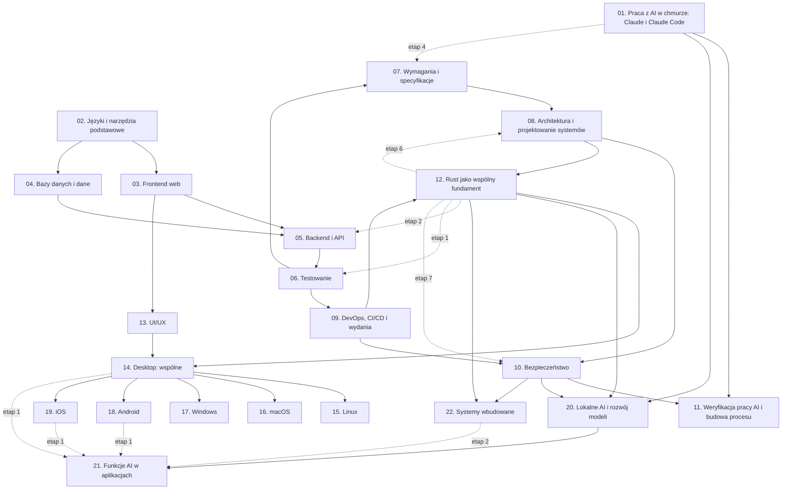

# Plan wdrożenia planu nauki w Linear: kolejność i zależności

Stan na 11 października 2026 r. · Team **LEA** (https://linear.app/daankh/team/LEA/overview) · Źródło: dokument „Umiejętności techniczne” (wersja z układem warstw) w projekcie „JDG: Rozwój oprogramowania”.

Ten plik opisuje kolejność projektów i zależności między nimi. Szczegóły każdego projektu (opis, kamienie milowe, zadania i ich blokady) są w 22 plikach `01-…md` do `22-…md`. Nic nie zostało jeszcze utworzone w Linear: to plan do przeglądu przed wdrożeniem.

## 1. Jak plan nauki przekłada się na Linear

| Element planu nauki | Element w Linear | Liczba |
|---|---|---|
| sekcja dokumentu | projekt w teamie LEA | 22 |
| etap ścieżki nauki (także ścieżek uzupełniających 12.2, 17.2 i 20.4) | kamień milowy projektu | 153 |
| punkt startu sekcji | zadanie „Start: …” z warunkami wejścia | 22 |
| materiał z tabeli etapu | zadanie typu „materiał” | 734 |
| dowód etapu (i dowód poziomu E) | zadanie typu „dowód”, zamyka kamień milowy | 153 |
| praktyka z etapu eksperckiego | zadanie typu „praktyka” (ciągłe) | 76 |
| kolejność nauki | relacje „blokuje / blokowane przez” między zadaniami | 1779 |
| | w tym relacje między projektami | 117 |

Razem **985 zadań**, z tego 137 materiałów płatnych i 10 zadań w etapach opcjonalnych.

**Zasady zależności:**

- Każdy projekt ma jedno zadanie startowe. Wszystkie zadania pierwszego etapu (i ścieżek uzupełniających) są przez nie blokowane.
- Zadanie startowe jest blokowane przez dowody tych etapów projektów wstępnych, po których dana umiejętność jest na poziomie wystarczającym do dalszej pracy (zwykle pierwszy etap z poziomem W). Nie trzeba kończyć całego projektu wstępnego, żeby zacząć następny: tak działa nauka spiralna z dokumentu.
- Wewnątrz etapu materiały są równoległe i wszystkie blokują dowód etapu. Dowód etapu blokuje materiały kolejnego etapu.
- Kilka etapów ma dodatkowe zależności od innych projektów (np. testy w Ruście czekają na Rusta). Są w tabeli w punkcie 5.
- Etapy opcjonalne (21: TinyML, 22: embedded Linux i Zephyr) nie blokują reszty ścieżki.

## 2. Wymagania przed wdrożeniem

- **Plan Linear:** plan Free ma limit 250 zgłoszeń, a ten plan ma 985 zadań. Potrzebny jest plan płatny albo wdrażanie partiami z archiwizacją zamkniętych zadań; zalecany jest plan płatny.
- **Etykiety zadań do utworzenia w teamie LEA:** grupa „Typ” z etykietami `start`, `materiał`, `dowód`, `praktyka`; etykiety `płatny`, `opcjonalne`, `ścieżka uzupełniająca`.
- **Etykiety projektów:** `warstwa-0` do `warstwa-8`.
- **Statusy:** domyślny przepływ teamu (Backlog, Todo, In Progress, Done, Canceled). Zadania startowe projektów 01 i 02 dostają status Todo, wszystkie pozostałe Backlog. Zadanie przechodzi do Todo, gdy zamknięte są wszystkie blokujące.
- **Materiały zaliczone samym dowodem:** przy doświadczeniu seniorskim część etapów zaliczasz od razu dowodem. Zadania materiałów takich etapów zamykasz jako Canceled z komentarzem, a dowód jako Done.

## 3. Punkt startu

Graf zależności ma dokładnie dwa zadania bez blokad i od nich zaczyna się cała nauka:

- **`S01-START`** · Start: 1. Praca z AI w chmurze: Claude i Claude Code (tor równoległy przez cały plan),
- **`S02-START`** · Start: 2. Języki i narzędzia podstawowe.

Wszystkie pozostałe 20 projektów odblokowują się kaskadowo przez dowody etapów. Graf nie ma cykli (sprawdzone automatycznie przy generowaniu planu).

## 4. Kolejność projektów

Kolejność według warstw z dokumentu: każdy projekt opiera się wyłącznie na wcześniejszych. Daty są propozycją zgodną z bramkami biznesplanu i można je zmienić przy wdrożeniu.

| Kolejność | Projekt | Warstwa | Blokowany przez | Blokuje | Odblokowanie startu (dowody) | Proponowany start | Proponowany termin | Zadania | Czas od zera |
|---|---|---|---|---|---|---|---|---|---|
| 1 | [01. Praca z AI w chmurze: Claude i Claude Code](01-praca-z-ai-w-chmurze.md) | 0: fundamenty | — | 11, 20, 21 | — | 2026-11-02 | 2027-03-31 | 45 | 100–135 h |
| 2 | [02. Języki i narzędzia podstawowe](02-jezyki-i-narzedzia-podstawowe.md) | 0: fundamenty | — | 03, 04, 09, 11, 12 | — | 2026-11-02 | 2026-12-18 | 25 | 85–120 h |
| 3 | [03. Frontend web](03-frontend-web.md) | 0: fundamenty | 02 | 05, 06, 07, 10, 13, 14 | `S02-E1-D` | 2026-11-02 | 2027-03-31 | 49 | 400–500 h |
| 4 | [04. Bazy danych i dane](04-bazy-danych-i-dane.md) | 1: dane i serwer | 02 | 05, 06, 08, 10 | `S02-E1-D` | 2026-11-02 | 2027-03-31 | 51 | 230–300 h |
| 5 | [05. Backend i API](05-backend-i-api.md) | 1: dane i serwer | 03, 04 | 06, 07, 08, 10, 12, 21 | `S03-E2-D`, `S04-E1-D` | 2026-11-02 | 2027-03-31 | 58 | 350–450 h |
| 6 | [06. Testowanie](06-testowanie.md) | 2: jakość i projektowanie | 03, 04, 05 | 07, 08, 09, 11, 12, 20, 21 | `S03-E2-D`, `S04-E1-D`, `S05-E1-D` | 2026-11-02 | 2027-03-31 | 44 | 270–350 h |
| 7 | [07. Wymagania i specyfikacje](07-wymagania-i-specyfikacje.md) | 2: jakość i projektowanie | 03, 05, 06 | 08, 11 | `S03-E2-D`, `S05-E1-D`, `S06-E2-D` | 2026-11-02 | 2027-03-31 | 43 | 145–200 h |
| 8 | [08. Architektura i projektowanie systemów](08-architektura-i-projektowanie-systemow.md) | 2: jakość i projektowanie | 04, 05, 06, 07 | 10, 11, 12, 14, 21 | `S04-E1-D`, `S05-E1-D`, `S06-E2-D`, `S07-E1-D` | 2026-11-16 | 2027-06-30 | 68 | 295–375 h |
| 9 | [09. DevOps, CI/CD i wydania](09-devops-ci-cd-i-wydania.md) | 2: jakość i projektowanie | 02, 06 | 10, 12, 15, 16, 17, 18, 19 | `S02-E1-D`, `S06-E2-D` | 2026-11-02 | 2027-03-31 | 39 | 190–250 h |
| 10 | [10. Bezpieczeństwo](10-bezpieczenstwo.md) | 3: ochrona i kontrola | 03, 04, 05, 08, 09 | 11, 20, 21, 22 | `S03-E2-D`, `S04-E1-D`, `S05-E1-D`, `S08-E1-D`, `S09-E2-D` | 2026-11-02 | 2027-03-31 | 50 | 330–440 h |
| 11 | [11. Weryfikacja pracy AI i budowa procesu](11-weryfikacja-pracy-ai-i-budowa-procesu.md) | 3: ochrona i kontrola | 01, 02, 06, 07, 08, 10 | — | `S01-E1-D`, `S02-E1-D`, `S06-E2-D`, `S07-E1-D`, `S08-E1-D`, `S10-E1-D` | 2026-11-16 | 2027-03-31 | 36 | 145–195 h |
| 12 | [12. Rust jako wspólny fundament](12-rust-jako-wspolny-fundament.md) | 4: rdzeń kompilowany i produkt | 02, 05, 06, 08, 09 | 14, 18, 19, 20, 22 | `S02-E1-D`, `S05-E1-D`, `S06-E2-D`, `S08-E1-D`, `S09-E2-D` | 2027-04-01 | 2027-12-17 | 66 | 300–400 h |
| 13 | [13. UI/UX](13-ui-ux.md) | 4: rdzeń kompilowany i produkt | 03 | 14, 18, 19 | `S03-E2-D` | 2027-04-01 | 2027-06-30 | 53 | 235–305 h |
| 14 | [14. Desktop: wspólne](14-desktop.md) | 5: desktop | 03, 08, 12, 13 | 15, 16, 17, 18, 19 | `S03-E2-D`, `S08-E1-D`, `S12-E2-D`, `S13-E2-D` | 2027-05-17 | 2027-09-30 | 37 | 140–185 h |
| 15 | [15. Linux](15-linux.md) | 5: desktop | 09, 14 | — | `S09-E2-D`, `S14-E1-D` | 2027-06-01 | 2027-12-17 | 28 | 80–105 h |
| 16 | [16. macOS](16-macos.md) | 5: desktop | 09, 14 | — | `S09-E2-D`, `S14-E1-D` | 2027-06-01 | 2027-12-17 | 32 | 60–75 h |
| 17 | [17. Windows](17-windows.md) | 5: desktop | 09, 14 | — | `S09-E2-D`, `S14-E1-D` | 2027-06-01 | 2027-12-17 | 37 | 60–75 h |
| 18 | [18. Android](18-android.md) | 6: mobile | 09, 12, 13, 14 | — | `S09-E2-D`, `S12-E2-D`, `S13-E2-D`, `S14-E1-D` | 2028-01-03 | 2028-12-15 | 49 | 270–350 h |
| 19 | [19. iOS](19-ios.md) | 6: mobile | 09, 12, 13, 14 | — | `S09-E2-D`, `S12-E2-D`, `S13-E2-D`, `S14-E1-D` | 2028-01-03 | 2028-12-15 | 49 | 250–330 h |
| 20 | [20. Lokalne AI i rozwój modeli](20-lokalne-ai-i-rozwoj-modeli.md) | 7: AI w produktach | 01, 06, 10, 12 | 21 | `S01-E1-D`, `S06-E2-D`, `S10-E1-D`, `S12-E2-D` | 2027-07-01 | 2028-12-15 | 40 | 215–295 h |
| 21 | [21. Funkcje AI w aplikacjach](21-funkcje-ai-w-aplikacjach.md) | 7: AI w produktach | 01, 05, 06, 08, 10, 20 | — | `S01-E1-D`, `S05-E1-D`, `S06-E2-D`, `S08-E1-D`, `S10-E1-D`, `S20-E1-D` | 2028-01-03 | 2028-12-15 | 31 | 135–190 h |
| 22 | [22. Systemy wbudowane](22-systemy-wbudowane.md) | 8: sprzęt | 10, 12 | — | `S10-E1-D`, `S12-E5-D`, `S12-U1-D` | 2029-01-08 | — | 55 | 330–420 h |

Projekty z tej samej warstwy można prowadzić równolegle. Sekcja 01 jest torem równoległym: jej etapy 0–2 warto zamknąć na początku, a kolejne równolegle z warstwami 2–3.

### Graf zależności projektów

Strzałka oznacza „blokuje”. Pokazane są tylko zależności bezpośrednie (bez przechodnich), pełna lista jest w tabeli powyżej. Linie przerywane to zależności częściowe: blokują jeden etap, a nie start projektu.

## 5. Relacje między projektami na poziomie zadań

Te relacje tworzysz w Linear jako „blocks” między zadaniami z różnych projektów. Relacje startowe odpowiadają zależnościom projektów, częściowe blokują pojedynczy etap.

| Zadanie blokujące | Zadanie blokowane | Rodzaj | Powód |
|---|---|---|---|
| `S02-E1-D` · Dowód etapu 1: Bash i `jq` | `S03-START` · Start: 3. Frontend web | start projektu | sekcja 2 na poziomie podstawowym do pracy (etap 1) |
| `S02-E1-D` · Dowód etapu 1: Bash i `jq` | `S04-START` · Start: 4. Bazy danych i dane | start projektu | sekcja 2 na poziomie podstawowym do pracy (etap 1) |
| `S12-E2-D` · Dowód etapu 2: własność, pożyczanie, czasy życia | `S05-E2-M1` · Przerobić: Tokio Tutorial | częściowa | backend w Ruście wymaga Rusta na poziomie W |
| `S12-E2-D` · Dowód etapu 2: własność, pożyczanie, czasy życia | `S05-E2-M2` · Przerobić: „Inventing the Service trait” | częściowa | backend w Ruście wymaga Rusta na poziomie W |
| `S12-E2-D` · Dowód etapu 2: własność, pożyczanie, czasy życia | `S05-E2-M3` · Przerobić: Dokumentacja Axum i katalog przykładów w repozytorium | częściowa | backend w Ruście wymaga Rusta na poziomie W |
| `S12-E2-D` · Dowód etapu 2: własność, pożyczanie, czasy życia | `S05-E2-M4` · Przerobić: Dokumentacja Tower i `tower-http` | częściowa | backend w Ruście wymaga Rusta na poziomie W |
| `S12-E2-D` · Dowód etapu 2: własność, pożyczanie, czasy życia | `S05-E2-M5` · Przerobić: Zero To Production in Rust | częściowa | backend w Ruście wymaga Rusta na poziomie W |
| `S03-E2-D` · Dowód etapu 2: TypeScript | `S05-START` · Start: 5. Backend i API | start projektu | sekcja 3 na poziomie podstawowym do pracy (etap 2) |
| `S04-E1-D` · Dowód etapu 1: PostgreSQL w praktyce | `S05-START` · Start: 5. Backend i API | start projektu | sekcja 4 na poziomie podstawowym do pracy (etap 1) |
| `S12-E2-D` · Dowód etapu 2: własność, pożyczanie, czasy życia | `S06-E1-M1` · Przerobić: The Rust Programming Language, rozdział 11 „Writing Automated Tests” | częściowa | testy w Ruście wymagają Rusta na poziomie W |
| `S12-E2-D` · Dowód etapu 2: własność, pożyczanie, czasy życia | `S06-E1-M2` · Przerobić: Test Driven Development: By Example | częściowa | testy w Ruście wymagają Rusta na poziomie W |
| `S12-E2-D` · Dowód etapu 2: własność, pożyczanie, czasy życia | `S06-E1-M3` · Przerobić: „Canon TDD” | częściowa | testy w Ruście wymagają Rusta na poziomie W |
| `S12-E2-D` · Dowód etapu 2: własność, pożyczanie, czasy życia | `S06-E1-M4` · Przerobić: cargo-nextest | częściowa | testy w Ruście wymagają Rusta na poziomie W |
| `S12-E2-D` · Dowód etapu 2: własność, pożyczanie, czasy życia | `S06-E1-M5` · Przerobić: cargo-llvm-cov | częściowa | testy w Ruście wymagają Rusta na poziomie W |
| `S03-E2-D` · Dowód etapu 2: TypeScript | `S06-START` · Start: 6. Testowanie | start projektu | sekcja 3 na poziomie podstawowym do pracy (etap 2) |
| `S04-E1-D` · Dowód etapu 1: PostgreSQL w praktyce | `S06-START` · Start: 6. Testowanie | start projektu | sekcja 4 na poziomie podstawowym do pracy (etap 1) |
| `S05-E1-D` · Dowód etapu 1: Node.js po stronie serwera | `S06-START` · Start: 6. Testowanie | start projektu | sekcja 5 na poziomie podstawowym do pracy (etap 1) |
| `S01-E1-D` · Dowód etapu 1: codzienna praca z Claude Code | `S07-E4-M1` · Przerobić: GitHub Spec Kit: „Specification-Driven Development”, Quickstart, „Existing Projects” | częściowa | specyfikacje dla agentów wymagają codziennej pracy z Claude Code |
| `S01-E1-D` · Dowód etapu 1: codzienna praca z Claude Code | `S07-E4-M2` · Przerobić: Kiro: specyfikacje funkcji i błędów | częściowa | specyfikacje dla agentów wymagają codziennej pracy z Claude Code |
| `S01-E1-D` · Dowód etapu 1: codzienna praca z Claude Code | `S07-E4-M3` · Przerobić: OpenSpec: koncepcje (delta specs) | częściowa | specyfikacje dla agentów wymagają codziennej pracy z Claude Code |
| `S01-E1-D` · Dowód etapu 1: codzienna praca z Claude Code | `S07-E4-M4` · Przerobić: „Understanding Spec-Driven-Development: Kiro, spec-kit, and Tessl” | częściowa | specyfikacje dla agentów wymagają codziennej pracy z Claude Code |
| `S01-E1-D` · Dowód etapu 1: codzienna praca z Claude Code | `S07-E4-M5` · Przerobić: Spec-driven development w Technology Radar | częściowa | specyfikacje dla agentów wymagają codziennej pracy z Claude Code |
| `S01-E1-D` · Dowód etapu 1: codzienna praca z Claude Code | `S07-E4-M6` · Przerobić: Dokumentacja Claude Code: „Let Claude interview you” (Best practices) | częściowa | specyfikacje dla agentów wymagają codziennej pracy z Claude Code |
| `S03-E2-D` · Dowód etapu 2: TypeScript | `S07-START` · Start: 7. Wymagania i specyfikacje | start projektu | sekcja 3 na poziomie podstawowym do pracy (etap 2) |
| `S05-E1-D` · Dowód etapu 1: Node.js po stronie serwera | `S07-START` · Start: 7. Wymagania i specyfikacje | start projektu | sekcja 5 na poziomie podstawowym do pracy (etap 1) |
| `S06-E2-D` · Dowód etapu 2: projektowanie testów | `S07-START` · Start: 7. Wymagania i specyfikacje | start projektu | sekcja 6 na poziomie podstawowym do pracy (etap 2) |
| `S12-E2-D` · Dowód etapu 2: własność, pożyczanie, czasy życia | `S08-E6-M1` · Przerobić: Building Multi-Tenant SaaS Architectures (2024) | częściowa | architektura wspólnego rdzenia wymaga Rusta na poziomie W |
| `S12-E2-D` · Dowód etapu 2: własność, pożyczanie, czasy życia | `S08-E6-M2` · Przerobić: Architect multitenant solutions on Azure: rozważania architektoniczne i modele wielodostępności | częściowa | architektura wspólnego rdzenia wymaga Rusta na poziomie W |
| `S12-E2-D` · Dowód etapu 2: własność, pożyczanie, czasy życia | `S08-E6-M3` · Przerobić: SaaS Lens (AWS Well-Architected) | częściowa | architektura wspólnego rdzenia wymaga Rusta na poziomie W |
| `S12-E2-D` · Dowód etapu 2: własność, pożyczanie, czasy życia | `S08-E6-M4` · Przerobić: Crux: rdzeń w Ruście i powłoki w Swift, Kotlin i TypeScript | częściowa | architektura wspólnego rdzenia wymaga Rusta na poziomie W |
| `S12-E2-D` · Dowód etapu 2: własność, pożyczanie, czasy życia | `S08-E6-M5` · Przerobić: „Large Rust Workspaces” (2021) | częściowa | architektura wspólnego rdzenia wymaga Rusta na poziomie W |
| `S04-E1-D` · Dowód etapu 1: PostgreSQL w praktyce | `S08-START` · Start: 8. Architektura i projektowanie systemów | start projektu | sekcja 4 na poziomie podstawowym do pracy (etap 1) |
| `S05-E1-D` · Dowód etapu 1: Node.js po stronie serwera | `S08-START` · Start: 8. Architektura i projektowanie systemów | start projektu | sekcja 5 na poziomie podstawowym do pracy (etap 1) |
| `S06-E2-D` · Dowód etapu 2: projektowanie testów | `S08-START` · Start: 8. Architektura i projektowanie systemów | start projektu | sekcja 6 na poziomie podstawowym do pracy (etap 2) |
| `S07-E1-D` · Dowód etapu 1: wydobywanie wymagań od klienta | `S08-START` · Start: 8. Architektura i projektowanie systemów | start projektu | sekcja 7 na poziomie podstawowym do pracy (etap 1) |
| `S02-E1-D` · Dowód etapu 1: Bash i `jq` | `S09-START` · Start: 9. DevOps, CI/CD i wydania | start projektu | sekcja 2 na poziomie podstawowym do pracy (etap 1) |
| `S06-E2-D` · Dowód etapu 2: projektowanie testów | `S09-START` · Start: 9. DevOps, CI/CD i wydania | start projektu | sekcja 6 na poziomie podstawowym do pracy (etap 2) |
| `S12-E2-D` · Dowód etapu 2: własność, pożyczanie, czasy życia | `S10-E7-M1` · Przerobić: OWASP MASVS, MASWE i MASTG | częściowa | bezpieczeństwo Rusta i platform wymaga Rusta na poziomie W |
| `S12-E2-D` · Dowód etapu 2: własność, pożyczanie, czasy życia | `S10-E7-M2` · Przerobić: Secure Rust Guidelines | częściowa | bezpieczeństwo Rusta i platform wymaga Rusta na poziomie W |
| `S12-E2-D` · Dowód etapu 2: własność, pożyczanie, czasy życia | `S10-E7-M3` · Przerobić: Rust Secure Code Working Group: lista projektów | częściowa | bezpieczeństwo Rusta i platform wymaga Rusta na poziomie W |
| `S12-E2-D` · Dowód etapu 2: własność, pożyczanie, czasy życia | `S10-E7-M4` · Przerobić: Tauri: Security (granice zaufania, IPC, capabilities) | częściowa | bezpieczeństwo Rusta i platform wymaga Rusta na poziomie W |
| `S03-E2-D` · Dowód etapu 2: TypeScript | `S10-START` · Start: 10. Bezpieczeństwo | start projektu | sekcja 3 na poziomie podstawowym do pracy (etap 2) |
| `S04-E1-D` · Dowód etapu 1: PostgreSQL w praktyce | `S10-START` · Start: 10. Bezpieczeństwo | start projektu | sekcja 4 na poziomie podstawowym do pracy (etap 1) |
| `S05-E1-D` · Dowód etapu 1: Node.js po stronie serwera | `S10-START` · Start: 10. Bezpieczeństwo | start projektu | sekcja 5 na poziomie podstawowym do pracy (etap 1) |
| `S08-E1-D` · Dowód etapu 1: style architektoniczne, atrybuty jakości i kompromisy | `S10-START` · Start: 10. Bezpieczeństwo | start projektu | sekcja 8 na poziomie podstawowym do pracy (etap 1) |
| `S09-E2-D` · Dowód etapu 2: GitHub Actions i bezpieczeństwo pipeline’u | `S10-START` · Start: 10. Bezpieczeństwo | start projektu | sekcja 9 na poziomie podstawowym do pracy (etap 2) |
| `S01-E1-D` · Dowód etapu 1: codzienna praca z Claude Code | `S11-START` · Start: 11. Weryfikacja pracy AI i budowa procesu | start projektu | sekcja 1 na poziomie podstawowym do pracy (etap 1) |
| `S02-E1-D` · Dowód etapu 1: Bash i `jq` | `S11-START` · Start: 11. Weryfikacja pracy AI i budowa procesu | start projektu | sekcja 2 na poziomie podstawowym do pracy (etap 1) |
| `S06-E2-D` · Dowód etapu 2: projektowanie testów | `S11-START` · Start: 11. Weryfikacja pracy AI i budowa procesu | start projektu | sekcja 6 na poziomie podstawowym do pracy (etap 2) |
| `S07-E1-D` · Dowód etapu 1: wydobywanie wymagań od klienta | `S11-START` · Start: 11. Weryfikacja pracy AI i budowa procesu | start projektu | sekcja 7 na poziomie podstawowym do pracy (etap 1) |
| `S08-E1-D` · Dowód etapu 1: style architektoniczne, atrybuty jakości i kompromisy | `S11-START` · Start: 11. Weryfikacja pracy AI i budowa procesu | start projektu | sekcja 8 na poziomie podstawowym do pracy (etap 1) |
| `S10-E1-D` · Dowód etapu 1: ataki na web i API w praktyce | `S11-START` · Start: 11. Weryfikacja pracy AI i budowa procesu | start projektu | sekcja 10 na poziomie podstawowym do pracy (etap 1) |
| `S02-E1-D` · Dowód etapu 1: Bash i `jq` | `S12-START` · Start: 12. Rust jako wspólny fundament | start projektu | sekcja 2 na poziomie podstawowym do pracy (etap 1) |
| `S05-E1-D` · Dowód etapu 1: Node.js po stronie serwera | `S12-START` · Start: 12. Rust jako wspólny fundament | start projektu | sekcja 5 na poziomie podstawowym do pracy (etap 1) |
| `S06-E2-D` · Dowód etapu 2: projektowanie testów | `S12-START` · Start: 12. Rust jako wspólny fundament | start projektu | sekcja 6 na poziomie podstawowym do pracy (etap 2) |
| `S08-E1-D` · Dowód etapu 1: style architektoniczne, atrybuty jakości i kompromisy | `S12-START` · Start: 12. Rust jako wspólny fundament | start projektu | sekcja 8 na poziomie podstawowym do pracy (etap 1) |
| `S09-E2-D` · Dowód etapu 2: GitHub Actions i bezpieczeństwo pipeline’u | `S12-START` · Start: 12. Rust jako wspólny fundament | start projektu | sekcja 9 na poziomie podstawowym do pracy (etap 2) |
| `S03-E2-D` · Dowód etapu 2: TypeScript | `S13-START` · Start: 13. UI/UX | start projektu | sekcja 3 na poziomie podstawowym do pracy (etap 2) |
| `S03-E2-D` · Dowód etapu 2: TypeScript | `S14-START` · Start: 14. Desktop: wspólne | start projektu | sekcja 3 na poziomie podstawowym do pracy (etap 2) |
| `S08-E1-D` · Dowód etapu 1: style architektoniczne, atrybuty jakości i kompromisy | `S14-START` · Start: 14. Desktop: wspólne | start projektu | sekcja 8 na poziomie podstawowym do pracy (etap 1) |
| `S12-E2-D` · Dowód etapu 2: własność, pożyczanie, czasy życia | `S14-START` · Start: 14. Desktop: wspólne | start projektu | sekcja 12 na poziomie podstawowym do pracy (etap 2) |
| `S13-E2-D` · Dowód etapu 2: badania i testy użyteczności | `S14-START` · Start: 14. Desktop: wspólne | start projektu | sekcja 13 na poziomie podstawowym do pracy (etap 2) |
| `S09-E2-D` · Dowód etapu 2: GitHub Actions i bezpieczeństwo pipeline’u | `S15-START` · Start: 15. Linux | start projektu | sekcja 9 na poziomie podstawowym do pracy (etap 2) |
| `S14-E1-D` · Dowód etapu 1: Tauri 2 | `S15-START` · Start: 15. Linux | start projektu | sekcja 14 na poziomie podstawowym do pracy (etap 1) |
| `S09-E2-D` · Dowód etapu 2: GitHub Actions i bezpieczeństwo pipeline’u | `S16-START` · Start: 16. macOS | start projektu | sekcja 9 na poziomie podstawowym do pracy (etap 2) |
| `S14-E1-D` · Dowód etapu 1: Tauri 2 | `S16-START` · Start: 16. macOS | start projektu | sekcja 14 na poziomie podstawowym do pracy (etap 1) |
| `S09-E2-D` · Dowód etapu 2: GitHub Actions i bezpieczeństwo pipeline’u | `S17-START` · Start: 17. Windows | start projektu | sekcja 9 na poziomie podstawowym do pracy (etap 2) |
| `S14-E1-D` · Dowód etapu 1: Tauri 2 | `S17-START` · Start: 17. Windows | start projektu | sekcja 14 na poziomie podstawowym do pracy (etap 1) |
| `S09-E2-D` · Dowód etapu 2: GitHub Actions i bezpieczeństwo pipeline’u | `S18-START` · Start: 18. Android | start projektu | sekcja 9 na poziomie podstawowym do pracy (etap 2) |
| `S12-E2-D` · Dowód etapu 2: własność, pożyczanie, czasy życia | `S18-START` · Start: 18. Android | start projektu | sekcja 12 na poziomie podstawowym do pracy (etap 2) |
| `S13-E2-D` · Dowód etapu 2: badania i testy użyteczności | `S18-START` · Start: 18. Android | start projektu | sekcja 13 na poziomie podstawowym do pracy (etap 2) |
| `S14-E1-D` · Dowód etapu 1: Tauri 2 | `S18-START` · Start: 18. Android | start projektu | sekcja 14 na poziomie podstawowym do pracy (etap 1) |
| `S09-E2-D` · Dowód etapu 2: GitHub Actions i bezpieczeństwo pipeline’u | `S19-START` · Start: 19. iOS | start projektu | sekcja 9 na poziomie podstawowym do pracy (etap 2) |
| `S12-E2-D` · Dowód etapu 2: własność, pożyczanie, czasy życia | `S19-START` · Start: 19. iOS | start projektu | sekcja 12 na poziomie podstawowym do pracy (etap 2) |
| `S13-E2-D` · Dowód etapu 2: badania i testy użyteczności | `S19-START` · Start: 19. iOS | start projektu | sekcja 13 na poziomie podstawowym do pracy (etap 2) |
| `S14-E1-D` · Dowód etapu 1: Tauri 2 | `S19-START` · Start: 19. iOS | start projektu | sekcja 14 na poziomie podstawowym do pracy (etap 1) |
| `S01-E1-D` · Dowód etapu 1: codzienna praca z Claude Code | `S20-START` · Start: 20. Lokalne AI i rozwój modeli | start projektu | sekcja 1 na poziomie podstawowym do pracy (etap 1) |
| `S06-E2-D` · Dowód etapu 2: projektowanie testów | `S20-START` · Start: 20. Lokalne AI i rozwój modeli | start projektu | sekcja 6 na poziomie podstawowym do pracy (etap 2) |
| `S10-E1-D` · Dowód etapu 1: ataki na web i API w praktyce | `S20-START` · Start: 20. Lokalne AI i rozwój modeli | start projektu | sekcja 10 na poziomie podstawowym do pracy (etap 1) |
| `S12-E2-D` · Dowód etapu 2: własność, pożyczanie, czasy życia | `S20-START` · Start: 20. Lokalne AI i rozwój modeli | start projektu | sekcja 12 na poziomie podstawowym do pracy (etap 2) |
| `S14-E1-D` · Dowód etapu 1: Tauri 2 | `S21-E1-M1` · Przerobić: Transformers.js (WebGPU i WASM) | częściowa | AI na urządzeniu wymaga znajomości platform |
| `S18-E2-D` · Dowód etapu 2: Compose w głębi i architektura | `S21-E1-M1` · Przerobić: Transformers.js (WebGPU i WASM) | częściowa | AI na urządzeniu wymaga znajomości platform |
| `S19-E2-D` · Dowód etapu 2: współbieżność Swift 6 i architektura | `S21-E1-M1` · Przerobić: Transformers.js (WebGPU i WASM) | częściowa | AI na urządzeniu wymaga znajomości platform |
| `S14-E1-D` · Dowód etapu 1: Tauri 2 | `S21-E1-M2` · Przerobić: WebLLM | częściowa | AI na urządzeniu wymaga znajomości platform |
| `S18-E2-D` · Dowód etapu 2: Compose w głębi i architektura | `S21-E1-M2` · Przerobić: WebLLM | częściowa | AI na urządzeniu wymaga znajomości platform |
| `S19-E2-D` · Dowód etapu 2: współbieżność Swift 6 i architektura | `S21-E1-M2` · Przerobić: WebLLM | częściowa | AI na urządzeniu wymaga znajomości platform |
| `S14-E1-D` · Dowód etapu 1: Tauri 2 | `S21-E1-M3` · Przerobić: ONNX Runtime: Web, Mobile, dostawcy wykonania | częściowa | AI na urządzeniu wymaga znajomości platform |
| `S18-E2-D` · Dowód etapu 2: Compose w głębi i architektura | `S21-E1-M3` · Przerobić: ONNX Runtime: Web, Mobile, dostawcy wykonania | częściowa | AI na urządzeniu wymaga znajomości platform |
| `S19-E2-D` · Dowód etapu 2: współbieżność Swift 6 i architektura | `S21-E1-M3` · Przerobić: ONNX Runtime: Web, Mobile, dostawcy wykonania | częściowa | AI na urządzeniu wymaga znajomości platform |
| `S14-E1-D` · Dowód etapu 1: Tauri 2 | `S21-E1-M4` · Przerobić: Foundation Models framework | częściowa | AI na urządzeniu wymaga znajomości platform |
| `S18-E2-D` · Dowód etapu 2: Compose w głębi i architektura | `S21-E1-M4` · Przerobić: Foundation Models framework | częściowa | AI na urządzeniu wymaga znajomości platform |
| `S19-E2-D` · Dowód etapu 2: współbieżność Swift 6 i architektura | `S21-E1-M4` · Przerobić: Foundation Models framework | częściowa | AI na urządzeniu wymaga znajomości platform |
| `S14-E1-D` · Dowód etapu 1: Tauri 2 | `S21-E1-M5` · Przerobić: Core ML | częściowa | AI na urządzeniu wymaga znajomości platform |
| `S18-E2-D` · Dowód etapu 2: Compose w głębi i architektura | `S21-E1-M5` · Przerobić: Core ML | częściowa | AI na urządzeniu wymaga znajomości platform |
| `S19-E2-D` · Dowód etapu 2: współbieżność Swift 6 i architektura | `S21-E1-M5` · Przerobić: Core ML | częściowa | AI na urządzeniu wymaga znajomości platform |
| `S14-E1-D` · Dowód etapu 1: Tauri 2 | `S21-E1-M6` · Przerobić: ML Kit GenAI APIs (Gemini Nano przez AICore, w tym Prompt API) | częściowa | AI na urządzeniu wymaga znajomości platform |
| `S18-E2-D` · Dowód etapu 2: Compose w głębi i architektura | `S21-E1-M6` · Przerobić: ML Kit GenAI APIs (Gemini Nano przez AICore, w tym Prompt API) | częściowa | AI na urządzeniu wymaga znajomości platform |
| `S19-E2-D` · Dowód etapu 2: współbieżność Swift 6 i architektura | `S21-E1-M6` · Przerobić: ML Kit GenAI APIs (Gemini Nano przez AICore, w tym Prompt API) | częściowa | AI na urządzeniu wymaga znajomości platform |
| `S14-E1-D` · Dowód etapu 1: Tauri 2 | `S21-E1-M7` · Przerobić: LiteRT (dawniej TensorFlow Lite) i LiteRT-LM | częściowa | AI na urządzeniu wymaga znajomości platform |
| `S18-E2-D` · Dowód etapu 2: Compose w głębi i architektura | `S21-E1-M7` · Przerobić: LiteRT (dawniej TensorFlow Lite) i LiteRT-LM | częściowa | AI na urządzeniu wymaga znajomości platform |
| `S19-E2-D` · Dowód etapu 2: współbieżność Swift 6 i architektura | `S21-E1-M7` · Przerobić: LiteRT (dawniej TensorFlow Lite) i LiteRT-LM | częściowa | AI na urządzeniu wymaga znajomości platform |
| `S14-E1-D` · Dowód etapu 1: Tauri 2 | `S21-E1-M8` · Przerobić: Windows ML (oparty na ONNX Runtime, akceleracja NPU) | częściowa | AI na urządzeniu wymaga znajomości platform |
| `S18-E2-D` · Dowód etapu 2: Compose w głębi i architektura | `S21-E1-M8` · Przerobić: Windows ML (oparty na ONNX Runtime, akceleracja NPU) | częściowa | AI na urządzeniu wymaga znajomości platform |
| `S19-E2-D` · Dowód etapu 2: współbieżność Swift 6 i architektura | `S21-E1-M8` · Przerobić: Windows ML (oparty na ONNX Runtime, akceleracja NPU) | częściowa | AI na urządzeniu wymaga znajomości platform |
| `S22-E2-D` · Dowód etapu 2: fundamenty | `S21-E2-M1` · Przerobić: Tiny Machine Learning (Fundamentals, Applications, Deploying TinyML) | częściowa | TinyML wymaga podstaw embedded |
| `S22-E2-D` · Dowód etapu 2: fundamenty | `S21-E2-M2` · Przerobić: Machine Learning Systems (podręcznik, otwarty dostęp) | częściowa | TinyML wymaga podstaw embedded |
| `S22-E2-D` · Dowód etapu 2: fundamenty | `S21-E2-M3` · Przerobić: LiteRT for Microcontrollers | częściowa | TinyML wymaga podstaw embedded |
| `S22-E2-D` · Dowód etapu 2: fundamenty | `S21-E2-M4` · Przerobić: Edge Impulse | częściowa | TinyML wymaga podstaw embedded |
| `S01-E1-D` · Dowód etapu 1: codzienna praca z Claude Code | `S21-START` · Start: 21. Funkcje AI w aplikacjach | start projektu | sekcja 1 na poziomie podstawowym do pracy (etap 1) |
| `S05-E1-D` · Dowód etapu 1: Node.js po stronie serwera | `S21-START` · Start: 21. Funkcje AI w aplikacjach | start projektu | sekcja 5 na poziomie podstawowym do pracy (etap 1) |
| `S06-E2-D` · Dowód etapu 2: projektowanie testów | `S21-START` · Start: 21. Funkcje AI w aplikacjach | start projektu | sekcja 6 na poziomie podstawowym do pracy (etap 2) |
| `S08-E1-D` · Dowód etapu 1: style architektoniczne, atrybuty jakości i kompromisy | `S21-START` · Start: 21. Funkcje AI w aplikacjach | start projektu | sekcja 8 na poziomie podstawowym do pracy (etap 1) |
| `S10-E1-D` · Dowód etapu 1: ataki na web i API w praktyce | `S21-START` · Start: 21. Funkcje AI w aplikacjach | start projektu | sekcja 10 na poziomie podstawowym do pracy (etap 1) |
| `S20-E1-D` · Dowód etapu 1: modele lokalne na stanowisku pracy | `S21-START` · Start: 21. Funkcje AI w aplikacjach | start projektu | sekcja 20 na poziomie podstawowym do pracy (etap 1) |
| `S10-E1-D` · Dowód etapu 1: ataki na web i API w praktyce | `S22-START` · Start: 22. Systemy wbudowane | start projektu | sekcja 10 na poziomie podstawowym do pracy (etap 1) |
| `S12-E5-D` · Dowód etapu 5: aplikacja produkcyjna | `S22-START` · Start: 22. Systemy wbudowane | start projektu | Rust na poziomie E (etap 5) |
| `S12-U1-D` · Dowód (12.2): C ogólnie i FFI z Rustem | `S22-START` · Start: 22. Systemy wbudowane | start projektu | C i FFI (12.2, etap 1) |

Relacje częściowe w obie strony między projektami 05, 06, 08, 10 i 12 nie tworzą cyklu, bo dotyczą różnych etapów: na przykład 12. Rust startuje po etapie 2 testowania (projektowanie testów, bez Rusta), a etap 1 testowania (testy w Ruście) czeka na etap 2 Rusta. W relacjach projektów w Linear ustaw więc tylko zależności z kolumny „Blokowany przez”, a częściowe zostaw na poziomie zadań.

## 6. Konwencje

- **Nazwy projektów:** `NN. Tytuł sekcji` (np. `06. Testowanie`), żeby lista projektów była posortowana w kolejności nauki.
- **Kamienie milowe:** `Etap k: nazwa`; dla ścieżek uzupełniających `Uzupełniająca 12.2 · nazwa`. Kamień milowy jest zamknięty, gdy zamknięte jest zadanie dowodu.
- **Klucze robocze zadań:** `S06-E2-M3` oznacza sekcję 6, etap 2 ścieżki głównej, materiał 3. `U` zamiast `E` oznacza ścieżkę uzupełniającą, `D` dowód, `P` praktykę, `START` zadanie startowe. Po wdrożeniu zadania dostaną identyfikatory `LEA-…`; mapowanie kluczy na identyfikatory warto zachować w pliku.
- **Tytuły zadań:** „Przerobić: …” (materiał), „Dowód etapu k: …”, „Dowód poziomu E: …”, „Praktyka: …”, „Start: …”.
- **Opisy:** materiał ma autora, typ, czas, koszt i link; dowód ma treść dowodu, „Na co zwrócić uwagę” i kryterium ukończenia; kamień milowy ma cel, czas, poziom i treść dowodu. Gotowe teksty są w plikach sekcji.

## 7. Kolejność wdrożenia w Linear

1. Utworzyć etykiety zadań i projektów (punkt 2).
2. Utworzyć 22 projekty w kolejności z punktu 4, z nazwą, podsumowaniem, opisem, datami i etykietą warstwy.
3. Dodać relacje między projektami (kolumna „Blokowany przez”).
4. W każdym projekcie utworzyć kamienie milowe w kolejności etapów (razem 153).
5. Utworzyć zadania projektami, w kolejności kluczy: najpierw start, potem etapami (razem 985).
6. Dodać relacje „blocks” najpierw wewnątrz projektów, potem między projektami z punktu 5 (razem 1779).
7. Ustawić statusy: `S01-START` i `S02-START` na Todo, reszta Backlog.
8. Sprawdzić: liczbę zadań w każdym projekcie z kolumny „Zadania”, to, że tylko dwa zadania nie mają blokad, oraz kilka losowych relacji z plików sekcji.

## 8. Pliki sekcji

| Plik | Projekt | Kamienie milowe | Zadania |
|---|---|---|---|
| [01-praca-z-ai-w-chmurze.md](01-praca-z-ai-w-chmurze.md) | 01. Praca z AI w chmurze: Claude i Claude Code | 7 | 45 |
| [02-jezyki-i-narzedzia-podstawowe.md](02-jezyki-i-narzedzia-podstawowe.md) | 02. Języki i narzędzia podstawowe | 4 | 25 |
| [03-frontend-web.md](03-frontend-web.md) | 03. Frontend web | 8 | 49 |
| [04-bazy-danych-i-dane.md](04-bazy-danych-i-dane.md) | 04. Bazy danych i dane | 8 | 51 |
| [05-backend-i-api.md](05-backend-i-api.md) | 05. Backend i API | 9 | 58 |
| [06-testowanie.md](06-testowanie.md) | 06. Testowanie | 8 | 44 |
| [07-wymagania-i-specyfikacje.md](07-wymagania-i-specyfikacje.md) | 07. Wymagania i specyfikacje | 7 | 43 |
| [08-architektura-i-projektowanie-systemow.md](08-architektura-i-projektowanie-systemow.md) | 08. Architektura i projektowanie systemów | 8 | 68 |
| [09-devops-ci-cd-i-wydania.md](09-devops-ci-cd-i-wydania.md) | 09. DevOps, CI/CD i wydania | 7 | 39 |
| [10-bezpieczenstwo.md](10-bezpieczenstwo.md) | 10. Bezpieczeństwo | 9 | 50 |
| [11-weryfikacja-pracy-ai-i-budowa-procesu.md](11-weryfikacja-pracy-ai-i-budowa-procesu.md) | 11. Weryfikacja pracy AI i budowa procesu | 6 | 36 |
| [12-rust-jako-wspolny-fundament.md](12-rust-jako-wspolny-fundament.md) | 12. Rust jako wspólny fundament | 9 | 66 |
| [13-ui-ux.md](13-ui-ux.md) | 13. UI/UX | 9 | 53 |
| [14-desktop.md](14-desktop.md) | 14. Desktop: wspólne | 6 | 37 |
| [15-linux.md](15-linux.md) | 15. Linux | 4 | 28 |
| [16-macos.md](16-macos.md) | 16. macOS | 4 | 32 |
| [17-windows.md](17-windows.md) | 17. Windows | 5 | 37 |
| [18-android.md](18-android.md) | 18. Android | 7 | 49 |
| [19-ios.md](19-ios.md) | 19. iOS | 7 | 49 |
| [20-lokalne-ai-i-rozwoj-modeli.md](20-lokalne-ai-i-rozwoj-modeli.md) | 20. Lokalne AI i rozwój modeli | 7 | 40 |
| [21-funkcje-ai-w-aplikacjach.md](21-funkcje-ai-w-aplikacjach.md) | 21. Funkcje AI w aplikacjach | 5 | 31 |
| [22-systemy-wbudowane.md](22-systemy-wbudowane.md) | 22. Systemy wbudowane | 9 | 55 |
