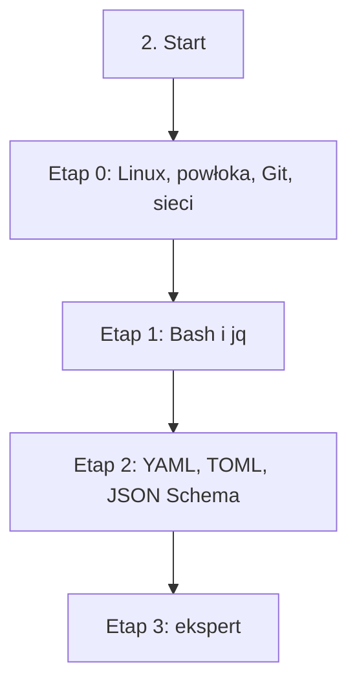

# 02. Języki i narzędzia podstawowe: plan wdrożenia w Linear

Team **LEA** (https://linear.app/daankh/team/LEA/overview). Plan do przeglądu przed wdrożeniem: nic nie zostało jeszcze utworzone w Linear. Klucze zadań (np. `S02-E0-M1`) są robocze; po wdrożeniu dostaną identyfikatory `LEA-…`.

**W skrócie:** 4 kamienie milowe, 25 zadań (1 start, 17 materiałów, 4 dowody, 3 praktyki). Plik główny z kolejnością projektów: `00-kolejnosc-i-zaleznosci.md`.

## 1. Projekt

| Pole | Wartość |
|---|---|
| Nazwa | 02. Języki i narzędzia podstawowe |
| Team | LEA |
| Podsumowanie (pole „Summary”) | Warstwa 0: fundamenty. Opiera się na: —. Jest podstawą: wszystkich pozostałych sekcji, zwłaszcza 6, 9 i 11. |
| Proponowany start | 2026-11-02 |
| Proponowany termin | 2026-12-18 |
| Etykiety projektu | `warstwa-0` |
| Blokowany przez (projekty) | — |
| Blokuje (projekty) | 03. Frontend web, 04. Bazy danych i dane, 09. DevOps, CI/CD i wydania, 11. Weryfikacja pracy AI i budowa procesu, 12. Rust jako wspólny fundament |
| Czas od zera | 85–120 h |

### Opis projektu (do wklejenia w Linear)

*Warstwa 0: fundamenty. Opiera się na: —. Jest podstawą: wszystkich pozostałych sekcji, zwłaszcza 6, 9 i 11.*

**Zakres umiejętności**

- Linux z linii poleceń: procesy, uprawnienia, systemd, logi, SSH, podstawy administracji serwerem.
- Git na poziomie historii: rebase, bisect, worktree, podpisane commity, analiza zmian w cudzym repozytorium.
- Bash i `jq`: skrypty odporne na błędy, przetwarzanie JSON w hookach i CI.
- Formaty konfiguracji: YAML, TOML, JSON Schema jako kontrakty sprawdzane w CI.
- Sieci w praktyce: HTTP, DNS, TLS i certyfikaty, poczta transakcyjna (SPF, DKIM, DMARC).
- Typowe błędy kodu z AI do wyłapania: niecytowane zmienne i połykane kody błędów w skryptach, wymyślone flagi narzędzi, niejawne typy w YAML, nadmierne uprawnienia w workflow.

**Ścieżka nauki**

Ścieżka ma 4 etapy. Każdy kończy się **dowodem**, czyli małym projektem, który pokazuje, że etap jest opanowany. Przy doświadczeniu seniorskim etapy 0 i 2 można zwykle zaliczyć samym dowodem; etap 1 warto przejść w całości, bo hooki vicrafter i skrypty CI to kod, którego błędy psują cały proces. Czas podany dla osoby startującej od zera; ceny materiałów płatnych zmieniają się, więc warto je sprawdzić przed zakupem.

Razem od zera do poziomu E: ok. 85–120 h, czyli 2–3 miesiące przy 10–12 h tygodniowo.

**Definicja ukończenia projektu (dowód poziomu E)**

Samodzielnie, bez agenta, w 1 dzień diagnozujesz i naprawiasz awarię skryptu CI lub hooka w Bashu w nieznanym projekcie i umiesz wyjaśnić przyczynę osobie nietechnicznej.

**Źródło:** dokument „Umiejętności techniczne” w projekcie „JDG: Rozwój oprogramowania”, sekcja 2.

## 2. Kamienie milowe

Jeden kamień milowy na etap ścieżki. Kamień milowy jest zamknięty, gdy zamknięte jest zadanie dowodu tego etapu. Daty kamieni milowych ustawiasz przy wdrożeniu według kolejności z pliku głównego.

| # | Kamień milowy | Cel | Czas od zera | Poziom po etapie | Zadania |
|---|---|---|---|---|---|
| 1 | Etap 0: Linux, powłoka, Git, sieci | Linux, powłoka, Git, sieci | 50–70 h | podstawy | 5 |
| 2 | Etap 1: Bash i `jq` | Bash i `jq` | 20–30 h | E | 6 |
| 3 | Etap 2: YAML, TOML, JSON Schema | YAML, TOML, JSON Schema | 15–20 h | E | 7 |
| 4 | Etap 3: ekspert | ekspert: recenzja skryptów i konfiguracji z AI, aktualność | stale, ok. 1 h tygodniowo | E | 6 |

## 3. Punkt startu

Zadanie **`S02-START` · Start: 2. Języki i narzędzia podstawowe** to jedyne wejście do projektu: wszystkie zadania pierwszego etapu są przez nie blokowane.

- **Blokowane przez:** —
- **Odblokowuje:** `S02-E0-M1`, `S02-E0-M2`, `S02-E0-M3`, `S02-E0-M4`
- **Status początkowy:** Todo (brak warunków wejścia)

Opis zadania (do wklejenia):

Punkt startu projektu „02. Języki i narzędzia podstawowe”.

Brak warunków wejścia: projekt można zacząć od razu.

**Do zrobienia:**

- przeczytać sekcję 2 dokumentu „Umiejętności techniczne”,
- zaznaczyć etapy, które zaliczasz samym dowodem (zgodnie z akapitem wstępnym ścieżki), i dla nich zamknąć zadania materiałów jako niepotrzebne,
- ustawić daty kamieni milowych zgodnie z kolejnością z pliku głównego.

## 4. Przepływ zależności

Linie ciągłe to zależności wewnątrz projektu, przerywane to zadania z innych projektów. Wewnątrz etapu zadania materiałów są równoległe i wszystkie blokują dowód etapu; dowód etapu blokuje materiały kolejnego etapu.

## 5. Zadania według kamieni milowych

Szablon opisu zadania materiału: nazwa materiału, autor lub wydawca, typ, czas, koszt i link (jak w kolumnach poniżej) oraz zdanie „Gotowe, gdy materiał jest przerobiony w zakresie potrzebnym do dowodu etapu”. Opisy dowodów i praktyk są podane pod tabelą każdego etapu.

### Etap 0: Linux, powłoka, Git, sieci

Opis kamienia milowego (do wklejenia):

**Cel:** Linux, powłoka, Git, sieci · **Czas od zera:** 50–70 h · **Poziom po etapie:** podstawy

**Szczególnie ważne:** uprawnienia i procesy, systemd i logi (`journalctl`), skrypty Bash odporne na błędy (`set -euo pipefail`, cytowanie zmiennych), DNS, TLS i certyfikaty, Git na poziomie historii (rebase, bisect, podpisane commity).

**Dowód:** Serwer VPS postawiony od zera z linii poleceń: użytkownik bez roota, SSH tylko z kluczem, zapora, usługa systemd z prostą aplikacją (np. z sekcji 5), TLS, domena z poprawnymi rekordami DNS oraz SPF/DKIM/DMARC; wszystko opisane skryptem, który da się uruchomić ponownie.

| Klucz | Tytuł | Typ | Czas | Koszt | Link | Blokowane przez | Blokuje |
|---|---|---|---|---|---|---|---|
| `S02-E0-M1` | Przerobić: The Linux Command Line (siódme wydanie internetowe) | materiał | 20–25 h | 0 zł (PDF) | https://linuxcommand.org/tlcl.php | `S02-START` | `S02-E0-D` |
| `S02-E0-M2` | Przerobić: The Missing Semester of Your CS Education (edycja 2026) | materiał | 12–15 h | 0 zł | https://missing.csail.mit.edu | `S02-START` | `S02-E0-D` |
| `S02-E0-M3` | Przerobić: Pro Git (wydanie 2) | materiał | 8–10 h | 0 zł | https://git-scm.com/book/en/v2 | `S02-START` | `S02-E0-D` |
| `S02-E0-M4` | Przerobić: High Performance Browser Networking | materiał | 8–10 h | 0 zł online | https://hpbn.co | `S02-START` | `S02-E0-D` |
| `S02-E0-D` | Dowód etapu 0: Linux, powłoka, Git, sieci | dowód | — | — | — | `S02-E0-M1`, `S02-E0-M2`, `S02-E0-M3`, `S02-E0-M4` | `S02-E1-M1`, `S02-E1-M2`, `S02-E1-M3`, `S02-E1-M4`, `S02-E1-M5` |

**`S02-E0-D` · Dowód etapu 0: Linux, powłoka, Git, sieci**

Serwer VPS postawiony od zera z linii poleceń: użytkownik bez roota, SSH tylko z kluczem, zapora, usługa systemd z prostą aplikacją (np. z sekcji 5), TLS, domena z poprawnymi rekordami DNS oraz SPF/DKIM/DMARC; wszystko opisane skryptem, który da się uruchomić ponownie.

**Na co zwrócić uwagę:** uprawnienia i procesy, systemd i logi (`journalctl`), skrypty Bash odporne na błędy (`set -euo pipefail`, cytowanie zmiennych), DNS, TLS i certyfikaty, Git na poziomie historii (rebase, bisect, podpisane commity).

**Kryterium ukończenia:** dowód wykonany samodzielnie; w komentarzu link do repozytorium, raportu lub notatki.

### Etap 1: Bash i `jq`

Opis kamienia milowego (do wklejenia):

**Cel:** Bash i `jq` · **Czas od zera:** 20–30 h · **Poziom po etapie:** E

**Szczególnie ważne:** cytowanie zmiennych i rozdzielanie słów, `set -euo pipefail` i jego ograniczenia, kody wyjścia i potoki, `trap` do sprzątania, bezpieczne pliki tymczasowe, `jq -e` i `--arg` zamiast wklejania danych w filtr, różnice GNU i BSD (`sed -i`, `date`) przy runnerach macOS.

**Dowód:** Hook vicrafter lub skrypt CI, który czyta JSON z wejścia przez `jq`, waliduje pola, zwraca właściwe kody wyjścia i przechodzi `shellcheck` bez wyjątków; zestaw testów (np. `bats`) uruchamiany na Linuksie i macOS.

| Klucz | Tytuł | Typ | Czas | Koszt | Link | Blokowane przez | Blokuje |
|---|---|---|---|---|---|---|---|
| `S02-E1-M1` | Przerobić: BashGuide i BashPitfalls | materiał | 6–8 h | 0 zł | https://mywiki.wooledge.org/BashGuide, https://mywiki.wooledge.org/BashPitfalls | `S02-E0-D` | `S02-E1-D` |
| `S02-E1-M2` | Przerobić: Bash Reference Manual | materiał | wg potrzeb | 0 zł | https://www.gnu.org/software/bash/manual/ | `S02-E0-D` | `S02-E1-D` |
| `S02-E1-M3` | Przerobić: Shell Style Guide | materiał | 1–2 h | 0 zł | https://google.github.io/styleguide/shellguide.html | `S02-E0-D` | `S02-E1-D` |
| `S02-E1-M4` | Przerobić: ShellCheck i wiki z opisem reguł | materiał | 2–3 h | 0 zł | https://www.shellcheck.net | `S02-E0-D` | `S02-E1-D` |
| `S02-E1-M5` | Przerobić: jq: Tutorial i Manual (jq 1.8) | materiał | 5–6 h | 0 zł | https://jqlang.org/tutorial/, https://jqlang.org/manual/ | `S02-E0-D` | `S02-E1-D` |
| `S02-E1-D` | Dowód etapu 1: Bash i `jq` | dowód | — | — | — | `S02-E1-M1`, `S02-E1-M2`, `S02-E1-M3`, `S02-E1-M4`, `S02-E1-M5` | `S02-E2-M1`, `S02-E2-M2`, `S02-E2-M3`, `S02-E2-M4`, `S02-E2-M5`, `S02-E2-M6`, `S03-START`, `S04-START`, `S09-START`, `S11-START`, `S12-START` |

**`S02-E1-D` · Dowód etapu 1: Bash i `jq`**

Hook vicrafter lub skrypt CI, który czyta JSON z wejścia przez `jq`, waliduje pola, zwraca właściwe kody wyjścia i przechodzi `shellcheck` bez wyjątków; zestaw testów (np. `bats`) uruchamiany na Linuksie i macOS.

**Na co zwrócić uwagę:** cytowanie zmiennych i rozdzielanie słów, `set -euo pipefail` i jego ograniczenia, kody wyjścia i potoki, `trap` do sprzątania, bezpieczne pliki tymczasowe, `jq -e` i `--arg` zamiast wklejania danych w filtr, różnice GNU i BSD (`sed -i`, `date`) przy runnerach macOS.

**Kryterium ukończenia:** dowód wykonany samodzielnie; w komentarzu link do repozytorium, raportu lub notatki.

### Etap 2: YAML, TOML, JSON Schema

Opis kamienia milowego (do wklejenia):

**Cel:** YAML, TOML, JSON Schema · **Czas od zera:** 15–20 h · **Poziom po etapie:** E

**Szczególnie ważne:** niejawne typy w YAML (np. `no`, `on` i liczby ósemkowe w parserach zgodnych z YAML 1.1), kotwice i scalanie, wieloliniowe łańcuchy; w JSON Schema `additionalProperties`, `oneOf` kontra `anyOf`, `$ref` i `$defs`, wersjonowanie schematów. W TOML 1.1 wieloliniowe tabele inline; przed użyciem sprawdzić, czy dany parser (np. Cargo, Taplo) obsługuje już tę wersję.

**Dowód:** Schemat JSON Schema 2020-12 dla kontraktu vicrafter z testami poprawnych i błędnych dokumentów, walidowany w CI; workflow GitHub Actions bez ostrzeżeń `actionlint` i `zizmor` (przypięte akcje, minimalne `permissions`).

| Klucz | Tytuł | Typ | Czas | Koszt | Link | Blokowane przez | Blokuje |
|---|---|---|---|---|---|---|---|
| `S02-E2-M1` | Przerobić: YAML 1.2.2 (rewizja z 2021 r.) | materiał | 2–3 h (wybrane rozdziały) | 0 zł | https://yaml.org/spec/1.2.2/ | `S02-E1-D` | `S02-E2-D` |
| `S02-E2-M2` | Przerobić: TOML v1.1.0 (grudzień 2025) | materiał | 1 h | 0 zł | https://toml.io/en/v1.1.0 | `S02-E1-D` | `S02-E2-D` |
| `S02-E2-M3` | Przerobić: Creating your first schema, Understanding JSON Schema, specyfikacja 2020-12 | materiał | 5–6 h | 0 zł | https://json-schema.org/learn/getting-started-step-by-step, https://json-schema.org/understanding-json-schema | `S02-E1-D` | `S02-E2-D` |
| `S02-E2-M4` | Przerobić: Workflow syntax for GitHub Actions | materiał | 2–3 h | 0 zł | https://docs.github.com/en/actions/reference/workflows-and-actions/workflow-syntax | `S02-E1-D` | `S02-E2-D` |
| `S02-E2-M5` | Przerobić: The Cargo Book: The Manifest Format | materiał | 1–2 h | 0 zł | https://doc.rust-lang.org/cargo/reference/manifest.html | `S02-E1-D` | `S02-E2-D` |
| `S02-E2-M6` | Przerobić: actionlint, zizmor, Taplo | materiał | 2–3 h | 0 zł | https://github.com/rhysd/actionlint, https://docs.zizmor.sh, https://taplo.tamasfe.dev | `S02-E1-D` | `S02-E2-D` |
| `S02-E2-D` | Dowód etapu 2: YAML, TOML, JSON Schema | dowód | — | — | — | `S02-E2-M1`, `S02-E2-M2`, `S02-E2-M3`, `S02-E2-M4`, `S02-E2-M5`, `S02-E2-M6` | `S02-E3-M1`, `S02-E3-M2`, `S02-E3-P1`, `S02-E3-P2`, `S02-E3-P3` |

**`S02-E2-D` · Dowód etapu 2: YAML, TOML, JSON Schema**

Schemat JSON Schema 2020-12 dla kontraktu vicrafter z testami poprawnych i błędnych dokumentów, walidowany w CI; workflow GitHub Actions bez ostrzeżeń `actionlint` i `zizmor` (przypięte akcje, minimalne `permissions`).

**Na co zwrócić uwagę:** niejawne typy w YAML (np. `no`, `on` i liczby ósemkowe w parserach zgodnych z YAML 1.1), kotwice i scalanie, wieloliniowe łańcuchy; w JSON Schema `additionalProperties`, `oneOf` kontra `anyOf`, `$ref` i `$defs`, wersjonowanie schematów. W TOML 1.1 wieloliniowe tabele inline; przed użyciem sprawdzić, czy dany parser (np. Cargo, Taplo) obsługuje już tę wersję.

**Kryterium ukończenia:** dowód wykonany samodzielnie; w komentarzu link do repozytorium, raportu lub notatki.

### Etap 3: ekspert

Opis kamienia milowego (do wklejenia):

**Cel:** ekspert: recenzja skryptów i konfiguracji z AI, aktualność · **Czas od zera:** stale, ok. 1 h tygodniowo · **Poziom po etapie:** E

**Dowód poziomu E:** Samodzielnie, bez agenta, w 1 dzień diagnozujesz i naprawiasz awarię skryptu CI lub hooka w Bashu w nieznanym projekcie i umiesz wyjaśnić przyczynę osobie nietechnicznej.

| Klucz | Tytuł | Typ | Czas | Koszt | Link | Blokowane przez | Blokuje |
|---|---|---|---|---|---|---|---|
| `S02-E3-M1` | Przerobić: Wiki ShellCheck (reguły SC) | materiał | wg potrzeb | 0 zł | https://www.shellcheck.net/wiki/ | `S02-E2-D` | `S02-E3-D` |
| `S02-E3-M2` | Przerobić: Informacje o wydaniach Gita | materiał | ok. 0,5 h na wydanie | 0 zł | https://git-scm.com/docs/git/RelNotes | `S02-E2-D` | `S02-E3-D` |
| `S02-E3-P1` | Praktyka: recenzja kodu AI | praktyka | — | — | — | `S02-E2-D` | `S02-E3-D` |
| `S02-E3-P2` | Praktyka: automatyzacja jako kod | praktyka | — | — | — | `S02-E2-D` | `S02-E3-D` |
| `S02-E3-P3` | Praktyka: analiza historii | praktyka | — | — | — | `S02-E2-D` | `S02-E3-D` |
| `S02-E3-D` | Dowód poziomu E: ekspert | dowód | — | — | — | `S02-E3-M1`, `S02-E3-M2`, `S02-E3-P1`, `S02-E3-P2`, `S02-E3-P3` | — |

**`S02-E3-P1` · Praktyka: recenzja kodu AI**

20 zmian wygenerowanych przez agentów w Bashu i plikach konfiguracji, recenzowanych według listy kontrolnej (niecytowane zmienne, połykane kody błędów, nadmierne `permissions` w workflow, nieprzypięte akcje i zależności, wymyślone flagi narzędzi).

Praktyka ciągła etapu eksperckiego: oznacz jako gotową, gdy działa jako stały element pracy, a nie po jednorazowym wykonaniu.

**`S02-E3-P2` · Praktyka: automatyzacja jako kod**

Wszystkie skrypty i konfiguracje własnych projektów przechodzą lint i walidację schematem w CI.

Praktyka ciągła etapu eksperckiego: oznacz jako gotową, gdy działa jako stały element pracy, a nie po jednorazowym wykonaniu.

**`S02-E3-P3` · Praktyka: analiza historii**

W każdym przejmowanym repozytorium `git log` i `git blame` jako źródło decyzji do odtworzenia w ADR.

Praktyka ciągła etapu eksperckiego: oznacz jako gotową, gdy działa jako stały element pracy, a nie po jednorazowym wykonaniu.

**`S02-E3-D` · Dowód poziomu E: ekspert**

Samodzielnie, bez agenta, w 1 dzień diagnozujesz i naprawiasz awarię skryptu CI lub hooka w Bashu w nieznanym projekcie i umiesz wyjaśnić przyczynę osobie nietechnicznej.

**Kryterium ukończenia:** dowód wykonany samodzielnie; w komentarzu link do repozytorium, raportu lub notatki. Bez agenta AI.

## 6. Relacje z innymi projektami

**Wchodzące** (zadanie z innego projektu blokuje zadanie tego projektu):

- brak

**Wychodzące** (zadanie tego projektu blokuje zadanie w innym projekcie):

- `S02-E1-D` → `S03-START` (03. Frontend web)
- `S02-E1-D` → `S04-START` (04. Bazy danych i dane)
- `S02-E1-D` → `S09-START` (09. DevOps, CI/CD i wydania)
- `S02-E1-D` → `S11-START` (11. Weryfikacja pracy AI i budowa procesu)
- `S02-E1-D` → `S12-START` (12. Rust jako wspólny fundament)
