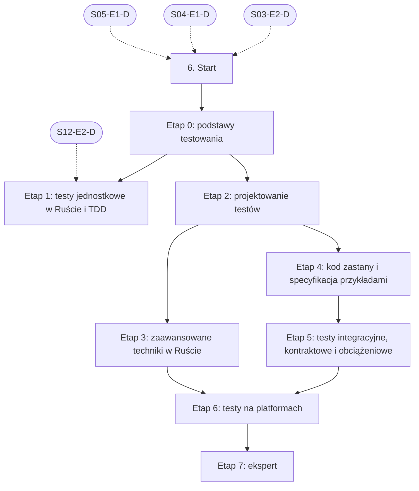

# 06. Testowanie: plan wdrożenia w Linear

Team **LEA** (https://linear.app/daankh/team/LEA/overview). Plan do przeglądu przed wdrożeniem: nic nie zostało jeszcze utworzone w Linear. Klucze zadań (np. `S06-E0-M1`) są robocze; po wdrożeniu dostaną identyfikatory `LEA-…`.

**W skrócie:** 8 kamieni milowych, 44 zadania (1 start, 32 materiały, 8 dowodów, 3 praktyki). Plik główny z kolejnością projektów: `00-kolejnosc-i-zaleznosci.md`.

## 1. Projekt

| Pole | Wartość |
|---|---|
| Nazwa | 06. Testowanie |
| Team | LEA |
| Podsumowanie (pole „Summary”) | Warstwa 2: jakość i projektowanie. Opiera się na: 3, 4 i 5; części dla Rusta i platform dochodzą przy sekcjach 12–22. Jest podstawą: 7, 8, 9, 11 i każdej platformy. |
| Proponowany start | 2026-11-02 |
| Proponowany termin | 2027-03-31 |
| Etykiety projektu | `warstwa-2` |
| Blokowany przez (projekty) | 03. Frontend web, 04. Bazy danych i dane, 05. Backend i API |
| Blokuje (projekty) | 07. Wymagania i specyfikacje, 08. Architektura i projektowanie systemów, 09. DevOps, CI/CD i wydania, 11. Weryfikacja pracy AI i budowa procesu, 12. Rust jako wspólny fundament, 20. Lokalne AI i rozwój modeli, 21. Funkcje AI w aplikacjach |
| Zależności częściowe (wchodzące) | etap 1 czeka na 12. Rust jako wspólny fundament (etap 2) |
| Czas od zera | 270–350 h |

### Opis projektu (do wklejenia w Linear)

*Warstwa 2: jakość i projektowanie. Opiera się na: 3, 4 i 5; części dla Rusta i platform dochodzą przy sekcjach 12–22. Jest podstawą: 7, 8, 9, 11 i każdej platformy.*

**Zakres umiejętności**

- Techniki: TDD, testy charakteryzujące, klasy równoważności, wartości brzegowe, tablice decyzyjne, przejścia stanów, Gherkin.
- Rust: `cargo test`, `cargo-nextest`, `proptest` (testy właściwości), `insta` (snapshoty), `criterion` (wydajność), `cargo-fuzz`, `cargo-mutants` (testy mutacyjne), `cargo-llvm-cov`.
- Web: Vitest, Testing Library, Playwright (E2E i akceptacyjne), MSW, axe (dostępność), regresja wizualna, k6 (obciążenie).
- Mobile: XCTest i XCUITest, testy Compose i Espresso, Maestro; emulatory i realne urządzenia.
- Desktop: WebDriver dla Tauri (`tauri-driver`), testy instalatorów i aktualizacji na czystych maszynach wirtualnych.
- Embedded: testy na hoście, `embedded-test` lub `defmt-test` na urządzeniu, QEMU, testy hardware-in-the-loop.
- Testy kontraktowe API i dane testowe bez danych osobowych.
- Typowe błędy testów pisanych przez AI: testy, które nic nie sprawdzają, mocki ukrywające błąd, testy dopasowane do implementacji zamiast zachowania, wyłączone lub osłabione asercje.

**Ścieżka nauki**

Ścieżka ma 8 etapów. Każdy kończy się **dowodem**, czyli małym projektem, który pokazuje, że etap jest opanowany. Przy doświadczeniu seniorskim etapy 0–2 można zaliczyć samym dowodem i wracać do materiałów tylko tam, gdzie dowód nie wychodzi; nowe będą najpewniej narzędzia Rusta (etap 3) i testy na urządzeniach (etap 6). Testy web (Vitest, Testing Library, MSW, Playwright) są w ścieżce frontendu (zob. sekcja 3.1, etap 6), a testy bezpieczeństwa w sekcji 10. Czas podany dla osoby startującej od zera; ceny materiałów płatnych zmieniają się, więc warto je sprawdzić przed zakupem.

Razem od zera do poziomu E: ok. 270–350 h, czyli 6–8 miesięcy przy 10–12 h tygodniowo.

**Definicja ukończenia projektu (dowód poziomu E)**

Samodzielnie, bez agenta, w 1 dzień obejmujesz nieznany moduł przejmowanej aplikacji testami charakteryzującymi, wskazujesz w zestawie testów wygenerowanym przez AI testy, które nic nie sprawdzają (potwierdzone testami mutacyjnymi), i umiesz wyjaśnić osobie nietechnicznej, jakie ryzyko pokrywają testy, a jakiego nie.

**Źródło:** dokument „Umiejętności techniczne” w projekcie „JDG: Rozwój oprogramowania”, sekcja 6.

## 2. Kamienie milowe

Jeden kamień milowy na etap ścieżki. Kamień milowy jest zamknięty, gdy zamknięte jest zadanie dowodu tego etapu. Daty kamieni milowych ustawiasz przy wdrożeniu według kolejności z pliku głównego.

| # | Kamień milowy | Cel | Czas od zera | Poziom po etapie | Zadania |
|---|---|---|---|---|---|
| 1 | Etap 0: podstawy testowania | podstawy testowania i techniki projektowania testów | 30–40 h | podstawy | 3 |
| 2 | Etap 1: testy jednostkowe w Ruście i TDD | testy jednostkowe w Ruście i TDD | 40–50 h | W | 6 |
| 3 | Etap 2: projektowanie testów | projektowanie testów: dublery, granice, co testować | 40–50 h | W | 7 |
| 4 | Etap 3: zaawansowane techniki w Ruście | testy właściwości, snapshoty, fuzzing, testy mutacyjne, wydajność | 40–50 h | W | 6 |
| 5 | Etap 4: kod zastany i specyfikacja przykładami | kod zastany i specyfikacja przykładami | 40–50 h | W | 5 |
| 6 | Etap 5: testy integracyjne, kontraktowe i obciążeniowe | testy integracyjne, kontraktowe i obciążeniowe | 25–35 h | W | 3 |
| 7 | Etap 6: testy na platformach | testy na platformach: mobile, desktop, embedded | 50–70 h | E | 7 |
| 8 | Etap 7: ekspert | ekspert: strategia testów, recenzja testów z AI, aktualność | stale, ok. 1–2 h tygodniowo | E | 6 |

## 3. Punkt startu

Zadanie **`S06-START` · Start: 6. Testowanie** to jedyne wejście do projektu: wszystkie zadania pierwszego etapu są przez nie blokowane.

- **Blokowane przez:** `S03-E2-D`, `S04-E1-D`, `S05-E1-D`
- **Odblokowuje:** `S06-E0-M1`, `S06-E0-M2`
- **Status początkowy:** Backlog do czasu zamknięcia zadań blokujących, potem Todo

Opis zadania (do wklejenia):

Punkt startu projektu „06. Testowanie”.

**Warunki wejścia (zadania blokujące):**

- `S03-E2-D` · Dowód etapu 2: TypeScript — sekcja 3 na poziomie podstawowym do pracy (etap 2)
- `S04-E1-D` · Dowód etapu 1: PostgreSQL w praktyce — sekcja 4 na poziomie podstawowym do pracy (etap 1)
- `S05-E1-D` · Dowód etapu 1: Node.js po stronie serwera — sekcja 5 na poziomie podstawowym do pracy (etap 1)

**Do zrobienia:**

- przeczytać sekcję 6 dokumentu „Umiejętności techniczne”,
- zaznaczyć etapy, które zaliczasz samym dowodem (zgodnie z akapitem wstępnym ścieżki), i dla nich zamknąć zadania materiałów jako niepotrzebne,
- ustawić daty kamieni milowych zgodnie z kolejnością z pliku głównego.

## 4. Przepływ zależności

Linie ciągłe to zależności wewnątrz projektu, przerywane to zadania z innych projektów. Wewnątrz etapu zadania materiałów są równoległe i wszystkie blokują dowód etapu; dowód etapu blokuje materiały kolejnego etapu.

## 5. Zadania według kamieni milowych

Szablon opisu zadania materiału: nazwa materiału, autor lub wydawca, typ, czas, koszt i link (jak w kolumnach poniżej) oraz zdanie „Gotowe, gdy materiał jest przerobiony w zakresie potrzebnym do dowodu etapu”. Opisy dowodów i praktyk są podane pod tabelą każdego etapu.

### Etap 0: podstawy testowania

Opis kamienia milowego (do wklejenia):

**Cel:** podstawy testowania i techniki projektowania testów · **Czas od zera:** 30–40 h · **Poziom po etapie:** podstawy

**Szczególnie ważne:** klasy równoważności, wartości brzegowe, tablice decyzyjne, przejścia stanów, testowanie oparte na ryzyku, różnica między weryfikacją a walidacją. Certyfikat nie jest potrzebny; sylabus służy jako wspólny słownik z klientami i zespołami QA.

**Dowód:** Dla jednej funkcji z wymaganiami (np. naliczanie ceny abonamentu z rabatem i okresem próbnym) rozpisany zestaw przypadków testowych z uzasadnieniem techniką: klasy, granice, tablica decyzyjna.

| Klucz | Tytuł | Typ | Czas | Koszt | Link | Blokowane przez | Blokuje |
|---|---|---|---|---|---|---|---|
| `S06-E0-M1` | Przerobić: Certified Tester Foundation Level, sylabus v4.0 (aktualizacja 4.0.1) | materiał, płatny | 15–20 h | 0 zł (egzamin płatny, opcjonalny) | https://istqb.org/certifications/certified-tester-foundation-level-ctfl-v4-0/ | `S06-START` | `S06-E0-D` |
| `S06-E0-M2` | Przerobić: Effective Software Testing | materiał, płatny | 15–20 h | płatna | https://www.manning.com/books/effective-software-testing | `S06-START` | `S06-E0-D` |
| `S06-E0-D` | Dowód etapu 0: podstawy testowania | dowód | — | — | — | `S06-E0-M1`, `S06-E0-M2` | `S06-E1-M1`, `S06-E1-M2`, `S06-E1-M3`, `S06-E1-M4`, `S06-E1-M5`, `S06-E2-M1`, `S06-E2-M2`, `S06-E2-M3`, `S06-E2-M4`, `S06-E2-M5`, `S06-E2-M6` |

**`S06-E0-D` · Dowód etapu 0: podstawy testowania**

Dla jednej funkcji z wymaganiami (np. naliczanie ceny abonamentu z rabatem i okresem próbnym) rozpisany zestaw przypadków testowych z uzasadnieniem techniką: klasy, granice, tablica decyzyjna.

**Na co zwrócić uwagę:** klasy równoważności, wartości brzegowe, tablice decyzyjne, przejścia stanów, testowanie oparte na ryzyku, różnica między weryfikacją a walidacją. Certyfikat nie jest potrzebny; sylabus służy jako wspólny słownik z klientami i zespołami QA.

**Kryterium ukończenia:** dowód wykonany samodzielnie; w komentarzu link do repozytorium, raportu lub notatki.

### Etap 1: testy jednostkowe w Ruście i TDD

Opis kamienia milowego (do wklejenia):

**Cel:** testy jednostkowe w Ruście i TDD · **Czas od zera:** 40–50 h · **Poziom po etapie:** W

**Szczególnie ważne:** cykl czerwony–zielony–refaktoryzacja, lista testów jako plan (zgodna ze specyfikacją w procesie spec-driven), testy w module i testy integracyjne w `tests/`, `cargo nextest` (nie uruchamia doctestów, więc w CI osobno `cargo test --doc`), pokrycie jako sygnał, a nie cel.

**Dowód:** Biblioteka w Ruście (np. walidacja i aktywacja klucza licencyjnego) napisana metodą TDD, z historią commitów pokazującą cykl test–implementacja, uruchamiana przez `cargo nextest` z raportem pokrycia z `cargo llvm-cov`.

| Klucz | Tytuł | Typ | Czas | Koszt | Link | Blokowane przez | Blokuje |
|---|---|---|---|---|---|---|---|
| `S06-E1-M1` | Przerobić: The Rust Programming Language, rozdział 11 „Writing Automated Tests” | materiał | 4–6 h | 0 zł | https://doc.rust-lang.org/book/ch11-00-testing.html | `S06-E0-D`, `S12-E2-D` | `S06-E1-D` |
| `S06-E1-M2` | Przerobić: Test Driven Development: By Example | materiał, płatny | 12–15 h | płatna | https://www.informit.com/store/test-driven-development-by-example-9780321146533 | `S06-E0-D`, `S12-E2-D` | `S06-E1-D` |
| `S06-E1-M3` | Przerobić: „Canon TDD” | materiał | 1 h | 0 zł | https://tidyfirst.substack.com/p/canon-tdd | `S06-E0-D`, `S12-E2-D` | `S06-E1-D` |
| `S06-E1-M4` | Przerobić: cargo-nextest | materiał | 3–4 h | 0 zł | https://nexte.st | `S06-E0-D`, `S12-E2-D` | `S06-E1-D` |
| `S06-E1-M5` | Przerobić: cargo-llvm-cov | materiał | 2 h | 0 zł | https://github.com/taiki-e/cargo-llvm-cov | `S06-E0-D`, `S12-E2-D` | `S06-E1-D` |
| `S06-E1-D` | Dowód etapu 1: testy jednostkowe w Ruście i TDD | dowód | — | — | — | `S06-E1-M1`, `S06-E1-M2`, `S06-E1-M3`, `S06-E1-M4`, `S06-E1-M5` | — |

**`S06-E1-D` · Dowód etapu 1: testy jednostkowe w Ruście i TDD**

Biblioteka w Ruście (np. walidacja i aktywacja klucza licencyjnego) napisana metodą TDD, z historią commitów pokazującą cykl test–implementacja, uruchamiana przez `cargo nextest` z raportem pokrycia z `cargo llvm-cov`.

**Na co zwrócić uwagę:** cykl czerwony–zielony–refaktoryzacja, lista testów jako plan (zgodna ze specyfikacją w procesie spec-driven), testy w module i testy integracyjne w `tests/`, `cargo nextest` (nie uruchamia doctestów, więc w CI osobno `cargo test --doc`), pokrycie jako sygnał, a nie cel.

**Kryterium ukończenia:** dowód wykonany samodzielnie; w komentarzu link do repozytorium, raportu lub notatki.

### Etap 2: projektowanie testów

Opis kamienia milowego (do wklejenia):

**Cel:** projektowanie testów: dublery, granice, co testować · **Czas od zera:** 40–50 h · **Poziom po etapie:** W

**Szczególnie ważne:** testowanie zachowania, a nie implementacji; kiedy dubler (mock, stub, fake) pomaga, a kiedy ukrywa błąd; odporność testu na refaktoryzację; proporcje testów jednostkowych, integracyjnych i E2E. To jest podstawa listy kontrolnej do recenzji testów pisanych przez agentów.

**Dowód:** Refaktoryzacja zestawu testów z etapu 1 tak, by zmiana wewnętrznej struktury kodu nie psuła żadnego testu, a celowo wprowadzony błąd zachowania był wykrywany; krótka notatka, które mocki usunięto i dlaczego.

| Klucz | Tytuł | Typ | Czas | Koszt | Link | Blokowane przez | Blokuje |
|---|---|---|---|---|---|---|---|
| `S06-E2-M1` | Przerobić: Unit Testing Principles, Practices, and Patterns | materiał, płatny | 15–20 h | płatna | https://www.manning.com/books/unit-testing | `S06-E0-D` | `S06-E2-D` |
| `S06-E2-M2` | Przerobić: Growing Object-Oriented Software, Guided by Tests | materiał, płatny | 15–20 h | płatna | https://www.informit.com/store/growing-object-oriented-software-guided-by-tests-9780321503626 | `S06-E0-D` | `S06-E2-D` |
| `S06-E2-M3` | Przerobić: „Mocks Aren’t Stubs” | materiał | 1–2 h | 0 zł | https://martinfowler.com/articles/mocksArentStubs.html | `S06-E0-D` | `S06-E2-D` |
| `S06-E2-M4` | Przerobić: „The Practical Test Pyramid” | materiał | 2 h | 0 zł | https://martinfowler.com/articles/practical-test-pyramid.html | `S06-E0-D` | `S06-E2-D` |
| `S06-E2-M5` | Przerobić: „The Testing Trophy and Testing Classifications” | materiał | 1 h | 0 zł | https://kentcdodds.com/blog/the-testing-trophy-and-testing-classifications | `S06-E0-D` | `S06-E2-D` |
| `S06-E2-M6` | Przerobić: Software Engineering at Google, rozdziały 11–14 (testowanie) | materiał | 6–8 h | 0 zł online | https://abseil.io/resources/swe-book | `S06-E0-D` | `S06-E2-D` |
| `S06-E2-D` | Dowód etapu 2: projektowanie testów | dowód | — | — | — | `S06-E2-M1`, `S06-E2-M2`, `S06-E2-M3`, `S06-E2-M4`, `S06-E2-M5`, `S06-E2-M6` | `S06-E3-M1`, `S06-E3-M2`, `S06-E3-M3`, `S06-E3-M4`, `S06-E3-M5`, `S06-E4-M1`, `S06-E4-M2`, `S06-E4-M3`, `S06-E4-M4`, `S07-START`, `S08-START`, `S09-START`, `S11-START`, `S12-START`, `S20-START`, `S21-START` |

**`S06-E2-D` · Dowód etapu 2: projektowanie testów**

Refaktoryzacja zestawu testów z etapu 1 tak, by zmiana wewnętrznej struktury kodu nie psuła żadnego testu, a celowo wprowadzony błąd zachowania był wykrywany; krótka notatka, które mocki usunięto i dlaczego.

**Na co zwrócić uwagę:** testowanie zachowania, a nie implementacji; kiedy dubler (mock, stub, fake) pomaga, a kiedy ukrywa błąd; odporność testu na refaktoryzację; proporcje testów jednostkowych, integracyjnych i E2E. To jest podstawa listy kontrolnej do recenzji testów pisanych przez agentów.

**Kryterium ukończenia:** dowód wykonany samodzielnie; w komentarzu link do repozytorium, raportu lub notatki.

### Etap 3: zaawansowane techniki w Ruście

Opis kamienia milowego (do wklejenia):

**Cel:** testy właściwości, snapshoty, fuzzing, testy mutacyjne, wydajność · **Czas od zera:** 40–50 h · **Poziom po etapie:** W

**Szczególnie ważne:** własności zamiast przykładów (odwracalność serializacji, niezmienniki), minimalizacja kontrprzykładów, recenzja zmian w snapshotach (`cargo insta review`) zamiast ślepej akceptacji, fuzzing parserów i wszystkiego, co przyjmuje dane z zewnątrz, odsetek przeżywających mutantów jako miara jakości testów.

**Dowód:** Do rdzenia z etapu 1 dodane: testy właściwości dla serializacji i synchronizacji, snapshot formatu wyjściowego, cel fuzzingu dla parsera wejścia uruchamiany w CI przez ograniczony czas, raport `cargo mutants` z omówieniem każdego przeżywającego mutanta.

| Klucz | Tytuł | Typ | Czas | Koszt | Link | Blokowane przez | Blokuje |
|---|---|---|---|---|---|---|---|
| `S06-E3-M1` | Przerobić: Proptest book | materiał | 5–6 h | 0 zł | https://proptest-rs.github.io/proptest/ | `S06-E2-D` | `S06-E3-D` |
| `S06-E3-M2` | Przerobić: insta | materiał | 2–3 h | 0 zł | https://insta.rs/docs/ | `S06-E2-D` | `S06-E3-D` |
| `S06-E3-M3` | Przerobić: Rust Fuzz Book (`cargo-fuzz`, `afl.rs`) | materiał | 6–8 h | 0 zł | https://rust-fuzz.github.io/book/ | `S06-E2-D` | `S06-E3-D` |
| `S06-E3-M4` | Przerobić: cargo-mutants | materiał | 4–5 h | 0 zł | https://mutants.rs | `S06-E2-D` | `S06-E3-D` |
| `S06-E3-M5` | Przerobić: Criterion.rs | materiał | 3–4 h | 0 zł | https://bheisler.github.io/criterion.rs/book/ | `S06-E2-D` | `S06-E3-D` |
| `S06-E3-D` | Dowód etapu 3: zaawansowane techniki w Ruście | dowód | — | — | — | `S06-E3-M1`, `S06-E3-M2`, `S06-E3-M3`, `S06-E3-M4`, `S06-E3-M5` | `S06-E6-M1`, `S06-E6-M2`, `S06-E6-M3`, `S06-E6-M4`, `S06-E6-M5`, `S06-E6-M6` |

**`S06-E3-D` · Dowód etapu 3: zaawansowane techniki w Ruście**

Do rdzenia z etapu 1 dodane: testy właściwości dla serializacji i synchronizacji, snapshot formatu wyjściowego, cel fuzzingu dla parsera wejścia uruchamiany w CI przez ograniczony czas, raport `cargo mutants` z omówieniem każdego przeżywającego mutanta.

**Na co zwrócić uwagę:** własności zamiast przykładów (odwracalność serializacji, niezmienniki), minimalizacja kontrprzykładów, recenzja zmian w snapshotach (`cargo insta review`) zamiast ślepej akceptacji, fuzzing parserów i wszystkiego, co przyjmuje dane z zewnątrz, odsetek przeżywających mutantów jako miara jakości testów.

**Kryterium ukończenia:** dowód wykonany samodzielnie; w komentarzu link do repozytorium, raportu lub notatki.

### Etap 4: kod zastany i specyfikacja przykładami

Opis kamienia milowego (do wklejenia):

**Cel:** kod zastany i specyfikacja przykładami · **Czas od zera:** 40–50 h · **Poziom po etapie:** W

**Szczególnie ważne:** testy charakteryzujące (utrwalenie obecnego zachowania przed zmianą), szwy i łamanie zależności, kryteria akceptacji jako przykłady w specyfikacji, testowanie eksploracyjne w sesjach z kartą (charter) przy przejmowaniu aplikacji z vibe codingu.

**Dowód:** Przejmowana aplikacja (poligon B z mapy nauki) objęta testami charakteryzującymi krytycznych ścieżek (logowanie, płatność, zapis danych) przed pierwszą zmianą; notatki z dwóch sesji eksploracyjnych z listą znalezionych problemów; trzy kryteria akceptacji kolejnej poprawki zapisane w Gherkinie.

| Klucz | Tytuł | Typ | Czas | Koszt | Link | Blokowane przez | Blokuje |
|---|---|---|---|---|---|---|---|
| `S06-E4-M1` | Przerobić: Working Effectively with Legacy Code | materiał, płatny | 15–20 h | płatna | https://www.informit.com/store/working-effectively-with-legacy-code-9780131177055 | `S06-E2-D` | `S06-E4-D` |
| `S06-E4-M2` | Przerobić: Specification by Example | materiał, płatny | 10–12 h | płatna | https://www.manning.com/books/specification-by-example | `S06-E2-D` | `S06-E4-D` |
| `S06-E4-M3` | Przerobić: Gherkin Reference | materiał | 1–2 h | 0 zł | https://cucumber.io/docs/gherkin/reference/ | `S06-E2-D` | `S06-E4-D` |
| `S06-E4-M4` | Przerobić: Explore It! | materiał, płatny | 8–10 h | płatna | https://pragprog.com/titles/ehxta/explore-it/ | `S06-E2-D` | `S06-E4-D` |
| `S06-E4-D` | Dowód etapu 4: kod zastany i specyfikacja przykładami | dowód | — | — | — | `S06-E4-M1`, `S06-E4-M2`, `S06-E4-M3`, `S06-E4-M4` | `S06-E5-M1`, `S06-E5-M2` |

**`S06-E4-D` · Dowód etapu 4: kod zastany i specyfikacja przykładami**

Przejmowana aplikacja (poligon B z mapy nauki) objęta testami charakteryzującymi krytycznych ścieżek (logowanie, płatność, zapis danych) przed pierwszą zmianą; notatki z dwóch sesji eksploracyjnych z listą znalezionych problemów; trzy kryteria akceptacji kolejnej poprawki zapisane w Gherkinie.

**Na co zwrócić uwagę:** testy charakteryzujące (utrwalenie obecnego zachowania przed zmianą), szwy i łamanie zależności, kryteria akceptacji jako przykłady w specyfikacji, testowanie eksploracyjne w sesjach z kartą (charter) przy przejmowaniu aplikacji z vibe codingu.

**Kryterium ukończenia:** dowód wykonany samodzielnie; w komentarzu link do repozytorium, raportu lub notatki.

### Etap 5: testy integracyjne, kontraktowe i obciążeniowe

Opis kamienia milowego (do wklejenia):

**Cel:** testy integracyjne, kontraktowe i obciążeniowe · **Czas od zera:** 25–35 h · **Poziom po etapie:** W

**Szczególnie ważne:** testy integracyjne z prawdziwą bazą w kontenerze zamiast mocków warstwy danych, kontrakt między aplikacją mobilną lub desktopową a API, progi (thresholds) w k6 jako bramka w CI, dane testowe bez danych osobowych.

**Dowód:** API w Axum z testem kontraktowym konsumenta (aplikacja kliencka) i weryfikacją po stronie dostawcy w CI; scenariusz k6 z progami opóźnienia i błędów, który zatrzymuje pipeline po ich przekroczeniu.

| Klucz | Tytuł | Typ | Czas | Koszt | Link | Blokowane przez | Blokuje |
|---|---|---|---|---|---|---|---|
| `S06-E5-M1` | Przerobić: Pact: wprowadzenie i przewodnik dla Rusta | materiał | 8–10 h | 0 zł | https://docs.pact.io, https://docs.pact.io/implementation_guides/rust | `S06-E4-D` | `S06-E5-D` |
| `S06-E5-M2` | Przerobić: Grafana k6 | materiał | 8–10 h | 0 zł | https://grafana.com/docs/k6/latest/ | `S06-E4-D` | `S06-E5-D` |
| `S06-E5-D` | Dowód etapu 5: testy integracyjne, kontraktowe i obciążeniowe | dowód | — | — | — | `S06-E5-M1`, `S06-E5-M2` | `S06-E6-M1`, `S06-E6-M2`, `S06-E6-M3`, `S06-E6-M4`, `S06-E6-M5`, `S06-E6-M6` |

**`S06-E5-D` · Dowód etapu 5: testy integracyjne, kontraktowe i obciążeniowe**

API w Axum z testem kontraktowym konsumenta (aplikacja kliencka) i weryfikacją po stronie dostawcy w CI; scenariusz k6 z progami opóźnienia i błędów, który zatrzymuje pipeline po ich przekroczeniu.

**Na co zwrócić uwagę:** testy integracyjne z prawdziwą bazą w kontenerze zamiast mocków warstwy danych, kontrakt między aplikacją mobilną lub desktopową a API, progi (thresholds) w k6 jako bramka w CI, dane testowe bez danych osobowych.

**Kryterium ukończenia:** dowód wykonany samodzielnie; w komentarzu link do repozytorium, raportu lub notatki.

### Etap 6: testy na platformach

Opis kamienia milowego (do wklejenia):

**Cel:** testy na platformach: mobile, desktop, embedded · **Czas od zera:** 50–70 h · **Poziom po etapie:** E

**Szczególnie ważne:** testy rdzenia Rust na hoście jako główna warstwa, a testy platformowe tylko dla integracji i UI; `tauri-driver` bezpośrednio działa na Linuksie i Windows, macOS wymaga ścieżki przez WebdriverIO; `defmt-test` opiera się na wycofanym `probe-run`, dlatego dla nowych projektów `embedded-test` z `probe-rs`; testy instalatora i aktualizacji na czystych maszynach wirtualnych.

**Dowód:** Jeden rdzeń w Ruście z testami na hoście oraz po jednym teście integracyjnym na każdej platformie: XCUITest na symulatorze iOS, test Compose na emulatorze Androida, przepływ Maestro przez onboarding, test WebDriver aplikacji Tauri na Linuksie i Windows w CI, test na płytce (np. nRF lub RP2040) uruchamiany przez `probe-rs`.

| Klucz | Tytuł | Typ | Czas | Koszt | Link | Blokowane przez | Blokuje |
|---|---|---|---|---|---|---|---|
| `S06-E6-M1` | Przerobić: XCTest (testy jednostkowe, wydajności i UI) i Swift Testing | materiał | 8–10 h | 0 zł | https://developer.apple.com/documentation/xctest, https://developer.apple.com/xcode/swift-testing/ | `S06-E5-D`, `S06-E3-D` | `S06-E6-D` |
| `S06-E6-M2` | Przerobić: Test apps on Android, Test your Compose layout, Espresso | materiał | 8–10 h | 0 zł | https://developer.android.com/training/testing, https://developer.android.com/develop/ui/compose/testing | `S06-E5-D`, `S06-E3-D` | `S06-E6-D` |
| `S06-E6-M3` | Przerobić: Maestro | materiał, płatny | 4–6 h | 0 zł (chmura płatna) | https://docs.maestro.dev | `S06-E5-D`, `S06-E3-D` | `S06-E6-D` |
| `S06-E6-M4` | Przerobić: Tauri: WebDriver (`tauri-driver`, usługa WebdriverIO) | materiał | 4–6 h | 0 zł | https://v2.tauri.app/develop/tests/webdriver/ | `S06-E5-D`, `S06-E3-D` | `S06-E6-D` |
| `S06-E6-M5` | Przerobić: embedded-test | materiał | 4–6 h | 0 zł | https://github.com/probe-rs/embedded-test | `S06-E5-D`, `S06-E3-D` | `S06-E6-D` |
| `S06-E6-M6` | Przerobić: QEMU: emulacja systemów Arm | materiał | 3–4 h | 0 zł | https://www.qemu.org/docs/master/system/target-arm.html | `S06-E5-D`, `S06-E3-D` | `S06-E6-D` |
| `S06-E6-D` | Dowód etapu 6: testy na platformach | dowód | — | — | — | `S06-E6-M1`, `S06-E6-M2`, `S06-E6-M3`, `S06-E6-M4`, `S06-E6-M5`, `S06-E6-M6` | `S06-E7-M1`, `S06-E7-M2`, `S06-E7-P1`, `S06-E7-P2`, `S06-E7-P3` |

**`S06-E6-D` · Dowód etapu 6: testy na platformach**

Jeden rdzeń w Ruście z testami na hoście oraz po jednym teście integracyjnym na każdej platformie: XCUITest na symulatorze iOS, test Compose na emulatorze Androida, przepływ Maestro przez onboarding, test WebDriver aplikacji Tauri na Linuksie i Windows w CI, test na płytce (np. nRF lub RP2040) uruchamiany przez `probe-rs`.

**Na co zwrócić uwagę:** testy rdzenia Rust na hoście jako główna warstwa, a testy platformowe tylko dla integracji i UI; `tauri-driver` bezpośrednio działa na Linuksie i Windows, macOS wymaga ścieżki przez WebdriverIO; `defmt-test` opiera się na wycofanym `probe-run`, dlatego dla nowych projektów `embedded-test` z `probe-rs`; testy instalatora i aktualizacji na czystych maszynach wirtualnych.

**Kryterium ukończenia:** dowód wykonany samodzielnie; w komentarzu link do repozytorium, raportu lub notatki.

### Etap 7: ekspert

Opis kamienia milowego (do wklejenia):

**Cel:** ekspert: strategia testów, recenzja testów z AI, aktualność · **Czas od zera:** stale, ok. 1–2 h tygodniowo · **Poziom po etapie:** E

**Dowód poziomu E:** Samodzielnie, bez agenta, w 1 dzień obejmujesz nieznany moduł przejmowanej aplikacji testami charakteryzującymi, wskazujesz w zestawie testów wygenerowanym przez AI testy, które nic nie sprawdzają (potwierdzone testami mutacyjnymi), i umiesz wyjaśnić osobie nietechnicznej, jakie ryzyko pokrywają testy, a jakiego nie.

| Klucz | Tytuł | Typ | Czas | Koszt | Link | Blokowane przez | Blokuje |
|---|---|---|---|---|---|---|---|
| `S06-E7-M1` | Przerobić: Wydania i changelogi narzędzi testowych | materiał | ok. 30 min tygodniowo | 0 zł | strony z etapów 1–6 | `S06-E6-D` | `S06-E7-D` |
| `S06-E7-M2` | Przerobić: Aktualizacje sylabusów ISTQB | materiał | wg potrzeb | 0 zł | https://istqb.org | `S06-E6-D` | `S06-E7-D` |
| `S06-E7-P1` | Praktyka: recenzja testów z AI | praktyka | — | — | — | `S06-E6-D` | `S06-E7-D` |
| `S06-E7-P2` | Praktyka: TDD z agentem | praktyka | — | — | — | `S06-E6-D` | `S06-E7-D` |
| `S06-E7-P3` | Praktyka: strategia testów u klienta | praktyka | — | — | — | `S06-E6-D` | `S06-E7-D` |
| `S06-E7-D` | Dowód poziomu E: ekspert | dowód | — | — | — | `S06-E7-M1`, `S06-E7-M2`, `S06-E7-P1`, `S06-E7-P2`, `S06-E7-P3` | — |

**`S06-E7-P1` · Praktyka: recenzja testów z AI**

20 pull requestów z testami wygenerowanymi przez agentów, recenzowanych według listy kontrolnej z etapów 2 i 3 (testy bez asercji lub z asercjami tautologicznymi, mocki ukrywające błąd, testy dopasowane do implementacji, osłabione lub wyłączone asercje, zaakceptowane bez przeglądu snapshoty); przy każdej wątpliwości `cargo mutants` na zmienionym kodzie.

Praktyka ciągła etapu eksperckiego: oznacz jako gotową, gdy działa jako stały element pracy, a nie po jednorazowym wykonaniu.

**`S06-E7-P2` · Praktyka: TDD z agentem**

Człowiek pisze lub zatwierdza listę testów ze specyfikacji, agent implementuje; pomiar, ile błędów wyłapały testy przed recenzją.

Praktyka ciągła etapu eksperckiego: oznacz jako gotową, gdy działa jako stały element pracy, a nie po jednorazowym wykonaniu.

**`S06-E7-P3` · Praktyka: strategia testów u klienta**

Jednostronicowa strategia (ryzyka, warstwy testów, bramki w CI, dane testowe) dla przejmowanej aplikacji.

Praktyka ciągła etapu eksperckiego: oznacz jako gotową, gdy działa jako stały element pracy, a nie po jednorazowym wykonaniu.

**`S06-E7-D` · Dowód poziomu E: ekspert**

Samodzielnie, bez agenta, w 1 dzień obejmujesz nieznany moduł przejmowanej aplikacji testami charakteryzującymi, wskazujesz w zestawie testów wygenerowanym przez AI testy, które nic nie sprawdzają (potwierdzone testami mutacyjnymi), i umiesz wyjaśnić osobie nietechnicznej, jakie ryzyko pokrywają testy, a jakiego nie.

**Kryterium ukończenia:** dowód wykonany samodzielnie; w komentarzu link do repozytorium, raportu lub notatki. Bez agenta AI.

## 6. Relacje z innymi projektami

**Wchodzące** (zadanie z innego projektu blokuje zadanie tego projektu):

- `S03-E2-D` (Dowód etapu 2: TypeScript) → `S06-START`
- `S04-E1-D` (Dowód etapu 1: PostgreSQL w praktyce) → `S06-START`
- `S05-E1-D` (Dowód etapu 1: Node.js po stronie serwera) → `S06-START`
- `S12-E2-D` (Dowód etapu 2: własność, pożyczanie, czasy życia) → `S06-E1-M1`
- `S12-E2-D` (Dowód etapu 2: własność, pożyczanie, czasy życia) → `S06-E1-M2`
- `S12-E2-D` (Dowód etapu 2: własność, pożyczanie, czasy życia) → `S06-E1-M3`
- `S12-E2-D` (Dowód etapu 2: własność, pożyczanie, czasy życia) → `S06-E1-M4`
- `S12-E2-D` (Dowód etapu 2: własność, pożyczanie, czasy życia) → `S06-E1-M5`

**Wychodzące** (zadanie tego projektu blokuje zadanie w innym projekcie):

- `S06-E2-D` → `S07-START` (07. Wymagania i specyfikacje)
- `S06-E2-D` → `S08-START` (08. Architektura i projektowanie systemów)
- `S06-E2-D` → `S09-START` (09. DevOps, CI/CD i wydania)
- `S06-E2-D` → `S11-START` (11. Weryfikacja pracy AI i budowa procesu)
- `S06-E2-D` → `S12-START` (12. Rust jako wspólny fundament)
- `S06-E2-D` → `S20-START` (20. Lokalne AI i rozwój modeli)
- `S06-E2-D` → `S21-START` (21. Funkcje AI w aplikacjach)
