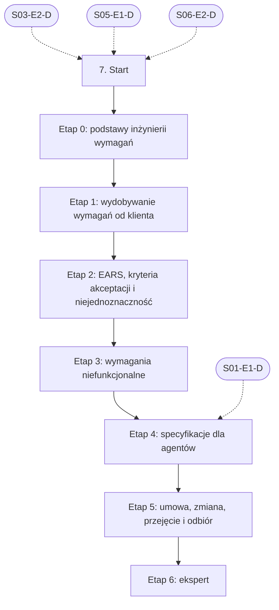

# 07. Wymagania i specyfikacje: plan wdrożenia w Linear

Team **LEA** (https://linear.app/daankh/team/LEA/overview). Plan do przeglądu przed wdrożeniem: nic nie zostało jeszcze utworzone w Linear. Klucze zadań (np. `S07-E0-M1`) są robocze; po wdrożeniu dostaną identyfikatory `LEA-…`.

**W skrócie:** 7 kamieni milowych, 43 zadania (1 start, 31 materiałów, 7 dowodów, 4 praktyki). Plik główny z kolejnością projektów: `00-kolejnosc-i-zaleznosci.md`.

## 1. Projekt

| Pole | Wartość |
|---|---|
| Nazwa | 07. Wymagania i specyfikacje |
| Team | LEA |
| Podsumowanie (pole „Summary”) | Warstwa 2: jakość i projektowanie. Opiera się na: 3, 5 i 6. Jest podstawą: 8, 10, 11 i każdego projektu klienta. |
| Proponowany start | 2026-11-02 |
| Proponowany termin | 2027-03-31 |
| Etykiety projektu | `warstwa-2` |
| Blokowany przez (projekty) | 03. Frontend web, 05. Backend i API, 06. Testowanie |
| Blokuje (projekty) | 08. Architektura i projektowanie systemów, 11. Weryfikacja pracy AI i budowa procesu |
| Zależności częściowe (wchodzące) | etap 4 czeka na 01. Praca z AI w chmurze: Claude i Claude Code (etap 1) |
| Czas od zera | 145–200 h |

### Opis projektu (do wklejenia w Linear)

*Warstwa 2: jakość i projektowanie. Opiera się na: 3, 5 i 6. Jest podstawą: 8, 10, 11 i każdego projektu klienta.*

**Zakres umiejętności**

- Wydobywanie wymagań od klienta: wywiad o przeszłych zachowaniach zamiast pytań o opinie, warsztat zdalny z klientem, Jobs-to-be-Done (jaką pracę klient „zatrudnia” aplikację do wykonania), mapa wpływu (cel biznesowy, aktorzy, wpływ, rezultaty), story mapping (szkielet przepływu użytkownika i cięcie na wydania), example mapping (reguły, przykłady, pytania otwarte) jako krótka sesja przed każdą funkcją; notatki z rozmów jako materiał źródłowy dla agenta, a nie gotowa specyfikacja.
- Pisanie wymagań w EARS: pięć wzorców podstawowych (stałe, zdarzeniowe „GDY”, stanowe „DOPÓKI”, niepożądane „JEŚLI … TO”, opcjonalne „GDZIE”) i wzorzec złożony, jedno wymaganie na zdanie, identyfikator R-n, aktor i reakcja systemu nazwane wprost, bez słów nieweryfikowalnych („szybko”, „intuicyjnie”, „odpowiednio”, „itp.”).
- Kryteria akceptacji: dla każdego R-n co najmniej jedno AC-n, przypadki pozytywne, negatywne (niepożądane zachowanie, brak uprawnień, błędne dane) i brzegowe (granice, wartości puste, równoczesność, strefy czasowe); konkretne przykłady z danymi zamiast ogólników; zapis jako scenariusze Zakładając/Gdy/Wtedy (format i automatyzacja: sekcja 6).
- Wymagania niefunkcjonalne według ISO/IEC 25010:2023 (dziewięć charakterystyk, m.in. bezpieczeństwo, niezawodność, wydajność, zdolność interakcji, elastyczność, safety): każde z miarą, progiem, warunkami pomiaru i sposobem weryfikacji (np. „p95 czasu odpowiedzi poniżej 300 ms przy 50 żądaniach na sekundę, mierzone testem k6 w CI”); bazowe NFR projektu w `nfr.md`, NFR funkcji w jej specyfikacji; wymagania bezpieczeństwa z OWASP ASVS (zob. sekcja 10), dostępności z WCAG 2.2 (zob. sekcja 13).
- Wykrywanie niejednoznaczności według kategorii: zakres, dane i ich źródła, błędy i przypadki brzegowe, uprawnienia i role, NFR, zależności od systemów zewnętrznych; „zapachy wymagań” (słowa niejednoznaczne, strona bierna bez aktora, zaimki bez odniesienia, porównania bez punktu odniesienia, „wszystkie”, „zawsze”); znaczniki `[DO WYJAŚNIENIA: …]` zamiast zgadywania i pytania do klienta z propozycją odpowiedzi.
- Rozdział „co i dlaczego” od „jak”: w `spec.md` cel, użytkownicy, wymagania, kryteria akceptacji, NFR i sekcja „Poza zakresem”, bez nazw technologii, tabel, endpointów i klas; „jak” należy do `plan.md` (zob. sekcja 8); test: czy specyfikacja przetrwałaby zmianę frameworka bez edycji.
- Specyfikacja jako zakres umowy i podstawa wyceny: zatwierdzona wersja specyfikacji z sumą kontrolną jako załącznik do zlecenia w pakiecie „Rozwój według specyfikacji”, wycena na podstawie liczby i złożoności wymagań oraz ryzyk z pytań otwartych, jawne założenia i wykluczenia, kryteria odbioru znane przed rozpoczęciem pracy.
- Zarządzanie zmianą: wersjonowanie specyfikacji (`spec_version`), zatwierdzenie przywiązane do treści, każda zmiana zachowania po zatwierdzeniu jako propozycja zmiany (`proposal.md` z powodem, wpływem i wyceną oraz `spec-delta.md` z wymaganiami dodanymi, zmienionymi i usuniętymi), rozróżnienie błędu (kod robi co innego, niż mówi specyfikacja: poprawka w ramach umowy) od luki w specyfikacji lub nowego życzenia (płatna spec-delta).
- Śledzenie powiązań: R-n → AC-n → zadanie T-n → test, wykrywanie wymagań bez kryteriów, kryteriów bez testów i kodu bez wymagania; macierz śledzenia jako dowód dla klienta, że wszystko, za co zapłacił, zostało sprawdzone.
- Odtwarzanie specyfikacji z istniejącego zachowania przy przejęciu: źródła (działająca aplikacja, interfejs, dane w bazie, logi, kod, rozmowa z klientem przy demonstracji), specyfikacje w statusie `reconstructed` tylko dla obszarów zmienianych w najbliższych 90 dniach, opis zachowania obecnego, także wadliwego, z oznaczeniem `[DO WERYFIKACJI Z KLIENTEM]`, testy charakteryzujące jako wykonywalna wersja tej specyfikacji (zob. sekcja 6), zatwierdzenie dopiero po weryfikacji z klientem.
- Specyfikacje jako kontekst dla agentów: jeden dokument czytelny i dla klienta, i dla AI (język klienta, stałe identyfikatory, krótkie zdania, przykłady z danymi, słownik pojęć), samowystarczalność (agent nie zgaduje, czego brakuje), sekcja „Poza zakresem” jako ochrona przed dopisywaniem funkcji, wywiad prowadzony przez agenta przed pisaniem specyfikacji (zob. sekcja 1), narzędzia spec-driven (GitHub Spec Kit, Kiro, OpenSpec) jako wzorce struktury artefaktów.
- Protokół odbioru (UAT): scenariusze odbioru wyprowadzone z AC, sesja z klientem na środowisku testowym z danymi bez danych osobowych, wynik każdego scenariusza, uwagi sklasyfikowane jako błąd, luka w specyfikacji albo nowe życzenie, decyzja (odbiór, odbiór z uwagami, odmowa) i podpis; protokół jako zamknięcie etapu rozliczeniowego.
- Typowe błędy specyfikacji pisanych przez AI do wyłapania: szczegóły implementacji w specyfikacji (tabele, endpointy, biblioteki), wymagania wymyślone ponad intencję klienta i „ulepszenia”, których nikt nie zamawiał, ciche założenia w miejscu pytań (np. przyjęta metoda logowania albo polityka retencji), same przypadki pozytywne bez negatywnych i brzegowych, słowa nieweryfikowalne i NFR bez progów, kryteria akceptacji powtarzające wymaganie innymi słowami zamiast przykładu z danymi, kilka wymagań w jednym zdaniu, niespójne nazwy tego samego pojęcia, wymagania sprzeczne między sekcjami, brak sekcji „Poza zakresem”, rozwlekłość utrudniająca przegląd klientowi, odtworzona specyfikacja, która opisuje to, co kod „powinien” robić, zamiast tego, co robi.

**Ścieżka nauki**

Ścieżka ma 7 etapów. Każdy kończy się **dowodem**, czyli małym projektem, który pokazuje, że etap jest opanowany. Przy doświadczeniu seniorskim etap 0 można zaliczyć samym dowodem; nowe będą najpewniej formalne pisanie wymagań w EARS i wykrywanie niejednoznaczności (etap 2), mierzalne NFR (etap 3) oraz specyfikacja jako zakres umowy, zmiana i odbiór (etap 5), bo w pracy etatowej tę część zwykle wykonują analityk i product owner. Etapy 1–2 i 4 warto przejść przed pierwszym projektem w pakiecie „Rozwój według specyfikacji”, a etap 5 przed podpisaniem pierwszej umowy. „Specification by Example”, Gherkin Reference i „Working Effectively with Legacy Code” są w ścieżce testowania (zob. sekcja 6.1, etap 4) i nie są tu powtarzane. Czas podany dla osoby startującej od zera; ceny materiałów płatnych zmieniają się, więc warto je sprawdzić przed zakupem. Narzędzia spec-driven zmieniają się co kilka tygodni, więc ich dokumentację trzeba czytać w wersji bieżącej.

Razem od zera do poziomu E: ok. 145–200 h, czyli 3–5 miesięcy przy 10–12 h tygodniowo.

**Definicja ukończenia projektu (dowód poziomu E)**

Samodzielnie, bez agenta, w 1 dzień po jednym warsztacie z klientem przygotowujesz specyfikację funkcji średniej wielkości (EARS, kryteria akceptacji pozytywne, negatywne i brzegowe, NFR z progami, „Poza zakresem”, lista pytań otwartych), wycenę i propozycję harmonogramu, a klient zatwierdza ją bez dodatkowej rundy wyjaśnień; przy odbiorze nie pojawia się uwaga sklasyfikowana jako luka w specyfikacji, a każdą prośbę zgłoszoną po zatwierdzeniu umiesz w 15 minut zaklasyfikować i wyjaśnić klientowi, czy mieści się w umowie, czy wymaga płatnej propozycji zmiany.

**Źródło:** dokument „Umiejętności techniczne” w projekcie „JDG: Rozwój oprogramowania”, sekcja 7.

## 2. Kamienie milowe

Jeden kamień milowy na etap ścieżki. Kamień milowy jest zamknięty, gdy zamknięte jest zadanie dowodu tego etapu. Daty kamieni milowych ustawiasz przy wdrożeniu według kolejności z pliku głównego.

| # | Kamień milowy | Cel | Czas od zera | Poziom po etapie | Zadania |
|---|---|---|---|---|---|
| 1 | Etap 0: podstawy inżynierii wymagań | podstawy inżynierii wymagań i wspólny słownik | 20–30 h | podstawy | 4 |
| 2 | Etap 1: wydobywanie wymagań od klienta | wydobywanie wymagań od klienta | 30–40 h | W | 7 |
| 3 | Etap 2: EARS, kryteria akceptacji i niejednoznaczność | EARS, kryteria akceptacji i niejednoznaczność | 30–40 h | W | 7 |
| 4 | Etap 3: wymagania niefunkcjonalne | wymagania niefunkcjonalne z mierzalnymi progami | 15–20 h | W | 4 |
| 5 | Etap 4: specyfikacje dla agentów | specyfikacje dla agentów: spec-driven w praktyce | 20–30 h | W | 7 |
| 6 | Etap 5: umowa, zmiana, przejęcie i odbiór | umowa, zmiana, przejęcie i odbiór | 30–40 h | E | 5 |
| 7 | Etap 6: ekspert | ekspert: pomiar jakości specyfikacji, recenzja specyfikacji z AI, aktualność | stale, ok. 1 h tygodniowo | E | 8 |

## 3. Punkt startu

Zadanie **`S07-START` · Start: 7. Wymagania i specyfikacje** to jedyne wejście do projektu: wszystkie zadania pierwszego etapu są przez nie blokowane.

- **Blokowane przez:** `S03-E2-D`, `S05-E1-D`, `S06-E2-D`
- **Odblokowuje:** `S07-E0-M1`, `S07-E0-M2`, `S07-E0-M3`
- **Status początkowy:** Backlog do czasu zamknięcia zadań blokujących, potem Todo

Opis zadania (do wklejenia):

Punkt startu projektu „07. Wymagania i specyfikacje”.

**Warunki wejścia (zadania blokujące):**

- `S03-E2-D` · Dowód etapu 2: TypeScript — sekcja 3 na poziomie podstawowym do pracy (etap 2)
- `S05-E1-D` · Dowód etapu 1: Node.js po stronie serwera — sekcja 5 na poziomie podstawowym do pracy (etap 1)
- `S06-E2-D` · Dowód etapu 2: projektowanie testów — sekcja 6 na poziomie podstawowym do pracy (etap 2)

**Do zrobienia:**

- przeczytać sekcję 7 dokumentu „Umiejętności techniczne”,
- zaznaczyć etapy, które zaliczasz samym dowodem (zgodnie z akapitem wstępnym ścieżki), i dla nich zamknąć zadania materiałów jako niepotrzebne,
- ustawić daty kamieni milowych zgodnie z kolejnością z pliku głównego.

## 4. Przepływ zależności

Linie ciągłe to zależności wewnątrz projektu, przerywane to zadania z innych projektów. Wewnątrz etapu zadania materiałów są równoległe i wszystkie blokują dowód etapu; dowód etapu blokuje materiały kolejnego etapu.

## 5. Zadania według kamieni milowych

Szablon opisu zadania materiału: nazwa materiału, autor lub wydawca, typ, czas, koszt i link (jak w kolumnach poniżej) oraz zdanie „Gotowe, gdy materiał jest przerobiony w zakresie potrzebnym do dowodu etapu”. Opisy dowodów i praktyk są podane pod tabelą każdego etapu.

### Etap 0: podstawy inżynierii wymagań

Opis kamienia milowego (do wklejenia):

**Cel:** podstawy inżynierii wymagań i wspólny słownik · **Czas od zera:** 20–30 h · **Poziom po etapie:** podstawy

**Szczególnie ważne:** rodzaje wymagań (biznesowe, użytkownika, funkcjonalne, jakościowe, ograniczenia), cechy dobrego wymagania (jednoznaczne, weryfikowalne, wykonalne, niezależne od rozwiązania, śledzalne), interesariusze i źródła wymagań, różnica między walidacją (czy to właściwy system) a weryfikacją (czy system spełnia specyfikację). Certyfikat nie jest potrzebny; sylabus i słownik dają wspólny język z klientami, którzy mają własnych analityków. Normę 29148 wystarczy znać z nazwy i struktury; przed zakupem sprawdzić, czy ukazało się nowe wydanie.

**Dowód:** Jednostronicowy słownik pojęć do oferty i umowy (wymaganie, kryterium akceptacji, specyfikacja, propozycja zmiany, odbiór, błąd, luka w specyfikacji) oraz rozbiór jednej istniejącej specyfikacji lub zgłoszenia od klienta: każde zdanie sklasyfikowane według rodzaju wymagania i ocenione według cech dobrego wymagania, z listą zdań do przepisania.

| Klucz | Tytuł | Typ | Czas | Koszt | Link | Blokowane przez | Blokuje |
|---|---|---|---|---|---|---|---|
| `S07-E0-M1` | Przerobić: CPRE Foundation Level, sylabus 3.3.0, słownik CPRE 2.2.0 i podręcznik | materiał, płatny | 12–15 h | 0 zł (podręcznik po założeniu darmowego konta; egzamin płatny, opcjonalny) | https://cpre.ireb.org/en/downloads-and-resources/downloads | `S07-START` | `S07-E0-D` |
| `S07-E0-M2` | Przerobić: Software Requirements Essentials: Core Practices for Successful Business Analysis | materiał, płatny | 8–10 h | płatna | https://www.informit.com/store/software-requirements-essentials-core-practices-for-9780138190286 | `S07-START` | `S07-E0-D` |
| `S07-E0-M3` | Przerobić: ISO/IEC/IEEE 29148:2018 | materiał, płatny | wg potrzeb | płatna | https://www.iso.org/standard/72089.html | `S07-START` | `S07-E0-D` |
| `S07-E0-D` | Dowód etapu 0: podstawy inżynierii wymagań | dowód | — | — | — | `S07-E0-M1`, `S07-E0-M2`, `S07-E0-M3` | `S07-E1-M1`, `S07-E1-M2`, `S07-E1-M3`, `S07-E1-M4`, `S07-E1-M5`, `S07-E1-M6` |

**`S07-E0-D` · Dowód etapu 0: podstawy inżynierii wymagań**

Jednostronicowy słownik pojęć do oferty i umowy (wymaganie, kryterium akceptacji, specyfikacja, propozycja zmiany, odbiór, błąd, luka w specyfikacji) oraz rozbiór jednej istniejącej specyfikacji lub zgłoszenia od klienta: każde zdanie sklasyfikowane według rodzaju wymagania i ocenione według cech dobrego wymagania, z listą zdań do przepisania.

**Na co zwrócić uwagę:** rodzaje wymagań (biznesowe, użytkownika, funkcjonalne, jakościowe, ograniczenia), cechy dobrego wymagania (jednoznaczne, weryfikowalne, wykonalne, niezależne od rozwiązania, śledzalne), interesariusze i źródła wymagań, różnica między walidacją (czy to właściwy system) a weryfikacją (czy system spełnia specyfikację). Certyfikat nie jest potrzebny; sylabus i słownik dają wspólny język z klientami, którzy mają własnych analityków. Normę 29148 wystarczy znać z nazwy i struktury; przed zakupem sprawdzić, czy ukazało się nowe wydanie.

**Kryterium ukończenia:** dowód wykonany samodzielnie; w komentarzu link do repozytorium, raportu lub notatki.

### Etap 1: wydobywanie wymagań od klienta

Opis kamienia milowego (do wklejenia):

**Cel:** wydobywanie wymagań od klienta · **Czas od zera:** 30–40 h · **Poziom po etapie:** W

**Szczególnie ważne:** pytania o to, co klient faktycznie robił i ile go to kosztowało, a nie o to, co by chciał; praca, którą aplikacja ma wykonać za użytkownika, jako filtr dla funkcji; mapa wpływu na start projektu, żeby każda funkcja miała cel biznesowy; story map do cięcia zakresu na wydania i do rozmowy o budżecie; example mapping jako 25-minutowa sesja przed każdą funkcją (czerwone karty, czyli pytania otwarte, to gotowe znaczniki `[DO WYJAŚNIENIA]`); jeśli sesja trwa dłużej, funkcja jest za duża i trzeba ją podzielić.

**Dowód:** Dla jednego klienta (lub poligonu z mapy nauki) notatki z dwóch wywiadów, mapa wpływu, story map z zaznaczonym pierwszym wydaniem i example map dla dwóch funkcji; z tego wpisy wejściowe do `/vicrafter:specify` (intencja w kilku zdaniach, reguły, przykłady, pytania otwarte) i lista decyzji, które klient podjął na warsztacie.

| Klucz | Tytuł | Typ | Czas | Koszt | Link | Blokowane przez | Blokuje |
|---|---|---|---|---|---|---|---|
| `S07-E1-M1` | Przerobić: The Mom Test | materiał, płatny | 3–4 h | płatna | https://www.momtestbook.com | `S07-E0-D` | `S07-E1-D` |
| `S07-E1-M2` | Przerobić: „Know Your Customers’ »Jobs to Be Done«” (wrzesień 2016) | materiał, płatny | 1 h | abonament (część artykułów bezpłatnie) | https://hbr.org/2016/09/know-your-customers-jobs-to-be-done | `S07-E0-D` | `S07-E1-D` |
| `S07-E1-M3` | Przerobić: User Story Mapping (2014) | materiał, płatny | 8–10 h | płatna | https://www.oreilly.com/library/view/user-story-mapping/9781491904893/ | `S07-E0-D` | `S07-E1-D` |
| `S07-E1-M4` | Przerobić: Impact Mapping (2012) i materiały warsztatowe na stronie projektu | materiał, płatny | 3–4 h | książka płatna, strona 0 zł | https://www.impactmapping.org | `S07-E0-D` | `S07-E1-D` |
| `S07-E1-M5` | Przerobić: „Introducing Example Mapping” (2015) | materiał | 1 h | 0 zł | https://cucumber.io/blog/bdd/example-mapping-introduction/ | `S07-E0-D` | `S07-E1-D` |
| `S07-E1-M6` | Przerobić: CPRE Requirements Elicitation, sylabus 3.2.0 | materiał | 6–8 h | 0 zł | https://cpre.ireb.org/en/downloads-and-resources/downloads | `S07-E0-D` | `S07-E1-D` |
| `S07-E1-D` | Dowód etapu 1: wydobywanie wymagań od klienta | dowód | — | — | — | `S07-E1-M1`, `S07-E1-M2`, `S07-E1-M3`, `S07-E1-M4`, `S07-E1-M5`, `S07-E1-M6` | `S07-E2-M1`, `S07-E2-M2`, `S07-E2-M3`, `S07-E2-M4`, `S07-E2-M5`, `S07-E2-M6`, `S08-START`, `S11-START` |

**`S07-E1-D` · Dowód etapu 1: wydobywanie wymagań od klienta**

Dla jednego klienta (lub poligonu z mapy nauki) notatki z dwóch wywiadów, mapa wpływu, story map z zaznaczonym pierwszym wydaniem i example map dla dwóch funkcji; z tego wpisy wejściowe do `/vicrafter:specify` (intencja w kilku zdaniach, reguły, przykłady, pytania otwarte) i lista decyzji, które klient podjął na warsztacie.

**Na co zwrócić uwagę:** pytania o to, co klient faktycznie robił i ile go to kosztowało, a nie o to, co by chciał; praca, którą aplikacja ma wykonać za użytkownika, jako filtr dla funkcji; mapa wpływu na start projektu, żeby każda funkcja miała cel biznesowy; story map do cięcia zakresu na wydania i do rozmowy o budżecie; example mapping jako 25-minutowa sesja przed każdą funkcją (czerwone karty, czyli pytania otwarte, to gotowe znaczniki `[DO WYJAŚNIENIA]`); jeśli sesja trwa dłużej, funkcja jest za duża i trzeba ją podzielić.

**Kryterium ukończenia:** dowód wykonany samodzielnie; w komentarzu link do repozytorium, raportu lub notatki.

### Etap 2: EARS, kryteria akceptacji i niejednoznaczność

Opis kamienia milowego (do wklejenia):

**Cel:** EARS, kryteria akceptacji i niejednoznaczność · **Czas od zera:** 30–40 h · **Poziom po etapie:** W

**Szczególnie ważne:** w EARS warunek i wyzwalacz przed reakcją systemu, a wzorzec niepożądany („JEŚLI … TO”) jako miejsce na wszystkie przypadki negatywne; kryterium akceptacji jako konkretny przykład z danymi, a nie przepisane wymaganie; trzy pytania kontrolne dla każdego R-n: co przy błędnych danych, co na granicy, co bez uprawnień; lista zapachów wymagań jako lista kontrolna do recenzji specyfikacji pisanych przez agenta. „Writing Great Specifications” uzupełnia „Specification by Example” z sekcji 6 o pisanie i utrzymanie samej dokumentacji.

**Dowód:** Specyfikacja jednej funkcji klienta (rozmiar M, np. rezerwacja z limitem i wygasaniem) z 5–8 wymaganiami w EARS, kryteriami akceptacji pozytywnymi, negatywnymi i brzegowymi dla każdego R-n i sekcją „Poza zakresem”; obok ta sama funkcja w wersji napisanej przez agenta bez wskazówek, z listą znalezionych zapachów wymagań i poprawek, oraz notatka, ile pytań do klienta wynikło z recenzji.

| Klucz | Tytuł | Typ | Czas | Koszt | Link | Blokowane przez | Blokuje |
|---|---|---|---|---|---|---|---|
| `S07-E2-M1` | Przerobić: EARS: przewodnik i reguły wzorców | materiał | 3–4 h | 0 zł | https://alistairmavin.com/ears/ | `S07-E1-D` | `S07-E2-D` |
| `S07-E2-M2` | Przerobić: „Easy Approach to Requirements Syntax (EARS)” (RE ’09) | materiał, płatny | 1–2 h | płatny dostęp przez IEEE | https://research.manchester.ac.uk/en/publications/easy-approach-to-requirements-syntax-ears/ | `S07-E1-D` | `S07-E2-D` |
| `S07-E2-M3` | Przerobić: Writing Great Specifications (2017) | materiał, płatny | 10–12 h | płatna | https://www.manning.com/books/writing-great-specifications | `S07-E1-D` | `S07-E2-D` |
| `S07-E2-M4` | Przerobić: Fifty Quick Ideas to Improve Your User Stories | materiał, płatny | 4–5 h | płatna | https://leanpub.com/50quickideas | `S07-E1-D` | `S07-E2-D` |
| `S07-E2-M5` | Przerobić: „Rapid quality assurance with Requirements Smells” (2016) | materiał | 1–2 h | 0 zł (arXiv) | https://arxiv.org/abs/1611.08847 | `S07-E1-D` | `S07-E2-D` |
| `S07-E2-M6` | Przerobić: Guide to Writing Requirements: arkusz podsumowujący (summary sheet) | materiał | 1–2 h | 0 zł | https://www.incose.org/communities/working-groups-initiatives/requirements | `S07-E1-D` | `S07-E2-D` |
| `S07-E2-D` | Dowód etapu 2: EARS, kryteria akceptacji i niejednoznaczność | dowód | — | — | — | `S07-E2-M1`, `S07-E2-M2`, `S07-E2-M3`, `S07-E2-M4`, `S07-E2-M5`, `S07-E2-M6` | `S07-E3-M1`, `S07-E3-M2`, `S07-E3-M3` |

**`S07-E2-D` · Dowód etapu 2: EARS, kryteria akceptacji i niejednoznaczność**

Specyfikacja jednej funkcji klienta (rozmiar M, np. rezerwacja z limitem i wygasaniem) z 5–8 wymaganiami w EARS, kryteriami akceptacji pozytywnymi, negatywnymi i brzegowymi dla każdego R-n i sekcją „Poza zakresem”; obok ta sama funkcja w wersji napisanej przez agenta bez wskazówek, z listą znalezionych zapachów wymagań i poprawek, oraz notatka, ile pytań do klienta wynikło z recenzji.

**Na co zwrócić uwagę:** w EARS warunek i wyzwalacz przed reakcją systemu, a wzorzec niepożądany („JEŚLI … TO”) jako miejsce na wszystkie przypadki negatywne; kryterium akceptacji jako konkretny przykład z danymi, a nie przepisane wymaganie; trzy pytania kontrolne dla każdego R-n: co przy błędnych danych, co na granicy, co bez uprawnień; lista zapachów wymagań jako lista kontrolna do recenzji specyfikacji pisanych przez agenta. „Writing Great Specifications” uzupełnia „Specification by Example” z sekcji 6 o pisanie i utrzymanie samej dokumentacji.

**Kryterium ukończenia:** dowód wykonany samodzielnie; w komentarzu link do repozytorium, raportu lub notatki.

### Etap 3: wymagania niefunkcjonalne

Opis kamienia milowego (do wklejenia):

**Cel:** wymagania niefunkcjonalne z mierzalnymi progami · **Czas od zera:** 15–20 h · **Poziom po etapie:** W

**Szczególnie ważne:** zmiany w wersji 2023 (dziewięć charakterystyk, nowa „safety”, „zdolność interakcji” zamiast użyteczności, „elastyczność” zamiast przenośności), kryterium dopasowania (fit criterion) jako miara i próg, które pozwalają rozstrzygnąć, czy wymaganie jest spełnione, rozróżnienie wymagań bazowych projektu i wymagań funkcji, NFR, które wynikają z prawa i umowy (RODO, CRA, dostępność), a nie z życzeń. Atrybuty jakości jako drivery decyzji architektonicznych są w sekcji 8, a SLO i ich pomiar w sekcji 9.

**Dowód:** `nfr.md` dla przejmowanej aplikacji klienta: dla każdej istotnej charakterystyki ISO 25010 wymaganie z miarą, progiem, warunkami pomiaru i sposobem weryfikacji (test, narzędzie, przegląd), z oznaczeniem, które progi system dziś spełnia, a których nie (wynik pomiaru), i które z nich trafiają do oferty jako płatne prace stabilizacyjne.

| Klucz | Tytuł | Typ | Czas | Koszt | Link | Blokowane przez | Blokuje |
|---|---|---|---|---|---|---|---|
| `S07-E3-M1` | Przerobić: ISO/IEC 25010:2023, model jakości produktu | materiał, płatny | 2–3 h (struktura i definicje) | płatna | https://www.iso.org/standard/78176.html | `S07-E2-D` | `S07-E3-D` |
| `S07-E3-M2` | Przerobić: arc42 Quality Model: charakterystyki jakości, przykładowe wymagania jakościowe, opis ISO 25010 | materiał | 4–6 h | 0 zł | https://quality.arc42.org, https://quality.arc42.org/standards/iso-25010 | `S07-E2-D` | `S07-E3-D` |
| `S07-E3-M3` | Przerobić: Mastering the Requirements Process, wydanie 3 (2012) | materiał, płatny | 6–8 h (rozdziały o wymaganiach niefunkcjonalnych i kryteriach dopasowania) | płatna | https://www.informit.com/store/mastering-the-requirements-process-getting-requirements-9780321815743 | `S07-E2-D` | `S07-E3-D` |
| `S07-E3-D` | Dowód etapu 3: wymagania niefunkcjonalne | dowód | — | — | — | `S07-E3-M1`, `S07-E3-M2`, `S07-E3-M3` | `S07-E4-M1`, `S07-E4-M2`, `S07-E4-M3`, `S07-E4-M4`, `S07-E4-M5`, `S07-E4-M6` |

**`S07-E3-D` · Dowód etapu 3: wymagania niefunkcjonalne**

`nfr.md` dla przejmowanej aplikacji klienta: dla każdej istotnej charakterystyki ISO 25010 wymaganie z miarą, progiem, warunkami pomiaru i sposobem weryfikacji (test, narzędzie, przegląd), z oznaczeniem, które progi system dziś spełnia, a których nie (wynik pomiaru), i które z nich trafiają do oferty jako płatne prace stabilizacyjne.

**Na co zwrócić uwagę:** zmiany w wersji 2023 (dziewięć charakterystyk, nowa „safety”, „zdolność interakcji” zamiast użyteczności, „elastyczność” zamiast przenośności), kryterium dopasowania (fit criterion) jako miara i próg, które pozwalają rozstrzygnąć, czy wymaganie jest spełnione, rozróżnienie wymagań bazowych projektu i wymagań funkcji, NFR, które wynikają z prawa i umowy (RODO, CRA, dostępność), a nie z życzeń. Atrybuty jakości jako drivery decyzji architektonicznych są w sekcji 8, a SLO i ich pomiar w sekcji 9.

**Kryterium ukończenia:** dowód wykonany samodzielnie; w komentarzu link do repozytorium, raportu lub notatki.

### Etap 4: specyfikacje dla agentów

Opis kamienia milowego (do wklejenia):

**Cel:** specyfikacje dla agentów: spec-driven w praktyce · **Czas od zera:** 20–30 h · **Poziom po etapie:** W

**Szczególnie ważne:** w Spec Kit szablon specyfikacji wymusza „co i dlaczego” bez „jak” oraz znaczniki `[NEEDS CLARIFICATION: …]`, a kroki `/speckit-clarify`, `/speckit-checklist` i `/speckit-analyze` (w Claude Code jako skille) to wzorzec dla `clarify` i `analyze` w vicrafter; w Kiro wymagania w `requirements.md` są w notacji EARS, a specyfikacja błędu rozdziela zachowanie obecne, oczekiwane i niezmienione, co dobrze pasuje do przejęć; w OpenSpec zmiana to delta (dodane, zmienione, usunięte wymagania) scalana do specyfikacji głównej, czyli ten sam pomysł co spec-delta. Böckeler i Thoughtworks pokazują ryzyka: rozwlekłe specyfikacje trudne do przeglądu, przerost ceremonii przy małych zmianach, złudne poczucie kontroli; w praktyce trzy poziomy rygoru: spec-first, spec-anchored (vicrafter) i spec-as-source. Wywiad prowadzony przez agenta skraca drogę od intencji do specyfikacji, ale odpowiedzi daje człowiek po rozmowie z klientem, a nie agent.

**Dowód:** Ta sama funkcja z etapu 2 przeprowadzona przez Spec Kit w Claude Code (od `/speckit-specify` do `/speckit-analyze`) i przez przepływ vicrafter (`specify`, `clarify`, `approve`), z porównaniem: czas człowieka, liczba pytań wyjaśniających, problemy wykryte w analizie spójności, długość specyfikacji, ocena klienta, czy rozumie dokument bez tłumaczenia; wnioski przeniesione do szablonu `spec.md` (zmiany w skillach vicrafter: sekcja 11).

| Klucz | Tytuł | Typ | Czas | Koszt | Link | Blokowane przez | Blokuje |
|---|---|---|---|---|---|---|---|
| `S07-E4-M1` | Przerobić: GitHub Spec Kit: „Specification-Driven Development”, Quickstart, „Existing Projects” | materiał | 6–8 h | 0 zł | https://github.com/github/spec-kit/blob/main/spec-driven.md, https://github.github.io/spec-kit/quickstart.html, https://github.github.io/spec-kit/guides/existing-projects.html | `S07-E3-D`, `S01-E1-D` | `S07-E4-D` |
| `S07-E4-M2` | Przerobić: Kiro: specyfikacje funkcji i błędów | materiał | 2–3 h | 0 zł | https://kiro.dev/docs/specs/, https://kiro.dev/docs/specs/bugfix-specs/ | `S07-E3-D`, `S01-E1-D` | `S07-E4-D` |
| `S07-E4-M3` | Przerobić: OpenSpec: koncepcje (delta specs) | materiał | 2–3 h | 0 zł | https://github.com/Fission-AI/OpenSpec/blob/main/docs/concepts.md | `S07-E3-D`, `S01-E1-D` | `S07-E4-D` |
| `S07-E4-M4` | Przerobić: „Understanding Spec-Driven-Development: Kiro, spec-kit, and Tessl” | materiał | 1 h | 0 zł | https://martinfowler.com/articles/exploring-gen-ai/sdd-3-tools.html | `S07-E3-D`, `S01-E1-D` | `S07-E4-D` |
| `S07-E4-M5` | Przerobić: Spec-driven development w Technology Radar | materiał | 0,5 h | 0 zł | https://www.thoughtworks.com/radar/techniques/spec-driven-development | `S07-E3-D`, `S01-E1-D` | `S07-E4-D` |
| `S07-E4-M6` | Przerobić: Dokumentacja Claude Code: „Let Claude interview you” (Best practices) | materiał | 0,5 h | 0 zł | https://code.claude.com/docs/en/best-practices | `S07-E3-D`, `S01-E1-D` | `S07-E4-D` |
| `S07-E4-D` | Dowód etapu 4: specyfikacje dla agentów | dowód | — | — | — | `S07-E4-M1`, `S07-E4-M2`, `S07-E4-M3`, `S07-E4-M4`, `S07-E4-M5`, `S07-E4-M6` | `S07-E5-M1`, `S07-E5-M2`, `S07-E5-M3`, `S07-E5-M4` |

**`S07-E4-D` · Dowód etapu 4: specyfikacje dla agentów**

Ta sama funkcja z etapu 2 przeprowadzona przez Spec Kit w Claude Code (od `/speckit-specify` do `/speckit-analyze`) i przez przepływ vicrafter (`specify`, `clarify`, `approve`), z porównaniem: czas człowieka, liczba pytań wyjaśniających, problemy wykryte w analizie spójności, długość specyfikacji, ocena klienta, czy rozumie dokument bez tłumaczenia; wnioski przeniesione do szablonu `spec.md` (zmiany w skillach vicrafter: sekcja 11).

**Na co zwrócić uwagę:** w Spec Kit szablon specyfikacji wymusza „co i dlaczego” bez „jak” oraz znaczniki `[NEEDS CLARIFICATION: …]`, a kroki `/speckit-clarify`, `/speckit-checklist` i `/speckit-analyze` (w Claude Code jako skille) to wzorzec dla `clarify` i `analyze` w vicrafter; w Kiro wymagania w `requirements.md` są w notacji EARS, a specyfikacja błędu rozdziela zachowanie obecne, oczekiwane i niezmienione, co dobrze pasuje do przejęć; w OpenSpec zmiana to delta (dodane, zmienione, usunięte wymagania) scalana do specyfikacji głównej, czyli ten sam pomysł co spec-delta. Böckeler i Thoughtworks pokazują ryzyka: rozwlekłe specyfikacje trudne do przeglądu, przerost ceremonii przy małych zmianach, złudne poczucie kontroli; w praktyce trzy poziomy rygoru: spec-first, spec-anchored (vicrafter) i spec-as-source. Wywiad prowadzony przez agenta skraca drogę od intencji do specyfikacji, ale odpowiedzi daje człowiek po rozmowie z klientem, a nie agent.

**Kryterium ukończenia:** dowód wykonany samodzielnie; w komentarzu link do repozytorium, raportu lub notatki.

### Etap 5: umowa, zmiana, przejęcie i odbiór

Opis kamienia milowego (do wklejenia):

**Cel:** umowa, zmiana, przejęcie i odbiór · **Czas od zera:** 30–40 h · **Poziom po etapie:** E

**Szczególnie ważne:** zatwierdzona wersja specyfikacji jako załącznik do zlecenia i punkt odniesienia dla odbioru; każda prośba klienta po zatwierdzeniu klasyfikowana jako błąd (w cenie), luka w specyfikacji lub nowe życzenie (płatna spec-delta z wyceną i wpływem na termin); wycena przedziałem z jawnymi założeniami, a pytania otwarte jako ryzyko w cenie lub warunek; przy przejęciu „wywiad podczas demonstracji” (klient pokazuje, jak używa aplikacji, a odtwarzana specyfikacja powstaje na bieżąco) i odtworzenie tylko obszarów, które będą zmieniane; UAT jako weryfikacja z perspektywy użytkownika według scenariuszy z AC, a nie swobodne „klikanie”, z decyzją i podpisem. Zapisy umowne (odpowiedzialność, odbiór milczący, terminy na uwagi) do weryfikacji z prawnikiem.

**Dowód:** Komplet dokumentów z jednego projektu klienta lub poligonu: odtworzona specyfikacja w statusie `reconstructed` dla jednego obszaru przejmowanej aplikacji (z oznaczeniami `[DO WERYFIKACJI Z KLIENTEM]` i powiązaniem z testami charakteryzującymi z sekcji 6), specyfikacja nowej funkcji zatwierdzona przez klienta z wyceną, jedna propozycja zmiany (`proposal.md` i `spec-delta.md`) z wyceną i wpływem na termin, macierz śledzenia R → AC → T → test oraz protokół odbioru (`uat-protocol.md`) z sesji z klientem, z uwagami sklasyfikowanymi jako błąd, luka albo nowe życzenie.

| Klucz | Tytuł | Typ | Czas | Koszt | Link | Blokowane przez | Blokuje |
|---|---|---|---|---|---|---|---|
| `S07-E5-M1` | Przerobić: Software Requirements, wydanie 3 (2013) | materiał, płatny | 12–15 h (rozdziały o priorytetyzacji, walidacji, zarządzaniu zmianą, śledzeniu powiązań i projektach przejmowanych) | płatna | https://www.pearson.com/en-us/subject-catalog/p/software-requirements/P200000000686/9780735679665 | `S07-E4-D` | `S07-E5-D` |
| `S07-E5-M2` | Przerobić: Object-Oriented Reengineering Patterns | materiał | 6–8 h (rozdziały o pierwszym kontakcie z systemem i wstępnym zrozumieniu) | 0 zł (PDF) | https://www.oscar.nierstrasz.org/oorp/ | `S07-E4-D` | `S07-E5-D` |
| `S07-E5-M3` | Przerobić: Certified Tester Acceptance Testing, sylabus v1.0 (2019) | materiał, płatny | 6–8 h | 0 zł (egzamin płatny, opcjonalny) | https://istqb.org/certifications/certified-tester-acceptance-testing-ct-act/ | `S07-E4-D` | `S07-E5-D` |
| `S07-E5-M4` | Przerobić: Software Estimation: Demystifying the Black Art (2006) | materiał, płatny | 6–8 h (wybrane rozdziały) | płatna | https://www.microsoftpressstore.com/store/software-estimation-demystifying-the-black-art-9780735605350 | `S07-E4-D` | `S07-E5-D` |
| `S07-E5-D` | Dowód etapu 5: umowa, zmiana, przejęcie i odbiór | dowód | — | — | — | `S07-E5-M1`, `S07-E5-M2`, `S07-E5-M3`, `S07-E5-M4` | `S07-E6-M1`, `S07-E6-M2`, `S07-E6-M3`, `S07-E6-P1`, `S07-E6-P2`, `S07-E6-P3`, `S07-E6-P4` |

**`S07-E5-D` · Dowód etapu 5: umowa, zmiana, przejęcie i odbiór**

Komplet dokumentów z jednego projektu klienta lub poligonu: odtworzona specyfikacja w statusie `reconstructed` dla jednego obszaru przejmowanej aplikacji (z oznaczeniami `[DO WERYFIKACJI Z KLIENTEM]` i powiązaniem z testami charakteryzującymi z sekcji 6), specyfikacja nowej funkcji zatwierdzona przez klienta z wyceną, jedna propozycja zmiany (`proposal.md` i `spec-delta.md`) z wyceną i wpływem na termin, macierz śledzenia R → AC → T → test oraz protokół odbioru (`uat-protocol.md`) z sesji z klientem, z uwagami sklasyfikowanymi jako błąd, luka albo nowe życzenie.

**Na co zwrócić uwagę:** zatwierdzona wersja specyfikacji jako załącznik do zlecenia i punkt odniesienia dla odbioru; każda prośba klienta po zatwierdzeniu klasyfikowana jako błąd (w cenie), luka w specyfikacji lub nowe życzenie (płatna spec-delta z wyceną i wpływem na termin); wycena przedziałem z jawnymi założeniami, a pytania otwarte jako ryzyko w cenie lub warunek; przy przejęciu „wywiad podczas demonstracji” (klient pokazuje, jak używa aplikacji, a odtwarzana specyfikacja powstaje na bieżąco) i odtworzenie tylko obszarów, które będą zmieniane; UAT jako weryfikacja z perspektywy użytkownika według scenariuszy z AC, a nie swobodne „klikanie”, z decyzją i podpisem. Zapisy umowne (odpowiedzialność, odbiór milczący, terminy na uwagi) do weryfikacji z prawnikiem.

**Kryterium ukończenia:** dowód wykonany samodzielnie; w komentarzu link do repozytorium, raportu lub notatki.

### Etap 6: ekspert

Opis kamienia milowego (do wklejenia):

**Cel:** ekspert: pomiar jakości specyfikacji, recenzja specyfikacji z AI, aktualność · **Czas od zera:** stale, ok. 1 h tygodniowo · **Poziom po etapie:** E

**Dowód poziomu E:** Samodzielnie, bez agenta, w 1 dzień po jednym warsztacie z klientem przygotowujesz specyfikację funkcji średniej wielkości (EARS, kryteria akceptacji pozytywne, negatywne i brzegowe, NFR z progami, „Poza zakresem”, lista pytań otwartych), wycenę i propozycję harmonogramu, a klient zatwierdza ją bez dodatkowej rundy wyjaśnień; przy odbiorze nie pojawia się uwaga sklasyfikowana jako luka w specyfikacji, a każdą prośbę zgłoszoną po zatwierdzeniu umiesz w 15 minut zaklasyfikować i wyjaśnić klientowi, czy mieści się w umowie, czy wymaga płatnej propozycji zmiany.

| Klucz | Tytuł | Typ | Czas | Koszt | Link | Blokowane przez | Blokuje |
|---|---|---|---|---|---|---|---|
| `S07-E6-M1` | Przerobić: Wydania i dokumentacja Spec Kit, Kiro i OpenSpec | materiał | ok. 0,5 h tygodniowo | 0 zł | https://github.com/github/spec-kit/releases, https://kiro.dev/docs/, https://openspec.dev | `S07-E5-D` | `S07-E6-D` |
| `S07-E6-M2` | Przerobić: AI4RE (micro-credential, sylabus i przewodnik 1.0.0), RE@Agile, Requirements Modeling | materiał, płatny | wg potrzeb | 0 zł (egzaminy płatne) | https://cpre.ireb.org/en/downloads-and-resources/downloads | `S07-E5-D` | `S07-E6-D` |
| `S07-E6-M3` | Przerobić: Kolejne wydanie ISO/IEC/IEEE 29148 (po publikacji) | materiał, płatny | wg potrzeb | płatna | https://www.iso.org/standard/72089.html | `S07-E5-D` | `S07-E6-D` |
| `S07-E6-P1` | Praktyka: recenzja specyfikacji z AI | praktyka | — | — | — | `S07-E5-D` | `S07-E6-D` |
| `S07-E6-P2` | Praktyka: pomiar jakości specyfikacji | praktyka | — | — | — | `S07-E5-D` | `S07-E6-D` |
| `S07-E6-P3` | Praktyka: warsztat z klientem jako usługa | praktyka | — | — | — | `S07-E5-D` | `S07-E6-D` |
| `S07-E6-P4` | Praktyka: biblioteka wzorców | praktyka | — | — | — | `S07-E5-D` | `S07-E6-D` |
| `S07-E6-D` | Dowód poziomu E: ekspert | dowód | — | — | — | `S07-E6-M1`, `S07-E6-M2`, `S07-E6-M3`, `S07-E6-P1`, `S07-E6-P2`, `S07-E6-P3`, `S07-E6-P4` | — |

**`S07-E6-P1` · Praktyka: recenzja specyfikacji z AI**

20 specyfikacji i propozycji zmian napisanych przez agenta `requirements`, recenzowanych według listy kontrolnej z etapów 2–4 (szczegóły implementacji, ciche założenia, brak przypadków negatywnych i brzegowych, NFR bez progów, wymagania ponad intencję klienta, niespójne nazwy, brak „Poza zakresem”); powtarzające się błędy przenoszone do skilli i ewaluacji vicrafter (zob. sekcja 11).

Praktyka ciągła etapu eksperckiego: oznacz jako gotową, gdy działa jako stały element pracy, a nie po jednorazowym wykonaniu.

**`S07-E6-P2` · Praktyka: pomiar jakości specyfikacji**

Co miesiąc liczba zadań w `needs_spec`, problemów blokujących w `analyze`, rund `clarify`, uwag klienta przy odbiorze sklasyfikowanych jako luka w specyfikacji oraz udział płatnych spec-delta w przychodzie.

Praktyka ciągła etapu eksperckiego: oznacz jako gotową, gdy działa jako stały element pracy, a nie po jednorazowym wykonaniu.

**`S07-E6-P3` · Praktyka: warsztat z klientem jako usługa**

Stały format example mappingu lub story mappingu na start każdego zlecenia, z notatką i decyzjami wysyłanymi klientowi tego samego dnia.

Praktyka ciągła etapu eksperckiego: oznacz jako gotową, gdy działa jako stały element pracy, a nie po jednorazowym wykonaniu.

**`S07-E6-P4` · Praktyka: biblioteka wzorców**

Zestaw przykładowych wymagań EARS, kryteriów akceptacji i NFR dla powtarzalnych obszarów aplikacji klientów (logowanie, role, płatności, powiadomienia, eksport danych, usuwanie konta), utrzymywany i poprawiany po każdym projekcie.

Praktyka ciągła etapu eksperckiego: oznacz jako gotową, gdy działa jako stały element pracy, a nie po jednorazowym wykonaniu.

**`S07-E6-D` · Dowód poziomu E: ekspert**

Samodzielnie, bez agenta, w 1 dzień po jednym warsztacie z klientem przygotowujesz specyfikację funkcji średniej wielkości (EARS, kryteria akceptacji pozytywne, negatywne i brzegowe, NFR z progami, „Poza zakresem”, lista pytań otwartych), wycenę i propozycję harmonogramu, a klient zatwierdza ją bez dodatkowej rundy wyjaśnień; przy odbiorze nie pojawia się uwaga sklasyfikowana jako luka w specyfikacji, a każdą prośbę zgłoszoną po zatwierdzeniu umiesz w 15 minut zaklasyfikować i wyjaśnić klientowi, czy mieści się w umowie, czy wymaga płatnej propozycji zmiany.

**Kryterium ukończenia:** dowód wykonany samodzielnie; w komentarzu link do repozytorium, raportu lub notatki. Bez agenta AI.

## 6. Relacje z innymi projektami

**Wchodzące** (zadanie z innego projektu blokuje zadanie tego projektu):

- `S03-E2-D` (Dowód etapu 2: TypeScript) → `S07-START`
- `S05-E1-D` (Dowód etapu 1: Node.js po stronie serwera) → `S07-START`
- `S06-E2-D` (Dowód etapu 2: projektowanie testów) → `S07-START`
- `S01-E1-D` (Dowód etapu 1: codzienna praca z Claude Code) → `S07-E4-M1`
- `S01-E1-D` (Dowód etapu 1: codzienna praca z Claude Code) → `S07-E4-M2`
- `S01-E1-D` (Dowód etapu 1: codzienna praca z Claude Code) → `S07-E4-M3`
- `S01-E1-D` (Dowód etapu 1: codzienna praca z Claude Code) → `S07-E4-M4`
- `S01-E1-D` (Dowód etapu 1: codzienna praca z Claude Code) → `S07-E4-M5`
- `S01-E1-D` (Dowód etapu 1: codzienna praca z Claude Code) → `S07-E4-M6`

**Wychodzące** (zadanie tego projektu blokuje zadanie w innym projekcie):

- `S07-E1-D` → `S08-START` (08. Architektura i projektowanie systemów)
- `S07-E1-D` → `S11-START` (11. Weryfikacja pracy AI i budowa procesu)
