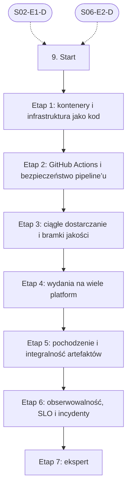

# 09. DevOps, CI/CD i wydania: plan wdrożenia w Linear

Team **LEA** (https://linear.app/daankh/team/LEA/overview). Plan do przeglądu przed wdrożeniem: nic nie zostało jeszcze utworzone w Linear. Klucze zadań (np. `S09-E0-M1`) są robocze; po wdrożeniu dostaną identyfikatory `LEA-…`.

**W skrócie:** 7 kamieni milowych, 39 zadań (1 start, 28 materiałów, 7 dowodów, 3 praktyki). Plik główny z kolejnością projektów: `00-kolejnosc-i-zaleznosci.md`.

## 1. Projekt

| Pole | Wartość |
|---|---|
| Nazwa | 09. DevOps, CI/CD i wydania |
| Team | LEA |
| Podsumowanie (pole „Summary”) | Warstwa 2: jakość i projektowanie. Opiera się na: 2 i 6. Jest podstawą: 10, 11 oraz wydań w sekcjach 14–19. |
| Proponowany start | 2026-11-02 |
| Proponowany termin | 2027-03-31 |
| Etykiety projektu | `warstwa-2` |
| Blokowany przez (projekty) | 02. Języki i narzędzia podstawowe, 06. Testowanie |
| Blokuje (projekty) | 10. Bezpieczeństwo, 12. Rust jako wspólny fundament, 15. Linux, 16. macOS, 17. Windows, 18. Android, 19. iOS |
| Czas od zera | 190–250 h |

### Opis projektu (do wklejenia w Linear)

*Warstwa 2: jakość i projektowanie. Opiera się na: 2 i 6. Jest podstawą: 10, 11 oraz wydań w sekcjach 14–19.*

**Zakres umiejętności**

- GitHub Actions: macierze systemów i targetów, runnery macOS i Windows, cache (`sccache`, `Swatinem/rust-cache`), sekrety i OIDC do chmury.
- Bramki jakości: testy, lint, `clippy`, typecheck, SAST, SCA, SBOM jako warunek scalenia i wydania.
- Automatyzacja wydań: wersjonowanie semantyczne, Conventional Commits, changelog, `tauri-action`, fastlane lub API App Store Connect i Google Play.
- Podpisy w CI: certyfikaty Apple, Windows, klucze aktualizacji Tauri, klucze Androida, GPG dla Linuksa; bezpieczne przechowywanie kluczy.
- Pochodzenie i integralność artefaktów: powtarzalne buildy, SLSA, podpisy Sigstore/cosign.
- Infrastruktura: Linux, Docker, sieci, DNS, TLS, SPF/DKIM/DMARC; czytanie planów Terraform i manifestów Kubernetes.
- Obserwowalność: OpenTelemetry, logi, metryki, SLO, alerty; raportowanie awarii (np. Sentry) z symbolami dSYM, PDB i plików mapowania.
- Koszty: limity i alerty budżetowe w chmurze i u dostawców AI.

**Ścieżka nauki**

Ścieżka ma 7 etapów, numerowanych od 1, bo podstawy Linuksa, powłoki, Gita i sieci są w sekcji 2.1. Każdy kończy się **dowodem**, czyli małym projektem, który pokazuje, że etap jest opanowany. Przy doświadczeniu seniorskim etap 1 można zaliczyć samym dowodem i wracać do materiałów tylko tam, gdzie dowód nie wychodzi; nowe będą najpewniej wydania na wiele platform (etap 4), pochodzenie artefaktów (etap 5) i SRE (etap 6). Narzędzia SAST, SCA i generowania SBOM są w sekcji 10, a szczegóły podpisów platformowych w sekcjach 15–17; tutaj chodzi o ich wpięcie w pipeline. Czas podany dla osoby startującej od zera; ceny materiałów płatnych zmieniają się, więc warto je sprawdzić przed zakupem.

Razem od zera do poziomu E: ok. 190–250 h, czyli 4–6 miesięcy przy 10–12 h tygodniowo.

**Definicja ukończenia projektu (dowód poziomu E)**

Samodzielnie, bez agenta, w 1 dzień wdrażasz szablon pipeline’u u klienta (bramki, SBOM, podpisane wydanie, monitoring z alertem SLO), diagnozujesz nieudane wydanie lub fałszywy alarm na podstawie logów i śladów, i umiesz wyjaśnić osobie nietechnicznej, co pipeline gwarantuje, a czego nie.

**Źródło:** dokument „Umiejętności techniczne” w projekcie „JDG: Rozwój oprogramowania”, sekcja 9.

## 2. Kamienie milowe

Jeden kamień milowy na etap ścieżki. Kamień milowy jest zamknięty, gdy zamknięte jest zadanie dowodu tego etapu. Daty kamieni milowych ustawiasz przy wdrożeniu według kolejności z pliku głównego.

| # | Kamień milowy | Cel | Czas od zera | Poziom po etapie | Zadania |
|---|---|---|---|---|---|
| 1 | Etap 1: kontenery i infrastruktura jako kod | kontenery i infrastruktura jako kod (czytanie) | 30–40 h | podstawy | 4 |
| 2 | Etap 2: GitHub Actions i bezpieczeństwo pipeline’u | GitHub Actions i bezpieczeństwo pipeline’u | 30–40 h | W | 5 |
| 3 | Etap 3: ciągłe dostarczanie i bramki jakości | ciągłe dostarczanie i bramki jakości | 30–40 h | W | 4 |
| 4 | Etap 4: wydania na wiele platform | wydania: wersjonowanie, changelog, wiele platform, aktualizacje | 40–50 h | W | 6 |
| 5 | Etap 5: pochodzenie i integralność artefaktów | pochodzenie i integralność artefaktów: SLSA, Sigstore, powtarzalne buildy | 20–30 h | W | 5 |
| 6 | Etap 6: obserwowalność, SLO i incydenty | obserwowalność, SLO, incydenty | 40–50 h | E | 6 |
| 7 | Etap 7: ekspert | ekspert: recenzja pipeline’ów z AI, ćwiczenia awarii, aktualność | stale, ok. 1–2 h tygodniowo | E | 8 |

## 3. Punkt startu

Zadanie **`S09-START` · Start: 9. DevOps, CI/CD i wydania** to jedyne wejście do projektu: wszystkie zadania pierwszego etapu są przez nie blokowane.

- **Blokowane przez:** `S02-E1-D`, `S06-E2-D`
- **Odblokowuje:** `S09-E1-M1`, `S09-E1-M2`, `S09-E1-M3`
- **Status początkowy:** Backlog do czasu zamknięcia zadań blokujących, potem Todo

Opis zadania (do wklejenia):

Punkt startu projektu „09. DevOps, CI/CD i wydania”.

**Warunki wejścia (zadania blokujące):**

- `S02-E1-D` · Dowód etapu 1: Bash i `jq` — sekcja 2 na poziomie podstawowym do pracy (etap 1)
- `S06-E2-D` · Dowód etapu 2: projektowanie testów — sekcja 6 na poziomie podstawowym do pracy (etap 2)

**Do zrobienia:**

- przeczytać sekcję 9 dokumentu „Umiejętności techniczne”,
- zaznaczyć etapy, które zaliczasz samym dowodem (zgodnie z akapitem wstępnym ścieżki), i dla nich zamknąć zadania materiałów jako niepotrzebne,
- ustawić daty kamieni milowych zgodnie z kolejnością z pliku głównego.

## 4. Przepływ zależności

Linie ciągłe to zależności wewnątrz projektu, przerywane to zadania z innych projektów. Wewnątrz etapu zadania materiałów są równoległe i wszystkie blokują dowód etapu; dowód etapu blokuje materiały kolejnego etapu.

## 5. Zadania według kamieni milowych

Szablon opisu zadania materiału: nazwa materiału, autor lub wydawca, typ, czas, koszt i link (jak w kolumnach poniżej) oraz zdanie „Gotowe, gdy materiał jest przerobiony w zakresie potrzebnym do dowodu etapu”. Opisy dowodów i praktyk są podane pod tabelą każdego etapu.

### Etap 1: kontenery i infrastruktura jako kod

Opis kamienia milowego (do wklejenia):

**Cel:** kontenery i infrastruktura jako kod (czytanie) · **Czas od zera:** 30–40 h · **Poziom po etapie:** podstawy

**Szczególnie ważne:** małe obrazy dla binarek Rusta (wieloetapowy build, obraz bazowy distroless lub `scratch`), użytkownik bez roota w kontenerze, czytanie `terraform plan` przed zatwierdzeniem zmian proponowanych przez agenta, stan Terraform i sekrety.

**Dowód:** Usługa z sekcji 2.1, etap 0, w obrazie poniżej 30 MB uruchamianym bez roota; infrastruktura (serwer, DNS, bucket na kopie zapasowe) opisana w Terraform, z przejrzanym i skomentowanym planem zmian.

| Klucz | Tytuł | Typ | Czas | Koszt | Link | Blokowane przez | Blokuje |
|---|---|---|---|---|---|---|---|
| `S09-E1-M1` | Przerobić: Docker: Get started (pojęcia, budowa obrazów, wieloetapowe buildy) | materiał | 8–10 h | 0 zł | https://docs.docker.com/get-started/ | `S09-START` | `S09-E1-D` |
| `S09-E1-M2` | Przerobić: Terraform Tutorials | materiał | 10–12 h | 0 zł | https://developer.hashicorp.com/terraform/tutorials | `S09-START` | `S09-E1-D` |
| `S09-E1-M3` | Przerobić: Kubernetes: Concepts | materiał | 8–10 h | 0 zł | https://kubernetes.io/docs/concepts/ | `S09-START` | `S09-E1-D` |
| `S09-E1-D` | Dowód etapu 1: kontenery i infrastruktura jako kod | dowód | — | — | — | `S09-E1-M1`, `S09-E1-M2`, `S09-E1-M3` | `S09-E2-M1`, `S09-E2-M2`, `S09-E2-M3`, `S09-E2-M4` |

**`S09-E1-D` · Dowód etapu 1: kontenery i infrastruktura jako kod**

Usługa z sekcji 2.1, etap 0, w obrazie poniżej 30 MB uruchamianym bez roota; infrastruktura (serwer, DNS, bucket na kopie zapasowe) opisana w Terraform, z przejrzanym i skomentowanym planem zmian.

**Na co zwrócić uwagę:** małe obrazy dla binarek Rusta (wieloetapowy build, obraz bazowy distroless lub `scratch`), użytkownik bez roota w kontenerze, czytanie `terraform plan` przed zatwierdzeniem zmian proponowanych przez agenta, stan Terraform i sekrety.

**Kryterium ukończenia:** dowód wykonany samodzielnie; w komentarzu link do repozytorium, raportu lub notatki.

### Etap 2: GitHub Actions i bezpieczeństwo pipeline’u

Opis kamienia milowego (do wklejenia):

**Cel:** GitHub Actions i bezpieczeństwo pipeline’u · **Czas od zera:** 30–40 h · **Poziom po etapie:** W

**Szczególnie ważne:** akcje przypięte do pełnego SHA, minimalne uprawnienia `GITHUB_TOKEN` (domyślnie tylko odczyt), ryzyko `pull_request_target` i `workflow_run`, wstrzykiwanie poleceń przez dane z `github.event`, OIDC zamiast długotrwałych kluczy do chmury, środowiska z wymaganym zatwierdzeniem dla sekretów do podpisów.

**Dowód:** Workflow budujący rdzeń w Ruście w macierzy Linux, macOS i Windows z cache; wszystkie akcje przypięte do SHA, uprawnienia ustawione per job, wdrożenie do chmury przez OIDC bez zapisanych kluczy; lista kontrolna bezpieczeństwa workflow zastosowana do jednego publicznego repozytorium.

| Klucz | Tytuł | Typ | Czas | Koszt | Link | Blokowane przez | Blokuje |
|---|---|---|---|---|---|---|---|
| `S09-E2-M1` | Przerobić: GitHub Actions: dokumentacja, w tym macierze jobów | materiał | 10–12 h | 0 zł | https://docs.github.com/en/actions | `S09-E1-D` | `S09-E2-D` |
| `S09-E2-M2` | Przerobić: Secure use reference (dawniej „Security hardening for GitHub Actions”) | materiał | 3–4 h | 0 zł | https://docs.github.com/en/actions/reference/security/secure-use | `S09-E1-D` | `S09-E2-D` |
| `S09-E2-M3` | Przerobić: OpenID Connect w GitHub Actions | materiał | 2–3 h | 0 zł | https://docs.github.com/en/actions/concepts/security/openid-connect | `S09-E1-D` | `S09-E2-D` |
| `S09-E2-M4` | Przerobić: `Swatinem/rust-cache`, `sccache` | materiał | 2–3 h | 0 zł | https://github.com/Swatinem/rust-cache, https://github.com/mozilla/sccache | `S09-E1-D` | `S09-E2-D` |
| `S09-E2-D` | Dowód etapu 2: GitHub Actions i bezpieczeństwo pipeline’u | dowód | — | — | — | `S09-E2-M1`, `S09-E2-M2`, `S09-E2-M3`, `S09-E2-M4` | `S09-E3-M1`, `S09-E3-M2`, `S09-E3-M3`, `S10-START`, `S12-START`, `S15-START`, `S16-START`, `S17-START`, `S18-START`, `S19-START` |

**`S09-E2-D` · Dowód etapu 2: GitHub Actions i bezpieczeństwo pipeline’u**

Workflow budujący rdzeń w Ruście w macierzy Linux, macOS i Windows z cache; wszystkie akcje przypięte do SHA, uprawnienia ustawione per job, wdrożenie do chmury przez OIDC bez zapisanych kluczy; lista kontrolna bezpieczeństwa workflow zastosowana do jednego publicznego repozytorium.

**Na co zwrócić uwagę:** akcje przypięte do pełnego SHA, minimalne uprawnienia `GITHUB_TOKEN` (domyślnie tylko odczyt), ryzyko `pull_request_target` i `workflow_run`, wstrzykiwanie poleceń przez dane z `github.event`, OIDC zamiast długotrwałych kluczy do chmury, środowiska z wymaganym zatwierdzeniem dla sekretów do podpisów.

**Kryterium ukończenia:** dowód wykonany samodzielnie; w komentarzu link do repozytorium, raportu lub notatki.

### Etap 3: ciągłe dostarczanie i bramki jakości

Opis kamienia milowego (do wklejenia):

**Cel:** ciągłe dostarczanie i bramki jakości · **Czas od zera:** 30–40 h · **Poziom po etapie:** W

**Szczególnie ważne:** jeden pipeline jako jedyna droga do produkcji, artefakt budowany raz i promowany między środowiskami, bramki jako warunek scalenia (testy, lint, `clippy`, typecheck, SAST, SCA, SBOM; narzędzia w sekcji 10), cztery metryki DORA mierzone także dla pracy agentów.

**Dowód:** Szablon pipeline’u gotowy do wdrożenia u klienta: bramki jakości jako wymagane sprawdzenia w ochronie gałęzi, SBOM w CycloneDX dołączany do każdego buildu, raport bramek w opisie pull requesta, krótka instrukcja wdrożenia szablonu w repozytorium klienta.

| Klucz | Tytuł | Typ | Czas | Koszt | Link | Blokowane przez | Blokuje |
|---|---|---|---|---|---|---|---|
| `S09-E3-M1` | Przerobić: Continuous Delivery | materiał, płatny | 15–20 h | płatna | https://www.informit.com/store/continuous-delivery-reliable-software-releases-through-build-9780321601919 | `S09-E2-D` | `S09-E3-D` |
| `S09-E3-M2` | Przerobić: Accelerate | materiał, płatny | 6–8 h | płatna | https://itrevolution.com/product/accelerate/ | `S09-E2-D` | `S09-E3-D` |
| `S09-E3-M3` | Przerobić: DORA: metryki dostarczania i raporty badawcze | materiał | 4–6 h | 0 zł | https://dora.dev | `S09-E2-D` | `S09-E3-D` |
| `S09-E3-D` | Dowód etapu 3: ciągłe dostarczanie i bramki jakości | dowód | — | — | — | `S09-E3-M1`, `S09-E3-M2`, `S09-E3-M3` | `S09-E4-M1`, `S09-E4-M2`, `S09-E4-M3`, `S09-E4-M4`, `S09-E4-M5` |

**`S09-E3-D` · Dowód etapu 3: ciągłe dostarczanie i bramki jakości**

Szablon pipeline’u gotowy do wdrożenia u klienta: bramki jakości jako wymagane sprawdzenia w ochronie gałęzi, SBOM w CycloneDX dołączany do każdego buildu, raport bramek w opisie pull requesta, krótka instrukcja wdrożenia szablonu w repozytorium klienta.

**Na co zwrócić uwagę:** jeden pipeline jako jedyna droga do produkcji, artefakt budowany raz i promowany między środowiskami, bramki jako warunek scalenia (testy, lint, `clippy`, typecheck, SAST, SCA, SBOM; narzędzia w sekcji 10), cztery metryki DORA mierzone także dla pracy agentów.

**Kryterium ukończenia:** dowód wykonany samodzielnie; w komentarzu link do repozytorium, raportu lub notatki.

### Etap 4: wydania na wiele platform

Opis kamienia milowego (do wklejenia):

**Cel:** wydania: wersjonowanie, changelog, wiele platform, aktualizacje · **Czas od zera:** 40–50 h · **Poziom po etapie:** W

**Szczególnie ważne:** wersja wynikająca z historii commitów, a nie z ręcznej decyzji agenta; klucz podpisu aktualizacji Tauri (utrata oznacza brak aktualizacji dla zainstalowanych kopii, więc kopia zapasowa poza CI); podpisy i notaryzacja wykonywane w CI z sekretami w środowisku chronionym (szczegóły platform w sekcjach 19, 15–17); ścieżki testowe sklepów przed produkcją.

**Dowód:** Wydanie aplikacji Tauri na Linux, macOS i Windows z jednego tagu: podpisane instalatory, plik aktualizacji dla Updatera, changelog z Conventional Commits; zainstalowana starsza wersja aktualizuje się automatycznie, a zmodyfikowana paczka aktualizacji jest odrzucana; build mobilny wysłany przez fastlane do TestFlight i ścieżki testów wewnętrznych Google Play.

| Klucz | Tytuł | Typ | Czas | Koszt | Link | Blokowane przez | Blokuje |
|---|---|---|---|---|---|---|---|
| `S09-E4-M1` | Przerobić: Semantic Versioning 2.0.0, Conventional Commits 1.0.0 | materiał | 2 h | 0 zł | https://semver.org, https://www.conventionalcommits.org/en/v1.0.0/ | `S09-E3-D` | `S09-E4-D` |
| `S09-E4-M2` | Przerobić: release-plz (wydania crate’ów przez PR z changelogiem) i `cargo-semver-checks` | materiał | 3–4 h | 0 zł | https://release-plz.dev, https://github.com/obi1kenobi/cargo-semver-checks | `S09-E3-D` | `S09-E4-D` |
| `S09-E4-M3` | Przerobić: dist (dawniej cargo-dist): instalatory i wydania narzędzi CLI | materiał | 3–4 h | 0 zł | https://axodotdev.github.io/cargo-dist/book/ | `S09-E3-D` | `S09-E4-D` |
| `S09-E4-M4` | Przerobić: Tauri: GitHub pipeline (`tauri-action`) i plugin Updater | materiał | 5–6 h | 0 zł | https://v2.tauri.app/distribute/pipelines/github/, https://v2.tauri.app/plugin/updater/ | `S09-E3-D` | `S09-E4-D` |
| `S09-E4-M5` | Przerobić: fastlane (w tym `match` do certyfikatów Apple) | materiał | 6–8 h | 0 zł | https://docs.fastlane.tools | `S09-E3-D` | `S09-E4-D` |
| `S09-E4-D` | Dowód etapu 4: wydania na wiele platform | dowód | — | — | — | `S09-E4-M1`, `S09-E4-M2`, `S09-E4-M3`, `S09-E4-M4`, `S09-E4-M5` | `S09-E5-M1`, `S09-E5-M2`, `S09-E5-M3`, `S09-E5-M4` |

**`S09-E4-D` · Dowód etapu 4: wydania na wiele platform**

Wydanie aplikacji Tauri na Linux, macOS i Windows z jednego tagu: podpisane instalatory, plik aktualizacji dla Updatera, changelog z Conventional Commits; zainstalowana starsza wersja aktualizuje się automatycznie, a zmodyfikowana paczka aktualizacji jest odrzucana; build mobilny wysłany przez fastlane do TestFlight i ścieżki testów wewnętrznych Google Play.

**Na co zwrócić uwagę:** wersja wynikająca z historii commitów, a nie z ręcznej decyzji agenta; klucz podpisu aktualizacji Tauri (utrata oznacza brak aktualizacji dla zainstalowanych kopii, więc kopia zapasowa poza CI); podpisy i notaryzacja wykonywane w CI z sekretami w środowisku chronionym (szczegóły platform w sekcjach 19, 15–17); ścieżki testowe sklepów przed produkcją.

**Kryterium ukończenia:** dowód wykonany samodzielnie; w komentarzu link do repozytorium, raportu lub notatki.

### Etap 5: pochodzenie i integralność artefaktów

Opis kamienia milowego (do wklejenia):

**Cel:** pochodzenie i integralność artefaktów: SLSA, Sigstore, powtarzalne buildy · **Czas od zera:** 20–30 h · **Poziom po etapie:** W

**Szczególnie ważne:** poziomy SLSA Build (atestacje GitHub dają poziom 2, poziom 3 wymaga wielokrotnego workflow izolującego build), weryfikacja atestacji i podpisów po stronie odbiorcy, a nie tylko ich wystawienie; powtarzalność jako dowód, że binarka odpowiada kodowi źródłowemu, co wspiera dokumentację techniczną wymaganą przez CRA.

**Dowód:** Artefakty wydania z etapu 4 z atestacją pochodzenia i podpisem Sigstore, SBOM dołączonym do wydania i instrukcją weryfikacji dla klienta (`gh attestation verify` lub `cosign verify-blob`); binarka CLI w Ruście zbudowana dwa razy w różnych środowiskach z identyczną sumą kontrolną.

| Klucz | Tytuł | Typ | Czas | Koszt | Link | Blokowane przez | Blokuje |
|---|---|---|---|---|---|---|---|
| `S09-E5-M1` | Przerobić: SLSA Specification v1.2 | materiał | 4–6 h | 0 zł | https://slsa.dev/spec/v1.2/ | `S09-E4-D` | `S09-E5-D` |
| `S09-E5-M2` | Przerobić: Sigstore (cosign, Fulcio, Rekor) | materiał | 4–6 h | 0 zł | https://docs.sigstore.dev | `S09-E4-D` | `S09-E5-D` |
| `S09-E5-M3` | Przerobić: GitHub Artifact attestations | materiał | 2 h | 0 zł | https://docs.github.com/en/actions/concepts/security/artifact-attestations | `S09-E4-D` | `S09-E5-D` |
| `S09-E5-M4` | Przerobić: Reproducible Builds: dokumentacja | materiał | 4–6 h | 0 zł | https://reproducible-builds.org/docs/ | `S09-E4-D` | `S09-E5-D` |
| `S09-E5-D` | Dowód etapu 5: pochodzenie i integralność artefaktów | dowód | — | — | — | `S09-E5-M1`, `S09-E5-M2`, `S09-E5-M3`, `S09-E5-M4` | `S09-E6-M1`, `S09-E6-M2`, `S09-E6-M3`, `S09-E6-M4`, `S09-E6-M5` |

**`S09-E5-D` · Dowód etapu 5: pochodzenie i integralność artefaktów**

Artefakty wydania z etapu 4 z atestacją pochodzenia i podpisem Sigstore, SBOM dołączonym do wydania i instrukcją weryfikacji dla klienta (`gh attestation verify` lub `cosign verify-blob`); binarka CLI w Ruście zbudowana dwa razy w różnych środowiskach z identyczną sumą kontrolną.

**Na co zwrócić uwagę:** poziomy SLSA Build (atestacje GitHub dają poziom 2, poziom 3 wymaga wielokrotnego workflow izolującego build), weryfikacja atestacji i podpisów po stronie odbiorcy, a nie tylko ich wystawienie; powtarzalność jako dowód, że binarka odpowiada kodowi źródłowemu, co wspiera dokumentację techniczną wymaganą przez CRA.

**Kryterium ukończenia:** dowód wykonany samodzielnie; w komentarzu link do repozytorium, raportu lub notatki.

### Etap 6: obserwowalność, SLO i incydenty

Opis kamienia milowego (do wklejenia):

**Cel:** obserwowalność, SLO, incydenty · **Czas od zera:** 40–50 h · **Poziom po etapie:** E

**Szczególnie ważne:** SLO i budżet błędów zamiast alertów na każdą metrykę, alerty wielookienkowe według tempa zużycia budżetu (burn rate), `tracing` w Ruście z eksportem do OpenTelemetry, symbole debugowania wysyłane w pipeline wydania, postmortem bez szukania winnych, zgłaszanie aktywnie wykorzystywanych podatności i poważnych incydentów w terminach CRA (od 11 września 2026 r.).

**Dowód:** Usługa produkcyjna z SLO dostępności i opóźnienia, alertem burn rate wysyłanym na telefon, śladami OpenTelemetry i raportami awarii z symbolami z aplikacji desktopowej; ćwiczenie awarii zakończone postmortemem według szablonu z SRE Book, z czasem wykrycia i przywrócenia.

| Klucz | Tytuł | Typ | Czas | Koszt | Link | Blokowane przez | Blokuje |
|---|---|---|---|---|---|---|---|
| `S09-E6-M1` | Przerobić: Site Reliability Engineering, m.in. rozdziały 4 (SLO), 6 (monitorowanie), 14 („Managing… | materiał | 12–15 h | 0 zł online | https://sre.google/sre-book/table-of-contents/ | `S09-E5-D` | `S09-E6-D` |
| `S09-E6-M2` | Przerobić: The Site Reliability Workbook, rozdziały 2 („Implementing SLOs”) i 5 | materiał | 6–8 h | 0 zł online | https://sre.google/workbook/table-of-contents/ | `S09-E5-D` | `S09-E6-D` |
| `S09-E6-M3` | Przerobić: Observability Engineering (wydanie 2, czerwiec 2026) | materiał, płatny | 12–15 h | płatna (darmowy egzemplarz oferuje Honeycomb) | https://www.oreilly.com/library/view/-/9781098179915/ | `S09-E5-D` | `S09-E6-D` |
| `S09-E6-M4` | Przerobić: OpenTelemetry: pojęcia, Collector, Rust | materiał | 6–8 h | 0 zł | https://opentelemetry.io/docs/ | `S09-E5-D` | `S09-E6-D` |
| `S09-E6-M5` | Przerobić: Sentry: SDK dla Rusta i plików debugowania | materiał, płatny | 4–5 h | 0 zł (usługa: plan darmowy i płatne) | https://docs.sentry.io/platforms/rust/, https://docs.sentry.io/cli/dif/ | `S09-E5-D` | `S09-E6-D` |
| `S09-E6-D` | Dowód etapu 6: obserwowalność, SLO i incydenty | dowód | — | — | — | `S09-E6-M1`, `S09-E6-M2`, `S09-E6-M3`, `S09-E6-M4`, `S09-E6-M5` | `S09-E7-M1`, `S09-E7-M2`, `S09-E7-M3`, `S09-E7-M4`, `S09-E7-P1`, `S09-E7-P2`, `S09-E7-P3` |

**`S09-E6-D` · Dowód etapu 6: obserwowalność, SLO i incydenty**

Usługa produkcyjna z SLO dostępności i opóźnienia, alertem burn rate wysyłanym na telefon, śladami OpenTelemetry i raportami awarii z symbolami z aplikacji desktopowej; ćwiczenie awarii zakończone postmortemem według szablonu z SRE Book, z czasem wykrycia i przywrócenia.

**Na co zwrócić uwagę:** SLO i budżet błędów zamiast alertów na każdą metrykę, alerty wielookienkowe według tempa zużycia budżetu (burn rate), `tracing` w Ruście z eksportem do OpenTelemetry, symbole debugowania wysyłane w pipeline wydania, postmortem bez szukania winnych, zgłaszanie aktywnie wykorzystywanych podatności i poważnych incydentów w terminach CRA (od 11 września 2026 r.).

**Kryterium ukończenia:** dowód wykonany samodzielnie; w komentarzu link do repozytorium, raportu lub notatki.

### Etap 7: ekspert

Opis kamienia milowego (do wklejenia):

**Cel:** ekspert: recenzja pipeline’ów z AI, ćwiczenia awarii, aktualność · **Czas od zera:** stale, ok. 1–2 h tygodniowo · **Poziom po etapie:** E

**Dowód poziomu E:** Samodzielnie, bez agenta, w 1 dzień wdrażasz szablon pipeline’u u klienta (bramki, SBOM, podpisane wydanie, monitoring z alertem SLO), diagnozujesz nieudane wydanie lub fałszywy alarm na podstawie logów i śladów, i umiesz wyjaśnić osobie nietechnicznej, co pipeline gwarantuje, a czego nie.

| Klucz | Tytuł | Typ | Czas | Koszt | Link | Blokowane przez | Blokuje |
|---|---|---|---|---|---|---|---|
| `S09-E7-M1` | Przerobić: GitHub Changelog i komunikaty bezpieczeństwa GitHub Actions | materiał | ok. 30 min tygodniowo | 0 zł | https://github.blog/changelog/ | `S09-E6-D` | `S09-E7-D` |
| `S09-E7-M2` | Przerobić: Release It! (wydanie 2) | materiał, płatny | 12–15 h | płatna | https://pragprog.com/titles/mnee2/release-it-second-edition/ | `S09-E6-D` | `S09-E7-D` |
| `S09-E7-M3` | Przerobić: Implementing Service Level Objectives | materiał, płatny | 12–15 h | płatna | https://www.oreilly.com/library/view/implementing-service-level/9781492076803/ | `S09-E6-D` | `S09-E7-D` |
| `S09-E7-M4` | Przerobić: Building Secure and Reliable Systems | materiał | wg potrzeb | 0 zł online | https://google.github.io/building-secure-and-reliable-systems/raw/toc.html | `S09-E6-D` | `S09-E7-D` |
| `S09-E7-P1` | Praktyka: recenzja pipeline’ów z AI | praktyka | — | — | — | `S09-E6-D` | `S09-E7-D` |
| `S09-E7-P2` | Praktyka: ćwiczenie wydania awaryjnego | praktyka | — | — | — | `S09-E6-D` | `S09-E7-D` |
| `S09-E7-P3` | Praktyka: ćwiczenie odtworzenia | praktyka | — | — | — | `S09-E6-D` | `S09-E7-D` |
| `S09-E7-D` | Dowód poziomu E: ekspert | dowód | — | — | — | `S09-E7-M1`, `S09-E7-M2`, `S09-E7-M3`, `S09-E7-M4`, `S09-E7-P1`, `S09-E7-P2`, `S09-E7-P3` | — |

**`S09-E7-P1` · Praktyka: recenzja pipeline’ów z AI**

20 zmian w workflow, Dockerfile i Terraform wygenerowanych przez agentów, recenzowanych według listy kontrolnej z etapów 2, 3 i 5 (akcje nieprzypięte do SHA, nadmiarowe uprawnienia, sekrety w logach lub argumentach, wyłączone lub warunkowo pomijane bramki, `continue-on-error` na krokach jakości, cache zatruwany z gałęzi pull requestów, `terraform apply` bez przeglądu planu).

Praktyka ciągła etapu eksperckiego: oznacz jako gotową, gdy działa jako stały element pracy, a nie po jednorazowym wykonaniu.

**`S09-E7-P2` · Praktyka: ćwiczenie wydania awaryjnego**

Poprawka podatności od zgłoszenia do podpisanego wydania na wszystkich platformach w 24 h, z zaktualizowanym SBOM i komunikatem dla użytkowników.

Praktyka ciągła etapu eksperckiego: oznacz jako gotową, gdy działa jako stały element pracy, a nie po jednorazowym wykonaniu.

**`S09-E7-P3` · Praktyka: ćwiczenie odtworzenia**

Odtworzenie infrastruktury i kluczy podpisu z kopii zapasowych na czystym koncie.

Praktyka ciągła etapu eksperckiego: oznacz jako gotową, gdy działa jako stały element pracy, a nie po jednorazowym wykonaniu.

**`S09-E7-D` · Dowód poziomu E: ekspert**

Samodzielnie, bez agenta, w 1 dzień wdrażasz szablon pipeline’u u klienta (bramki, SBOM, podpisane wydanie, monitoring z alertem SLO), diagnozujesz nieudane wydanie lub fałszywy alarm na podstawie logów i śladów, i umiesz wyjaśnić osobie nietechnicznej, co pipeline gwarantuje, a czego nie.

**Kryterium ukończenia:** dowód wykonany samodzielnie; w komentarzu link do repozytorium, raportu lub notatki. Bez agenta AI.

## 6. Relacje z innymi projektami

**Wchodzące** (zadanie z innego projektu blokuje zadanie tego projektu):

- `S02-E1-D` (Dowód etapu 1: Bash i `jq`) → `S09-START`
- `S06-E2-D` (Dowód etapu 2: projektowanie testów) → `S09-START`

**Wychodzące** (zadanie tego projektu blokuje zadanie w innym projekcie):

- `S09-E2-D` → `S10-START` (10. Bezpieczeństwo)
- `S09-E2-D` → `S12-START` (12. Rust jako wspólny fundament)
- `S09-E2-D` → `S15-START` (15. Linux)
- `S09-E2-D` → `S16-START` (16. macOS)
- `S09-E2-D` → `S17-START` (17. Windows)
- `S09-E2-D` → `S18-START` (18. Android)
- `S09-E2-D` → `S19-START` (19. iOS)
