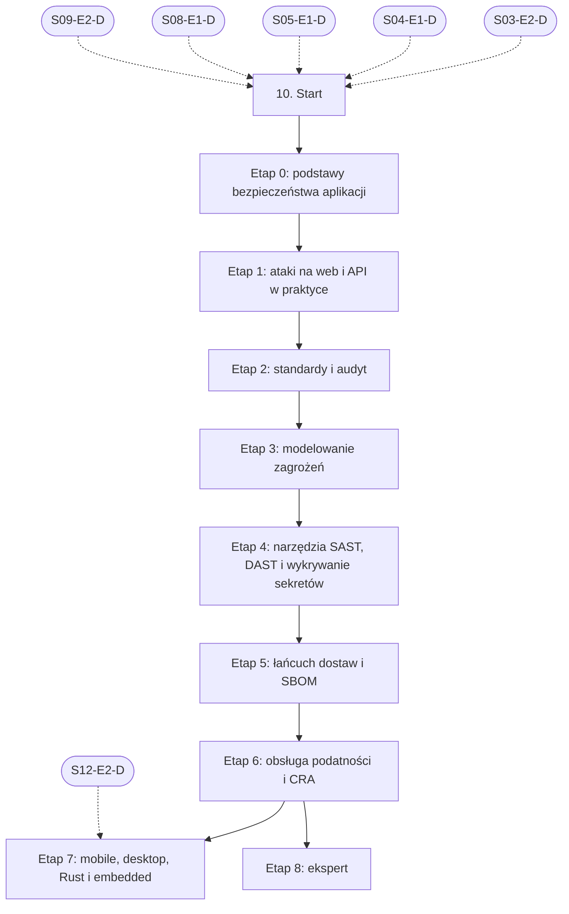

# 10. Bezpieczeństwo: plan wdrożenia w Linear

Team **LEA** (https://linear.app/daankh/team/LEA/overview). Plan do przeglądu przed wdrożeniem: nic nie zostało jeszcze utworzone w Linear. Klucze zadań (np. `S10-E0-M1`) są robocze; po wdrożeniu dostaną identyfikatory `LEA-…`.

**W skrócie:** 9 kamieni milowych, 50 zadań (1 start, 36 materiałów, 9 dowodów, 4 praktyki). Plik główny z kolejnością projektów: `00-kolejnosc-i-zaleznosci.md`.

## 1. Projekt

| Pole | Wartość |
|---|---|
| Nazwa | 10. Bezpieczeństwo |
| Team | LEA |
| Podsumowanie (pole „Summary”) | Warstwa 3: ochrona i kontrola. Opiera się na: 3, 4, 5, 8 i 9; części platformowe dochodzą przy sekcjach 14–22. Jest podstawą: 11, 20, 21 i 22. |
| Proponowany start | 2026-11-02 |
| Proponowany termin | 2027-03-31 |
| Etykiety projektu | `warstwa-3` |
| Blokowany przez (projekty) | 03. Frontend web, 04. Bazy danych i dane, 05. Backend i API, 08. Architektura i projektowanie systemów, 09. DevOps, CI/CD i wydania |
| Blokuje (projekty) | 11. Weryfikacja pracy AI i budowa procesu, 20. Lokalne AI i rozwój modeli, 21. Funkcje AI w aplikacjach, 22. Systemy wbudowane |
| Zależności częściowe (wchodzące) | etap 7 czeka na 12. Rust jako wspólny fundament (etap 2) |
| Czas od zera | 330–440 h |

### Opis projektu (do wklejenia w Linear)

*Warstwa 3: ochrona i kontrola. Opiera się na: 3, 4, 5, 8 i 9; części platformowe dochodzą przy sekcjach 14–22. Jest podstawą: 11, 20, 21 i 22.*

**Zakres umiejętności**

- Web i API: OWASP ASVS (poziom 1 i wybrane wymagania poziomu 2), OWASP Top 10 i API Top 10, nagłówki bezpieczeństwa, CSP.
- Mobile: OWASP MASVS i MASTG, pinning certyfikatów, przechowywanie sekretów, inżynieria wsteczna aplikacji.
- Desktop: zakres capabilities w Tauri, walidacja wejścia w poleceniach IPC, podpis aktualizacji, uprawnienia systemowe.
- Embedded: secure boot, podpis firmware, ochrona kluczy, interfejsy debugowania, aktualizacje bez możliwości cofnięcia do podatnej wersji.
- Łańcuch dostaw: SBOM w CycloneDX (`cargo-cyclonedx`, `cargo-auditable`, narzędzia dla npm), `cargo-audit`, `cargo-deny`, `cargo-vet`, `osv-scanner`, Dependabot lub Renovate; priorytety według CVSS, EPSS i KEV.
- Narzędzia: gitleaks, Semgrep, CodeQL, OWASP ZAP; `cargo-geiger` do mapy kodu `unsafe`.
- Modelowanie zagrożeń STRIDE i LINDDUN dla każdej klasy aplikacji.
- Ryzyka specyficzne dla AI: zależności wymyślone przez model i podszywające się pod nie pakiety (typosquatting), prompt injection w treściach z repozytorium, agenci bez poświadczeń produkcyjnych.

**Ścieżka nauki**

Ścieżka ma 9 etapów. Każdy kończy się **dowodem**, czyli małym projektem, który pokazuje, że etap jest opanowany. Dowody odpowiadają usługom z biznesplanu: audyt według ASVS, model zagrożeń, triage podatności i zgłoszenie w trybie CRA. Przy doświadczeniu seniorskim etap 0 można zaliczyć samym dowodem, ale etapy 2, 5 i 6 warto przejść w całości, bo to rdzeń niszy „rescue & hardening”. Czas podany dla osoby startującej od zera; ceny materiałów płatnych zmieniają się, więc warto je sprawdzić przed zakupem. Ściągawki OWASP o XSS, CSP i sesjach są w etapie 6 ścieżki frontendowej (zob. sekcja 3.1), testy w sekcji 6, a bramki CI w sekcji 9.

Razem od zera do poziomu E: ok. 330–440 h, czyli 7–10 miesięcy przy 10–12 h tygodniowo.

**Definicja ukończenia projektu (dowód poziomu E)**

Samodzielnie, bez agenta, w 2 dni przeprowadzasz audyt nieznanej aplikacji (ASVS L1, model zagrożeń, SBOM i triage podatności), znajdujesz co najmniej jeden błąd kontroli dostępu lub łańcucha dostaw, który przeoczyły narzędzia automatyczne, i przedstawiasz klientowi raport z planem naprawy i oceną obowiązków z CRA.

**Źródło:** dokument „Umiejętności techniczne” w projekcie „JDG: Rozwój oprogramowania”, sekcja 10.

## 2. Kamienie milowe

Jeden kamień milowy na etap ścieżki. Kamień milowy jest zamknięty, gdy zamknięte jest zadanie dowodu tego etapu. Daty kamieni milowych ustawiasz przy wdrożeniu według kolejności z pliku głównego.

| # | Kamień milowy | Cel | Czas od zera | Poziom po etapie | Zadania |
|---|---|---|---|---|---|
| 1 | Etap 0: podstawy bezpieczeństwa aplikacji | podstawy bezpieczeństwa aplikacji i bezpiecznego kodowania | 40–60 h | podstawy | 4 |
| 2 | Etap 1: ataki na web i API w praktyce | ataki na web i API w praktyce | 80–100 h | W | 4 |
| 3 | Etap 2: standardy i audyt | standardy i audyt: ASVS, Top 10, API Top 10 | 40–50 h | E | 4 |
| 4 | Etap 3: modelowanie zagrożeń | modelowanie zagrożeń: STRIDE i LINDDUN | 25–35 h | W | 4 |
| 5 | Etap 4: narzędzia SAST, DAST i wykrywanie sekretów | narzędzia: SAST, DAST, wykrywanie sekretów | 30–40 h | W | 5 |
| 6 | Etap 5: łańcuch dostaw i SBOM | łańcuch dostaw: SBOM, zależności, `cargo-vet` | 30–40 h | E | 6 |
| 7 | Etap 6: obsługa podatności i CRA | obsługa podatności i CRA: CVSS, EPSS, KEV, zgłoszenia | 30–40 h | E | 9 |
| 8 | Etap 7: mobile, desktop, Rust i embedded | mobile, desktop, Rust i embedded | 50–70 h | W | 5 |
| 9 | Etap 8: ekspert | ekspert: audyty klientów, badania, aktualność | stale, ok. 2 h tygodniowo | E | 8 |

## 3. Punkt startu

Zadanie **`S10-START` · Start: 10. Bezpieczeństwo** to jedyne wejście do projektu: wszystkie zadania pierwszego etapu są przez nie blokowane.

- **Blokowane przez:** `S03-E2-D`, `S04-E1-D`, `S05-E1-D`, `S08-E1-D`, `S09-E2-D`
- **Odblokowuje:** `S10-E0-M1`, `S10-E0-M2`, `S10-E0-M3`
- **Status początkowy:** Backlog do czasu zamknięcia zadań blokujących, potem Todo

Opis zadania (do wklejenia):

Punkt startu projektu „10. Bezpieczeństwo”.

**Warunki wejścia (zadania blokujące):**

- `S03-E2-D` · Dowód etapu 2: TypeScript — sekcja 3 na poziomie podstawowym do pracy (etap 2)
- `S04-E1-D` · Dowód etapu 1: PostgreSQL w praktyce — sekcja 4 na poziomie podstawowym do pracy (etap 1)
- `S05-E1-D` · Dowód etapu 1: Node.js po stronie serwera — sekcja 5 na poziomie podstawowym do pracy (etap 1)
- `S08-E1-D` · Dowód etapu 1: style architektoniczne, atrybuty jakości i kompromisy — sekcja 8 na poziomie podstawowym do pracy (etap 1)
- `S09-E2-D` · Dowód etapu 2: GitHub Actions i bezpieczeństwo pipeline’u — sekcja 9 na poziomie podstawowym do pracy (etap 2)

**Do zrobienia:**

- przeczytać sekcję 10 dokumentu „Umiejętności techniczne”,
- zaznaczyć etapy, które zaliczasz samym dowodem (zgodnie z akapitem wstępnym ścieżki), i dla nich zamknąć zadania materiałów jako niepotrzebne,
- ustawić daty kamieni milowych zgodnie z kolejnością z pliku głównego.

## 4. Przepływ zależności

Linie ciągłe to zależności wewnątrz projektu, przerywane to zadania z innych projektów. Wewnątrz etapu zadania materiałów są równoległe i wszystkie blokują dowód etapu; dowód etapu blokuje materiały kolejnego etapu.

## 5. Zadania według kamieni milowych

Szablon opisu zadania materiału: nazwa materiału, autor lub wydawca, typ, czas, koszt i link (jak w kolumnach poniżej) oraz zdanie „Gotowe, gdy materiał jest przerobiony w zakresie potrzebnym do dowodu etapu”. Opisy dowodów i praktyk są podane pod tabelą każdego etapu.

### Etap 0: podstawy bezpieczeństwa aplikacji

Opis kamienia milowego (do wklejenia):

**Cel:** podstawy bezpieczeństwa aplikacji i bezpiecznego kodowania · **Czas od zera:** 40–60 h · **Poziom po etapie:** podstawy

**Szczególnie ważne:** zasada najmniejszych uprawnień, obrona warstwowa, walidacja wejścia i kodowanie wyjścia, bezpieczne wartości domyślne, zarządzanie sekretami, różnica między uwierzytelnianiem a autoryzacją.

Wystarczy jedna z dwóch książek Tanyi Janki: „Application Security” przy starcie od zera, „Secure Coding” przy doświadczeniu programistycznym.

**Dowód:** Certyfikat ukończenia LFD121 oraz lista 15 typowych błędów bezpieczeństwa w kodzie generowanym przez AI, każdy z przykładem w TypeScript lub Ruście i poprawką.

| Klucz | Tytuł | Typ | Czas | Koszt | Link | Blokowane przez | Blokuje |
|---|---|---|---|---|---|---|---|
| `S10-E0-M1` | Przerobić: Developing Secure Software (LFD121) | materiał | 14–18 h | 0 zł | https://openssf.org/training/courses/ | `S10-START` | `S10-E0-D` |
| `S10-E0-M2` | Przerobić: Alice and Bob Learn Application Security | materiał, płatny | 12–15 h | płatna | https://shehackspurple.ca/books/ | `S10-START` | `S10-E0-D` |
| `S10-E0-M3` | Przerobić: Alice and Bob Learn Secure Coding (Wiley 2025) | materiał, płatny | 12–15 h | płatna | https://shehackspurple.ca/books/ | `S10-START` | `S10-E0-D` |
| `S10-E0-D` | Dowód etapu 0: podstawy bezpieczeństwa aplikacji | dowód | — | — | — | `S10-E0-M1`, `S10-E0-M2`, `S10-E0-M3` | `S10-E1-M1`, `S10-E1-M2`, `S10-E1-M3` |

**`S10-E0-D` · Dowód etapu 0: podstawy bezpieczeństwa aplikacji**

Certyfikat ukończenia LFD121 oraz lista 15 typowych błędów bezpieczeństwa w kodzie generowanym przez AI, każdy z przykładem w TypeScript lub Ruście i poprawką.

**Na co zwrócić uwagę:** zasada najmniejszych uprawnień, obrona warstwowa, walidacja wejścia i kodowanie wyjścia, bezpieczne wartości domyślne, zarządzanie sekretami, różnica między uwierzytelnianiem a autoryzacją.

**Kryterium ukończenia:** dowód wykonany samodzielnie; w komentarzu link do repozytorium, raportu lub notatki.

### Etap 1: ataki na web i API w praktyce

Opis kamienia milowego (do wklejenia):

**Cel:** ataki na web i API w praktyce · **Czas od zera:** 80–100 h · **Poziom po etapie:** W

**Szczególnie ważne:** kontrola dostępu do obiektów (IDOR, BOLA), SSRF, wstrzyknięcia (SQL, polecenia systemowe, szablony), XSS i CSRF, błędy logiki biznesowej, ataki na OAuth i JWT, wyścigi (race conditions); w laboratoriach PortSwigger przede wszystkim kategorie „Access control”, „Authentication”, „SSRF” i „Business logic vulnerabilities”.

**Dowód:** 30 rozwiązanych laboratoriów Web Security Academy (w tym co najmniej 10 na poziomie „Practitioner”) i 40 wyzwań Juice Shop; dla 5 z nich notatka: przyczyna w kodzie, poprawka i test regresyjny.

| Klucz | Tytuł | Typ | Czas | Koszt | Link | Blokowane przez | Blokuje |
|---|---|---|---|---|---|---|---|
| `S10-E1-M1` | Przerobić: Web Security Academy (ścieżki nauki i laboratoria) | materiał | 50–60 h | 0 zł | https://portswigger.net/web-security | `S10-E0-D` | `S10-E1-D` |
| `S10-E1-M2` | Przerobić: OWASP Juice Shop i przewodnik „Pwning OWASP Juice Shop” | materiał | 15–20 h | 0 zł | https://owasp.org/www-project-juice-shop/, https://pwning.owasp-juice.shop | `S10-E0-D` | `S10-E1-D` |
| `S10-E1-M3` | Przerobić: Real-World Bug Hunting: A Field Guide to Web Hacking | materiał, płatny | 10–12 h | płatna | https://nostarch.com/bughunting | `S10-E0-D` | `S10-E1-D` |
| `S10-E1-D` | Dowód etapu 1: ataki na web i API w praktyce | dowód | — | — | — | `S10-E1-M1`, `S10-E1-M2`, `S10-E1-M3` | `S10-E2-M1`, `S10-E2-M2`, `S10-E2-M3`, `S11-START`, `S20-START`, `S21-START`, `S22-START` |

**`S10-E1-D` · Dowód etapu 1: ataki na web i API w praktyce**

30 rozwiązanych laboratoriów Web Security Academy (w tym co najmniej 10 na poziomie „Practitioner”) i 40 wyzwań Juice Shop; dla 5 z nich notatka: przyczyna w kodzie, poprawka i test regresyjny.

**Na co zwrócić uwagę:** kontrola dostępu do obiektów (IDOR, BOLA), SSRF, wstrzyknięcia (SQL, polecenia systemowe, szablony), XSS i CSRF, błędy logiki biznesowej, ataki na OAuth i JWT, wyścigi (race conditions); w laboratoriach PortSwigger przede wszystkim kategorie „Access control”, „Authentication”, „SSRF” i „Business logic vulnerabilities”.

**Kryterium ukończenia:** dowód wykonany samodzielnie; w komentarzu link do repozytorium, raportu lub notatki.

### Etap 2: standardy i audyt

Opis kamienia milowego (do wklejenia):

**Cel:** standardy i audyt: ASVS, Top 10, API Top 10 · **Czas od zera:** 40–50 h · **Poziom po etapie:** E

**Szczególnie ważne:** ASVS 5.0 ma inną numerację niż 4.0.3, więc raporty i listy kontrolne oparte na starej wersji trzeba przemapować. W Top 10:2025 pojawiły się nowe kategorie „Software Supply Chain Failures” (A03) i „Mishandling of Exceptional Conditions” (A10), a kontrola dostępu nadal jest na pierwszym miejscu.

**Dowód:** Raport z audytu przykładowej aplikacji Next.js z Supabase (np. własnej z sekcji 3.1 albo aplikacji z vibe codingu) według ASVS L1 i wybranych wymagań L2: tabela wymagań ze statusem, dowody (zrzuty, żądania, fragmenty kodu), priorytety i plan naprawy zrozumiały dla klienta nietechnicznego.

| Klucz | Tytuł | Typ | Czas | Koszt | Link | Blokowane przez | Blokuje |
|---|---|---|---|---|---|---|---|
| `S10-E2-M1` | Przerobić: OWASP ASVS 5.0.0 (wydanie z 30 maja 2025 r., poziomy L1–L3) | materiał | 20–25 h | 0 zł | https://owasp.org/www-project-application-security-verification-standard/, https://github.com/OWASP/ASVS | `S10-E1-D` | `S10-E2-D` |
| `S10-E2-M2` | Przerobić: OWASP Top 10:2025 | materiał | 5–6 h | 0 zł | https://top10.owasp.org/2025/ | `S10-E1-D` | `S10-E2-D` |
| `S10-E2-M3` | Przerobić: OWASP API Security Top 10 (edycja 2023) | materiał | 4–5 h | 0 zł | https://api-security.owasp.org | `S10-E1-D` | `S10-E2-D` |
| `S10-E2-D` | Dowód etapu 2: standardy i audyt | dowód | — | — | — | `S10-E2-M1`, `S10-E2-M2`, `S10-E2-M3` | `S10-E3-M1`, `S10-E3-M2`, `S10-E3-M3` |

**`S10-E2-D` · Dowód etapu 2: standardy i audyt**

Raport z audytu przykładowej aplikacji Next.js z Supabase (np. własnej z sekcji 3.1 albo aplikacji z vibe codingu) według ASVS L1 i wybranych wymagań L2: tabela wymagań ze statusem, dowody (zrzuty, żądania, fragmenty kodu), priorytety i plan naprawy zrozumiały dla klienta nietechnicznego.

**Na co zwrócić uwagę:** ASVS 5.0 ma inną numerację niż 4.0.3, więc raporty i listy kontrolne oparte na starej wersji trzeba przemapować. W Top 10:2025 pojawiły się nowe kategorie „Software Supply Chain Failures” (A03) i „Mishandling of Exceptional Conditions” (A10), a kontrola dostępu nadal jest na pierwszym miejscu.

**Kryterium ukończenia:** dowód wykonany samodzielnie; w komentarzu link do repozytorium, raportu lub notatki.

### Etap 3: modelowanie zagrożeń

Opis kamienia milowego (do wklejenia):

**Cel:** modelowanie zagrożeń: STRIDE i LINDDUN · **Czas od zera:** 25–35 h · **Poziom po etapie:** W

**Szczególnie ważne:** diagram przepływu danych z granicami zaufania, STRIDE dla każdego elementu diagramu, LINDDUN dla danych osobowych (spójność z RODO), zagrożenia wprowadzone przez agentów AI i integracje LLM (zob. sekcja 11.1).

Wydanie 2 książki Shostacka („Threat Modeling: Designing for Security in an AI World”) jest zapowiedziane na luty 2027 r.; do tego czasu podstawą jest wydanie 1.

**Dowód:** Model zagrożeń STRIDE i LINDDUN dla przejmowanej aplikacji klienta przygotowany w 1 dzień: diagram, lista zagrożeń z oceną ryzyka, środki zaradcze przypisane do zadań i decyzje zapisane w ADR.

| Klucz | Tytuł | Typ | Czas | Koszt | Link | Blokowane przez | Blokuje |
|---|---|---|---|---|---|---|---|
| `S10-E3-M1` | Przerobić: Threat Modeling: Designing for Security (wydanie 1, Wiley 2014) | materiał, płatny | 15–20 h | płatna | https://shostack.org/books/threat-modeling-book | `S10-E2-D` | `S10-E3-D` |
| `S10-E3-M2` | Przerobić: Threat Modeling Manifesto | materiał | 1 h | 0 zł | https://www.threatmodelingmanifesto.org | `S10-E2-D` | `S10-E3-D` |
| `S10-E3-M3` | Przerobić: LINDDUN (wariant uproszczony GO i szczegółowy PRO) | materiał | 6–8 h | 0 zł | https://linddun.org | `S10-E2-D` | `S10-E3-D` |
| `S10-E3-D` | Dowód etapu 3: modelowanie zagrożeń | dowód | — | — | — | `S10-E3-M1`, `S10-E3-M2`, `S10-E3-M3` | `S10-E4-M1`, `S10-E4-M2`, `S10-E4-M3`, `S10-E4-M4` |

**`S10-E3-D` · Dowód etapu 3: modelowanie zagrożeń**

Model zagrożeń STRIDE i LINDDUN dla przejmowanej aplikacji klienta przygotowany w 1 dzień: diagram, lista zagrożeń z oceną ryzyka, środki zaradcze przypisane do zadań i decyzje zapisane w ADR.

**Na co zwrócić uwagę:** diagram przepływu danych z granicami zaufania, STRIDE dla każdego elementu diagramu, LINDDUN dla danych osobowych (spójność z RODO), zagrożenia wprowadzone przez agentów AI i integracje LLM (zob. sekcja 11.1).

**Kryterium ukończenia:** dowód wykonany samodzielnie; w komentarzu link do repozytorium, raportu lub notatki.

### Etap 4: narzędzia SAST, DAST i wykrywanie sekretów

Opis kamienia milowego (do wklejenia):

**Cel:** narzędzia: SAST, DAST, wykrywanie sekretów · **Czas od zera:** 30–40 h · **Poziom po etapie:** W

**Szczególnie ważne:** odróżnianie fałszywych alarmów od prawdziwych błędów, własne reguły dla wzorców typowych dla kodu z AI (brak autoryzacji w Server Actions, klucz `service_role` Supabase po stronie klienta, `NEXT_PUBLIC_*` z sekretem), skanowanie DAST z zalogowanym użytkownikiem, przegląd całej historii git pod kątem sekretów i ich rotacja.

**Dowód:** Zestaw 5 własnych reguł Semgrep z testami, każda wykrywająca błąd znaleziony w etapie 2; skan ZAP z uwierzytelnieniem uruchamiany w CI (zob. sekcja 9) i raport gitleaks z historii repozytorium z planem rotacji kluczy.

| Klucz | Tytuł | Typ | Czas | Koszt | Link | Blokowane przez | Blokuje |
|---|---|---|---|---|---|---|---|
| `S10-E4-M1` | Przerobić: Semgrep: dokumentacja, w tym pisanie własnych reguł | materiał | 8–10 h | 0 zł (wersja społecznościowa) | https://semgrep.dev/docs | `S10-E3-D` | `S10-E4-D` |
| `S10-E4-M2` | Przerobić: CodeQL: dokumentacja i „Learn to write CodeQL” | materiał | 8–10 h | 0 zł dla repozytoriów publicznych | https://codeql.github.com/docs/ | `S10-E3-D` | `S10-E4-D` |
| `S10-E4-M3` | Przerobić: ZAP: Getting Started, Automation Framework, uwierzytelnianie | materiał | 8–10 h | 0 zł | https://www.zaproxy.org/docs/ | `S10-E3-D` | `S10-E4-D` |
| `S10-E4-M4` | Przerobić: gitleaks | materiał | 2–3 h | 0 zł | https://github.com/gitleaks/gitleaks | `S10-E3-D` | `S10-E4-D` |
| `S10-E4-D` | Dowód etapu 4: narzędzia SAST, DAST i wykrywanie sekretów | dowód | — | — | — | `S10-E4-M1`, `S10-E4-M2`, `S10-E4-M3`, `S10-E4-M4` | `S10-E5-M1`, `S10-E5-M2`, `S10-E5-M3`, `S10-E5-M4`, `S10-E5-M5` |

**`S10-E4-D` · Dowód etapu 4: narzędzia SAST, DAST i wykrywanie sekretów**

Zestaw 5 własnych reguł Semgrep z testami, każda wykrywająca błąd znaleziony w etapie 2; skan ZAP z uwierzytelnieniem uruchamiany w CI (zob. sekcja 9) i raport gitleaks z historii repozytorium z planem rotacji kluczy.

**Na co zwrócić uwagę:** odróżnianie fałszywych alarmów od prawdziwych błędów, własne reguły dla wzorców typowych dla kodu z AI (brak autoryzacji w Server Actions, klucz `service_role` Supabase po stronie klienta, `NEXT_PUBLIC_*` z sekretem), skanowanie DAST z zalogowanym użytkownikiem, przegląd całej historii git pod kątem sekretów i ich rotacja.

**Kryterium ukończenia:** dowód wykonany samodzielnie; w komentarzu link do repozytorium, raportu lub notatki.

### Etap 5: łańcuch dostaw i SBOM

Opis kamienia milowego (do wklejenia):

**Cel:** łańcuch dostaw: SBOM, zależności, `cargo-vet` · **Czas od zera:** 30–40 h · **Poziom po etapie:** E

**Szczególnie ważne:** kompletność SBOM (zależności przechodnie, wersje, licencje, identyfikatory PURL), SBOM dla każdego wydania, a nie jednorazowo, ocena nowych zależności przed dodaniem (Scorecard, utrzymanie, liczba opiekunów), pakiety wymyślone przez model i ich podróbki (typosquatting, „slopsquatting”).

**Dowód:** Dla jednej aplikacji z rdzeniem w Ruście i frontendem w TypeScript: SBOM w CycloneDX generowany w CI przy każdym wydaniu, polityka `cargo-deny` i `cargo-vet` z udokumentowanymi wyjątkami, raport Scorecard dla 10 najważniejszych zależności i decyzja dla każdej.

| Klucz | Tytuł | Typ | Czas | Koszt | Link | Blokowane przez | Blokuje |
|---|---|---|---|---|---|---|---|
| `S10-E5-M1` | Przerobić: Authoritative Guide to SBOM (wydanie 3) i specyfikacja CycloneDX | materiał | 8–10 h | 0 zł | https://cyclonedx.org/guides/, https://cyclonedx.org | `S10-E4-D` | `S10-E5-D` |
| `S10-E5-M2` | Przerobić: Cargo Vet | materiał | 3–4 h | 0 zł | https://mozilla.github.io/cargo-vet/ | `S10-E4-D` | `S10-E5-D` |
| `S10-E5-M3` | Przerobić: RustSec Advisory Database i `cargo-audit` | materiał | 2–3 h | 0 zł | https://rustsec.org | `S10-E4-D` | `S10-E5-D` |
| `S10-E5-M4` | Przerobić: OpenSSF Scorecard | materiał | 2–3 h | 0 zł | https://scorecard.dev | `S10-E4-D` | `S10-E5-D` |
| `S10-E5-M5` | Przerobić: OSV i `osv-scanner` | materiał | 2–3 h | 0 zł | https://osv.dev | `S10-E4-D` | `S10-E5-D` |
| `S10-E5-D` | Dowód etapu 5: łańcuch dostaw i SBOM | dowód | — | — | — | `S10-E5-M1`, `S10-E5-M2`, `S10-E5-M3`, `S10-E5-M4`, `S10-E5-M5` | `S10-E6-M1`, `S10-E6-M2`, `S10-E6-M3`, `S10-E6-M4`, `S10-E6-M5`, `S10-E6-M6`, `S10-E6-M7`, `S10-E6-M8` |

**`S10-E5-D` · Dowód etapu 5: łańcuch dostaw i SBOM**

Dla jednej aplikacji z rdzeniem w Ruście i frontendem w TypeScript: SBOM w CycloneDX generowany w CI przy każdym wydaniu, polityka `cargo-deny` i `cargo-vet` z udokumentowanymi wyjątkami, raport Scorecard dla 10 najważniejszych zależności i decyzja dla każdej.

**Na co zwrócić uwagę:** kompletność SBOM (zależności przechodnie, wersje, licencje, identyfikatory PURL), SBOM dla każdego wydania, a nie jednorazowo, ocena nowych zależności przed dodaniem (Scorecard, utrzymanie, liczba opiekunów), pakiety wymyślone przez model i ich podróbki (typosquatting, „slopsquatting”).

**Kryterium ukończenia:** dowód wykonany samodzielnie; w komentarzu link do repozytorium, raportu lub notatki.

### Etap 6: obsługa podatności i CRA

Opis kamienia milowego (do wklejenia):

**Cel:** obsługa podatności i CRA: CVSS, EPSS, KEV, zgłoszenia · **Czas od zera:** 30–40 h · **Poziom po etapie:** E

**Szczególnie ważne:** CVSS opisuje dotkliwość, a nie ryzyko, więc kolejność napraw ustala się łącznie z EPSS, obecnością w KEV i kontekstem klienta (czy podatny kod jest osiągalny); terminy z art. 14: wczesne ostrzeżenie w 24 h, zgłoszenie w 72 h i raport końcowy; polityka ujawniania podatności i `security.txt`; okres wsparcia produktu.

Obowiązki zgłoszeniowe producentów z CRA obowiązują od 11 września 2026 r. i są realizowane przez platformę ENISA; pozostałe obowiązki od 11 grudnia 2027 r.

**Dowód:** Triage 10 rzeczywistych CVE z zależności własnej aplikacji według CVSS 4.0, EPSS i KEV, z uzasadnieniem kolejności i decyzją (naprawa, łagodzenie, brak wpływu z oświadczeniem VEX); ćwiczenie zgłoszenia CRA na czas: od wykrycia aktywnie wykorzystywanej podatności do wypełnionego wczesnego ostrzeżenia w 24 h, z gotowymi szablonami zgłoszenia i komunikatu dla użytkowników.

| Klucz | Tytuł | Typ | Czas | Koszt | Link | Blokowane przez | Blokuje |
|---|---|---|---|---|---|---|---|
| `S10-E6-M1` | Przerobić: CVSS v4.0: specyfikacja i User Guide | materiał | 5–6 h | 0 zł | https://www.first.org/cvss/v4.0/specification-document, https://www.first.org/cvss/v4.0/user-guide | `S10-E5-D` | `S10-E6-D` |
| `S10-E6-M2` | Przerobić: EPSS (Exploit Prediction Scoring System) | materiał | 2–3 h | 0 zł | https://www.first.org/epss/ | `S10-E5-D` | `S10-E6-D` |
| `S10-E6-M3` | Przerobić: Known Exploited Vulnerabilities Catalog | materiał | 1–2 h | 0 zł | https://www.cisa.gov/known-exploited-vulnerabilities-catalog | `S10-E5-D` | `S10-E6-D` |
| `S10-E6-M4` | Przerobić: European Vulnerability Database (EUVD) | materiał | 1–2 h | 0 zł | https://euvd.enisa.europa.eu | `S10-E5-D` | `S10-E6-D` |
| `S10-E6-M5` | Przerobić: Rozporządzenie (UE) 2024/2847 (CRA), zwłaszcza art. 13, 14 i załącznik I | materiał | 6–8 h | 0 zł | https://eur-lex.europa.eu/eli/reg/2024/2847/oj/eng | `S10-E5-D` | `S10-E6-D` |
| `S10-E6-M6` | Przerobić: Wytyczne Komisji do stosowania CRA (27 lipca 2026 r., 67 przykładów, m.in. dla… | materiał | 6–8 h | 0 zł | https://digital-strategy.ec.europa.eu/en/library/commission-publishes-new-guidance-support-timely-cyber-resilience-act-implementation, https://digital-strategy.ec.europa.eu/en/policies/cra-reporting | `S10-E5-D` | `S10-E6-D` |
| `S10-E6-M7` | Przerobić: Single Reporting Platform: FAQ, instrukcje, nagrania | materiał | 2–3 h | 0 zł | https://www.enisa.europa.eu/topics/product-security/single-reporting-platform-srp | `S10-E5-D` | `S10-E6-D` |
| `S10-E6-M8` | Przerobić: Secure by Design and Default Playbook | materiał | 2–3 h | 0 zł | https://www.enisa.europa.eu/publications/enisa-secure-by-design-and-default-playbook | `S10-E5-D` | `S10-E6-D` |
| `S10-E6-D` | Dowód etapu 6: obsługa podatności i CRA | dowód | — | — | — | `S10-E6-M1`, `S10-E6-M2`, `S10-E6-M3`, `S10-E6-M4`, `S10-E6-M5`, `S10-E6-M6`, `S10-E6-M7`, `S10-E6-M8` | `S10-E7-M1`, `S10-E7-M2`, `S10-E7-M3`, `S10-E7-M4`, `S10-E8-M1`, `S10-E8-M2`, `S10-E8-M3`, `S10-E8-P1`, `S10-E8-P2`, `S10-E8-P3`, `S10-E8-P4` |

**`S10-E6-D` · Dowód etapu 6: obsługa podatności i CRA**

Triage 10 rzeczywistych CVE z zależności własnej aplikacji według CVSS 4.0, EPSS i KEV, z uzasadnieniem kolejności i decyzją (naprawa, łagodzenie, brak wpływu z oświadczeniem VEX); ćwiczenie zgłoszenia CRA na czas: od wykrycia aktywnie wykorzystywanej podatności do wypełnionego wczesnego ostrzeżenia w 24 h, z gotowymi szablonami zgłoszenia i komunikatu dla użytkowników.

**Na co zwrócić uwagę:** CVSS opisuje dotkliwość, a nie ryzyko, więc kolejność napraw ustala się łącznie z EPSS, obecnością w KEV i kontekstem klienta (czy podatny kod jest osiągalny); terminy z art. 14: wczesne ostrzeżenie w 24 h, zgłoszenie w 72 h i raport końcowy; polityka ujawniania podatności i `security.txt`; okres wsparcia produktu.

**Kryterium ukończenia:** dowód wykonany samodzielnie; w komentarzu link do repozytorium, raportu lub notatki.

### Etap 7: mobile, desktop, Rust i embedded

Opis kamienia milowego (do wklejenia):

**Cel:** mobile, desktop, Rust i embedded · **Czas od zera:** 50–70 h · **Poziom po etapie:** W

Embedded na tym etapie ogranicza się do wymagań z sekcji 22 (secure boot, podpis firmware, blokada debugowania, ochrona przed cofnięciem wersji); szczegółowe normy (EN 18031, ETSI EN 303 645) warto zgłębiać dopiero po decyzji o wejściu w urządzenia.

**Dowód:** Test aplikacji mobilnej według MASVS (przechowywanie danych, sieć, platforma) z raportem; przegląd kodu `unsafe` w rdzeniu Rust z mapą `cargo-geiger` i uzasadnieniem każdego bloku; przegląd capabilities i poleceń IPC aplikacji Tauri z poprawkami.

| Klucz | Tytuł | Typ | Czas | Koszt | Link | Blokowane przez | Blokuje |
|---|---|---|---|---|---|---|---|
| `S10-E7-M1` | Przerobić: OWASP MASVS, MASWE i MASTG | materiał | 20–25 h | 0 zł | https://mas.owasp.org | `S10-E6-D`, `S12-E2-D` | `S10-E7-D` |
| `S10-E7-M2` | Przerobić: Secure Rust Guidelines | materiał | 6–8 h | 0 zł | https://anssi-fr.github.io/rust-guide/ | `S10-E6-D`, `S12-E2-D` | `S10-E7-D` |
| `S10-E7-M3` | Przerobić: Rust Secure Code Working Group: lista projektów | materiał | 2–3 h | 0 zł | https://github.com/rust-secure-code/projects | `S10-E6-D`, `S12-E2-D` | `S10-E7-D` |
| `S10-E7-M4` | Przerobić: Tauri: Security (granice zaufania, IPC, capabilities) | materiał | 4–6 h | 0 zł | https://v2.tauri.app/security/ | `S10-E6-D`, `S12-E2-D` | `S10-E7-D` |
| `S10-E7-D` | Dowód etapu 7: mobile, desktop, Rust i embedded | dowód | — | — | — | `S10-E7-M1`, `S10-E7-M2`, `S10-E7-M3`, `S10-E7-M4` | — |

**`S10-E7-D` · Dowód etapu 7: mobile, desktop, Rust i embedded**

Test aplikacji mobilnej według MASVS (przechowywanie danych, sieć, platforma) z raportem; przegląd kodu `unsafe` w rdzeniu Rust z mapą `cargo-geiger` i uzasadnieniem każdego bloku; przegląd capabilities i poleceń IPC aplikacji Tauri z poprawkami.

**Kryterium ukończenia:** dowód wykonany samodzielnie; w komentarzu link do repozytorium, raportu lub notatki.

### Etap 8: ekspert

Opis kamienia milowego (do wklejenia):

**Cel:** ekspert: audyty klientów, badania, aktualność · **Czas od zera:** stale, ok. 2 h tygodniowo · **Poziom po etapie:** E

**Dowód poziomu E:** Samodzielnie, bez agenta, w 2 dni przeprowadzasz audyt nieznanej aplikacji (ASVS L1, model zagrożeń, SBOM i triage podatności), znajdujesz co najmniej jeden błąd kontroli dostępu lub łańcucha dostaw, który przeoczyły narzędzia automatyczne, i przedstawiasz klientowi raport z planem naprawy i oceną obowiązków z CRA.

| Klucz | Tytuł | Typ | Czas | Koszt | Link | Blokowane przez | Blokuje |
|---|---|---|---|---|---|---|---|
| `S10-E8-M1` | Przerobić: Burp Suite Certified Practitioner | materiał, płatny | 20–40 h przygotowania | płatny | https://portswigger.net/web-security | `S10-E6-D` | `S10-E8-D` |
| `S10-E8-M2` | Przerobić: Komunikaty bezpieczeństwa frameworków i zależności, RustSec, EUVD, KEV | materiał | ok. 1 h tygodniowo | 0 zł | https://rustsec.org, https://euvd.enisa.europa.eu | `S10-E6-D` | `S10-E8-D` |
| `S10-E8-M3` | Przerobić: Zmiany w ASVS, Top 10 i materiałach Komisji i ENISA o CRA | materiał | wg potrzeb | 0 zł | https://github.com/OWASP/ASVS, https://digital-strategy.ec.europa.eu/en/policies/cra-reporting | `S10-E6-D` | `S10-E8-D` |
| `S10-E8-P1` | Praktyka: audyty klientów | praktyka | — | — | — | `S10-E6-D` | `S10-E8-D` |
| `S10-E8-P2` | Praktyka: recenzja bezpieczeństwa kodu AI | praktyka | — | — | — | `S10-E6-D` | `S10-E8-D` |
| `S10-E8-P3` | Praktyka: obsługa podatności jako proces | praktyka | — | — | — | `S10-E6-D` | `S10-E8-D` |
| `S10-E8-P4` | Praktyka: wkład zewnętrzny | praktyka | — | — | — | `S10-E6-D` | `S10-E8-D` |
| `S10-E8-D` | Dowód poziomu E: ekspert | dowód | — | — | — | `S10-E8-M1`, `S10-E8-M2`, `S10-E8-M3`, `S10-E8-P1`, `S10-E8-P2`, `S10-E8-P3`, `S10-E8-P4` | — |

**`S10-E8-P1` · Praktyka: audyty klientów**

5 audytów aplikacji z vibe codingu lub no-code według jednego szablonu raportu (ASVS, model zagrożeń, SBOM, plan naprawy), z mierzeniem czasu i poprawianiem szablonu.

Praktyka ciągła etapu eksperckiego: oznacz jako gotową, gdy działa jako stały element pracy, a nie po jednorazowym wykonaniu.

**`S10-E8-P2` · Praktyka: recenzja bezpieczeństwa kodu AI**

Lista kontrolna bezpieczeństwa wbudowana w vicrafter (hooki i skille) i sprawdzana na 20 pull requestach agentów, z odsetkiem błędów wykrytych przez człowieka, a pominiętych przez narzędzia.

Praktyka ciągła etapu eksperckiego: oznacz jako gotową, gdy działa jako stały element pracy, a nie po jednorazowym wykonaniu.

**`S10-E8-P3` · Praktyka: obsługa podatności jako proces**

Dyżur nad komunikatami dla wszystkich utrzymywanych aplikacji, ćwiczenie zgłoszenia CRA raz na kwartał.

Praktyka ciągła etapu eksperckiego: oznacz jako gotową, gdy działa jako stały element pracy, a nie po jednorazowym wykonaniu.

**`S10-E8-P4` · Praktyka: wkład zewnętrzny**

Zgłoszenie odpowiedzialnie ujawnionej podatności w projekcie open source albo reguła Semgrep lub wpis do RustSec.

Praktyka ciągła etapu eksperckiego: oznacz jako gotową, gdy działa jako stały element pracy, a nie po jednorazowym wykonaniu.

**`S10-E8-D` · Dowód poziomu E: ekspert**

Samodzielnie, bez agenta, w 2 dni przeprowadzasz audyt nieznanej aplikacji (ASVS L1, model zagrożeń, SBOM i triage podatności), znajdujesz co najmniej jeden błąd kontroli dostępu lub łańcucha dostaw, który przeoczyły narzędzia automatyczne, i przedstawiasz klientowi raport z planem naprawy i oceną obowiązków z CRA.

**Kryterium ukończenia:** dowód wykonany samodzielnie; w komentarzu link do repozytorium, raportu lub notatki. Bez agenta AI.

## 6. Relacje z innymi projektami

**Wchodzące** (zadanie z innego projektu blokuje zadanie tego projektu):

- `S03-E2-D` (Dowód etapu 2: TypeScript) → `S10-START`
- `S04-E1-D` (Dowód etapu 1: PostgreSQL w praktyce) → `S10-START`
- `S05-E1-D` (Dowód etapu 1: Node.js po stronie serwera) → `S10-START`
- `S08-E1-D` (Dowód etapu 1: style architektoniczne, atrybuty jakości i kompromisy) → `S10-START`
- `S09-E2-D` (Dowód etapu 2: GitHub Actions i bezpieczeństwo pipeline’u) → `S10-START`
- `S12-E2-D` (Dowód etapu 2: własność, pożyczanie, czasy życia) → `S10-E7-M1`
- `S12-E2-D` (Dowód etapu 2: własność, pożyczanie, czasy życia) → `S10-E7-M2`
- `S12-E2-D` (Dowód etapu 2: własność, pożyczanie, czasy życia) → `S10-E7-M3`
- `S12-E2-D` (Dowód etapu 2: własność, pożyczanie, czasy życia) → `S10-E7-M4`

**Wychodzące** (zadanie tego projektu blokuje zadanie w innym projekcie):

- `S10-E1-D` → `S11-START` (11. Weryfikacja pracy AI i budowa procesu)
- `S10-E1-D` → `S20-START` (20. Lokalne AI i rozwój modeli)
- `S10-E1-D` → `S21-START` (21. Funkcje AI w aplikacjach)
- `S10-E1-D` → `S22-START` (22. Systemy wbudowane)
