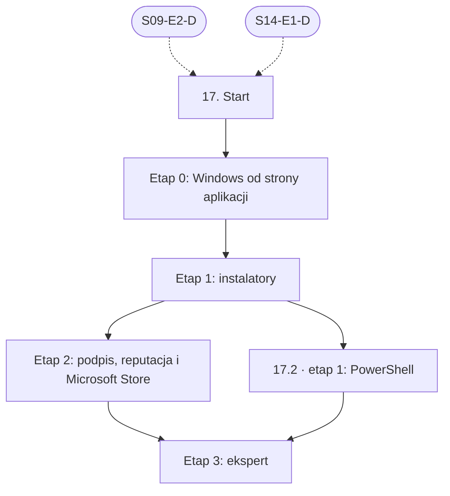

# 17. Windows: plan wdrożenia w Linear

Team **LEA** (https://linear.app/daankh/team/LEA/overview). Plan do przeglądu przed wdrożeniem: nic nie zostało jeszcze utworzone w Linear. Klucze zadań (np. `S17-E0-M1`) są robocze; po wdrożeniu dostaną identyfikatory `LEA-…`.

**W skrócie:** 5 kamieni milowych, 37 zadań (1 start, 28 materiałów, 5 dowodów, 3 praktyki). Plik główny z kolejnością projektów: `00-kolejnosc-i-zaleznosci.md`.

## 1. Projekt

| Pole | Wartość |
|---|---|
| Nazwa | 17. Windows |
| Team | LEA |
| Podsumowanie (pole „Summary”) | Warstwa 5: desktop. Opiera się na: 9 i 14. |
| Proponowany start | 2027-06-01 |
| Proponowany termin | 2027-12-17 |
| Etykiety projektu | `warstwa-5` |
| Blokowany przez (projekty) | 09. DevOps, CI/CD i wydania, 14. Desktop: wspólne |
| Blokuje (projekty) | — |
| Czas od zera | 60–75 h + 15–20 h (ścieżka uzupełniająca) |

### Opis projektu (do wklejenia w Linear)

*Warstwa 5: desktop. Opiera się na: 9 i 14.*

**Zakres umiejętności**

- Toolchain MSVC, `windows-rs`, WebView2 (dystrybucja i wersje).
- Instalatory: MSI (WiX), NSIS, MSIX; podpis Authenticode certyfikatem lub usługą podpisu w chmurze Microsoftu, reputacja SmartScreen.
- Microsoft Store: pakiety MSIX, płatności Microsoft lub własne.
- Specyfika systemu: rejestr, uprawnienia UAC, ścieżki, pułapka DLL hijacking, Defender i fałszywe alarmy antywirusów.

**Ścieżka nauki**

Ścieżka ma 4 etapy. Każdy kończy się **dowodem**, czyli małym projektem, który pokazuje, że etap jest opanowany. Wszystkie dowody dotyczą tej samej aplikacji z sekcji 14.1: narzędzia desktopowego do kontroli sekretów, licencji i zależności w repozytoriach, sprzedawanego poza sklepem przez Merchant of Record i w Microsoft Store. Przy doświadczeniu z Windows etap 0 można zaliczyć samym dowodem, ale etapu 2 nie warto skracać: podpis, reputacja SmartScreen i fałszywe alarmy antywirusów decydują o tym, czy klient w ogóle uruchomi aplikację. Czas podany dla osoby startującej od zera; ceny materiałów płatnych i certyfikatów zmieniają się, więc warto je sprawdzić przed zakupem.

Razem od zera do poziomu E: ok. 60–75 h, czyli ok. 2 miesiące przy 8–10 h tygodniowo.

**17.2 Ścieżka uzupełniająca: PowerShell**

PowerShell jest potrzebny do skryptów budowania i podpisywania na runnerach Windows. Wystarczy go opanować przed pierwszym wydaniem na Windows; ok. 15–20 h od zera, poziom W.

**Definicja ukończenia projektu (dowód poziomu E)**

Samodzielnie, bez agenta, w 1 dzień diagnozujesz i naprawiasz problem zgłoszony przez użytkownika Windows (np. blokada SmartScreen lub Defendera, nieudana aktualizacja przez MSI, brak WebView2, błąd uprawnień), wydajesz podpisaną poprawkę i umiesz wyjaśnić przyczynę osobie nietechnicznej.

**Źródło:** dokument „Umiejętności techniczne” w projekcie „JDG: Rozwój oprogramowania”, sekcja 17.

## 2. Kamienie milowe

Jeden kamień milowy na etap ścieżki. Kamień milowy jest zamknięty, gdy zamknięte jest zadanie dowodu tego etapu. Daty kamieni milowych ustawiasz przy wdrożeniu według kolejności z pliku głównego.

| # | Kamień milowy | Cel | Czas od zera | Poziom po etapie | Zadania |
|---|---|---|---|---|---|
| 1 | Etap 0: Windows od strony aplikacji | Windows od strony aplikacji: toolchain MSVC, `windows-rs`, WebView2 | 25–30 h | podstawy | 6 |
| 2 | Etap 1: instalatory | instalatory: MSI (WiX), NSIS, MSIX | 20–25 h | W | 7 |
| 3 | Etap 2: podpis, reputacja i Microsoft Store | podpis Authenticode, SmartScreen, Defender, Microsoft Store | 15–20 h | W | 9 |
| 4 | Etap 3: ekspert | ekspert: mechanizmy systemu, diagnoza, recenzja kodu AI | stale, ok. 1 h tygodniowo | E | 9 |
| 5 | Uzupełniająca 17.2 · PowerShell | PowerShell | — | — | 5 |

## 3. Punkt startu

Zadanie **`S17-START` · Start: 17. Windows** to jedyne wejście do projektu: wszystkie zadania pierwszego etapu i ścieżek uzupełniających są przez nie blokowane.

- **Blokowane przez:** `S09-E2-D`, `S14-E1-D`
- **Odblokowuje:** `S17-E0-M1`, `S17-E0-M2`, `S17-E0-M3`, `S17-E0-M4`, `S17-E0-M5`
- **Status początkowy:** Backlog do czasu zamknięcia zadań blokujących, potem Todo

Opis zadania (do wklejenia):

Punkt startu projektu „17. Windows”.

**Warunki wejścia (zadania blokujące):**

- `S09-E2-D` · Dowód etapu 2: GitHub Actions i bezpieczeństwo pipeline’u — sekcja 9 na poziomie podstawowym do pracy (etap 2)
- `S14-E1-D` · Dowód etapu 1: Tauri 2 — sekcja 14 na poziomie podstawowym do pracy (etap 1)

**Do zrobienia:**

- przeczytać sekcję 17 dokumentu „Umiejętności techniczne”,
- zaznaczyć etapy, które zaliczasz samym dowodem (zgodnie z akapitem wstępnym ścieżki), i dla nich zamknąć zadania materiałów jako niepotrzebne,
- ustawić daty kamieni milowych zgodnie z kolejnością z pliku głównego.

## 4. Przepływ zależności

Linie ciągłe to zależności wewnątrz projektu, przerywane to zadania z innych projektów. Wewnątrz etapu zadania materiałów są równoległe i wszystkie blokują dowód etapu; dowód etapu blokuje materiały kolejnego etapu.

## 5. Zadania według kamieni milowych

Szablon opisu zadania materiału: nazwa materiału, autor lub wydawca, typ, czas, koszt i link (jak w kolumnach poniżej) oraz zdanie „Gotowe, gdy materiał jest przerobiony w zakresie potrzebnym do dowodu etapu”. Opisy dowodów i praktyk są podane pod tabelą każdego etapu.

### Etap 0: Windows od strony aplikacji

Opis kamienia milowego (do wklejenia):

**Cel:** Windows od strony aplikacji: toolchain MSVC, `windows-rs`, WebView2 · **Czas od zera:** 25–30 h · **Poziom po etapie:** podstawy

**Szczególnie ważne:** target `x86_64-pc-windows-msvc` i `aarch64-pc-windows-msvc` (Windows na ARM), Visual Studio Build Tools; Smart App Control w trybie wymuszania potrafi zablokować niepodpisane narzędzia, także toolchain Rusta; WebView2 w trybie Evergreen aktualizuje się sam, ale aplikacja musi sprawdzić, czy runtime jest zainstalowany; ścieżki z ukośnikiem wstecznym, limit długości ścieżki, wielkość liter, `%APPDATA%` i `%LOCALAPPDATA%` zamiast katalogu programu. Wytyczne Fluent: zob. sekcja 13.

**Dowód:** Narzędzie z sekcji 14.1 zbudowane na Windows x64 i ARM64, z tokenami w Credential Manager, danymi w `%LOCALAPPDATA%`, wykrywaniem braku WebView2 z czytelnym komunikatem i jednym wywołaniem API systemu przez `windows-rs` (np. powiadomienie systemowe albo odczyt ustawienia rejestru) z obsługą błędów zamiast `unwrap()`.

| Klucz | Tytuł | Typ | Czas | Koszt | Link | Blokowane przez | Blokuje |
|---|---|---|---|---|---|---|---|
| `S17-E0-M1` | Przerobić: Overview of developing on Windows with Rust, Set up your Rust development environment, Rust for… | materiał | 3–4 h | 0 zł | https://learn.microsoft.com/en-us/windows/dev-environment/rust/ | `S17-START` | `S17-E0-D` |
| `S17-E0-M2` | Przerobić: Crate’y `windows` i `windows-sys` | materiał | 3–4 h | 0 zł | https://docs.rs/windows, https://github.com/microsoft/windows-rs | `S17-START` | `S17-E0-D` |
| `S17-E0-M3` | Przerobić: Introduction to Microsoft Edge WebView2, Distribute your app and the WebView2 Runtime | materiał | 3–4 h | 0 zł | https://learn.microsoft.com/en-us/microsoft-edge/webview2/, https://learn.microsoft.com/en-us/microsoft-edge/webview2/concepts/distribution | `S17-START` | `S17-E0-D` |
| `S17-E0-M4` | Przerobić: Windows 10 System Programming, Part 1 | materiał, płatny | 12–15 h | płatna | https://leanpub.com/windows10systemprogramming | `S17-START` | `S17-E0-D` |
| `S17-E0-M5` | Przerobić: CryptProtectData (DPAPI), CredWriteW (Credential Manager) | materiał | 1–2 h | 0 zł | https://learn.microsoft.com/en-us/windows/win32/api/dpapi/nf-dpapi-cryptprotectdata | `S17-START` | `S17-E0-D` |
| `S17-E0-D` | Dowód etapu 0: Windows od strony aplikacji | dowód | — | — | — | `S17-E0-M1`, `S17-E0-M2`, `S17-E0-M3`, `S17-E0-M4`, `S17-E0-M5` | `S17-E1-M1`, `S17-E1-M2`, `S17-E1-M3`, `S17-E1-M4`, `S17-E1-M5`, `S17-E1-M6` |

**`S17-E0-D` · Dowód etapu 0: Windows od strony aplikacji**

Narzędzie z sekcji 14.1 zbudowane na Windows x64 i ARM64, z tokenami w Credential Manager, danymi w `%LOCALAPPDATA%`, wykrywaniem braku WebView2 z czytelnym komunikatem i jednym wywołaniem API systemu przez `windows-rs` (np. powiadomienie systemowe albo odczyt ustawienia rejestru) z obsługą błędów zamiast `unwrap()`.

**Na co zwrócić uwagę:** target `x86_64-pc-windows-msvc` i `aarch64-pc-windows-msvc` (Windows na ARM), Visual Studio Build Tools; Smart App Control w trybie wymuszania potrafi zablokować niepodpisane narzędzia, także toolchain Rusta; WebView2 w trybie Evergreen aktualizuje się sam, ale aplikacja musi sprawdzić, czy runtime jest zainstalowany; ścieżki z ukośnikiem wstecznym, limit długości ścieżki, wielkość liter, `%APPDATA%` i `%LOCALAPPDATA%` zamiast katalogu programu. Wytyczne Fluent: zob. sekcja 13.

**Kryterium ukończenia:** dowód wykonany samodzielnie; w komentarzu link do repozytorium, raportu lub notatki.

### Etap 1: instalatory

Opis kamienia milowego (do wklejenia):

**Cel:** instalatory: MSI (WiX), NSIS, MSIX · **Czas od zera:** 20–25 h · **Poziom po etapie:** W

**Szczególnie ważne:** Tauri buduje MSI na WiX v3, który FireGiant oznacza jako przestarzały, a MSI powstaje tylko na Windows, więc w CI potrzebny jest runner Windows; Tauri nie generuje MSIX; wybór trybu WebView2 (`downloadBootstrapper`, `offlineInstaller`, `fixedVersion`) to kompromis rozmiaru, pracy offline i odpowiedzialności za łatki silnika; instalacja na użytkownika bez uprawnień administratora jest zwykle lepsza dla narzędzia deweloperskiego; poprawne odinstalowanie i stały `UpgradeCode` w MSI.

**Dowód:** Narzędzie wydane jako instalator NSIS (na użytkownika) i MSI (na maszynę, do wdrożeń firmowych), oba z cichą instalacją (`/S`, `/quiet`), wpisem w „Aplikacje i funkcje” z poprawnym wydawcą i wersją, czystym odinstalowaniem bez pozostałości oraz aktualizacją z N do N+1 przez updater z sekcji 14.1; test na czystej maszynie wirtualnej Windows 10 i 11.

| Klucz | Tytuł | Typ | Czas | Koszt | Link | Blokowane przez | Blokuje |
|---|---|---|---|---|---|---|---|
| `S17-E1-M1` | Przerobić: Windows Installer | materiał | 4–5 h | 0 zł | https://learn.microsoft.com/en-us/windows/win32/msi/windows-installer-portal | `S17-E0-D` | `S17-E1-D` |
| `S17-E1-M2` | Przerobić: WiX Toolset: dokumentacja | materiał | 4–6 h | 0 zł; firmy z przychodem od 10 tys. USD rocznie objęte opłatą Open Source Maintenance Fee | https://docs.firegiant.com/wix/ | `S17-E0-D` | `S17-E1-D` |
| `S17-E1-M3` | Przerobić: NSIS: dokumentacja | materiał | 2–3 h | 0 zł | https://nsis.sourceforge.io/Docs/ | `S17-E0-D` | `S17-E1-D` |
| `S17-E1-M4` | Przerobić: MSIX: dokumentacja | materiał | 4–5 h | 0 zł | https://learn.microsoft.com/en-us/windows/msix/ | `S17-E0-D` | `S17-E1-D` |
| `S17-E1-M5` | Przerobić: Package and deploy Windows apps | materiał | 1–2 h | 0 zł | https://learn.microsoft.com/en-us/windows/apps/package-and-deploy/ | `S17-E0-D` | `S17-E1-D` |
| `S17-E1-M6` | Przerobić: Tauri: Windows Installer | materiał | 2 h | 0 zł | https://v2.tauri.app/distribute/windows-installer/ | `S17-E0-D` | `S17-E1-D` |
| `S17-E1-D` | Dowód etapu 1: instalatory | dowód | — | — | — | `S17-E1-M1`, `S17-E1-M2`, `S17-E1-M3`, `S17-E1-M4`, `S17-E1-M5`, `S17-E1-M6` | `S17-E2-M1`, `S17-E2-M2`, `S17-E2-M3`, `S17-E2-M4`, `S17-E2-M5`, `S17-E2-M6`, `S17-E2-M7`, `S17-E2-M8`, `S17-U1-M1`, `S17-U1-M2`, `S17-U1-M3`, `S17-U1-M4` |

**`S17-E1-D` · Dowód etapu 1: instalatory**

Narzędzie wydane jako instalator NSIS (na użytkownika) i MSI (na maszynę, do wdrożeń firmowych), oba z cichą instalacją (`/S`, `/quiet`), wpisem w „Aplikacje i funkcje” z poprawnym wydawcą i wersją, czystym odinstalowaniem bez pozostałości oraz aktualizacją z N do N+1 przez updater z sekcji 14.1; test na czystej maszynie wirtualnej Windows 10 i 11.

**Na co zwrócić uwagę:** Tauri buduje MSI na WiX v3, który FireGiant oznacza jako przestarzały, a MSI powstaje tylko na Windows, więc w CI potrzebny jest runner Windows; Tauri nie generuje MSIX; wybór trybu WebView2 (`downloadBootstrapper`, `offlineInstaller`, `fixedVersion`) to kompromis rozmiaru, pracy offline i odpowiedzialności za łatki silnika; instalacja na użytkownika bez uprawnień administratora jest zwykle lepsza dla narzędzia deweloperskiego; poprawne odinstalowanie i stały `UpgradeCode` w MSI.

**Kryterium ukończenia:** dowód wykonany samodzielnie; w komentarzu link do repozytorium, raportu lub notatki.

### Etap 2: podpis, reputacja i Microsoft Store

Opis kamienia milowego (do wklejenia):

**Cel:** podpis Authenticode, SmartScreen, Defender, Microsoft Store · **Czas od zera:** 15–20 h · **Poziom po etapie:** W

**Szczególnie ważne:** Artifact Signing dla osób fizycznych działa tylko w USA i Kanadzie, a organizacje z UE muszą przejść walidację jako podmiot prawny, więc dla JDG trzeba sprawdzić, czy przejdzie walidację jako organizacja, a w razie odmowy kupić certyfikat OV z kluczem na HSM lub tokenie; certyfikat EV od 2024 r. nie omija już SmartScreen, a reputację buduje się stałą tożsamością podpisu między wydaniami; podpisane muszą być instalator i wszystkie pliki PE w środku, z ważnym znacznikiem czasu; Microsoft Store przyjmuje MSI i EXE z wersjonowanego adresu HTTPS, z cichą instalacją i bez pobierania plików podczas instalacji, a aplikacje niebędące grami mogą używać własnego systemu płatności. Klucze i podpis w CI: zob. sekcja 9.

**Dowód:** Instalatory z etapu 1 podpisane (Artifact Signing albo certyfikat OV) ze znacznikiem czasu, sprawdzone przez `signtool verify /pa /all`; na czystej maszynie z włączonym SmartScreen i Defenderem instalacja przebiega bez blokady albo z udokumentowanym ostrzeżeniem i planem budowy reputacji; zgłoszenie aplikacji do Microsoft Store przechodzi certyfikację; procedura zgłaszania fałszywego alarmu antywirusa opisana w dokumentacji wydania.

| Klucz | Tytuł | Typ | Czas | Koszt | Link | Blokowane przez | Blokuje |
|---|---|---|---|---|---|---|---|
| `S17-E2-M1` | Przerobić: Code signing options for Windows app developers | materiał | 1–2 h | 0 zł | https://learn.microsoft.com/en-us/windows/apps/package-and-deploy/code-signing-options | `S17-E1-D` | `S17-E2-D` |
| `S17-E2-M2` | Przerobić: SmartScreen reputation for Windows app developers | materiał | 1 h | 0 zł | https://learn.microsoft.com/en-us/windows/apps/package-and-deploy/smartscreen-reputation | `S17-E1-D` | `S17-E2-D` |
| `S17-E2-M3` | Przerobić: Artifact Signing (dawniej Trusted Signing): przegląd, quickstart, FAQ, modele zaufania | materiał, płatny | 3–4 h | usługa płatna (abonament) | https://learn.microsoft.com/en-us/azure/artifact-signing/ | `S17-E1-D` | `S17-E2-D` |
| `S17-E2-M4` | Przerobić: Smart App Control overview | materiał | 1 h | 0 zł | https://learn.microsoft.com/en-us/windows/apps/develop/smart-app-control/overview | `S17-E1-D` | `S17-E2-D` |
| `S17-E2-M5` | Przerobić: Tauri: Windows Code Signing | materiał | 1–2 h | 0 zł | https://v2.tauri.app/distribute/sign/windows/ | `S17-E1-D` | `S17-E2-D` |
| `S17-E2-M6` | Przerobić: Publish apps and games to Microsoft Store, proces certyfikacji aplikacji MSI/EXE, Microsoft Store… | materiał, płatny | 4–5 h | 0 zł; konto indywidualne bezpłatne | https://learn.microsoft.com/en-us/windows/apps/publish/, https://learn.microsoft.com/en-us/windows/apps/publish/store-policies | `S17-E1-D` | `S17-E2-D` |
| `S17-E2-M7` | Przerobić: Tauri: Microsoft Store | materiał | 1 h | 0 zł | https://v2.tauri.app/distribute/microsoft-store/ | `S17-E1-D` | `S17-E2-D` |
| `S17-E2-M8` | Przerobić: Submit a file for malware analysis | materiał | 0,5 h | 0 zł | https://www.microsoft.com/en-us/wdsi/filesubmission | `S17-E1-D` | `S17-E2-D` |
| `S17-E2-D` | Dowód etapu 2: podpis, reputacja i Microsoft Store | dowód | — | — | — | `S17-E2-M1`, `S17-E2-M2`, `S17-E2-M3`, `S17-E2-M4`, `S17-E2-M5`, `S17-E2-M6`, `S17-E2-M7`, `S17-E2-M8` | `S17-E3-M1`, `S17-E3-M2`, `S17-E3-M3`, `S17-E3-M4`, `S17-E3-M5`, `S17-E3-P1`, `S17-E3-P2`, `S17-E3-P3` |

**`S17-E2-D` · Dowód etapu 2: podpis, reputacja i Microsoft Store**

Instalatory z etapu 1 podpisane (Artifact Signing albo certyfikat OV) ze znacznikiem czasu, sprawdzone przez `signtool verify /pa /all`; na czystej maszynie z włączonym SmartScreen i Defenderem instalacja przebiega bez blokady albo z udokumentowanym ostrzeżeniem i planem budowy reputacji; zgłoszenie aplikacji do Microsoft Store przechodzi certyfikację; procedura zgłaszania fałszywego alarmu antywirusa opisana w dokumentacji wydania.

**Na co zwrócić uwagę:** Artifact Signing dla osób fizycznych działa tylko w USA i Kanadzie, a organizacje z UE muszą przejść walidację jako podmiot prawny, więc dla JDG trzeba sprawdzić, czy przejdzie walidację jako organizacja, a w razie odmowy kupić certyfikat OV z kluczem na HSM lub tokenie; certyfikat EV od 2024 r. nie omija już SmartScreen, a reputację buduje się stałą tożsamością podpisu między wydaniami; podpisane muszą być instalator i wszystkie pliki PE w środku, z ważnym znacznikiem czasu; Microsoft Store przyjmuje MSI i EXE z wersjonowanego adresu HTTPS, z cichą instalacją i bez pobierania plików podczas instalacji, a aplikacje niebędące grami mogą używać własnego systemu płatności. Klucze i podpis w CI: zob. sekcja 9.

**Kryterium ukończenia:** dowód wykonany samodzielnie; w komentarzu link do repozytorium, raportu lub notatki.

### Etap 3: ekspert

Opis kamienia milowego (do wklejenia):

**Cel:** ekspert: mechanizmy systemu, diagnoza, recenzja kodu AI · **Czas od zera:** stale, ok. 1 h tygodniowo · **Poziom po etapie:** E

**Dowód poziomu E:** Samodzielnie, bez agenta, w 1 dzień diagnozujesz i naprawiasz problem zgłoszony przez użytkownika Windows (np. blokada SmartScreen lub Defendera, nieudana aktualizacja przez MSI, brak WebView2, błąd uprawnień), wydajesz podpisaną poprawkę i umiesz wyjaśnić przyczynę osobie nietechnicznej.

| Klucz | Tytuł | Typ | Czas | Koszt | Link | Blokowane przez | Blokuje |
|---|---|---|---|---|---|---|---|
| `S17-E3-M1` | Przerobić: Windows Internals, 7th Edition, Part 1 i Part 2 | materiał, płatny | 20–30 h (wybrane rozdziały) | płatna | https://learn.microsoft.com/en-us/sysinternals/resources/windows-internals | `S17-E2-D`, `S17-U1-D` | `S17-E3-D` |
| `S17-E3-M2` | Przerobić: Sysinternals: Process Monitor, Process Explorer, Autoruns, Sigcheck | materiał | 4–6 h | 0 zł | https://learn.microsoft.com/en-us/sysinternals/ | `S17-E2-D`, `S17-U1-D` | `S17-E3-D` |
| `S17-E3-M3` | Przerobić: Dynamic-Link Library Security | materiał | 1–2 h | 0 zł | https://learn.microsoft.com/en-us/windows/win32/dlls/dynamic-link-library-security | `S17-E2-D`, `S17-U1-D` | `S17-E3-D` |
| `S17-E3-M4` | Przerobić: User Account Control | materiał | 1 h | 0 zł | https://learn.microsoft.com/en-us/windows/security/application-security/application-control/user-account-control/ | `S17-E2-D`, `S17-U1-D` | `S17-E3-D` |
| `S17-E3-M5` | Przerobić: The Old New Thing | materiał | ok. 30 min tygodniowo | 0 zł | https://devblogs.microsoft.com/oldnewthing/ | `S17-E2-D`, `S17-U1-D` | `S17-E3-D` |
| `S17-E3-P1` | Praktyka: recenzja kodu AI | praktyka | — | — | — | `S17-E2-D`, `S17-U1-D` | `S17-E3-D` |
| `S17-E3-P2` | Praktyka: diagnoza Process Monitorem | praktyka | — | — | — | `S17-E2-D`, `S17-U1-D` | `S17-E3-D` |
| `S17-E3-P3` | Praktyka: macierz wersji | praktyka | — | — | — | `S17-E2-D`, `S17-U1-D` | `S17-E3-D` |
| `S17-E3-D` | Dowód poziomu E: ekspert | dowód | — | — | — | `S17-E3-M1`, `S17-E3-M2`, `S17-E3-M3`, `S17-E3-M4`, `S17-E3-M5`, `S17-E3-P1`, `S17-E3-P2`, `S17-E3-P3` | — |

**`S17-E3-P1` · Praktyka: recenzja kodu AI**

10 pull requestów agentów dotyczących budowania, instalatora i integracji z Windows, recenzowanych pod kątem: `LoadLibrary` bez pełnej ścieżki, żądania uprawnień administratora bez potrzeby (manifest `requireAdministrator`), zapisu do `Program Files` w czasie działania, sekretów w rejestrze lub plikach zamiast w Credential Manager albo DPAPI, `unsafe` przy wywołaniach Win32 bez sprawdzenia kodów błędów, wyłączenia sprawdzania WebView2.

Praktyka ciągła etapu eksperckiego: oznacz jako gotową, gdy działa jako stały element pracy, a nie po jednorazowym wykonaniu.

**`S17-E3-P2` · Praktyka: diagnoza Process Monitorem**

Sprawdzenie, czy aplikacja i instalator nie ładują DLL z katalogu bieżącego lub katalogu pobierania.

Praktyka ciągła etapu eksperckiego: oznacz jako gotową, gdy działa jako stały element pracy, a nie po jednorazowym wykonaniu.

**`S17-E3-P3` · Praktyka: macierz wersji**

Windows 10 i 11, x64 i ARM64, konto standardowe i administrator, z WebView2 i bez niego.

Praktyka ciągła etapu eksperckiego: oznacz jako gotową, gdy działa jako stały element pracy, a nie po jednorazowym wykonaniu.

**`S17-E3-D` · Dowód poziomu E: ekspert**

Samodzielnie, bez agenta, w 1 dzień diagnozujesz i naprawiasz problem zgłoszony przez użytkownika Windows (np. blokada SmartScreen lub Defendera, nieudana aktualizacja przez MSI, brak WebView2, błąd uprawnień), wydajesz podpisaną poprawkę i umiesz wyjaśnić przyczynę osobie nietechnicznej.

**Kryterium ukończenia:** dowód wykonany samodzielnie; w komentarzu link do repozytorium, raportu lub notatki. Bez agenta AI.

### Uzupełniająca 17.2 · PowerShell

Opis kamienia milowego (do wklejenia):

**Cel:** PowerShell

PowerShell jest potrzebny do skryptów budowania i podpisywania na runnerach Windows. Wystarczy go opanować przed pierwszym wydaniem na Windows; ok. 15–20 h od zera, poziom W.

Książka Manninga jest opcjonalna; do poziomu W zwykle wystarcza PowerShell 101 i praca na skryptach budowania. Szczególnie ważne: potok obiektów zamiast tekstu, `$ErrorActionPreference = 'Stop'` i `try`/`catch`, polityka wykonywania skryptów, różnice Windows PowerShell 5.1 i PowerShell 7. Podpisywanie i instalatory: zob. sekcja 17.

**Dowód:** Skrypt PowerShell 7 na runnerze Windows w GitHub Actions, który buduje instalator, podpisuje go i weryfikuje podpis, kończy się błędem przy każdym niepowodzeniu kroku i przechodzi PSScriptAnalyzer oraz testy w Pester.

| Klucz | Tytuł | Typ | Czas | Koszt | Link | Blokowane przez | Blokuje |
|---|---|---|---|---|---|---|---|
| `S17-U1-M1` | Przerobić: PowerShell 101 | materiał | 5–6 h | 0 zł | https://learn.microsoft.com/en-us/powershell/scripting/learn/ps101/00-introduction | `S17-E1-D` | `S17-U1-D` |
| `S17-U1-M2` | Przerobić: Learn PowerShell in a Month of Lunches (wydanie 4) | materiał, płatny | 10–15 h | płatna | https://www.manning.com/books/learn-powershell-in-a-month-of-lunches | `S17-E1-D` | `S17-U1-D` |
| `S17-U1-M3` | Przerobić: PSScriptAnalyzer | materiał | 1–2 h | 0 zł | https://learn.microsoft.com/en-us/powershell/utility-modules/psscriptanalyzer/overview | `S17-E1-D` | `S17-U1-D` |
| `S17-U1-M4` | Przerobić: Pester | materiał | 2–3 h | 0 zł | https://pester.dev | `S17-E1-D` | `S17-U1-D` |
| `S17-U1-D` | Dowód (17.2): PowerShell | dowód | — | — | — | `S17-U1-M1`, `S17-U1-M2`, `S17-U1-M3`, `S17-U1-M4` | `S17-E3-M1`, `S17-E3-M2`, `S17-E3-M3`, `S17-E3-M4`, `S17-E3-M5`, `S17-E3-P1`, `S17-E3-P2`, `S17-E3-P3` |

**`S17-U1-D` · Dowód (17.2): PowerShell**

Skrypt PowerShell 7 na runnerze Windows w GitHub Actions, który buduje instalator, podpisuje go i weryfikuje podpis, kończy się błędem przy każdym niepowodzeniu kroku i przechodzi PSScriptAnalyzer oraz testy w Pester.

**Kryterium ukończenia:** dowód wykonany samodzielnie; w komentarzu link do repozytorium, raportu lub notatki.

## 6. Relacje z innymi projektami

**Wchodzące** (zadanie z innego projektu blokuje zadanie tego projektu):

- `S09-E2-D` (Dowód etapu 2: GitHub Actions i bezpieczeństwo pipeline’u) → `S17-START`
- `S14-E1-D` (Dowód etapu 1: Tauri 2) → `S17-START`

**Wychodzące** (zadanie tego projektu blokuje zadanie w innym projekcie):

- brak
