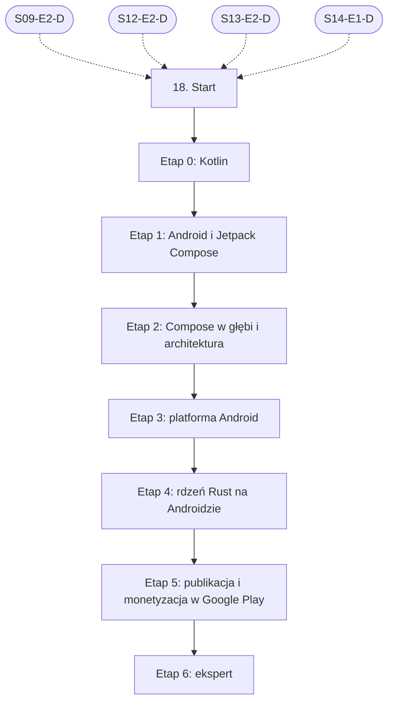

# 18. Android: plan wdrożenia w Linear

Team **LEA** (https://linear.app/daankh/team/LEA/overview). Plan do przeglądu przed wdrożeniem: nic nie zostało jeszcze utworzone w Linear. Klucze zadań (np. `S18-E0-M1`) są robocze; po wdrożeniu dostaną identyfikatory `LEA-…`.

**W skrócie:** 7 kamieni milowych, 49 zadań (1 start, 38 materiałów, 7 dowodów, 3 praktyki). Plik główny z kolejnością projektów: `00-kolejnosc-i-zaleznosci.md`.

## 1. Projekt

| Pole | Wartość |
|---|---|
| Nazwa | 18. Android |
| Team | LEA |
| Podsumowanie (pole „Summary”) | Warstwa 6: mobile. Opiera się na: 9, 12, 13 i 14 (rdzeń w Ruście). Jest podstawą: 21. |
| Proponowany start | 2028-01-03 |
| Proponowany termin | 2028-12-15 |
| Etykiety projektu | `warstwa-6` |
| Blokowany przez (projekty) | 09. DevOps, CI/CD i wydania, 12. Rust jako wspólny fundament, 13. UI/UX, 14. Desktop: wspólne |
| Blokuje (projekty) | — |
| Zależności częściowe (wychodzące) | 21. Funkcje AI w aplikacjach, etap 1 |
| Czas od zera | 270–350 h |

### Opis projektu (do wklejenia w Linear)

*Warstwa 6: mobile. Opiera się na: 9, 12, 13 i 14 (rdzeń w Ruście). Jest podstawą: 21.*

**Zakres umiejętności**

- Kotlin, Jetpack Compose, cykl życia aktywności i procesów, WorkManager, uprawnienia.
- Gradle, Android SDK i NDK, targety ABI, budowanie biblioteki Rust (`cargo-ndk`) i wiązania UniFFI.
- Alternatywnie Tauri 2 na Androidzie: ograniczenia webview i pluginy natywne.
- Android App Bundle, podpisywanie (Play App Signing), Play Console, ścieżki testowe, wymagania docelowego poziomu API.
- Google Play Billing (abonamenty, zakup jednorazowy), polityki sklepu, sekcja bezpieczeństwa danych.
- Bezpieczne przechowywanie: Android Keystore i szyfrowane magazyny danych.

**Ścieżka nauki**

Ścieżka ma 7 etapów. Każdy kończy się **dowodem**, czyli małym projektem, który pokazuje, że etap jest opanowany. Przy doświadczeniu seniorskim w TypeScript, React i Rust etap 0 można zaliczyć samym dowodem (Kotlin jest bliski obu językom), a w etapie 1 wystarczą jednostki 4–7 kursu, bo model Compose odpowiada Reactowi. Etapy 4 i 5 są obowiązkowe w całości: to w nich powstaje rdzeń Rust na Androidzie i przychód. Czas podany dla osoby startującej od zera; ceny materiałów płatnych zmieniają się, więc warto je sprawdzić przed zakupem.

Razem od zera do poziomu E: ok. 270–350 h, czyli 6–8 miesięcy przy 10–12 h tygodniowo.

**Definicja ukończenia projektu (dowód poziomu E)**

Samodzielnie, bez agenta, w 1 dzień diagnozujesz i naprawiasz ANR, wyciek pamięci albo błąd zakupów w aplikacji z rdzeniem Rust, korzystając z Perfetto, profilera Android Studio i logów RTDN, i umiesz wyjaśnić przyczynę osobie nietechnicznej.

**Źródło:** dokument „Umiejętności techniczne” w projekcie „JDG: Rozwój oprogramowania”, sekcja 18.

## 2. Kamienie milowe

Jeden kamień milowy na etap ścieżki. Kamień milowy jest zamknięty, gdy zamknięte jest zadanie dowodu tego etapu. Daty kamieni milowych ustawiasz przy wdrożeniu według kolejności z pliku głównego.

| # | Kamień milowy | Cel | Czas od zera | Poziom po etapie | Zadania |
|---|---|---|---|---|---|
| 1 | Etap 0: Kotlin | Kotlin i korutyny | 40–60 h | podstawy | 5 |
| 2 | Etap 1: Android i Jetpack Compose | pierwsze aplikacje: Android i Jetpack Compose | 80–100 h | podstawy | 3 |
| 3 | Etap 2: Compose w głębi i architektura | Compose w głębi i architektura aplikacji | 50–60 h | W | 7 |
| 4 | Etap 3: platforma Android | platforma: procesy, praca w tle, uprawnienia, dane, Keystore | 40–50 h | W | 6 |
| 5 | Etap 4: rdzeń Rust na Androidzie | rdzeń Rust: UniFFI, `cargo-ndk`, alternatywnie Tauri 2 | 30–40 h | E | 8 |
| 6 | Etap 5: publikacja i monetyzacja w Google Play | publikacja i monetyzacja w Google Play | 30–40 h | E | 10 |
| 7 | Etap 6: ekspert | ekspert: wydajność, mechanizmy wewnętrzne, recenzja kodu AI, aktualność | stale, ok. 2 h tygodniowo | E | 9 |

## 3. Punkt startu

Zadanie **`S18-START` · Start: 18. Android** to jedyne wejście do projektu: wszystkie zadania pierwszego etapu są przez nie blokowane.

- **Blokowane przez:** `S09-E2-D`, `S12-E2-D`, `S13-E2-D`, `S14-E1-D`
- **Odblokowuje:** `S18-E0-M1`, `S18-E0-M2`, `S18-E0-M3`, `S18-E0-M4`
- **Status początkowy:** Backlog do czasu zamknięcia zadań blokujących, potem Todo

Opis zadania (do wklejenia):

Punkt startu projektu „18. Android”.

**Warunki wejścia (zadania blokujące):**

- `S09-E2-D` · Dowód etapu 2: GitHub Actions i bezpieczeństwo pipeline’u — sekcja 9 na poziomie podstawowym do pracy (etap 2)
- `S12-E2-D` · Dowód etapu 2: własność, pożyczanie, czasy życia — sekcja 12 na poziomie podstawowym do pracy (etap 2)
- `S13-E2-D` · Dowód etapu 2: badania i testy użyteczności — sekcja 13 na poziomie podstawowym do pracy (etap 2)
- `S14-E1-D` · Dowód etapu 1: Tauri 2 — sekcja 14 na poziomie podstawowym do pracy (etap 1)

**Do zrobienia:**

- przeczytać sekcję 18 dokumentu „Umiejętności techniczne”,
- zaznaczyć etapy, które zaliczasz samym dowodem (zgodnie z akapitem wstępnym ścieżki), i dla nich zamknąć zadania materiałów jako niepotrzebne,
- ustawić daty kamieni milowych zgodnie z kolejnością z pliku głównego.

## 4. Przepływ zależności

Linie ciągłe to zależności wewnątrz projektu, przerywane to zadania z innych projektów. Wewnątrz etapu zadania materiałów są równoległe i wszystkie blokują dowód etapu; dowód etapu blokuje materiały kolejnego etapu.

## 5. Zadania według kamieni milowych

Szablon opisu zadania materiału: nazwa materiału, autor lub wydawca, typ, czas, koszt i link (jak w kolumnach poniżej) oraz zdanie „Gotowe, gdy materiał jest przerobiony w zakresie potrzebnym do dowodu etapu”. Opisy dowodów i praktyk są podane pod tabelą każdego etapu.

### Etap 0: Kotlin

Opis kamienia milowego (do wklejenia):

**Cel:** Kotlin i korutyny · **Czas od zera:** 40–60 h · **Poziom po etapie:** podstawy

**Szczególnie ważne:** null safety, klasy `data` i `sealed`, funkcje rozszerzające, lambdy z odbiorcą, korutyny strukturalne, anulowanie, `Flow` i `StateFlow`, różnice wobec `async`/`await` w TypeScript i Tokio w Ruście.

**Dowód:** Narzędzie konsolowe w Kotlinie pobierające dane z publicznego API przez korutyny, z anulowaniem po przekroczeniu czasu, wynikami jako `sealed` hierarchią i testami jednostkowymi.

| Klucz | Tytuł | Typ | Czas | Koszt | Link | Blokowane przez | Blokuje |
|---|---|---|---|---|---|---|---|
| `S18-E0-M1` | Przerobić: Kotlin tour i dokumentacja języka | materiał | 10–15 h | 0 zł | https://kotlinlang.org/docs/kotlin-tour-welcome.html, https://kotlinlang.org/docs/home.html | `S18-START` | `S18-E0-D` |
| `S18-E0-M2` | Przerobić: Kotlin Koans | materiał | 6–8 h | 0 zł | https://play.kotlinlang.org/koans | `S18-START` | `S18-E0-D` |
| `S18-E0-M3` | Przerobić: Kotlin in Action (wydanie 2, 2024) | materiał, płatny | 20–25 h | płatna | https://www.manning.com/books/kotlin-in-action-second-edition | `S18-START` | `S18-E0-D` |
| `S18-E0-M4` | Przerobić: Coroutines guide | materiał | 6–8 h | 0 zł | https://kotlinlang.org/docs/coroutines-guide.html | `S18-START` | `S18-E0-D` |
| `S18-E0-D` | Dowód etapu 0: Kotlin | dowód | — | — | — | `S18-E0-M1`, `S18-E0-M2`, `S18-E0-M3`, `S18-E0-M4` | `S18-E1-M1`, `S18-E1-M2` |

**`S18-E0-D` · Dowód etapu 0: Kotlin**

Narzędzie konsolowe w Kotlinie pobierające dane z publicznego API przez korutyny, z anulowaniem po przekroczeniu czasu, wynikami jako `sealed` hierarchią i testami jednostkowymi.

**Na co zwrócić uwagę:** null safety, klasy `data` i `sealed`, funkcje rozszerzające, lambdy z odbiorcą, korutyny strukturalne, anulowanie, `Flow` i `StateFlow`, różnice wobec `async`/`await` w TypeScript i Tokio w Ruście.

**Kryterium ukończenia:** dowód wykonany samodzielnie; w komentarzu link do repozytorium, raportu lub notatki.

### Etap 1: Android i Jetpack Compose

Opis kamienia milowego (do wklejenia):

**Cel:** pierwsze aplikacje: Android i Jetpack Compose · **Czas od zera:** 80–100 h · **Poziom po etapie:** podstawy

**Szczególnie ważne:** rekompozycja i `remember`, wynoszenie stanu (state hoisting), `ViewModel`, nawigacja, różnice między efektami w Compose a `useEffect` w React.

**Dowód:** Aplikacja offline-first z listą, edycją i wyszukiwaniem (np. notatki lub nawyki), z danymi w Room, odświeżaniem z sieci i obsługą obrotu ekranu bez utraty stanu.

| Klucz | Tytuł | Typ | Czas | Koszt | Link | Blokowane przez | Blokuje |
|---|---|---|---|---|---|---|---|
| `S18-E1-M1` | Przerobić: Android Basics with Compose | materiał | 80–100 h | 0 zł | https://developer.android.com/courses/android-basics-compose/course | `S18-E0-D` | `S18-E1-D` |
| `S18-E1-M2` | Przerobić: Dokumentacja Jetpack Compose: „Thinking in Compose”, stan, efekty uboczne, Material 3 | materiał | 6–8 h | 0 zł | https://developer.android.com/develop/ui/compose/documentation | `S18-E0-D` | `S18-E1-D` |
| `S18-E1-D` | Dowód etapu 1: Android i Jetpack Compose | dowód | — | — | — | `S18-E1-M1`, `S18-E1-M2` | `S18-E2-M1`, `S18-E2-M2`, `S18-E2-M3`, `S18-E2-M4`, `S18-E2-M5`, `S18-E2-M6` |

**`S18-E1-D` · Dowód etapu 1: Android i Jetpack Compose**

Aplikacja offline-first z listą, edycją i wyszukiwaniem (np. notatki lub nawyki), z danymi w Room, odświeżaniem z sieci i obsługą obrotu ekranu bez utraty stanu.

**Na co zwrócić uwagę:** rekompozycja i `remember`, wynoszenie stanu (state hoisting), `ViewModel`, nawigacja, różnice między efektami w Compose a `useEffect` w React.

**Kryterium ukończenia:** dowód wykonany samodzielnie; w komentarzu link do repozytorium, raportu lub notatki.

### Etap 2: Compose w głębi i architektura

Opis kamienia milowego (do wklejenia):

**Cel:** Compose w głębi i architektura aplikacji · **Czas od zera:** 50–60 h · **Poziom po etapie:** W

**Szczególnie ważne:** wstrzykiwanie dispatcherów i zakresów, niemutowalny stan UI, układy adaptacyjne (telefon, tablet, składane), modularyzacja Gradle, katalog wersji i Compose BOM.

**Dowód:** Aplikacja z etapu 1 przebudowana na warstwy (UI, dane, opcjonalnie domena) i moduły Gradle, z `StateFlow` jako jedynym źródłem stanu ekranu, układem list–szczegóły na tablecie i testami `ViewModel` z `runTest` (zob. sekcja 6).

| Klucz | Tytuł | Typ | Czas | Koszt | Link | Blokowane przez | Blokuje |
|---|---|---|---|---|---|---|---|
| `S18-E2-M1` | Przerobić: Guide to app architecture: warstwy UI i danych, jedno źródło prawdy, przepływ jednokierunkowy | materiał | 6–8 h | 0 zł | https://developer.android.com/topic/architecture | `S18-E1-D` | `S18-E2-D` |
| `S18-E2-M2` | Przerobić: Now in Android | materiał | 10–15 h | 0 zł | https://github.com/android/nowinandroid | `S18-E1-D` | `S18-E2-D` |
| `S18-E2-M3` | Przerobić: Best practices for coroutines in Android | materiał | 2–3 h | 0 zł | https://developer.android.com/kotlin/coroutines/coroutines-best-practices | `S18-E1-D` | `S18-E2-D` |
| `S18-E2-M4` | Przerobić: Jetpack Compose for Android Developers | materiał | 15–20 h | 0 zł | https://developer.android.com/courses/jetpack-compose/course | `S18-E1-D` | `S18-E2-D` |
| `S18-E2-M5` | Przerobić: Kotlin Coroutines: Deep Dive | materiał, płatny | 12–15 h | płatna | https://leanpub.com/coroutines | `S18-E1-D` | `S18-E2-D` |
| `S18-E2-M6` | Przerobić: Effective Kotlin | materiał, płatny | 10–12 h | płatna | https://kt.academy/book/effectivekotlin | `S18-E1-D` | `S18-E2-D` |
| `S18-E2-D` | Dowód etapu 2: Compose w głębi i architektura | dowód | — | — | — | `S18-E2-M1`, `S18-E2-M2`, `S18-E2-M3`, `S18-E2-M4`, `S18-E2-M5`, `S18-E2-M6` | `S18-E3-M1`, `S18-E3-M2`, `S18-E3-M3`, `S18-E3-M4`, `S18-E3-M5`, `S21-E1-M1`, `S21-E1-M2`, `S21-E1-M3`, `S21-E1-M4`, `S21-E1-M5`, `S21-E1-M6`, `S21-E1-M7`, `S21-E1-M8` |

**`S18-E2-D` · Dowód etapu 2: Compose w głębi i architektura**

Aplikacja z etapu 1 przebudowana na warstwy (UI, dane, opcjonalnie domena) i moduły Gradle, z `StateFlow` jako jedynym źródłem stanu ekranu, układem list–szczegóły na tablecie i testami `ViewModel` z `runTest` (zob. sekcja 6).

**Na co zwrócić uwagę:** wstrzykiwanie dispatcherów i zakresów, niemutowalny stan UI, układy adaptacyjne (telefon, tablet, składane), modularyzacja Gradle, katalog wersji i Compose BOM.

**Kryterium ukończenia:** dowód wykonany samodzielnie; w komentarzu link do repozytorium, raportu lub notatki.

### Etap 3: platforma Android

Opis kamienia milowego (do wklejenia):

**Cel:** platforma: procesy, praca w tle, uprawnienia, dane, Keystore · **Czas od zera:** 40–50 h · **Poziom po etapie:** W

**Szczególnie ważne:** system może zabić proces w każdej chwili, `onDestroy()` nie jest gwarantowane, ograniczenia pracy w tle i trybu Doze, jednorazowe i automatycznie cofane uprawnienia, klucze sprzętowe (TEE, StrongBox) i uwierzytelnianie biometryczne. Testy bezpieczeństwa według MASVS: zob. sekcja 10.

**Dowód:** Synchronizacja danych aplikacji przez `CoroutineWorker` z ograniczeniami sieci i baterii, przeżywająca ubicie procesu i restart urządzenia; token sesji zaszyfrowany kluczem z Android Keystore; funkcja wymagająca uprawnienia działa w trybie ograniczonym po odmowie.

| Klucz | Tytuł | Typ | Czas | Koszt | Link | Blokowane przez | Blokuje |
|---|---|---|---|---|---|---|---|
| `S18-E3-M1` | Przerobić: Processes and app lifecycle | materiał | 2–3 h | 0 zł | https://developer.android.com/guide/components/activities/process-lifecycle | `S18-E2-D` | `S18-E3-D` |
| `S18-E3-M2` | Przerobić: WorkManager: trwała praca w tle | materiał | 4–6 h | 0 zł | https://developer.android.com/develop/background-work/background-tasks/persistent | `S18-E2-D` | `S18-E3-D` |
| `S18-E3-M3` | Przerobić: Request runtime permissions | materiał | 2–3 h | 0 zł | https://developer.android.com/training/permissions/requesting | `S18-E2-D` | `S18-E3-D` |
| `S18-E3-M4` | Przerobić: Room (od wersji 3.0 pakiet `androidx.room3`, wymaga KSP) | materiał | 4–6 h | 0 zł | https://developer.android.com/training/data-storage/room | `S18-E2-D` | `S18-E3-D` |
| `S18-E3-M5` | Przerobić: Android Keystore system | materiał | 3–4 h | 0 zł | https://developer.android.com/privacy-and-security/keystore | `S18-E2-D` | `S18-E3-D` |
| `S18-E3-D` | Dowód etapu 3: platforma Android | dowód | — | — | — | `S18-E3-M1`, `S18-E3-M2`, `S18-E3-M3`, `S18-E3-M4`, `S18-E3-M5` | `S18-E4-M1`, `S18-E4-M2`, `S18-E4-M3`, `S18-E4-M4`, `S18-E4-M5`, `S18-E4-M6`, `S18-E4-M7` |

**`S18-E3-D` · Dowód etapu 3: platforma Android**

Synchronizacja danych aplikacji przez `CoroutineWorker` z ograniczeniami sieci i baterii, przeżywająca ubicie procesu i restart urządzenia; token sesji zaszyfrowany kluczem z Android Keystore; funkcja wymagająca uprawnienia działa w trybie ograniczonym po odmowie.

**Na co zwrócić uwagę:** system może zabić proces w każdej chwili, `onDestroy()` nie jest gwarantowane, ograniczenia pracy w tle i trybu Doze, jednorazowe i automatycznie cofane uprawnienia, klucze sprzętowe (TEE, StrongBox) i uwierzytelnianie biometryczne. Testy bezpieczeństwa według MASVS: zob. sekcja 10.

**Kryterium ukończenia:** dowód wykonany samodzielnie; w komentarzu link do repozytorium, raportu lub notatki.

### Etap 4: rdzeń Rust na Androidzie

Opis kamienia milowego (do wklejenia):

**Cel:** rdzeń Rust: UniFFI, `cargo-ndk`, alternatywnie Tauri 2 · **Czas od zera:** 30–40 h · **Poziom po etapie:** E

**Szczególnie ważne:** granica FFI jako kontrakt (błędy Rust zamienione na wyjątki Kotlina, brak paniki przez granicę), wątki Rust wywołujące Kotlina, async po obu stronach, rozmiar `.so` na każde ABI, wyrównanie bibliotek do stron 16 KB (blokada aktualizacji w Google Play bez tego wsparcia od 1 lutego 2027 r.), wersjonowanie rdzenia wspólnego z iOS i desktopem. Opcjonalnie Gobley (https://gobley.dev) przy projekcie Kotlin Multiplatform.

**Dowód:** Ten sam crate z rdzeniem (model danych, walidacja, logika licencji i synchronizacji) używany przez aplikację z etapu 3 przez wiązania UniFFI, budowany w Gradle dla `arm64-v8a` i `x86_64`; błąd z Rusta obsłużony w UI jako wyjątek Kotlina; biblioteka `.so` zweryfikowana pod kątem wyrównania 16 KB. Rdzeń wchodzi do SBOM aplikacji (zob. sekcja 10).

| Klucz | Tytuł | Typ | Czas | Koszt | Link | Blokowane przez | Blokuje |
|---|---|---|---|---|---|---|---|
| `S18-E4-M1` | Przerobić: The UniFFI user guide: model typów, proc-macros, async, interfejsy zwrotne, rozdziały Kotlin i… | materiał | 8–10 h | 0 zł | https://mozilla.github.io/uniffi-rs/latest/ | `S18-E3-D` | `S18-E4-D` |
| `S18-E4-M2` | Przerobić: `cargo-ndk` | materiał | 1–2 h | 0 zł | https://github.com/bbqsrc/cargo-ndk | `S18-E3-D` | `S18-E4-D` |
| `S18-E4-M3` | Przerobić: JNI tips | materiał | 2–3 h | 0 zł | https://developer.android.com/ndk/guides/jni-tips | `S18-E3-D` | `S18-E4-D` |
| `S18-E4-M4` | Przerobić: Support 16 KB page sizes | materiał | 1–2 h | 0 zł | https://developer.android.com/guide/practices/page-sizes | `S18-E3-D` | `S18-E4-D` |
| `S18-E4-M5` | Przerobić: uniffi-starter (rdzeń Rust, Gradle z `cargo-ndk`, Swift Package) | materiał | 3–4 h | 0 zł | https://github.com/ianthetechie/uniffi-starter | `S18-E3-D` | `S18-E4-D` |
| `S18-E4-M6` | Przerobić: application-services | materiał | 3–5 h | 0 zł | https://github.com/mozilla/application-services | `S18-E3-D` | `S18-E4-D` |
| `S18-E4-M7` | Przerobić: Tauri 2 na Androidzie: wymagania (SDK, NDK, targety `rustup`) i pluginy mobilne w Kotlinie | materiał | 6–8 h | 0 zł | https://v2.tauri.app/start/prerequisites/, https://v2.tauri.app/develop/plugins/develop-mobile/ | `S18-E3-D` | `S18-E4-D` |
| `S18-E4-D` | Dowód etapu 4: rdzeń Rust na Androidzie | dowód | — | — | — | `S18-E4-M1`, `S18-E4-M2`, `S18-E4-M3`, `S18-E4-M4`, `S18-E4-M5`, `S18-E4-M6`, `S18-E4-M7` | `S18-E5-M1`, `S18-E5-M2`, `S18-E5-M3`, `S18-E5-M4`, `S18-E5-M5`, `S18-E5-M6`, `S18-E5-M7`, `S18-E5-M8`, `S18-E5-M9` |

**`S18-E4-D` · Dowód etapu 4: rdzeń Rust na Androidzie**

Ten sam crate z rdzeniem (model danych, walidacja, logika licencji i synchronizacji) używany przez aplikację z etapu 3 przez wiązania UniFFI, budowany w Gradle dla `arm64-v8a` i `x86_64`; błąd z Rusta obsłużony w UI jako wyjątek Kotlina; biblioteka `.so` zweryfikowana pod kątem wyrównania 16 KB. Rdzeń wchodzi do SBOM aplikacji (zob. sekcja 10).

**Na co zwrócić uwagę:** granica FFI jako kontrakt (błędy Rust zamienione na wyjątki Kotlina, brak paniki przez granicę), wątki Rust wywołujące Kotlina, async po obu stronach, rozmiar `.so` na każde ABI, wyrównanie bibliotek do stron 16 KB (blokada aktualizacji w Google Play bez tego wsparcia od 1 lutego 2027 r.), wersjonowanie rdzenia wspólnego z iOS i desktopem. Opcjonalnie Gobley (https://gobley.dev) przy projekcie Kotlin Multiplatform.

**Kryterium ukończenia:** dowód wykonany samodzielnie; w komentarzu link do repozytorium, raportu lub notatki.

### Etap 5: publikacja i monetyzacja w Google Play

Opis kamienia milowego (do wklejenia):

**Cel:** publikacja i monetyzacja w Google Play · **Czas od zera:** 30–40 h · **Poziom po etapie:** E

**Szczególnie ważne:** potwierdzenie zakupu w ciągu 3 dni (inaczej automatyczny zwrot), uprawnienia przyznawane dopiero po weryfikacji tokenu na serwerze, stany abonamentu (okres karencji, wstrzymanie, odzyskanie), zgodność ekranu zakupu z polityką i prawem konsumenckim (zob. sekcja 13), automatyzacja wydań przez API Google Play (zob. sekcja 9).

**Dowód:** Aplikacja z rdzeniem Rust opublikowana w Google Play po teście zamkniętym, z abonamentem i zakupem jednorazowym; backend w Rust (Axum) weryfikuje tokeny, odbiera RTDN przez Pub/Sub i jest jedynym źródłem uprawnień; sekcja bezpieczeństwa danych zgodna z faktycznym przetwarzaniem; proces zgłaszania podatności zgodny z CRA opisany na stronie produktu.

| Klucz | Tytuł | Typ | Czas | Koszt | Link | Blokowane przez | Blokuje |
|---|---|---|---|---|---|---|---|
| `S18-E5-M1` | Przerobić: Play Console Help: konto dewelopera, ścieżki testów, wymóg testu zamkniętego | materiał | 4–6 h | 0 zł | https://support.google.com/googleplay/android-developer/answer/14151465 | `S18-E4-D` | `S18-E5-D` |
| `S18-E5-M2` | Przerobić: Android App Bundle, Play App Signing | materiał | 2–3 h | 0 zł | https://developer.android.com/guide/app-bundle, https://developer.android.com/studio/publish/app-signing | `S18-E4-D` | `S18-E5-D` |
| `S18-E5-M3` | Przerobić: Wymagania docelowego API | materiał | 1 h | 0 zł | https://developer.android.com/google/play/requirements/target-sdk | `S18-E4-D` | `S18-E5-D` |
| `S18-E5-M4` | Przerobić: Google Play Billing: integracja, abonamenty, produkty jednorazowe, migracja do Billing Library 9 | materiał | 8–10 h | 0 zł | https://developer.android.com/google/play/billing | `S18-E4-D` | `S18-E5-D` |
| `S18-E5-M5` | Przerobić: Real-time developer notifications (RTDN) i weryfikacja zakupów na serwerze | materiał | 3–4 h | 0 zł | https://developer.android.com/google/play/billing/rtdn-reference | `S18-E4-D` | `S18-E5-D` |
| `S18-E5-M6` | Przerobić: Play Integrity API | materiał | 2–3 h | 0 zł | https://developer.android.com/google/play/integrity | `S18-E4-D` | `S18-E5-D` |
| `S18-E5-M7` | Przerobić: Polityki programu dla deweloperów, sekcja bezpieczeństwa danych, weryfikacja deweloperów Androida | materiał | 4–6 h | 0 zł | https://play.google/developer-content-policy/, https://support.google.com/googleplay/android-developer/answer/10787469, https://developer.android.com/developer-verification | `S18-E4-D` | `S18-E5-D` |
| `S18-E5-M8` | Przerobić: Google Play Academy | materiał | wg potrzeb | 0 zł | https://playacademy.withgoogle.com | `S18-E4-D` | `S18-E5-D` |
| `S18-E5-M9` | Przerobić: Tauri 2: publikacja w Google Play (AAB, architektury) | materiał | 1–2 h | 0 zł | https://v2.tauri.app/distribute/google-play/ | `S18-E4-D` | `S18-E5-D` |
| `S18-E5-D` | Dowód etapu 5: publikacja i monetyzacja w Google Play | dowód | — | — | — | `S18-E5-M1`, `S18-E5-M2`, `S18-E5-M3`, `S18-E5-M4`, `S18-E5-M5`, `S18-E5-M6`, `S18-E5-M7`, `S18-E5-M8`, `S18-E5-M9` | `S18-E6-M1`, `S18-E6-M2`, `S18-E6-M3`, `S18-E6-M4`, `S18-E6-M5`, `S18-E6-P1`, `S18-E6-P2`, `S18-E6-P3` |

**`S18-E5-D` · Dowód etapu 5: publikacja i monetyzacja w Google Play**

Aplikacja z rdzeniem Rust opublikowana w Google Play po teście zamkniętym, z abonamentem i zakupem jednorazowym; backend w Rust (Axum) weryfikuje tokeny, odbiera RTDN przez Pub/Sub i jest jedynym źródłem uprawnień; sekcja bezpieczeństwa danych zgodna z faktycznym przetwarzaniem; proces zgłaszania podatności zgodny z CRA opisany na stronie produktu.

**Na co zwrócić uwagę:** potwierdzenie zakupu w ciągu 3 dni (inaczej automatyczny zwrot), uprawnienia przyznawane dopiero po weryfikacji tokenu na serwerze, stany abonamentu (okres karencji, wstrzymanie, odzyskanie), zgodność ekranu zakupu z polityką i prawem konsumenckim (zob. sekcja 13), automatyzacja wydań przez API Google Play (zob. sekcja 9).

**Kryterium ukończenia:** dowód wykonany samodzielnie; w komentarzu link do repozytorium, raportu lub notatki.

### Etap 6: ekspert

Opis kamienia milowego (do wklejenia):

**Cel:** ekspert: wydajność, mechanizmy wewnętrzne, recenzja kodu AI, aktualność · **Czas od zera:** stale, ok. 2 h tygodniowo · **Poziom po etapie:** E

**Dowód poziomu E:** Samodzielnie, bez agenta, w 1 dzień diagnozujesz i naprawiasz ANR, wyciek pamięci albo błąd zakupów w aplikacji z rdzeniem Rust, korzystając z Perfetto, profilera Android Studio i logów RTDN, i umiesz wyjaśnić przyczynę osobie nietechnicznej.

| Klucz | Tytuł | Typ | Czas | Koszt | Link | Blokowane przez | Blokuje |
|---|---|---|---|---|---|---|---|
| `S18-E6-M1` | Przerobić: Jetpack Compose Performance, fazy Compose, stabilność | materiał | 4–6 h | 0 zł | https://developer.android.com/develop/ui/compose/performance | `S18-E5-D` | `S18-E6-D` |
| `S18-E6-M2` | Przerobić: Baseline Profiles i Macrobenchmark | materiał | 6–8 h | 0 zł | https://developer.android.com/topic/performance/baselineprofiles/overview, https://developer.android.com/topic/performance/benchmarking/macrobenchmark-overview | `S18-E5-D` | `S18-E6-D` |
| `S18-E6-M3` | Przerobić: Android vitals (progi złego zachowania: awarie, ANR, pamięć) | materiał | 2–3 h | 0 zł | https://developer.android.com/topic/performance/vitals | `S18-E5-D` | `S18-E6-D` |
| `S18-E6-M4` | Przerobić: Jetpack Compose Internals (wydanie z 2022 r.) | materiał, płatny | 10–12 h | płatna | https://leanpub.com/composeinternals | `S18-E5-D` | `S18-E6-D` |
| `S18-E6-M5` | Przerobić: Android Developers Blog, Android Code Search | materiał | ok. 1 h tygodniowo | 0 zł | https://android-developers.googleblog.com, https://cs.android.com | `S18-E5-D` | `S18-E6-D` |
| `S18-E6-P1` | Praktyka: recenzja kodu AI | praktyka | — | — | — | `S18-E5-D` | `S18-E6-D` |
| `S18-E6-P2` | Praktyka: wydajność | praktyka | — | — | — | `S18-E5-D` | `S18-E6-D` |
| `S18-E6-P3` | Praktyka: śledzenie zmian platformy | praktyka | — | — | — | `S18-E5-D` | `S18-E6-D` |
| `S18-E6-D` | Dowód poziomu E: ekspert | dowód | — | — | — | `S18-E6-M1`, `S18-E6-M2`, `S18-E6-M3`, `S18-E6-M4`, `S18-E6-M5`, `S18-E6-P1`, `S18-E6-P2`, `S18-E6-P3` | — |

**`S18-E6-P1` · Praktyka: recenzja kodu AI**

20 pull requestów wygenerowanych przez agentów, recenzowanych według listy kontrolnej z etapów 2–5 (zbędne rekompozycje i niestabilne parametry, `GlobalScope` i zakodowane dispatchery, połknięte `CancellationException`, praca w tle bez WorkManagera, nadmiarowe uprawnienia, zakupy bez potwierdzenia i weryfikacji na serwerze, panika Rusta przez granicę FFI, wymyślone API Androida).

Praktyka ciągła etapu eksperckiego: oznacz jako gotową, gdy działa jako stały element pracy, a nie po jednorazowym wykonaniu.

**`S18-E6-P2` · Praktyka: wydajność**

Baseline Profile i Macrobenchmark w CI dla uruchomienia i przewijania; awarie i ANR poniżej progów Android vitals.

Praktyka ciągła etapu eksperckiego: oznacz jako gotową, gdy działa jako stały element pracy, a nie po jednorazowym wykonaniu.

**`S18-E6-P3` · Praktyka: śledzenie zmian platformy**

Coroczna aktualizacja docelowego API, wersji Billing Library i wymogów weryfikacji deweloperów, przećwiczona przed terminem Google.

Praktyka ciągła etapu eksperckiego: oznacz jako gotową, gdy działa jako stały element pracy, a nie po jednorazowym wykonaniu.

**`S18-E6-D` · Dowód poziomu E: ekspert**

Samodzielnie, bez agenta, w 1 dzień diagnozujesz i naprawiasz ANR, wyciek pamięci albo błąd zakupów w aplikacji z rdzeniem Rust, korzystając z Perfetto, profilera Android Studio i logów RTDN, i umiesz wyjaśnić przyczynę osobie nietechnicznej.

**Kryterium ukończenia:** dowód wykonany samodzielnie; w komentarzu link do repozytorium, raportu lub notatki. Bez agenta AI.

## 6. Relacje z innymi projektami

**Wchodzące** (zadanie z innego projektu blokuje zadanie tego projektu):

- `S09-E2-D` (Dowód etapu 2: GitHub Actions i bezpieczeństwo pipeline’u) → `S18-START`
- `S12-E2-D` (Dowód etapu 2: własność, pożyczanie, czasy życia) → `S18-START`
- `S13-E2-D` (Dowód etapu 2: badania i testy użyteczności) → `S18-START`
- `S14-E1-D` (Dowód etapu 1: Tauri 2) → `S18-START`

**Wychodzące** (zadanie tego projektu blokuje zadanie w innym projekcie):

- `S18-E2-D` → `S21-E1-M1` (21. Funkcje AI w aplikacjach)
- `S18-E2-D` → `S21-E1-M2` (21. Funkcje AI w aplikacjach)
- `S18-E2-D` → `S21-E1-M3` (21. Funkcje AI w aplikacjach)
- `S18-E2-D` → `S21-E1-M4` (21. Funkcje AI w aplikacjach)
- `S18-E2-D` → `S21-E1-M5` (21. Funkcje AI w aplikacjach)
- `S18-E2-D` → `S21-E1-M6` (21. Funkcje AI w aplikacjach)
- `S18-E2-D` → `S21-E1-M7` (21. Funkcje AI w aplikacjach)
- `S18-E2-D` → `S21-E1-M8` (21. Funkcje AI w aplikacjach)
