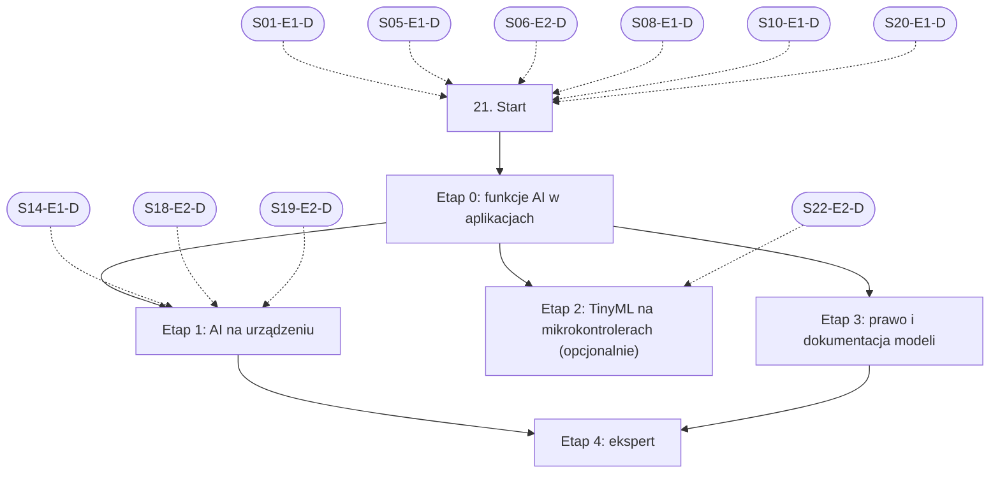

# 21. Funkcje AI w aplikacjach: plan wdrożenia w Linear

Team **LEA** (https://linear.app/daankh/team/LEA/overview). Plan do przeglądu przed wdrożeniem: nic nie zostało jeszcze utworzone w Linear. Klucze zadań (np. `S21-E0-M1`) są robocze; po wdrożeniu dostaną identyfikatory `LEA-…`.

**W skrócie:** 5 kamieni milowych, 31 zadań (1 start, 22 materiały, 5 dowodów, 3 praktyki). Plik główny z kolejnością projektów: `00-kolejnosc-i-zaleznosci.md`.

## 1. Projekt

| Pole | Wartość |
|---|---|
| Nazwa | 21. Funkcje AI w aplikacjach |
| Team | LEA |
| Podsumowanie (pole „Summary”) | Warstwa 7: AI w produktach. Opiera się na: 1, 5, 6, 8, 10, 20 i platformach 14–19; etap 2 (TinyML) także na sekcji 22. |
| Proponowany start | 2028-01-03 |
| Proponowany termin | 2028-12-15 |
| Etykiety projektu | `warstwa-7` |
| Blokowany przez (projekty) | 01. Praca z AI w chmurze: Claude i Claude Code, 05. Backend i API, 06. Testowanie, 08. Architektura i projektowanie systemów, 10. Bezpieczeństwo, 20. Lokalne AI i rozwój modeli |
| Blokuje (projekty) | — |
| Zależności częściowe (wchodzące) | etap 1 czeka na 14. Desktop: wspólne (etap 1); etap 1 czeka na 18. Android (etap 2); etap 1 czeka na 19. iOS (etap 2); etap 2 czeka na 22. Systemy wbudowane (etap 2) |
| Czas od zera | 135–190 h |

### Opis projektu (do wklejenia w Linear)

*Warstwa 7: AI w produktach. Opiera się na: 1, 5, 6, 8, 10, 20 i platformach 14–19; etap 2 (TinyML) także na sekcji 22.*

**Zakres umiejętności**

**Architektura i wybór miejsca wykonania**
- Decyzja chmura, urządzenie czy hybryda: prywatność, koszt na użytkownika, opóźnienie, praca offline, rozmiar aplikacji, jakość; zapisana w ADR.
- Model w chmurze: API Anthropic i innych dostawców (oficjalne SDK w TypeScript, klient HTTP w Ruście), streaming, tool use, wyjście strukturalne ze schematem, prompt caching, przetwarzanie wsadowe, limity i ponawianie.
- Backend jako pośrednik: klucze API nigdy w aplikacji klienckiej, limity per użytkownik, kontrola kosztów, cache odpowiedzi, wymiana modelu bez wydania aplikacji.
- Agenci i narzędzia w produkcie: projektowanie narzędzi, minimalne uprawnienia, potwierdzenie przez człowieka dla działań nieodwracalnych, MCP jako interfejs do danych.
**Modele na urządzeniu, według platformy**
- Web: WebGPU i WASM w przeglądarce (np. Transformers.js, WebLLM, ONNX Runtime Web), ograniczenia pamięci i pobierania modelu, Vercel AI SDK lub podobne do streamingu UI w Next.js.
- Desktop (Tauri, Rust): llama.cpp lub mistral.rs jako biblioteka albo proces poboczny, ONNX Runtime z akceleracją (CoreML, DirectML), pobieranie i aktualizacja modeli poza instalatorem, weryfikacja sum kontrolnych.
- macOS i iOS: Core ML, MLX, systemowe modele Apple (framework Foundation Models) i ich dostępność zależna od urządzenia i wersji systemu.
- Android: systemowe modele Google na urządzeniu (Gemini Nano przez ML Kit i AICore) i ich dostępność, LiteRT (dawniej TensorFlow Lite), ONNX Runtime Mobile, MediaPipe.
- Windows: Windows ML i akceleracja NPU, DirectML.
- Systemy wbudowane: TinyML (LiteRT for Microcontrollers, narzędzia typu Edge Impulse), modele w Ruście `no_std` (np. `tract` lub własne sieci po kwantyzacji int8), budżet pamięci, energii i czasu wnioskowania, akceleratory w mikrokontrolerach.
**Bezpieczeństwo funkcji AI**
- OWASP Top 10 dla aplikacji LLM: prompt injection bezpośredni i pośredni, niebezpieczna obsługa wyjścia modelu, wyciek danych i promptu systemowego, nadmierna sprawczość agentów, zatrucie danych RAG.
- Treści z zewnątrz (dokumenty, strony, e-maile) traktowane jako dane, nie instrukcje; separacja uprawnień między modelem a narzędziami.
- Walidacja wyjścia modelu przed użyciem (schemat, sanitacja HTML, zakaz wykonywania kodu z odpowiedzi bez piaskownicy).
- Ochrona modeli dostarczanych z aplikacją: podpis i integralność plików modelu, licencje wag, ryzyko ekstrakcji modelu z aplikacji.
**Jakość, testy i obserwowalność**
- Testowanie niedeterministycznych funkcji: zestawy referencyjne, progi jakości jako bramka w CI, testy regresji przy zmianie modelu lub promptu, testy adwersarialne (próby prompt injection).
- Wersjonowanie promptów, modeli i konfiguracji razem z kodem; możliwość wycofania.
- Obserwowalność: śledzenie wywołań LLM (np. konwencje OpenTelemetry dla GenAI, Langfuse lub podobne), koszt, opóźnienie, odsetek błędów i odmów, informacja zwrotna od użytkowników; bez zapisywania danych osobowych w logach.
- Ekonomia funkcji: koszt na aktywnego użytkownika wpisany w cenę abonamentu, limity w planach, degradacja do tańszego modelu.
**UX funkcji AI**
- Streaming i stany pośrednie, możliwość przerwania, edycji i ponowienia.
- Komunikowanie niepewności i ograniczeń, źródła przy odpowiedziach z RAG, kontrola człowieka przed skutkami.
- Ścieżka zastępcza, gdy model jest niedostępny, offline lub urządzenie go nie obsługuje.
- Dostępność interfejsów konwersacyjnych i treści generowanych.
**Prawo i zgodność**
- AI Act: obowiązki przejrzystości z art. 50 (informowanie o interakcji z AI, oznaczanie treści generowanych), rozpoznawanie zastosowań wysokiego ryzyka przed wejściem w budowę (kryterium z biznesplanu), obowiązki dostawców modeli ogólnego przeznaczenia przy publikacji własnych dostrojonych modeli.
- RODO: podstawa prawna przetwarzania przez AI, umowy powierzenia z dostawcami API, transfery poza EOG, retencja danych u dostawcy, prawo do sprzeciwu i wyjaśnienia; przewaga przetwarzania na urządzeniu.
- CRA: model jako element produktu z elementami cyfrowymi, podatności w środowiskach uruchomieniowych (llama.cpp, ONNX Runtime) objęte procesem obsługi podatności i SBOM.
- Zasady sklepów: wymagania Apple i Google dla treści generowanych przez AI, zgłaszanie treści przez użytkowników, deklaracje w sekcjach prywatności.
- Licencje modeli z otwartymi wagami: ograniczenia komercyjne, obowiązki przypisania, zakazy zastosowań.

**Ścieżka nauki**

Ścieżka ma 5 etapów. Każdy kończy się **dowodem**, czyli małym projektem, który pokazuje, że etap jest opanowany. Etapy 0 i 3 warto przejść w całości, bo bezpośrednio przekładają się na usługi i produkty z biznesplanu. Etap 1 wymaga znajomości platform z sekcji 14–19, więc robi się go po nich. Etap 2 (embedded) robi się po sekcji 22 i jest opcjonalny do czasu decyzji o wejściu w urządzenia (zob. „Gdzie najpewniej będą luki”). Czas podany dla osoby startującej od zera; ceny materiałów płatnych zmieniają się, więc warto je sprawdzić przed zakupem.

Razem od zera do poziomu E: ok. 135–190 h (bez etapu 2: 95–130 h), czyli 3–5 miesięcy przy 10–12 h tygodniowo.

**Definicja ukończenia projektu (dowód poziomu E)**

Samodzielnie, bez agenta, w 2 dni dodajesz do istniejącej aplikacji funkcję AI z wyborem miejsca wykonania uzasadnionym w ADR (chmura, urządzenie lub model lokalny), bramką jakości w CI, obserwowalnością bez danych osobowych, oznaczeniem zgodnym z art. 50 i wpisem ML-BOM, i umiesz wyjaśnić klientowi koszt, ryzyka i ograniczenia tej funkcji.

**Źródło:** dokument „Umiejętności techniczne” w projekcie „JDG: Rozwój oprogramowania”, sekcja 21.

## 2. Kamienie milowe

Jeden kamień milowy na etap ścieżki. Kamień milowy jest zamknięty, gdy zamknięte jest zadanie dowodu tego etapu. Daty kamieni milowych ustawiasz przy wdrożeniu według kolejności z pliku głównego.

| # | Kamień milowy | Cel | Czas od zera | Poziom po etapie | Zadania |
|---|---|---|---|---|---|
| 1 | Etap 0: funkcje AI w aplikacjach | funkcje AI w aplikacjach: API, streaming, obserwowalność | 30–40 h | E | 6 |
| 2 | Etap 1: AI na urządzeniu | AI na urządzeniu: web, desktop, iOS, Android, Windows | 50–70 h | W | 9 |
| 3 | Etap 2: TinyML na mikrokontrolerach (opcjonalnie) (opcjonalny) | TinyML na mikrokontrolerach (opcjonalnie) | 40–60 h | W | 5 |
| 4 | Etap 3: prawo i dokumentacja modeli | prawo i dokumentacja: AI Act art. 50, ML-BOM | 15–20 h | E | 5 |
| 5 | Etap 4: ekspert | ekspert: produkt z funkcją AI, aktualność | stale, ok. 1–2 h tygodniowo | E | 5 |

## 3. Punkt startu

Zadanie **`S21-START` · Start: 21. Funkcje AI w aplikacjach** to jedyne wejście do projektu: wszystkie zadania pierwszego etapu są przez nie blokowane.

- **Blokowane przez:** `S01-E1-D`, `S05-E1-D`, `S06-E2-D`, `S08-E1-D`, `S10-E1-D`, `S20-E1-D`
- **Odblokowuje:** `S21-E0-M1`, `S21-E0-M2`, `S21-E0-M3`, `S21-E0-M4`, `S21-E0-M5`
- **Status początkowy:** Backlog do czasu zamknięcia zadań blokujących, potem Todo

Opis zadania (do wklejenia):

Punkt startu projektu „21. Funkcje AI w aplikacjach”.

**Warunki wejścia (zadania blokujące):**

- `S01-E1-D` · Dowód etapu 1: codzienna praca z Claude Code — sekcja 1 na poziomie podstawowym do pracy (etap 1)
- `S05-E1-D` · Dowód etapu 1: Node.js po stronie serwera — sekcja 5 na poziomie podstawowym do pracy (etap 1)
- `S06-E2-D` · Dowód etapu 2: projektowanie testów — sekcja 6 na poziomie podstawowym do pracy (etap 2)
- `S08-E1-D` · Dowód etapu 1: style architektoniczne, atrybuty jakości i kompromisy — sekcja 8 na poziomie podstawowym do pracy (etap 1)
- `S10-E1-D` · Dowód etapu 1: ataki na web i API w praktyce — sekcja 10 na poziomie podstawowym do pracy (etap 1)
- `S20-E1-D` · Dowód etapu 1: modele lokalne na stanowisku pracy — sekcja 20 na poziomie podstawowym do pracy (etap 1)

**Do zrobienia:**

- przeczytać sekcję 21 dokumentu „Umiejętności techniczne”,
- zaznaczyć etapy, które zaliczasz samym dowodem (zgodnie z akapitem wstępnym ścieżki), i dla nich zamknąć zadania materiałów jako niepotrzebne,
- ustawić daty kamieni milowych zgodnie z kolejnością z pliku głównego.

## 4. Przepływ zależności

Linie ciągłe to zależności wewnątrz projektu, przerywane to zadania z innych projektów. Wewnątrz etapu zadania materiałów są równoległe i wszystkie blokują dowód etapu; dowód etapu blokuje materiały kolejnego etapu.

## 5. Zadania według kamieni milowych

Szablon opisu zadania materiału: nazwa materiału, autor lub wydawca, typ, czas, koszt i link (jak w kolumnach poniżej) oraz zdanie „Gotowe, gdy materiał jest przerobiony w zakresie potrzebnym do dowodu etapu”. Opisy dowodów i praktyk są podane pod tabelą każdego etapu.

### Etap 0: funkcje AI w aplikacjach

Opis kamienia milowego (do wklejenia):

**Cel:** funkcje AI w aplikacjach: API, streaming, obserwowalność · **Czas od zera:** 30–40 h · **Poziom po etapie:** E

**Szczególnie ważne:** klucz API tylko na backendzie, limity per użytkownik i budżet, cache promptów a koszt na aktywnego użytkownika, walidacja wyjścia modelu schematem przed użyciem, ścieżka zastępcza przy niedostępności modelu, nazwy atrybutów `gen_ai.*` mogą się zmieniać, więc wersję konwencji trzeba przypiąć.

**Dowód:** Funkcja AI w aplikacji Next.js (np. streszczenie raportu z audytu dla klienta) z backendem pośredniczącym, streamingiem, wyjściem strukturalnym, śledzeniem w Langfuse lub przez OpenTelemetry bez danych osobowych w logach i bramką jakości w CI: zestaw referencyjny z progiem, który blokuje scalenie przy spadku wyników.

| Klucz | Tytuł | Typ | Czas | Koszt | Link | Blokowane przez | Blokuje |
|---|---|---|---|---|---|---|---|
| `S21-E0-M1` | Przerobić: Claude API: tool use, prompt caching, wyjście strukturalne, przetwarzanie wsadowe | materiał, płatny | 8–10 h | 0 zł (zużycie API płatne) | https://platform.claude.com/docs/en/agents-and-tools/tool-use/overview, https://platform.claude.com/docs/en/build-with-claude/prompt-caching | `S21-START` | `S21-E0-D` |
| `S21-E0-M2` | Przerobić: Kurs „Building with the Claude API” | materiał | 6–8 h | 0 zł | https://anthropic.skilljar.com | `S21-START` | `S21-E0-D` |
| `S21-E0-M3` | Przerobić: AI SDK | materiał | 5–6 h | 0 zł | https://ai-sdk.dev/docs | `S21-START` | `S21-E0-D` |
| `S21-E0-M4` | Przerobić: Langfuse: śledzenie, ewaluacje, wersjonowanie promptów | materiał, płatny | 4–5 h | 0 zł (własny hosting) / abonament (chmura) | https://langfuse.com/docs | `S21-START` | `S21-E0-D` |
| `S21-E0-M5` | Przerobić: Konwencje semantyczne OpenTelemetry dla GenAI | materiał | 2–3 h | 0 zł | https://github.com/open-telemetry/semantic-conventions-genai | `S21-START` | `S21-E0-D` |
| `S21-E0-D` | Dowód etapu 0: funkcje AI w aplikacjach | dowód | — | — | — | `S21-E0-M1`, `S21-E0-M2`, `S21-E0-M3`, `S21-E0-M4`, `S21-E0-M5` | `S21-E1-M1`, `S21-E1-M2`, `S21-E1-M3`, `S21-E1-M4`, `S21-E1-M5`, `S21-E1-M6`, `S21-E1-M7`, `S21-E1-M8`, `S21-E2-M1`, `S21-E2-M2`, `S21-E2-M3`, `S21-E2-M4`, `S21-E3-M1`, `S21-E3-M2`, `S21-E3-M3`, `S21-E3-M4` |

**`S21-E0-D` · Dowód etapu 0: funkcje AI w aplikacjach**

Funkcja AI w aplikacji Next.js (np. streszczenie raportu z audytu dla klienta) z backendem pośredniczącym, streamingiem, wyjściem strukturalnym, śledzeniem w Langfuse lub przez OpenTelemetry bez danych osobowych w logach i bramką jakości w CI: zestaw referencyjny z progiem, który blokuje scalenie przy spadku wyników.

**Na co zwrócić uwagę:** klucz API tylko na backendzie, limity per użytkownik i budżet, cache promptów a koszt na aktywnego użytkownika, walidacja wyjścia modelu schematem przed użyciem, ścieżka zastępcza przy niedostępności modelu, nazwy atrybutów `gen_ai.*` mogą się zmieniać, więc wersję konwencji trzeba przypiąć.

**Kryterium ukończenia:** dowód wykonany samodzielnie; w komentarzu link do repozytorium, raportu lub notatki.

### Etap 1: AI na urządzeniu

Opis kamienia milowego (do wklejenia):

**Cel:** AI na urządzeniu: web, desktop, iOS, Android, Windows · **Czas od zera:** 50–70 h · **Poziom po etapie:** W

**Szczególnie ważne:** dostępność modeli systemowych zależy od urządzenia, wersji systemu i regionu (Apple Intelligence, lista urządzeń z Gemini Nano), więc ścieżka zastępcza jest obowiązkowa; rozmiar pobieranego modelu i jego aktualizacja poza sklepem; weryfikacja sum kontrolnych i podpisu plików modelu.

**Dowód:** Jedna funkcja (np. streszczenie lub klasyfikacja notatki) działająca na urządzeniu na trzech platformach: w przeglądarce (Transformers.js), na iOS (Foundation Models) i na Androidzie (ML Kit GenAI), ze ścieżką zastępczą do backendu i tabelą: dostępność, opóźnienie, rozmiar, jakość na wspólnym zestawie testowym.

| Klucz | Tytuł | Typ | Czas | Koszt | Link | Blokowane przez | Blokuje |
|---|---|---|---|---|---|---|---|
| `S21-E1-M1` | Przerobić: Transformers.js (WebGPU i WASM) | materiał | 4–6 h | 0 zł | https://huggingface.co/docs/transformers.js | `S21-E0-D`, `S14-E1-D`, `S18-E2-D`, `S19-E2-D` | `S21-E1-D` |
| `S21-E1-M2` | Przerobić: WebLLM | materiał | 2–3 h | 0 zł | https://webllm.mlc.ai/docs/ | `S21-E0-D`, `S14-E1-D`, `S18-E2-D`, `S19-E2-D` | `S21-E1-D` |
| `S21-E1-M3` | Przerobić: ONNX Runtime: Web, Mobile, dostawcy wykonania | materiał | 8–10 h | 0 zł | https://onnxruntime.ai/docs/ | `S21-E0-D`, `S14-E1-D`, `S18-E2-D`, `S19-E2-D` | `S21-E1-D` |
| `S21-E1-M4` | Przerobić: Foundation Models framework | materiał | 4–6 h | 0 zł | https://developer.apple.com/documentation/foundationmodels | `S21-E0-D`, `S14-E1-D`, `S18-E2-D`, `S19-E2-D` | `S21-E1-D` |
| `S21-E1-M5` | Przerobić: Core ML | materiał | 4–6 h | 0 zł | https://developer.apple.com/documentation/coreml | `S21-E0-D`, `S14-E1-D`, `S18-E2-D`, `S19-E2-D` | `S21-E1-D` |
| `S21-E1-M6` | Przerobić: ML Kit GenAI APIs (Gemini Nano przez AICore, w tym Prompt API) | materiał | 4–6 h | 0 zł | https://developers.google.com/ml-kit/genai | `S21-E0-D`, `S14-E1-D`, `S18-E2-D`, `S19-E2-D` | `S21-E1-D` |
| `S21-E1-M7` | Przerobić: LiteRT (dawniej TensorFlow Lite) i LiteRT-LM | materiał | 6–8 h | 0 zł | https://developers.google.com/edge/litert | `S21-E0-D`, `S14-E1-D`, `S18-E2-D`, `S19-E2-D` | `S21-E1-D` |
| `S21-E1-M8` | Przerobić: Windows ML (oparty na ONNX Runtime, akceleracja NPU) | materiał | 4–6 h | 0 zł | https://learn.microsoft.com/windows/ai/new-windows-ml/overview | `S21-E0-D`, `S14-E1-D`, `S18-E2-D`, `S19-E2-D` | `S21-E1-D` |
| `S21-E1-D` | Dowód etapu 1: AI na urządzeniu | dowód | — | — | — | `S21-E1-M1`, `S21-E1-M2`, `S21-E1-M3`, `S21-E1-M4`, `S21-E1-M5`, `S21-E1-M6`, `S21-E1-M7`, `S21-E1-M8` | `S21-E4-M1`, `S21-E4-P1`, `S21-E4-P2`, `S21-E4-P3` |

**`S21-E1-D` · Dowód etapu 1: AI na urządzeniu**

Jedna funkcja (np. streszczenie lub klasyfikacja notatki) działająca na urządzeniu na trzech platformach: w przeglądarce (Transformers.js), na iOS (Foundation Models) i na Androidzie (ML Kit GenAI), ze ścieżką zastępczą do backendu i tabelą: dostępność, opóźnienie, rozmiar, jakość na wspólnym zestawie testowym.

**Na co zwrócić uwagę:** dostępność modeli systemowych zależy od urządzenia, wersji systemu i regionu (Apple Intelligence, lista urządzeń z Gemini Nano), więc ścieżka zastępcza jest obowiązkowa; rozmiar pobieranego modelu i jego aktualizacja poza sklepem; weryfikacja sum kontrolnych i podpisu plików modelu.

**Kryterium ukończenia:** dowód wykonany samodzielnie; w komentarzu link do repozytorium, raportu lub notatki.

### Etap 2: TinyML na mikrokontrolerach (opcjonalnie) (opcjonalny)

Opis kamienia milowego (do wklejenia):

**Cel:** TinyML na mikrokontrolerach (opcjonalnie) · **Czas od zera:** 40–60 h · **Poziom po etapie:** W

**Etap opcjonalny.** Nie blokuje dalszej części ścieżki.

Książka „TinyML” (Pete Warden, Daniel Situnayake, O’Reilly 2019) dobrze tłumaczy podstawy, ale opisuje TensorFlow Lite for Microcontrollers sprzed zmiany nazwy na LiteRT, więc przykłady kodu trzeba sprawdzać z bieżącą dokumentacją.

**Dowód:** Model wykrywania słowa kluczowego lub gestu skwantyzowany do int8 i uruchomiony na mikrokontrolerze z sekcji 22 (np. nRF lub ESP32), z pomiarem pamięci, czasu wnioskowania i poboru energii; wersja w Ruście `no_std` z `tract` lub uzasadnienie, dlaczego zostaje C.

| Klucz | Tytuł | Typ | Czas | Koszt | Link | Blokowane przez | Blokuje |
|---|---|---|---|---|---|---|---|
| `S21-E2-M1` | Przerobić: Tiny Machine Learning (Fundamentals, Applications, Deploying TinyML) | materiał, płatny | 30–40 h | 0 zł (audyt) / płatny (certyfikat) | https://harvardonline.harvard.edu/course/fundamentals-tinyml | `S21-E0-D`, `S22-E2-D` | `S21-E2-D` |
| `S21-E2-M2` | Przerobić: Machine Learning Systems (podręcznik, otwarty dostęp) | materiał | wg potrzeb | 0 zł online | https://mlsysbook.ai | `S21-E0-D`, `S22-E2-D` | `S21-E2-D` |
| `S21-E2-M3` | Przerobić: LiteRT for Microcontrollers | materiał | 4–6 h | 0 zł | https://developers.google.com/edge/litert/microcontrollers/overview | `S21-E0-D`, `S22-E2-D` | `S21-E2-D` |
| `S21-E2-M4` | Przerobić: Edge Impulse | materiał, płatny | 6–8 h | 0 zł (plan Developer) / płatny (Enterprise) | https://docs.edgeimpulse.com | `S21-E0-D`, `S22-E2-D` | `S21-E2-D` |
| `S21-E2-D` | Dowód etapu 2: TinyML na mikrokontrolerach (opcjonalnie) | dowód | — | — | — | `S21-E2-M1`, `S21-E2-M2`, `S21-E2-M3`, `S21-E2-M4` | — |

**`S21-E2-D` · Dowód etapu 2: TinyML na mikrokontrolerach (opcjonalnie)**

Model wykrywania słowa kluczowego lub gestu skwantyzowany do int8 i uruchomiony na mikrokontrolerze z sekcji 22 (np. nRF lub ESP32), z pomiarem pamięci, czasu wnioskowania i poboru energii; wersja w Ruście `no_std` z `tract` lub uzasadnienie, dlaczego zostaje C.

**Kryterium ukończenia:** dowód wykonany samodzielnie; w komentarzu link do repozytorium, raportu lub notatki.

### Etap 3: prawo i dokumentacja modeli

Opis kamienia milowego (do wklejenia):

**Cel:** prawo i dokumentacja: AI Act art. 50, ML-BOM · **Czas od zera:** 15–20 h · **Poziom po etapie:** E

Obowiązki przejrzystości z art. 50 stosuje się od 2 sierpnia 2026 r.; według FAQ Komisji systemy wprowadzone do obrotu przed tą datą mają czas na oznaczanie treści (art. 50 ust. 2) do 2 grudnia 2026 r. Pakiet „Digital Omnibus” zmienia część terminów AI Act, więc przed wdrożeniem trzeba sprawdzić tekst obowiązujący w danym dniu.

**Dowód:** Dla funkcji AI z etapu 0: notatka kwalifikacyjna (czy to system wysokiego ryzyka, które ustępy art. 50 mają zastosowanie, kto jest dostawcą, a kto podmiotem stosującym), wdrożone informowanie użytkownika o interakcji z AI i oznaczenie treści generowanych zgodnie z kodeksem praktyk, wpis ML-BOM w SBOM wydania oraz karta modelu dla modelu dostrojonego w sekcji 20.3, etap 3.

| Klucz | Tytuł | Typ | Czas | Koszt | Link | Blokowane przez | Blokuje |
|---|---|---|---|---|---|---|---|
| `S21-E3-M1` | Przerobić: Rozporządzenie (UE) 2024/1689 (AI Act), zwłaszcza art. 3, 6, 50 i załącznik III | materiał | 4–6 h | 0 zł | https://eur-lex.europa.eu/eli/reg/2024/1689/oj/eng | `S21-E0-D` | `S21-E3-D` |
| `S21-E3-M2` | Przerobić: Wytyczne w sprawie obowiązków przejrzystości dostawców i podmiotów stosujących systemy AI | materiał | 3–4 h | 0 zł | https://digital-strategy.ec.europa.eu/en/library/guidelines-transparency-obligations-providers-and-deployers-ai-systems | `S21-E0-D` | `S21-E3-D` |
| `S21-E3-M3` | Przerobić: Kodeks praktyk dotyczący oznaczania i etykietowania treści generowanych przez AI (10 czerwca 2026… | materiał | 3–4 h | 0 zł | https://digital-strategy.ec.europa.eu/en/news/commission-publishes-code-practice-marking-and-labelling-ai-generated-content, https://digital-strategy.ec.europa.eu/en/faqs/code-practice-transparency-ai-generated-content | `S21-E0-D` | `S21-E3-D` |
| `S21-E3-M4` | Przerobić: CycloneDX ML-BOM i „Authoritative Guide to AI/ML-BOM” | materiał | 3–4 h | 0 zł | https://cyclonedx.org/capabilities/mlbom/, https://cyclonedx.org/guides/ | `S21-E0-D` | `S21-E3-D` |
| `S21-E3-D` | Dowód etapu 3: prawo i dokumentacja modeli | dowód | — | — | — | `S21-E3-M1`, `S21-E3-M2`, `S21-E3-M3`, `S21-E3-M4` | `S21-E4-M1`, `S21-E4-P1`, `S21-E4-P2`, `S21-E4-P3` |

**`S21-E3-D` · Dowód etapu 3: prawo i dokumentacja modeli**

Dla funkcji AI z etapu 0: notatka kwalifikacyjna (czy to system wysokiego ryzyka, które ustępy art. 50 mają zastosowanie, kto jest dostawcą, a kto podmiotem stosującym), wdrożone informowanie użytkownika o interakcji z AI i oznaczenie treści generowanych zgodnie z kodeksem praktyk, wpis ML-BOM w SBOM wydania oraz karta modelu dla modelu dostrojonego w sekcji 20.3, etap 3.

**Kryterium ukończenia:** dowód wykonany samodzielnie; w komentarzu link do repozytorium, raportu lub notatki.

### Etap 4: ekspert

Opis kamienia milowego (do wklejenia):

**Cel:** ekspert: produkt z funkcją AI, aktualność · **Czas od zera:** stale, ok. 1–2 h tygodniowo · **Poziom po etapie:** E

**Dowód poziomu E:** Samodzielnie, bez agenta, w 2 dni dodajesz do istniejącej aplikacji funkcję AI z wyborem miejsca wykonania uzasadnionym w ADR (chmura, urządzenie lub model lokalny), bramką jakości w CI, obserwowalnością bez danych osobowych, oznaczeniem zgodnym z art. 50 i wpisem ML-BOM, i umiesz wyjaśnić klientowi koszt, ryzyka i ograniczenia tej funkcji.

| Klucz | Tytuł | Typ | Czas | Koszt | Link | Blokowane przez | Blokuje |
|---|---|---|---|---|---|---|---|
| `S21-E4-M1` | Przerobić: Strony Komisji o AI Act i o kodeksach praktyk | materiał | wg potrzeb | 0 zł | https://digital-strategy.ec.europa.eu/en/policies/regulatory-framework-ai | `S21-E1-D`, `S21-E3-D` | `S21-E4-D` |
| `S21-E4-P1` | Praktyka: produkt z funkcją AI | praktyka | — | — | — | `S21-E1-D`, `S21-E3-D` | `S21-E4-D` |
| `S21-E4-P2` | Praktyka: podatności środowisk uruchomieniowych | praktyka | — | — | — | `S21-E1-D`, `S21-E3-D` | `S21-E4-D` |
| `S21-E4-P3` | Praktyka: koszt funkcji AI | praktyka | — | — | — | `S21-E1-D`, `S21-E3-D` | `S21-E4-D` |
| `S21-E4-D` | Dowód poziomu E: ekspert | dowód | — | — | — | `S21-E4-M1`, `S21-E4-P1`, `S21-E4-P2`, `S21-E4-P3` | — |

**`S21-E4-P1` · Praktyka: produkt z funkcją AI**

Jedna własna aplikacja z funkcją AI wydana na co najmniej dwóch platformach, z kosztem na aktywnego użytkownika wpisanym w cenę i ścieżką zastępczą.

Praktyka ciągła etapu eksperckiego: oznacz jako gotową, gdy działa jako stały element pracy, a nie po jednorazowym wykonaniu.

**`S21-E4-P2` · Praktyka: podatności środowisk uruchomieniowych**

Llama.cpp, ONNX Runtime i biblioteki tokenizerów objęte tym samym procesem obsługi podatności co reszta zależności (zob. sekcja 10.1).

Praktyka ciągła etapu eksperckiego: oznacz jako gotową, gdy działa jako stały element pracy, a nie po jednorazowym wykonaniu.

**`S21-E4-P3` · Praktyka: koszt funkcji AI**

Co miesiąc koszt na aktywnego użytkownika względem ceny planu i decyzja o zmianie modelu, cache lub limitów.

Praktyka ciągła etapu eksperckiego: oznacz jako gotową, gdy działa jako stały element pracy, a nie po jednorazowym wykonaniu.

**`S21-E4-D` · Dowód poziomu E: ekspert**

Samodzielnie, bez agenta, w 2 dni dodajesz do istniejącej aplikacji funkcję AI z wyborem miejsca wykonania uzasadnionym w ADR (chmura, urządzenie lub model lokalny), bramką jakości w CI, obserwowalnością bez danych osobowych, oznaczeniem zgodnym z art. 50 i wpisem ML-BOM, i umiesz wyjaśnić klientowi koszt, ryzyka i ograniczenia tej funkcji.

**Kryterium ukończenia:** dowód wykonany samodzielnie; w komentarzu link do repozytorium, raportu lub notatki. Bez agenta AI.

## 6. Relacje z innymi projektami

**Wchodzące** (zadanie z innego projektu blokuje zadanie tego projektu):

- `S01-E1-D` (Dowód etapu 1: codzienna praca z Claude Code) → `S21-START`
- `S05-E1-D` (Dowód etapu 1: Node.js po stronie serwera) → `S21-START`
- `S06-E2-D` (Dowód etapu 2: projektowanie testów) → `S21-START`
- `S08-E1-D` (Dowód etapu 1: style architektoniczne, atrybuty jakości i kompromisy) → `S21-START`
- `S10-E1-D` (Dowód etapu 1: ataki na web i API w praktyce) → `S21-START`
- `S20-E1-D` (Dowód etapu 1: modele lokalne na stanowisku pracy) → `S21-START`
- `S14-E1-D` (Dowód etapu 1: Tauri 2) → `S21-E1-M1`
- `S18-E2-D` (Dowód etapu 2: Compose w głębi i architektura) → `S21-E1-M1`
- `S19-E2-D` (Dowód etapu 2: współbieżność Swift 6 i architektura) → `S21-E1-M1`
- `S14-E1-D` (Dowód etapu 1: Tauri 2) → `S21-E1-M2`
- `S18-E2-D` (Dowód etapu 2: Compose w głębi i architektura) → `S21-E1-M2`
- `S19-E2-D` (Dowód etapu 2: współbieżność Swift 6 i architektura) → `S21-E1-M2`
- `S14-E1-D` (Dowód etapu 1: Tauri 2) → `S21-E1-M3`
- `S18-E2-D` (Dowód etapu 2: Compose w głębi i architektura) → `S21-E1-M3`
- `S19-E2-D` (Dowód etapu 2: współbieżność Swift 6 i architektura) → `S21-E1-M3`
- `S14-E1-D` (Dowód etapu 1: Tauri 2) → `S21-E1-M4`
- `S18-E2-D` (Dowód etapu 2: Compose w głębi i architektura) → `S21-E1-M4`
- `S19-E2-D` (Dowód etapu 2: współbieżność Swift 6 i architektura) → `S21-E1-M4`
- `S14-E1-D` (Dowód etapu 1: Tauri 2) → `S21-E1-M5`
- `S18-E2-D` (Dowód etapu 2: Compose w głębi i architektura) → `S21-E1-M5`
- `S19-E2-D` (Dowód etapu 2: współbieżność Swift 6 i architektura) → `S21-E1-M5`
- `S14-E1-D` (Dowód etapu 1: Tauri 2) → `S21-E1-M6`
- `S18-E2-D` (Dowód etapu 2: Compose w głębi i architektura) → `S21-E1-M6`
- `S19-E2-D` (Dowód etapu 2: współbieżność Swift 6 i architektura) → `S21-E1-M6`
- `S14-E1-D` (Dowód etapu 1: Tauri 2) → `S21-E1-M7`
- `S18-E2-D` (Dowód etapu 2: Compose w głębi i architektura) → `S21-E1-M7`
- `S19-E2-D` (Dowód etapu 2: współbieżność Swift 6 i architektura) → `S21-E1-M7`
- `S14-E1-D` (Dowód etapu 1: Tauri 2) → `S21-E1-M8`
- `S18-E2-D` (Dowód etapu 2: Compose w głębi i architektura) → `S21-E1-M8`
- `S19-E2-D` (Dowód etapu 2: współbieżność Swift 6 i architektura) → `S21-E1-M8`
- `S22-E2-D` (Dowód etapu 2: fundamenty) → `S21-E2-M1`
- `S22-E2-D` (Dowód etapu 2: fundamenty) → `S21-E2-M2`
- `S22-E2-D` (Dowód etapu 2: fundamenty) → `S21-E2-M3`
- `S22-E2-D` (Dowód etapu 2: fundamenty) → `S21-E2-M4`

**Wychodzące** (zadanie tego projektu blokuje zadanie w innym projekcie):

- brak
