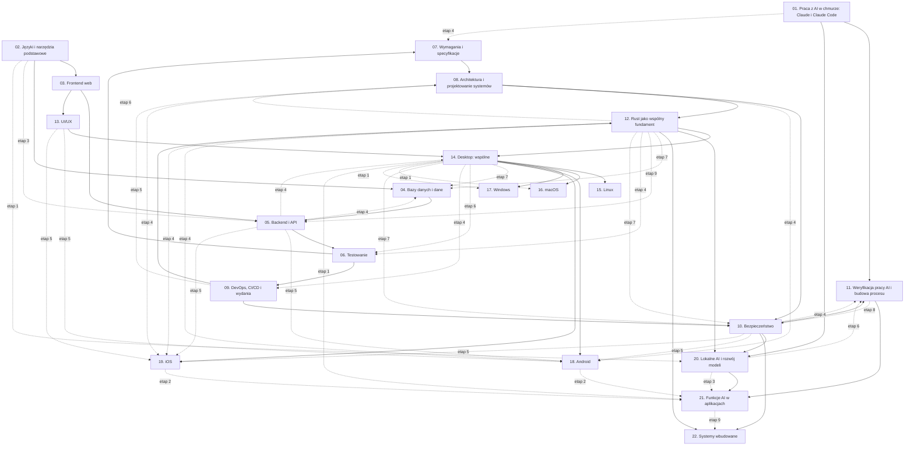

# Plan wdrożenia planu nauki w Linear: kolejność i zależności

Stan na 11 października 2026 r. · Team **LEA** (https://linear.app/daankh/team/LEA/overview) · Źródło: dokument „Umiejętności techniczne” (wersja z układem warstw) w projekcie „JDG: Rozwój oprogramowania”.

Ten plik opisuje kolejność projektów i zależności między nimi. Szczegóły każdego projektu (opis, kamienie milowe, zadania i ich blokady) są w 22 plikach `01-…md` do `22-…md`. Nic nie zostało jeszcze utworzone w Linear: to plan do przeglądu przed wdrożeniem.

## 1. Jak plan nauki przekłada się na Linear

| Element planu nauki | Element w Linear | Liczba |
|---|---|---|
| sekcja dokumentu | projekt w teamie LEA | 22 |
| etap ścieżki nauki (także ścieżek uzupełniających 12.2 i 17.2) | kamień milowy projektu | 160 |
| punkt startu sekcji | zadanie „Start: …” z warunkami wejścia | 22 |
| materiał z tabeli etapu | zadanie typu „materiał” | 864 |
| dowód etapu (i dowód poziomu E) | zadanie typu „dowód”, zamyka kamień milowy | 160 |
| praktyka z etapu eksperckiego | zadanie typu „praktyka” (ciągłe) | 75 |
| kolejność nauki | relacje „blokuje / blokowane przez” między zadaniami | 2139 |
| | w tym relacje między projektami | 313 |

Razem **1121 zadań**, z tego 124 materiałów płatnych, 116 materiałów opcjonalnych w etapach obowiązkowych i 10 zadań w etapach opcjonalnych. Plan nie zawiera dat ani sumarycznych szacunków czasu; czas jest podany tylko przy każdym materiale.

**Zasady zależności:**

- Każdy projekt ma jedno zadanie startowe. Wszystkie zadania pierwszego etapu (i ścieżek uzupełniających) są przez nie blokowane.
- Zadanie startowe jest blokowane przez dowody tych etapów projektów wstępnych, po których dana umiejętność jest na poziomie wystarczającym do dalszej pracy (zwykle pierwszy etap z poziomem W). Nie trzeba kończyć całego projektu wstępnego, żeby zacząć następny: tak działa nauka spiralna z dokumentu.
- Wewnątrz etapu materiały są równoległe i blokują dowód etapu. Dowód etapu blokuje materiały kolejnego etapu (albo kilku etapów, gdy ścieżka się rozgałęzia; etap ekspercki wymaga wszystkich obowiązkowych etapów projektu).
- Materiały oznaczone `opcjonalne` (alternatywy, uzupełnienia „wg potrzeb”) nie blokują dowodu etapu. Są blokowane jak pozostałe materiały etapu, ale można je zamknąć jako Canceled bez wpływu na resztę ścieżki.
- Kilka etapów ma dodatkowe zależności od innych projektów (np. testy w Ruście czekają na Rusta, testy desktopowe na Tauri). Są w tabeli w punkcie 5. Dowód etapu nie wymaga umiejętności spoza swoich (pośrednich) blokad.
- Etapy opcjonalne (22: embedded Linux i Zephyr oraz TinyML) nie blokują reszty ścieżki.

## 2. Wymagania przed wdrożeniem

- **Plan Linear:** plan Free ma limit 250 zgłoszeń, a ten plan ma 1121 zadań. Potrzebny jest plan płatny albo wdrażanie partiami z archiwizacją zamkniętych zadań; zalecany jest plan płatny.
- **Etykiety zadań w teamie LEA:** `start`, `materiał`, `dowód`, `praktyka`, `płatny`, `opcjonalne`, `ścieżka uzupełniająca`. Skrypt tworzy je sam (kolory w `ISSUE_LABELS`). Etykieta `płatny` oznacza materiał, za który trzeba zapłacić, żeby go przerobić (bezpłatny materiał z płatnym drukiem lub egzaminem jej nie ma).
- **Etykiety projektów:** `warstwa-0` do `warstwa-8`.
- **Statusy:** domyślny przepływ teamu (Backlog, Todo, In Progress, Done, Canceled). Zadania startowe projektów 01 i 02 dostają status Todo, wszystkie pozostałe Backlog. Zadanie przechodzi do Todo, gdy zamknięte są wszystkie blokujące.
- **Materiały zaliczone samym dowodem:** przy doświadczeniu seniorskim część etapów zaliczasz od razu dowodem. Zadania materiałów takich etapów zamykasz jako Canceled z komentarzem, a dowód jako Done.

## 3. Punkt startu

Graf zależności ma dokładnie dwa zadania bez blokad i od nich zaczyna się cała nauka:

- **`S01-START`** · Start: 1. Praca z AI w chmurze: Claude i Claude Code (tor równoległy przez cały plan),
- **`S02-START`** · Start: 2. Języki i narzędzia podstawowe.

Wszystkie pozostałe 20 projektów odblokowują się kaskadowo przez dowody etapów. Graf nie ma cykli (sprawdzone automatycznie przy generowaniu planu).

## 4. Kolejność projektów

Kolejność według warstw z dokumentu: każdy projekt opiera się wyłącznie na wcześniejszych.

| Kolejność | Projekt | Warstwa | Blokowany przez | Blokuje | Odblokowanie startu (dowody) | Zadania |
|---|---|---|---|---|---|---|
| 1 | [01. Praca z AI w chmurze: Claude i Claude Code](01-praca-z-ai-w-chmurze.md) | 0: fundamenty | — | 11, 20, 21 | — | 50 |
| 2 | [02. Języki i narzędzia podstawowe](02-jezyki-i-narzedzia-podstawowe.md) | 0: fundamenty | — | 03, 04, 09, 11, 12 | — | 42 |
| 3 | [03. Frontend web](03-frontend-web.md) | 0: fundamenty | 02 | 05, 06, 07, 10, 13, 14 | `S02-E1-D` | 53 |
| 4 | [04. Bazy danych i dane](04-bazy-danych-i-dane.md) | 1: dane i serwer | 02 | 05, 06, 08, 10 | `S02-E1-D` | 56 |
| 5 | [05. Backend i API](05-backend-i-api.md) | 1: dane i serwer | 03, 04 | 06, 07, 08, 10, 12, 21 | `S03-E2-D`, `S04-E1-D` | 92 |
| 6 | [06. Testowanie](06-testowanie.md) | 2: jakość i projektowanie | 03, 04, 05 | 07, 08, 09, 11, 12, 20, 21 | `S03-E2-D`, `S04-E1-D`, `S05-E1-D` | 50 |
| 7 | [07. Wymagania i specyfikacje](07-wymagania-i-specyfikacje.md) | 2: jakość i projektowanie | 03, 05, 06 | 08, 11 | `S03-E2-D`, `S05-E1-D`, `S06-E1-D` | 47 |
| 8 | [08. Architektura i projektowanie systemów](08-architektura-i-projektowanie-systemow.md) | 2: jakość i projektowanie | 04, 05, 06, 07 | 10, 11, 12, 14, 21 | `S04-E1-D`, `S05-E1-D`, `S06-E1-D`, `S07-E1-D` | 70 |
| 9 | [09. DevOps, CI/CD i wydania](09-devops-ci-cd-i-wydania.md) | 2: jakość i projektowanie | 02, 06 | 10, 12, 15, 16, 17, 18, 19 | `S02-E1-D`, `S06-E1-D` | 46 |
| 10 | [10. Bezpieczeństwo](10-bezpieczenstwo.md) | 3: ochrona i kontrola | 03, 04, 05, 08, 09 | 11, 20, 21, 22 | `S03-E2-D`, `S04-E1-D`, `S05-E1-D`, `S08-E1-D`, `S09-E2-D` | 57 |
| 11 | [11. Weryfikacja pracy AI i budowa procesu](11-weryfikacja-pracy-ai-i-budowa-procesu.md) | 3: ochrona i kontrola | 01, 02, 06, 07, 08, 10 | 21 | `S01-E1-D`, `S02-E1-D`, `S06-E1-D`, `S07-E1-D`, `S08-E1-D`, `S10-E1-D` | 40 |
| 12 | [12. Rust jako wspólny fundament](12-rust-jako-wspolny-fundament.md) | 4: rdzeń kompilowany i produkt | 02, 05, 06, 08, 09 | 14, 18, 19, 20, 22 | `S02-E1-D`, `S05-E1-D`, `S06-E1-D`, `S08-E1-D`, `S09-E2-D` | 68 |
| 13 | [13. UI/UX](13-ui-ux.md) | 4: rdzeń kompilowany i produkt | 03 | 14, 18, 19 | `S03-E2-D` | 61 |
| 14 | [14. Desktop: wspólne](14-desktop.md) | 5: desktop | 03, 08, 12, 13 | 15, 16, 17, 18, 19 | `S03-E2-D`, `S08-E1-D`, `S12-E2-D`, `S13-E2-D` | 39 |
| 15 | [15. Linux](15-linux.md) | 5: desktop | 09, 14 | — | `S09-E2-D`, `S14-E1-D` | 31 |
| 16 | [16. macOS](16-macos.md) | 5: desktop | 09, 14 | — | `S09-E2-D`, `S14-E1-D` | 33 |
| 17 | [17. Windows](17-windows.md) | 5: desktop | 09, 14 | — | `S09-E2-D`, `S14-E1-D` | 38 |
| 18 | [18. Android](18-android.md) | 6: mobile | 09, 12, 13, 14 | — | `S09-E2-D`, `S12-E2-D`, `S13-E2-D`, `S14-E1-D` | 58 |
| 19 | [19. iOS](19-ios.md) | 6: mobile | 09, 12, 13, 14 | — | `S09-E2-D`, `S12-E2-D`, `S13-E2-D`, `S14-E1-D` | 54 |
| 20 | [20. Lokalne AI i rozwój modeli](20-lokalne-ai-i-rozwoj-modeli.md) | 7: AI w produktach | 01, 06, 10, 12 | 21 | `S01-E1-D`, `S06-E1-D`, `S10-E1-D`, `S12-E2-D` | 40 |
| 21 | [21. Funkcje AI w aplikacjach](21-funkcje-ai-w-aplikacjach.md) | 7: AI w produktach | 01, 05, 06, 08, 10, 11, 20 | — | `S01-E1-D`, `S05-E1-D`, `S06-E1-D`, `S08-E1-D`, `S10-E1-D`, `S20-E0-D`, `S11-E3-D`, `S11-E4-D` | 31 |
| 22 | [22. Systemy wbudowane](22-systemy-wbudowane.md) | 8: sprzęt | 10, 12 | — | `S10-E1-D`, `S12-E6-D`, `S12-U1-D` | 65 |

Projekty z tej samej warstwy można prowadzić równolegle. Sekcja 01 jest torem równoległym: jej etapy 0–2 warto zamknąć na początku, a kolejne równolegle z warstwami 2–3.

### Graf zależności projektów

Strzałka oznacza „blokuje”. Pokazane są tylko zależności bezpośrednie (bez przechodnich), pełna lista jest w tabeli powyżej. Linie przerywane to zależności częściowe: blokują jeden etap, a nie start projektu.

## 5. Relacje między projektami na poziomie zadań

Te relacje tworzysz w Linear jako „blocks” między zadaniami z różnych projektów. Relacje startowe odpowiadają zależnościom projektów, częściowe blokują pojedynczy etap.

| Zadanie blokujące | Zadanie blokowane | Rodzaj | Powód |
|---|---|---|---|
| `S02-E1-D` · Dowód etapu 1: Bash i `jq` | `S03-START` · Start: 3. Frontend web | start projektu | sekcja 2 na poziomie podstawowym do pracy (etap 1) |
| `S05-E1-D` · Dowód etapu 1: Node.js po stronie serwera | `S04-E4-M1` · Przerobić: Dokumentacja Redis: typy danych, wygasanie kluczy, Streams, trwałość, Pub/Sub | częściowa | cache i limity zapytań na usłudze Node.js z sekcji 5 |
| `S05-E1-D` · Dowód etapu 1: Node.js po stronie serwera | `S04-E4-M2` · Przerobić: Valkey (otwarty fork Redis na licencji BSD pod Linux Foundation) | częściowa | cache i limity zapytań na usłudze Node.js z sekcji 5 |
| `S05-E1-D` · Dowód etapu 1: Node.js po stronie serwera | `S04-E4-M3` · Przerobić: Klient Redis dla Node.js: `node-redis` (oficjalny) albo `ioredis` | częściowa | cache i limity zapytań na usłudze Node.js z sekcji 5 |
| `S12-E2-D` · Dowód etapu 2: własność, pożyczanie, czasy życia | `S04-E7-M1` · Przerobić: Dokumentacja SQLite: „Isolation In SQLite”, „Write-Ahead Logging”, „STRICT Tables”… | częściowa | local-first w rdzeniu Rust wymaga Rusta na poziomie W |
| `S14-E1-D` · Dowód etapu 1: Tauri 2 | `S04-E7-M1` · Przerobić: Dokumentacja SQLite: „Isolation In SQLite”, „Write-Ahead Logging”, „STRICT Tables”… | częściowa | aplikacja local-first działa w Tauri |
| `S12-E2-D` · Dowód etapu 2: własność, pożyczanie, czasy życia | `S04-E7-M2` · Przerobić: `rusqlite` (albo SQLx z SQLite, zob. sekcja 5, etap dostępu do danych z Rusta) | częściowa | local-first w rdzeniu Rust wymaga Rusta na poziomie W |
| `S14-E1-D` · Dowód etapu 1: Tauri 2 | `S04-E7-M2` · Przerobić: `rusqlite` (albo SQLx z SQLite, zob. sekcja 5, etap dostępu do danych z Rusta) | częściowa | aplikacja local-first działa w Tauri |
| `S12-E2-D` · Dowód etapu 2: własność, pożyczanie, czasy życia | `S04-E7-M3` · Przerobić: „Local-first software: You own your data, in spite of the cloud” | częściowa | local-first w rdzeniu Rust wymaga Rusta na poziomie W |
| `S14-E1-D` · Dowód etapu 1: Tauri 2 | `S04-E7-M3` · Przerobić: „Local-first software: You own your data, in spite of the cloud” | częściowa | aplikacja local-first działa w Tauri |
| `S12-E2-D` · Dowód etapu 2: własność, pożyczanie, czasy życia | `S04-E7-M4` · Przerobić: Automerge 3 (rdzeń w Ruście, wiązania JavaScript przez WebAssembly) | częściowa | local-first w rdzeniu Rust wymaga Rusta na poziomie W |
| `S14-E1-D` · Dowód etapu 1: Tauri 2 | `S04-E7-M4` · Przerobić: Automerge 3 (rdzeń w Ruście, wiązania JavaScript przez WebAssembly) | częściowa | aplikacja local-first działa w Tauri |
| `S12-E2-D` · Dowód etapu 2: własność, pożyczanie, czasy życia | `S04-E7-M5` · Przerobić: Yjs i jego port do Rusta `yrs` | częściowa | local-first w rdzeniu Rust wymaga Rusta na poziomie W |
| `S14-E1-D` · Dowód etapu 1: Tauri 2 | `S04-E7-M5` · Przerobić: Yjs i jego port do Rusta `yrs` | częściowa | aplikacja local-first działa w Tauri |
| `S12-E2-D` · Dowód etapu 2: własność, pożyczanie, czasy życia | `S04-E7-M6` · Przerobić: Loro (CRDT w Ruście z wiązaniami JS, Swift, Python) | częściowa | local-first w rdzeniu Rust wymaga Rusta na poziomie W |
| `S14-E1-D` · Dowód etapu 1: Tauri 2 | `S04-E7-M6` · Przerobić: Loro (CRDT w Ruście z wiązaniami JS, Swift, Python) | częściowa | aplikacja local-first działa w Tauri |
| `S12-E2-D` · Dowód etapu 2: własność, pożyczanie, czasy życia | `S04-E7-M7` · Przerobić: Silniki synchronizacji PostgreSQL–SQLite: PowerSync (SDK w Ruście w wersji beta), Electric | częściowa | local-first w rdzeniu Rust wymaga Rusta na poziomie W |
| `S14-E1-D` · Dowód etapu 1: Tauri 2 | `S04-E7-M7` · Przerobić: Silniki synchronizacji PostgreSQL–SQLite: PowerSync (SDK w Ruście w wersji beta), Electric | częściowa | aplikacja local-first działa w Tauri |
| `S02-E1-D` · Dowód etapu 1: Bash i `jq` | `S04-START` · Start: 4. Bazy danych i dane | start projektu | sekcja 2 na poziomie podstawowym do pracy (etap 1) |
| `S02-E3-D` · Dowód etapu 3: Python | `S05-E3-M1` · Przerobić: FastAPI: „Tutorial - User Guide”… | częściowa | FastAPI wymaga Pythona na poziomie W |
| `S02-E3-D` · Dowód etapu 3: Python | `S05-E3-M2` · Przerobić: Pydantic v2: modele, walidatory, serializacja, `pydantic-settings` | częściowa | FastAPI wymaga Pythona na poziomie W |
| `S02-E3-D` · Dowód etapu 3: Python | `S05-E3-M3` · Przerobić: SQLAlchemy 2.0: „Unified Tutorial” i „Asynchronous I/O (asyncio)” | częściowa | FastAPI wymaga Pythona na poziomie W |
| `S02-E3-D` · Dowód etapu 3: Python | `S05-E3-M4` · Przerobić: Alembic: „Tutorial” i „Auto Generating Migrations” | częściowa | FastAPI wymaga Pythona na poziomie W |
| `S02-E3-D` · Dowód etapu 3: Python | `S05-E3-M5` · Przerobić: FastAPI: „Deployment” (FastAPI CLI, Uvicorn, procesy robocze, obraz Dockera) | częściowa | FastAPI wymaga Pythona na poziomie W |
| `S12-E2-D` · Dowód etapu 2: własność, pożyczanie, czasy życia | `S05-E9-M1` · Przerobić: Tokio Tutorial | częściowa | backend w Ruście wymaga Rusta na poziomie W |
| `S12-E2-D` · Dowód etapu 2: własność, pożyczanie, czasy życia | `S05-E9-M2` · Przerobić: „Inventing the Service trait” | częściowa | backend w Ruście wymaga Rusta na poziomie W |
| `S12-E2-D` · Dowód etapu 2: własność, pożyczanie, czasy życia | `S05-E9-M3` · Przerobić: Dokumentacja Axum i katalog przykładów w repozytorium | częściowa | backend w Ruście wymaga Rusta na poziomie W |
| `S12-E2-D` · Dowód etapu 2: własność, pożyczanie, czasy życia | `S05-E9-M4` · Przerobić: Dokumentacja Tower i `tower-http` (timeouty, limity, CORS, kompresja, śledzenie) | częściowa | backend w Ruście wymaga Rusta na poziomie W |
| `S12-E2-D` · Dowód etapu 2: własność, pożyczanie, czasy życia | `S05-E9-M5` · Przerobić: Zero To Production in Rust | częściowa | backend w Ruście wymaga Rusta na poziomie W |
| `S12-E2-D` · Dowód etapu 2: własność, pożyczanie, czasy życia | `S05-E9-M6` · Przerobić: `utoipa` i `utoipa-axum`: OpenAPI generowane z kodu Rust | częściowa | backend w Ruście wymaga Rusta na poziomie W |
| `S12-E2-D` · Dowód etapu 2: własność, pożyczanie, czasy życia | `S05-E9-M7` · Przerobić: `tonic`: przykłady i samouczek routeguide | częściowa | backend w Ruście wymaga Rusta na poziomie W |
| `S12-E2-D` · Dowód etapu 2: własność, pożyczanie, czasy życia | `S05-E9-M8` · Przerobić: Crate’y `oauth2`, `openidconnect`, `tower-sessions`, `axum-login` | częściowa | backend w Ruście wymaga Rusta na poziomie W |
| `S12-E2-D` · Dowód etapu 2: własność, pożyczanie, czasy życia | `S05-E9-M9` · Przerobić: Zadania w tle w Ruście: `apalis` (wersja 1.0 w fazie RC) | częściowa | backend w Ruście wymaga Rusta na poziomie W |
| `S03-E2-D` · Dowód etapu 2: TypeScript | `S05-START` · Start: 5. Backend i API | start projektu | sekcja 3 na poziomie podstawowym do pracy (etap 2) |
| `S04-E1-D` · Dowód etapu 1: PostgreSQL w praktyce | `S05-START` · Start: 5. Backend i API | start projektu | sekcja 4 na poziomie podstawowym do pracy (etap 1) |
| `S12-E2-D` · Dowód etapu 2: własność, pożyczanie, czasy życia | `S06-E4-M1` · Przerobić: The Rust Programming Language, rozdział 11 „Writing Automated Tests” | częściowa | testy jednostkowe w Ruście wymagają Rusta na poziomie W (własność, pożyczanie) |
| `S12-E2-D` · Dowód etapu 2: własność, pożyczanie, czasy życia | `S06-E4-M2` · Przerobić: cargo-nextest | częściowa | testy jednostkowe w Ruście wymagają Rusta na poziomie W (własność, pożyczanie) |
| `S12-E2-D` · Dowód etapu 2: własność, pożyczanie, czasy życia | `S06-E4-M3` · Przerobić: cargo-llvm-cov | częściowa | testy jednostkowe w Ruście wymagają Rusta na poziomie W (własność, pożyczanie) |
| `S14-E1-D` · Dowód etapu 1: Tauri 2 | `S06-E6-M1` · Przerobić: Playwright: Getting started, lokatory, trace viewer, uruchamianie w CI | częściowa | testy aplikacji desktopowej wymagają Tauri |
| `S14-E1-D` · Dowód etapu 1: Tauri 2 | `S06-E6-M2` · Przerobić: Tauri: WebDriver (`tauri-driver`, usługa WebdriverIO) | częściowa | testy aplikacji desktopowej wymagają Tauri |
| `S14-E1-D` · Dowód etapu 1: Tauri 2 | `S06-E6-M3` · Przerobić: Tauri: Mock Tauri APIs (`@tauri-apps/api/mocks`, `mockIPC`) | częściowa | testy aplikacji desktopowej wymagają Tauri |
| `S14-E1-D` · Dowód etapu 1: Tauri 2 | `S06-E6-M4` · Przerobić: XCTest (testy jednostkowe, wydajności i UI) i Swift Testing | częściowa | testy aplikacji desktopowej wymagają Tauri |
| `S14-E1-D` · Dowód etapu 1: Tauri 2 | `S06-E6-M5` · Przerobić: Test apps on Android, Test your Compose layout, Espresso | częściowa | testy aplikacji desktopowej wymagają Tauri |
| `S14-E1-D` · Dowód etapu 1: Tauri 2 | `S06-E6-M6` · Przerobić: Maestro | częściowa | testy aplikacji desktopowej wymagają Tauri |
| `S14-E1-D` · Dowód etapu 1: Tauri 2 | `S06-E6-M7` · Przerobić: embedded-test | częściowa | testy aplikacji desktopowej wymagają Tauri |
| `S14-E1-D` · Dowód etapu 1: Tauri 2 | `S06-E6-M8` · Przerobić: QEMU: emulacja systemów Arm | częściowa | testy aplikacji desktopowej wymagają Tauri |
| `S03-E2-D` · Dowód etapu 2: TypeScript | `S06-START` · Start: 6. Testowanie | start projektu | sekcja 3 na poziomie podstawowym do pracy (etap 2) |
| `S04-E1-D` · Dowód etapu 1: PostgreSQL w praktyce | `S06-START` · Start: 6. Testowanie | start projektu | sekcja 4 na poziomie podstawowym do pracy (etap 1) |
| `S05-E1-D` · Dowód etapu 1: Node.js po stronie serwera | `S06-START` · Start: 6. Testowanie | start projektu | sekcja 5 na poziomie podstawowym do pracy (etap 1) |
| `S01-E1-D` · Dowód etapu 1: codzienna praca z Claude Code | `S07-E4-M1` · Przerobić: GitHub Spec Kit: „Specification-Driven Development”, Quickstart, „Existing Projects” | częściowa | specyfikacje dla agentów wymagają codziennej pracy z Claude Code |
| `S01-E1-D` · Dowód etapu 1: codzienna praca z Claude Code | `S07-E4-M2` · Przerobić: Kiro: specyfikacje funkcji i błędów | częściowa | specyfikacje dla agentów wymagają codziennej pracy z Claude Code |
| `S01-E1-D` · Dowód etapu 1: codzienna praca z Claude Code | `S07-E4-M3` · Przerobić: OpenSpec: koncepcje (delta specs) | częściowa | specyfikacje dla agentów wymagają codziennej pracy z Claude Code |
| `S01-E1-D` · Dowód etapu 1: codzienna praca z Claude Code | `S07-E4-M4` · Przerobić: „Understanding Spec-Driven-Development: Kiro, spec-kit, and Tessl” (październik 2025) | częściowa | specyfikacje dla agentów wymagają codziennej pracy z Claude Code |
| `S01-E1-D` · Dowód etapu 1: codzienna praca z Claude Code | `S07-E4-M5` · Przerobić: Spec-driven development w Technology Radar (listopad 2025, pierścień „Assess”) | częściowa | specyfikacje dla agentów wymagają codziennej pracy z Claude Code |
| `S01-E1-D` · Dowód etapu 1: codzienna praca z Claude Code | `S07-E4-M6` · Przerobić: Dokumentacja Claude Code: „Let Claude interview you” (Best practices) | częściowa | specyfikacje dla agentów wymagają codziennej pracy z Claude Code |
| `S03-E2-D` · Dowód etapu 2: TypeScript | `S07-START` · Start: 7. Wymagania i specyfikacje | start projektu | sekcja 3 na poziomie podstawowym do pracy (etap 2) |
| `S05-E1-D` · Dowód etapu 1: Node.js po stronie serwera | `S07-START` · Start: 7. Wymagania i specyfikacje | start projektu | sekcja 5 na poziomie podstawowym do pracy (etap 1) |
| `S06-E1-D` · Dowód etapu 1: projektowanie testów i TDD | `S07-START` · Start: 7. Wymagania i specyfikacje | start projektu | sekcja 6 na poziomie podstawowym do pracy (etap 1: projektowanie testów i TDD) |
| `S09-E2-D` · Dowód etapu 2: GitHub Actions i bezpieczeństwo pipeline’u | `S08-E5-M1` · Przerobić: Building Evolutionary Architectures (wydanie 2, 2022) | częściowa | funkcje dopasowania działają w pipeline’ie CI z sekcji 9 |
| `S09-E2-D` · Dowód etapu 2: GitHub Actions i bezpieczeństwo pipeline’u | `S08-E5-M2` · Przerobić: Fitness Function Katas | częściowa | funkcje dopasowania działają w pipeline’ie CI z sekcji 9 |
| `S09-E2-D` · Dowód etapu 2: GitHub Actions i bezpieczeństwo pipeline’u | `S08-E5-M3` · Przerobić: ArchUnitTS: testy architektury w TypeScript (Jest, Vitest, Jasmine; pakiet npm `archunit`) | częściowa | funkcje dopasowania działają w pipeline’ie CI z sekcji 9 |
| `S09-E2-D` · Dowód etapu 2: GitHub Actions i bezpieczeństwo pipeline’u | `S08-E5-M4` · Przerobić: `cargo-deny`: reguły `bans` (zakaz crate’ów, `wrappers`, duplikaty wersji) | częściowa | funkcje dopasowania działają w pipeline’ie CI z sekcji 9 |
| `S09-E2-D` · Dowód etapu 2: GitHub Actions i bezpieczeństwo pipeline’u | `S08-E5-M5` · Przerobić: `cargo-pup`: asercje architektury w Ruście inspirowane ArchUnit (wersja 0.1, wymaga nightly) | częściowa | funkcje dopasowania działają w pipeline’ie CI z sekcji 9 |
| `S09-E2-D` · Dowód etapu 2: GitHub Actions i bezpieczeństwo pipeline’u | `S08-E5-M6` · Przerobić: Monolith to Microservices (2019), rozdziały 2–4… | częściowa | funkcje dopasowania działają w pipeline’ie CI z sekcji 9 |
| `S09-E2-D` · Dowód etapu 2: GitHub Actions i bezpieczeństwo pipeline’u | `S08-E5-M7` · Przerobić: „Strangler Fig” (sierpień 2024) i „Patterns of Legacy Displacement” | częściowa | funkcje dopasowania działają w pipeline’ie CI z sekcji 9 |
| `S09-E2-D` · Dowód etapu 2: GitHub Actions i bezpieczeństwo pipeline’u | `S08-E5-M8` · Przerobić: Strangler Fig pattern (z migracją bazy przez CDC) | częściowa | funkcje dopasowania działają w pipeline’ie CI z sekcji 9 |
| `S12-E5-D` · Dowód etapu 5: `unsafe` i FFI (UniFFI, `cbindgen`, Miri) | `S08-E6-M1` · Przerobić: Building Multi-Tenant SaaS Architectures (2024) | częściowa | wspólny rdzeń z powłokami natywnymi wymaga FFI i UniFFI |
| `S12-E5-D` · Dowód etapu 5: `unsafe` i FFI (UniFFI, `cbindgen`, Miri) | `S08-E6-M2` · Przerobić: Architect multitenant solutions on Azure: rozważania architektoniczne i modele wielodostępności | częściowa | wspólny rdzeń z powłokami natywnymi wymaga FFI i UniFFI |
| `S12-E5-D` · Dowód etapu 5: `unsafe` i FFI (UniFFI, `cbindgen`, Miri) | `S08-E6-M3` · Przerobić: SaaS Lens (AWS Well-Architected) | częściowa | wspólny rdzeń z powłokami natywnymi wymaga FFI i UniFFI |
| `S12-E5-D` · Dowód etapu 5: `unsafe` i FFI (UniFFI, `cbindgen`, Miri) | `S08-E6-M4` · Przerobić: Crux: rdzeń w Ruście i powłoki w Swift, Kotlin i TypeScript (przed wersją 1.0) | częściowa | wspólny rdzeń z powłokami natywnymi wymaga FFI i UniFFI |
| `S12-E5-D` · Dowód etapu 5: `unsafe` i FFI (UniFFI, `cbindgen`, Miri) | `S08-E6-M5` · Przerobić: „Large Rust Workspaces” (2021) | częściowa | wspólny rdzeń z powłokami natywnymi wymaga FFI i UniFFI |
| `S04-E1-D` · Dowód etapu 1: PostgreSQL w praktyce | `S08-START` · Start: 8. Architektura i projektowanie systemów | start projektu | sekcja 4 na poziomie podstawowym do pracy (etap 1) |
| `S05-E1-D` · Dowód etapu 1: Node.js po stronie serwera | `S08-START` · Start: 8. Architektura i projektowanie systemów | start projektu | sekcja 5 na poziomie podstawowym do pracy (etap 1) |
| `S06-E1-D` · Dowód etapu 1: projektowanie testów i TDD | `S08-START` · Start: 8. Architektura i projektowanie systemów | start projektu | sekcja 6 na poziomie podstawowym do pracy (etap 1: projektowanie testów i TDD) |
| `S07-E1-D` · Dowód etapu 1: wydobywanie wymagań od klienta | `S08-START` · Start: 8. Architektura i projektowanie systemów | start projektu | sekcja 7 na poziomie podstawowym do pracy (etap 1) |
| `S14-E1-D` · Dowód etapu 1: Tauri 2 | `S09-E4-M1` · Przerobić: Semantic Versioning 2.0.0, Conventional Commits 1.0.0 | częściowa | wydania desktopowe budują aplikację Tauri |
| `S14-E1-D` · Dowód etapu 1: Tauri 2 | `S09-E4-M2` · Przerobić: release-plz (wydania crate’ów przez PR z changelogiem) i `cargo-semver-checks` | częściowa | wydania desktopowe budują aplikację Tauri |
| `S14-E1-D` · Dowód etapu 1: Tauri 2 | `S09-E4-M3` · Przerobić: dist (dawniej cargo-dist): instalatory i wydania narzędzi CLI | częściowa | wydania desktopowe budują aplikację Tauri |
| `S14-E1-D` · Dowód etapu 1: Tauri 2 | `S09-E4-M4` · Przerobić: Tauri: GitHub pipeline (`tauri-action`) i plugin Updater | częściowa | wydania desktopowe budują aplikację Tauri |
| `S14-E1-D` · Dowód etapu 1: Tauri 2 | `S09-E4-M5` · Przerobić: fastlane (w tym `match` do certyfikatów Apple) | częściowa | wydania desktopowe budują aplikację Tauri |
| `S02-E1-D` · Dowód etapu 1: Bash i `jq` | `S09-START` · Start: 9. DevOps, CI/CD i wydania | start projektu | sekcja 2 na poziomie podstawowym do pracy (etap 1) |
| `S06-E1-D` · Dowód etapu 1: projektowanie testów i TDD | `S09-START` · Start: 9. DevOps, CI/CD i wydania | start projektu | sekcja 6 na poziomie podstawowym do pracy (etap 1: projektowanie testów i TDD) |
| `S12-E5-D` · Dowód etapu 5: `unsafe` i FFI (UniFFI, `cbindgen`, Miri) | `S10-E7-M1` · Przerobić: Secure Rust Guidelines | częściowa | przegląd `unsafe` i FFI wymaga etapu `unsafe` i FFI z sekcji 12 |
| `S14-E1-D` · Dowód etapu 1: Tauri 2 | `S10-E7-M1` · Przerobić: Secure Rust Guidelines | częściowa | bezpieczeństwo Tauri wymaga aplikacji Tauri (sekcja 14, etap 1) |
| `S12-E5-D` · Dowód etapu 5: `unsafe` i FFI (UniFFI, `cbindgen`, Miri) | `S10-E7-M2` · Przerobić: Rust Secure Code Working Group: lista projektów (fuzzery, analizatory, narzędzia zależności) | częściowa | przegląd `unsafe` i FFI wymaga etapu `unsafe` i FFI z sekcji 12 |
| `S14-E1-D` · Dowód etapu 1: Tauri 2 | `S10-E7-M2` · Przerobić: Rust Secure Code Working Group: lista projektów (fuzzery, analizatory, narzędzia zależności) | częściowa | bezpieczeństwo Tauri wymaga aplikacji Tauri (sekcja 14, etap 1) |
| `S12-E5-D` · Dowód etapu 5: `unsafe` i FFI (UniFFI, `cbindgen`, Miri) | `S10-E7-M3` · Przerobić: Tauri: Security (granice zaufania, IPC, capabilities) | częściowa | przegląd `unsafe` i FFI wymaga etapu `unsafe` i FFI z sekcji 12 |
| `S14-E1-D` · Dowód etapu 1: Tauri 2 | `S10-E7-M3` · Przerobić: Tauri: Security (granice zaufania, IPC, capabilities) | częściowa | bezpieczeństwo Tauri wymaga aplikacji Tauri (sekcja 14, etap 1) |
| `S11-E2-D` · Dowód etapu 2: recenzja kodu | `S10-E8-M1` · Przerobić: Burp Suite Certified Practitioner | częściowa | audyt używa listy kontrolnej recenzji z sekcji 11 |
| `S11-E2-D` · Dowód etapu 2: recenzja kodu | `S10-E8-M2` · Przerobić: Komunikaty bezpieczeństwa frameworków i zależności, RustSec, EUVD, KEV | częściowa | audyt używa listy kontrolnej recenzji z sekcji 11 |
| `S11-E2-D` · Dowód etapu 2: recenzja kodu | `S10-E8-M3` · Przerobić: Zmiany w ASVS, Top 10 i materiałach Komisji i ENISA o CRA | częściowa | audyt używa listy kontrolnej recenzji z sekcji 11 |
| `S11-E2-D` · Dowód etapu 2: recenzja kodu | `S10-E8-P1` · Praktyka: audyty klientów | częściowa | audyt używa listy kontrolnej recenzji z sekcji 11 |
| `S11-E2-D` · Dowód etapu 2: recenzja kodu | `S10-E8-P2` · Praktyka: recenzja bezpieczeństwa kodu AI | częściowa | audyt używa listy kontrolnej recenzji z sekcji 11 |
| `S11-E2-D` · Dowód etapu 2: recenzja kodu | `S10-E8-P3` · Praktyka: obsługa podatności jako proces | częściowa | audyt używa listy kontrolnej recenzji z sekcji 11 |
| `S11-E2-D` · Dowód etapu 2: recenzja kodu | `S10-E8-P4` · Praktyka: wkład zewnętrzny | częściowa | audyt używa listy kontrolnej recenzji z sekcji 11 |
| `S03-E2-D` · Dowód etapu 2: TypeScript | `S10-START` · Start: 10. Bezpieczeństwo | start projektu | sekcja 3 na poziomie podstawowym do pracy (etap 2) |
| `S04-E1-D` · Dowód etapu 1: PostgreSQL w praktyce | `S10-START` · Start: 10. Bezpieczeństwo | start projektu | sekcja 4 na poziomie podstawowym do pracy (etap 1) |
| `S05-E1-D` · Dowód etapu 1: Node.js po stronie serwera | `S10-START` · Start: 10. Bezpieczeństwo | start projektu | sekcja 5 na poziomie podstawowym do pracy (etap 1) |
| `S08-E1-D` · Dowód etapu 1: style architektoniczne, atrybuty jakości i kompromisy | `S10-START` · Start: 10. Bezpieczeństwo | start projektu | sekcja 8 na poziomie podstawowym do pracy (etap 1) |
| `S09-E2-D` · Dowód etapu 2: GitHub Actions i bezpieczeństwo pipeline’u | `S10-START` · Start: 10. Bezpieczeństwo | start projektu | sekcja 9 na poziomie podstawowym do pracy (etap 2) |
| `S10-E3-D` · Dowód etapu 3: modelowanie zagrożeń | `S11-E4-M1` · Przerobić: OWASP Top 10 for LLM Applications 2025 | częściowa | bezpieczeństwo agentów korzysta z modelowania zagrożeń (STRIDE) |
| `S10-E3-D` · Dowód etapu 3: modelowanie zagrożeń | `S11-E4-M2` · Przerobić: OWASP Top 10 for Agentic Applications for 2026 (grudzień 2025) | częściowa | bezpieczeństwo agentów korzysta z modelowania zagrożeń (STRIDE) |
| `S10-E3-D` · Dowód etapu 3: modelowanie zagrożeń | `S11-E4-M3` · Przerobić: MCP: Security Best Practices | częściowa | bezpieczeństwo agentów korzysta z modelowania zagrożeń (STRIDE) |
| `S10-E3-D` · Dowód etapu 3: modelowanie zagrożeń | `S11-E4-M4` · Przerobić: „The lethal trifecta for AI agents” i tag „prompt-injection” | częściowa | bezpieczeństwo agentów korzysta z modelowania zagrożeń (STRIDE) |
| `S20-E0-D` · Dowód etapu 0: modele lokalne na stanowisku pracy | `S11-E6-M1` · Przerobić: Blog inżynieryjny Anthropic i informacje o zmianach Claude Code | częściowa | recenzja na modelu lokalnym wymaga modeli lokalnych na stanowisku pracy |
| `S20-E0-D` · Dowód etapu 0: modele lokalne na stanowisku pracy | `S11-E6-M2` · Przerobić: Simon Willison’s Weblog | częściowa | recenzja na modelu lokalnym wymaga modeli lokalnych na stanowisku pracy |
| `S20-E0-D` · Dowód etapu 0: modele lokalne na stanowisku pracy | `S11-E6-M3` · Przerobić: Specyfikacja MCP (nowe wersje i zmiany w autoryzacji) | częściowa | recenzja na modelu lokalnym wymaga modeli lokalnych na stanowisku pracy |
| `S20-E0-D` · Dowód etapu 0: modele lokalne na stanowisku pracy | `S11-E6-M4` · Przerobić: LiteLLM: jedna bramka (proxy) do modeli różnych dostawców i modeli lokalnych (Ollama), limity… | częściowa | recenzja na modelu lokalnym wymaga modeli lokalnych na stanowisku pracy |
| `S20-E0-D` · Dowód etapu 0: modele lokalne na stanowisku pracy | `S11-E6-P1` · Praktyka: recenzja krzyżowa | częściowa | recenzja na modelu lokalnym wymaga modeli lokalnych na stanowisku pracy |
| `S20-E0-D` · Dowód etapu 0: modele lokalne na stanowisku pracy | `S11-E6-P2` · Praktyka: pomiar procesu | częściowa | recenzja na modelu lokalnym wymaga modeli lokalnych na stanowisku pracy |
| `S20-E0-D` · Dowód etapu 0: modele lokalne na stanowisku pracy | `S11-E6-P3` · Praktyka: aktualizacja ewaluacji | częściowa | recenzja na modelu lokalnym wymaga modeli lokalnych na stanowisku pracy |
| `S20-E0-D` · Dowód etapu 0: modele lokalne na stanowisku pracy | `S11-E6-P4` · Praktyka: praca bez agenta | częściowa | recenzja na modelu lokalnym wymaga modeli lokalnych na stanowisku pracy |
| `S01-E1-D` · Dowód etapu 1: codzienna praca z Claude Code | `S11-START` · Start: 11. Weryfikacja pracy AI i budowa procesu | start projektu | sekcja 1 na poziomie podstawowym do pracy (etap 1) |
| `S02-E1-D` · Dowód etapu 1: Bash i `jq` | `S11-START` · Start: 11. Weryfikacja pracy AI i budowa procesu | start projektu | sekcja 2 na poziomie podstawowym do pracy (etap 1) |
| `S06-E1-D` · Dowód etapu 1: projektowanie testów i TDD | `S11-START` · Start: 11. Weryfikacja pracy AI i budowa procesu | start projektu | sekcja 6 na poziomie podstawowym do pracy (etap 1) |
| `S07-E1-D` · Dowód etapu 1: wydobywanie wymagań od klienta | `S11-START` · Start: 11. Weryfikacja pracy AI i budowa procesu | start projektu | sekcja 7 na poziomie podstawowym do pracy (etap 1) |
| `S08-E1-D` · Dowód etapu 1: style architektoniczne, atrybuty jakości i kompromisy | `S11-START` · Start: 11. Weryfikacja pracy AI i budowa procesu | start projektu | sekcja 8 na poziomie podstawowym do pracy (etap 1) |
| `S10-E1-D` · Dowód etapu 1: ataki na web i API w praktyce | `S11-START` · Start: 11. Weryfikacja pracy AI i budowa procesu | start projektu | sekcja 10 na poziomie podstawowym do pracy (etap 1) |
| `S02-E1-D` · Dowód etapu 1: Bash i `jq` | `S12-START` · Start: 12. Rust jako wspólny fundament | start projektu | sekcja 2 na poziomie podstawowym do pracy (etap 1) |
| `S05-E1-D` · Dowód etapu 1: Node.js po stronie serwera | `S12-START` · Start: 12. Rust jako wspólny fundament | start projektu | sekcja 5 na poziomie podstawowym do pracy (etap 1) |
| `S06-E1-D` · Dowód etapu 1: projektowanie testów i TDD | `S12-START` · Start: 12. Rust jako wspólny fundament | start projektu | sekcja 6 na poziomie podstawowym do pracy (etap 1) |
| `S08-E1-D` · Dowód etapu 1: style architektoniczne, atrybuty jakości i kompromisy | `S12-START` · Start: 12. Rust jako wspólny fundament | start projektu | sekcja 8 na poziomie podstawowym do pracy (etap 1) |
| `S09-E2-D` · Dowód etapu 2: GitHub Actions i bezpieczeństwo pipeline’u | `S12-START` · Start: 12. Rust jako wspólny fundament | start projektu | sekcja 9 na poziomie podstawowym do pracy (etap 2) |
| `S03-E2-D` · Dowód etapu 2: TypeScript | `S13-START` · Start: 13. UI/UX | start projektu | sekcja 3 na poziomie podstawowym do pracy (etap 2) |
| `S05-E8-D` · Dowód etapu 8: płatności i platformy klientów | `S14-E4-M1` · Przerobić: `keyring` 4 i `keyring-core` z osobnymi magazynami dla Keychain, Windows Credential Manager i… | częściowa | licencje i webhook Merchant of Record po stronie serwera z sekcji 5 |
| `S05-E8-D` · Dowód etapu 8: płatności i platformy klientów | `S14-E4-M2` · Przerobić: Keychain services, CryptProtectData (DPAPI), CredWriteW, Secret Service API | częściowa | licencje i webhook Merchant of Record po stronie serwera z sekcji 5 |
| `S05-E8-D` · Dowód etapu 8: płatności i platformy klientów | `S14-E4-M3` · Przerobić: Tauri Updater: klucze, format manifestu, serwer statyczny i dynamiczny, podpis nie do wyłączenia | częściowa | licencje i webhook Merchant of Record po stronie serwera z sekcji 5 |
| `S05-E8-D` · Dowód etapu 8: płatności i platformy klientów | `S14-E4-M4` · Przerobić: The Update Framework (TUF): specyfikacja i model zagrożeń aktualizacji | częściowa | licencje i webhook Merchant of Record po stronie serwera z sekcji 5 |
| `S05-E8-D` · Dowód etapu 8: płatności i platformy klientów | `S14-E4-M5` · Przerobić: Keygen: licencjonowanie offline (podpisane pliki licencji, Ed25519), aktywacja urządzeń | częściowa | licencje i webhook Merchant of Record po stronie serwera z sekcji 5 |
| `S05-E8-D` · Dowód etapu 8: płatności i platformy klientów | `S14-E4-M6` · Przerobić: Sentry for Native i Minidumps; crate’y `crash-handler` i `minidumper` | częściowa | licencje i webhook Merchant of Record po stronie serwera z sekcji 5 |
| `S05-E8-D` · Dowód etapu 8: płatności i platformy klientów | `S14-E4-M7` · Przerobić: Distribute: przegląd formatów i pipeline’ów | częściowa | licencje i webhook Merchant of Record po stronie serwera z sekcji 5 |
| `S03-E2-D` · Dowód etapu 2: TypeScript | `S14-START` · Start: 14. Desktop: wspólne | start projektu | sekcja 3 na poziomie podstawowym do pracy (etap 2) |
| `S08-E1-D` · Dowód etapu 1: style architektoniczne, atrybuty jakości i kompromisy | `S14-START` · Start: 14. Desktop: wspólne | start projektu | sekcja 8 na poziomie podstawowym do pracy (etap 1) |
| `S12-E2-D` · Dowód etapu 2: własność, pożyczanie, czasy życia | `S14-START` · Start: 14. Desktop: wspólne | start projektu | sekcja 12 na poziomie podstawowym do pracy (etap 2) |
| `S13-E2-D` · Dowód etapu 2: badania i testy użyteczności | `S14-START` · Start: 14. Desktop: wspólne | start projektu | sekcja 13 na poziomie podstawowym do pracy (etap 2) |
| `S09-E2-D` · Dowód etapu 2: GitHub Actions i bezpieczeństwo pipeline’u | `S15-START` · Start: 15. Linux | start projektu | sekcja 9 na poziomie podstawowym do pracy (etap 2) |
| `S14-E1-D` · Dowód etapu 1: Tauri 2 | `S15-START` · Start: 15. Linux | start projektu | sekcja 14 na poziomie podstawowym do pracy (etap 1) |
| `S14-E4-D` · Dowód etapu 4: infrastruktura produktu | `S16-E1-M1` · Przerobić: Signing Mac Software with Developer ID | częściowa | aktualizacja N → N+1 korzysta z updatera Tauri z sekcji 14, etap 4 |
| `S14-E4-D` · Dowód etapu 4: infrastruktura produktu | `S16-E1-M2` · Przerobić: Creating distribution-signed code for macOS | częściowa | aktualizacja N → N+1 korzysta z updatera Tauri z sekcji 14, etap 4 |
| `S14-E4-D` · Dowód etapu 4: infrastruktura produktu | `S16-E1-M3` · Przerobić: Hardened Runtime | częściowa | aktualizacja N → N+1 korzysta z updatera Tauri z sekcji 14, etap 4 |
| `S14-E4-D` · Dowód etapu 4: infrastruktura produktu | `S16-E1-M4` · Przerobić: Notarizing macOS software before distribution, Customizing the notarization workflow, Resolving… | częściowa | aktualizacja N → N+1 korzysta z updatera Tauri z sekcji 14, etap 4 |
| `S14-E4-D` · Dowód etapu 4: infrastruktura produktu | `S16-E1-M5` · Przerobić: Packaging Mac software for distribution (ZIP, DMG, PKG) | częściowa | aktualizacja N → N+1 korzysta z updatera Tauri z sekcji 14, etap 4 |
| `S14-E4-D` · Dowód etapu 4: infrastruktura produktu | `S16-E1-M6` · Przerobić: TN3125, TN3126, TN3127: Inside Code Signing (profile, skróty, wymagania) | częściowa | aktualizacja N → N+1 korzysta z updatera Tauri z sekcji 14, etap 4 |
| `S14-E4-D` · Dowód etapu 4: infrastruktura produktu | `S16-E1-M7` · Przerobić: Code Signing: strona wsparcia z odnośnikami do przewodników i wątków forum | częściowa | aktualizacja N → N+1 korzysta z updatera Tauri z sekcji 14, etap 4 |
| `S14-E4-D` · Dowód etapu 4: infrastruktura produktu | `S16-E1-M8` · Przerobić: „Resolving Trusted Execution Problems” | częściowa | aktualizacja N → N+1 korzysta z updatera Tauri z sekcji 14, etap 4 |
| `S14-E4-D` · Dowód etapu 4: infrastruktura produktu | `S16-E1-M9` · Przerobić: Tauri: macOS Code Signing (Developer ID, klucz API App Store Connect, zmienne dla CI) | częściowa | aktualizacja N → N+1 korzysta z updatera Tauri z sekcji 14, etap 4 |
| `S14-E4-D` · Dowód etapu 4: infrastruktura produktu | `S16-E1-M10` · Przerobić: Sparkle: dokumentacja (podpis EdDSA aktualizacji; dla aplikacji natywnych bez Tauri) | częściowa | aktualizacja N → N+1 korzysta z updatera Tauri z sekcji 14, etap 4 |
| `S14-E4-D` · Dowód etapu 4: infrastruktura produktu | `S16-E1-M11` · Przerobić: Apple Code Signing (`rcodesign`: podpis i notaryzacja z Linuksa) | częściowa | aktualizacja N → N+1 korzysta z updatera Tauri z sekcji 14, etap 4 |
| `S09-E2-D` · Dowód etapu 2: GitHub Actions i bezpieczeństwo pipeline’u | `S16-START` · Start: 16. macOS | start projektu | sekcja 9 na poziomie podstawowym do pracy (etap 2) |
| `S14-E1-D` · Dowód etapu 1: Tauri 2 | `S16-START` · Start: 16. macOS | start projektu | sekcja 14 na poziomie podstawowym do pracy (etap 1) |
| `S14-E4-D` · Dowód etapu 4: infrastruktura produktu | `S17-E1-M1` · Przerobić: Windows Installer… | częściowa | aktualizacje korzystają z updatera z sekcji 14, etap 4 |
| `S14-E4-D` · Dowód etapu 4: infrastruktura produktu | `S17-E1-M2` · Przerobić: WiX Toolset: dokumentacja (wersja 7 z kwietnia 2026 r.; wersja 3 nie jest już wspierana) | częściowa | aktualizacje korzystają z updatera z sekcji 14, etap 4 |
| `S14-E4-D` · Dowód etapu 4: infrastruktura produktu | `S17-E1-M3` · Przerobić: NSIS: dokumentacja | częściowa | aktualizacje korzystają z updatera z sekcji 14, etap 4 |
| `S14-E4-D` · Dowód etapu 4: infrastruktura produktu | `S17-E1-M4` · Przerobić: MSIX: dokumentacja (What is MSIX, kontenery, App Installer, Packaging Tool) | częściowa | aktualizacje korzystają z updatera z sekcji 14, etap 4 |
| `S14-E4-D` · Dowód etapu 4: infrastruktura produktu | `S17-E1-M5` · Przerobić: Package and deploy Windows apps (wybór modelu pakowania i ścieżki dystrybucji) | częściowa | aktualizacje korzystają z updatera z sekcji 14, etap 4 |
| `S14-E4-D` · Dowód etapu 4: infrastruktura produktu | `S17-E1-M6` · Przerobić: Tauri: Windows Installer (WiX, NSIS, tryby instalacji WebView2, kompilacja skrośna NSIS z Linuksa) | częściowa | aktualizacje korzystają z updatera z sekcji 14, etap 4 |
| `S09-E2-D` · Dowód etapu 2: GitHub Actions i bezpieczeństwo pipeline’u | `S17-START` · Start: 17. Windows | start projektu | sekcja 9 na poziomie podstawowym do pracy (etap 2) |
| `S14-E1-D` · Dowód etapu 1: Tauri 2 | `S17-START` · Start: 17. Windows | start projektu | sekcja 14 na poziomie podstawowym do pracy (etap 1) |
| `S12-E5-D` · Dowód etapu 5: `unsafe` i FFI (UniFFI, `cbindgen`, Miri) | `S18-E4-M1` · Przerobić: The UniFFI user guide: model typów, proc-macros, async, interfejsy zwrotne, rozdziały Kotlin i… | częściowa | rdzeń w Ruście na urządzeniu wymaga FFI i UniFFI |
| `S12-U2-D` · Dowód (12.2): czytanie C++, Javy i Objective-C | `S18-E4-M1` · Przerobić: The UniFFI user guide: model typów, proc-macros, async, interfejsy zwrotne, rozdziały Kotlin i… | częściowa | integracja z platformą wymaga czytania Javy lub Objective-C |
| `S08-E6-D` · Dowód etapu 6: architektura SaaS i wspólny rdzeń w Ruście | `S18-E4-M1` · Przerobić: The UniFFI user guide: model typów, proc-macros, async, interfejsy zwrotne, rozdziały Kotlin i… | częściowa | architektura wspólnego rdzenia z sekcji 8 |
| `S12-E5-D` · Dowód etapu 5: `unsafe` i FFI (UniFFI, `cbindgen`, Miri) | `S18-E4-M2` · Przerobić: `cargo-ndk` | częściowa | rdzeń w Ruście na urządzeniu wymaga FFI i UniFFI |
| `S12-U2-D` · Dowód (12.2): czytanie C++, Javy i Objective-C | `S18-E4-M2` · Przerobić: `cargo-ndk` | częściowa | integracja z platformą wymaga czytania Javy lub Objective-C |
| `S08-E6-D` · Dowód etapu 6: architektura SaaS i wspólny rdzeń w Ruście | `S18-E4-M2` · Przerobić: `cargo-ndk` | częściowa | architektura wspólnego rdzenia z sekcji 8 |
| `S12-E5-D` · Dowód etapu 5: `unsafe` i FFI (UniFFI, `cbindgen`, Miri) | `S18-E4-M3` · Przerobić: JNI tips (wątki, `JNIEnv`, ładowanie bibliotek, `UnsatisfiedLinkError`) | częściowa | rdzeń w Ruście na urządzeniu wymaga FFI i UniFFI |
| `S12-U2-D` · Dowód (12.2): czytanie C++, Javy i Objective-C | `S18-E4-M3` · Przerobić: JNI tips (wątki, `JNIEnv`, ładowanie bibliotek, `UnsatisfiedLinkError`) | częściowa | integracja z platformą wymaga czytania Javy lub Objective-C |
| `S08-E6-D` · Dowód etapu 6: architektura SaaS i wspólny rdzeń w Ruście | `S18-E4-M3` · Przerobić: JNI tips (wątki, `JNIEnv`, ładowanie bibliotek, `UnsatisfiedLinkError`) | częściowa | architektura wspólnego rdzenia z sekcji 8 |
| `S12-E5-D` · Dowód etapu 5: `unsafe` i FFI (UniFFI, `cbindgen`, Miri) | `S18-E4-M4` · Przerobić: Support 16 KB page sizes | częściowa | rdzeń w Ruście na urządzeniu wymaga FFI i UniFFI |
| `S12-U2-D` · Dowód (12.2): czytanie C++, Javy i Objective-C | `S18-E4-M4` · Przerobić: Support 16 KB page sizes | częściowa | integracja z platformą wymaga czytania Javy lub Objective-C |
| `S08-E6-D` · Dowód etapu 6: architektura SaaS i wspólny rdzeń w Ruście | `S18-E4-M4` · Przerobić: Support 16 KB page sizes | częściowa | architektura wspólnego rdzenia z sekcji 8 |
| `S12-E5-D` · Dowód etapu 5: `unsafe` i FFI (UniFFI, `cbindgen`, Miri) | `S18-E4-M5` · Przerobić: uniffi-starter (rdzeń Rust, Gradle z `cargo-ndk`, Swift Package) | częściowa | rdzeń w Ruście na urządzeniu wymaga FFI i UniFFI |
| `S12-U2-D` · Dowód (12.2): czytanie C++, Javy i Objective-C | `S18-E4-M5` · Przerobić: uniffi-starter (rdzeń Rust, Gradle z `cargo-ndk`, Swift Package) | częściowa | integracja z platformą wymaga czytania Javy lub Objective-C |
| `S08-E6-D` · Dowód etapu 6: architektura SaaS i wspólny rdzeń w Ruście | `S18-E4-M5` · Przerobić: uniffi-starter (rdzeń Rust, Gradle z `cargo-ndk`, Swift Package) | częściowa | architektura wspólnego rdzenia z sekcji 8 |
| `S12-E5-D` · Dowód etapu 5: `unsafe` i FFI (UniFFI, `cbindgen`, Miri) | `S18-E4-M6` · Przerobić: application-services (komponenty Firefoksa współdzielone przez UniFFI z Androidem i iOS) | częściowa | rdzeń w Ruście na urządzeniu wymaga FFI i UniFFI |
| `S12-U2-D` · Dowód (12.2): czytanie C++, Javy i Objective-C | `S18-E4-M6` · Przerobić: application-services (komponenty Firefoksa współdzielone przez UniFFI z Androidem i iOS) | częściowa | integracja z platformą wymaga czytania Javy lub Objective-C |
| `S08-E6-D` · Dowód etapu 6: architektura SaaS i wspólny rdzeń w Ruście | `S18-E4-M6` · Przerobić: application-services (komponenty Firefoksa współdzielone przez UniFFI z Androidem i iOS) | częściowa | architektura wspólnego rdzenia z sekcji 8 |
| `S12-E5-D` · Dowód etapu 5: `unsafe` i FFI (UniFFI, `cbindgen`, Miri) | `S18-E4-M7` · Przerobić: Tauri 2 na Androidzie: wymagania (SDK, NDK, targety `rustup`) i pluginy mobilne w Kotlinie | częściowa | rdzeń w Ruście na urządzeniu wymaga FFI i UniFFI |
| `S12-U2-D` · Dowód (12.2): czytanie C++, Javy i Objective-C | `S18-E4-M7` · Przerobić: Tauri 2 na Androidzie: wymagania (SDK, NDK, targety `rustup`) i pluginy mobilne w Kotlinie | częściowa | integracja z platformą wymaga czytania Javy lub Objective-C |
| `S08-E6-D` · Dowód etapu 6: architektura SaaS i wspólny rdzeń w Ruście | `S18-E4-M7` · Przerobić: Tauri 2 na Androidzie: wymagania (SDK, NDK, targety `rustup`) i pluginy mobilne w Kotlinie | częściowa | architektura wspólnego rdzenia z sekcji 8 |
| `S12-E5-D` · Dowód etapu 5: `unsafe` i FFI (UniFFI, `cbindgen`, Miri) | `S18-E4-M8` · Przerobić: Kotlin Multiplatform i Compose Multiplatform: przegląd, współdzielenie logiki z iOS | częściowa | rdzeń w Ruście na urządzeniu wymaga FFI i UniFFI |
| `S12-U2-D` · Dowód (12.2): czytanie C++, Javy i Objective-C | `S18-E4-M8` · Przerobić: Kotlin Multiplatform i Compose Multiplatform: przegląd, współdzielenie logiki z iOS | częściowa | integracja z platformą wymaga czytania Javy lub Objective-C |
| `S08-E6-D` · Dowód etapu 6: architektura SaaS i wspólny rdzeń w Ruście | `S18-E4-M8` · Przerobić: Kotlin Multiplatform i Compose Multiplatform: przegląd, współdzielenie logiki z iOS | częściowa | architektura wspólnego rdzenia z sekcji 8 |
| `S05-E8-D` · Dowód etapu 8: płatności i platformy klientów | `S18-E5-M1` · Przerobić: Play Console Help: konto dewelopera, ścieżki testów, wymóg testu zamkniętego… | częściowa | weryfikacja zakupów i uprawnień po stronie serwera z sekcji 5 |
| `S10-E6-D` · Dowód etapu 6: obsługa podatności i CRA | `S18-E5-M1` · Przerobić: Play Console Help: konto dewelopera, ścieżki testów, wymóg testu zamkniętego… | częściowa | SBOM i obsługa podatności (CRA) z sekcji 10 |
| `S13-E7-D` · Dowód etapu 7: onboarding, paywalle i etyka | `S18-E5-M1` · Przerobić: Play Console Help: konto dewelopera, ścieżki testów, wymóg testu zamkniętego… | częściowa | dostępność, onboarding i paywalle z sekcji 13 |
| `S05-E8-D` · Dowód etapu 8: płatności i platformy klientów | `S18-E5-M2` · Przerobić: Android App Bundle, Play App Signing (klucz podpisu i klucz przesyłania) | częściowa | weryfikacja zakupów i uprawnień po stronie serwera z sekcji 5 |
| `S10-E6-D` · Dowód etapu 6: obsługa podatności i CRA | `S18-E5-M2` · Przerobić: Android App Bundle, Play App Signing (klucz podpisu i klucz przesyłania) | częściowa | SBOM i obsługa podatności (CRA) z sekcji 10 |
| `S13-E7-D` · Dowód etapu 7: onboarding, paywalle i etyka | `S18-E5-M2` · Przerobić: Android App Bundle, Play App Signing (klucz podpisu i klucz przesyłania) | częściowa | dostępność, onboarding i paywalle z sekcji 13 |
| `S05-E8-D` · Dowód etapu 8: płatności i platformy klientów | `S18-E5-M3` · Przerobić: Wymagania docelowego API… | częściowa | weryfikacja zakupów i uprawnień po stronie serwera z sekcji 5 |
| `S10-E6-D` · Dowód etapu 6: obsługa podatności i CRA | `S18-E5-M3` · Przerobić: Wymagania docelowego API… | częściowa | SBOM i obsługa podatności (CRA) z sekcji 10 |
| `S13-E7-D` · Dowód etapu 7: onboarding, paywalle i etyka | `S18-E5-M3` · Przerobić: Wymagania docelowego API… | częściowa | dostępność, onboarding i paywalle z sekcji 13 |
| `S05-E8-D` · Dowód etapu 8: płatności i platformy klientów | `S18-E5-M4` · Przerobić: Google Play Billing: integracja, abonamenty, produkty jednorazowe, aktualna wersja Billing… | częściowa | weryfikacja zakupów i uprawnień po stronie serwera z sekcji 5 |
| `S10-E6-D` · Dowód etapu 6: obsługa podatności i CRA | `S18-E5-M4` · Przerobić: Google Play Billing: integracja, abonamenty, produkty jednorazowe, aktualna wersja Billing… | częściowa | SBOM i obsługa podatności (CRA) z sekcji 10 |
| `S13-E7-D` · Dowód etapu 7: onboarding, paywalle i etyka | `S18-E5-M4` · Przerobić: Google Play Billing: integracja, abonamenty, produkty jednorazowe, aktualna wersja Billing… | częściowa | dostępność, onboarding i paywalle z sekcji 13 |
| `S05-E8-D` · Dowód etapu 8: płatności i platformy klientów | `S18-E5-M5` · Przerobić: Real-time developer notifications (RTDN) i weryfikacja zakupów na serwerze | częściowa | weryfikacja zakupów i uprawnień po stronie serwera z sekcji 5 |
| `S10-E6-D` · Dowód etapu 6: obsługa podatności i CRA | `S18-E5-M5` · Przerobić: Real-time developer notifications (RTDN) i weryfikacja zakupów na serwerze | częściowa | SBOM i obsługa podatności (CRA) z sekcji 10 |
| `S13-E7-D` · Dowód etapu 7: onboarding, paywalle i etyka | `S18-E5-M5` · Przerobić: Real-time developer notifications (RTDN) i weryfikacja zakupów na serwerze | częściowa | dostępność, onboarding i paywalle z sekcji 13 |
| `S05-E8-D` · Dowód etapu 8: płatności i platformy klientów | `S18-E5-M6` · Przerobić: Play Integrity API | częściowa | weryfikacja zakupów i uprawnień po stronie serwera z sekcji 5 |
| `S10-E6-D` · Dowód etapu 6: obsługa podatności i CRA | `S18-E5-M6` · Przerobić: Play Integrity API | częściowa | SBOM i obsługa podatności (CRA) z sekcji 10 |
| `S13-E7-D` · Dowód etapu 7: onboarding, paywalle i etyka | `S18-E5-M6` · Przerobić: Play Integrity API | częściowa | dostępność, onboarding i paywalle z sekcji 13 |
| `S05-E8-D` · Dowód etapu 8: płatności i platformy klientów | `S18-E5-M7` · Przerobić: Polityki programu dla deweloperów, sekcja bezpieczeństwa danych, weryfikacja deweloperów Androida | częściowa | weryfikacja zakupów i uprawnień po stronie serwera z sekcji 5 |
| `S10-E6-D` · Dowód etapu 6: obsługa podatności i CRA | `S18-E5-M7` · Przerobić: Polityki programu dla deweloperów, sekcja bezpieczeństwa danych, weryfikacja deweloperów Androida | częściowa | SBOM i obsługa podatności (CRA) z sekcji 10 |
| `S13-E7-D` · Dowód etapu 7: onboarding, paywalle i etyka | `S18-E5-M7` · Przerobić: Polityki programu dla deweloperów, sekcja bezpieczeństwa danych, weryfikacja deweloperów Androida | częściowa | dostępność, onboarding i paywalle z sekcji 13 |
| `S05-E8-D` · Dowód etapu 8: płatności i platformy klientów | `S18-E5-M8` · Przerobić: Dostępność w Compose i testowanie dostępności (TalkBack, Accessibility Scanner, testy semantyki) | częściowa | weryfikacja zakupów i uprawnień po stronie serwera z sekcji 5 |
| `S10-E6-D` · Dowód etapu 6: obsługa podatności i CRA | `S18-E5-M8` · Przerobić: Dostępność w Compose i testowanie dostępności (TalkBack, Accessibility Scanner, testy semantyki) | częściowa | SBOM i obsługa podatności (CRA) z sekcji 10 |
| `S13-E7-D` · Dowód etapu 7: onboarding, paywalle i etyka | `S18-E5-M8` · Przerobić: Dostępność w Compose i testowanie dostępności (TalkBack, Accessibility Scanner, testy semantyki) | częściowa | dostępność, onboarding i paywalle z sekcji 13 |
| `S05-E8-D` · Dowód etapu 8: płatności i platformy klientów | `S18-E5-M9` · Przerobić: Zasady Google Play dotyczące abonamentów (przejrzystość oferty, okres próbny, anulowanie) | częściowa | weryfikacja zakupów i uprawnień po stronie serwera z sekcji 5 |
| `S10-E6-D` · Dowód etapu 6: obsługa podatności i CRA | `S18-E5-M9` · Przerobić: Zasady Google Play dotyczące abonamentów (przejrzystość oferty, okres próbny, anulowanie) | częściowa | SBOM i obsługa podatności (CRA) z sekcji 10 |
| `S13-E7-D` · Dowód etapu 7: onboarding, paywalle i etyka | `S18-E5-M9` · Przerobić: Zasady Google Play dotyczące abonamentów (przejrzystość oferty, okres próbny, anulowanie) | częściowa | dostępność, onboarding i paywalle z sekcji 13 |
| `S05-E8-D` · Dowód etapu 8: płatności i platformy klientów | `S18-E5-M10` · Przerobić: Google Play Academy | częściowa | weryfikacja zakupów i uprawnień po stronie serwera z sekcji 5 |
| `S10-E6-D` · Dowód etapu 6: obsługa podatności i CRA | `S18-E5-M10` · Przerobić: Google Play Academy | częściowa | SBOM i obsługa podatności (CRA) z sekcji 10 |
| `S13-E7-D` · Dowód etapu 7: onboarding, paywalle i etyka | `S18-E5-M10` · Przerobić: Google Play Academy | częściowa | dostępność, onboarding i paywalle z sekcji 13 |
| `S05-E8-D` · Dowód etapu 8: płatności i platformy klientów | `S18-E5-M11` · Przerobić: Tauri 2: publikacja w Google Play (AAB, architektury) | częściowa | weryfikacja zakupów i uprawnień po stronie serwera z sekcji 5 |
| `S10-E6-D` · Dowód etapu 6: obsługa podatności i CRA | `S18-E5-M11` · Przerobić: Tauri 2: publikacja w Google Play (AAB, architektury) | częściowa | SBOM i obsługa podatności (CRA) z sekcji 10 |
| `S13-E7-D` · Dowód etapu 7: onboarding, paywalle i etyka | `S18-E5-M11` · Przerobić: Tauri 2: publikacja w Google Play (AAB, architektury) | częściowa | dostępność, onboarding i paywalle z sekcji 13 |
| `S09-E2-D` · Dowód etapu 2: GitHub Actions i bezpieczeństwo pipeline’u | `S18-START` · Start: 18. Android | start projektu | sekcja 9 na poziomie podstawowym do pracy (etap 2) |
| `S12-E2-D` · Dowód etapu 2: własność, pożyczanie, czasy życia | `S18-START` · Start: 18. Android | start projektu | sekcja 12 na poziomie podstawowym do pracy (etap 2) |
| `S13-E2-D` · Dowód etapu 2: badania i testy użyteczności | `S18-START` · Start: 18. Android | start projektu | sekcja 13 na poziomie podstawowym do pracy (etap 2) |
| `S14-E1-D` · Dowód etapu 1: Tauri 2 | `S18-START` · Start: 18. Android | start projektu | sekcja 14 na poziomie podstawowym do pracy (etap 1) |
| `S12-E5-D` · Dowód etapu 5: `unsafe` i FFI (UniFFI, `cbindgen`, Miri) | `S19-E4-M1` · Przerobić: The UniFFI user guide: rozdziały Swift… | częściowa | rdzeń w Ruście na urządzeniu wymaga FFI i UniFFI |
| `S12-U2-D` · Dowód (12.2): czytanie C++, Javy i Objective-C | `S19-E4-M1` · Przerobić: The UniFFI user guide: rozdziały Swift… | częściowa | integracja z platformą wymaga czytania Javy lub Objective-C |
| `S08-E6-D` · Dowód etapu 6: architektura SaaS i wspólny rdzeń w Ruście | `S19-E4-M1` · Przerobić: The UniFFI user guide: rozdziały Swift… | częściowa | architektura wspólnego rdzenia z sekcji 8 |
| `S12-E5-D` · Dowód etapu 5: `unsafe` i FFI (UniFFI, `cbindgen`, Miri) | `S19-E4-M2` · Przerobić: Creating a multiplatform binary framework bundle (XCFramework) | częściowa | rdzeń w Ruście na urządzeniu wymaga FFI i UniFFI |
| `S12-U2-D` · Dowód (12.2): czytanie C++, Javy i Objective-C | `S19-E4-M2` · Przerobić: Creating a multiplatform binary framework bundle (XCFramework) | częściowa | integracja z platformą wymaga czytania Javy lub Objective-C |
| `S08-E6-D` · Dowód etapu 6: architektura SaaS i wspólny rdzeń w Ruście | `S19-E4-M2` · Przerobić: Creating a multiplatform binary framework bundle (XCFramework) | częściowa | architektura wspólnego rdzenia z sekcji 8 |
| `S12-E5-D` · Dowód etapu 5: `unsafe` i FFI (UniFFI, `cbindgen`, Miri) | `S19-E4-M3` · Przerobić: „Ferrostar: Building a Cross-Platform Navigation SDK in Rust (Part 2 – iOS Packaging)” | częściowa | rdzeń w Ruście na urządzeniu wymaga FFI i UniFFI |
| `S12-U2-D` · Dowód (12.2): czytanie C++, Javy i Objective-C | `S19-E4-M3` · Przerobić: „Ferrostar: Building a Cross-Platform Navigation SDK in Rust (Part 2 – iOS Packaging)” | częściowa | integracja z platformą wymaga czytania Javy lub Objective-C |
| `S08-E6-D` · Dowód etapu 6: architektura SaaS i wspólny rdzeń w Ruście | `S19-E4-M3` · Przerobić: „Ferrostar: Building a Cross-Platform Navigation SDK in Rust (Part 2 – iOS Packaging)” | częściowa | architektura wspólnego rdzenia z sekcji 8 |
| `S12-E5-D` · Dowód etapu 5: `unsafe` i FFI (UniFFI, `cbindgen`, Miri) | `S19-E4-M4` · Przerobić: `cargo-swift` (budowa pakietu Swift z crate’a z UniFFI) | częściowa | rdzeń w Ruście na urządzeniu wymaga FFI i UniFFI |
| `S12-U2-D` · Dowód (12.2): czytanie C++, Javy i Objective-C | `S19-E4-M4` · Przerobić: `cargo-swift` (budowa pakietu Swift z crate’a z UniFFI) | częściowa | integracja z platformą wymaga czytania Javy lub Objective-C |
| `S08-E6-D` · Dowód etapu 6: architektura SaaS i wspólny rdzeń w Ruście | `S19-E4-M4` · Przerobić: `cargo-swift` (budowa pakietu Swift z crate’a z UniFFI) | częściowa | architektura wspólnego rdzenia z sekcji 8 |
| `S12-E5-D` · Dowód etapu 5: `unsafe` i FFI (UniFFI, `cbindgen`, Miri) | `S19-E4-M5` · Przerobić: uniffi-starter (rdzeń Rust, skrypt XCFramework, Swift Package, wspólny z Androidem) | częściowa | rdzeń w Ruście na urządzeniu wymaga FFI i UniFFI |
| `S12-U2-D` · Dowód (12.2): czytanie C++, Javy i Objective-C | `S19-E4-M5` · Przerobić: uniffi-starter (rdzeń Rust, skrypt XCFramework, Swift Package, wspólny z Androidem) | częściowa | integracja z platformą wymaga czytania Javy lub Objective-C |
| `S08-E6-D` · Dowód etapu 6: architektura SaaS i wspólny rdzeń w Ruście | `S19-E4-M5` · Przerobić: uniffi-starter (rdzeń Rust, skrypt XCFramework, Swift Package, wspólny z Androidem) | częściowa | architektura wspólnego rdzenia z sekcji 8 |
| `S12-E5-D` · Dowód etapu 5: `unsafe` i FFI (UniFFI, `cbindgen`, Miri) | `S19-E4-M6` · Przerobić: Tauri 2 na iOS: wymagania, pluginy mobilne w Swifcie, publikacja w App Store | częściowa | rdzeń w Ruście na urządzeniu wymaga FFI i UniFFI |
| `S12-U2-D` · Dowód (12.2): czytanie C++, Javy i Objective-C | `S19-E4-M6` · Przerobić: Tauri 2 na iOS: wymagania, pluginy mobilne w Swifcie, publikacja w App Store | częściowa | integracja z platformą wymaga czytania Javy lub Objective-C |
| `S08-E6-D` · Dowód etapu 6: architektura SaaS i wspólny rdzeń w Ruście | `S19-E4-M6` · Przerobić: Tauri 2 na iOS: wymagania, pluginy mobilne w Swifcie, publikacja w App Store | częściowa | architektura wspólnego rdzenia z sekcji 8 |
| `S12-E5-D` · Dowód etapu 5: `unsafe` i FFI (UniFFI, `cbindgen`, Miri) | `S19-E4-M7` · Przerobić: Kotlin Multiplatform i Compose Multiplatform na iOS: przegląd (do porównania w ADR) | częściowa | rdzeń w Ruście na urządzeniu wymaga FFI i UniFFI |
| `S12-U2-D` · Dowód (12.2): czytanie C++, Javy i Objective-C | `S19-E4-M7` · Przerobić: Kotlin Multiplatform i Compose Multiplatform na iOS: przegląd (do porównania w ADR) | częściowa | integracja z platformą wymaga czytania Javy lub Objective-C |
| `S08-E6-D` · Dowód etapu 6: architektura SaaS i wspólny rdzeń w Ruście | `S19-E4-M7` · Przerobić: Kotlin Multiplatform i Compose Multiplatform na iOS: przegląd (do porównania w ADR) | częściowa | architektura wspólnego rdzenia z sekcji 8 |
| `S05-E8-D` · Dowód etapu 8: płatności i platformy klientów | `S19-E5-M1` · Przerobić: App Store Connect Help: rekord aplikacji, przesyłanie buildów, ceny, abonamenty, umowy i podatki | częściowa | weryfikacja zakupów i uprawnień po stronie serwera z sekcji 5 |
| `S10-E6-D` · Dowód etapu 6: obsługa podatności i CRA | `S19-E5-M1` · Przerobić: App Store Connect Help: rekord aplikacji, przesyłanie buildów, ceny, abonamenty, umowy i podatki | częściowa | SBOM i obsługa podatności (CRA) z sekcji 10 |
| `S13-E7-D` · Dowód etapu 7: onboarding, paywalle i etyka | `S19-E5-M1` · Przerobić: App Store Connect Help: rekord aplikacji, przesyłanie buildów, ceny, abonamenty, umowy i podatki | częściowa | dostępność, onboarding i paywalle z sekcji 13 |
| `S05-E8-D` · Dowód etapu 8: płatności i platformy klientów | `S19-E5-M2` · Przerobić: TestFlight | częściowa | weryfikacja zakupów i uprawnień po stronie serwera z sekcji 5 |
| `S10-E6-D` · Dowód etapu 6: obsługa podatności i CRA | `S19-E5-M2` · Przerobić: TestFlight | częściowa | SBOM i obsługa podatności (CRA) z sekcji 10 |
| `S13-E7-D` · Dowód etapu 7: onboarding, paywalle i etyka | `S19-E5-M2` · Przerobić: TestFlight | częściowa | dostępność, onboarding i paywalle z sekcji 13 |
| `S05-E8-D` · Dowód etapu 8: płatności i platformy klientów | `S19-E5-M3` · Przerobić: App Review Guidelines (zwłaszcza 3.1.1 zakupy w aplikacji, 3.1.2 abonamenty, 5.1 prywatność) | częściowa | weryfikacja zakupów i uprawnień po stronie serwera z sekcji 5 |
| `S10-E6-D` · Dowód etapu 6: obsługa podatności i CRA | `S19-E5-M3` · Przerobić: App Review Guidelines (zwłaszcza 3.1.1 zakupy w aplikacji, 3.1.2 abonamenty, 5.1 prywatność) | częściowa | SBOM i obsługa podatności (CRA) z sekcji 10 |
| `S13-E7-D` · Dowód etapu 7: onboarding, paywalle i etyka | `S19-E5-M3` · Przerobić: App Review Guidelines (zwłaszcza 3.1.1 zakupy w aplikacji, 3.1.2 abonamenty, 5.1 prywatność) | częściowa | dostępność, onboarding i paywalle z sekcji 13 |
| `S05-E8-D` · Dowód etapu 8: płatności i platformy klientów | `S19-E5-M4` · Przerobić: StoreKit 2: dokumentacja In-App Purchase, widoki sklepu (`SubscriptionStoreView`), testowanie w… | częściowa | weryfikacja zakupów i uprawnień po stronie serwera z sekcji 5 |
| `S10-E6-D` · Dowód etapu 6: obsługa podatności i CRA | `S19-E5-M4` · Przerobić: StoreKit 2: dokumentacja In-App Purchase, widoki sklepu (`SubscriptionStoreView`), testowanie w… | częściowa | SBOM i obsługa podatności (CRA) z sekcji 10 |
| `S13-E7-D` · Dowód etapu 7: onboarding, paywalle i etyka | `S19-E5-M4` · Przerobić: StoreKit 2: dokumentacja In-App Purchase, widoki sklepu (`SubscriptionStoreView`), testowanie w… | częściowa | dostępność, onboarding i paywalle z sekcji 13 |
| `S05-E8-D` · Dowód etapu 8: płatności i platformy klientów | `S19-E5-M5` · Przerobić: App Store Server API, App Store Server Notifications, App Store Server Library | częściowa | weryfikacja zakupów i uprawnień po stronie serwera z sekcji 5 |
| `S10-E6-D` · Dowód etapu 6: obsługa podatności i CRA | `S19-E5-M5` · Przerobić: App Store Server API, App Store Server Notifications, App Store Server Library | częściowa | SBOM i obsługa podatności (CRA) z sekcji 10 |
| `S13-E7-D` · Dowód etapu 7: onboarding, paywalle i etyka | `S19-E5-M5` · Przerobić: App Store Server API, App Store Server Notifications, App Store Server Library | częściowa | dostępność, onboarding i paywalle z sekcji 13 |
| `S05-E8-D` · Dowód etapu 8: płatności i platformy klientów | `S19-E5-M6` · Przerobić: App Privacy Details (etykiety prywatności) | częściowa | weryfikacja zakupów i uprawnień po stronie serwera z sekcji 5 |
| `S10-E6-D` · Dowód etapu 6: obsługa podatności i CRA | `S19-E5-M6` · Przerobić: App Privacy Details (etykiety prywatności) | częściowa | SBOM i obsługa podatności (CRA) z sekcji 10 |
| `S13-E7-D` · Dowód etapu 7: onboarding, paywalle i etyka | `S19-E5-M6` · Przerobić: App Privacy Details (etykiety prywatności) | częściowa | dostępność, onboarding i paywalle z sekcji 13 |
| `S05-E8-D` · Dowód etapu 8: płatności i platformy klientów | `S19-E5-M7` · Przerobić: Testowanie dostępności aplikacji (VoiceOver, Accessibility Inspector, audyt w Xcode) | częściowa | weryfikacja zakupów i uprawnień po stronie serwera z sekcji 5 |
| `S10-E6-D` · Dowód etapu 6: obsługa podatności i CRA | `S19-E5-M7` · Przerobić: Testowanie dostępności aplikacji (VoiceOver, Accessibility Inspector, audyt w Xcode) | częściowa | SBOM i obsługa podatności (CRA) z sekcji 10 |
| `S13-E7-D` · Dowód etapu 7: onboarding, paywalle i etyka | `S19-E5-M7` · Przerobić: Testowanie dostępności aplikacji (VoiceOver, Accessibility Inspector, audyt w Xcode) | częściowa | dostępność, onboarding i paywalle z sekcji 13 |
| `S05-E8-D` · Dowód etapu 8: płatności i platformy klientów | `S19-E5-M8` · Przerobić: Dystrybucja aplikacji w UE (alternatywne sklepy, dystrybucja przez stronę, warunki handlowe) | częściowa | weryfikacja zakupów i uprawnień po stronie serwera z sekcji 5 |
| `S10-E6-D` · Dowód etapu 6: obsługa podatności i CRA | `S19-E5-M8` · Przerobić: Dystrybucja aplikacji w UE (alternatywne sklepy, dystrybucja przez stronę, warunki handlowe) | częściowa | SBOM i obsługa podatności (CRA) z sekcji 10 |
| `S13-E7-D` · Dowód etapu 7: onboarding, paywalle i etyka | `S19-E5-M8` · Przerobić: Dystrybucja aplikacji w UE (alternatywne sklepy, dystrybucja przez stronę, warunki handlowe) | częściowa | dostępność, onboarding i paywalle z sekcji 13 |
| `S05-E8-D` · Dowód etapu 8: płatności i platformy klientów | `S19-E5-M9` · Przerobić: App Store Small Business Program | częściowa | weryfikacja zakupów i uprawnień po stronie serwera z sekcji 5 |
| `S10-E6-D` · Dowód etapu 6: obsługa podatności i CRA | `S19-E5-M9` · Przerobić: App Store Small Business Program | częściowa | SBOM i obsługa podatności (CRA) z sekcji 10 |
| `S13-E7-D` · Dowód etapu 7: onboarding, paywalle i etyka | `S19-E5-M9` · Przerobić: App Store Small Business Program | częściowa | dostępność, onboarding i paywalle z sekcji 13 |
| `S05-E8-D` · Dowód etapu 8: płatności i platformy klientów | `S19-E5-M10` · Przerobić: Upcoming requirements (minimalne wersje Xcode i SDK oraz terminy ich obowiązywania) | częściowa | weryfikacja zakupów i uprawnień po stronie serwera z sekcji 5 |
| `S10-E6-D` · Dowód etapu 6: obsługa podatności i CRA | `S19-E5-M10` · Przerobić: Upcoming requirements (minimalne wersje Xcode i SDK oraz terminy ich obowiązywania) | częściowa | SBOM i obsługa podatności (CRA) z sekcji 10 |
| `S13-E7-D` · Dowód etapu 7: onboarding, paywalle i etyka | `S19-E5-M10` · Przerobić: Upcoming requirements (minimalne wersje Xcode i SDK oraz terminy ich obowiązywania) | częściowa | dostępność, onboarding i paywalle z sekcji 13 |
| `S09-E2-D` · Dowód etapu 2: GitHub Actions i bezpieczeństwo pipeline’u | `S19-START` · Start: 19. iOS | start projektu | sekcja 9 na poziomie podstawowym do pracy (etap 2) |
| `S12-E2-D` · Dowód etapu 2: własność, pożyczanie, czasy życia | `S19-START` · Start: 19. iOS | start projektu | sekcja 12 na poziomie podstawowym do pracy (etap 2) |
| `S13-E2-D` · Dowód etapu 2: badania i testy użyteczności | `S19-START` · Start: 19. iOS | start projektu | sekcja 13 na poziomie podstawowym do pracy (etap 2) |
| `S14-E1-D` · Dowód etapu 1: Tauri 2 | `S19-START` · Start: 19. iOS | start projektu | sekcja 14 na poziomie podstawowym do pracy (etap 1) |
| `S02-E3-D` · Dowód etapu 3: Python | `S20-E1-M1` · Przerobić: Practical Deep Learning for Coders, część 1 | częściowa | uczenie maszynowe wymaga Pythona na poziomie W |
| `S02-E3-D` · Dowód etapu 3: Python | `S20-E1-M2` · Przerobić: Neural Networks: Zero to Hero (od micrograd do GPT i tokenizera) | częściowa | uczenie maszynowe wymaga Pythona na poziomie W |
| `S02-E3-D` · Dowód etapu 3: Python | `S20-E1-M3` · Przerobić: LLM Course, rozdziały 0–6 | częściowa | uczenie maszynowe wymaga Pythona na poziomie W |
| `S01-E1-D` · Dowód etapu 1: codzienna praca z Claude Code | `S20-START` · Start: 20. Lokalne AI i rozwój modeli | start projektu | sekcja 1 na poziomie podstawowym do pracy (etap 1) |
| `S06-E1-D` · Dowód etapu 1: projektowanie testów i TDD | `S20-START` · Start: 20. Lokalne AI i rozwój modeli | start projektu | sekcja 6 na poziomie podstawowym do pracy (etap 1) |
| `S10-E1-D` · Dowód etapu 1: ataki na web i API w praktyce | `S20-START` · Start: 20. Lokalne AI i rozwój modeli | start projektu | sekcja 10 na poziomie podstawowym do pracy (etap 1) |
| `S12-E2-D` · Dowód etapu 2: własność, pożyczanie, czasy życia | `S20-START` · Start: 20. Lokalne AI i rozwój modeli | start projektu | sekcja 12 na poziomie podstawowym do pracy (etap 2) |
| `S14-E1-D` · Dowód etapu 1: Tauri 2 | `S21-E1-M1` · Przerobić: Transformers.js (WebGPU i WASM) | częściowa | AI na urządzeniu wymaga znajomości platform |
| `S14-E1-D` · Dowód etapu 1: Tauri 2 | `S21-E1-M2` · Przerobić: WebLLM | częściowa | AI na urządzeniu wymaga znajomości platform |
| `S14-E1-D` · Dowód etapu 1: Tauri 2 | `S21-E1-M3` · Przerobić: ONNX Runtime: Web, Mobile, dostawcy wykonania (CoreML, DirectML, NNAPI, QNN) | częściowa | AI na urządzeniu wymaga znajomości platform |
| `S14-E1-D` · Dowód etapu 1: Tauri 2 | `S21-E1-M4` · Przerobić: Windows ML (oparty na ONNX Runtime, akceleracja NPU) | częściowa | AI na urządzeniu wymaga znajomości platform |
| `S14-E1-D` · Dowód etapu 1: Tauri 2 | `S21-E1-M5` · Przerobić: Tauri 2: proces poboczny (sidecar) i dołączanie zewnętrznych binariów | częściowa | AI na urządzeniu wymaga znajomości platform |
| `S18-E2-D` · Dowód etapu 2: Compose w głębi i architektura | `S21-E2-M1` · Przerobić: Foundation Models framework | częściowa | AI na urządzeniu wymaga znajomości platform |
| `S19-E2-D` · Dowód etapu 2: współbieżność Swift 6 i architektura | `S21-E2-M1` · Przerobić: Foundation Models framework | częściowa | AI na urządzeniu wymaga znajomości platform |
| `S18-E2-D` · Dowód etapu 2: Compose w głębi i architektura | `S21-E2-M2` · Przerobić: Core ML | częściowa | AI na urządzeniu wymaga znajomości platform |
| `S19-E2-D` · Dowód etapu 2: współbieżność Swift 6 i architektura | `S21-E2-M2` · Przerobić: Core ML | częściowa | AI na urządzeniu wymaga znajomości platform |
| `S18-E2-D` · Dowód etapu 2: Compose w głębi i architektura | `S21-E2-M3` · Przerobić: ML Kit GenAI APIs (Gemini Nano przez AICore, w tym Prompt API) | częściowa | AI na urządzeniu wymaga znajomości platform |
| `S19-E2-D` · Dowód etapu 2: współbieżność Swift 6 i architektura | `S21-E2-M3` · Przerobić: ML Kit GenAI APIs (Gemini Nano przez AICore, w tym Prompt API) | częściowa | AI na urządzeniu wymaga znajomości platform |
| `S18-E2-D` · Dowód etapu 2: Compose w głębi i architektura | `S21-E2-M4` · Przerobić: LiteRT (dawniej TensorFlow Lite) i LiteRT-LM | częściowa | AI na urządzeniu wymaga znajomości platform |
| `S19-E2-D` · Dowód etapu 2: współbieżność Swift 6 i architektura | `S21-E2-M4` · Przerobić: LiteRT (dawniej TensorFlow Lite) i LiteRT-LM | częściowa | AI na urządzeniu wymaga znajomości platform |
| `S20-E3-D` · Dowód etapu 3: dostrajanie, RAG i ewaluacja modeli | `S21-E3-M1` · Przerobić: Rozporządzenie (UE) 2024/1689 (AI Act), zwłaszcza art. 3, 6, 50 i załącznik III | częściowa | karta modelu dotyczy modelu dostrojonego w sekcji 20 |
| `S20-E3-D` · Dowód etapu 3: dostrajanie, RAG i ewaluacja modeli | `S21-E3-M2` · Przerobić: Wytyczne w sprawie obowiązków przejrzystości dostawców i podmiotów stosujących systemy AI… | częściowa | karta modelu dotyczy modelu dostrojonego w sekcji 20 |
| `S20-E3-D` · Dowód etapu 3: dostrajanie, RAG i ewaluacja modeli | `S21-E3-M3` · Przerobić: Kodeks praktyk dotyczący oznaczania i etykietowania treści generowanych przez AI… | częściowa | karta modelu dotyczy modelu dostrojonego w sekcji 20 |
| `S20-E3-D` · Dowód etapu 3: dostrajanie, RAG i ewaluacja modeli | `S21-E3-M4` · Przerobić: CycloneDX ML-BOM i „Authoritative Guide to AI/ML-BOM” | częściowa | karta modelu dotyczy modelu dostrojonego w sekcji 20 |
| `S01-E1-D` · Dowód etapu 1: codzienna praca z Claude Code | `S21-START` · Start: 21. Funkcje AI w aplikacjach | start projektu | sekcja 1 na poziomie podstawowym do pracy (etap 1) |
| `S05-E1-D` · Dowód etapu 1: Node.js po stronie serwera | `S21-START` · Start: 21. Funkcje AI w aplikacjach | start projektu | sekcja 5 na poziomie podstawowym do pracy (etap 1) |
| `S06-E1-D` · Dowód etapu 1: projektowanie testów i TDD | `S21-START` · Start: 21. Funkcje AI w aplikacjach | start projektu | sekcja 6 na poziomie podstawowym do pracy (etap 1) |
| `S08-E1-D` · Dowód etapu 1: style architektoniczne, atrybuty jakości i kompromisy | `S21-START` · Start: 21. Funkcje AI w aplikacjach | start projektu | sekcja 8 na poziomie podstawowym do pracy (etap 1) |
| `S10-E1-D` · Dowód etapu 1: ataki na web i API w praktyce | `S21-START` · Start: 21. Funkcje AI w aplikacjach | start projektu | sekcja 10 na poziomie podstawowym do pracy (etap 1) |
| `S20-E0-D` · Dowód etapu 0: modele lokalne na stanowisku pracy | `S21-START` · Start: 21. Funkcje AI w aplikacjach | start projektu | sekcja 20 na poziomie podstawowym do pracy (etap 0) |
| `S11-E3-D` · Dowód etapu 3: ewaluacje | `S21-START` · Start: 21. Funkcje AI w aplikacjach | start projektu | ewaluacje z sekcji 11 (etap 3) jako bramka jakości funkcji AI |
| `S11-E4-D` · Dowód etapu 4: bezpieczeństwo agentów i integracji LLM | `S21-START` · Start: 21. Funkcje AI w aplikacjach | start projektu | prompt injection i uprawnienia agentów z sekcji 11 (etap 4) |
| `S21-E0-D` · Dowód etapu 0: funkcje AI w aplikacjach | `S22-E9-M1` · Przerobić: Tiny Machine Learning (Fundamentals, Applications, Deploying TinyML) | częściowa | TinyML zakłada znajomość funkcji AI w aplikacjach |
| `S21-E0-D` · Dowód etapu 0: funkcje AI w aplikacjach | `S22-E9-M2` · Przerobić: Machine Learning Systems (podręcznik, otwarty dostęp) | częściowa | TinyML zakłada znajomość funkcji AI w aplikacjach |
| `S21-E0-D` · Dowód etapu 0: funkcje AI w aplikacjach | `S22-E9-M3` · Przerobić: LiteRT for Microcontrollers | częściowa | TinyML zakłada znajomość funkcji AI w aplikacjach |
| `S21-E0-D` · Dowód etapu 0: funkcje AI w aplikacjach | `S22-E9-M4` · Przerobić: Edge Impulse | częściowa | TinyML zakłada znajomość funkcji AI w aplikacjach |
| `S10-E1-D` · Dowód etapu 1: ataki na web i API w praktyce | `S22-START` · Start: 22. Systemy wbudowane | start projektu | sekcja 10 na poziomie podstawowym do pracy (etap 1) |
| `S12-E6-D` · Dowód etapu 6: aplikacja produkcyjna | `S22-START` · Start: 22. Systemy wbudowane | start projektu | Rust na poziomie E (etap 6) |
| `S12-U1-D` · Dowód (12.2): C ogólnie i FFI z Rustem | `S22-START` · Start: 22. Systemy wbudowane | start projektu | C i FFI (12.2, etap 1) |

Relacje częściowe w obie strony między projektami (np. 05, 06, 08, 10 i 12 z Rustem albo 04 i 05) nie tworzą cyklu, bo dotyczą różnych etapów: na przykład 12. Rust startuje po etapie projektowania testów w sekcji 6 (bez Rusta), a etapy testów w Ruście czekają na etap 2 Rusta i są w sekcji 6 później. W relacjach projektów w Linear ustaw więc tylko zależności z kolumny „Blokowany przez”, a częściowe zostaw na poziomie zadań.

## 6. Konwencje

- **Nazwy projektów:** `NN. Tytuł sekcji` (np. `06. Testowanie`), żeby lista projektów była posortowana w kolejności nauki.
- **Kamienie milowe:** `Etap k: nazwa`; dla ścieżek uzupełniających `Uzupełniająca 12.2 · nazwa`. Kamień milowy jest zamknięty, gdy zamknięte jest zadanie dowodu.
- **Klucze robocze zadań:** `S06-E2-M3` oznacza sekcję 6, etap 2 ścieżki głównej, materiał 3. `U` zamiast `E` oznacza ścieżkę uzupełniającą, `D` dowód, `P` praktykę, `START` zadanie startowe. Po wdrożeniu zadania dostaną identyfikatory `LEA-…`; mapowanie kluczy na identyfikatory warto zachować w pliku.
- **Tytuły zadań:** „Przerobić: …” (materiał), „Dowód etapu k: …”, „Dowód poziomu E: …”, „Praktyka: …”, „Start: …”.
- **Opisy:** materiał ma autora, typ, czas, koszt i link; dowód ma treść dowodu, „Na co zwrócić uwagę” i kryterium ukończenia; kamień milowy ma cel, poziom i treść dowodu. Gotowe teksty są w plikach sekcji.
- **Foldery robocze:** każdy projekt ma folder w katalogu głównym repozytorium o nazwie pliku sekcji (np. `06-testowanie/`), a w nim jeden folder na kamień milowy: `ek-nazwa-etapu/` lub `uk-nazwa-sciezki/` (bez polskich znaków, np. `12-rust-jako-wspolny-fundament/u1-c-ogolnie-i-ffi-z-rustem/`). Wszystkie zadania etapu (materiały, dowód, praktyki) pracują w folderze swojego kamienia milowego, zadanie startowe w folderze projektu. Opis każdego zadania kończy się wierszem „**Folder roboczy:**”, a tabele zadań w plikach sekcji mają kolumnę „Folder”. Puste foldery zawierają plik `.gitkeep`.

## 7. Kolejność wdrożenia w Linear

1. Utworzyć etykiety zadań i projektów (punkt 2).
2. Utworzyć 22 projekty w kolejności z punktu 4, z nazwą, podsumowaniem, opisem i etykietą warstwy.
3. Dodać relacje między projektami (kolumna „Blokowany przez”).
4. W każdym projekcie utworzyć kamienie milowe w kolejności etapów (razem 160).
5. Utworzyć zadania projektami, w kolejności kluczy: najpierw start, potem etapami (razem 1121).
6. Dodać relacje „blocks” najpierw wewnątrz projektów, potem między projektami z punktu 5 (razem 2139).
7. Ustawić statusy: `S01-START` i `S02-START` na Todo, reszta Backlog.
8. Sprawdzić: liczbę zadań w każdym projekcie z kolumny „Zadania”, to, że tylko dwa zadania nie mają blokad, oraz kilka losowych relacji z plików sekcji.

## 8. Pliki sekcji

| Plik | Projekt | Kamienie milowe | Zadania |
|---|---|---|---|
| [01-praca-z-ai-w-chmurze.md](01-praca-z-ai-w-chmurze.md) | 01. Praca z AI w chmurze: Claude i Claude Code | 7 | 50 |
| [02-jezyki-i-narzedzia-podstawowe.md](02-jezyki-i-narzedzia-podstawowe.md) | 02. Języki i narzędzia podstawowe | 5 | 42 |
| [03-frontend-web.md](03-frontend-web.md) | 03. Frontend web | 8 | 53 |
| [04-bazy-danych-i-dane.md](04-bazy-danych-i-dane.md) | 04. Bazy danych i dane | 9 | 56 |
| [05-backend-i-api.md](05-backend-i-api.md) | 05. Backend i API | 12 | 92 |
| [06-testowanie.md](06-testowanie.md) | 06. Testowanie | 8 | 50 |
| [07-wymagania-i-specyfikacje.md](07-wymagania-i-specyfikacje.md) | 07. Wymagania i specyfikacje | 7 | 47 |
| [08-architektura-i-projektowanie-systemow.md](08-architektura-i-projektowanie-systemow.md) | 08. Architektura i projektowanie systemów | 8 | 70 |
| [09-devops-ci-cd-i-wydania.md](09-devops-ci-cd-i-wydania.md) | 09. DevOps, CI/CD i wydania | 7 | 46 |
| [10-bezpieczenstwo.md](10-bezpieczenstwo.md) | 10. Bezpieczeństwo | 9 | 57 |
| [11-weryfikacja-pracy-ai-i-budowa-procesu.md](11-weryfikacja-pracy-ai-i-budowa-procesu.md) | 11. Weryfikacja pracy AI i budowa procesu | 6 | 40 |
| [12-rust-jako-wspolny-fundament.md](12-rust-jako-wspolny-fundament.md) | 12. Rust jako wspólny fundament | 10 | 68 |
| [13-ui-ux.md](13-ui-ux.md) | 13. UI/UX | 9 | 61 |
| [14-desktop.md](14-desktop.md) | 14. Desktop: wspólne | 6 | 39 |
| [15-linux.md](15-linux.md) | 15. Linux | 4 | 31 |
| [16-macos.md](16-macos.md) | 16. macOS | 4 | 33 |
| [17-windows.md](17-windows.md) | 17. Windows | 5 | 38 |
| [18-android.md](18-android.md) | 18. Android | 7 | 58 |
| [19-ios.md](19-ios.md) | 19. iOS | 7 | 54 |
| [20-lokalne-ai-i-rozwoj-modeli.md](20-lokalne-ai-i-rozwoj-modeli.md) | 20. Lokalne AI i rozwój modeli | 6 | 40 |
| [21-funkcje-ai-w-aplikacjach.md](21-funkcje-ai-w-aplikacjach.md) | 21. Funkcje AI w aplikacjach | 5 | 31 |
| [22-systemy-wbudowane.md](22-systemy-wbudowane.md) | 22. Systemy wbudowane | 11 | 65 |
