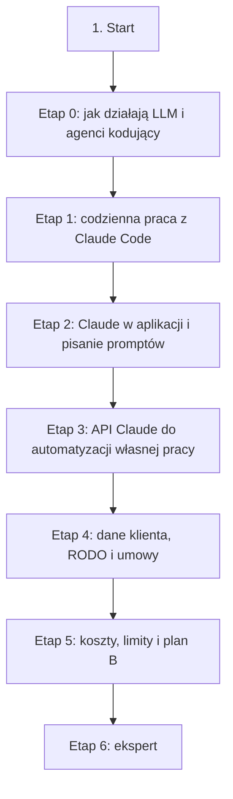

# 01. Praca z AI w chmurze: Claude i Claude Code: plan wdrożenia w Linear

Team **LEA** (https://linear.app/daankh/team/LEA/overview). Plan do przeglądu przed wdrożeniem: nic nie zostało jeszcze utworzone w Linear. Klucze zadań (np. `S01-E0-M1`) są robocze; po wdrożeniu dostaną identyfikatory `LEA-…`.

**W skrócie:** 7 kamieni milowych, 45 zadań (1 start, 33 materiały, 7 dowodów, 4 praktyki). Plik główny z kolejnością projektów: `00-kolejnosc-i-zaleznosci.md`.

## 1. Projekt

| Pole | Wartość |
|---|---|
| Nazwa | 01. Praca z AI w chmurze: Claude i Claude Code |
| Team | LEA |
| Podsumowanie (pole „Summary”) | Warstwa 0: fundamenty, tor równoległy. Opiera się na: —. Jest podstawą: wszystkich pozostałych sekcji. |
| Proponowany start | 2026-11-02 |
| Proponowany termin | 2027-03-31 |
| Etykiety projektu | `warstwa-0` |
| Blokowany przez (projekty) | — |
| Blokuje (projekty) | 11. Weryfikacja pracy AI i budowa procesu, 20. Lokalne AI i rozwój modeli, 21. Funkcje AI w aplikacjach |
| Zależności częściowe (wychodzące) | 07. Wymagania i specyfikacje, etap 4 |
| Czas od zera | 100–135 h |

### Opis projektu (do wklejenia w Linear)

*Warstwa 0: fundamenty, tor równoległy. Opiera się na: —. Jest podstawą: wszystkich pozostałych sekcji.*

**Zakres umiejętności**

- Działanie LLM na poziomie użytkownika: tokeny, okno kontekstu i spadek jakości przy jego zapełnianiu, niedeterminizm (to samo polecenie daje różne wyniki), halucynacje (wymyślone API, pakiety, przepisy, źródła), data granicy wiedzy modelu, rozumowanie (extended thinking) i poziom wysiłku.
- Dobór modelu do zadania: model najmocniejszy do planowania, architektury i trudnych błędów, tańszy do rutyny i subagentów, najmniejszy do klasyfikacji; przełączanie w trakcie sesji (`/model`, `/effort`).
- Przekazywanie kontekstu: `CLAUDE.md` (krótki, tylko to, czego agent nie wyczyta z kodu), import plików, `AGENTS.md` w przejmowanych repozytoriach, pamięć automatyczna, specyfikacja w pliku (`SPEC.md`, `PLAN.md`) pisana po wywiadzie prowadzonym przez agenta, odwołania `@plik`, zrzuty ekranu, logi przez potok.
- Cykl pracy: eksploracja, tryb planowania (plan zatwierdzony lub poprawiony przez człowieka), implementacja małymi krokami, weryfikowalne kryterium ukończenia (test, build, linter, zrzut ekranu), commit; agent pokazuje dowód (wynik testów, uruchomione polecenie), a nie tylko deklaruje sukces.
- Zarządzanie sesją i kontekstem: `/clear` między niezwiązanymi zadaniami, `/compact` z instrukcją, co zachować, `/context`, nazwane sesje (`/rename`, `--continue`, `--resume`), punkty kontrolne i `/rewind` (nie zastępują gita), subagenci do eksploracji, żeby nie zaśmiecać głównego kontekstu.
- Praca równoległa: kilka sesji w osobnych worktree gita, wzorzec „autor i recenzent” w dwóch świeżych kontekstach, tryb nieinteraktywny (`claude -p`) do powtarzalnych zadań; granica, przy której człowiek przestaje nadążać z weryfikacją.
- Rozpoznawanie, że agent błądzi, i przerywanie pętli: `Esc` od razu, po dwóch nieudanych poprawkach nowa sesja z lepszym poleceniem, zawężenie zadania, powrót do punktu kontrolnego, samodzielne wykonanie fragmentu.
- Claude w aplikacji (claude.ai, desktop): projekty z wiedzą i instrukcjami dla każdego klienta, research z wyszukiwaniem w sieci, praca na długich dokumentach (umowy, normy, dokumentacja przejmowanej aplikacji), szkice raportów z audytu, ofert i specyfikacji; sprawdzanie każdego cytatu i źródła.
- Pisanie promptów: jasny cel i kontekst, przykłady, struktura (np. znaczniki XML), rola, kryteria sukcesu, prośba o przyznanie się do niewiedzy, łańcuchy promptów zamiast jednego wielkiego; prompty do powtarzalnych zadań przechowywane i wersjonowane jak kod.
- API do automatyzacji własnej pracy: Claude Console, klucze API i obszary robocze (workspaces) z limitami wydatków, limity zapytań i tokenów, przetwarzanie wsadowe tańszych zadań (np. streszczenia wielu plików), liczenie tokenów przed wysłaniem, raport zużycia i kosztów; klucze w menedżerze sekretów, nigdy w repozytorium.
- Dane i prawo: klasyfikacja danych klienta przed wysłaniem do modelu (kod, sekrety, dane osobowe, zrzuty bazy), minimalizacja i pseudonimizacja, plany konsumenckie (Free, Pro, Max: Consumer Terms, ustawienie trenowania na danych, retencja 30 dni lub do 5 lat) a komercyjne (Team, Enterprise, API: Commercial Terms, brak trenowania domyślnie, DPA ze standardowymi klauzulami umownymi, lista podprocesorów), transfery poza EOG, zapis o używaniu AI i podprocesorach w ofercie i umowie powierzenia z klientem; weryfikacja z prawnikiem.
- Koszty i limity: limity planów subskrypcyjnych (okna kilkugodzinne i tygodniowe, wspólne dla czatu i Claude Code), `/usage` i linia statusu, koszt na zadanie i na projekt, miesięczny raport kosztu AI względem progu 5% przychodu, zachowania, które zawyżają zużycie (długie sesje, chybienia cache, wielu agentów równolegle).
- Zależność od jednego dostawcy i plan B: przenośne artefakty (specyfikacje, prompty, testy, ewaluacje), drugi dostawca przez bramkę LLM, model lokalny do danych, które nie mogą wyjść z maszyny (zob. sekcja 20), procedura na wypadek awarii, zmiany cennika lub warunków.
- Uczenie się z AI bez utraty umiejętności: AI jako tutor (wyjaśnienia, pytania sprawdzające) zamiast generatora gotowych rozwiązań w obszarach, które dopiero się poznaje; regularne zadania „bez agenta” jako dowód, że weryfikacja nie jest pozorna.
- Typowe błędy pracy z agentem do wyłapania: sesja „na wszystko” z zaśmieconym kontekstem, wielokrotne poprawianie zamiast nowego startu, rozdęty `CLAUDE.md`, którego agent nie przestrzega, akceptowanie wyniku bez uruchomionej weryfikacji, osłabianie lub usuwanie testów, żeby „przeszły”, niekontrolowana eksploracja setek plików, wymyślone pakiety i API, wklejanie sekretów i danych osobowych klienta do czatu na planie konsumenckim, praca na danych klienta bez podstawy w umowie.

**Ścieżka nauki**

Ścieżka ma 7 etapów. Każdy kończy się **dowodem**, czyli małym projektem, który pokazuje, że etap jest opanowany. To tor równoległy: etapy 0–2 warto przejść przed pierwszym projektem klienta, bo przez nie przechodzi praca we wszystkich pozostałych sekcjach, a etapy 4 i 5 przed podpisaniem pierwszej umowy. Przy doświadczeniu seniorskim etap 0 można zaliczyć samym dowodem. Czas podany dla osoby startującej od zera; ceny materiałów płatnych i planów zmieniają się, więc warto je sprawdzić przed zakupem. Dokumentacja Claude Code i warunki planów zmieniają się co kilka tygodni, więc materiały z tej sekcji trzeba czytać w wersji bieżącej, a nie z notatek. Konfiguracja i rozszerzanie Claude Code (uprawnienia, skille, subagenci, hooki, pluginy, MCP) są w sekcji 11, API Claude w produktach w sekcji 21, modele lokalne w sekcji 20.

Razem od zera do poziomu E: ok. 100–135 h, czyli 2–3 miesiące przy 10–12 h tygodniowo.

**Definicja ukończenia projektu (dowód poziomu E)**

Przejmujesz nieznaną aplikację klienta i w 1 dzień przeprowadzasz z Claude Code wstępny audyt na danych dopuszczonych polityką danych dla AI: przygotowujesz kontekst (`CLAUDE.md`, specyfikacja zadania), prowadzisz równoległe sesje, przerywasz te, które błądzą, a gotowy raport z audytu zawiera tylko zweryfikowane znaleziska, koszt AI tego dnia i informację, które dane i w jakim narzędziu były przetwarzane; potrafisz też wyjaśnić klientowi, dlaczego tak, a nie inaczej.

**Źródło:** dokument „Umiejętności techniczne” w projekcie „JDG: Rozwój oprogramowania”, sekcja 1.

## 2. Kamienie milowe

Jeden kamień milowy na etap ścieżki. Kamień milowy jest zamknięty, gdy zamknięte jest zadanie dowodu tego etapu. Daty kamieni milowych ustawiasz przy wdrożeniu według kolejności z pliku głównego.

| # | Kamień milowy | Cel | Czas od zera | Poziom po etapie | Zadania |
|---|---|---|---|---|---|
| 1 | Etap 0: jak działają LLM i agenci kodujący | jak działają LLM i agenci kodujący | 15–20 h | podstawy | 6 |
| 2 | Etap 1: codzienna praca z Claude Code | codzienna praca z Claude Code | 30–40 h | W | 6 |
| 3 | Etap 2: Claude w aplikacji i pisanie promptów | Claude w aplikacji i pisanie promptów | 15–20 h | W | 5 |
| 4 | Etap 3: API Claude do automatyzacji własnej pracy | API Claude do automatyzacji własnej pracy | 15–20 h | W | 5 |
| 5 | Etap 4: dane klienta, RODO i umowy | dane klienta, RODO i umowy | 15–20 h | E | 8 |
| 6 | Etap 5: koszty, limity i plan B | koszty, limity i plan B | 10–15 h | E | 6 |
| 7 | Etap 6: ekspert | ekspert: praca równoległa, pomiar, aktualność | stale, ok. 1 h tygodniowo | E | 8 |

## 3. Punkt startu

Zadanie **`S01-START` · Start: 1. Praca z AI w chmurze: Claude i Claude Code** to jedyne wejście do projektu: wszystkie zadania pierwszego etapu są przez nie blokowane.

- **Blokowane przez:** —
- **Odblokowuje:** `S01-E0-M1`, `S01-E0-M2`, `S01-E0-M3`, `S01-E0-M4`, `S01-E0-M5`
- **Status początkowy:** Todo (brak warunków wejścia)

Opis zadania (do wklejenia):

Punkt startu projektu „01. Praca z AI w chmurze: Claude i Claude Code”.

Brak warunków wejścia: projekt można zacząć od razu.

**Do zrobienia:**

- przeczytać sekcję 1 dokumentu „Umiejętności techniczne”,
- zaznaczyć etapy, które zaliczasz samym dowodem (zgodnie z akapitem wstępnym ścieżki), i dla nich zamknąć zadania materiałów jako niepotrzebne,
- ustawić daty kamieni milowych zgodnie z kolejnością z pliku głównego.

**Folder roboczy:** `01-praca-z-ai-w-chmurze/`

## 4. Przepływ zależności

Linie ciągłe to zależności wewnątrz projektu, przerywane to zadania z innych projektów. Wewnątrz etapu zadania materiałów są równoległe i wszystkie blokują dowód etapu; dowód etapu blokuje materiały kolejnego etapu.

## 5. Zadania według kamieni milowych

Szablon opisu zadania materiału: nazwa materiału, autor lub wydawca, typ, czas, koszt i link (jak w kolumnach poniżej), zdanie „Gotowe, gdy materiał jest przerobiony w zakresie potrzebnym do dowodu etapu” oraz folder roboczy z kolumny „Folder”. Opisy dowodów i praktyk są podane pod tabelą każdego etapu.

### Etap 0: jak działają LLM i agenci kodujący

Opis kamienia milowego (do wklejenia):

**Cel:** jak działają LLM i agenci kodujący · **Czas od zera:** 15–20 h · **Poziom po etapie:** podstawy

**Szczególnie ważne:** okno kontekstu jako główne ograniczenie, niedeterminizm i jego konsekwencja (jeden udany przebieg niczego nie dowodzi), halucynacje jako normalna cecha, a nie awaria, granica wiedzy modelu przy nowych wersjach frameworków; wniosek z badania Anthropic: osoby, które delegowały pisanie kodu i naprawę błędów, uczyły się wyraźnie słabiej niż te, które prosiły AI o wyjaśnienia, a największa różnica dotyczyła debugowania.

**Dowód:** Krótka notatka (1–2 strony) dla siebie i do oferty: jak działa agent kodujący, czego nie widzi, kiedy halucynuje, który model do jakich zadań; plus 5 przypadków halucynacji lub błędów modelu zebranych z własnej pracy, każdy z opisem, jak go wykryto.

| Klucz | Tytuł | Typ | Czas | Koszt | Link | Blokowane przez | Blokuje | Folder |
|---|---|---|---|---|---|---|---|---|
| `S01-E0-M1` | Przerobić: „Deep Dive into LLMs like ChatGPT” | materiał | 3–4 h | 0 zł | https://www.youtube.com/watch?v=7xTGNNLPyMI | `S01-START` | `S01-E0-D` | `01-praca-z-ai-w-chmurze/e0-jak-dzialaja-llm-i-agenci-kodujacy/` |
| `S01-E0-M2` | Przerobić: Kursy Anthropic Academy: „Claude 101”, „AI Fluency: Framework & Foundations”, „AI Capabilities… | materiał | 5–7 h | 0 zł | https://anthropic.skilljar.com | `S01-START` | `S01-E0-D` | `01-praca-z-ai-w-chmurze/e0-jak-dzialaja-llm-i-agenci-kodujacy/` |
| `S01-E0-M3` | Przerobić: Dokumentacja Claude Code: „How Claude Code works”, „Explore the context window” | materiał | 2–3 h | 0 zł | https://code.claude.com/docs/en/how-claude-code-works, https://code.claude.com/docs/en/context-window | `S01-START` | `S01-E0-D` | `01-praca-z-ai-w-chmurze/e0-jak-dzialaja-llm-i-agenci-kodujacy/` |
| `S01-E0-M4` | Przerobić: Dokumentacja API: przegląd modeli, „Choosing a model”, okna kontekstu, „Reduce hallucinations” | materiał | 2–3 h | 0 zł | https://platform.claude.com/docs/en/about-claude/models/choosing-a-model, https://platform.claude.com/docs/en/build-with-claude/context-windows, https://platform.claude.com/docs/en/test-and-evaluate/strengthen-guardrails/reduce-hallucinations | `S01-START` | `S01-E0-D` | `01-praca-z-ai-w-chmurze/e0-jak-dzialaja-llm-i-agenci-kodujacy/` |
| `S01-E0-M5` | Przerobić: „How AI assistance impacts the formation of coding skills” | materiał | 1 h | 0 zł | https://www.anthropic.com/research/AI-assistance-coding-skills | `S01-START` | `S01-E0-D` | `01-praca-z-ai-w-chmurze/e0-jak-dzialaja-llm-i-agenci-kodujacy/` |
| `S01-E0-D` | Dowód etapu 0: jak działają LLM i agenci kodujący | dowód | — | — | — | `S01-E0-M1`, `S01-E0-M2`, `S01-E0-M3`, `S01-E0-M4`, `S01-E0-M5` | `S01-E1-M1`, `S01-E1-M2`, `S01-E1-M3`, `S01-E1-M4`, `S01-E1-M5` | `01-praca-z-ai-w-chmurze/e0-jak-dzialaja-llm-i-agenci-kodujacy/` |

**`S01-E0-D` · Dowód etapu 0: jak działają LLM i agenci kodujący**

Krótka notatka (1–2 strony) dla siebie i do oferty: jak działa agent kodujący, czego nie widzi, kiedy halucynuje, który model do jakich zadań; plus 5 przypadków halucynacji lub błędów modelu zebranych z własnej pracy, każdy z opisem, jak go wykryto.

**Na co zwrócić uwagę:** okno kontekstu jako główne ograniczenie, niedeterminizm i jego konsekwencja (jeden udany przebieg niczego nie dowodzi), halucynacje jako normalna cecha, a nie awaria, granica wiedzy modelu przy nowych wersjach frameworków; wniosek z badania Anthropic: osoby, które delegowały pisanie kodu i naprawę błędów, uczyły się wyraźnie słabiej niż te, które prosiły AI o wyjaśnienia, a największa różnica dotyczyła debugowania.

**Kryterium ukończenia:** dowód wykonany samodzielnie; w komentarzu link do repozytorium, raportu lub notatki.

**Folder roboczy:** `01-praca-z-ai-w-chmurze/e0-jak-dzialaja-llm-i-agenci-kodujacy/`

### Etap 1: codzienna praca z Claude Code

Opis kamienia milowego (do wklejenia):

**Cel:** codzienna praca z Claude Code · **Czas od zera:** 30–40 h · **Poziom po etapie:** W

**Szczególnie ważne:** cykl eksploracja, plan, implementacja, commit; tryb planowania tylko tam, gdzie zmiany nie da się opisać jednym zdaniem; weryfikowalne kryteria ukończenia w poleceniu; `/clear` między zadaniami i nowa sesja po dwóch nieudanych poprawkach; `CLAUDE.md` krótki i przycinany, reguły, które muszą zadziałać zawsze, przeniesione do hooków (zob. sekcja 11); punkty kontrolne nie obejmują zmian zrobionych przez polecenia powłoki, więc git pozostaje siatką bezpieczeństwa.

**Dowód:** Jedna funkcja w istniejącej aplikacji zrealizowana z Claude Code w cyklu eksploracja, plan, implementacja, commit, z zatwierdzonym przez człowieka planem, testami uruchomionymi przez agenta i notatką: ile poprawek wymagał wynik i dlaczego; do tego `CLAUDE.md` dla repozytorium testowego „przejmowanej” aplikacji (polecenia budowania i testów, pułapki, zakazy) przycięty po tygodniu pracy na podstawie tego, czego agent faktycznie nie przestrzegał.

| Klucz | Tytuł | Typ | Czas | Koszt | Link | Blokowane przez | Blokuje | Folder |
|---|---|---|---|---|---|---|---|---|
| `S01-E1-M1` | Przerobić: Kursy Anthropic Academy: „Claude Code 101”, „Claude Code in Action” | materiał | 6–8 h | 0 zł | https://anthropic.skilljar.com | `S01-E0-D` | `S01-E1-D` | `01-praca-z-ai-w-chmurze/e1-codzienna-praca-z-claude-code/` |
| `S01-E1-M2` | Przerobić: Dokumentacja Claude Code: Best practices, Common workflows | materiał | 4–6 h | 0 zł | https://code.claude.com/docs/en/best-practices, https://code.claude.com/docs/en/common-workflows | `S01-E0-D` | `S01-E1-D` | `01-praca-z-ai-w-chmurze/e1-codzienna-praca-z-claude-code/` |
| `S01-E1-M3` | Przerobić: Dokumentacja Claude Code: pamięć i `CLAUDE.md`, sesje, punkty kontrolne, tryb interaktywny | materiał | 3–4 h | 0 zł | https://code.claude.com/docs/en/memory, https://code.claude.com/docs/en/sessions, https://code.claude.com/docs/en/checkpointing, https://code.claude.com/docs/en/interactive-mode | `S01-E0-D` | `S01-E1-D` | `01-praca-z-ai-w-chmurze/e1-codzienna-praca-z-claude-code/` |
| `S01-E1-M4` | Przerobić: Dokumentacja Claude Code: worktree, konfiguracja modelu i poziomu wysiłku | materiał | 2–3 h | 0 zł | https://code.claude.com/docs/en/worktrees, https://code.claude.com/docs/en/model-config | `S01-E0-D` | `S01-E1-D` | `01-praca-z-ai-w-chmurze/e1-codzienna-praca-z-claude-code/` |
| `S01-E1-M5` | Przerobić: „Here’s how I use LLMs to help me write code” (marzec 2025) i tag „ai-assisted-programming” | materiał | 3–4 h | 0 zł | https://simonwillison.net/2025/Mar/11/using-llms-for-code/, https://simonwillison.net/tags/ai-assisted-programming/ | `S01-E0-D` | `S01-E1-D` | `01-praca-z-ai-w-chmurze/e1-codzienna-praca-z-claude-code/` |
| `S01-E1-D` | Dowód etapu 1: codzienna praca z Claude Code | dowód | — | — | — | `S01-E1-M1`, `S01-E1-M2`, `S01-E1-M3`, `S01-E1-M4`, `S01-E1-M5` | `S01-E2-M1`, `S01-E2-M2`, `S01-E2-M3`, `S01-E2-M4`, `S07-E4-M1`, `S07-E4-M2`, `S07-E4-M3`, `S07-E4-M4`, `S07-E4-M5`, `S07-E4-M6`, `S11-START`, `S20-START`, `S21-START` | `01-praca-z-ai-w-chmurze/e1-codzienna-praca-z-claude-code/` |

**`S01-E1-D` · Dowód etapu 1: codzienna praca z Claude Code**

Jedna funkcja w istniejącej aplikacji zrealizowana z Claude Code w cyklu eksploracja, plan, implementacja, commit, z zatwierdzonym przez człowieka planem, testami uruchomionymi przez agenta i notatką: ile poprawek wymagał wynik i dlaczego; do tego `CLAUDE.md` dla repozytorium testowego „przejmowanej” aplikacji (polecenia budowania i testów, pułapki, zakazy) przycięty po tygodniu pracy na podstawie tego, czego agent faktycznie nie przestrzegał.

**Na co zwrócić uwagę:** cykl eksploracja, plan, implementacja, commit; tryb planowania tylko tam, gdzie zmiany nie da się opisać jednym zdaniem; weryfikowalne kryteria ukończenia w poleceniu; `/clear` między zadaniami i nowa sesja po dwóch nieudanych poprawkach; `CLAUDE.md` krótki i przycinany, reguły, które muszą zadziałać zawsze, przeniesione do hooków (zob. sekcja 11); punkty kontrolne nie obejmują zmian zrobionych przez polecenia powłoki, więc git pozostaje siatką bezpieczeństwa.

**Kryterium ukończenia:** dowód wykonany samodzielnie; w komentarzu link do repozytorium, raportu lub notatki.

**Folder roboczy:** `01-praca-z-ai-w-chmurze/e1-codzienna-praca-z-claude-code/`

### Etap 2: Claude w aplikacji i pisanie promptów

Opis kamienia milowego (do wklejenia):

**Cel:** Claude w aplikacji i pisanie promptów · **Czas od zera:** 15–20 h · **Poziom po etapie:** W

**Szczególnie ważne:** jeden projekt na klienta, żeby kontekst jednego klienta nie mieszał się z innym; research jako punkt wyjścia, a nie źródło, więc każde twierdzenie w raporcie sprawdzone w źródle pierwotnym; szablony promptów do powtarzalnych dokumentów (raport z audytu, oferta, specyfikacja) przechowywane w repozytorium.

Interaktywny samouczek powstał dla modeli Claude 3; tam, gdzie różni się od „Prompting best practices”, obowiązuje dokumentacja bieżąca.

**Dowód:** Szablon raportu z audytu przejmowanej aplikacji przygotowany z Claude w projekcie (struktura, skala oceny znalezisk, streszczenie dla zarządu), wypełniony dla aplikacji testowej; każdy fakt i odwołanie do normy (OWASP ASVS, CRA, RODO) sprawdzone ręcznie, z listą poprawek, które trzeba było wprowadzić po AI.

| Klucz | Tytuł | Typ | Czas | Koszt | Link | Blokowane przez | Blokuje | Folder |
|---|---|---|---|---|---|---|---|---|
| `S01-E2-M1` | Przerobić: Prompt engineering: przegląd i „Prompting best practices” | materiał | 3–4 h | 0 zł | https://platform.claude.com/docs/en/build-with-claude/prompt-engineering/overview, https://platform.claude.com/docs/en/build-with-claude/prompt-engineering/claude-prompting-best-practices | `S01-E1-D` | `S01-E2-D` | `01-praca-z-ai-w-chmurze/e2-claude-w-aplikacji-i-pisanie-promptow/` |
| `S01-E2-M2` | Przerobić: „Prompt engineering interactive tutorial” | materiał, płatny | 6–8 h | 0 zł (zużycie API płatne) | https://github.com/anthropics/prompt-eng-interactive-tutorial | `S01-E1-D` | `S01-E2-D` | `01-praca-z-ai-w-chmurze/e2-claude-w-aplikacji-i-pisanie-promptow/` |
| `S01-E2-M3` | Przerobić: Centrum pomocy: „What are projects?”, „Using Research on Claude” | materiał | 1–2 h | 0 zł | https://support.claude.com/en/articles/9517075-what-are-projects, https://support.claude.com/en/articles/11088861-using-research-on-claude | `S01-E1-D` | `S01-E2-D` | `01-praca-z-ai-w-chmurze/e2-claude-w-aplikacji-i-pisanie-promptow/` |
| `S01-E2-M4` | Przerobić: Kurs Anthropic Academy „AI Fluency for Small Businesses” | materiał | 2–3 h | 0 zł | https://anthropic.skilljar.com | `S01-E1-D` | `S01-E2-D` | `01-praca-z-ai-w-chmurze/e2-claude-w-aplikacji-i-pisanie-promptow/` |
| `S01-E2-D` | Dowód etapu 2: Claude w aplikacji i pisanie promptów | dowód | — | — | — | `S01-E2-M1`, `S01-E2-M2`, `S01-E2-M3`, `S01-E2-M4` | `S01-E3-M1`, `S01-E3-M2`, `S01-E3-M3`, `S01-E3-M4` | `01-praca-z-ai-w-chmurze/e2-claude-w-aplikacji-i-pisanie-promptow/` |

**`S01-E2-D` · Dowód etapu 2: Claude w aplikacji i pisanie promptów**

Szablon raportu z audytu przejmowanej aplikacji przygotowany z Claude w projekcie (struktura, skala oceny znalezisk, streszczenie dla zarządu), wypełniony dla aplikacji testowej; każdy fakt i odwołanie do normy (OWASP ASVS, CRA, RODO) sprawdzone ręcznie, z listą poprawek, które trzeba było wprowadzić po AI.

**Na co zwrócić uwagę:** jeden projekt na klienta, żeby kontekst jednego klienta nie mieszał się z innym; research jako punkt wyjścia, a nie źródło, więc każde twierdzenie w raporcie sprawdzone w źródle pierwotnym; szablony promptów do powtarzalnych dokumentów (raport z audytu, oferta, specyfikacja) przechowywane w repozytorium.

**Kryterium ukończenia:** dowód wykonany samodzielnie; w komentarzu link do repozytorium, raportu lub notatki.

**Folder roboczy:** `01-praca-z-ai-w-chmurze/e2-claude-w-aplikacji-i-pisanie-promptow/`

### Etap 3: API Claude do automatyzacji własnej pracy

Opis kamienia milowego (do wklejenia):

**Cel:** API Claude do automatyzacji własnej pracy · **Czas od zera:** 15–20 h · **Poziom po etapie:** W

**Szczególnie ważne:** osobny obszar roboczy i klucz dla każdego zastosowania, limit wydatków na obszar, klucze w menedżerze sekretów; przetwarzanie wsadowe do zadań, które mogą poczekać; zasady z sekcji 4 tej ścieżki obowiązują także skrypty. Użycie API w aplikacjach klientów (tool use, prompt caching, streaming, pośrednik w backendzie) jest w sekcji 21.

**Dowód:** Skrypt, który dla repozytorium klienta przygotowuje szkic inwentarza do audytu (streszczenia modułów, lista zależności i punktów wejścia) przez przetwarzanie wsadowe lub `claude -p`, z limitem wydatków na osobnym obszarze roboczym, kluczem poza repozytorium, filtrem plików z sekretami i danymi osobowymi oraz zapisem kosztu przebiegu.

| Klucz | Tytuł | Typ | Czas | Koszt | Link | Blokowane przez | Blokuje | Folder |
|---|---|---|---|---|---|---|---|---|
| `S01-E3-M1` | Przerobić: Get started, klucze API, obszary robocze | materiał | 2–3 h | 0 zł | https://platform.claude.com/docs/en/get-started, https://platform.claude.com/docs/en/get-api-key, https://platform.claude.com/docs/en/manage-claude/workspaces | `S01-E2-D` | `S01-E3-D` | `01-praca-z-ai-w-chmurze/e3-api-claude-do-automatyzacji-wlasnej-pracy/` |
| `S01-E3-M2` | Przerobić: Limity zapytań, liczenie tokenów, przetwarzanie wsadowe, Usage and Cost API | materiał | 3–4 h | 0 zł | https://platform.claude.com/docs/en/api/rate-limits, https://platform.claude.com/docs/en/build-with-claude/token-counting, https://platform.claude.com/docs/en/build-with-claude/batch-processing, https://platform.claude.com/docs/en/manage-claude/usage-cost-api | `S01-E2-D` | `S01-E3-D` | `01-praca-z-ai-w-chmurze/e3-api-claude-do-automatyzacji-wlasnej-pracy/` |
| `S01-E3-M3` | Przerobić: Claude Code w trybie nieinteraktywnym (`claude -p`) | materiał | 1–2 h | 0 zł | https://code.claude.com/docs/en/headless | `S01-E2-D` | `S01-E3-D` | `01-praca-z-ai-w-chmurze/e3-api-claude-do-automatyzacji-wlasnej-pracy/` |
| `S01-E3-M4` | Przerobić: Kurs Anthropic Academy „Claude Platform 101” i kurs „Anthropic API fundamentals” | materiał, płatny | 5–7 h | 0 zł (zużycie API płatne) | https://anthropic.skilljar.com, https://github.com/anthropics/courses | `S01-E2-D` | `S01-E3-D` | `01-praca-z-ai-w-chmurze/e3-api-claude-do-automatyzacji-wlasnej-pracy/` |
| `S01-E3-D` | Dowód etapu 3: API Claude do automatyzacji własnej pracy | dowód | — | — | — | `S01-E3-M1`, `S01-E3-M2`, `S01-E3-M3`, `S01-E3-M4` | `S01-E4-M1`, `S01-E4-M2`, `S01-E4-M3`, `S01-E4-M4`, `S01-E4-M5`, `S01-E4-M6`, `S01-E4-M7` | `01-praca-z-ai-w-chmurze/e3-api-claude-do-automatyzacji-wlasnej-pracy/` |

**`S01-E3-D` · Dowód etapu 3: API Claude do automatyzacji własnej pracy**

Skrypt, który dla repozytorium klienta przygotowuje szkic inwentarza do audytu (streszczenia modułów, lista zależności i punktów wejścia) przez przetwarzanie wsadowe lub `claude -p`, z limitem wydatków na osobnym obszarze roboczym, kluczem poza repozytorium, filtrem plików z sekretami i danymi osobowymi oraz zapisem kosztu przebiegu.

**Na co zwrócić uwagę:** osobny obszar roboczy i klucz dla każdego zastosowania, limit wydatków na obszar, klucze w menedżerze sekretów; przetwarzanie wsadowe do zadań, które mogą poczekać; zasady z sekcji 4 tej ścieżki obowiązują także skrypty. Użycie API w aplikacjach klientów (tool use, prompt caching, streaming, pośrednik w backendzie) jest w sekcji 21.

**Kryterium ukończenia:** dowód wykonany samodzielnie; w komentarzu link do repozytorium, raportu lub notatki.

**Folder roboczy:** `01-praca-z-ai-w-chmurze/e3-api-claude-do-automatyzacji-wlasnej-pracy/`

### Etap 4: dane klienta, RODO i umowy

Opis kamienia milowego (do wklejenia):

**Cel:** dane klienta, RODO i umowy · **Czas od zera:** 15–20 h · **Poziom po etapie:** E

**Szczególnie ważne:** najpierw klasyfikacja danych, potem wybór narzędzia; zrzuty produkcyjnych baz i pliki `.env` nigdy do modelu w chmurze; zgoda klienta na podprocesora AI zapisana w umowie przed pierwszą sesją; regularne sprawdzanie ustawień prywatności konta i zmian w warunkach.

Stan na październik 2026 r. według dokumentacji Anthropic:

Wniosek do weryfikacji z prawnikiem: plan Max założony w biznesplanie wystarcza do pracy na własnym kodzie i na materiałach bez danych osobowych, ale do pracy na repozytoriach i danych klientów, zwłaszcza zawierających dane osobowe, prawdopodobnie potrzebny będzie plan komercyjny (Team lub klucz API), żeby mieć umowę powierzenia z Anthropic jako dalszym podmiotem przetwarzającym i móc wpisać go do umowy z klientem. Dane, które nie mogą opuścić maszyny, zostają przy modelu lokalnym (zob. sekcja 20).

**Dowód:** „polityka danych dla AI” jako załącznik do oferty i wzoru umowy powierzenia: klasy danych klienta i dozwolone narzędzia dla każdej (Claude na planie komercyjnym, model lokalny, zakaz), podprocesorzy z odnośnikiem do listy Anthropic, podstawa transferu poza EOG, retencja, sposób anonimizacji danych testowych, procedura przy przypadkowym wysłaniu sekretu; dokument przejrzany przez prawnika, z listą zmian po przeglądzie.

| Klucz | Tytuł | Typ | Czas | Koszt | Link | Blokowane przez | Blokuje | Folder |
|---|---|---|---|---|---|---|---|---|
| `S01-E4-M1` | Przerobić: Dokumentacja Claude Code: Data usage, Legal and compliance, Zero data retention | materiał | 2–3 h | 0 zł | https://code.claude.com/docs/en/data-usage, https://code.claude.com/docs/en/legal-and-compliance, https://code.claude.com/docs/en/zero-data-retention | `S01-E3-D` | `S01-E4-D` | `01-praca-z-ai-w-chmurze/e4-dane-klienta-rodo-i-umowy/` |
| `S01-E4-M2` | Przerobić: Consumer Terms, Commercial Terms, Privacy Policy | materiał | 3–4 h | 0 zł | https://www.anthropic.com/legal/consumer-terms, https://www.anthropic.com/legal/commercial-terms, https://www.anthropic.com/legal/privacy | `S01-E3-D` | `S01-E4-D` | `01-praca-z-ai-w-chmurze/e4-dane-klienta-rodo-i-umowy/` |
| `S01-E4-M3` | Przerobić: Data Processing Addendum (z SCC) i lista podprocesorów | materiał | 2–3 h | 0 zł | https://www.anthropic.com/legal/data-processing-addendum, https://trust.anthropic.com/subprocessors | `S01-E3-D` | `S01-E4-D` | `01-praca-z-ai-w-chmurze/e4-dane-klienta-rodo-i-umowy/` |
| `S01-E4-M4` | Przerobić: Privacy Center: trenowanie na danych, okresy przechowywania, DPA dla produktów komercyjnych | materiał | 1–2 h | 0 zł | https://privacy.claude.com, https://privacy.claude.com/en/articles/7996862 | `S01-E3-D` | `S01-E4-D` | `01-praca-z-ai-w-chmurze/e4-dane-klienta-rodo-i-umowy/` |
| `S01-E4-M5` | Przerobić: Data residency w API | materiał | 0,5 h | 0 zł | https://platform.claude.com/docs/en/build-with-claude/data-residency | `S01-E3-D` | `S01-E4-D` | `01-praca-z-ai-w-chmurze/e4-dane-klienta-rodo-i-umowy/` |
| `S01-E4-M6` | Przerobić: Trust Center (certyfikaty, raporty) | materiał | 1 h | 0 zł | https://trust.anthropic.com | `S01-E3-D` | `S01-E4-D` | `01-praca-z-ai-w-chmurze/e4-dane-klienta-rodo-i-umowy/` |
| `S01-E4-M7` | Przerobić: „AI Privacy Risks & Mitigations: Large Language Models (LLMs)” | materiał | 3–4 h | 0 zł | https://www.edpb.europa.eu/our-work-tools/our-documents/support-pool-experts-projects/ai-privacy-risks-mitigations-large_en | `S01-E3-D` | `S01-E4-D` | `01-praca-z-ai-w-chmurze/e4-dane-klienta-rodo-i-umowy/` |
| `S01-E4-D` | Dowód etapu 4: dane klienta, RODO i umowy | dowód | — | — | — | `S01-E4-M1`, `S01-E4-M2`, `S01-E4-M3`, `S01-E4-M4`, `S01-E4-M5`, `S01-E4-M6`, `S01-E4-M7` | `S01-E5-M1`, `S01-E5-M2`, `S01-E5-M3`, `S01-E5-M4`, `S01-E5-M5` | `01-praca-z-ai-w-chmurze/e4-dane-klienta-rodo-i-umowy/` |

**`S01-E4-D` · Dowód etapu 4: dane klienta, RODO i umowy**

„polityka danych dla AI” jako załącznik do oferty i wzoru umowy powierzenia: klasy danych klienta i dozwolone narzędzia dla każdej (Claude na planie komercyjnym, model lokalny, zakaz), podprocesorzy z odnośnikiem do listy Anthropic, podstawa transferu poza EOG, retencja, sposób anonimizacji danych testowych, procedura przy przypadkowym wysłaniu sekretu; dokument przejrzany przez prawnika, z listą zmian po przeglądzie.

**Na co zwrócić uwagę:** najpierw klasyfikacja danych, potem wybór narzędzia; zrzuty produkcyjnych baz i pliki `.env` nigdy do modelu w chmurze; zgoda klienta na podprocesora AI zapisana w umowie przed pierwszą sesją; regularne sprawdzanie ustawień prywatności konta i zmian w warunkach.

**Kryterium ukończenia:** dowód wykonany samodzielnie; w komentarzu link do repozytorium, raportu lub notatki.

**Folder roboczy:** `01-praca-z-ai-w-chmurze/e4-dane-klienta-rodo-i-umowy/`

### Etap 5: koszty, limity i plan B

Opis kamienia milowego (do wklejenia):

**Cel:** koszty, limity i plan B · **Czas od zera:** 10–15 h · **Poziom po etapie:** E

**Szczególnie ważne:** na planach subskrypcyjnych limity działają w oknach czasowych (sesyjnym i tygodniowym) wspólnych dla czatu i Claude Code, a przekroczenie można pokryć płatnymi kredytami z własnym limitem wydatków; `/usage` pokazuje zużycie planu i jego rozkład na skille, subagentów, pluginy i serwery MCP; zużycie najbardziej zawyżają długie sesje, chybienia cache po przerwie i wielu agentów równolegle; Anthropic nie wspiera kierowania Claude Code do modeli innych niż Claude, więc plan B to raczej przenośny proces (specyfikacje, testy, ewaluacje) niż ten sam przepływ na innym modelu.

**Dowód:** Miesięczny raport kosztu AI: koszt planu i kredytów, zużycie według projektów i rodzajów zadań, koszt na zadanie dla trzech typowych zadań (audyt modułu, poprawka bezpieczeństwa, raport), udział w przychodzie względem progu 5% i decyzje na kolejny miesiąc; do tego jednostronicowy plan B: co robić przy awarii, wyczerpaniu limitu lub zmianie warunków (drugi dostawca przez bramkę, model lokalny, praca ręczna), sprawdzony w praktyce jednym dniem pracy bez Claude.

| Klucz | Tytuł | Typ | Czas | Koszt | Link | Blokowane przez | Blokuje | Folder |
|---|---|---|---|---|---|---|---|---|
| `S01-E5-M1` | Przerobić: Dokumentacja Claude Code: „Manage costs effectively”, Monitoring | materiał | 2–3 h | 0 zł | https://code.claude.com/docs/en/costs, https://code.claude.com/docs/en/monitoring-usage | `S01-E4-D` | `S01-E5-D` | `01-praca-z-ai-w-chmurze/e5-koszty-limity-i-plan-b/` |
| `S01-E5-M2` | Przerobić: Centrum pomocy: limity planu Max | materiał | 0,5 h | 0 zł | https://support.claude.com/en/articles/11014257-about-claude-s-max-plan-usage | `S01-E4-D` | `S01-E5-D` | `01-praca-z-ai-w-chmurze/e5-koszty-limity-i-plan-b/` |
| `S01-E5-M3` | Przerobić: Cennik planów i cennik API | materiał | 1 h | 0 zł | https://claude.com/pricing, https://platform.claude.com/docs/en/about-claude/pricing | `S01-E4-D` | `S01-E5-D` | `01-praca-z-ai-w-chmurze/e5-koszty-limity-i-plan-b/` |
| `S01-E5-M4` | Przerobić: Dokumentacja Claude Code: bramki LLM | materiał | 1–2 h | 0 zł | https://code.claude.com/docs/en/llm-gateway | `S01-E4-D` | `S01-E5-D` | `01-praca-z-ai-w-chmurze/e5-koszty-limity-i-plan-b/` |
| `S01-E5-M5` | Przerobić: Status usług | materiał | wg potrzeb | 0 zł | https://status.claude.com | `S01-E4-D` | `S01-E5-D` | `01-praca-z-ai-w-chmurze/e5-koszty-limity-i-plan-b/` |
| `S01-E5-D` | Dowód etapu 5: koszty, limity i plan B | dowód | — | — | — | `S01-E5-M1`, `S01-E5-M2`, `S01-E5-M3`, `S01-E5-M4`, `S01-E5-M5` | `S01-E6-M1`, `S01-E6-M2`, `S01-E6-M3`, `S01-E6-P1`, `S01-E6-P2`, `S01-E6-P3`, `S01-E6-P4` | `01-praca-z-ai-w-chmurze/e5-koszty-limity-i-plan-b/` |

**`S01-E5-D` · Dowód etapu 5: koszty, limity i plan B**

Miesięczny raport kosztu AI: koszt planu i kredytów, zużycie według projektów i rodzajów zadań, koszt na zadanie dla trzech typowych zadań (audyt modułu, poprawka bezpieczeństwa, raport), udział w przychodzie względem progu 5% i decyzje na kolejny miesiąc; do tego jednostronicowy plan B: co robić przy awarii, wyczerpaniu limitu lub zmianie warunków (drugi dostawca przez bramkę, model lokalny, praca ręczna), sprawdzony w praktyce jednym dniem pracy bez Claude.

**Na co zwrócić uwagę:** na planach subskrypcyjnych limity działają w oknach czasowych (sesyjnym i tygodniowym) wspólnych dla czatu i Claude Code, a przekroczenie można pokryć płatnymi kredytami z własnym limitem wydatków; `/usage` pokazuje zużycie planu i jego rozkład na skille, subagentów, pluginy i serwery MCP; zużycie najbardziej zawyżają długie sesje, chybienia cache po przerwie i wielu agentów równolegle; Anthropic nie wspiera kierowania Claude Code do modeli innych niż Claude, więc plan B to raczej przenośny proces (specyfikacje, testy, ewaluacje) niż ten sam przepływ na innym modelu.

**Kryterium ukończenia:** dowód wykonany samodzielnie; w komentarzu link do repozytorium, raportu lub notatki.

**Folder roboczy:** `01-praca-z-ai-w-chmurze/e5-koszty-limity-i-plan-b/`

### Etap 6: ekspert

Opis kamienia milowego (do wklejenia):

**Cel:** ekspert: praca równoległa, pomiar, aktualność · **Czas od zera:** stale, ok. 1 h tygodniowo · **Poziom po etapie:** E

**Dowód poziomu E:** Przejmujesz nieznaną aplikację klienta i w 1 dzień przeprowadzasz z Claude Code wstępny audyt na danych dopuszczonych polityką danych dla AI: przygotowujesz kontekst (`CLAUDE.md`, specyfikacja zadania), prowadzisz równoległe sesje, przerywasz te, które błądzą, a gotowy raport z audytu zawiera tylko zweryfikowane znaleziska, koszt AI tego dnia i informację, które dane i w jakim narzędziu były przetwarzane; potrafisz też wyjaśnić klientowi, dlaczego tak, a nie inaczej.

| Klucz | Tytuł | Typ | Czas | Koszt | Link | Blokowane przez | Blokuje | Folder |
|---|---|---|---|---|---|---|---|---|
| `S01-E6-M1` | Przerobić: Informacje o zmianach Claude Code („What’s new”, changelog) | materiał | ok. 0,5 h tygodniowo | 0 zł | https://code.claude.com/docs/en/whats-new, https://code.claude.com/docs/en/changelog | `S01-E5-D` | `S01-E6-D` | `01-praca-z-ai-w-chmurze/e6-ekspert/` |
| `S01-E6-M2` | Przerobić: Aktualności Anthropic i Privacy Center (zmiany warunków i retencji) | materiał | wg potrzeb | 0 zł | https://www.anthropic.com/news, https://privacy.claude.com | `S01-E5-D` | `S01-E6-D` | `01-praca-z-ai-w-chmurze/e6-ekspert/` |
| `S01-E6-M3` | Przerobić: Simon Willison’s Weblog | materiał | ok. 0,5 h tygodniowo | 0 zł | https://simonwillison.net | `S01-E5-D` | `S01-E6-D` | `01-praca-z-ai-w-chmurze/e6-ekspert/` |
| `S01-E6-P1` | Praktyka: praca równoległa pod kontrolą | praktyka | — | — | — | `S01-E5-D` | `S01-E6-D` | `01-praca-z-ai-w-chmurze/e6-ekspert/` |
| `S01-E6-P2` | Praktyka: pomiar własnej pracy | praktyka | — | — | — | `S01-E5-D` | `S01-E6-D` | `01-praca-z-ai-w-chmurze/e6-ekspert/` |
| `S01-E6-P3` | Praktyka: przegląd warunków co kwartał | praktyka | — | — | — | `S01-E5-D` | `S01-E6-D` | `01-praca-z-ai-w-chmurze/e6-ekspert/` |
| `S01-E6-P4` | Praktyka: praca bez agenta | praktyka | — | — | — | `S01-E5-D` | `S01-E6-D` | `01-praca-z-ai-w-chmurze/e6-ekspert/` |
| `S01-E6-D` | Dowód poziomu E: ekspert | dowód | — | — | — | `S01-E6-M1`, `S01-E6-M2`, `S01-E6-M3`, `S01-E6-P1`, `S01-E6-P2`, `S01-E6-P3`, `S01-E6-P4` | — | `01-praca-z-ai-w-chmurze/e6-ekspert/` |

**`S01-E6-P1` · Praktyka: praca równoległa pod kontrolą**

2–3 sesje w osobnych worktree przy jednym projekcie klienta, z zasadą, że żadna zmiana nie trafia do gałęzi głównej bez weryfikacji człowieka, i zapisem, przy ilu sesjach jakość weryfikacji zaczyna spadać.

Praktyka ciągła etapu eksperckiego: oznacz jako gotową, gdy działa jako stały element pracy, a nie po jednorazowym wykonaniu.

**Folder roboczy:** `01-praca-z-ai-w-chmurze/e6-ekspert/`

**`S01-E6-P2` · Praktyka: pomiar własnej pracy**

Co miesiąc koszt na zadanie, odsetek sesji przerwanych lub zaczętych od nowa i przyczyny; wnioski przenoszone do `CLAUDE.md`, szablonów promptów i do vicrafter (zob. sekcja 11).

Praktyka ciągła etapu eksperckiego: oznacz jako gotową, gdy działa jako stały element pracy, a nie po jednorazowym wykonaniu.

**Folder roboczy:** `01-praca-z-ai-w-chmurze/e6-ekspert/`

**`S01-E6-P3` · Praktyka: przegląd warunków co kwartał**

Ustawienia prywatności konta, Consumer i Commercial Terms, lista podprocesorów, limity planów; zmiany przenoszone do polityki danych dla AI w ofercie.

Praktyka ciągła etapu eksperckiego: oznacz jako gotową, gdy działa jako stały element pracy, a nie po jednorazowym wykonaniu.

**Folder roboczy:** `01-praca-z-ai-w-chmurze/e6-ekspert/`

**`S01-E6-P4` · Praktyka: praca bez agenta**

Raz w miesiącu zadanie wykonane samodzielnie, a w obszarach, których dopiero się uczysz, AI używane jako tutor (wyjaśnienia, pytania sprawdzające), a nie generator rozwiązań.

Praktyka ciągła etapu eksperckiego: oznacz jako gotową, gdy działa jako stały element pracy, a nie po jednorazowym wykonaniu.

**Folder roboczy:** `01-praca-z-ai-w-chmurze/e6-ekspert/`

**`S01-E6-D` · Dowód poziomu E: ekspert**

Przejmujesz nieznaną aplikację klienta i w 1 dzień przeprowadzasz z Claude Code wstępny audyt na danych dopuszczonych polityką danych dla AI: przygotowujesz kontekst (`CLAUDE.md`, specyfikacja zadania), prowadzisz równoległe sesje, przerywasz te, które błądzą, a gotowy raport z audytu zawiera tylko zweryfikowane znaleziska, koszt AI tego dnia i informację, które dane i w jakim narzędziu były przetwarzane; potrafisz też wyjaśnić klientowi, dlaczego tak, a nie inaczej.

**Kryterium ukończenia:** dowód wykonany samodzielnie; w komentarzu link do repozytorium, raportu lub notatki.

**Folder roboczy:** `01-praca-z-ai-w-chmurze/e6-ekspert/`

## 6. Relacje z innymi projektami

**Wchodzące** (zadanie z innego projektu blokuje zadanie tego projektu):

- brak

**Wychodzące** (zadanie tego projektu blokuje zadanie w innym projekcie):

- `S01-E1-D` → `S07-E4-M1` (07. Wymagania i specyfikacje)
- `S01-E1-D` → `S07-E4-M2` (07. Wymagania i specyfikacje)
- `S01-E1-D` → `S07-E4-M3` (07. Wymagania i specyfikacje)
- `S01-E1-D` → `S07-E4-M4` (07. Wymagania i specyfikacje)
- `S01-E1-D` → `S07-E4-M5` (07. Wymagania i specyfikacje)
- `S01-E1-D` → `S07-E4-M6` (07. Wymagania i specyfikacje)
- `S01-E1-D` → `S11-START` (11. Weryfikacja pracy AI i budowa procesu)
- `S01-E1-D` → `S20-START` (20. Lokalne AI i rozwój modeli)
- `S01-E1-D` → `S21-START` (21. Funkcje AI w aplikacjach)
