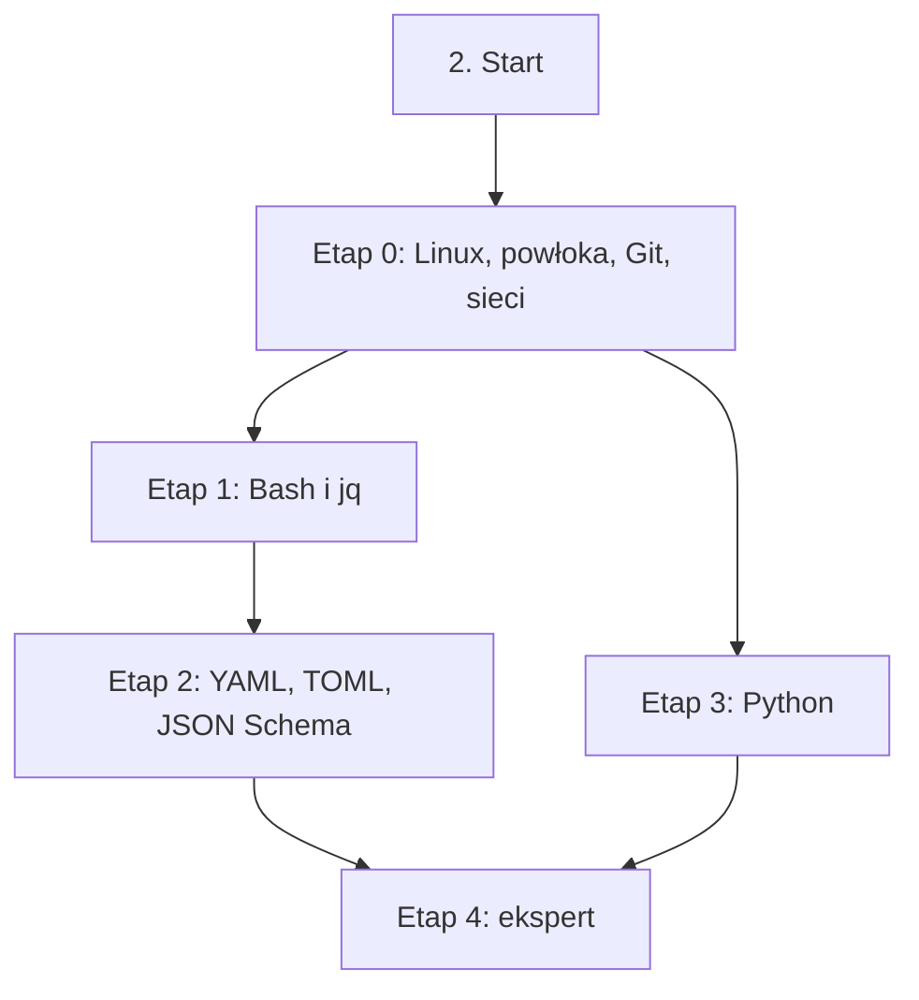

# 02. Języki i narzędzia podstawowe: plan wdrożenia w Linear

Team **LEA** (https://linear.app/daankh/team/LEA/overview). Plan jest wdrożony w Linear. Klucze zadań (np. `S02-E0-M1`) są robocze, a identyfikator każdego zadania w Linear (`LEA-…`) jest w kolumnie „Linear” tabel zadań i w pliku `mapowanie-kluczy.csv`.

**W skrócie:** 5 kamieni milowych, 42 zadania (1 start, 33 materiały, 5 dowodów, 3 praktyki). Plik główny z kolejnością projektów: `00-kolejnosc-i-zaleznosci.md`.

## 1. Projekt

| Pole | Wartość |
|---|---|
| Nazwa | 02. Języki i narzędzia podstawowe |
| Team | LEA |
| Podsumowanie (pole „Summary”) | Warstwa 0: fundamenty. Opiera się na: —. Jest podstawą: 3, 4, 9, 11 i 12, a etap Python także 5 (FastAPI) i 20 (uczenie maszynowe). |
| Etykiety projektu | `warstwa-0` |
| Blokowany przez (projekty) | — |
| Blokuje (projekty) | 03. Frontend web, 04. Bazy danych i dane, 09. DevOps, CI/CD i wydania, 11. Weryfikacja pracy AI i budowa procesu, 12. Rust jako wspólny fundament |
| Zależności częściowe (wychodzące) | 05. Backend i API, etap 3; 20. Lokalne AI i rozwój modeli, etap 1 |

### Opis projektu (do wklejenia w Linear)

*Warstwa 0: fundamenty. Opiera się na: —. Jest podstawą: 3, 4, 9, 11 i 12, a etap Python także 5 (FastAPI) i 20 (uczenie maszynowe).*

**Zakres umiejętności**

- Linux z linii poleceń: procesy, uprawnienia, systemd, logi, SSH, podstawy administracji serwerem.
- Git na poziomie historii: rebase, bisect, worktree, podpisane commity, analiza zmian w cudzym repozytorium.
- Bash i `jq`: skrypty odporne na błędy, przetwarzanie JSON w hookach i CI.
- Python: typowanie sprawdzane w CI, `asyncio`, projekty i zależności w `uv`, testy w `pytest`, lint i formatowanie w Ruff; podstawa backendu w FastAPI (sekcja 5) i uczenia maszynowego (sekcja 20).
- Formaty konfiguracji: YAML, TOML, JSON Schema jako kontrakty sprawdzane w CI.
- Sieci w praktyce: HTTP, DNS, TLS i certyfikaty, poczta transakcyjna (SPF, DKIM, DMARC).
- Typowe błędy kodu z AI do wyłapania: niecytowane zmienne i połykane kody błędów w skryptach, wymyślone flagi narzędzi, niejawne typy w YAML, nadmierne uprawnienia w workflow.

**Ścieżka nauki**

Ścieżka ma 5 etapów. Każdy kończy się **dowodem**, czyli małym projektem, który pokazuje, że etap jest opanowany. Przy doświadczeniu seniorskim etapy 0 i 2 można zwykle zaliczyć samym dowodem; etap 1 warto przejść w całości, bo hooki vicrafter (własnego pluginu Claude Code z komendami, hookami, skillami i listą kontrolną recenzji, rozwijanego w sekcji 11) i skrypty CI to kod, którego błędy psują cały proces. Etap 3 (Python) zaczyna się po etapie 0, równolegle z Bashem i formatami konfiguracji; jest potrzebny przed backendem w FastAPI (sekcja 5) i uczeniem maszynowym (sekcja 20), a przy codziennej pracy w Pythonie można go zaliczyć samym dowodem. Ceny materiałów płatnych zmieniają się, więc warto je sprawdzić przed zakupem.

**Definicja ukończenia projektu (dowód poziomu E)**

Samodzielnie, bez agenta, w 1 dzień diagnozujesz i naprawiasz awarię skryptu CI lub hooka w Bashu w nieznanym projekcie i umiesz wyjaśnić przyczynę osobie nietechnicznej.

**Źródło:** dokument „Umiejętności techniczne” w projekcie „JDG: Rozwój oprogramowania”, sekcja 2.

## 2. Kamienie milowe

Jeden kamień milowy na etap ścieżki. Kamień milowy jest zamknięty, gdy zamknięte jest zadanie dowodu tego etapu.

| # | Kamień milowy | Cel | Poziom po etapie | Zadania |
|---|---|---|---|---|
| 1 | Etap 0: Linux, powłoka, Git, sieci | Linux, powłoka, Git, sieci | podstawy | 14 |
| 2 | Etap 1: Bash i `jq` | Bash i `jq` | E | 6 |
| 3 | Etap 2: YAML, TOML, JSON Schema | YAML, TOML, JSON Schema | E | 7 |
| 4 | Etap 3: Python | Python: typowanie, `asyncio`, `uv`, `pytest`, Ruff | W | 8 |
| 5 | Etap 4: ekspert | ekspert: recenzja skryptów i konfiguracji z AI, aktualność | E | 6 |

## 3. Punkt startu

Zadanie **`S02-START` · Start: 2. Języki i narzędzia podstawowe** (LEA-51 w Linear) to jedyne wejście do projektu: wszystkie zadania pierwszego etapu są przez nie blokowane.

- **Blokowane przez:** —
- **Odblokowuje:** `S02-E0-M1`, `S02-E0-M2`, `S02-E0-M3`, `S02-E0-M4`, `S02-E0-M5`, `S02-E0-M6`, `S02-E0-M7`, `S02-E0-M8`, `S02-E0-M9`, `S02-E0-M10`, `S02-E0-M11`, `S02-E0-M12`, `S02-E0-M13`
- **Status początkowy:** Todo (brak warunków wejścia)

Opis zadania (do wklejenia):

Punkt startu projektu „02. Języki i narzędzia podstawowe”.

Brak warunków wejścia: projekt można zacząć od razu.

**Do zrobienia:**

- przeczytać sekcję 2 dokumentu „Umiejętności techniczne”,
- zaznaczyć etapy, które zaliczasz samym dowodem (zgodnie z akapitem wstępnym ścieżki), i dla nich zamknąć zadania materiałów jako niepotrzebne.

**Folder roboczy:** `02-jezyki-i-narzedzia-podstawowe/`

## 4. Przepływ zależności

Linie ciągłe to zależności wewnątrz projektu, przerywane to zadania z innych projektów. Wewnątrz etapu zadania materiałów są równoległe i wszystkie blokują dowód etapu; dowód etapu blokuje materiały kolejnego etapu.

## 5. Zadania według kamieni milowych

Szablon opisu zadania materiału: nazwa materiału, autor lub wydawca, typ, czas, koszt i link (jak w kolumnach poniżej), zdanie „Gotowe, gdy materiał jest przerobiony w zakresie potrzebnym do dowodu etapu” oraz folder roboczy z kolumny „Folder”. Opisy dowodów i praktyk są podane pod tabelą każdego etapu.

### Etap 0: Linux, powłoka, Git, sieci

Opis kamienia milowego (do wklejenia):

**Cel:** Linux, powłoka, Git, sieci · **Poziom po etapie:** podstawy

**Szczególnie ważne:** uprawnienia i procesy, systemd i logi (`journalctl`), zapora z domyślną odmową, skrypty Bash odporne na błędy (`set -euo pipefail`, cytowanie zmiennych), DNS, TLS 1.3 i certyfikaty, HTTP/2 i HTTP/3, SPF, DKIM i DMARC, Git na poziomie historii (rebase interaktywny, `bisect run`, worktree, commity podpisane kluczem SSH). Pro Git (wydanie 2) nie opisuje worktree ani podpisu kluczem SSH, więc te tematy są w dokumentacji Gita i GitHuba.

**Dowód:** Serwer VPS postawiony od zera z linii poleceń: użytkownik bez roota, SSH tylko z kluczem, zapora, usługa systemd z prostą aplikacją, TLS, domena z poprawnymi rekordami DNS oraz SPF/DKIM/DMARC; wszystko opisane skryptem, który da się uruchomić ponownie. Do tego repozytorium ćwiczeniowe Gita: historia gałęzi uporządkowana rebase interaktywnym (scalenie, zmiana opisu i kolejności commitów), regresja znaleziona przez `git bisect run` z testem, commity podpisane kluczem SSH i druga gałąź prowadzona równolegle w `git worktree`.

| Klucz | Linear | Tytuł | Typ | Czas | Koszt | Link | Blokowane przez | Blokuje | Folder |
|---|---|---|---|---|---|---|---|---|---|
| `S02-E0-M1` | LEA-61 | Przerobić: The Linux Command Line (siódme wydanie internetowe) | materiał | 20–25 h | 0 zł (PDF) | https://linuxcommand.org/tlcl.php | `S02-START` | `S02-E0-D` | `02-jezyki-i-narzedzia-podstawowe/e0-linux-powloka-git-sieci/` |
| `S02-E0-M2` | LEA-62 | Przerobić: The Missing Semester of Your CS Education (edycja 2026) | materiał | 12–15 h | 0 zł | https://missing.csail.mit.edu | `S02-START` | `S02-E0-D` | `02-jezyki-i-narzedzia-podstawowe/e0-linux-powloka-git-sieci/` |
| `S02-E0-M3` | LEA-64 | Przerobić: Pro Git (wydanie 2) | materiał | 8–10 h | 0 zł | https://git-scm.com/book/en/v2 | `S02-START` | `S02-E0-D` | `02-jezyki-i-narzedzia-podstawowe/e0-linux-powloka-git-sieci/` |
| `S02-E0-M4` | LEA-66 | Przerobić: High Performance Browser Networking | materiał | 8–10 h | 0 zł online | https://hpbn.co | `S02-START` | `S02-E0-D` | `02-jezyki-i-narzedzia-podstawowe/e0-linux-powloka-git-sieci/` |
| `S02-E0-M5` | LEA-67 | Przerobić: Dokumentacja Gita: `git-worktree`, `git-bisect` (`bisect run`), `git-rebase` (tryb interaktywny)… | materiał | 2–3 h | 0 zł | https://git-scm.com/docs/git-worktree, https://git-scm.com/docs/git-bisect, https://git-scm.com/docs/git-rebase, https://git-scm.com/docs/git-config#Documentation/git-config.txt-gpgformat | `S02-START` | `S02-E0-D` | `02-jezyki-i-narzedzia-podstawowe/e0-linux-powloka-git-sieci/` |
| `S02-E0-M6` | LEA-68 | Przerobić: GitHub Docs: „About commit signature verification” i „Signing commits” | materiał | 1 h | 0 zł | https://docs.github.com/en/authentication/managing-commit-signature-verification/about-commit-signature-verification, https://docs.github.com/en/authentication/managing-commit-signature-verification/signing-commits | `S02-START` | `S02-E0-D` | `02-jezyki-i-narzedzia-podstawowe/e0-linux-powloka-git-sieci/` |
| `S02-E0-M7` | LEA-69 | Przerobić: „HTTP/3 explained” | materiał | 2–3 h | 0 zł | https://http3-explained.haxx.se | `S02-START` | `S02-E0-D` | `02-jezyki-i-narzedzia-podstawowe/e0-linux-powloka-git-sieci/` |
| `S02-E0-M8` | LEA-70 | Przerobić: „The Illustrated TLS 1.3 Connection” | materiał | 1–2 h | 0 zł | https://tls13.xargs.org | `S02-START` | `S02-E0-D` | `02-jezyki-i-narzedzia-podstawowe/e0-linux-powloka-git-sieci/` |
| `S02-E0-M9` | LEA-84 | Przerobić: Let's Encrypt: „How It Works” i dokumentacja | materiał | 1 h | 0 zł | https://letsencrypt.org/how-it-works/, https://letsencrypt.org/docs/ | `S02-START` | `S02-E0-D` | `02-jezyki-i-narzedzia-podstawowe/e0-linux-powloka-git-sieci/` |
| `S02-E0-M10` | LEA-86 | Przerobić: Mess With DNS (eksperymenty z rekordami DNS na własnej subdomenie) | materiał | 2–3 h | 0 zł | https://messwithdns.net | `S02-START` | `S02-E0-D` | `02-jezyki-i-narzedzia-podstawowe/e0-linux-powloka-git-sieci/` |
| `S02-E0-M11` | LEA-88 | Przerobić: Poczta: „Email sender guidelines” (SPF, DKIM, DMARC) i przegląd DMARC | materiał | 1–2 h | 0 zł | https://support.google.com/a/answer/81126, https://dmarc.org/overview/ | `S02-START` | `S02-E0-D` | `02-jezyki-i-narzedzia-podstawowe/e0-linux-powloka-git-sieci/` |
| `S02-E0-M12` | LEA-89 | Przerobić: systemd: artykuł ArchWiki i strona podręcznika `systemd.service(5)` | materiał | 3–4 h | 0 zł | https://wiki.archlinux.org/title/Systemd, https://www.freedesktop.org/software/systemd/man/latest/systemd.service.html | `S02-START` | `S02-E0-D` | `02-jezyki-i-narzedzia-podstawowe/e0-linux-powloka-git-sieci/` |
| `S02-E0-M13` | LEA-90 | Przerobić: Ubuntu Server: „Firewalls” (`ufw`, nftables) | materiał | 1–2 h | 0 zł | https://documentation.ubuntu.com/server/how-to/security/firewalls/ | `S02-START` | `S02-E0-D` | `02-jezyki-i-narzedzia-podstawowe/e0-linux-powloka-git-sieci/` |
| `S02-E0-D` | LEA-92 | Dowód etapu 0: Linux, powłoka, Git, sieci | dowód | — | — | — | `S02-E0-M1`, `S02-E0-M2`, `S02-E0-M3`, `S02-E0-M4`, `S02-E0-M5`, `S02-E0-M6`, `S02-E0-M7`, `S02-E0-M8`, `S02-E0-M9`, `S02-E0-M10`, `S02-E0-M11`, `S02-E0-M12`, `S02-E0-M13` | `S02-E1-M1`, `S02-E1-M2`, `S02-E1-M3`, `S02-E1-M4`, `S02-E1-M5`, `S02-E3-M1`, `S02-E3-M2`, `S02-E3-M3`, `S02-E3-M4`, `S02-E3-M5`, `S02-E3-M6`, `S02-E3-M7` | `02-jezyki-i-narzedzia-podstawowe/e0-linux-powloka-git-sieci/` |

**`S02-E0-D` · Dowód etapu 0: Linux, powłoka, Git, sieci**

Serwer VPS postawiony od zera z linii poleceń: użytkownik bez roota, SSH tylko z kluczem, zapora, usługa systemd z prostą aplikacją, TLS, domena z poprawnymi rekordami DNS oraz SPF/DKIM/DMARC; wszystko opisane skryptem, który da się uruchomić ponownie. Do tego repozytorium ćwiczeniowe Gita: historia gałęzi uporządkowana rebase interaktywnym (scalenie, zmiana opisu i kolejności commitów), regresja znaleziona przez `git bisect run` z testem, commity podpisane kluczem SSH i druga gałąź prowadzona równolegle w `git worktree`.

**Na co zwrócić uwagę:** uprawnienia i procesy, systemd i logi (`journalctl`), zapora z domyślną odmową, skrypty Bash odporne na błędy (`set -euo pipefail`, cytowanie zmiennych), DNS, TLS 1.3 i certyfikaty, HTTP/2 i HTTP/3, SPF, DKIM i DMARC, Git na poziomie historii (rebase interaktywny, `bisect run`, worktree, commity podpisane kluczem SSH). Pro Git (wydanie 2) nie opisuje worktree ani podpisu kluczem SSH, więc te tematy są w dokumentacji Gita i GitHuba.

**Kryterium ukończenia:** drugie uruchomienie skryptu niczego nie zmienia, a skrypt przechodzi `shellcheck`; logowanie na `root` i hasłem jest odrzucane; zapora przepuszcza tylko porty 22, 80 i 443; usługa wraca po `kill` i po restarcie serwera; SSL Labs daje co najmniej ocenę A; wiadomość testowa ma w nagłówku `Authentication-Results` wyniki `spf=pass`, `dkim=pass` i `dmarc=pass`; w repozytorium Gita `git bisect run` wskazuje właściwy commit, wszystkie commity gałęzi głównej mają na GitHubie status „Verified”, a notatka zawiera użyte polecenia.

**Folder roboczy:** `02-jezyki-i-narzedzia-podstawowe/e0-linux-powloka-git-sieci/`

### Etap 1: Bash i `jq`

Opis kamienia milowego (do wklejenia):

**Cel:** Bash i `jq` · **Poziom po etapie:** E

**Szczególnie ważne:** cytowanie zmiennych i rozdzielanie słów, `set -euo pipefail` i jego ograniczenia, kody wyjścia i potoki, `trap` do sprzątania, bezpieczne pliki tymczasowe, `jq -e` i `--arg` zamiast wklejania danych w filtr, różnice GNU i BSD (`sed -i`, `date`) przy runnerach macOS.

**Dowód:** Hook vicrafter lub skrypt CI, który czyta JSON z wejścia przez `jq`, waliduje pola, zwraca właściwe kody wyjścia i przechodzi `shellcheck` bez wyjątków; zestaw testów (np. `bats`) uruchamiany na Linuksie i macOS.

| Klucz | Linear | Tytuł | Typ | Czas | Koszt | Link | Blokowane przez | Blokuje | Folder |
|---|---|---|---|---|---|---|---|---|---|
| `S02-E1-M1` | LEA-105 | Przerobić: BashGuide i BashPitfalls | materiał | 6–8 h | 0 zł | https://mywiki.wooledge.org/BashGuide, https://mywiki.wooledge.org/BashPitfalls | `S02-E0-D` | `S02-E1-D` | `02-jezyki-i-narzedzia-podstawowe/e1-bash-i-jq/` |
| `S02-E1-M2` | LEA-106 | Przerobić: Bash Reference Manual | materiał | wg potrzeb | 0 zł | https://www.gnu.org/software/bash/manual/ | `S02-E0-D` | `S02-E1-D` | `02-jezyki-i-narzedzia-podstawowe/e1-bash-i-jq/` |
| `S02-E1-M3` | LEA-107 | Przerobić: Shell Style Guide | materiał | 1–2 h | 0 zł | https://google.github.io/styleguide/shellguide.html | `S02-E0-D` | `S02-E1-D` | `02-jezyki-i-narzedzia-podstawowe/e1-bash-i-jq/` |
| `S02-E1-M4` | LEA-108 | Przerobić: ShellCheck i wiki z opisem reguł | materiał | 2–3 h | 0 zł | https://www.shellcheck.net | `S02-E0-D` | `S02-E1-D` | `02-jezyki-i-narzedzia-podstawowe/e1-bash-i-jq/` |
| `S02-E1-M5` | LEA-110 | Przerobić: jq: Tutorial i Manual (jq 1.8) | materiał | 5–6 h | 0 zł | https://jqlang.org/tutorial/, https://jqlang.org/manual/ | `S02-E0-D` | `S02-E1-D` | `02-jezyki-i-narzedzia-podstawowe/e1-bash-i-jq/` |
| `S02-E1-D` | LEA-136 | Dowód etapu 1: Bash i `jq` | dowód | — | — | — | `S02-E1-M1`, `S02-E1-M2`, `S02-E1-M3`, `S02-E1-M4`, `S02-E1-M5` | `S02-E2-M1`, `S02-E2-M2`, `S02-E2-M3`, `S02-E2-M4`, `S02-E2-M5`, `S02-E2-M6`, `S03-START`, `S04-START`, `S09-START`, `S11-START`, `S12-START` | `02-jezyki-i-narzedzia-podstawowe/e1-bash-i-jq/` |

**`S02-E1-D` · Dowód etapu 1: Bash i `jq`**

Hook vicrafter lub skrypt CI, który czyta JSON z wejścia przez `jq`, waliduje pola, zwraca właściwe kody wyjścia i przechodzi `shellcheck` bez wyjątków; zestaw testów (np. `bats`) uruchamiany na Linuksie i macOS.

**Na co zwrócić uwagę:** cytowanie zmiennych i rozdzielanie słów, `set -euo pipefail` i jego ograniczenia, kody wyjścia i potoki, `trap` do sprzątania, bezpieczne pliki tymczasowe, `jq -e` i `--arg` zamiast wklejania danych w filtr, różnice GNU i BSD (`sed -i`, `date`) przy runnerach macOS.

**Kryterium ukończenia:** `shellcheck` bez ostrzeżeń i bez dyrektyw wyłączających; co najmniej 10 testów `bats` przechodzi w CI na `ubuntu-latest` i `macos-latest`, w tym przypadki: brak pola, zły typ, niepoprawny JSON i puste wejście, każdy z oczekiwanym kodem wyjścia; w komentarzu link do repozytorium.

**Folder roboczy:** `02-jezyki-i-narzedzia-podstawowe/e1-bash-i-jq/`

### Etap 2: YAML, TOML, JSON Schema

Opis kamienia milowego (do wklejenia):

**Cel:** YAML, TOML, JSON Schema · **Poziom po etapie:** E

**Szczególnie ważne:** niejawne typy w YAML (np. `no`, `on` i liczby ósemkowe w parserach zgodnych z YAML 1.1), kotwice i scalanie, wieloliniowe łańcuchy; w JSON Schema `additionalProperties`, `oneOf` kontra `anyOf`, `$ref` i `$defs`, wersjonowanie schematów. W TOML 1.1 wieloliniowe tabele inline; przed użyciem sprawdzić, czy dany parser (np. Cargo, Taplo) obsługuje już tę wersję.

**Dowód:** Schemat JSON Schema 2020-12 dla własnego kontraktu konfiguracji (np. pliku konfiguracyjnego hooka lub skryptu z etapu 1, zapisywanego w YAML albo TOML) z testami poprawnych i błędnych dokumentów, walidowany w CI; workflow GitHub Actions bez ostrzeżeń `actionlint` i `zizmor` (przypięte akcje, minimalne `permissions`).

| Klucz | Linear | Tytuł | Typ | Czas | Koszt | Link | Blokowane przez | Blokuje | Folder |
|---|---|---|---|---|---|---|---|---|---|
| `S02-E2-M1` | LEA-154 | Przerobić: YAML 1.2.2 (rewizja z 2021 r.) | materiał | 2–3 h (wybrane rozdziały) | 0 zł | https://yaml.org/spec/1.2.2/ | `S02-E1-D` | `S02-E2-D` | `02-jezyki-i-narzedzia-podstawowe/e2-yaml-toml-json-schema/` |
| `S02-E2-M2` | LEA-155 | Przerobić: TOML v1.1.0 (grudzień 2025) | materiał | 1 h | 0 zł | https://toml.io/en/v1.1.0 | `S02-E1-D` | `S02-E2-D` | `02-jezyki-i-narzedzia-podstawowe/e2-yaml-toml-json-schema/` |
| `S02-E2-M3` | LEA-157 | Przerobić: Creating your first schema, Understanding JSON Schema, specyfikacja 2020-12 | materiał | 5–6 h | 0 zł | https://json-schema.org/learn/getting-started-step-by-step, https://json-schema.org/understanding-json-schema | `S02-E1-D` | `S02-E2-D` | `02-jezyki-i-narzedzia-podstawowe/e2-yaml-toml-json-schema/` |
| `S02-E2-M4` | LEA-158 | Przerobić: Workflow syntax for GitHub Actions | materiał | 2–3 h | 0 zł | https://docs.github.com/en/actions/reference/workflows-and-actions/workflow-syntax | `S02-E1-D` | `S02-E2-D` | `02-jezyki-i-narzedzia-podstawowe/e2-yaml-toml-json-schema/` |
| `S02-E2-M5` | LEA-159 | Przerobić: The Cargo Book: The Manifest Format | materiał | 1–2 h | 0 zł | https://doc.rust-lang.org/cargo/reference/manifest.html | `S02-E1-D` | `S02-E2-D` | `02-jezyki-i-narzedzia-podstawowe/e2-yaml-toml-json-schema/` |
| `S02-E2-M6` | LEA-160 | Przerobić: actionlint, zizmor, Taplo | materiał | 2–3 h | 0 zł | https://github.com/rhysd/actionlint, https://docs.zizmor.sh, https://taplo.tamasfe.dev | `S02-E1-D` | `S02-E2-D` | `02-jezyki-i-narzedzia-podstawowe/e2-yaml-toml-json-schema/` |
| `S02-E2-D` | LEA-162 | Dowód etapu 2: YAML, TOML, JSON Schema | dowód | — | — | — | `S02-E2-M1`, `S02-E2-M2`, `S02-E2-M3`, `S02-E2-M4`, `S02-E2-M5`, `S02-E2-M6` | `S02-E4-M1`, `S02-E4-M2`, `S02-E4-P1`, `S02-E4-P2`, `S02-E4-P3` | `02-jezyki-i-narzedzia-podstawowe/e2-yaml-toml-json-schema/` |

**`S02-E2-D` · Dowód etapu 2: YAML, TOML, JSON Schema**

Schemat JSON Schema 2020-12 dla własnego kontraktu konfiguracji (np. pliku konfiguracyjnego hooka lub skryptu z etapu 1, zapisywanego w YAML albo TOML) z testami poprawnych i błędnych dokumentów, walidowany w CI; workflow GitHub Actions bez ostrzeżeń `actionlint` i `zizmor` (przypięte akcje, minimalne `permissions`).

**Na co zwrócić uwagę:** niejawne typy w YAML (np. `no`, `on` i liczby ósemkowe w parserach zgodnych z YAML 1.1), kotwice i scalanie, wieloliniowe łańcuchy; w JSON Schema `additionalProperties`, `oneOf` kontra `anyOf`, `$ref` i `$defs`, wersjonowanie schematów. W TOML 1.1 wieloliniowe tabele inline; przed użyciem sprawdzić, czy dany parser (np. Cargo, Taplo) obsługuje już tę wersję.

**Kryterium ukończenia:** co najmniej 10 dokumentów poprawnych i 10 błędnych (w tym pułapki YAML: `no`, `on`, liczby ósemkowe); CI przyjmuje każdy poprawny i odrzuca każdy błędny; schemat używa `additionalProperties: false`, `$defs` i `$ref`; `actionlint` i `zizmor` bez ostrzeżeń, wszystkie akcje przypięte do SHA, `permissions` ustawione na poziomie zadań.

**Folder roboczy:** `02-jezyki-i-narzedzia-podstawowe/e2-yaml-toml-json-schema/`

### Etap 3: Python

Opis kamienia milowego (do wklejenia):

**Cel:** Python: typowanie, `asyncio`, `uv`, `pytest`, Ruff · **Poziom po etapie:** W

**Szczególnie ważne:** projekt w `uv` (`pyproject.toml`, `uv.lock`, `uv sync --locked` w CI), adnotacje typów sprawdzane w trybie ścisłym (mypy lub pyright), `async`/`await` i `asyncio` (pętla zdarzeń, `TaskGroup`, limity współbieżności, blokujące wywołania w kodzie asynchronicznym), wyjątki i menedżery kontekstu, testy w `pytest` (fixture, parametryzacja), Ruff jako linter i formatter; typowe podatności w przejmowanych projektach (`pickle`, `eval`, `subprocess` z `shell=True`, `yaml.load`).

Python jest podstawą backendu w FastAPI (sekcja 5) i całego ekosystemu uczenia maszynowego (sekcja 20), a przyda się też przy przejmowanych projektach klientów napisanych w Pythonie. Wystarczy jedna z dwóch płatnych książek: Effective Python przy pracy na cudzych projektach (obowiązkowa), Fluent Python przy głębszym zrozumieniu modelu danych języka (opcjonalna).

**Dowód:** Narzędzie CLI w Pythonie jako projekt `uv` (np. walidator plików konfiguracyjnych YAML i TOML albo klient publicznego API), z co najmniej jedną operacją asynchroniczną w `asyncio` (np. równoległe pobieranie z limitem współbieżności), pełnymi adnotacjami typów sprawdzanymi w CI, testami w `pytest` i Ruff z regułami bezpieczeństwa (`S`).

| Klucz | Linear | Tytuł | Typ | Czas | Koszt | Link | Blokowane przez | Blokuje | Folder |
|---|---|---|---|---|---|---|---|---|---|
| `S02-E3-M1` | LEA-113 | Przerobić: The Python Tutorial | materiał | 10–15 h | 0 zł | https://docs.python.org/3/tutorial/ | `S02-E0-D` | `S02-E3-D` | `02-jezyki-i-narzedzia-podstawowe/e3-python/` |
| `S02-E3-M2` | LEA-116 | Przerobić: Effective Python (wydanie 3, do Pythona 3.13) | materiał, płatny | 15–20 h | płatna | https://effectivepython.com | `S02-E0-D` | `S02-E3-D` | `02-jezyki-i-narzedzia-podstawowe/e3-python/` |
| `S02-E3-M3` | LEA-117 | Przerobić: Fluent Python (wydanie 2) | materiał, płatny, opcjonalne | 20–25 h | płatna | https://www.oreilly.com/library/view/fluent-python-2nd/9781492056348/ | `S02-E0-D` | — | `02-jezyki-i-narzedzia-podstawowe/e3-python/` |
| `S02-E3-M4` | LEA-129 | Przerobić: Static Typing with Python i mypy: „Getting started” | materiał | 4–5 h | 0 zł | https://typing.python.org, https://mypy.readthedocs.io/en/stable/getting_started.html | `S02-E0-D` | `S02-E3-D` | `02-jezyki-i-narzedzia-podstawowe/e3-python/` |
| `S02-E3-M5` | LEA-132 | Przerobić: uv (projekty, `uv.lock`, narzędzia), Ruff, pytest | materiał | 4–6 h | 0 zł | https://docs.astral.sh/uv/guides/projects/, https://docs.astral.sh/uv/guides/tools/, https://docs.astral.sh/ruff/, https://docs.pytest.org/en/stable/getting-started.html | `S02-E0-D` | `S02-E3-D` | `02-jezyki-i-narzedzia-podstawowe/e3-python/` |
| `S02-E3-M6` | LEA-134 | Przerobić: „A Conceptual Overview of asyncio” i dokumentacja modułu `asyncio` | materiał | 3–4 h | 0 zł | https://docs.python.org/3/howto/a-conceptual-overview-of-asyncio.html, https://docs.python.org/3/library/asyncio.html | `S02-E0-D` | `S02-E3-D` | `02-jezyki-i-narzedzia-podstawowe/e3-python/` |
| `S02-E3-M7` | LEA-135 | Przerobić: Dokumentacja FastAPI: „Python Types Intro” i „Concurrency and async / await” | materiał | 1–2 h | 0 zł | https://fastapi.tiangolo.com/python-types/, https://fastapi.tiangolo.com/async/ | `S02-E0-D` | `S02-E3-D` | `02-jezyki-i-narzedzia-podstawowe/e3-python/` |
| `S02-E3-D` | LEA-137 | Dowód etapu 3: Python | dowód | — | — | — | `S02-E3-M1`, `S02-E3-M2`, `S02-E3-M4`, `S02-E3-M5`, `S02-E3-M6`, `S02-E3-M7` | `S02-E4-M1`, `S02-E4-M2`, `S02-E4-P1`, `S02-E4-P2`, `S02-E4-P3`, `S05-E3-M1`, `S05-E3-M2`, `S05-E3-M3`, `S05-E3-M4`, `S05-E3-M5`, `S20-E1-M1`, `S20-E1-M2`, `S20-E1-M3` | `02-jezyki-i-narzedzia-podstawowe/e3-python/` |

**`S02-E3-D` · Dowód etapu 3: Python**

Narzędzie CLI w Pythonie jako projekt `uv` (np. walidator plików konfiguracyjnych YAML i TOML albo klient publicznego API), z co najmniej jedną operacją asynchroniczną w `asyncio` (np. równoległe pobieranie z limitem współbieżności), pełnymi adnotacjami typów sprawdzanymi w CI, testami w `pytest` i Ruff z regułami bezpieczeństwa (`S`).

**Na co zwrócić uwagę:** projekt w `uv` (`pyproject.toml`, `uv.lock`, `uv sync --locked` w CI), adnotacje typów sprawdzane w trybie ścisłym (mypy lub pyright), `async`/`await` i `asyncio` (pętla zdarzeń, `TaskGroup`, limity współbieżności, blokujące wywołania w kodzie asynchronicznym), wyjątki i menedżery kontekstu, testy w `pytest` (fixture, parametryzacja), Ruff jako linter i formatter; typowe podatności w przejmowanych projektach (`pickle`, `eval`, `subprocess` z `shell=True`, `yaml.load`).

**Kryterium ukończenia:** CI na czystym klonie (`uv sync --locked`) przechodzi: `ruff check` i `ruff format --check` bez błędów, `mypy --strict` (lub pyright w trybie `strict`) bez błędów, co najmniej 15 testów `pytest`, w tym testy ścieżek błędów i co najmniej jeden test kodu asynchronicznego; pokrycie modułów logiki co najmniej 80% (`pytest --cov`); narzędzie instaluje się przez `uv tool install .`; w komentarzu link do repozytorium.

**Folder roboczy:** `02-jezyki-i-narzedzia-podstawowe/e3-python/`

### Etap 4: ekspert

Opis kamienia milowego (do wklejenia):

**Cel:** ekspert: recenzja skryptów i konfiguracji z AI, aktualność · **Poziom po etapie:** E

**Dowód poziomu E:** Samodzielnie, bez agenta, w 1 dzień diagnozujesz i naprawiasz awarię skryptu CI lub hooka w Bashu w nieznanym projekcie i umiesz wyjaśnić przyczynę osobie nietechnicznej.

| Klucz | Linear | Tytuł | Typ | Czas | Koszt | Link | Blokowane przez | Blokuje | Folder |
|---|---|---|---|---|---|---|---|---|---|
| `S02-E4-M1` | LEA-170 | Przerobić: Wiki ShellCheck (reguły SC) | materiał | wg potrzeb | 0 zł | https://www.shellcheck.net/wiki/ | `S02-E2-D`, `S02-E3-D` | `S02-E4-D` | `02-jezyki-i-narzedzia-podstawowe/e4-ekspert/` |
| `S02-E4-M2` | LEA-172 | Przerobić: Informacje o wydaniach Gita | materiał | ok. 0,5 h na wydanie | 0 zł | https://git-scm.com/docs/git/RelNotes | `S02-E2-D`, `S02-E3-D` | `S02-E4-D` | `02-jezyki-i-narzedzia-podstawowe/e4-ekspert/` |
| `S02-E4-P1` | LEA-174 | Praktyka: recenzja kodu AI | praktyka | — | — | — | `S02-E2-D`, `S02-E3-D` | `S02-E4-D` | `02-jezyki-i-narzedzia-podstawowe/e4-ekspert/` |
| `S02-E4-P2` | LEA-176 | Praktyka: automatyzacja jako kod | praktyka | — | — | — | `S02-E2-D`, `S02-E3-D` | `S02-E4-D` | `02-jezyki-i-narzedzia-podstawowe/e4-ekspert/` |
| `S02-E4-P3` | LEA-178 | Praktyka: analiza historii | praktyka | — | — | — | `S02-E2-D`, `S02-E3-D` | `S02-E4-D` | `02-jezyki-i-narzedzia-podstawowe/e4-ekspert/` |
| `S02-E4-D` | LEA-184 | Dowód poziomu E: ekspert | dowód | — | — | — | `S02-E4-M1`, `S02-E4-M2`, `S02-E4-P1`, `S02-E4-P2`, `S02-E4-P3` | — | `02-jezyki-i-narzedzia-podstawowe/e4-ekspert/` |

**`S02-E4-P1` · Praktyka: recenzja kodu AI**

20 zmian wygenerowanych przez agentów w Bashu i plikach konfiguracji, recenzowanych według listy kontrolnej (niecytowane zmienne, połykane kody błędów, nadmierne `permissions` w workflow, nieprzypięte akcje i zależności, wymyślone flagi narzędzi).

Praktyka ciągła etapu eksperckiego: oznacz jako gotową, gdy działa jako stały element pracy, a nie po jednorazowym wykonaniu.

**Folder roboczy:** `02-jezyki-i-narzedzia-podstawowe/e4-ekspert/`

**`S02-E4-P2` · Praktyka: automatyzacja jako kod**

Wszystkie skrypty i konfiguracje własnych projektów przechodzą lint i walidację schematem w CI.

Praktyka ciągła etapu eksperckiego: oznacz jako gotową, gdy działa jako stały element pracy, a nie po jednorazowym wykonaniu.

**Folder roboczy:** `02-jezyki-i-narzedzia-podstawowe/e4-ekspert/`

**`S02-E4-P3` · Praktyka: analiza historii**

W każdym przejmowanym repozytorium `git log` i `git blame` jako źródło decyzji do odtworzenia w ADR.

Praktyka ciągła etapu eksperckiego: oznacz jako gotową, gdy działa jako stały element pracy, a nie po jednorazowym wykonaniu.

**Folder roboczy:** `02-jezyki-i-narzedzia-podstawowe/e4-ekspert/`

**`S02-E4-D` · Dowód poziomu E: ekspert**

Samodzielnie, bez agenta, w 1 dzień diagnozujesz i naprawiasz awarię skryptu CI lub hooka w Bashu w nieznanym projekcie i umiesz wyjaśnić przyczynę osobie nietechnicznej.

**Kryterium ukończenia:** bez agenta AI, w jednym dniu roboczym (do 8 h); awaria przygotowana przez inną osobę albo zgłoszony błąd w projekcie open source; poprawka z testem regresji (`bats`), który bez niej nie przechodzi; notatka z przyczyną na najwyżej jedną stronę, zrozumiała dla osoby nietechnicznej; w komentarzu link do poprawki i notatki.

**Folder roboczy:** `02-jezyki-i-narzedzia-podstawowe/e4-ekspert/`

## 6. Relacje z innymi projektami

**Wchodzące** (zadanie z innego projektu blokuje zadanie tego projektu):

- brak

**Wychodzące** (zadanie tego projektu blokuje zadanie w innym projekcie):

- `S02-E1-D` → `S03-START` (03. Frontend web)
- `S02-E1-D` → `S04-START` (04. Bazy danych i dane)
- `S02-E1-D` → `S09-START` (09. DevOps, CI/CD i wydania)
- `S02-E1-D` → `S11-START` (11. Weryfikacja pracy AI i budowa procesu)
- `S02-E1-D` → `S12-START` (12. Rust jako wspólny fundament)
- `S02-E3-D` → `S05-E3-M1` (05. Backend i API)
- `S02-E3-D` → `S05-E3-M2` (05. Backend i API)
- `S02-E3-D` → `S05-E3-M3` (05. Backend i API)
- `S02-E3-D` → `S05-E3-M4` (05. Backend i API)
- `S02-E3-D` → `S05-E3-M5` (05. Backend i API)
- `S02-E3-D` → `S20-E1-M1` (20. Lokalne AI i rozwój modeli)
- `S02-E3-D` → `S20-E1-M2` (20. Lokalne AI i rozwój modeli)
- `S02-E3-D` → `S20-E1-M3` (20. Lokalne AI i rozwój modeli)
