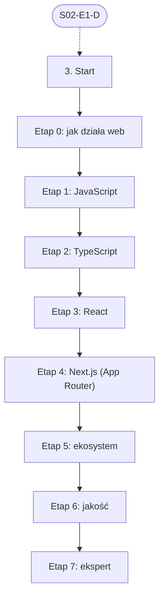

# 03. Frontend web: plan wdrożenia w Linear

Team **LEA** (https://linear.app/daankh/team/LEA/overview). Plan jest wdrożony w Linear. Klucze zadań (np. `S03-E0-M1`) są robocze, a identyfikator każdego zadania w Linear (`LEA-…`) jest w kolumnie „Linear” tabel zadań i w pliku `mapowanie-kluczy.csv`.

**W skrócie:** 8 kamieni milowych, 53 zadania (1 start, 41 materiałów, 8 dowodów, 3 praktyki). Plik główny z kolejnością projektów: `00-kolejnosc-i-zaleznosci.md`.

## 1. Projekt

| Pole | Wartość |
|---|---|
| Nazwa | 03. Frontend web |
| Team | LEA |
| Podsumowanie (pole „Summary”) | Warstwa 0: fundamenty. Opiera się na: 2. Jest podstawą: 5, 6, 7, 10, 13 i 14. |
| Etykiety projektu | `warstwa-0` |
| Blokowany przez (projekty) | 02. Języki i narzędzia podstawowe |
| Blokuje (projekty) | 05. Backend i API, 06. Testowanie, 07. Wymagania i specyfikacje, 10. Bezpieczeństwo, 13. UI/UX, 14. Desktop: wspólne |

### Opis projektu (do wklejenia w Linear)

*Warstwa 0: fundamenty. Opiera się na: 2. Jest podstawą: 5, 6, 7, 10, 13 i 14.*

**Zakres umiejętności**

- React 19: komponenty, hooki, stan, efekty i ich pułapki, renderowanie i memoizacja; Actions, `useActionState`, `useOptimistic`, `use`; React Compiler (automatyczna memoizacja).
- Next.js (App Router): Server Components i Client Components, Server Functions (Server Actions), route handlers, `proxy.ts` (do Next.js 15 `middleware.ts`), Cache Components i dyrektywa `use cache`, Partial Prerendering, ISR, granica serwer–klient.
- TypeScript w trybie ścisłym, walidacja danych na granicach (Zod).
- Zarządzanie stanem i danymi: TanStack Query, Zustand albo Context; formularze (React Hook Form).
- Stylowanie i komponenty: Tailwind CSS, Radix lub shadcn/ui, design tokens.
- Internacjonalizacja, SEO, metadane, Core Web Vitals, rozmiar paczek, ładowanie obrazów i fontów.
- Bundlery i narzędzia: Turbopack (domyślny w Next.js 16) lub Vite, pnpm, ESLint, Prettier.
- Opcjonalnie Rust w przeglądarce: `wasm-bindgen` (od 2025 r. w nowej organizacji `wasm-bindgen` na GitHubie), do ciężkich obliczeń.
- Typowe błędy kodu z AI do wyłapania: sekrety w zmiennych `NEXT_PUBLIC_*`, brak autoryzacji w Server Actions, logika uprawnień wyłącznie po stronie klienta.

**Ścieżka nauki**

Ścieżka ma 8 etapów. Każdy kończy się **dowodem**, czyli małym projektem, który pokazuje, że etap jest opanowany. Przy doświadczeniu seniorskim etapy 0–3 można zaliczyć samym dowodem i wracać do materiałów tylko tam, gdzie dowód nie wychodzi. Ceny materiałów płatnych zmieniają się, więc warto je sprawdzić przed zakupem.

**Definicja ukończenia projektu (dowód poziomu E)**

Samodzielnie, bez agenta, w 1 dzień diagnozujesz i naprawiasz błąd wydajności lub bezpieczeństwa w nieznanej aplikacji Next.js i umiesz wyjaśnić przyczynę osobie nietechnicznej.

**Źródło:** dokument „Umiejętności techniczne” w projekcie „JDG: Rozwój oprogramowania”, sekcja 3.

## 2. Kamienie milowe

Jeden kamień milowy na etap ścieżki. Kamień milowy jest zamknięty, gdy zamknięte jest zadanie dowodu tego etapu.

| # | Kamień milowy | Cel | Poziom po etapie | Zadania |
|---|---|---|---|---|
| 1 | Etap 0: jak działa web | jak działa web: HTML, CSS, przeglądarka, HTTP | podstawy | 4 |
| 2 | Etap 1: JavaScript | JavaScript bez frameworka | podstawy | 4 |
| 3 | Etap 2: TypeScript | TypeScript w trybie ścisłym | W | 5 |
| 4 | Etap 3: React | React 19 | W | 6 |
| 5 | Etap 4: Next.js (App Router) | Next.js (App Router) i jego bezpieczeństwo | W | 8 |
| 6 | Etap 5: ekosystem | ekosystem: dane, formularze, stylowanie, narzędzia | W | 8 |
| 7 | Etap 6: jakość | jakość: testy, wydajność, dostępność, bezpieczeństwo | E | 9 |
| 8 | Etap 7: ekspert | ekspert: mechanizmy wewnętrzne, recenzja kodu AI, aktualność | E | 8 |

## 3. Punkt startu

Zadanie **`S03-START` · Start: 3. Frontend web** (LEA-53 w Linear) to jedyne wejście do projektu: wszystkie zadania pierwszego etapu są przez nie blokowane.

- **Blokowane przez:** `S02-E1-D`
- **Odblokowuje:** `S03-E0-M1`, `S03-E0-M2`, `S03-E0-M3`
- **Status początkowy:** Backlog do czasu zamknięcia zadań blokujących, potem Todo

Opis zadania (do wklejenia):

Punkt startu projektu „03. Frontend web”.

**Warunki wejścia (zadania blokujące):**

- `S02-E1-D` · Dowód etapu 1: Bash i `jq` — sekcja 2 na poziomie podstawowym do pracy (etap 1)

**Do zrobienia:**

- przeczytać sekcję 3 dokumentu „Umiejętności techniczne”,
- zaznaczyć etapy, które zaliczasz samym dowodem (zgodnie z akapitem wstępnym ścieżki), i dla nich zamknąć zadania materiałów jako niepotrzebne.

**Folder roboczy:** `03-frontend-web/`

## 4. Przepływ zależności

Linie ciągłe to zależności wewnątrz projektu, przerywane to zadania z innych projektów. Wewnątrz etapu zadania materiałów są równoległe i wszystkie blokują dowód etapu; dowód etapu blokuje materiały kolejnego etapu.

## 5. Zadania według kamieni milowych

Szablon opisu zadania materiału: nazwa materiału, autor lub wydawca, typ, czas, koszt i link (jak w kolumnach poniżej), zdanie „Gotowe, gdy materiał jest przerobiony w zakresie potrzebnym do dowodu etapu” oraz folder roboczy z kolumny „Folder”. Opisy dowodów i praktyk są podane pod tabelą każdego etapu.

### Etap 0: jak działa web

Opis kamienia milowego (do wklejenia):

**Cel:** jak działa web: HTML, CSS, przeglądarka, HTTP · **Poziom po etapie:** podstawy

**Dowód:** Responsywna strona wielosekcyjna bez frameworka, z formularzem, poprawną semantyką i obsługą klawiatury; wynik Lighthouse powyżej 90 we wszystkich kategoriach.

| Klucz | Linear | Tytuł | Typ | Czas | Koszt | Link | Blokowane przez | Blokuje | Folder |
|---|---|---|---|---|---|---|---|---|---|
| `S03-E0-M1` | LEA-57 | Przerobić: Learn web development | materiał | 30–40 h | 0 zł | https://developer.mozilla.org/en-US/docs/Learn_web_development | `S03-START` | `S03-E0-D` | `03-frontend-web/e0-jak-dziala-web/` |
| `S03-E0-M2` | LEA-59 | Przerobić: Learn HTML, Learn CSS, Learn Forms | materiał | 20–25 h | 0 zł | https://web.dev/learn | `S03-START` | `S03-E0-D` | `03-frontend-web/e0-jak-dziala-web/` |
| `S03-E0-M3` | LEA-60 | Przerobić: CSS for JavaScript Developers | materiał, płatny | 30–40 h | płatny | https://css-for-js.dev | `S03-START` | `S03-E0-D` | `03-frontend-web/e0-jak-dziala-web/` |
| `S03-E0-D` | LEA-65 | Dowód etapu 0: jak działa web | dowód | — | — | — | `S03-E0-M1`, `S03-E0-M2`, `S03-E0-M3` | `S03-E1-M1`, `S03-E1-M2`, `S03-E1-M3` | `03-frontend-web/e0-jak-dziala-web/` |

**`S03-E0-D` · Dowód etapu 0: jak działa web**

Responsywna strona wielosekcyjna bez frameworka, z formularzem, poprawną semantyką i obsługą klawiatury; wynik Lighthouse powyżej 90 we wszystkich kategoriach.

**Kryterium ukończenia:** Lighthouse (tryb mobilny) co najmniej 90 w każdej kategorii; walidator HTML W3C bez błędów; axe DevTools bez naruszeń; formularz da się wypełnić i wysłać samą klawiaturą z widocznym fokusem; układ działa od 320 px szerokości; w komentarzu link do repozytorium i raportu Lighthouse.

**Folder roboczy:** `03-frontend-web/e0-jak-dziala-web/`

### Etap 1: JavaScript

Opis kamienia milowego (do wklejenia):

**Cel:** JavaScript bez frameworka · **Poziom po etapie:** podstawy

**Szczególnie ważne:** domknięcia, zakresy, `this`, prototypy, pętla zdarzeń, `Promise` i `async`/`await`, moduły ES, niemutowalność, obsługa błędów.

**Dowód:** Aplikacja w czystym JavaScript pobierająca dane z publicznego API, z obsługą błędów sieci, anulowaniem żądań (`AbortController`) i stanami ładowania.

| Klucz | Linear | Tytuł | Typ | Czas | Koszt | Link | Blokowane przez | Blokuje | Folder |
|---|---|---|---|---|---|---|---|---|---|
| `S03-E1-M1` | LEA-75 | Przerobić: The Modern JavaScript Tutorial | materiał | 40–50 h | 0 zł | https://javascript.info | `S03-E0-D` | `S03-E1-D` | `03-frontend-web/e1-javascript/` |
| `S03-E1-M2` | LEA-77 | Przerobić: Eloquent JavaScript (wydanie 4) | materiał | 30–40 h | 0 zł online | https://eloquentjavascript.net | `S03-E0-D` | `S03-E1-D` | `03-frontend-web/e1-javascript/` |
| `S03-E1-M3` | LEA-78 | Przerobić: You Don’t Know JS Yet | materiał | 15–20 h | 0 zł | https://github.com/getify/You-Dont-Know-JS | `S03-E0-D` | `S03-E1-D` | `03-frontend-web/e1-javascript/` |
| `S03-E1-D` | LEA-91 | Dowód etapu 1: JavaScript | dowód | — | — | — | `S03-E1-M1`, `S03-E1-M2`, `S03-E1-M3` | `S03-E2-M1`, `S03-E2-M2`, `S03-E2-M3`, `S03-E2-M4` | `03-frontend-web/e1-javascript/` |

**`S03-E1-D` · Dowód etapu 1: JavaScript**

Aplikacja w czystym JavaScript pobierająca dane z publicznego API, z obsługą błędów sieci, anulowaniem żądań (`AbortController`) i stanami ładowania.

**Na co zwrócić uwagę:** domknięcia, zakresy, `this`, prototypy, pętla zdarzeń, `Promise` i `async`/`await`, moduły ES, niemutowalność, obsługa błędów.

**Kryterium ukończenia:** obsłużone i pokazane w README cztery przypadki: błąd sieci, odpowiedź spoza 2xx, przekroczenie czasu i anulowanie poprzedniego żądania przy szybkim wpisywaniu; brak nieobsłużonych odrzuceń `Promise` w konsoli; w komentarzu link do repozytorium.

**Folder roboczy:** `03-frontend-web/e1-javascript/`

### Etap 2: TypeScript

Opis kamienia milowego (do wklejenia):

**Cel:** TypeScript w trybie ścisłym · **Poziom po etapie:** W

**Dowód:** Klient API w trybie `strict`, bez `any`, z typami wyprowadzonymi ze schematów Zod i dyskryminowanymi uniami dla stanów odpowiedzi.

| Klucz | Linear | Tytuł | Typ | Czas | Koszt | Link | Blokowane przez | Blokuje | Folder |
|---|---|---|---|---|---|---|---|---|---|
| `S03-E2-M1` | LEA-99 | Przerobić: TypeScript Handbook | materiał | 10–15 h | 0 zł | https://www.typescriptlang.org/docs/handbook/ | `S03-E1-D` | `S03-E2-D` | `03-frontend-web/e2-typescript/` |
| `S03-E2-M2` | LEA-100 | Przerobić: Total TypeScript (darmowe tutoriale i płatne warsztaty) | materiał, płatny | 20–30 h | 0 zł / płatny | https://www.totaltypescript.com | `S03-E1-D` | `S03-E2-D` | `03-frontend-web/e2-typescript/` |
| `S03-E2-M3` | LEA-101 | Przerobić: Effective TypeScript (wydanie 2) | materiał, płatny | 12–15 h | płatna | https://effectivetypescript.com | `S03-E1-D` | `S03-E2-D` | `03-frontend-web/e2-typescript/` |
| `S03-E2-M4` | LEA-102 | Przerobić: type-challenges | materiał | wg potrzeb | 0 zł | https://github.com/type-challenges/type-challenges | `S03-E1-D` | `S03-E2-D` | `03-frontend-web/e2-typescript/` |
| `S03-E2-D` | LEA-104 | Dowód etapu 2: TypeScript | dowód | — | — | — | `S03-E2-M1`, `S03-E2-M2`, `S03-E2-M3`, `S03-E2-M4` | `S03-E3-M1`, `S03-E3-M2`, `S03-E3-M3`, `S03-E3-M4`, `S03-E3-M5`, `S05-START`, `S06-START`, `S07-START`, `S10-START`, `S13-START`, `S14-START` | `03-frontend-web/e2-typescript/` |

**`S03-E2-D` · Dowód etapu 2: TypeScript**

Klient API w trybie `strict`, bez `any`, z typami wyprowadzonymi ze schematów Zod i dyskryminowanymi uniami dla stanów odpowiedzi.

**Kryterium ukończenia:** `tsc --noEmit` w trybie `strict` bez błędów; reguły `@typescript-eslint/no-explicit-any` i `no-unsafe-*` jako błędy, bez wyłączeń; każda odpowiedź API parsowana przez `safeParse`; obsługa unii z gałęzią `never`, więc dodanie nowego stanu psuje kompilację; w komentarzu link do repozytorium.

**Folder roboczy:** `03-frontend-web/e2-typescript/`

### Etap 3: React

Opis kamienia milowego (do wklejenia):

**Cel:** React 19 · **Poziom po etapie:** W

**Szczególnie ważne:** stan wyprowadzany zamiast synchronizowanego efektami („You Might Not Need an Effect”), klucze list, własne hooki; React 19: Actions i `useActionState` do formularzy, `useOptimistic` do natychmiastowej odpowiedzi interfejsu, `use` do odczytu `Promise` i kontekstu; React Compiler memoizuje automatycznie, więc ręczne `useMemo` i `useCallback` są potrzebne rzadziej, ale kod musi przestrzegać reguł Reacta.

Wystarczy jeden z dwóch płatnych kursów: The Joy of React przy starcie od zera (obowiązkowy), Epic React przy doświadczeniu z Reactem (opcjonalny).

**Dowód:** Aplikacja z formularzami, listą z filtrowaniem, stanem współdzielonym i własnymi hookami, bez zbędnych `useEffect`; co najmniej jeden formularz na Actions z `useActionState` i optymistyczną aktualizacją `useOptimistic`; React Compiler włączony; komponenty dostępne z klawiatury.

| Klucz | Linear | Tytuł | Typ | Czas | Koszt | Link | Blokowane przez | Blokuje | Folder |
|---|---|---|---|---|---|---|---|---|---|
| `S03-E3-M1` | LEA-124 | Przerobić: react.dev: Learn i Reference (w całości, z artykułem „You Might Not Need an Effect”) | materiał | 20–25 h | 0 zł | https://react.dev/learn | `S03-E2-D` | `S03-E3-D` | `03-frontend-web/e3-react/` |
| `S03-E3-M2` | LEA-125 | Przerobić: The Joy of React | materiał, płatny | 30–40 h | płatny | https://www.joyofreact.com | `S03-E2-D` | `S03-E3-D` | `03-frontend-web/e3-react/` |
| `S03-E3-M3` | LEA-126 | Przerobić: Epic React | materiał, płatny, opcjonalne | 40–60 h | płatny | https://www.epicreact.dev | `S03-E2-D` | — | `03-frontend-web/e3-react/` |
| `S03-E3-M4` | LEA-127 | Przerobić: overreacted.io | materiał | 5–10 h | 0 zł | https://overreacted.io | `S03-E2-D` | `S03-E3-D` | `03-frontend-web/e3-react/` |
| `S03-E3-M5` | LEA-128 | Przerobić: React 19 i 19.2: Actions, `useActionState`, `useOptimistic`, `use`; React Compiler | materiał | 4–6 h | 0 zł | https://react.dev/blog/2024/12/05/react-19, https://react.dev/blog/2025/10/01/react-19-2, https://react.dev/reference/react/useActionState, https://react.dev/reference/react/useOptimistic, https://react.dev/learn/react-compiler | `S03-E2-D` | `S03-E3-D` | `03-frontend-web/e3-react/` |
| `S03-E3-D` | LEA-133 | Dowód etapu 3: React | dowód | — | — | — | `S03-E3-M1`, `S03-E3-M2`, `S03-E3-M4`, `S03-E3-M5` | `S03-E4-M1`, `S03-E4-M2`, `S03-E4-M3`, `S03-E4-M4`, `S03-E4-M5`, `S03-E4-M6`, `S03-E4-M7` | `03-frontend-web/e3-react/` |

**`S03-E3-D` · Dowód etapu 3: React**

Aplikacja z formularzami, listą z filtrowaniem, stanem współdzielonym i własnymi hookami, bez zbędnych `useEffect`; co najmniej jeden formularz na Actions z `useActionState` i optymistyczną aktualizacją `useOptimistic`; React Compiler włączony; komponenty dostępne z klawiatury.

**Na co zwrócić uwagę:** stan wyprowadzany zamiast synchronizowanego efektami („You Might Not Need an Effect”), klucze list, własne hooki; React 19: Actions i `useActionState` do formularzy, `useOptimistic` do natychmiastowej odpowiedzi interfejsu, `use` do odczytu `Promise` i kontekstu; React Compiler memoizuje automatycznie, więc ręczne `useMemo` i `useCallback` są potrzebne rzadziej, ale kod musi przestrzegać reguł Reacta.

**Kryterium ukończenia:** `eslint-plugin-react-hooks` (z regułami React Compiler) bez ostrzeżeń; każdy `useEffect` ma komentarz, z jakim systemem zewnętrznym synchronizuje; co najmniej 2 własne hooki; wszystkie elementy interaktywne osiągalne klawiaturą (lista sprawdzonych ścieżek w README); w komentarzu link do repozytorium.

**Folder roboczy:** `03-frontend-web/e3-react/`

### Etap 4: Next.js (App Router)

Opis kamienia milowego (do wklejenia):

**Cel:** Next.js (App Router) i jego bezpieczeństwo · **Poziom po etapie:** W

**Szczególnie ważne:** granica serwer–klient, warstwa dostępu do danych (DAL) z autoryzacją w każdej akcji, `proxy.ts` (dawny `middleware.ts`) tylko do przekierowań i wstępnych sprawdzeń, nigdy jako jedyna autoryzacja, które zmienne trafiają do przeglądarki, Cache Components i `use cache` (dane zależne od użytkownika nie trafiają do współdzielonego cache), unieważnianie cache (`updateTag`, `revalidateTag`), aktualizacja frameworka jako element obsługi podatności (CRA).

**Dowód:** Aplikacja Next.js 16 (Turbopack, Cache Components) z logowaniem (np. Better Auth), co najmniej dwiema rolami i co najmniej trzema Server Actions, w której każda akcja sprawdza sesję i rolę w warstwie dostępu do danych po stronie serwera, a `proxy.ts` tylko przekierowuje niezalogowanych; testy, które wywołują każdą akcję bez sesji i z niewystarczającą rolą i dostają odmowę.

| Klucz | Linear | Tytuł | Typ | Czas | Koszt | Link | Blokowane przez | Blokuje | Folder |
|---|---|---|---|---|---|---|---|---|---|
| `S03-E4-M1` | LEA-146 | Przerobić: Next.js Learn (kurs budowy dashboardu) | materiał | 10–15 h | 0 zł | https://nextjs.org/learn | `S03-E3-D` | `S03-E4-D` | `03-frontend-web/e4-next-js-app-router/` |
| `S03-E4-M2` | LEA-147 | Przerobić: Dokumentacja Next.js 16: Server and Client Components, Caching (Cache Components, `use cache`)… | materiał | 15–20 h | 0 zł | https://nextjs.org/docs/app/getting-started/server-and-client-components, https://nextjs.org/docs/app/getting-started/caching, https://nextjs.org/docs/app/getting-started/mutating-data, https://nextjs.org/docs/app/getting-started/proxy, https://nextjs.org/docs/app/guides/data-security | `S03-E3-D` | `S03-E4-D` | `03-frontend-web/e4-next-js-app-router/` |
| `S03-E4-M3` | LEA-148 | Przerobić: Next.js 16: wpis o wydaniu, przewodnik aktualizacji do wersji 16 i dokumentacja Turbopack | materiał | 2–3 h | 0 zł | https://nextjs.org/blog/next-16, https://nextjs.org/docs/app/guides/upgrading/version-16, https://nextjs.org/docs/app/api-reference/turbopack | `S03-E3-D` | `S03-E4-D` | `03-frontend-web/e4-next-js-app-router/` |
| `S03-E4-M4` | LEA-149 | Przerobić: „How to Think About Security in Next.js” | materiał | 1–2 h | 0 zł | https://nextjs.org/blog/security-nextjs-server-components-actions | `S03-E3-D` | `S03-E4-D` | `03-frontend-web/e4-next-js-app-router/` |
| `S03-E4-M5` | LEA-150 | Przerobić: Komunikaty bezpieczeństwa React i Next.js, m.in. krytyczna podatność RCE w React Server… | materiał | 2–3 h | 0 zł | https://react.dev/blog/2025/12/03/critical-security-vulnerability-in-react-server-components, https://nextjs.org/blog/CVE-2025-66478, https://github.com/vercel/next.js/security/advisories | `S03-E3-D` | `S03-E4-D` | `03-frontend-web/e4-next-js-app-router/` |
| `S03-E4-M6` | LEA-151 | Przerobić: Dokumentacja Next.js: przewodnik „Authentication” (sesje, autoryzacja, DAL) | materiał | 2–3 h | 0 zł | https://nextjs.org/docs/app/guides/authentication | `S03-E3-D` | `S03-E4-D` | `03-frontend-web/e4-next-js-app-router/` |
| `S03-E4-M7` | LEA-152 | Przerobić: Better Auth: dokumentacja i integracja z Next.js | materiał | 3–4 h | 0 zł | https://www.better-auth.com/docs, https://www.better-auth.com/docs/integrations/next | `S03-E3-D` | `S03-E4-D` | `03-frontend-web/e4-next-js-app-router/` |
| `S03-E4-D` | LEA-161 | Dowód etapu 4: Next.js (App Router) | dowód | — | — | — | `S03-E4-M1`, `S03-E4-M2`, `S03-E4-M3`, `S03-E4-M4`, `S03-E4-M5`, `S03-E4-M6`, `S03-E4-M7` | `S03-E5-M1`, `S03-E5-M2`, `S03-E5-M3`, `S03-E5-M4`, `S03-E5-M5`, `S03-E5-M6`, `S03-E5-M7` | `03-frontend-web/e4-next-js-app-router/` |

**`S03-E4-D` · Dowód etapu 4: Next.js (App Router)**

Aplikacja Next.js 16 (Turbopack, Cache Components) z logowaniem (np. Better Auth), co najmniej dwiema rolami i co najmniej trzema Server Actions, w której każda akcja sprawdza sesję i rolę w warstwie dostępu do danych po stronie serwera, a `proxy.ts` tylko przekierowuje niezalogowanych; testy, które wywołują każdą akcję bez sesji i z niewystarczającą rolą i dostają odmowę.

**Na co zwrócić uwagę:** granica serwer–klient, warstwa dostępu do danych (DAL) z autoryzacją w każdej akcji, `proxy.ts` (dawny `middleware.ts`) tylko do przekierowań i wstępnych sprawdzeń, nigdy jako jedyna autoryzacja, które zmienne trafiają do przeglądarki, Cache Components i `use cache` (dane zależne od użytkownika nie trafiają do współdzielonego cache), unieważnianie cache (`updateTag`, `revalidateTag`), aktualizacja frameworka jako element obsługi podatności (CRA).

**Kryterium ukończenia:** wszystkie testy odmowy (bez sesji i ze złą rolą, dla każdej akcji) przechodzą w CI; usunięcie `proxy.ts` nie otwiera dostępu do żadnej akcji ani strony z danymi; `next build` bez błędów i ostrzeżeń; w paczce klienta i zmiennych `NEXT_PUBLIC_*` brak sekretów (sprawdzone wyszukiwaniem w zbudowanych plikach); w komentarzu link do repozytorium.

**Folder roboczy:** `03-frontend-web/e4-next-js-app-router/`

### Etap 5: ekosystem

Opis kamienia milowego (do wklejenia):

**Cel:** ekosystem: dane, formularze, stylowanie, narzędzia · **Poziom po etapie:** W

Uwaga do Rusta w przeglądarce: organizacja `rustwasm` została zarchiwizowana we wrześniu 2025 r., `wasm-bindgen` przeszedł do nowej organizacji, a `wasm-pack` trafił na listę do archiwizacji. Starsze poradniki oparte na `wasm-pack` trzeba sprawdzać pod kątem aktualności.

**Dowód:** Aplikacja wielojęzyczna z formularzem walidowanym tym samym schematem Zod na kliencie i serwerze, cache danych z optymistycznymi aktualizacjami i własnym komponentem dostępnym zbudowanym na Radix.

| Klucz | Linear | Tytuł | Typ | Czas | Koszt | Link | Blokowane przez | Blokuje | Folder |
|---|---|---|---|---|---|---|---|---|---|
| `S03-E5-M1` | LEA-175 | Przerobić: TanStack Query: dokumentacja i blog „Practical React Query” | materiał | 8–10 h | 0 zł | https://tanstack.com/query, https://tkdodo.eu/blog/practical-react-query | `S03-E4-D` | `S03-E5-D` | `03-frontend-web/e5-ekosystem/` |
| `S03-E5-M2` | LEA-177 | Przerobić: Zod, React Hook Form, Zustand | materiał | 6–8 h | 0 zł | https://zod.dev, https://react-hook-form.com, https://zustand.docs.pmnd.rs | `S03-E4-D` | `S03-E5-D` | `03-frontend-web/e5-ekosystem/` |
| `S03-E5-M3` | LEA-179 | Przerobić: Tailwind CSS, Radix Primitives, shadcn/ui | materiał | 8–10 h | 0 zł | https://tailwindcss.com/docs, https://www.radix-ui.com/primitives, https://ui.shadcn.com | `S03-E4-D` | `S03-E5-D` | `03-frontend-web/e5-ekosystem/` |
| `S03-E5-M4` | LEA-180 | Przerobić: next-intl | materiał | 3–4 h | 0 zł | https://next-intl.dev | `S03-E4-D` | `S03-E5-D` | `03-frontend-web/e5-ekosystem/` |
| `S03-E5-M5` | LEA-181 | Przerobić: Vite, pnpm, typescript-eslint | materiał | 5–6 h | 0 zł | https://vite.dev, https://pnpm.io, https://typescript-eslint.io | `S03-E4-D` | `S03-E5-D` | `03-frontend-web/e5-ekosystem/` |
| `S03-E5-M6` | LEA-182 | Przerobić: patterns.dev | materiał | 8–10 h | 0 zł | https://www.patterns.dev | `S03-E4-D` | `S03-E5-D` | `03-frontend-web/e5-ekosystem/` |
| `S03-E5-M7` | LEA-183 | Przerobić: Rust i WebAssembly: `wasm-bindgen` i przewodnik MDN o WebAssembly | materiał, opcjonalne | 8–10 h | 0 zł | https://github.com/wasm-bindgen/wasm-bindgen, https://developer.mozilla.org/en-US/docs/WebAssembly | `S03-E4-D` | — | `03-frontend-web/e5-ekosystem/` |
| `S03-E5-D` | LEA-185 | Dowód etapu 5: ekosystem | dowód | — | — | — | `S03-E5-M1`, `S03-E5-M2`, `S03-E5-M3`, `S03-E5-M4`, `S03-E5-M5`, `S03-E5-M6` | `S03-E6-M1`, `S03-E6-M2`, `S03-E6-M3`, `S03-E6-M4`, `S03-E6-M5`, `S03-E6-M6`, `S03-E6-M7`, `S03-E6-M8` | `03-frontend-web/e5-ekosystem/` |

**`S03-E5-D` · Dowód etapu 5: ekosystem**

Aplikacja wielojęzyczna z formularzem walidowanym tym samym schematem Zod na kliencie i serwerze, cache danych z optymistycznymi aktualizacjami i własnym komponentem dostępnym zbudowanym na Radix.

**Kryterium ukończenia:** co najmniej 2 języki z przełącznikiem i tłumaczonymi metadanymi; ten sam schemat Zod importowany w formularzu i w Server Action, a test pokazuje odrzucenie niepoprawnych danych po obu stronach; optymistyczna aktualizacja wycofuje się przy symulowanym błędzie serwera; komponent na Radix obsługuje klawiaturę zgodnie z wzorcem APG i nie ma naruszeń axe; w komentarzu link do repozytorium.

**Folder roboczy:** `03-frontend-web/e5-ekosystem/`

### Etap 6: jakość

Opis kamienia milowego (do wklejenia):

**Cel:** jakość: testy, wydajność, dostępność, bezpieczeństwo · **Poziom po etapie:** E

**Dowód:** Do aplikacji z etapu 4 dodane: testy jednostkowe, komponentów i E2E w CI; budżet wydajności (LCP, INP, CLS) sprawdzany automatycznie; audyt WCAG 2.2 AA z poprawkami i testem czytnikiem ekranu; nagłówki bezpieczeństwa i CSP.

| Klucz | Linear | Tytuł | Typ | Czas | Koszt | Link | Blokowane przez | Blokuje | Folder |
|---|---|---|---|---|---|---|---|---|---|
| `S03-E6-M1` | LEA-201 | Przerobić: Testing Library, Vitest, MSW | materiał | 8–10 h | 0 zł | https://testing-library.com, https://vitest.dev, https://mswjs.io | `S03-E5-D` | `S03-E6-D` | `03-frontend-web/e6-jakosc/` |
| `S03-E6-M2` | LEA-202 | Przerobić: Playwright (testy E2E, fixtures, trace viewer) | materiał | 8–10 h | 0 zł | https://playwright.dev | `S03-E5-D` | `S03-E6-D` | `03-frontend-web/e6-jakosc/` |
| `S03-E6-M3` | LEA-203 | Przerobić: Testing JavaScript | materiał, płatny, opcjonalne | 15–20 h | płatny | https://www.testingjavascript.com | `S03-E5-D` | — | `03-frontend-web/e6-jakosc/` |
| `S03-E6-M4` | LEA-204 | Przerobić: Learn Performance, Core Web Vitals | materiał | 8–10 h | 0 zł | https://web.dev/learn/performance | `S03-E5-D` | `S03-E6-D` | `03-frontend-web/e6-jakosc/` |
| `S03-E6-M5` | LEA-205 | Przerobić: Chrome DevTools: Performance, Memory, Network | materiał | 4–6 h | 0 zł | https://developer.chrome.com/docs/devtools | `S03-E5-D` | `S03-E6-D` | `03-frontend-web/e6-jakosc/` |
| `S03-E6-M6` | LEA-206 | Przerobić: Learn Accessibility | materiał | 6–8 h | 0 zł | https://web.dev/learn/accessibility | `S03-E5-D` | `S03-E6-D` | `03-frontend-web/e6-jakosc/` |
| `S03-E6-M7` | LEA-207 | Przerobić: ARIA Authoring Practices Guide, Understanding WCAG 2.2 | materiał | 8–10 h | 0 zł | https://www.w3.org/WAI/ARIA/apg/, https://www.w3.org/WAI/WCAG22/Understanding/ | `S03-E5-D` | `S03-E6-D` | `03-frontend-web/e6-jakosc/` |
| `S03-E6-M8` | LEA-208 | Przerobić: OWASP Cheat Sheet Series: XSS, CSP, CSRF, uwierzytelnianie, sesje | materiał | 6–8 h | 0 zł | https://cheatsheetseries.owasp.org | `S03-E5-D` | `S03-E6-D` | `03-frontend-web/e6-jakosc/` |
| `S03-E6-D` | LEA-219 | Dowód etapu 6: jakość | dowód | — | — | — | `S03-E6-M1`, `S03-E6-M2`, `S03-E6-M4`, `S03-E6-M5`, `S03-E6-M6`, `S03-E6-M7`, `S03-E6-M8` | `S03-E7-M1`, `S03-E7-M2`, `S03-E7-M3`, `S03-E7-M4`, `S03-E7-P1`, `S03-E7-P2`, `S03-E7-P3` | `03-frontend-web/e6-jakosc/` |

**`S03-E6-D` · Dowód etapu 6: jakość**

Do aplikacji z etapu 4 dodane: testy jednostkowe, komponentów i E2E w CI; budżet wydajności (LCP, INP, CLS) sprawdzany automatycznie; audyt WCAG 2.2 AA z poprawkami i testem czytnikiem ekranu; nagłówki bezpieczeństwa i CSP.

**Kryterium ukończenia:** w CI co najmniej 20 testów jednostkowych i komponentów (Vitest, Testing Library) i co najmniej 5 scenariuszy E2E (Playwright), w tym logowanie i odmowa uprawnień; Lighthouse CI przerywa build przy LCP powyżej 2,5 s, CLS powyżej 0,1 lub TBT powyżej 200 ms (laboratoryjny zastępnik INP); 0 naruszeń axe na kluczowych stronach i raport WCAG 2.2 AA z wynikiem dla każdego kryterium; test czytnikiem ekranu (NVDA lub VoiceOver) dla 3 głównych ścieżek; CSP bez `unsafe-inline` dla skryptów (nonce) i co najmniej ocena A w Mozilla HTTP Observatory; w komentarzu link do repozytorium i raportów.

**Folder roboczy:** `03-frontend-web/e6-jakosc/`

### Etap 7: ekspert

Opis kamienia milowego (do wklejenia):

**Cel:** ekspert: mechanizmy wewnętrzne, recenzja kodu AI, aktualność · **Poziom po etapie:** E

**Dowód poziomu E:** Samodzielnie, bez agenta, w 1 dzień diagnozujesz i naprawiasz błąd wydajności lub bezpieczeństwa w nieznanej aplikacji Next.js i umiesz wyjaśnić przyczynę osobie nietechnicznej.

| Klucz | Linear | Tytuł | Typ | Czas | Koszt | Link | Blokowane przez | Blokuje | Folder |
|---|---|---|---|---|---|---|---|---|---|
| `S03-E7-M1` | LEA-235 | Przerobić: Build your own React | materiał | 4–6 h | 0 zł | https://pomb.us/build-your-own-react/ | `S03-E6-D` | `S03-E7-D` | `03-frontend-web/e7-ekspert/` |
| `S03-E7-M2` | LEA-236 | Przerobić: Blog React, informacje o wydaniach Next.js, dyskusje i RFC na GitHubie | materiał | ok. 1 h tygodniowo | 0 zł | https://react.dev/blog, https://nextjs.org/blog | `S03-E6-D` | `S03-E7-D` | `03-frontend-web/e7-ekspert/` |
| `S03-E7-M3` | LEA-239 | Przerobić: Kursy zaawansowane (wydajność, architektura frontendu, wewnętrzne mechanizmy) | materiał, płatny | wg potrzeb | abonament | https://frontendmasters.com | `S03-E6-D` | `S03-E7-D` | `03-frontend-web/e7-ekspert/` |
| `S03-E7-M4` | LEA-241 | Przerobić: Nagrania konferencji React Conf (kanał React Conf) i Next.js Conf (kanał Vercel) | materiał | wg potrzeb | 0 zł | https://www.youtube.com/@ReactConfOfficial, https://www.youtube.com/@VercelHQ | `S03-E6-D` | `S03-E7-D` | `03-frontend-web/e7-ekspert/` |
| `S03-E7-P1` | LEA-244 | Praktyka: recenzja kodu AI | praktyka | — | — | — | `S03-E6-D` | `S03-E7-D` | `03-frontend-web/e7-ekspert/` |
| `S03-E7-P2` | LEA-246 | Praktyka: przejęcie cudzej aplikacji Next.js | praktyka | — | — | — | `S03-E6-D` | `S03-E7-D` | `03-frontend-web/e7-ekspert/` |
| `S03-E7-P3` | LEA-250 | Praktyka: śledzenie podatności | praktyka | — | — | — | `S03-E6-D` | `S03-E7-D` | `03-frontend-web/e7-ekspert/` |
| `S03-E7-D` | LEA-268 | Dowód poziomu E: ekspert | dowód | — | — | — | `S03-E7-M1`, `S03-E7-M2`, `S03-E7-M3`, `S03-E7-M4`, `S03-E7-P1`, `S03-E7-P2`, `S03-E7-P3` | — | `03-frontend-web/e7-ekspert/` |

**`S03-E7-P1` · Praktyka: recenzja kodu AI**

20 pull requestów wygenerowanych przez agentów, recenzowanych według listy kontrolnej z etapów 4 i 6 (autoryzacja w akcjach, `NEXT_PUBLIC_*`, zbędne efekty, dostępność, testy, które naprawdę coś sprawdzają).

Praktyka ciągła etapu eksperckiego: oznacz jako gotową, gdy działa jako stały element pracy, a nie po jednorazowym wykonaniu.

**Folder roboczy:** `03-frontend-web/e7-ekspert/`

**`S03-E7-P2` · Praktyka: przejęcie cudzej aplikacji Next.js**

Pierwsza aplikacja z vibe codingu (poligon B z mapy nauki) przeprowadzona przez pełny audyt i stabilizację.

Praktyka ciągła etapu eksperckiego: oznacz jako gotową, gdy działa jako stały element pracy, a nie po jednorazowym wykonaniu.

**Folder roboczy:** `03-frontend-web/e7-ekspert/`

**`S03-E7-P3` · Praktyka: śledzenie podatności**

Subskrypcja komunikatów bezpieczeństwa React i Next.js oraz ćwiczenie aktualizacji frameworka w 24 h.

Praktyka ciągła etapu eksperckiego: oznacz jako gotową, gdy działa jako stały element pracy, a nie po jednorazowym wykonaniu.

**Folder roboczy:** `03-frontend-web/e7-ekspert/`

**`S03-E7-D` · Dowód poziomu E: ekspert**

Samodzielnie, bez agenta, w 1 dzień diagnozujesz i naprawiasz błąd wydajności lub bezpieczeństwa w nieznanej aplikacji Next.js i umiesz wyjaśnić przyczynę osobie nietechnicznej.

**Kryterium ukończenia:** bez agenta AI, w jednym dniu roboczym (do 8 h); aplikacja przygotowana przez inną osobę albo zgłoszony błąd w projekcie open source; poprawka z testem, który bez niej nie przechodzi (dla wydajności: pomiar przed i po, np. LCP lub INP z trace w Chrome DevTools); notatka z przyczyną na najwyżej jedną stronę, zrozumiała dla osoby nietechnicznej; w komentarzu link do poprawki i notatki.

**Folder roboczy:** `03-frontend-web/e7-ekspert/`

## 6. Relacje z innymi projektami

**Wchodzące** (zadanie z innego projektu blokuje zadanie tego projektu):

- `S02-E1-D` (Dowód etapu 1: Bash i `jq`) → `S03-START`

**Wychodzące** (zadanie tego projektu blokuje zadanie w innym projekcie):

- `S03-E2-D` → `S05-START` (05. Backend i API)
- `S03-E2-D` → `S06-START` (06. Testowanie)
- `S03-E2-D` → `S07-START` (07. Wymagania i specyfikacje)
- `S03-E2-D` → `S10-START` (10. Bezpieczeństwo)
- `S03-E2-D` → `S13-START` (13. UI/UX)
- `S03-E2-D` → `S14-START` (14. Desktop: wspólne)
