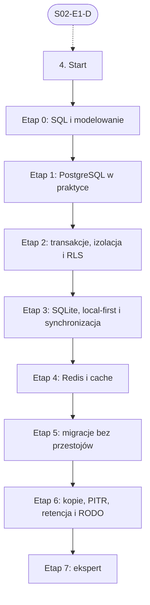

# 04. Bazy danych i dane: plan wdrożenia w Linear

Team **LEA** (https://linear.app/daankh/team/LEA/overview). Plan do przeglądu przed wdrożeniem: nic nie zostało jeszcze utworzone w Linear. Klucze zadań (np. `S04-E0-M1`) są robocze; po wdrożeniu dostaną identyfikatory `LEA-…`.

**W skrócie:** 8 kamieni milowych, 51 zadań (1 start, 38 materiałów, 8 dowodów, 4 praktyki). Plik główny z kolejnością projektów: `00-kolejnosc-i-zaleznosci.md`.

## 1. Projekt

| Pole | Wartość |
|---|---|
| Nazwa | 04. Bazy danych i dane |
| Team | LEA |
| Podsumowanie (pole „Summary”) | Warstwa 1: dane i serwer. Opiera się na: 2. Jest podstawą: 5, 8, 14, 18, 19 i 22 (dane lokalne). |
| Proponowany start | 2026-11-02 |
| Proponowany termin | 2027-03-31 |
| Etykiety projektu | `warstwa-1` |
| Blokowany przez (projekty) | 02. Języki i narzędzia podstawowe |
| Blokuje (projekty) | 05. Backend i API, 06. Testowanie, 08. Architektura i projektowanie systemów, 10. Bezpieczeństwo |
| Czas od zera | 230–300 h |

### Opis projektu (do wklejenia w Linear)

*Warstwa 1: dane i serwer. Opiera się na: 2. Jest podstawą: 5, 8, 14, 18, 19 i 22 (dane lokalne).*

**Zakres umiejętności**

- PostgreSQL: modelowanie, indeksy i plany zapytań (`EXPLAIN ANALYZE`), transakcje i poziomy izolacji, ograniczenia integralności, Row-Level Security.
- SQLite lokalnie na desktopie, mobile i w trybie offline; synchronizacja i rozwiązywanie konfliktów.
- Redis lub podobny cache, kolejki.
- Migracje expand–contract, kopie zapasowe z testem odtworzenia, retencja i usuwanie danych (RODO).

**Ścieżka nauki**

Ścieżka ma 8 etapów. Każdy kończy się **dowodem**, czyli małym projektem, który pokazuje, że etap jest opanowany. Przy doświadczeniu seniorskim etapy 0–1 można zaliczyć samym dowodem i wracać do materiałów tylko tam, gdzie dowód nie wychodzi. Dostęp do bazy z Rusta (SQLx, SeaORM) jest w sekcji 5, a szyfrowanie i ochrona sekretów w sekcji 10. Czas podany dla osoby startującej od zera; ceny materiałów płatnych zmieniają się, więc warto je sprawdzić przed zakupem.

Razem od zera do poziomu E: ok. 230–300 h, czyli 5–7 miesięcy przy 10–12 h tygodniowo.

**Definicja ukończenia projektu (dowód poziomu E)**

Samodzielnie, bez agenta, w 1 dzień diagnozujesz i naprawiasz w nieznanej bazie PostgreSQL problem wydajności, blokad albo wycieku danych między najemcami, przygotowujesz bezpieczną migrację naprawczą i umiesz wyjaśnić przyczynę osobie nietechnicznej.

**Źródło:** dokument „Umiejętności techniczne” w projekcie „JDG: Rozwój oprogramowania”, sekcja 4.

## 2. Kamienie milowe

Jeden kamień milowy na etap ścieżki. Kamień milowy jest zamknięty, gdy zamknięte jest zadanie dowodu tego etapu. Daty kamieni milowych ustawiasz przy wdrożeniu według kolejności z pliku głównego.

| # | Kamień milowy | Cel | Czas od zera | Poziom po etapie | Zadania |
|---|---|---|---|---|---|
| 1 | Etap 0: SQL i modelowanie | SQL i modelowanie relacyjne | 50–70 h | podstawy | 6 |
| 2 | Etap 1: PostgreSQL w praktyce | PostgreSQL w praktyce: typy, ograniczenia, indeksy, plany zapytań | 50–60 h | W | 6 |
| 3 | Etap 2: transakcje, izolacja i RLS | transakcje, izolacja, blokady i Row-Level Security | 30–40 h | E | 6 |
| 4 | Etap 3: SQLite, local-first i synchronizacja | SQLite lokalnie, local-first i synchronizacja | 40–50 h | W | 8 |
| 5 | Etap 4: Redis i cache | Redis i cache | 15–20 h | W | 4 |
| 6 | Etap 5: migracje bez przestojów | migracje bez przestojów (expand–contract) | 15–20 h | E | 5 |
| 7 | Etap 6: kopie, PITR, retencja i RODO | kopie zapasowe, PITR, retencja i RODO w danych | 30–40 h | E | 7 |
| 8 | Etap 7: ekspert | ekspert: wnętrze PostgreSQL, recenzja kodu AI, aktualność | stale, ok. 2 h tygodniowo | E | 8 |

## 3. Punkt startu

Zadanie **`S04-START` · Start: 4. Bazy danych i dane** to jedyne wejście do projektu: wszystkie zadania pierwszego etapu są przez nie blokowane.

- **Blokowane przez:** `S02-E1-D`
- **Odblokowuje:** `S04-E0-M1`, `S04-E0-M2`, `S04-E0-M3`, `S04-E0-M4`, `S04-E0-M5`
- **Status początkowy:** Backlog do czasu zamknięcia zadań blokujących, potem Todo

Opis zadania (do wklejenia):

Punkt startu projektu „04. Bazy danych i dane”.

**Warunki wejścia (zadania blokujące):**

- `S02-E1-D` · Dowód etapu 1: Bash i `jq` — sekcja 2 na poziomie podstawowym do pracy (etap 1)

**Do zrobienia:**

- przeczytać sekcję 4 dokumentu „Umiejętności techniczne”,
- zaznaczyć etapy, które zaliczasz samym dowodem (zgodnie z akapitem wstępnym ścieżki), i dla nich zamknąć zadania materiałów jako niepotrzebne,
- ustawić daty kamieni milowych zgodnie z kolejnością z pliku głównego.

**Folder roboczy:** `04-bazy-danych-i-dane/`

## 4. Przepływ zależności

Linie ciągłe to zależności wewnątrz projektu, przerywane to zadania z innych projektów. Wewnątrz etapu zadania materiałów są równoległe i wszystkie blokują dowód etapu; dowód etapu blokuje materiały kolejnego etapu.

## 5. Zadania według kamieni milowych

Szablon opisu zadania materiału: nazwa materiału, autor lub wydawca, typ, czas, koszt i link (jak w kolumnach poniżej), zdanie „Gotowe, gdy materiał jest przerobiony w zakresie potrzebnym do dowodu etapu” oraz folder roboczy z kolumny „Folder”. Opisy dowodów i praktyk są podane pod tabelą każdego etapu.

### Etap 0: SQL i modelowanie

Opis kamienia milowego (do wklejenia):

**Cel:** SQL i modelowanie relacyjne · **Czas od zera:** 50–70 h · **Poziom po etapie:** podstawy

**Szczególnie ważne:** normalizacja i świadoma denormalizacja, klucze naturalne i sztuczne, `NULL` i logika trójwartościowa, złączenia, agregacje, funkcje okna, CTE, antywzorce z książki Karwina (EAV, listy w kolumnie, polimorficzne klucze obce).

**Dowód:** Model danych dla aplikacji abonamentowej z wielodostępnością (najemcy, użytkownicy, role, abonamenty, faktury, zdarzenia płatności) z kluczami obcymi i ograniczeniami; 15 zapytań raportowych, w tym z funkcjami okna; krótka notatka, które antywzorce świadomie ominięto.

| Klucz | Tytuł | Typ | Czas | Koszt | Link | Blokowane przez | Blokuje | Folder |
|---|---|---|---|---|---|---|---|---|
| `S04-E0-M1` | Przerobić: Dokumentacja PostgreSQL: część I „Tutorial” i rozdziały o zapytaniach, typach i DDL | materiał | 15–20 h | 0 zł | https://www.postgresql.org/docs/current/ | `S04-START` | `S04-E0-D` | `04-bazy-danych-i-dane/e0-sql-i-modelowanie/` |
| `S04-E0-M2` | Przerobić: PostgreSQL Exercises | materiał | 10–15 h | 0 zł | https://pgexercises.com | `S04-START` | `S04-E0-D` | `04-bazy-danych-i-dane/e0-sql-i-modelowanie/` |
| `S04-E0-M3` | Przerobić: Modern SQL | materiał | 5–8 h | 0 zł | https://modern-sql.com | `S04-START` | `S04-E0-D` | `04-bazy-danych-i-dane/e0-sql-i-modelowanie/` |
| `S04-E0-M4` | Przerobić: SQL Antipatterns, Volume 1 | materiał, płatny | 12–15 h | płatna | https://pragprog.com/titles/bksap1/sql-antipatterns-volume-1/ | `S04-START` | `S04-E0-D` | `04-bazy-danych-i-dane/e0-sql-i-modelowanie/` |
| `S04-E0-M5` | Przerobić: Intro to Database Systems (CMU 15-445/645) | materiał | 20–30 h wybranych wykładów | 0 zł | https://15445.courses.cs.cmu.edu | `S04-START` | `S04-E0-D` | `04-bazy-danych-i-dane/e0-sql-i-modelowanie/` |
| `S04-E0-D` | Dowód etapu 0: SQL i modelowanie | dowód | — | — | — | `S04-E0-M1`, `S04-E0-M2`, `S04-E0-M3`, `S04-E0-M4`, `S04-E0-M5` | `S04-E1-M1`, `S04-E1-M2`, `S04-E1-M3`, `S04-E1-M4`, `S04-E1-M5` | `04-bazy-danych-i-dane/e0-sql-i-modelowanie/` |

**`S04-E0-D` · Dowód etapu 0: SQL i modelowanie**

Model danych dla aplikacji abonamentowej z wielodostępnością (najemcy, użytkownicy, role, abonamenty, faktury, zdarzenia płatności) z kluczami obcymi i ograniczeniami; 15 zapytań raportowych, w tym z funkcjami okna; krótka notatka, które antywzorce świadomie ominięto.

**Na co zwrócić uwagę:** normalizacja i świadoma denormalizacja, klucze naturalne i sztuczne, `NULL` i logika trójwartościowa, złączenia, agregacje, funkcje okna, CTE, antywzorce z książki Karwina (EAV, listy w kolumnie, polimorficzne klucze obce).

**Kryterium ukończenia:** dowód wykonany samodzielnie; w komentarzu link do repozytorium, raportu lub notatki.

**Folder roboczy:** `04-bazy-danych-i-dane/e0-sql-i-modelowanie/`

### Etap 1: PostgreSQL w praktyce

Opis kamienia milowego (do wklejenia):

**Cel:** PostgreSQL w praktyce: typy, ograniczenia, indeksy, plany zapytań · **Czas od zera:** 50–60 h · **Poziom po etapie:** W

**Szczególnie ważne:** czytanie `EXPLAIN (ANALYZE, BUFFERS)`, indeksy wielokolumnowe i kolejność kolumn, indeksy częściowe i wyrażeniowe, GIN dla `jsonb`, `CHECK` i ograniczenia wykluczające, kiedy `jsonb` zamiast tabeli, a kiedy nie. Plany zapytań z danymi klienta wklejaj do narzędzi online tylko po anonimizacji albo używaj lokalnej wersji explain.dalibo.com.

**Dowód:** Baza z etapu 0 wypełniona milionem wierszy danych syntetycznych; pięć wolnych zapytań przyspieszonych co najmniej dziesięciokrotnie, każde z planem przed i po oraz wyjaśnieniem, dlaczego indeks lub przepisanie zapytania zadziałało.

| Klucz | Tytuł | Typ | Czas | Koszt | Link | Blokowane przez | Blokuje | Folder |
|---|---|---|---|---|---|---|---|---|
| `S04-E1-M1` | Przerobić: The Art of PostgreSQL | materiał, płatny | 20–25 h | płatna | https://theartofpostgresql.com | `S04-E0-D` | `S04-E1-D` | `04-bazy-danych-i-dane/e1-postgresql-w-praktyce/` |
| `S04-E1-M2` | Przerobić: Use The Index, Luke | materiał | 10–12 h | 0 zł | https://use-the-index-luke.com | `S04-E0-D` | `S04-E1-D` | `04-bazy-danych-i-dane/e1-postgresql-w-praktyce/` |
| `S04-E1-M3` | Przerobić: Dokumentacja PostgreSQL: rozdziały „Indexes” i „Performance Tips” | materiał | 8–10 h | 0 zł | https://www.postgresql.org/docs/current/using-explain.html | `S04-E0-D` | `S04-E1-D` | `04-bazy-danych-i-dane/e1-postgresql-w-praktyce/` |
| `S04-E1-M4` | Przerobić: explain.depesz.com, explain.dalibo.com | materiał | wg potrzeb | 0 zł | https://explain.depesz.com, https://explain.dalibo.com | `S04-E0-D` | `S04-E1-D` | `04-bazy-danych-i-dane/e1-postgresql-w-praktyce/` |
| `S04-E1-M5` | Przerobić: Postgres Playground: samouczki w przeglądarce | materiał | 5–8 h | 0 zł | https://www.crunchydata.com/developers/tutorials | `S04-E0-D` | `S04-E1-D` | `04-bazy-danych-i-dane/e1-postgresql-w-praktyce/` |
| `S04-E1-D` | Dowód etapu 1: PostgreSQL w praktyce | dowód | — | — | — | `S04-E1-M1`, `S04-E1-M2`, `S04-E1-M3`, `S04-E1-M4`, `S04-E1-M5` | `S04-E2-M1`, `S04-E2-M2`, `S04-E2-M3`, `S04-E2-M4`, `S04-E2-M5`, `S05-START`, `S06-START`, `S08-START`, `S10-START` | `04-bazy-danych-i-dane/e1-postgresql-w-praktyce/` |

**`S04-E1-D` · Dowód etapu 1: PostgreSQL w praktyce**

Baza z etapu 0 wypełniona milionem wierszy danych syntetycznych; pięć wolnych zapytań przyspieszonych co najmniej dziesięciokrotnie, każde z planem przed i po oraz wyjaśnieniem, dlaczego indeks lub przepisanie zapytania zadziałało.

**Na co zwrócić uwagę:** czytanie `EXPLAIN (ANALYZE, BUFFERS)`, indeksy wielokolumnowe i kolejność kolumn, indeksy częściowe i wyrażeniowe, GIN dla `jsonb`, `CHECK` i ograniczenia wykluczające, kiedy `jsonb` zamiast tabeli, a kiedy nie. Plany zapytań z danymi klienta wklejaj do narzędzi online tylko po anonimizacji albo używaj lokalnej wersji explain.dalibo.com.

**Kryterium ukończenia:** dowód wykonany samodzielnie; w komentarzu link do repozytorium, raportu lub notatki.

**Folder roboczy:** `04-bazy-danych-i-dane/e1-postgresql-w-praktyce/`

### Etap 2: transakcje, izolacja i RLS

Opis kamienia milowego (do wklejenia):

**Cel:** transakcje, izolacja, blokady i Row-Level Security · **Czas od zera:** 30–40 h · **Poziom po etapie:** E

**Szczególnie ważne:** domyślny `READ COMMITTED` i utracone aktualizacje, `SELECT … FOR UPDATE` i `SKIP LOCKED`, `SERIALIZABLE` z ponawianiem transakcji, zakleszczenia i stała kolejność blokad, długie transakcje blokujące `VACUUM`; w RLS polityki `USING` i `WITH CHECK`, `FORCE ROW LEVEL SECURITY`, role omijające RLS (`BYPASSRLS`, właściciel tabeli), wydajność funkcji w politykach.

**Dowód:** Test współbieżności, który dwiema równoległymi transakcjami odtwarza utraconą aktualizację salda lub podwójną rezerwację, a następnie pokazuje dwie poprawki (blokada wiersza oraz `SERIALIZABLE` z ponawianiem); izolacja najemców przez RLS z testem, który jako użytkownik jednego najemcy próbuje czytać i zapisywać dane innego.

| Klucz | Tytuł | Typ | Czas | Koszt | Link | Blokowane przez | Blokuje | Folder |
|---|---|---|---|---|---|---|---|---|
| `S04-E2-M1` | Przerobić: Dokumentacja PostgreSQL: „Concurrency Control” | materiał | 6–8 h | 0 zł | https://www.postgresql.org/docs/current/mvcc.html | `S04-E1-D` | `S04-E2-D` | `04-bazy-danych-i-dane/e2-transakcje-izolacja-i-rls/` |
| `S04-E2-M2` | Przerobić: Dokumentacja PostgreSQL: „Row Security Policies” | materiał | 2–3 h | 0 zł | https://www.postgresql.org/docs/current/ddl-rowsecurity.html | `S04-E1-D` | `S04-E2-D` | `04-bazy-danych-i-dane/e2-transakcje-izolacja-i-rls/` |
| `S04-E2-M3` | Przerobić: Hermitage: testy anomalii izolacji w różnych bazach | materiał | 3–4 h | 0 zł | https://github.com/ept/hermitage | `S04-E1-D` | `S04-E2-D` | `04-bazy-danych-i-dane/e2-transakcje-izolacja-i-rls/` |
| `S04-E2-M4` | Przerobić: Modele spójności (mapa i opisy anomalii) | materiał | 3–4 h | 0 zł | https://jepsen.io/consistency | `S04-E1-D` | `S04-E2-D` | `04-bazy-danych-i-dane/e2-transakcje-izolacja-i-rls/` |
| `S04-E2-M5` | Przerobić: Rozdział o transakcjach w „Designing Data-Intensive Applications” | materiał, płatny | 4–6 h | płatna | zob. sekcja 5 | `S04-E1-D` | `S04-E2-D` | `04-bazy-danych-i-dane/e2-transakcje-izolacja-i-rls/` |
| `S04-E2-D` | Dowód etapu 2: transakcje, izolacja i RLS | dowód | — | — | — | `S04-E2-M1`, `S04-E2-M2`, `S04-E2-M3`, `S04-E2-M4`, `S04-E2-M5` | `S04-E3-M1`, `S04-E3-M2`, `S04-E3-M3`, `S04-E3-M4`, `S04-E3-M5`, `S04-E3-M6`, `S04-E3-M7` | `04-bazy-danych-i-dane/e2-transakcje-izolacja-i-rls/` |

**`S04-E2-D` · Dowód etapu 2: transakcje, izolacja i RLS**

Test współbieżności, który dwiema równoległymi transakcjami odtwarza utraconą aktualizację salda lub podwójną rezerwację, a następnie pokazuje dwie poprawki (blokada wiersza oraz `SERIALIZABLE` z ponawianiem); izolacja najemców przez RLS z testem, który jako użytkownik jednego najemcy próbuje czytać i zapisywać dane innego.

**Na co zwrócić uwagę:** domyślny `READ COMMITTED` i utracone aktualizacje, `SELECT … FOR UPDATE` i `SKIP LOCKED`, `SERIALIZABLE` z ponawianiem transakcji, zakleszczenia i stała kolejność blokad, długie transakcje blokujące `VACUUM`; w RLS polityki `USING` i `WITH CHECK`, `FORCE ROW LEVEL SECURITY`, role omijające RLS (`BYPASSRLS`, właściciel tabeli), wydajność funkcji w politykach.

**Kryterium ukończenia:** dowód wykonany samodzielnie; w komentarzu link do repozytorium, raportu lub notatki.

**Folder roboczy:** `04-bazy-danych-i-dane/e2-transakcje-izolacja-i-rls/`

### Etap 3: SQLite, local-first i synchronizacja

Opis kamienia milowego (do wklejenia):

**Cel:** SQLite lokalnie, local-first i synchronizacja · **Czas od zera:** 40–50 h · **Poziom po etapie:** W

**Szczególnie ważne:** SQLite w trybie WAL, `BEGIN IMMEDIATE` przy zapisie, typy w tabelach `STRICT`, migracje schematu na urządzeniu użytkownika, wybór strategii konfliktów (ostatni zapis wygrywa, scalanie CRDT, rozstrzyganie przez serwer), uprawnienia do danych synchronizowanych na urządzenie, usuwanie danych także z kopii lokalnych.

Uwaga do CRDT w SQLite: `cr-sqlite` (vlcn) nie wydał nowej wersji od stycznia 2024 r., a ostatnie zmiany w repozytorium pochodzą z 2024 r. Do nowych projektów lepiej wybrać aktywnie rozwijane rozwiązanie: CRDT na poziomie dokumentu (Automerge, Yjs/`yrs`, Loro) zapisywane w SQLite albo silnik synchronizacji (PowerSync, Electric). Stan tych narzędzi trzeba sprawdzać przed decyzją, bo obszar szybko się zmienia.

**Dowód:** Prosta aplikacja notatek w Tauri z rdzeniem w Ruście: SQLite lokalnie, praca offline, synchronizacja między dwoma urządzeniami przez Automerge lub `yrs`; test, w którym oba urządzenia edytują ten sam dokument offline, a po połączeniu stan jest identyczny i nic nie ginie; zapisana w ADR decyzja o strategii konfliktów.

| Klucz | Tytuł | Typ | Czas | Koszt | Link | Blokowane przez | Blokuje | Folder |
|---|---|---|---|---|---|---|---|---|
| `S04-E3-M1` | Przerobić: Dokumentacja SQLite: „Isolation In SQLite”, „Write-Ahead Logging”, „STRICT Tables”, „How SQLite… | materiał | 6–8 h | 0 zł | https://www.sqlite.org/docs.html | `S04-E2-D` | `S04-E3-D` | `04-bazy-danych-i-dane/e3-sqlite-local-first-i-synchronizacja/` |
| `S04-E3-M2` | Przerobić: `rusqlite` (albo SQLx z SQLite, zob. sekcja 5) | materiał | 3–4 h | 0 zł | https://docs.rs/rusqlite | `S04-E2-D` | `S04-E3-D` | `04-bazy-danych-i-dane/e3-sqlite-local-first-i-synchronizacja/` |
| `S04-E3-M3` | Przerobić: „Local-first software: You own your data, in spite of the cloud” | materiał | 2–3 h | 0 zł | https://www.inkandswitch.com/essay/local-first/ | `S04-E2-D` | `S04-E3-D` | `04-bazy-danych-i-dane/e3-sqlite-local-first-i-synchronizacja/` |
| `S04-E3-M4` | Przerobić: Automerge 3 (rdzeń w Ruście, wiązania JavaScript przez WebAssembly) | materiał | 6–8 h | 0 zł | https://automerge.org | `S04-E2-D` | `S04-E3-D` | `04-bazy-danych-i-dane/e3-sqlite-local-first-i-synchronizacja/` |
| `S04-E3-M5` | Przerobić: Yjs i jego port do Rusta `yrs` | materiał | 4–6 h | 0 zł | https://docs.yjs.dev, https://github.com/y-crdt/y-crdt | `S04-E2-D` | `S04-E3-D` | `04-bazy-danych-i-dane/e3-sqlite-local-first-i-synchronizacja/` |
| `S04-E3-M6` | Przerobić: Loro (CRDT w Ruście z wiązaniami JS, Swift, Python) | materiał | 3–4 h | 0 zł | https://loro.dev | `S04-E2-D` | `S04-E3-D` | `04-bazy-danych-i-dane/e3-sqlite-local-first-i-synchronizacja/` |
| `S04-E3-M7` | Przerobić: Silniki synchronizacji PostgreSQL–SQLite: PowerSync (SDK w Ruście w wersji beta), Electric | materiał | 4–6 h | 0 zł | https://docs.powersync.com, https://electric.ax/docs/intro | `S04-E2-D` | `S04-E3-D` | `04-bazy-danych-i-dane/e3-sqlite-local-first-i-synchronizacja/` |
| `S04-E3-D` | Dowód etapu 3: SQLite, local-first i synchronizacja | dowód | — | — | — | `S04-E3-M1`, `S04-E3-M2`, `S04-E3-M3`, `S04-E3-M4`, `S04-E3-M5`, `S04-E3-M6`, `S04-E3-M7` | `S04-E4-M1`, `S04-E4-M2`, `S04-E4-M3` | `04-bazy-danych-i-dane/e3-sqlite-local-first-i-synchronizacja/` |

**`S04-E3-D` · Dowód etapu 3: SQLite, local-first i synchronizacja**

Prosta aplikacja notatek w Tauri z rdzeniem w Ruście: SQLite lokalnie, praca offline, synchronizacja między dwoma urządzeniami przez Automerge lub `yrs`; test, w którym oba urządzenia edytują ten sam dokument offline, a po połączeniu stan jest identyczny i nic nie ginie; zapisana w ADR decyzja o strategii konfliktów.

**Na co zwrócić uwagę:** SQLite w trybie WAL, `BEGIN IMMEDIATE` przy zapisie, typy w tabelach `STRICT`, migracje schematu na urządzeniu użytkownika, wybór strategii konfliktów (ostatni zapis wygrywa, scalanie CRDT, rozstrzyganie przez serwer), uprawnienia do danych synchronizowanych na urządzenie, usuwanie danych także z kopii lokalnych.

**Kryterium ukończenia:** dowód wykonany samodzielnie; w komentarzu link do repozytorium, raportu lub notatki.

**Folder roboczy:** `04-bazy-danych-i-dane/e3-sqlite-local-first-i-synchronizacja/`

### Etap 4: Redis i cache

Opis kamienia milowego (do wklejenia):

**Cel:** Redis i cache · **Czas od zera:** 15–20 h · **Poziom po etapie:** W

**Szczególnie ważne:** cache-aside i unieważnianie, czas życia kluczy, lawina odświeżeń (stampede), ograniczanie liczby żądań, Redis jako pośrednik kolejki a ryzyko utraty danych, kiedy wystarczy PostgreSQL (kolejka z `SKIP LOCKED`, zob. sekcja 5), dane osobowe w cache i ich wygasanie.

Uwaga do licencji: Redis od wersji 8 (maj 2025 r.) jest ponownie dostępny na licencji open source (AGPLv3 jako jedna z opcji), a Valkey powstał w 2024 r. jako fork na licencji BSD. Przy wdrożeniu u klienta trzeba sprawdzić, która wersja i licencja są używane.

**Dowód:** Cache odczytów i limiter żądań w usłudze z sekcji 5 na Redis lub Valkey; test, który pokazuje poprawne unieważnienie po zapisie, ochronę przed lawiną odświeżeń i działanie usługi przy niedostępnym Redisie.

| Klucz | Tytuł | Typ | Czas | Koszt | Link | Blokowane przez | Blokuje | Folder |
|---|---|---|---|---|---|---|---|---|
| `S04-E4-M1` | Przerobić: Dokumentacja Redis: typy danych, wygasanie kluczy, Streams, trwałość, Pub/Sub | materiał | 8–10 h | 0 zł | https://redis.io/docs/latest/develop/ | `S04-E3-D` | `S04-E4-D` | `04-bazy-danych-i-dane/e4-redis-i-cache/` |
| `S04-E4-M2` | Przerobić: Valkey (otwarty fork Redis na licencji BSD pod Linux Foundation) | materiał | 2–3 h | 0 zł | https://valkey.io | `S04-E3-D` | `S04-E4-D` | `04-bazy-danych-i-dane/e4-redis-i-cache/` |
| `S04-E4-M3` | Przerobić: Crate `redis` (lub `fred`) | materiał | 2–3 h | 0 zł | https://docs.rs/redis | `S04-E3-D` | `S04-E4-D` | `04-bazy-danych-i-dane/e4-redis-i-cache/` |
| `S04-E4-D` | Dowód etapu 4: Redis i cache | dowód | — | — | — | `S04-E4-M1`, `S04-E4-M2`, `S04-E4-M3` | `S04-E5-M1`, `S04-E5-M2`, `S04-E5-M3`, `S04-E5-M4` | `04-bazy-danych-i-dane/e4-redis-i-cache/` |

**`S04-E4-D` · Dowód etapu 4: Redis i cache**

Cache odczytów i limiter żądań w usłudze z sekcji 5 na Redis lub Valkey; test, który pokazuje poprawne unieważnienie po zapisie, ochronę przed lawiną odświeżeń i działanie usługi przy niedostępnym Redisie.

**Na co zwrócić uwagę:** cache-aside i unieważnianie, czas życia kluczy, lawina odświeżeń (stampede), ograniczanie liczby żądań, Redis jako pośrednik kolejki a ryzyko utraty danych, kiedy wystarczy PostgreSQL (kolejka z `SKIP LOCKED`, zob. sekcja 5), dane osobowe w cache i ich wygasanie.

**Kryterium ukończenia:** dowód wykonany samodzielnie; w komentarzu link do repozytorium, raportu lub notatki.

**Folder roboczy:** `04-bazy-danych-i-dane/e4-redis-i-cache/`

### Etap 5: migracje bez przestojów

Opis kamienia milowego (do wklejenia):

**Cel:** migracje bez przestojów (expand–contract) · **Czas od zera:** 15–20 h · **Poziom po etapie:** E

**Szczególnie ważne:** każda zmiana w trzech krokach (dodanie, przeniesienie danych i podwójny zapis, usunięcie starego) rozłożonych na osobne wydania, `lock_timeout` przy migracjach, indeksy tworzone `CONCURRENTLY`, wypełnianie danych partiami, ograniczenia dodawane jako `NOT VALID` i walidowane osobno, migracja zgodna wstecz z poprzednią wersją aplikacji, na wypadek wycofania wydania.

**Dowód:** Zmiana nazwy i typu kolumny w tabeli z milionem wierszy przeprowadzona metodą expand–contract w trzech wydaniach, podczas ciągłego obciążenia testowego, bez błędów po stronie klientów; wycofanie środkowego wydania bez utraty danych.

| Klucz | Tytuł | Typ | Czas | Koszt | Link | Blokowane przez | Blokuje | Folder |
|---|---|---|---|---|---|---|---|---|
| `S04-E5-M1` | Przerobić: „Parallel Change” (expand–contract) | materiał | 1 h | 0 zł | https://martinfowler.com/bliki/ParallelChange.html | `S04-E4-D` | `S04-E5-D` | `04-bazy-danych-i-dane/e5-migracje-bez-przestojow/` |
| `S04-E5-M2` | Przerobić: Dokumentacja PostgreSQL: „Explicit Locking” i poziomy blokad poleceń `ALTER TABLE`, `CREATE INDEX… | materiał | 4–5 h | 0 zł | https://www.postgresql.org/docs/current/explicit-locking.html | `S04-E4-D` | `S04-E5-D` | `04-bazy-danych-i-dane/e5-migracje-bez-przestojow/` |
| `S04-E5-M3` | Przerobić: pgroll: migracje odwracalne z wieloma wersjami schematu naraz | materiał | 3–4 h | 0 zł | https://github.com/xataio/pgroll | `S04-E4-D` | `S04-E5-D` | `04-bazy-danych-i-dane/e5-migracje-bez-przestojow/` |
| `S04-E5-M4` | Przerobić: Migracje w SQLx (`sqlx migrate`) lub w SeaORM (zob. sekcja 5) | materiał | 2 h | 0 zł | https://docs.rs/sqlx/latest/sqlx/macro.migrate.html | `S04-E4-D` | `S04-E5-D` | `04-bazy-danych-i-dane/e5-migracje-bez-przestojow/` |
| `S04-E5-D` | Dowód etapu 5: migracje bez przestojów | dowód | — | — | — | `S04-E5-M1`, `S04-E5-M2`, `S04-E5-M3`, `S04-E5-M4` | `S04-E6-M1`, `S04-E6-M2`, `S04-E6-M3`, `S04-E6-M4`, `S04-E6-M5`, `S04-E6-M6` | `04-bazy-danych-i-dane/e5-migracje-bez-przestojow/` |

**`S04-E5-D` · Dowód etapu 5: migracje bez przestojów**

Zmiana nazwy i typu kolumny w tabeli z milionem wierszy przeprowadzona metodą expand–contract w trzech wydaniach, podczas ciągłego obciążenia testowego, bez błędów po stronie klientów; wycofanie środkowego wydania bez utraty danych.

**Na co zwrócić uwagę:** każda zmiana w trzech krokach (dodanie, przeniesienie danych i podwójny zapis, usunięcie starego) rozłożonych na osobne wydania, `lock_timeout` przy migracjach, indeksy tworzone `CONCURRENTLY`, wypełnianie danych partiami, ograniczenia dodawane jako `NOT VALID` i walidowane osobno, migracja zgodna wstecz z poprzednią wersją aplikacji, na wypadek wycofania wydania.

**Kryterium ukończenia:** dowód wykonany samodzielnie; w komentarzu link do repozytorium, raportu lub notatki.

**Folder roboczy:** `04-bazy-danych-i-dane/e5-migracje-bez-przestojow/`

### Etap 6: kopie, PITR, retencja i RODO

Opis kamienia milowego (do wklejenia):

**Cel:** kopie zapasowe, PITR, retencja i RODO w danych · **Czas od zera:** 30–40 h · **Poziom po etapie:** E

**Szczególnie ważne:** RPO i RTO zapisane dla każdej aplikacji, kopia, której odtworzenia nie przetestowano, nie istnieje, kopie zaszyfrowane i poza kontem produkcyjnym, retencja kopii a prawo do usunięcia danych (dane usunięte z bazy żyją w kopiach do końca ich retencji, co trzeba opisać w polityce), pseudonimizacja danych w środowiskach testowych, rejestr czynności przetwarzania, minimalizacja danych w logach i zdarzeniach.

Uwaga do pgBackRest: w kwietniu 2026 r. dotychczasowy opiekun ogłosił koniec utrzymania projektu, a w maju 2026 r. projekt wznowiono dzięki finansowaniu przez grupę sponsorów; kolejne wydania z serii 2.59 ukazały się od lipca do października 2026 r. Przy wyborze narzędzia trzeba sprawdzić jego stan i mieć opanowaną alternatywę (WAL-G albo wbudowane `pg_basebackup` z archiwizacją WAL).

**Dowód:** PITR skonfigurowany dla bazy z poprzednich etapów, comiesięczny automatyczny test odtworzenia do wskazanej chwili z pomiarem czasu (RTO) i utraty danych (RPO), zapisany jako runbook; mapa danych osobowych jednej aplikacji (tabele, kopie, logi, cache, urządzenia) z okresami retencji i procedurą usunięcia na żądanie, przetestowaną od początku do końca.

| Klucz | Tytuł | Typ | Czas | Koszt | Link | Blokowane przez | Blokuje | Folder |
|---|---|---|---|---|---|---|---|---|
| `S04-E6-M1` | Przerobić: Dokumentacja PostgreSQL: „Backup and Restore”, w tym „Continuous Archiving and Point-in-Time… | materiał | 6–8 h | 0 zł | https://www.postgresql.org/docs/current/continuous-archiving.html | `S04-E5-D` | `S04-E6-D` | `04-bazy-danych-i-dane/e6-kopie-pitr-retencja-i-rodo/` |
| `S04-E6-M2` | Przerobić: pgBackRest User Guide | materiał | 6–8 h | 0 zł | https://pgbackrest.org/user-guide.html | `S04-E5-D` | `S04-E6-D` | `04-bazy-danych-i-dane/e6-kopie-pitr-retencja-i-rodo/` |
| `S04-E6-M3` | Przerobić: WAL-G | materiał | 3–4 h | 0 zł | https://github.com/wal-g/wal-g | `S04-E5-D` | `S04-E6-D` | `04-bazy-danych-i-dane/e6-kopie-pitr-retencja-i-rodo/` |
| `S04-E6-M4` | Przerobić: RODO, tekst rozporządzenia 2016/679 | materiał | 4–6 h | 0 zł | https://eur-lex.europa.eu/legal-content/PL/TXT/?uri=CELEX:32016R0679 | `S04-E5-D` | `S04-E6-D` | `04-bazy-danych-i-dane/e6-kopie-pitr-retencja-i-rodo/` |
| `S04-E6-M5` | Przerobić: GDPR developer’s guide | materiał | 4–5 h | 0 zł | https://www.cnil.fr/en/gdpr-developers-guide | `S04-E5-D` | `S04-E6-D` | `04-bazy-danych-i-dane/e6-kopie-pitr-retencja-i-rodo/` |
| `S04-E6-M6` | Przerobić: Wytyczne 4/2019 w sprawie art. 25: uwzględnianie ochrony danych w fazie projektowania i domyślna… | materiał | 2–3 h | 0 zł | https://www.edpb.europa.eu/our-work-tools/our-documents/guidelines/guidelines-42019-article-25-data-protection-design-and_en | `S04-E5-D` | `S04-E6-D` | `04-bazy-danych-i-dane/e6-kopie-pitr-retencja-i-rodo/` |
| `S04-E6-D` | Dowód etapu 6: kopie, PITR, retencja i RODO | dowód | — | — | — | `S04-E6-M1`, `S04-E6-M2`, `S04-E6-M3`, `S04-E6-M4`, `S04-E6-M5`, `S04-E6-M6` | `S04-E7-M1`, `S04-E7-M2`, `S04-E7-M3`, `S04-E7-P1`, `S04-E7-P2`, `S04-E7-P3`, `S04-E7-P4` | `04-bazy-danych-i-dane/e6-kopie-pitr-retencja-i-rodo/` |

**`S04-E6-D` · Dowód etapu 6: kopie, PITR, retencja i RODO**

PITR skonfigurowany dla bazy z poprzednich etapów, comiesięczny automatyczny test odtworzenia do wskazanej chwili z pomiarem czasu (RTO) i utraty danych (RPO), zapisany jako runbook; mapa danych osobowych jednej aplikacji (tabele, kopie, logi, cache, urządzenia) z okresami retencji i procedurą usunięcia na żądanie, przetestowaną od początku do końca.

**Na co zwrócić uwagę:** RPO i RTO zapisane dla każdej aplikacji, kopia, której odtworzenia nie przetestowano, nie istnieje, kopie zaszyfrowane i poza kontem produkcyjnym, retencja kopii a prawo do usunięcia danych (dane usunięte z bazy żyją w kopiach do końca ich retencji, co trzeba opisać w polityce), pseudonimizacja danych w środowiskach testowych, rejestr czynności przetwarzania, minimalizacja danych w logach i zdarzeniach.

**Kryterium ukończenia:** dowód wykonany samodzielnie; w komentarzu link do repozytorium, raportu lub notatki.

**Folder roboczy:** `04-bazy-danych-i-dane/e6-kopie-pitr-retencja-i-rodo/`

### Etap 7: ekspert

Opis kamienia milowego (do wklejenia):

**Cel:** ekspert: wnętrze PostgreSQL, recenzja kodu AI, aktualność · **Czas od zera:** stale, ok. 2 h tygodniowo · **Poziom po etapie:** E

**Dowód poziomu E:** Samodzielnie, bez agenta, w 1 dzień diagnozujesz i naprawiasz w nieznanej bazie PostgreSQL problem wydajności, blokad albo wycieku danych między najemcami, przygotowujesz bezpieczną migrację naprawczą i umiesz wyjaśnić przyczynę osobie nietechnicznej.

| Klucz | Tytuł | Typ | Czas | Koszt | Link | Blokowane przez | Blokuje | Folder |
|---|---|---|---|---|---|---|---|---|
| `S04-E7-M1` | Przerobić: PostgreSQL 14 Internals | materiał | 25–30 h | 0 zł (PDF) | https://postgrespro.com/community/books/internals | `S04-E6-D` | `S04-E7-D` | `04-bazy-danych-i-dane/e7-ekspert/` |
| `S04-E7-M2` | Przerobić: Dokumentacja PostgreSQL: informacje o wydaniach i rozdział o `VACUUM` i autovacuum | materiał | ok. 1 h tygodniowo | 0 zł | https://www.postgresql.org/docs/release/ | `S04-E6-D` | `S04-E7-D` | `04-bazy-danych-i-dane/e7-ekspert/` |
| `S04-E7-M3` | Przerobić: Designing Data-Intensive Applications | materiał, płatny | 10–15 h | płatna | zob. sekcja 5 | `S04-E6-D` | `S04-E7-D` | `04-bazy-danych-i-dane/e7-ekspert/` |
| `S04-E7-P1` | Praktyka: recenzja kodu AI | praktyka | — | — | — | `S04-E6-D` | `S04-E7-D` | `04-bazy-danych-i-dane/e7-ekspert/` |
| `S04-E7-P2` | Praktyka: przejęcie cudzej bazy | praktyka | — | — | — | `S04-E6-D` | `S04-E7-D` | `04-bazy-danych-i-dane/e7-ekspert/` |
| `S04-E7-P3` | Praktyka: ćwiczenie awarii | praktyka | — | — | — | `S04-E6-D` | `S04-E7-D` | `04-bazy-danych-i-dane/e7-ekspert/` |
| `S04-E7-P4` | Praktyka: monitorowanie | praktyka | — | — | — | `S04-E6-D` | `S04-E7-D` | `04-bazy-danych-i-dane/e7-ekspert/` |
| `S04-E7-D` | Dowód poziomu E: ekspert | dowód | — | — | — | `S04-E7-M1`, `S04-E7-M2`, `S04-E7-M3`, `S04-E7-P1`, `S04-E7-P2`, `S04-E7-P3`, `S04-E7-P4` | — | `04-bazy-danych-i-dane/e7-ekspert/` |

**`S04-E7-P1` · Praktyka: recenzja kodu AI**

20 pull requestów z migracjami, zapytaniami i politykami RLS wygenerowanymi przez agentów, recenzowanych według listy kontrolnej z etapów 1, 2 i 5 (blokujące migracje, brak indeksu pod nowy filtr, zapytania N+1, transakcje obejmujące wywołania sieciowe, polityki RLS bez `WITH CHECK`, dane osobowe w logach i seedach, testy na SQLite zamiast na prawdziwym PostgreSQL).

Praktyka ciągła etapu eksperckiego: oznacz jako gotową, gdy działa jako stały element pracy, a nie po jednorazowym wykonaniu.

**Folder roboczy:** `04-bazy-danych-i-dane/e7-ekspert/`

**`S04-E7-P2` · Praktyka: przejęcie cudzej bazy**

Audyt bazy jednej aplikacji z vibe codingu (zwykle Supabase): tabele bez RLS, brakujące indeksy i ograniczenia, brak kopii z testem odtworzenia; raport z priorytetami i poprawki jako migracje.

Praktyka ciągła etapu eksperckiego: oznacz jako gotową, gdy działa jako stały element pracy, a nie po jednorazowym wykonaniu.

**Folder roboczy:** `04-bazy-danych-i-dane/e7-ekspert/`

**`S04-E7-P3` · Praktyka: ćwiczenie awarii**

Odtworzenie bazy po symulowanym usunięciu tabeli i po utracie serwera, z pomiarem czasu, raz na kwartał.

Praktyka ciągła etapu eksperckiego: oznacz jako gotową, gdy działa jako stały element pracy, a nie po jednorazowym wykonaniu.

**Folder roboczy:** `04-bazy-danych-i-dane/e7-ekspert/`

**`S04-E7-P4` · Praktyka: monitorowanie**

`pg_stat_statements`, rozrost tabel i indeksów, opóźnienie autovacuum, długie transakcje; alerty w obserwowalności (zob. sekcja 9).

Praktyka ciągła etapu eksperckiego: oznacz jako gotową, gdy działa jako stały element pracy, a nie po jednorazowym wykonaniu.

**Folder roboczy:** `04-bazy-danych-i-dane/e7-ekspert/`

**`S04-E7-D` · Dowód poziomu E: ekspert**

Samodzielnie, bez agenta, w 1 dzień diagnozujesz i naprawiasz w nieznanej bazie PostgreSQL problem wydajności, blokad albo wycieku danych między najemcami, przygotowujesz bezpieczną migrację naprawczą i umiesz wyjaśnić przyczynę osobie nietechnicznej.

**Kryterium ukończenia:** dowód wykonany samodzielnie; w komentarzu link do repozytorium, raportu lub notatki. Bez agenta AI.

**Folder roboczy:** `04-bazy-danych-i-dane/e7-ekspert/`

## 6. Relacje z innymi projektami

**Wchodzące** (zadanie z innego projektu blokuje zadanie tego projektu):

- `S02-E1-D` (Dowód etapu 1: Bash i `jq`) → `S04-START`

**Wychodzące** (zadanie tego projektu blokuje zadanie w innym projekcie):

- `S04-E1-D` → `S05-START` (05. Backend i API)
- `S04-E1-D` → `S06-START` (06. Testowanie)
- `S04-E1-D` → `S08-START` (08. Architektura i projektowanie systemów)
- `S04-E1-D` → `S10-START` (10. Bezpieczeństwo)
