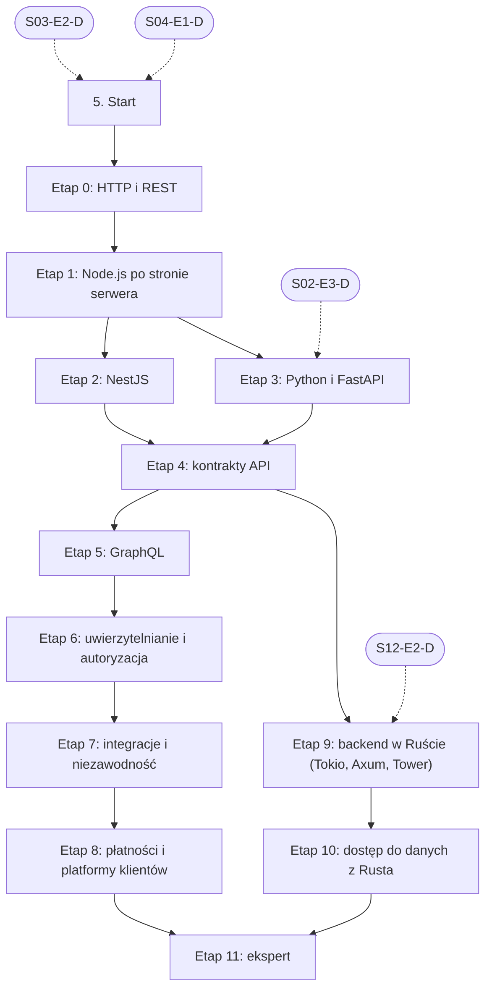

# 05. Backend i API: plan wdrożenia w Linear

Team **LEA** (https://linear.app/daankh/team/LEA/overview). Plan jest wdrożony w Linear. Klucze zadań (np. `S05-E0-M1`) są robocze, a identyfikator każdego zadania w Linear (`LEA-…`) jest w kolumnie „Linear” tabel zadań i w pliku `mapowanie-kluczy.csv`.

**W skrócie:** 12 kamieni milowych, 92 zadania (1 start, 75 materiałów, 12 dowodów, 4 praktyki). Plik główny z kolejnością projektów: `00-kolejnosc-i-zaleznosci.md`.

## 1. Projekt

| Pole | Wartość |
|---|---|
| Nazwa | 05. Backend i API |
| Team | LEA |
| Podsumowanie (pole „Summary”) | Warstwa 1: dane i serwer. Opiera się na: 3 i 4; etap FastAPI także na Pythonie z sekcji 2, a etapy w Ruście na 12. Jest podstawą: 6, 7, 8, 10, 12 i 21 oraz części serwerowej w 14, 18 i 19. |
| Etykiety projektu | `warstwa-1` |
| Blokowany przez (projekty) | 03. Frontend web, 04. Bazy danych i dane |
| Blokuje (projekty) | 06. Testowanie, 07. Wymagania i specyfikacje, 08. Architektura i projektowanie systemów, 10. Bezpieczeństwo, 12. Rust jako wspólny fundament, 21. Funkcje AI w aplikacjach |
| Zależności częściowe (wchodzące) | etap 3 czeka na 02. Języki i narzędzia podstawowe (etap 3); etap 9 czeka na 12. Rust jako wspólny fundament (etap 2) |
| Zależności częściowe (wychodzące) | 04. Bazy danych i dane, etap 4; 14. Desktop: wspólne, etap 4; 18. Android, etap 5; 19. iOS, etap 5 |

### Opis projektu (do wklejenia w Linear)

*Warstwa 1: dane i serwer. Opiera się na: 3 i 4; etap FastAPI także na Pythonie z sekcji 2, a etapy w Ruście na 12. Jest podstawą: 6, 7, 8, 10, 12 i 21 oraz części serwerowej w 14, 18 i 19.*

**Zakres umiejętności**

- Node.js po stronie serwera: pętla zdarzeń, strumienie, audyt przejmowanych aplikacji Next.js i Express.
- NestJS jako główny framework usług: moduły i DI, walidacja, guardy, interceptory, PostgreSQL przez Prisma, testy e2e, OpenAPI.
- Python i FastAPI: Pydantic v2, SQLAlchemy 2.0 (async) z Alembic, testy `pytest`.
- GraphQL: projekt schematu, paginacja kursorowa, DataLoader, autoryzacja pól, limity złożoności, kontrola zmian schematu.
- Rust: Axum, Tower (middleware), Tokio, SQLx (SeaORM opcjonalnie), zadania w tle.
- Kontrakty API: REST z OpenAPI (`@nestjs/swagger`, FastAPI, w Ruście `utoipa`), generowany klient TypeScript, testy kontraktowe, gRPC między usługami; wersjonowanie, idempotencja, paginacja, limity, spójne błędy.
- Uwierzytelnianie i autoryzacja: OAuth 2.0 / OIDC, sesje, ciasteczka, pułapki JWT, kontrola dostępu do obiektów, wielodostępność.
- Integracje: webhooki z weryfikacją podpisu, outbox, idempotentni konsumenci, poczta transakcyjna, przechowywanie plików (S3).
- Płatności i licencje: Stripe, pośrednik Merchant of Record, klucze licencyjne (Keygen); weryfikacja zakupów z App Store i Google Play po stronie serwera (opcjonalnie; StoreKit 2 i Google Play Billing w aplikacji są w sekcjach 18 i 19).
- Platformy klientów: Supabase (RLS, Edge Functions, klucze), Firebase (reguły bezpieczeństwa), wdrożenia na Vercel i Fly.io.

**Ścieżka nauki**

Ścieżka ma 12 etapów. Każdy kończy się **dowodem**, czyli małym projektem, który pokazuje, że etap jest opanowany. Przy doświadczeniu seniorskim w TypeScript i Node.js etapy 0–1 (HTTP i REST, Node.js) można zaliczyć samym dowodem i wracać do materiałów tylko tam, gdzie dowód nie wychodzi; przy doświadczeniu w Pythonie podobnie etap FastAPI. Usługa NestJS z etapu 2 jest główną usługą ścieżki: na niej budują dowody kontraktów, GraphQL, uwierzytelniania, integracji i płatności. Gałąź rustowa (backend w Ruście i dostęp do danych z Rusta) jest na końcu, bo czeka na sekcję 12 (etap 2); jej dowód implementuje ten sam kontrakt co usługa NestJS. Pełna „Designing Data-Intensive Applications” jest w sekcji 4 (etap ekspercki). Podstawy Rusta są w sekcji 12, bazy danych w sekcji 4, testy w sekcji 6, a bezpieczeństwo API w sekcji 10; tu są tylko elementy właściwe dla backendu. Ceny materiałów płatnych zmieniają się, więc warto je sprawdzić przed zakupem.

**Definicja ukończenia projektu (dowód poziomu E)**

Samodzielnie, bez agenta, w 1 dzień diagnozujesz i naprawiasz w nieznanej usłudze (NestJS, FastAPI albo Axum, z REST lub GraphQL) błąd autoryzacji, zdublowaną płatność, zgubione zdarzenie z webhooka albo problem N+1 w resolverze GraphQL, piszesz test, który odtwarza problem, i umiesz wyjaśnić przyczynę osobie nietechnicznej.

**Źródło:** dokument „Umiejętności techniczne” w projekcie „JDG: Rozwój oprogramowania”, sekcja 5.

## 2. Kamienie milowe

Jeden kamień milowy na etap ścieżki. Kamień milowy jest zamknięty, gdy zamknięte jest zadanie dowodu tego etapu.

| # | Kamień milowy | Cel | Poziom po etapie | Zadania |
|---|---|---|---|---|
| 1 | Etap 0: HTTP i REST | HTTP i REST: semantyka, kody, cache, błędy | podstawy | 5 |
| 2 | Etap 1: Node.js po stronie serwera | Node.js po stronie serwera | W | 4 |
| 3 | Etap 2: NestJS | NestJS: moduły, DI, walidacja, guardy, PostgreSQL, testy, OpenAPI | W | 6 |
| 4 | Etap 3: Python i FastAPI | Python i FastAPI: Pydantic v2, SQLAlchemy 2.0 async, Alembic, testy | W | 6 |
| 5 | Etap 4: kontrakty API | kontrakty API: OpenAPI, klient TypeScript, testy kontraktowe, gRPC, wytyczne | W | 10 |
| 6 | Etap 5: GraphQL | GraphQL: schemat, paginacja, DataLoader, autoryzacja pól, bezpieczeństwo, ewolucja schematu | W | 11 |
| 7 | Etap 6: uwierzytelnianie i autoryzacja | uwierzytelnianie i autoryzacja: OAuth 2.0, OIDC, sesje | E | 10 |
| 8 | Etap 7: integracje i niezawodność | integracje i niezawodność: webhooki, outbox, kolejki, idempotencja | E | 9 |
| 9 | Etap 8: płatności i platformy klientów | płatności i platformy klientów: Stripe, Merchant of Record, Supabase, Firebase | E | 10 |
| 10 | Etap 9: backend w Ruście (Tokio, Axum, Tower) | backend w Ruście: Tokio, Axum, Tower, OpenAPI z `utoipa` | W | 10 |
| 11 | Etap 10: dostęp do danych z Rusta | dostęp do danych z Rusta: SQLx, SeaORM | W | 3 |
| 12 | Etap 11: ekspert | ekspert: NestJS, FastAPI, GraphQL i Rust w produkcji, recenzja kodu AI, aktualność | E | 7 |

## 3. Punkt startu

Zadanie **`S05-START` · Start: 5. Backend i API** (LEA-223 w Linear) to jedyne wejście do projektu: wszystkie zadania pierwszego etapu są przez nie blokowane.

- **Blokowane przez:** `S03-E2-D`, `S04-E1-D`
- **Odblokowuje:** `S05-E0-M1`, `S05-E0-M2`, `S05-E0-M3`, `S05-E0-M4`
- **Status początkowy:** Backlog do czasu zamknięcia zadań blokujących, potem Todo

Opis zadania (do wklejenia):

Punkt startu projektu „05. Backend i API”.

**Warunki wejścia (zadania blokujące):**

- `S03-E2-D` · Dowód etapu 2: TypeScript — sekcja 3 na poziomie podstawowym do pracy (etap 2)
- `S04-E1-D` · Dowód etapu 1: PostgreSQL w praktyce — sekcja 4 na poziomie podstawowym do pracy (etap 1)

**Do zrobienia:**

- przeczytać sekcję 5 dokumentu „Umiejętności techniczne”,
- zaznaczyć etapy, które zaliczasz samym dowodem (zgodnie z akapitem wstępnym ścieżki), i dla nich zamknąć zadania materiałów jako niepotrzebne.

**Folder roboczy:** `05-backend-i-api/`

## 4. Przepływ zależności

Linie ciągłe to zależności wewnątrz projektu, przerywane to zadania z innych projektów. Wewnątrz etapu zadania materiałów są równoległe i wszystkie blokują dowód etapu; dowód etapu blokuje materiały kolejnego etapu.

## 5. Zadania według kamieni milowych

Szablon opisu zadania materiału: nazwa materiału, autor lub wydawca, typ, czas, koszt i link (jak w kolumnach poniżej), zdanie „Gotowe, gdy materiał jest przerobiony w zakresie potrzebnym do dowodu etapu” oraz folder roboczy z kolumny „Folder”. Opisy dowodów i praktyk są podane pod tabelą każdego etapu.

### Etap 0: HTTP i REST

Opis kamienia milowego (do wklejenia):

**Cel:** HTTP i REST: semantyka, kody, cache, błędy · **Poziom po etapie:** podstawy

**Szczególnie ważne:** które metody są bezpieczne i idempotentne, `ETag` i żądania warunkowe (`If-Match`) jako ochrona przed utratą zapisu, różnica 401 i 403, 404 zamiast 403 przy ukrywaniu istnienia obiektu, spójny format błędów.

**Dowód:** Prosty serwer HTTP bez frameworka (moduł `http` w Node.js), który obsługuje `GET`, `PUT` z `If-Match`, zwraca błędy w formacie RFC 9457 i poprawne nagłówki cache; zestaw wywołań `curl` pokazujący każdy przypadek.

| Klucz | Linear | Tytuł | Typ | Czas | Koszt | Link | Blokowane przez | Blokuje | Folder |
|---|---|---|---|---|---|---|---|---|---|
| `S05-E0-M1` | LEA-231 | Przerobić: HTTP: przewodniki (przegląd, cache, CORS, ciasteczka, nagłówki, kody odpowiedzi) | materiał | 15–20 h | 0 zł | https://developer.mozilla.org/en-US/docs/Web/HTTP | `S05-START` | `S05-E0-D` | `05-backend-i-api/e0-http-i-rest/` |
| `S05-E0-M2` | LEA-232 | Przerobić: RFC 9110 „HTTP Semantics”… | materiał | 8–10 h | 0 zł | https://datatracker.ietf.org/doc/rfc9110/ | `S05-START` | `S05-E0-D` | `05-backend-i-api/e0-http-i-rest/` |
| `S05-E0-M3` | LEA-233 | Przerobić: RFC 9111 „HTTP Caching” | materiał | 3–4 h | 0 zł | https://datatracker.ietf.org/doc/rfc9111/ | `S05-START` | `S05-E0-D` | `05-backend-i-api/e0-http-i-rest/` |
| `S05-E0-M4` | LEA-234 | Przerobić: RFC 9457 „Problem Details for HTTP APIs” | materiał | 1–2 h | 0 zł | https://datatracker.ietf.org/doc/rfc9457/ | `S05-START` | `S05-E0-D` | `05-backend-i-api/e0-http-i-rest/` |
| `S05-E0-D` | LEA-243 | Dowód etapu 0: HTTP i REST | dowód | — | — | — | `S05-E0-M1`, `S05-E0-M2`, `S05-E0-M3`, `S05-E0-M4` | `S05-E1-M1`, `S05-E1-M2`, `S05-E1-M3` | `05-backend-i-api/e0-http-i-rest/` |

**`S05-E0-D` · Dowód etapu 0: HTTP i REST**

Prosty serwer HTTP bez frameworka (moduł `http` w Node.js), który obsługuje `GET`, `PUT` z `If-Match`, zwraca błędy w formacie RFC 9457 i poprawne nagłówki cache; zestaw wywołań `curl` pokazujący każdy przypadek.

**Na co zwrócić uwagę:** które metody są bezpieczne i idempotentne, `ETag` i żądania warunkowe (`If-Match`) jako ochrona przed utratą zapisu, różnica 401 i 403, 404 zamiast 403 przy ukrywaniu istnienia obiektu, spójny format błędów.

**Kryterium ukończenia:** skrypt z wywołaniami `curl` w repozytorium pokazuje co najmniej: `200` z `ETag` i `Cache-Control`, `304` przy `If-None-Match`, `412` przy nieaktualnym `If-Match`, `428` przy `PUT` bez `If-Match`, `404` i `400` z treścią `application/problem+json`.

**Folder roboczy:** `05-backend-i-api/e0-http-i-rest/`

### Etap 1: Node.js po stronie serwera

Opis kamienia milowego (do wklejenia):

**Cel:** Node.js po stronie serwera · **Poziom po etapie:** W

**Szczególnie ważne:** blokowanie pętli zdarzeń, obsługa odrzuconych obietnic, strumienie z backpressure, limity rozmiaru żądań, zamykanie połączeń przy wyłączaniu procesu, kontekst żądania przez `AsyncLocalStorage`. To podstawa pod NestJS (następny etap) i wiedza do audytu przejmowanych aplikacji Next.js i Express.

**Dowód:** Audyt fragmentu serwerowego istniejącej aplikacji Node.js (route handlers lub API Express): lista znalezisk z priorytetami, w tym blokowanie pętli zdarzeń, brak limitów i brak łagodnego zamykania; dwie poprawki z testami.

| Klucz | Linear | Tytuł | Typ | Czas | Koszt | Link | Blokowane przez | Blokuje | Folder |
|---|---|---|---|---|---|---|---|---|---|
| `S05-E1-M1` | LEA-253 | Przerobić: Learn Node.js: pętla zdarzeń, „Don’t Block the Event Loop”, strumienie i backpressure, wbudowany… | materiał | 12–15 h | 0 zł | https://nodejs.org/en/learn | `S05-E0-D` | `S05-E1-D` | `05-backend-i-api/e1-node-js-po-stronie-serwera/` |
| `S05-E1-M2` | LEA-255 | Przerobić: Node.js Design Patterns (wydanie 4, Node.js 24) | materiał, płatny, opcjonalne | 25–35 h | płatna | https://www.nodejsdesignpatterns.com | `S05-E0-D` | — | `05-backend-i-api/e1-node-js-po-stronie-serwera/` |
| `S05-E1-M3` | LEA-257 | Przerobić: Dokumentacja API Node.js: `http`, `stream`, `worker_threads`, `AsyncLocalStorage` | materiał | 5–8 h | 0 zł | https://nodejs.org/api/ | `S05-E0-D` | `S05-E1-D` | `05-backend-i-api/e1-node-js-po-stronie-serwera/` |
| `S05-E1-D` | LEA-262 | Dowód etapu 1: Node.js po stronie serwera | dowód | — | — | — | `S05-E1-M1`, `S05-E1-M3` | `S04-E4-M1`, `S04-E4-M2`, `S04-E4-M3`, `S05-E2-M1`, `S05-E2-M2`, `S05-E2-M3`, `S05-E2-M4`, `S05-E2-M5`, `S05-E3-M1`, `S05-E3-M2`, `S05-E3-M3`, `S05-E3-M4`, `S05-E3-M5`, `S06-START`, `S07-START`, `S08-START`, `S10-START`, `S12-START`, `S21-START` | `05-backend-i-api/e1-node-js-po-stronie-serwera/` |

**`S05-E1-D` · Dowód etapu 1: Node.js po stronie serwera**

Audyt fragmentu serwerowego istniejącej aplikacji Node.js (route handlers lub API Express): lista znalezisk z priorytetami, w tym blokowanie pętli zdarzeń, brak limitów i brak łagodnego zamykania; dwie poprawki z testami.

**Na co zwrócić uwagę:** blokowanie pętli zdarzeń, obsługa odrzuconych obietnic, strumienie z backpressure, limity rozmiaru żądań, zamykanie połączeń przy wyłączaniu procesu, kontekst żądania przez `AsyncLocalStorage`. To podstawa pod NestJS (następny etap) i wiedza do audytu przejmowanych aplikacji Next.js i Express.

**Kryterium ukończenia:** raport z co najmniej 8 znaleziskami z priorytetem i miejscem w kodzie; dwie poprawki jako pull requesty z testem, który przed poprawką pada, a po niej przechodzi (np. limit rozmiaru ciała, łagodne zamykanie po `SIGTERM` bez zerwanych żądań).

**Folder roboczy:** `05-backend-i-api/e1-node-js-po-stronie-serwera/`

### Etap 2: NestJS

Opis kamienia milowego (do wklejenia):

**Cel:** NestJS: moduły, DI, walidacja, guardy, PostgreSQL, testy, OpenAPI · **Poziom po etapie:** W

**Szczególnie ważne:** granice modułów i zależności między nimi, zakresy providerów (domyślny singleton, `REQUEST` i jego koszt), DTO z walidacją i `whitelist`/`forbidNonWhitelisted` w `ValidationPipe`, kolejność w cyklu żądania (middleware, guardy, interceptory, pipe'y, filtry), filtr wyjątków zwracający RFC 9457, konfiguracja walidowana przy starcie, transakcje Prisma (`$transaction`) i zapytania N+1 przy relacjach, testy e2e na prawdziwym PostgreSQL w kontenerze, `enableShutdownHooks` i łagodne zamykanie, adapter Fastify zamiast Express tam, gdzie liczy się wydajność.

**Dowód:** Usługa NestJS dla domeny rezerwacji zasobów (najemcy, zasoby, rezerwacje, przypomnienia) na PostgreSQL przez Prisma: walidowane DTO, guard z kluczem API, interceptor z identyfikatorem żądania w logach, filtr wyjątków RFC 9457, konfiguracja z walidacją przy starcie, OpenAPI z `@nestjs/swagger`, testy jednostkowe i e2e, łagodne zamykanie, obraz kontenera. To główna usługa, na której budują kolejne etapy.

| Klucz | Linear | Tytuł | Typ | Czas | Koszt | Link | Blokowane przez | Blokuje | Folder |
|---|---|---|---|---|---|---|---|---|---|
| `S05-E2-M1` | LEA-277 | Przerobić: Dokumentacja NestJS: „Overview”… | materiał | 15–20 h | 0 zł | https://docs.nestjs.com | `S05-E1-D` | `S05-E2-D` | `05-backend-i-api/e2-nestjs/` |
| `S05-E2-M2` | LEA-278 | Przerobić: Dokumentacja NestJS: „Techniques” (konfiguracja, walidacja, serializacja, logowanie, kolejki) i… | materiał | 6–8 h | 0 zł | https://docs.nestjs.com/techniques/configuration | `S05-E1-D` | `S05-E2-D` | `05-backend-i-api/e2-nestjs/` |
| `S05-E2-M3` | LEA-279 | Przerobić: Dokumentacja Prisma ORM (schemat, migracje `prisma migrate`, transakcje, relacje) i przepis… | materiał | 6–8 h | 0 zł | https://www.prisma.io/docs/orm | `S05-E1-D` | `S05-E2-D` | `05-backend-i-api/e2-nestjs/` |
| `S05-E2-M4` | LEA-280 | Przerobić: Drizzle ORM (alternatywa dla Prisma, bliżej SQL) | materiał, opcjonalne | 3–4 h | 0 zł | https://orm.drizzle.team/docs/overview | `S05-E1-D` | — | `05-backend-i-api/e2-nestjs/` |
| `S05-E2-M5` | LEA-281 | Przerobić: NestJS Fundamentals Course (oficjalny kurs wideo) | materiał, płatny, opcjonalne | 8–10 h | płatny | https://courses.nestjs.com | `S05-E1-D` | — | `05-backend-i-api/e2-nestjs/` |
| `S05-E2-D` | LEA-303 | Dowód etapu 2: NestJS | dowód | — | — | — | `S05-E2-M1`, `S05-E2-M2`, `S05-E2-M3` | `S05-E4-M1`, `S05-E4-M2`, `S05-E4-M3`, `S05-E4-M4`, `S05-E4-M5`, `S05-E4-M6`, `S05-E4-M7`, `S05-E4-M8`, `S05-E4-M9` | `05-backend-i-api/e2-nestjs/` |

**`S05-E2-D` · Dowód etapu 2: NestJS**

Usługa NestJS dla domeny rezerwacji zasobów (najemcy, zasoby, rezerwacje, przypomnienia) na PostgreSQL przez Prisma: walidowane DTO, guard z kluczem API, interceptor z identyfikatorem żądania w logach, filtr wyjątków RFC 9457, konfiguracja z walidacją przy starcie, OpenAPI z `@nestjs/swagger`, testy jednostkowe i e2e, łagodne zamykanie, obraz kontenera. To główna usługa, na której budują kolejne etapy.

**Na co zwrócić uwagę:** granice modułów i zależności między nimi, zakresy providerów (domyślny singleton, `REQUEST` i jego koszt), DTO z walidacją i `whitelist`/`forbidNonWhitelisted` w `ValidationPipe`, kolejność w cyklu żądania (middleware, guardy, interceptory, pipe'y, filtry), filtr wyjątków zwracający RFC 9457, konfiguracja walidowana przy starcie, transakcje Prisma (`$transaction`) i zapytania N+1 przy relacjach, testy e2e na prawdziwym PostgreSQL w kontenerze, `enableShutdownHooks` i łagodne zamykanie, adapter Fastify zamiast Express tam, gdzie liczy się wydajność.

**Kryterium ukończenia:** `docker compose up` uruchamia usługę z bazą; testy jednostkowe i e2e (`@nestjs/testing`, supertest, PostgreSQL w kontenerze) przechodzą w CI, pokrycie modułów domeny ≥ 80%; żądanie z nieznanym polem lub złym typem dostaje `400` w formacie RFC 9457; podwójna rezerwacja tego samego zasobu w tym samym czasie jest odrzucana także przy 20 równoległych żądaniach; `SIGTERM` w trakcie obciążenia nie zrywa żądań; dokument OpenAPI generuje się bez ostrzeżeń.

**Folder roboczy:** `05-backend-i-api/e2-nestjs/`

### Etap 3: Python i FastAPI

Opis kamienia milowego (do wklejenia):

**Cel:** Python i FastAPI: Pydantic v2, SQLAlchemy 2.0 async, Alembic, testy · **Poziom po etapie:** W

**Szczególnie ważne:** `async def` a `def` w handlerach (kod blokujący w pętli zdarzeń, pula wątków), zależności (`Depends`) z `yield` do sesji bazy, modele Pydantic v2 oddzielne dla wejścia i wyjścia (`response_model`), `lifespan` zamiast zdarzeń startu, sesja `AsyncSession` na żądanie i brak leniwego ładowania relacji w trybie async (`selectinload`), migracje Alembic z autogeneracją sprawdzaną ręcznie, `BackgroundTasks` tylko do lekkich zadań, ustawienia przez `pydantic-settings`, uruchamianie przez FastAPI CLI lub Uvicorn z kilkoma procesami.

**Dowód:** Usługa FastAPI pomocnicza dla domeny z usługi NestJS: raporty obłożenia zasobów i eksport CSV, na PostgreSQL przez SQLAlchemy 2.0 (async) z migracjami Alembic, z modelami Pydantic v2, zależnościami, `lifespan`, testami `pytest` z `httpx` i obrazem kontenera; usługa NestJS wywołuje ją przez HTTP z timeoutem.

| Klucz | Linear | Tytuł | Typ | Czas | Koszt | Link | Blokowane przez | Blokuje | Folder |
|---|---|---|---|---|---|---|---|---|---|
| `S05-E3-M1` | LEA-282 | Przerobić: FastAPI: „Tutorial - User Guide”… | materiał | 12–15 h | 0 zł | https://fastapi.tiangolo.com/tutorial/ | `S05-E1-D`, `S02-E3-D` | `S05-E3-D` | `05-backend-i-api/e3-python-i-fastapi/` |
| `S05-E3-M2` | LEA-283 | Przerobić: Pydantic v2: modele, walidatory, serializacja, `pydantic-settings` | materiał | 4–5 h | 0 zł | https://docs.pydantic.dev/latest/ | `S05-E1-D`, `S02-E3-D` | `S05-E3-D` | `05-backend-i-api/e3-python-i-fastapi/` |
| `S05-E3-M3` | LEA-284 | Przerobić: SQLAlchemy 2.0: „Unified Tutorial” i „Asynchronous I/O (asyncio)” | materiał | 10–12 h | 0 zł | https://docs.sqlalchemy.org/en/20/tutorial/ | `S05-E1-D`, `S02-E3-D` | `S05-E3-D` | `05-backend-i-api/e3-python-i-fastapi/` |
| `S05-E3-M4` | LEA-293 | Przerobić: Alembic: „Tutorial” i „Auto Generating Migrations” | materiał | 2–3 h | 0 zł | https://alembic.sqlalchemy.org/en/latest/tutorial.html | `S05-E1-D`, `S02-E3-D` | `S05-E3-D` | `05-backend-i-api/e3-python-i-fastapi/` |
| `S05-E3-M5` | LEA-294 | Przerobić: FastAPI: „Deployment” (FastAPI CLI, Uvicorn, procesy robocze, obraz Dockera) | materiał | 2–3 h | 0 zł | https://fastapi.tiangolo.com/deployment/ | `S05-E1-D`, `S02-E3-D` | `S05-E3-D` | `05-backend-i-api/e3-python-i-fastapi/` |
| `S05-E3-D` | LEA-304 | Dowód etapu 3: Python i FastAPI | dowód | — | — | — | `S05-E3-M1`, `S05-E3-M2`, `S05-E3-M3`, `S05-E3-M4`, `S05-E3-M5` | `S05-E4-M1`, `S05-E4-M2`, `S05-E4-M3`, `S05-E4-M4`, `S05-E4-M5`, `S05-E4-M6`, `S05-E4-M7`, `S05-E4-M8`, `S05-E4-M9` | `05-backend-i-api/e3-python-i-fastapi/` |

**`S05-E3-D` · Dowód etapu 3: Python i FastAPI**

Usługa FastAPI pomocnicza dla domeny z usługi NestJS: raporty obłożenia zasobów i eksport CSV, na PostgreSQL przez SQLAlchemy 2.0 (async) z migracjami Alembic, z modelami Pydantic v2, zależnościami, `lifespan`, testami `pytest` z `httpx` i obrazem kontenera; usługa NestJS wywołuje ją przez HTTP z timeoutem.

**Na co zwrócić uwagę:** `async def` a `def` w handlerach (kod blokujący w pętli zdarzeń, pula wątków), zależności (`Depends`) z `yield` do sesji bazy, modele Pydantic v2 oddzielne dla wejścia i wyjścia (`response_model`), `lifespan` zamiast zdarzeń startu, sesja `AsyncSession` na żądanie i brak leniwego ładowania relacji w trybie async (`selectinload`), migracje Alembic z autogeneracją sprawdzaną ręcznie, `BackgroundTasks` tylko do lekkich zadań, ustawienia przez `pydantic-settings`, uruchamianie przez FastAPI CLI lub Uvicorn z kilkoma procesami.

**Kryterium ukończenia:** `docker compose up` uruchamia obie usługi; testy `pytest` (z `httpx.AsyncClient` i PostgreSQL w kontenerze) przechodzą w CI, pokrycie ≥ 80%; `alembic upgrade head` na czystej bazie i `alembic downgrade -1` działają; endpoint listy z relacjami wykonuje stałą liczbę zapytań SQL niezależnie od liczby wierszy (test liczy zapytania); dokument OpenAPI z `/openapi.json` przechodzi walidację; usługa NestJS przy niedostępnej usłudze FastAPI zwraca `503` w formacie RFC 9457 w czasie poniżej ustawionego timeoutu.

**Folder roboczy:** `05-backend-i-api/e3-python-i-fastapi/`

### Etap 4: kontrakty API

Opis kamienia milowego (do wklejenia):

**Cel:** kontrakty API: OpenAPI, klient TypeScript, testy kontraktowe, gRPC, wytyczne · **Poziom po etapie:** W

**Szczególnie ważne:** wersjonowanie i zmiany niełamiące, paginacja kursorowa, filtrowanie, limity i nagłówki limitów, idempotencja zapisów (np. nagłówek `Idempotency-Key`; propozycja IETF wygasła i nie jest normą), spójne błędy, kontrakt jako źródło prawdy dla klienta TypeScript; wybór OpenAPI-first albo code-first (`@nestjs/swagger`, FastAPI) i pilnowanie, by wygenerowany dokument był zatwierdzany w repozytorium; gRPC tylko między własnymi usługami, plik `.proto` w jednym miejscu.

**Dowód:** Kontrakt OpenAPI 3.1 usługi NestJS (code-first z `@nestjs/swagger` albo OpenAPI-first) zatwierdzany w repozytorium, z wygenerowanym z niego klientem TypeScript (`openapi-typescript` + `openapi-fetch`) używanym w testach e2e; w CI `oasdiff` blokuje scalenie przy łamiącej zmianie; Schemathesis sprawdza usługę NestJS i usługę FastAPI względem ich kontraktów; jedno wywołanie między usługami przez gRPC z jednym plikiem `.proto`; dokument decyzji projektowych odwołujący się do wytycznych Zalando.

| Klucz | Linear | Tytuł | Typ | Czas | Koszt | Link | Blokowane przez | Blokuje | Folder |
|---|---|---|---|---|---|---|---|---|---|
| `S05-E4-M1` | LEA-315 | Przerobić: OpenAPI Learn i specyfikacja OpenAPI (3.1 i 3.2) | materiał | 8–10 h | 0 zł | https://learn.openapis.org | `S05-E2-D`, `S05-E3-D` | `S05-E4-D` | `05-backend-i-api/e4-kontrakty-api/` |
| `S05-E4-M2` | LEA-318 | Przerobić: Microsoft REST API Guidelines (ogólne, Azure, Microsoft Graph) | materiał, opcjonalne | 5–6 h | 0 zł | https://github.com/microsoft/api-guidelines | `S05-E2-D`, `S05-E3-D` | — | `05-backend-i-api/e4-kontrakty-api/` |
| `S05-E4-M3` | LEA-321 | Przerobić: API Improvement Proposals (AIP) | materiał, opcjonalne | 6–8 h | 0 zł | https://google.aip.dev | `S05-E2-D`, `S05-E3-D` | — | `05-backend-i-api/e4-kontrakty-api/` |
| `S05-E4-M4` | LEA-325 | Przerobić: Zalando RESTful API and Event Guidelines | materiał | 5–6 h | 0 zł | https://opensource.zalando.com/restful-api-guidelines/ | `S05-E2-D`, `S05-E3-D` | `S05-E4-D` | `05-backend-i-api/e4-kontrakty-api/` |
| `S05-E4-M5` | LEA-329 | Przerobić: gRPC: Core concepts, Protocol Buffers | materiał | 4–6 h | 0 zł | https://grpc.io/docs/ | `S05-E2-D`, `S05-E3-D` | `S05-E4-D` | `05-backend-i-api/e4-kontrakty-api/` |
| `S05-E4-M6` | LEA-330 | Przerobić: `openapi-typescript` i `openapi-fetch`: typy i klient TypeScript generowane z OpenAPI | materiał | 2–3 h | 0 zł | https://openapi-ts.dev | `S05-E2-D`, `S05-E3-D` | `S05-E4-D` | `05-backend-i-api/e4-kontrakty-api/` |
| `S05-E4-M7` | LEA-331 | Przerobić: `oasdiff`: wykrywanie łamiących zmian w OpenAPI (w CI) | materiał | 1–2 h | 0 zł | https://github.com/oasdiff/oasdiff | `S05-E2-D`, `S05-E3-D` | `S05-E4-D` | `05-backend-i-api/e4-kontrakty-api/` |
| `S05-E4-M8` | LEA-332 | Przerobić: Schemathesis: testy właściwości i kontraktu API na podstawie OpenAPI | materiał | 3–4 h | 0 zł | https://schemathesis.readthedocs.io | `S05-E2-D`, `S05-E3-D` | `S05-E4-D` | `05-backend-i-api/e4-kontrakty-api/` |
| `S05-E4-M9` | LEA-333 | Przerobić: NestJS: „Microservices” → gRPC; gRPC dla Pythona: „Basics tutorial” | materiał | 4–5 h | 0 zł | https://docs.nestjs.com/microservices/grpc, https://grpc.io/docs/languages/python/basics/ | `S05-E2-D`, `S05-E3-D` | `S05-E4-D` | `05-backend-i-api/e4-kontrakty-api/` |
| `S05-E4-D` | LEA-338 | Dowód etapu 4: kontrakty API | dowód | — | — | — | `S05-E4-M1`, `S05-E4-M4`, `S05-E4-M5`, `S05-E4-M6`, `S05-E4-M7`, `S05-E4-M8`, `S05-E4-M9` | `S05-E5-M1`, `S05-E5-M2`, `S05-E5-M3`, `S05-E5-M4`, `S05-E5-M5`, `S05-E5-M6`, `S05-E5-M7`, `S05-E5-M8`, `S05-E5-M9`, `S05-E5-M10`, `S05-E9-M1`, `S05-E9-M2`, `S05-E9-M3`, `S05-E9-M4`, `S05-E9-M5`, `S05-E9-M6`, `S05-E9-M7`, `S05-E9-M8`, `S05-E9-M9` | `05-backend-i-api/e4-kontrakty-api/` |

**`S05-E4-D` · Dowód etapu 4: kontrakty API**

Kontrakt OpenAPI 3.1 usługi NestJS (code-first z `@nestjs/swagger` albo OpenAPI-first) zatwierdzany w repozytorium, z wygenerowanym z niego klientem TypeScript (`openapi-typescript` + `openapi-fetch`) używanym w testach e2e; w CI `oasdiff` blokuje scalenie przy łamiącej zmianie; Schemathesis sprawdza usługę NestJS i usługę FastAPI względem ich kontraktów; jedno wywołanie między usługami przez gRPC z jednym plikiem `.proto`; dokument decyzji projektowych odwołujący się do wytycznych Zalando.

**Na co zwrócić uwagę:** wersjonowanie i zmiany niełamiące, paginacja kursorowa, filtrowanie, limity i nagłówki limitów, idempotencja zapisów (np. nagłówek `Idempotency-Key`; propozycja IETF wygasła i nie jest normą), spójne błędy, kontrakt jako źródło prawdy dla klienta TypeScript; wybór OpenAPI-first albo code-first (`@nestjs/swagger`, FastAPI) i pilnowanie, by wygenerowany dokument był zatwierdzany w repozytorium; gRPC tylko między własnymi usługami, plik `.proto` w jednym miejscu.

**Kryterium ukończenia:** pull request z celowo łamiącą zmianą (usunięte pole odpowiedzi) pada w CI na kroku `oasdiff`, a zmiana niełamiąca przechodzi; Schemathesis kończy się bez błędów dla obu usług; klient TypeScript kompiluje się z kontraktu bez ręcznych poprawek; test gRPC przechodzi z kodem wygenerowanym po obu stronach; dokument zawiera co najmniej 8 decyzji (wersjonowanie, paginacja, błędy, idempotencja, limity, nazewnictwo, daty, filtrowanie) z odwołaniem do reguły Zalando.

**Folder roboczy:** `05-backend-i-api/e4-kontrakty-api/`

### Etap 5: GraphQL

Opis kamienia milowego (do wklejenia):

**Cel:** GraphQL: schemat, paginacja, DataLoader, autoryzacja pól, bezpieczeństwo, ewolucja schematu · **Poziom po etapie:** W

**Szczególnie ważne:** projekt schematu od potrzeb klienta, a nie od tabel; nullowalność pól jako decyzja o błędach częściowych; paginacja kursorowa w stylu Relay (`edges`, `node`, `pageInfo`); problem N+1 w resolverach i DataLoader tworzony na żądanie (nie globalnie, bo miesza dane użytkowników); autoryzacja w warstwie domeny i na poziomie pól, nie tylko na wejściu; limity głębokości i złożoności zapytań, wyłączona introspekcja i persisted queries na produkcji; błędy domenowe jako typy wyniku (unie) a błędy techniczne w `errors`; cache przy jednym endpoincie `POST`; ewolucja schematu przez `@deprecated` zamiast wersjonowania.

**Dowód:** API GraphQL (code-first, `@nestjs/graphql`, sterownik Apollo lub Mercurius) w usłudze NestJS obok REST: zapytania z paginacją kursorową (Relay connections), mutacje z błędami domenowymi jako typami wyniku, DataLoader dla relacji, autoryzacja na poziomie pól, limit głębokości i złożoności zapytań, testy i kontrola zmian łamiących schemat w CI (GraphQL Inspector).

| Klucz | Linear | Tytuł | Typ | Czas | Koszt | Link | Blokowane przez | Blokuje | Folder |
|---|---|---|---|---|---|---|---|---|---|
| `S05-E5-M1` | LEA-343 | Przerobić: Learn GraphQL… | materiał | 6–8 h | 0 zł | https://graphql.org/learn/ | `S05-E4-D` | `S05-E5-D` | `05-backend-i-api/e5-graphql/` |
| `S05-E5-M2` | LEA-346 | Przerobić: Specyfikacja GraphQL (wykonywanie, walidacja, błędy) i specyfikacja Relay… | materiał | 3–4 h | 0 zł | https://spec.graphql.org, https://relay.dev/graphql/connections.htm | `S05-E4-D` | `S05-E5-D` | `05-backend-i-api/e5-graphql/` |
| `S05-E5-M3` | LEA-349 | Przerobić: Dokumentacja NestJS: „GraphQL”… | materiał | 6–8 h | 0 zł | https://docs.nestjs.com/graphql/quick-start | `S05-E4-D` | `S05-E5-D` | `05-backend-i-api/e5-graphql/` |
| `S05-E5-M4` | LEA-352 | Przerobić: DataLoader: grupowanie i cache na żądanie (README i opis problemu N+1) | materiał | 1–2 h | 0 zł | https://github.com/graphql/dataloader | `S05-E4-D` | `S05-E5-D` | `05-backend-i-api/e5-graphql/` |
| `S05-E5-M5` | LEA-354 | Przerobić: OWASP GraphQL Cheat Sheet | materiał | 1–2 h | 0 zł | https://cheatsheetseries.owasp.org/cheatsheets/GraphQL_Cheat_Sheet.html | `S05-E4-D` | `S05-E5-D` | `05-backend-i-api/e5-graphql/` |
| `S05-E5-M6` | LEA-357 | Przerobić: GraphQL Inspector: porównanie schematów i wykrywanie zmian łamiących (CLI, GitHub Action) | materiał | 1–2 h | 0 zł | https://the-guild.dev/graphql/inspector/docs | `S05-E4-D` | `S05-E5-D` | `05-backend-i-api/e5-graphql/` |
| `S05-E5-M7` | LEA-360 | Przerobić: Production Ready GraphQL | materiał, płatny, opcjonalne | 8–10 h | płatna | https://book.productionreadygraphql.com | `S05-E4-D` | — | `05-backend-i-api/e5-graphql/` |
| `S05-E5-M8` | LEA-362 | Przerobić: Apollo Federation: łączenie schematów wielu usług | materiał, opcjonalne | 4–6 h | 0 zł | https://www.apollographql.com/docs/graphos/schema-design/federated-schemas/federation | `S05-E4-D` | — | `05-backend-i-api/e5-graphql/` |
| `S05-E5-M9` | LEA-364 | Przerobić: Strawberry (GraphQL w Pythonie, integracja z FastAPI) | materiał, opcjonalne | 3–4 h | 0 zł | https://strawberry.rocks/docs | `S05-E4-D` | — | `05-backend-i-api/e5-graphql/` |
| `S05-E5-M10` | LEA-365 | Przerobić: `async-graphql` (GraphQL w Ruście, integracja z Axum) | materiał, opcjonalne | 3–4 h | 0 zł | https://async-graphql.github.io/async-graphql/en/index.html | `S05-E4-D` | — | `05-backend-i-api/e5-graphql/` |
| `S05-E5-D` | LEA-375 | Dowód etapu 5: GraphQL | dowód | — | — | — | `S05-E5-M1`, `S05-E5-M2`, `S05-E5-M3`, `S05-E5-M4`, `S05-E5-M5`, `S05-E5-M6` | `S05-E6-M1`, `S05-E6-M2`, `S05-E6-M3`, `S05-E6-M4`, `S05-E6-M5`, `S05-E6-M6`, `S05-E6-M7`, `S05-E6-M8`, `S05-E6-M9` | `05-backend-i-api/e5-graphql/` |

**`S05-E5-D` · Dowód etapu 5: GraphQL**

API GraphQL (code-first, `@nestjs/graphql`, sterownik Apollo lub Mercurius) w usłudze NestJS obok REST: zapytania z paginacją kursorową (Relay connections), mutacje z błędami domenowymi jako typami wyniku, DataLoader dla relacji, autoryzacja na poziomie pól, limit głębokości i złożoności zapytań, testy i kontrola zmian łamiących schemat w CI (GraphQL Inspector).

**Na co zwrócić uwagę:** projekt schematu od potrzeb klienta, a nie od tabel; nullowalność pól jako decyzja o błędach częściowych; paginacja kursorowa w stylu Relay (`edges`, `node`, `pageInfo`); problem N+1 w resolverach i DataLoader tworzony na żądanie (nie globalnie, bo miesza dane użytkowników); autoryzacja w warstwie domeny i na poziomie pól, nie tylko na wejściu; limity głębokości i złożoności zapytań, wyłączona introspekcja i persisted queries na produkcji; błędy domenowe jako typy wyniku (unie) a błędy techniczne w `errors`; cache przy jednym endpoincie `POST`; ewolucja schematu przez `@deprecated` zamiast wersjonowania.

**Kryterium ukończenia:** test liczący zapytania SQL pokazuje, że lista 50 rezerwacji z zasobem i najemcą wykonuje przed DataLoaderem co najmniej 51 zapytań, a po nim najwyżej 3 (liczby w raporcie); zapytanie przekraczające limit głębokości lub złożoności jest odrzucane przed wykonaniem; test pobiera pole chronione jako użytkownik bez uprawnień i dostaje `null` z błędem autoryzacji; pull request usuwający pole bez `@deprecated` pada w CI na GraphQL Inspector; testy e2e paginacji (pierwsza, środkowa i ostatnia strona) przechodzą.

**Folder roboczy:** `05-backend-i-api/e5-graphql/`

### Etap 6: uwierzytelnianie i autoryzacja

Opis kamienia milowego (do wklejenia):

**Cel:** uwierzytelnianie i autoryzacja: OAuth 2.0, OIDC, sesje · **Poziom po etapie:** E

**Szczególnie ważne:** sesje po stronie serwera zamiast JWT w `localStorage`, atrybuty ciasteczek, rotacja identyfikatora sesji po logowaniu, kontrola dostępu do obiektu w każdym zapytaniu (BOLA), izolacja najemców w wielodostępności, unieważnianie sesji i tokenów.

Książka „OAuth 2 in Action” jest z 2017 r.: mechanika protokołu jest aktualna, ale zalecenia bezpieczeństwa trzeba czytać razem z RFC 9700 i draftem OAuth 2.1 (PKCE zawsze, bez implicit i password grant, dokładne dopasowanie `redirect_uri`).

**Dowód:** Logowanie przez zewnętrznego dostawcę OIDC (kod autoryzacyjny z PKCE, `openid-client`) do usługi NestJS, sesje w ciasteczkach `HttpOnly`, role i izolacja najemców w REST i w resolverach GraphQL; zestaw testów, który próbuje odczytać i zmienić obiekt innego najemcy, podmienić `state` i użyć wylogowanej sesji, i za każdym razem dostaje odmowę.

| Klucz | Linear | Tytuł | Typ | Czas | Koszt | Link | Blokowane przez | Blokuje | Folder |
|---|---|---|---|---|---|---|---|---|---|
| `S05-E6-M1` | LEA-409 | Przerobić: OAuth 2 in Action | materiał, płatny | 20–25 h | płatna | https://www.manning.com/books/oauth-2-in-action | `S05-E5-D` | `S05-E6-D` | `05-backend-i-api/e6-uwierzytelnianie-i-autoryzacja/` |
| `S05-E6-M2` | LEA-410 | Przerobić: RFC 6749 „The OAuth 2.0 Authorization Framework” | materiał | 4–6 h | 0 zł | https://datatracker.ietf.org/doc/rfc6749/ | `S05-E5-D` | `S05-E6-D` | `05-backend-i-api/e6-uwierzytelnianie-i-autoryzacja/` |
| `S05-E6-M3` | LEA-412 | Przerobić: „The OAuth 2.1 Authorization Framework” (draft, wersja 16 z września 2026 r., jeszcze nie RFC) | materiał | 3–4 h | 0 zł | https://datatracker.ietf.org/doc/draft-ietf-oauth-v2-1/ | `S05-E5-D` | `S05-E6-D` | `05-backend-i-api/e6-uwierzytelnianie-i-autoryzacja/` |
| `S05-E6-M4` | LEA-414 | Przerobić: RFC 9700 „Best Current Practice for OAuth 2.0 Security” (styczeń 2025) | materiał | 3–4 h | 0 zł | https://datatracker.ietf.org/doc/rfc9700/ | `S05-E5-D` | `S05-E6-D` | `05-backend-i-api/e6-uwierzytelnianie-i-autoryzacja/` |
| `S05-E6-M5` | LEA-418 | Przerobić: OpenID Connect Core 1.0 | materiał | 4–5 h | 0 zł | https://openid.net/specs/openid-connect-core-1_0.html | `S05-E5-D` | `S05-E6-D` | `05-backend-i-api/e6-uwierzytelnianie-i-autoryzacja/` |
| `S05-E6-M6` | LEA-425 | Przerobić: RFC 8725 „JSON Web Token Best Current Practices” | materiał | 1–2 h | 0 zł | https://datatracker.ietf.org/doc/rfc8725/ | `S05-E5-D` | `S05-E6-D` | `05-backend-i-api/e6-uwierzytelnianie-i-autoryzacja/` |
| `S05-E6-M7` | LEA-427 | Przerobić: Pilcrow’s auth book (następca „The Copenhagen Book”): sesje, hasła, passkeys, CSRF | materiał | 5–6 h | 0 zł | https://auth.pilcrowonpaper.com | `S05-E5-D` | `S05-E6-D` | `05-backend-i-api/e6-uwierzytelnianie-i-autoryzacja/` |
| `S05-E6-M8` | LEA-430 | Przerobić: Dokumentacja NestJS: „Security”… | materiał | 4–5 h | 0 zł | https://docs.nestjs.com/security/authentication | `S05-E5-D` | `S05-E6-D` | `05-backend-i-api/e6-uwierzytelnianie-i-autoryzacja/` |
| `S05-E6-M9` | LEA-433 | Przerobić: `openid-client`: certyfikowany klient OAuth 2.0 / OIDC dla Node.js | materiał | 2–3 h | 0 zł | https://github.com/panva/openid-client | `S05-E5-D` | `S05-E6-D` | `05-backend-i-api/e6-uwierzytelnianie-i-autoryzacja/` |
| `S05-E6-D` | LEA-437 | Dowód etapu 6: uwierzytelnianie i autoryzacja | dowód | — | — | — | `S05-E6-M1`, `S05-E6-M2`, `S05-E6-M3`, `S05-E6-M4`, `S05-E6-M5`, `S05-E6-M6`, `S05-E6-M7`, `S05-E6-M8`, `S05-E6-M9` | `S05-E7-M1`, `S05-E7-M2`, `S05-E7-M3`, `S05-E7-M4`, `S05-E7-M5`, `S05-E7-M6`, `S05-E7-M7`, `S05-E7-M8` | `05-backend-i-api/e6-uwierzytelnianie-i-autoryzacja/` |

**`S05-E6-D` · Dowód etapu 6: uwierzytelnianie i autoryzacja**

Logowanie przez zewnętrznego dostawcę OIDC (kod autoryzacyjny z PKCE, `openid-client`) do usługi NestJS, sesje w ciasteczkach `HttpOnly`, role i izolacja najemców w REST i w resolverach GraphQL; zestaw testów, który próbuje odczytać i zmienić obiekt innego najemcy, podmienić `state` i użyć wylogowanej sesji, i za każdym razem dostaje odmowę.

**Na co zwrócić uwagę:** sesje po stronie serwera zamiast JWT w `localStorage`, atrybuty ciasteczek, rotacja identyfikatora sesji po logowaniu, kontrola dostępu do obiektu w każdym zapytaniu (BOLA), izolacja najemców w wielodostępności, unieważnianie sesji i tokenów.

**Kryterium ukończenia:** testy e2e przechodzą w CI i obejmują co najmniej: odczyt i zmianę obiektu innego najemcy przez REST i przez GraphQL, podmieniony `state`, brak lub zły `code_verifier`, użycie sesji po wylogowaniu, brak rotacji identyfikatora sesji po logowaniu; każda próba kończy się odmową (`401`/`403`/`404` albo błąd autoryzacji w GraphQL); ciasteczko sesji ma `HttpOnly`, `Secure` i `SameSite`.

**Folder roboczy:** `05-backend-i-api/e6-uwierzytelnianie-i-autoryzacja/`

### Etap 7: integracje i niezawodność

Opis kamienia milowego (do wklejenia):

**Cel:** integracje i niezawodność: webhooki, outbox, kolejki, idempotencja · **Poziom po etapie:** E

**Szczególnie ważne:** weryfikacja podpisu na surowym ciele żądania i porównanie w stałym czasie, szybka odpowiedź 2xx i przetwarzanie asynchroniczne, deduplikacja po identyfikatorze zdarzenia, zapis zmiany i zdarzenia w jednej transakcji (outbox), ponawianie z wykładniczym odstępem, kolejka błędów, poczta transakcyjna wysyłana z outboxa, a nie w środku transakcji.

**Dowód:** Odbiornik webhooków Stripe w usłudze NestJS z weryfikacją podpisu, deduplikacją i outboxem w PostgreSQL (wysyłka przez `pg-boss`); test, który wysyła to samo zdarzenie dwa razy, zdarzenia w odwrotnej kolejności i zdarzenie ze złym podpisem, oraz test awarii procesu między zapisem a wysłaniem e-maila, po którym nic nie ginie i nic się nie dubluje. Do tego załączniki rezerwacji przez presigned URL do magazynu zgodnego z S3 i e-mail transakcyjny z domeny z SPF, DKIM i DMARC.

| Klucz | Linear | Tytuł | Typ | Czas | Koszt | Link | Blokowane przez | Blokuje | Folder |
|---|---|---|---|---|---|---|---|---|---|
| `S05-E7-M1` | LEA-445 | Przerobić: Standard Webhooks: specyfikacja podpisu, identyfikatorów i ponowień | materiał | 2–3 h | 0 zł | https://github.com/standard-webhooks/standard-webhooks/blob/main/spec/standard-webhooks.md | `S05-E6-D` | `S05-E7-D` | `05-backend-i-api/e7-integracje-i-niezawodnosc/` |
| `S05-E7-M2` | LEA-449 | Przerobić: Stripe: odbieranie webhooków… | materiał | 2–3 h | 0 zł | https://docs.stripe.com/webhooks | `S05-E6-D` | `S05-E7-D` | `05-backend-i-api/e7-integracje-i-niezawodnosc/` |
| `S05-E7-M3` | LEA-451 | Przerobić: „Pattern: Transactional outbox” i powiązane wzorce (idempotent consumer, saga) | materiał | 3–4 h | 0 zł | https://microservices.io/patterns/data/transactional-outbox.html | `S05-E6-D` | `S05-E7-D` | `05-backend-i-api/e7-integracje-i-niezawodnosc/` |
| `S05-E7-M4` | LEA-452 | Przerobić: Kolejki na PostgreSQL: `pgmq`, `SELECT … FOR UPDATE SKIP LOCKED` | materiał | 4–5 h | 0 zł | https://github.com/pgmq/pgmq | `S05-E6-D` | `S05-E7-D` | `05-backend-i-api/e7-integracje-i-niezawodnosc/` |
| `S05-E7-M5` | LEA-455 | Przerobić: Rozdziały o przetwarzaniu strumieniowym i wsadowym w „Designing Data-Intensive Applications”… | materiał, płatny, opcjonalne | 8–10 h | płatna | https://www.oreilly.com/library/view/designing-data-intensive-applications/9781098119058/ | `S05-E6-D` | — | `05-backend-i-api/e7-integracje-i-niezawodnosc/` |
| `S05-E7-M6` | LEA-459 | Przerobić: `pg-boss`: kolejka zadań na PostgreSQL (`SKIP LOCKED`) dla Node.js | materiał | 2–3 h | 0 zł | https://github.com/timgit/pg-boss | `S05-E6-D` | `S05-E7-D` | `05-backend-i-api/e7-integracje-i-niezawodnosc/` |
| `S05-E7-M7` | LEA-462 | Przerobić: Amazon S3: przesyłanie plików przez presigned URL… | materiał | 2–3 h | 0 zł | https://docs.aws.amazon.com/AmazonS3/latest/userguide/using-presigned-url.html | `S05-E6-D` | `S05-E7-D` | `05-backend-i-api/e7-integracje-i-niezawodnosc/` |
| `S05-E7-M8` | LEA-465 | Przerobić: Wytyczne dla nadawców e-maili (SPF, DKIM, DMARC, rezygnacja jednym kliknięciem) | materiał | 1–2 h | 0 zł | https://support.google.com/a/answer/81126 | `S05-E6-D` | `S05-E7-D` | `05-backend-i-api/e7-integracje-i-niezawodnosc/` |
| `S05-E7-D` | LEA-478 | Dowód etapu 7: integracje i niezawodność | dowód | — | — | — | `S05-E7-M1`, `S05-E7-M2`, `S05-E7-M3`, `S05-E7-M4`, `S05-E7-M6`, `S05-E7-M7`, `S05-E7-M8` | `S05-E8-M1`, `S05-E8-M2`, `S05-E8-M3`, `S05-E8-M4`, `S05-E8-M5`, `S05-E8-M6`, `S05-E8-M7`, `S05-E8-M8`, `S05-E8-M9` | `05-backend-i-api/e7-integracje-i-niezawodnosc/` |

**`S05-E7-D` · Dowód etapu 7: integracje i niezawodność**

Odbiornik webhooków Stripe w usłudze NestJS z weryfikacją podpisu, deduplikacją i outboxem w PostgreSQL (wysyłka przez `pg-boss`); test, który wysyła to samo zdarzenie dwa razy, zdarzenia w odwrotnej kolejności i zdarzenie ze złym podpisem, oraz test awarii procesu między zapisem a wysłaniem e-maila, po którym nic nie ginie i nic się nie dubluje. Do tego załączniki rezerwacji przez presigned URL do magazynu zgodnego z S3 i e-mail transakcyjny z domeny z SPF, DKIM i DMARC.

**Na co zwrócić uwagę:** weryfikacja podpisu na surowym ciele żądania i porównanie w stałym czasie, szybka odpowiedź 2xx i przetwarzanie asynchroniczne, deduplikacja po identyfikatorze zdarzenia, zapis zmiany i zdarzenia w jednej transakcji (outbox), ponawianie z wykładniczym odstępem, kolejka błędów, poczta transakcyjna wysyłana z outboxa, a nie w środku transakcji.

**Kryterium ukończenia:** testy w CI: duplikat zdarzenia daje jeden efekt; zdarzenia w odwrotnej kolejności dają poprawny stan końcowy; zły podpis daje `400` bez efektu; po zabiciu procesu między zapisem a wysyłką i ponownym starcie e-mail wychodzi dokładnie raz; presigned URL wygasa po ustawionym czasie i odrzuca plik ponad limit rozmiaru (MinIO w kontenerze); nagłówki odebranej wiadomości testowej pokazują `spf=pass`, `dkim=pass` i `dmarc=pass`.

**Folder roboczy:** `05-backend-i-api/e7-integracje-i-niezawodnosc/`

### Etap 8: płatności i platformy klientów

Opis kamienia milowego (do wklejenia):

**Cel:** płatności i platformy klientów: Stripe, Merchant of Record, Supabase, Firebase · **Poziom po etapie:** E

**Szczególnie ważne:** stan abonamentu odtwarzany z webhooków, a nie z przekierowania po płatności; uprawnienia w aplikacji wynikające z jednego źródła prawdy; wybór między własnym rozliczaniem VAT (Stripe Billing z Stripe Tax) a pośrednikiem MoR; w projektach Supabase klucz `service_role` lub secret poza przeglądarką i RLS włączone na każdej tabeli; w Firebase reguły, które nie są otwarte „na czas testów”.

**Dowód:** Abonament w usłudze NestJS przez Stripe Billing lub Managed Payments, z obsługą odnowienia, nieudanej płatności, anulowania i zwrotu, sterowany wyłącznie webhookami z etapu integracji; klucz licencyjny (Keygen albo własny podpisany klucz) wydawany po opłaceniu i weryfikowany offline; usługa wdrożona na Fly.io z sekretami w platformie; oraz raport z audytu bezpieczeństwa przykładowego projektu Supabase lub Firebase (tabele bez RLS, zbyt szerokie polityki, klucze w kliencie) z poprawkami i testami, czyli wzór usługi audytu z biznesplanu.

| Klucz | Linear | Tytuł | Typ | Czas | Koszt | Link | Blokowane przez | Blokuje | Folder |
|---|---|---|---|---|---|---|---|---|---|
| `S05-E8-M1` | LEA-495 | Przerobić: Stripe Billing: abonamenty, okresy próbne, faktury, portal klienta | materiał | 8–10 h | 0 zł | https://docs.stripe.com/billing | `S05-E7-D` | `S05-E8-D` | `05-backend-i-api/e8-platnosci-i-platformy-klientow/` |
| `S05-E8-M2` | LEA-496 | Przerobić: Stripe: żądania idempotentne | materiał | 1 h | 0 zł | https://docs.stripe.com/api/idempotent_requests | `S05-E7-D` | `S05-E8-D` | `05-backend-i-api/e8-platnosci-i-platformy-klientow/` |
| `S05-E8-M3` | LEA-497 | Przerobić: Stripe Managed Payments… | materiał | 3–4 h | 0 zł | https://docs.stripe.com/payments/managed-payments | `S05-E7-D` | `S05-E8-D` | `05-backend-i-api/e8-platnosci-i-platformy-klientow/` |
| `S05-E8-M4` | LEA-499 | Przerobić: Paddle Billing (alternatywny Merchant of Record) | materiał, opcjonalne | 3–4 h | 0 zł | https://developer.paddle.com | `S05-E7-D` | — | `05-backend-i-api/e8-platnosci-i-platformy-klientow/` |
| `S05-E8-M5` | LEA-502 | Przerobić: Supabase: Row Level Security, klucze publishable i secret, Edge Functions | materiał | 6–8 h | 0 zł | https://supabase.com/docs/guides/database/postgres/row-level-security | `S05-E7-D` | `S05-E8-D` | `05-backend-i-api/e8-platnosci-i-platformy-klientow/` |
| `S05-E8-M6` | LEA-505 | Przerobić: Firebase Security Rules | materiał, opcjonalne | 4–5 h | 0 zł | https://firebase.google.com/docs/rules | `S05-E7-D` | — | `05-backend-i-api/e8-platnosci-i-platformy-klientow/` |
| `S05-E8-M7` | LEA-506 | Przerobić: Keygen: licencjonowanie oprogramowania (walidacja kluczy, aktywacja urządzeń, licencje offline) | materiał | 3–4 h | 0 zł | https://keygen.sh/docs/ | `S05-E7-D` | `S05-E8-D` | `05-backend-i-api/e8-platnosci-i-platformy-klientow/` |
| `S05-E8-M8` | LEA-507 | Przerobić: Vercel (projekty, zmienne środowiskowe, funkcje) i Fly.io (aplikacje, maszyny, sekrety, regiony) | materiał | 4–5 h | 0 zł | https://vercel.com/docs, https://fly.io/docs/ | `S05-E7-D` | `S05-E8-D` | `05-backend-i-api/e8-platnosci-i-platformy-klientow/` |
| `S05-E8-M9` | LEA-509 | Przerobić: Weryfikacja zakupów po stronie serwera: App Store Server API i powiadomienia, Google Play… | materiał, opcjonalne | 4–5 h | 0 zł | https://developer.apple.com/documentation/appstoreserverapi, https://developer.android.com/google/play/billing/rtdn-reference | `S05-E7-D` | — | `05-backend-i-api/e8-platnosci-i-platformy-klientow/` |
| `S05-E8-D` | LEA-518 | Dowód etapu 8: płatności i platformy klientów | dowód | — | — | — | `S05-E8-M1`, `S05-E8-M2`, `S05-E8-M3`, `S05-E8-M5`, `S05-E8-M7`, `S05-E8-M8` | `S05-E11-M1`, `S05-E11-M2`, `S05-E11-P1`, `S05-E11-P2`, `S05-E11-P3`, `S05-E11-P4`, `S14-E4-M1`, `S14-E4-M2`, `S14-E4-M3`, `S14-E4-M4`, `S14-E4-M5`, `S14-E4-M6`, `S14-E4-M7`, `S18-E5-M1`, `S18-E5-M2`, `S18-E5-M3`, `S18-E5-M4`, `S18-E5-M5`, `S18-E5-M6`, `S18-E5-M7`, `S18-E5-M8`, `S18-E5-M9`, `S18-E5-M10`, `S18-E5-M11`, `S19-E5-M1`, `S19-E5-M2`, `S19-E5-M3`, `S19-E5-M4`, `S19-E5-M5`, `S19-E5-M6`, `S19-E5-M7`, `S19-E5-M8`, `S19-E5-M9`, `S19-E5-M10` | `05-backend-i-api/e8-platnosci-i-platformy-klientow/` |

**`S05-E8-D` · Dowód etapu 8: płatności i platformy klientów**

Abonament w usłudze NestJS przez Stripe Billing lub Managed Payments, z obsługą odnowienia, nieudanej płatności, anulowania i zwrotu, sterowany wyłącznie webhookami z etapu integracji; klucz licencyjny (Keygen albo własny podpisany klucz) wydawany po opłaceniu i weryfikowany offline; usługa wdrożona na Fly.io z sekretami w platformie; oraz raport z audytu bezpieczeństwa przykładowego projektu Supabase lub Firebase (tabele bez RLS, zbyt szerokie polityki, klucze w kliencie) z poprawkami i testami, czyli wzór usługi audytu z biznesplanu.

**Na co zwrócić uwagę:** stan abonamentu odtwarzany z webhooków, a nie z przekierowania po płatności; uprawnienia w aplikacji wynikające z jednego źródła prawdy; wybór między własnym rozliczaniem VAT (Stripe Billing z Stripe Tax) a pośrednikiem MoR; w projektach Supabase klucz `service_role` lub secret poza przeglądarką i RLS włączone na każdej tabeli; w Firebase reguły, które nie są otwarte „na czas testów”.

**Kryterium ukończenia:** scenariusze z Stripe CLI (`stripe trigger` albo zegar testowy) dla odnowienia, nieudanej płatności, anulowania i zwrotu kończą się poprawnym stanem uprawnień w bazie, a test potwierdza, że przekierowanie po płatności niczego nie zmienia; licencja anulowanego abonamentu przestaje przechodzić walidację; wdrożenie na Fly.io odpowiada na `/health`, a w repozytorium nie ma sekretów; raport audytu ma co najmniej 5 znalezisk z priorytetem, a każda poprawka ma test.

**Folder roboczy:** `05-backend-i-api/e8-platnosci-i-platformy-klientow/`

### Etap 9: backend w Ruście (Tokio, Axum, Tower)

Opis kamienia milowego (do wklejenia):

**Cel:** backend w Ruście: Tokio, Axum, Tower, OpenAPI z `utoipa` · **Poziom po etapie:** W

**Szczególnie ważne:** ekstraktory i kolejność warstw middleware, stan aplikacji, obsługa błędów przez `IntoResponse`, timeouty i limity rozmiaru ciała żądania, łagodne zamykanie, `tracing` z identyfikatorem żądania, kod blokujący w handlerach async.

Uwaga: „Zero To Production in Rust” używa `actix-web`, nie Axum. Wartość książki leży w procesie (testy integracyjne, konfiguracja, telemetria z `tracing`, CI, wdrożenie, idempotencja, uwierzytelnianie), który przenosi się na Axum bez zmian w podejściu. Projekt z książki warto przepisać na Axum jako ćwiczenie.

Uwaga do gRPC w Ruście: w maju 2026 r. `tonic` przeszedł do projektu gRPC (repozytorium `grpc/grpc-rust`). Dostaje poprawki błędów, ale nie duże nowe funkcje; jego następcą ma być crate `grpc`, który w październiku 2026 r. jest jeszcze w wersjach 0.x. Generowany kod `tonic` ma pozostać wspierany, więc nauka `tonic` nie jest stracona, ale przy nowym projekcie trzeba sprawdzić stan `grpc`.

**Dowód:** Usługa w Axum implementująca część kontraktu OpenAPI usługi NestJS (zasoby i rezerwacje), z warstwami Tower (timeout, limit ciała, śledzenie), spójnymi błędami RFC 9457, OpenAPI generowanym przez `utoipa`, konfiguracją z pliku i zmiennych środowiskowych, testami integracyjnymi i łagodnym zamykaniem; wdrożona jako kontener.

| Klucz | Linear | Tytuł | Typ | Czas | Koszt | Link | Blokowane przez | Blokuje | Folder |
|---|---|---|---|---|---|---|---|---|---|
| `S05-E9-M1` | LEA-376 | Przerobić: Tokio Tutorial | materiał | 10–15 h | 0 zł | https://tokio.rs/tokio/tutorial | `S05-E4-D`, `S12-E2-D` | `S05-E9-D` | `05-backend-i-api/e9-backend-w-ruscie-tokio-axum-tower/` |
| `S05-E9-M2` | LEA-377 | Przerobić: „Inventing the Service trait” | materiał | 1–2 h | 0 zł | https://tokio.rs/blog/2021-05-14-inventing-the-service-trait | `S05-E4-D`, `S12-E2-D` | `S05-E9-D` | `05-backend-i-api/e9-backend-w-ruscie-tokio-axum-tower/` |
| `S05-E9-M3` | LEA-378 | Przerobić: Dokumentacja Axum i katalog przykładów w repozytorium | materiał | 12–15 h | 0 zł | https://docs.rs/axum/latest/axum/ | `S05-E4-D`, `S12-E2-D` | `S05-E9-D` | `05-backend-i-api/e9-backend-w-ruscie-tokio-axum-tower/` |
| `S05-E9-M4` | LEA-380 | Przerobić: Dokumentacja Tower i `tower-http` (timeouty, limity, CORS, kompresja, śledzenie) | materiał | 5–6 h | 0 zł | https://docs.rs/tower/latest/tower/ | `S05-E4-D`, `S12-E2-D` | `S05-E9-D` | `05-backend-i-api/e9-backend-w-ruscie-tokio-axum-tower/` |
| `S05-E9-M5` | LEA-384 | Przerobić: Zero To Production in Rust | materiał, płatny | 40–60 h | płatna | https://www.zero2prod.com | `S05-E4-D`, `S12-E2-D` | `S05-E9-D` | `05-backend-i-api/e9-backend-w-ruscie-tokio-axum-tower/` |
| `S05-E9-M6` | LEA-386 | Przerobić: `utoipa` i `utoipa-axum`: OpenAPI generowane z kodu Rust | materiał | 4–6 h | 0 zł | https://docs.rs/utoipa/latest/utoipa/ | `S05-E4-D`, `S12-E2-D` | `S05-E9-D` | `05-backend-i-api/e9-backend-w-ruscie-tokio-axum-tower/` |
| `S05-E9-M7` | LEA-390 | Przerobić: `tonic`: przykłady i samouczek routeguide | materiał, opcjonalne | 5–6 h | 0 zł | https://github.com/grpc/grpc-rust | `S05-E4-D`, `S12-E2-D` | — | `05-backend-i-api/e9-backend-w-ruscie-tokio-axum-tower/` |
| `S05-E9-M8` | LEA-393 | Przerobić: Crate’y `oauth2`, `openidconnect`, `tower-sessions`, `axum-login` | materiał, opcjonalne | 4–5 h | 0 zł | https://docs.rs/openidconnect, https://docs.rs/tower-sessions | `S05-E4-D`, `S12-E2-D` | — | `05-backend-i-api/e9-backend-w-ruscie-tokio-axum-tower/` |
| `S05-E9-M9` | LEA-396 | Przerobić: Zadania w tle w Ruście: `apalis` (wersja 1.0 w fazie RC) | materiał, opcjonalne | 3–4 h | 0 zł | https://docs.rs/apalis | `S05-E4-D`, `S12-E2-D` | — | `05-backend-i-api/e9-backend-w-ruscie-tokio-axum-tower/` |
| `S05-E9-D` | LEA-434 | Dowód etapu 9: backend w Ruście (Tokio, Axum, Tower) | dowód | — | — | — | `S05-E9-M1`, `S05-E9-M2`, `S05-E9-M3`, `S05-E9-M4`, `S05-E9-M5`, `S05-E9-M6` | `S05-E10-M1`, `S05-E10-M2` | `05-backend-i-api/e9-backend-w-ruscie-tokio-axum-tower/` |

**`S05-E9-D` · Dowód etapu 9: backend w Ruście (Tokio, Axum, Tower)**

Usługa w Axum implementująca część kontraktu OpenAPI usługi NestJS (zasoby i rezerwacje), z warstwami Tower (timeout, limit ciała, śledzenie), spójnymi błędami RFC 9457, OpenAPI generowanym przez `utoipa`, konfiguracją z pliku i zmiennych środowiskowych, testami integracyjnymi i łagodnym zamykaniem; wdrożona jako kontener.

**Na co zwrócić uwagę:** ekstraktory i kolejność warstw middleware, stan aplikacji, obsługa błędów przez `IntoResponse`, timeouty i limity rozmiaru ciała żądania, łagodne zamykanie, `tracing` z identyfikatorem żądania, kod blokujący w handlerach async.

**Kryterium ukończenia:** `oasdiff` nie pokazuje łamiących różnic między dokumentem z `utoipa` a kontraktem z etapu kontraktów (dla wspólnych ścieżek); Schemathesis kończy się bez błędów; testy integracyjne przechodzą w CI; żądanie ponad limit ciała dostaje `413`, wolny handler kończy się timeoutem; `SIGTERM` w trakcie obciążenia nie zrywa żądań.

**Folder roboczy:** `05-backend-i-api/e9-backend-w-ruscie-tokio-axum-tower/`

### Etap 10: dostęp do danych z Rusta

Opis kamienia milowego (do wklejenia):

**Cel:** dostęp do danych z Rusta: SQLx, SeaORM · **Poziom po etapie:** W

Wystarczy dobrze znać jedno z dwóch narzędzi: SQLx jako domyślny wybór dla własnych usług, SeaORM tam, gdzie projekt go już używa. Wiedza o SQL, indeksach i transakcjach jest w sekcji 4.

**Dowód:** Warstwa danych usługi z etapu backendu w Ruście na SQLx: zapytania sprawdzane w kompilacji z cache trybu offline w CI, transakcja obejmująca kilka tabel, test na prawdziwym PostgreSQL w kontenerze, brak zapytań N+1 w liście z relacjami.

| Klucz | Linear | Tytuł | Typ | Czas | Koszt | Link | Blokowane przez | Blokuje | Folder |
|---|---|---|---|---|---|---|---|---|---|
| `S05-E10-M1` | LEA-438 | Przerobić: SQLx (wersja 0.9): zapytania sprawdzane w czasie kompilacji, tryb offline, migracje, pula połączeń | materiał | 8–10 h | 0 zł | https://docs.rs/sqlx/latest/sqlx/ | `S05-E9-D` | `S05-E10-D` | `05-backend-i-api/e10-dostep-do-danych-z-rusta/` |
| `S05-E10-M2` | LEA-439 | Przerobić: SeaORM 2.0: dokumentacja, tutorial, cookbook | materiał, opcjonalne | 12–15 h | 0 zł | https://www.sea-ql.org/SeaORM/docs/index/ | `S05-E9-D` | — | `05-backend-i-api/e10-dostep-do-danych-z-rusta/` |
| `S05-E10-D` | LEA-467 | Dowód etapu 10: dostęp do danych z Rusta | dowód | — | — | — | `S05-E10-M1` | `S05-E11-M1`, `S05-E11-M2`, `S05-E11-P1`, `S05-E11-P2`, `S05-E11-P3`, `S05-E11-P4` | `05-backend-i-api/e10-dostep-do-danych-z-rusta/` |

**`S05-E10-D` · Dowód etapu 10: dostęp do danych z Rusta**

Warstwa danych usługi z etapu backendu w Ruście na SQLx: zapytania sprawdzane w kompilacji z cache trybu offline w CI, transakcja obejmująca kilka tabel, test na prawdziwym PostgreSQL w kontenerze, brak zapytań N+1 w liście z relacjami.

**Kryterium ukończenia:** CI buduje projekt bez dostępu do bazy (`SQLX_OFFLINE`, zatwierdzony katalog `.sqlx`); test transakcji sprawdza wycofanie wszystkich tabel po błędzie w ostatnim kroku; test liczący zapytania pokazuje stałą liczbę zapytań dla listy z relacjami niezależnie od jej długości.

**Folder roboczy:** `05-backend-i-api/e10-dostep-do-danych-z-rusta/`

### Etap 11: ekspert

Opis kamienia milowego (do wklejenia):

**Cel:** ekspert: NestJS, FastAPI, GraphQL i Rust w produkcji, recenzja kodu AI, aktualność · **Poziom po etapie:** E

**Dowód poziomu E:** Samodzielnie, bez agenta, w 1 dzień diagnozujesz i naprawiasz w nieznanej usłudze (NestJS, FastAPI albo Axum, z REST lub GraphQL) błąd autoryzacji, zdublowaną płatność, zgubione zdarzenie z webhooka albo problem N+1 w resolverze GraphQL, piszesz test, który odtwarza problem, i umiesz wyjaśnić przyczynę osobie nietechnicznej.

| Klucz | Linear | Tytuł | Typ | Czas | Koszt | Link | Blokowane przez | Blokuje | Folder |
|---|---|---|---|---|---|---|---|---|---|
| `S05-E11-M1` | LEA-536 | Przerobić: OWASP API Security Top 10 (edycja 2023) | materiał | 3–4 h | 0 zł | https://owasp.org/API-Security/ | `S05-E8-D`, `S05-E10-D` | `S05-E11-D` | `05-backend-i-api/e11-ekspert/` |
| `S05-E11-M2` | LEA-538 | Przerobić: Komunikaty i wydania: NestJS, FastAPI, Prisma, GraphQL (specyfikacja i GraphQL.js), blog Tokio… | materiał | ok. 1 h tygodniowo | 0 zł | https://github.com/nestjs/nest/releases, https://fastapi.tiangolo.com/release-notes/, https://graphql.org/blog/, https://tokio.rs/blog, https://grpc.io/blog/, https://docs.stripe.com/changelog, https://datatracker.ietf.org/wg/oauth/documents/ | `S05-E8-D`, `S05-E10-D` | `S05-E11-D` | `05-backend-i-api/e11-ekspert/` |
| `S05-E11-P1` | LEA-542 | Praktyka: recenzja kodu AI | praktyka | — | — | — | `S05-E8-D`, `S05-E10-D` | `S05-E11-D` | `05-backend-i-api/e11-ekspert/` |
| `S05-E11-P2` | LEA-545 | Praktyka: przejęcie cudzego backendu | praktyka | — | — | — | `S05-E8-D`, `S05-E10-D` | `S05-E11-D` | `05-backend-i-api/e11-ekspert/` |
| `S05-E11-P3` | LEA-547 | Praktyka: projekt systemu na papierze | praktyka | — | — | — | `S05-E8-D`, `S05-E10-D` | `S05-E11-D` | `05-backend-i-api/e11-ekspert/` |
| `S05-E11-P4` | LEA-548 | Praktyka: śledzenie zmian | praktyka | — | — | — | `S05-E8-D`, `S05-E10-D` | `S05-E11-D` | `05-backend-i-api/e11-ekspert/` |
| `S05-E11-D` | LEA-549 | Dowód poziomu E: ekspert | dowód | — | — | — | `S05-E11-M1`, `S05-E11-M2`, `S05-E11-P1`, `S05-E11-P2`, `S05-E11-P3`, `S05-E11-P4` | — | `05-backend-i-api/e11-ekspert/` |

**`S05-E11-P1` · Praktyka: recenzja kodu AI**

20 pull requestów z kodem backendowym (NestJS, FastAPI, resolvery GraphQL, Axum) wygenerowanym przez agentów, recenzowanych według listy kontrolnej z etapów NestJS, FastAPI, GraphQL, uwierzytelniania, integracji i płatności (autoryzacja obiektu w każdym zapytaniu i resolverze, walidacja DTO i modeli Pydantic, zapytania N+1 i brak DataLoadera, weryfikacja podpisu webhooka na surowym ciele, idempotencja, kod blokujący w handlerach async, brak `unwrap()` w Ruście, sekrety poza logami, timeouty na wywołaniach zewnętrznych, testy przypadków odmowy).

Praktyka ciągła etapu eksperckiego: oznacz jako gotową, gdy działa jako stały element pracy, a nie po jednorazowym wykonaniu.

**Folder roboczy:** `05-backend-i-api/e11-ekspert/`

**`S05-E11-P2` · Praktyka: przejęcie cudzego backendu**

Jedna aplikacja klienta (Next.js z Supabase, Node.js z Firebase, NestJS albo FastAPI) przeprowadzona przez audyt API według OWASP API Security Top 10, z poprawkami i SBOM zależności serwerowych.

Praktyka ciągła etapu eksperckiego: oznacz jako gotową, gdy działa jako stały element pracy, a nie po jednorazowym wykonaniu.

**Folder roboczy:** `05-backend-i-api/e11-ekspert/`

**`S05-E11-P3` · Praktyka: projekt systemu na papierze**

Dokument architektury jednej własnej aplikacji (rdzeń w Ruście, API REST i GraphQL w NestJS, usługi pomocnicze w FastAPI, synchronizacja, płatności) z analizą awarii każdego połączenia i decyzjami zapisanymi w ADR.

Praktyka ciągła etapu eksperckiego: oznacz jako gotową, gdy działa jako stały element pracy, a nie po jednorazowym wykonaniu.

**Folder roboczy:** `05-backend-i-api/e11-ekspert/`

**`S05-E11-P4` · Praktyka: śledzenie zmian**

Subskrypcja komunikatów bezpieczeństwa używanych crate’ów, bibliotek Node.js i pakietów Pythona, ćwiczenie aktualizacji zależności z podatnością w 24 h jako element procesu obsługi podatności (CRA).

Praktyka ciągła etapu eksperckiego: oznacz jako gotową, gdy działa jako stały element pracy, a nie po jednorazowym wykonaniu.

**Folder roboczy:** `05-backend-i-api/e11-ekspert/`

**`S05-E11-D` · Dowód poziomu E: ekspert**

Samodzielnie, bez agenta, w 1 dzień diagnozujesz i naprawiasz w nieznanej usłudze (NestJS, FastAPI albo Axum, z REST lub GraphQL) błąd autoryzacji, zdublowaną płatność, zgubione zdarzenie z webhooka albo problem N+1 w resolverze GraphQL, piszesz test, który odtwarza problem, i umiesz wyjaśnić przyczynę osobie nietechnicznej.

**Kryterium ukończenia:** dowód wykonany samodzielnie w ciągu 1 dnia na usłudze przygotowanej przez kogoś innego (albo z publicznego repozytorium z wprowadzonym błędem); w komentarzu link do poprawki z testem, który przed nią pada, i notatka z wyjaśnieniem dla osoby nietechnicznej. Bez agenta AI.

**Folder roboczy:** `05-backend-i-api/e11-ekspert/`

## 6. Relacje z innymi projektami

**Wchodzące** (zadanie z innego projektu blokuje zadanie tego projektu):

- `S03-E2-D` (Dowód etapu 2: TypeScript) → `S05-START`
- `S04-E1-D` (Dowód etapu 1: PostgreSQL w praktyce) → `S05-START`
- `S02-E3-D` (Dowód etapu 3: Python) → `S05-E3-M1`
- `S02-E3-D` (Dowód etapu 3: Python) → `S05-E3-M2`
- `S02-E3-D` (Dowód etapu 3: Python) → `S05-E3-M3`
- `S02-E3-D` (Dowód etapu 3: Python) → `S05-E3-M4`
- `S02-E3-D` (Dowód etapu 3: Python) → `S05-E3-M5`
- `S12-E2-D` (Dowód etapu 2: własność, pożyczanie, czasy życia) → `S05-E9-M1`
- `S12-E2-D` (Dowód etapu 2: własność, pożyczanie, czasy życia) → `S05-E9-M2`
- `S12-E2-D` (Dowód etapu 2: własność, pożyczanie, czasy życia) → `S05-E9-M3`
- `S12-E2-D` (Dowód etapu 2: własność, pożyczanie, czasy życia) → `S05-E9-M4`
- `S12-E2-D` (Dowód etapu 2: własność, pożyczanie, czasy życia) → `S05-E9-M5`
- `S12-E2-D` (Dowód etapu 2: własność, pożyczanie, czasy życia) → `S05-E9-M6`
- `S12-E2-D` (Dowód etapu 2: własność, pożyczanie, czasy życia) → `S05-E9-M7`
- `S12-E2-D` (Dowód etapu 2: własność, pożyczanie, czasy życia) → `S05-E9-M8`
- `S12-E2-D` (Dowód etapu 2: własność, pożyczanie, czasy życia) → `S05-E9-M9`

**Wychodzące** (zadanie tego projektu blokuje zadanie w innym projekcie):

- `S05-E1-D` → `S04-E4-M1` (04. Bazy danych i dane)
- `S05-E1-D` → `S04-E4-M2` (04. Bazy danych i dane)
- `S05-E1-D` → `S04-E4-M3` (04. Bazy danych i dane)
- `S05-E1-D` → `S06-START` (06. Testowanie)
- `S05-E1-D` → `S07-START` (07. Wymagania i specyfikacje)
- `S05-E1-D` → `S08-START` (08. Architektura i projektowanie systemów)
- `S05-E1-D` → `S10-START` (10. Bezpieczeństwo)
- `S05-E1-D` → `S12-START` (12. Rust jako wspólny fundament)
- `S05-E1-D` → `S21-START` (21. Funkcje AI w aplikacjach)
- `S05-E8-D` → `S14-E4-M1` (14. Desktop: wspólne)
- `S05-E8-D` → `S14-E4-M2` (14. Desktop: wspólne)
- `S05-E8-D` → `S14-E4-M3` (14. Desktop: wspólne)
- `S05-E8-D` → `S14-E4-M4` (14. Desktop: wspólne)
- `S05-E8-D` → `S14-E4-M5` (14. Desktop: wspólne)
- `S05-E8-D` → `S14-E4-M6` (14. Desktop: wspólne)
- `S05-E8-D` → `S14-E4-M7` (14. Desktop: wspólne)
- `S05-E8-D` → `S18-E5-M1` (18. Android)
- `S05-E8-D` → `S18-E5-M2` (18. Android)
- `S05-E8-D` → `S18-E5-M3` (18. Android)
- `S05-E8-D` → `S18-E5-M4` (18. Android)
- `S05-E8-D` → `S18-E5-M5` (18. Android)
- `S05-E8-D` → `S18-E5-M6` (18. Android)
- `S05-E8-D` → `S18-E5-M7` (18. Android)
- `S05-E8-D` → `S18-E5-M8` (18. Android)
- `S05-E8-D` → `S18-E5-M9` (18. Android)
- `S05-E8-D` → `S18-E5-M10` (18. Android)
- `S05-E8-D` → `S18-E5-M11` (18. Android)
- `S05-E8-D` → `S19-E5-M1` (19. iOS)
- `S05-E8-D` → `S19-E5-M2` (19. iOS)
- `S05-E8-D` → `S19-E5-M3` (19. iOS)
- `S05-E8-D` → `S19-E5-M4` (19. iOS)
- `S05-E8-D` → `S19-E5-M5` (19. iOS)
- `S05-E8-D` → `S19-E5-M6` (19. iOS)
- `S05-E8-D` → `S19-E5-M7` (19. iOS)
- `S05-E8-D` → `S19-E5-M8` (19. iOS)
- `S05-E8-D` → `S19-E5-M9` (19. iOS)
- `S05-E8-D` → `S19-E5-M10` (19. iOS)
