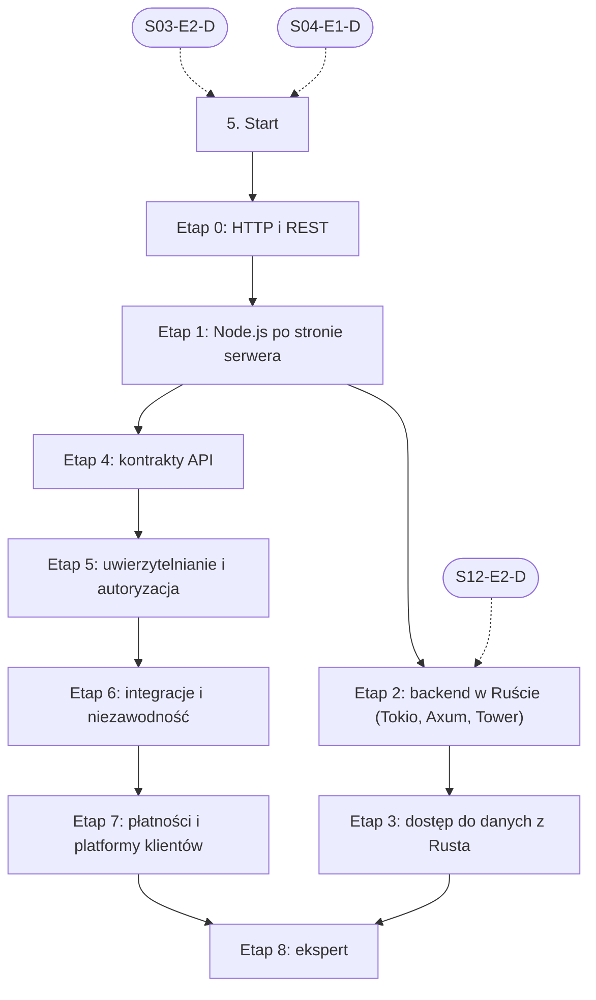

# 05. Backend i API: plan wdrożenia w Linear

Team **LEA** (https://linear.app/daankh/team/LEA/overview). Plan do przeglądu przed wdrożeniem: nic nie zostało jeszcze utworzone w Linear. Klucze zadań (np. `S05-E0-M1`) są robocze; po wdrożeniu dostaną identyfikatory `LEA-…`.

**W skrócie:** 9 kamieni milowych, 58 zadań (1 start, 44 materiały, 9 dowodów, 4 praktyki). Plik główny z kolejnością projektów: `00-kolejnosc-i-zaleznosci.md`.

## 1. Projekt

| Pole | Wartość |
|---|---|
| Nazwa | 05. Backend i API |
| Team | LEA |
| Podsumowanie (pole „Summary”) | Warstwa 1: dane i serwer. Opiera się na: 3 i 4; części w Ruście dochodzą po sekcji 12. Jest podstawą: 6, 7, 8, 9, 10 i 21. |
| Proponowany start | 2026-11-02 |
| Proponowany termin | 2027-03-31 |
| Etykiety projektu | `warstwa-1` |
| Blokowany przez (projekty) | 03. Frontend web, 04. Bazy danych i dane |
| Blokuje (projekty) | 06. Testowanie, 07. Wymagania i specyfikacje, 08. Architektura i projektowanie systemów, 10. Bezpieczeństwo, 12. Rust jako wspólny fundament, 21. Funkcje AI w aplikacjach |
| Zależności częściowe (wchodzące) | etap 2 czeka na 12. Rust jako wspólny fundament (etap 2) |
| Czas od zera | 350–450 h |

### Opis projektu (do wklejenia w Linear)

*Warstwa 1: dane i serwer. Opiera się na: 3 i 4; części w Ruście dochodzą po sekcji 12. Jest podstawą: 6, 7, 8, 9, 10 i 21.*

**Zakres umiejętności**

- Rust: Axum, Tower (middleware), Tokio, SQLx lub SeaORM, kolejki i zadania w tle.
- Node.js po stronie serwera Next.js i w przejmowanych projektach.
- Kontrakty API: REST z OpenAPI (np. generowane z kodu przez `utoipa`), opcjonalnie gRPC (`tonic`); wersjonowanie, idempotencja, paginacja, limity, spójne błędy.
- Uwierzytelnianie i autoryzacja: OAuth 2.0 / OIDC, sesje, ciasteczka, pułapki JWT, kontrola dostępu do obiektów, wielodostępność.
- Integracje: webhooki z weryfikacją podpisu, outbox, idempotentni konsumenci, poczta transakcyjna, przechowywanie plików (S3).
- Płatności i licencje: Stripe, pośrednik Merchant of Record, klucze licencyjne, StoreKit 2, Google Play Billing.
- Platformy klientów: Supabase (RLS, Edge Functions, klucze), Firebase (reguły bezpieczeństwa), Vercel, Fly.io.

**Ścieżka nauki**

Ścieżka ma 9 etapów. Każdy kończy się **dowodem**, czyli małym projektem, który pokazuje, że etap jest opanowany. Przy doświadczeniu seniorskim w TypeScript i Node.js etapy 0–1 można zaliczyć samym dowodem i wracać do materiałów tylko tam, gdzie dowód nie wychodzi. Podstawy Rusta są w sekcji 12, bazy danych w sekcji 4, testy w sekcji 6, a bezpieczeństwo API w sekcji 10; tu są tylko elementy właściwe dla backendu. Czas podany dla osoby startującej od zera (przy etapach 2–3 od zera w backendzie, ze znajomością Rusta z sekcji 12); ceny materiałów płatnych zmieniają się, więc warto je sprawdzić przed zakupem.

Razem od zera do poziomu E: ok. 350–450 h, czyli 8–10 miesięcy przy 10–12 h tygodniowo.

**Definicja ukończenia projektu (dowód poziomu E)**

Samodzielnie, bez agenta, w 1 dzień diagnozujesz i naprawiasz w nieznanej usłudze błąd autoryzacji, zdublowaną płatność lub zgubione zdarzenie z webhooka, piszesz test, który odtwarza problem, i umiesz wyjaśnić przyczynę osobie nietechnicznej.

**Źródło:** dokument „Umiejętności techniczne” w projekcie „JDG: Rozwój oprogramowania”, sekcja 5.

## 2. Kamienie milowe

Jeden kamień milowy na etap ścieżki. Kamień milowy jest zamknięty, gdy zamknięte jest zadanie dowodu tego etapu. Daty kamieni milowych ustawiasz przy wdrożeniu według kolejności z pliku głównego.

| # | Kamień milowy | Cel | Czas od zera | Poziom po etapie | Zadania |
|---|---|---|---|---|---|
| 1 | Etap 0: HTTP i REST | HTTP i REST: semantyka, kody, cache, błędy | 30–40 h | podstawy | 5 |
| 2 | Etap 1: Node.js po stronie serwera | Node.js po stronie serwera | 40–60 h | W | 4 |
| 3 | Etap 2: backend w Ruście (Tokio, Axum, Tower) | backend w Ruście: Tokio, Axum, Tower | 80–100 h | W | 6 |
| 4 | Etap 3: dostęp do danych z Rusta | dostęp do danych z Rusta: SQLx, SeaORM | 25–35 h | W | 3 |
| 5 | Etap 4: kontrakty API | kontrakty API: OpenAPI (`utoipa`), gRPC, wytyczne projektowe | 40–50 h | W | 8 |
| 6 | Etap 5: uwierzytelnianie i autoryzacja | uwierzytelnianie i autoryzacja: OAuth 2.0, OIDC, sesje | 50–60 h | E | 9 |
| 7 | Etap 6: integracje i niezawodność | integracje i niezawodność: webhooki, outbox, kolejki, idempotencja | 40–50 h | E | 7 |
| 8 | Etap 7: płatności i platformy klientów | płatności i platformy klientów: Stripe, Merchant of Record, Supabase, Firebase | 40–50 h | E | 7 |
| 9 | Etap 8: ekspert | ekspert: systemy rozproszone, recenzja kodu AI, aktualność | stale, ok. 2 h tygodniowo | E | 8 |

## 3. Punkt startu

Zadanie **`S05-START` · Start: 5. Backend i API** to jedyne wejście do projektu: wszystkie zadania pierwszego etapu są przez nie blokowane.

- **Blokowane przez:** `S03-E2-D`, `S04-E1-D`
- **Odblokowuje:** `S05-E0-M1`, `S05-E0-M2`, `S05-E0-M3`, `S05-E0-M4`
- **Status początkowy:** Backlog do czasu zamknięcia zadań blokujących, potem Todo

Opis zadania (do wklejenia):

Punkt startu projektu „05. Backend i API”.

**Warunki wejścia (zadania blokujące):**

- `S03-E2-D` · Dowód etapu 2: TypeScript — sekcja 3 na poziomie podstawowym do pracy (etap 2)
- `S04-E1-D` · Dowód etapu 1: PostgreSQL w praktyce — sekcja 4 na poziomie podstawowym do pracy (etap 1)

**Do zrobienia:**

- przeczytać sekcję 5 dokumentu „Umiejętności techniczne”,
- zaznaczyć etapy, które zaliczasz samym dowodem (zgodnie z akapitem wstępnym ścieżki), i dla nich zamknąć zadania materiałów jako niepotrzebne,
- ustawić daty kamieni milowych zgodnie z kolejnością z pliku głównego.

**Folder roboczy:** `05-backend-i-api/`

## 4. Przepływ zależności

Linie ciągłe to zależności wewnątrz projektu, przerywane to zadania z innych projektów. Wewnątrz etapu zadania materiałów są równoległe i wszystkie blokują dowód etapu; dowód etapu blokuje materiały kolejnego etapu.

## 5. Zadania według kamieni milowych

Szablon opisu zadania materiału: nazwa materiału, autor lub wydawca, typ, czas, koszt i link (jak w kolumnach poniżej), zdanie „Gotowe, gdy materiał jest przerobiony w zakresie potrzebnym do dowodu etapu” oraz folder roboczy z kolumny „Folder”. Opisy dowodów i praktyk są podane pod tabelą każdego etapu.

### Etap 0: HTTP i REST

Opis kamienia milowego (do wklejenia):

**Cel:** HTTP i REST: semantyka, kody, cache, błędy · **Czas od zera:** 30–40 h · **Poziom po etapie:** podstawy

**Szczególnie ważne:** które metody są bezpieczne i idempotentne, `ETag` i żądania warunkowe (`If-Match`) jako ochrona przed utratą zapisu, różnica 401 i 403, 404 zamiast 403 przy ukrywaniu istnienia obiektu, spójny format błędów.

**Dowód:** Prosty serwer HTTP bez frameworka (Node.js `http` albo `hyper`), który obsługuje `GET`, `PUT` z `If-Match`, zwraca błędy w formacie RFC 9457 i poprawne nagłówki cache; zestaw wywołań `curl` pokazujący każdy przypadek.

| Klucz | Tytuł | Typ | Czas | Koszt | Link | Blokowane przez | Blokuje | Folder |
|---|---|---|---|---|---|---|---|---|
| `S05-E0-M1` | Przerobić: HTTP: przewodniki | materiał | 15–20 h | 0 zł | https://developer.mozilla.org/en-US/docs/Web/HTTP | `S05-START` | `S05-E0-D` | `05-backend-i-api/e0-http-i-rest/` |
| `S05-E0-M2` | Przerobić: RFC 9110 „HTTP Semantics” | materiał | 8–10 h | 0 zł | https://datatracker.ietf.org/doc/rfc9110/ | `S05-START` | `S05-E0-D` | `05-backend-i-api/e0-http-i-rest/` |
| `S05-E0-M3` | Przerobić: RFC 9111 „HTTP Caching” | materiał | 3–4 h | 0 zł | https://datatracker.ietf.org/doc/rfc9111/ | `S05-START` | `S05-E0-D` | `05-backend-i-api/e0-http-i-rest/` |
| `S05-E0-M4` | Przerobić: RFC 9457 „Problem Details for HTTP APIs” | materiał | 1–2 h | 0 zł | https://datatracker.ietf.org/doc/rfc9457/ | `S05-START` | `S05-E0-D` | `05-backend-i-api/e0-http-i-rest/` |
| `S05-E0-D` | Dowód etapu 0: HTTP i REST | dowód | — | — | — | `S05-E0-M1`, `S05-E0-M2`, `S05-E0-M3`, `S05-E0-M4` | `S05-E1-M1`, `S05-E1-M2`, `S05-E1-M3` | `05-backend-i-api/e0-http-i-rest/` |

**`S05-E0-D` · Dowód etapu 0: HTTP i REST**

Prosty serwer HTTP bez frameworka (Node.js `http` albo `hyper`), który obsługuje `GET`, `PUT` z `If-Match`, zwraca błędy w formacie RFC 9457 i poprawne nagłówki cache; zestaw wywołań `curl` pokazujący każdy przypadek.

**Na co zwrócić uwagę:** które metody są bezpieczne i idempotentne, `ETag` i żądania warunkowe (`If-Match`) jako ochrona przed utratą zapisu, różnica 401 i 403, 404 zamiast 403 przy ukrywaniu istnienia obiektu, spójny format błędów.

**Kryterium ukończenia:** dowód wykonany samodzielnie; w komentarzu link do repozytorium, raportu lub notatki.

**Folder roboczy:** `05-backend-i-api/e0-http-i-rest/`

### Etap 1: Node.js po stronie serwera

Opis kamienia milowego (do wklejenia):

**Cel:** Node.js po stronie serwera · **Czas od zera:** 40–60 h · **Poziom po etapie:** W

**Szczególnie ważne:** blokowanie pętli zdarzeń, obsługa odrzuconych obietnic, strumienie z backpressure, limity rozmiaru żądań, zamykanie połączeń przy wyłączaniu procesu, kontekst żądania przez `AsyncLocalStorage`. To wiedza potrzebna głównie do audytu przejmowanych aplikacji Next.js i Express.

**Dowód:** Audyt fragmentu serwerowego istniejącej aplikacji Node.js (route handlers lub API Express): lista znalezisk z priorytetami, w tym blokowanie pętli zdarzeń, brak limitów i brak łagodnego zamykania; dwie poprawki z testami.

| Klucz | Tytuł | Typ | Czas | Koszt | Link | Blokowane przez | Blokuje | Folder |
|---|---|---|---|---|---|---|---|---|
| `S05-E1-M1` | Przerobić: Learn Node.js: pętla zdarzeń, „Don’t Block the Event Loop”, strumienie i backpressure, wbudowany… | materiał | 12–15 h | 0 zł | https://nodejs.org/en/learn | `S05-E0-D` | `S05-E1-D` | `05-backend-i-api/e1-node-js-po-stronie-serwera/` |
| `S05-E1-M2` | Przerobić: Node.js Design Patterns (wydanie 4, Node.js 24) | materiał, płatny | 25–35 h | płatna | https://www.nodejsdesignpatterns.com | `S05-E0-D` | `S05-E1-D` | `05-backend-i-api/e1-node-js-po-stronie-serwera/` |
| `S05-E1-M3` | Przerobić: Dokumentacja API Node.js: `http`, `stream`, `worker_threads`, `AsyncLocalStorage` | materiał | 5–8 h | 0 zł | https://nodejs.org/api/ | `S05-E0-D` | `S05-E1-D` | `05-backend-i-api/e1-node-js-po-stronie-serwera/` |
| `S05-E1-D` | Dowód etapu 1: Node.js po stronie serwera | dowód | — | — | — | `S05-E1-M1`, `S05-E1-M2`, `S05-E1-M3` | `S05-E2-M1`, `S05-E2-M2`, `S05-E2-M3`, `S05-E2-M4`, `S05-E2-M5`, `S05-E4-M1`, `S05-E4-M2`, `S05-E4-M3`, `S05-E4-M4`, `S05-E4-M5`, `S05-E4-M6`, `S05-E4-M7`, `S06-START`, `S07-START`, `S08-START`, `S10-START`, `S12-START`, `S21-START` | `05-backend-i-api/e1-node-js-po-stronie-serwera/` |

**`S05-E1-D` · Dowód etapu 1: Node.js po stronie serwera**

Audyt fragmentu serwerowego istniejącej aplikacji Node.js (route handlers lub API Express): lista znalezisk z priorytetami, w tym blokowanie pętli zdarzeń, brak limitów i brak łagodnego zamykania; dwie poprawki z testami.

**Na co zwrócić uwagę:** blokowanie pętli zdarzeń, obsługa odrzuconych obietnic, strumienie z backpressure, limity rozmiaru żądań, zamykanie połączeń przy wyłączaniu procesu, kontekst żądania przez `AsyncLocalStorage`. To wiedza potrzebna głównie do audytu przejmowanych aplikacji Next.js i Express.

**Kryterium ukończenia:** dowód wykonany samodzielnie; w komentarzu link do repozytorium, raportu lub notatki.

**Folder roboczy:** `05-backend-i-api/e1-node-js-po-stronie-serwera/`

### Etap 2: backend w Ruście (Tokio, Axum, Tower)

Opis kamienia milowego (do wklejenia):

**Cel:** backend w Ruście: Tokio, Axum, Tower · **Czas od zera:** 80–100 h · **Poziom po etapie:** W

**Szczególnie ważne:** ekstraktory i kolejność warstw middleware, stan aplikacji, obsługa błędów przez `IntoResponse`, timeouty i limity rozmiaru ciała żądania, łagodne zamykanie, `tracing` z identyfikatorem żądania, kod blokujący w handlerach async.

Uwaga: „Zero To Production in Rust” używa `actix-web`, nie Axum. Wartość książki leży w procesie (testy integracyjne, konfiguracja, telemetria z `tracing`, CI, wdrożenie, idempotencja, uwierzytelnianie), który przenosi się na Axum bez zmian w podejściu. Projekt z książki warto przepisać na Axum jako ćwiczenie.

**Dowód:** Usługa w Axum z kilkoma zasobami, warstwami Tower (timeout, limit ciała, śledzenie), spójnymi błędami RFC 9457, konfiguracją z pliku i zmiennych środowiskowych, testami integracyjnymi i łagodnym zamykaniem; wdrożona jako kontener.

| Klucz | Tytuł | Typ | Czas | Koszt | Link | Blokowane przez | Blokuje | Folder |
|---|---|---|---|---|---|---|---|---|
| `S05-E2-M1` | Przerobić: Tokio Tutorial | materiał | 10–15 h | 0 zł | https://tokio.rs/tokio/tutorial | `S05-E1-D`, `S12-E2-D` | `S05-E2-D` | `05-backend-i-api/e2-backend-w-ruscie-tokio-axum-tower/` |
| `S05-E2-M2` | Przerobić: „Inventing the Service trait” | materiał | 1–2 h | 0 zł | https://tokio.rs/blog/2021-05-14-inventing-the-service-trait | `S05-E1-D`, `S12-E2-D` | `S05-E2-D` | `05-backend-i-api/e2-backend-w-ruscie-tokio-axum-tower/` |
| `S05-E2-M3` | Przerobić: Dokumentacja Axum i katalog przykładów w repozytorium | materiał | 12–15 h | 0 zł | https://docs.rs/axum/latest/axum/ | `S05-E1-D`, `S12-E2-D` | `S05-E2-D` | `05-backend-i-api/e2-backend-w-ruscie-tokio-axum-tower/` |
| `S05-E2-M4` | Przerobić: Dokumentacja Tower i `tower-http` | materiał | 5–6 h | 0 zł | https://docs.rs/tower/latest/tower/ | `S05-E1-D`, `S12-E2-D` | `S05-E2-D` | `05-backend-i-api/e2-backend-w-ruscie-tokio-axum-tower/` |
| `S05-E2-M5` | Przerobić: Zero To Production in Rust | materiał, płatny | 40–60 h | płatna | https://www.zero2prod.com | `S05-E1-D`, `S12-E2-D` | `S05-E2-D` | `05-backend-i-api/e2-backend-w-ruscie-tokio-axum-tower/` |
| `S05-E2-D` | Dowód etapu 2: backend w Ruście (Tokio, Axum, Tower) | dowód | — | — | — | `S05-E2-M1`, `S05-E2-M2`, `S05-E2-M3`, `S05-E2-M4`, `S05-E2-M5` | `S05-E3-M1`, `S05-E3-M2` | `05-backend-i-api/e2-backend-w-ruscie-tokio-axum-tower/` |

**`S05-E2-D` · Dowód etapu 2: backend w Ruście (Tokio, Axum, Tower)**

Usługa w Axum z kilkoma zasobami, warstwami Tower (timeout, limit ciała, śledzenie), spójnymi błędami RFC 9457, konfiguracją z pliku i zmiennych środowiskowych, testami integracyjnymi i łagodnym zamykaniem; wdrożona jako kontener.

**Na co zwrócić uwagę:** ekstraktory i kolejność warstw middleware, stan aplikacji, obsługa błędów przez `IntoResponse`, timeouty i limity rozmiaru ciała żądania, łagodne zamykanie, `tracing` z identyfikatorem żądania, kod blokujący w handlerach async.

**Kryterium ukończenia:** dowód wykonany samodzielnie; w komentarzu link do repozytorium, raportu lub notatki.

**Folder roboczy:** `05-backend-i-api/e2-backend-w-ruscie-tokio-axum-tower/`

### Etap 3: dostęp do danych z Rusta

Opis kamienia milowego (do wklejenia):

**Cel:** dostęp do danych z Rusta: SQLx, SeaORM · **Czas od zera:** 25–35 h · **Poziom po etapie:** W

Wystarczy dobrze znać jedno z dwóch narzędzi: SQLx jako domyślny wybór dla własnych usług, SeaORM tam, gdzie projekt go już używa. Wiedza o SQL, indeksach i transakcjach jest w sekcji 4.

**Dowód:** Warstwa danych usługi z etapu 2 na SQLx: zapytania sprawdzane w kompilacji z cache trybu offline w CI, transakcja obejmująca kilka tabel, test na prawdziwym PostgreSQL w kontenerze, brak zapytań N+1 w liście z relacjami.

| Klucz | Tytuł | Typ | Czas | Koszt | Link | Blokowane przez | Blokuje | Folder |
|---|---|---|---|---|---|---|---|---|
| `S05-E3-M1` | Przerobić: SQLx (wersja 0.9): zapytania sprawdzane w czasie kompilacji, tryb offline, migracje, pula połączeń | materiał | 8–10 h | 0 zł | https://docs.rs/sqlx/latest/sqlx/ | `S05-E2-D` | `S05-E3-D` | `05-backend-i-api/e3-dostep-do-danych-z-rusta/` |
| `S05-E3-M2` | Przerobić: SeaORM 2.0: dokumentacja, tutorial, cookbook | materiał | 12–15 h | 0 zł | https://www.sea-ql.org/SeaORM/docs/index/ | `S05-E2-D` | `S05-E3-D` | `05-backend-i-api/e3-dostep-do-danych-z-rusta/` |
| `S05-E3-D` | Dowód etapu 3: dostęp do danych z Rusta | dowód | — | — | — | `S05-E3-M1`, `S05-E3-M2` | `S05-E8-M1`, `S05-E8-M2`, `S05-E8-M3`, `S05-E8-P1`, `S05-E8-P2`, `S05-E8-P3`, `S05-E8-P4` | `05-backend-i-api/e3-dostep-do-danych-z-rusta/` |

**`S05-E3-D` · Dowód etapu 3: dostęp do danych z Rusta**

Warstwa danych usługi z etapu 2 na SQLx: zapytania sprawdzane w kompilacji z cache trybu offline w CI, transakcja obejmująca kilka tabel, test na prawdziwym PostgreSQL w kontenerze, brak zapytań N+1 w liście z relacjami.

**Kryterium ukończenia:** dowód wykonany samodzielnie; w komentarzu link do repozytorium, raportu lub notatki.

**Folder roboczy:** `05-backend-i-api/e3-dostep-do-danych-z-rusta/`

### Etap 4: kontrakty API

Opis kamienia milowego (do wklejenia):

**Cel:** kontrakty API: OpenAPI (`utoipa`), gRPC, wytyczne projektowe · **Czas od zera:** 40–50 h · **Poziom po etapie:** W

**Szczególnie ważne:** wersjonowanie i zmiany niełamiące, paginacja kursorowa, filtrowanie, limity i nagłówki limitów, idempotencja zapisów (np. nagłówek `Idempotency-Key`; propozycja IETF wygasła i nie jest normą), spójne błędy, kontrakt jako źródło prawdy dla klienta TypeScript.

Uwaga do gRPC w Ruście: w maju 2026 r. `tonic` przeszedł do projektu gRPC (repozytorium `grpc/grpc-rust`). Dostaje poprawki błędów, ale nie duże nowe funkcje; jego następcą ma być crate `grpc`, który w październiku 2026 r. jest jeszcze w wersjach 0.x. Generowany kod `tonic` ma pozostać wspierany, więc nauka `tonic` nie jest stracona, ale przy nowym projekcie trzeba sprawdzić stan `grpc`.

**Dowód:** API z etapu 2 opisane w OpenAPI generowanym przez `utoipa`, z wygenerowanym z niego klientem TypeScript używanym przez aplikację Next.js; test w CI, który blokuje scalenie przy łamiącej zmianie kontraktu; krótki dokument z decyzjami projektowymi odwołującymi się do jednego z trzech zestawów wytycznych.

| Klucz | Tytuł | Typ | Czas | Koszt | Link | Blokowane przez | Blokuje | Folder |
|---|---|---|---|---|---|---|---|---|
| `S05-E4-M1` | Przerobić: OpenAPI Learn i specyfikacja OpenAPI (3.1 i 3.2) | materiał | 8–10 h | 0 zł | https://learn.openapis.org | `S05-E1-D` | `S05-E4-D` | `05-backend-i-api/e4-kontrakty-api/` |
| `S05-E4-M2` | Przerobić: `utoipa` i `utoipa-axum`: OpenAPI generowane z kodu Rust | materiał | 4–6 h | 0 zł | https://docs.rs/utoipa/latest/utoipa/ | `S05-E1-D` | `S05-E4-D` | `05-backend-i-api/e4-kontrakty-api/` |
| `S05-E4-M3` | Przerobić: Microsoft REST API Guidelines (ogólne, Azure, Microsoft Graph) | materiał | 5–6 h | 0 zł | https://github.com/microsoft/api-guidelines | `S05-E1-D` | `S05-E4-D` | `05-backend-i-api/e4-kontrakty-api/` |
| `S05-E4-M4` | Przerobić: API Improvement Proposals (AIP) | materiał | 6–8 h | 0 zł | https://google.aip.dev | `S05-E1-D` | `S05-E4-D` | `05-backend-i-api/e4-kontrakty-api/` |
| `S05-E4-M5` | Przerobić: Zalando RESTful API and Event Guidelines | materiał | 5–6 h | 0 zł | https://opensource.zalando.com/restful-api-guidelines/ | `S05-E1-D` | `S05-E4-D` | `05-backend-i-api/e4-kontrakty-api/` |
| `S05-E4-M6` | Przerobić: gRPC: Core concepts, Protocol Buffers | materiał | 4–6 h | 0 zł | https://grpc.io/docs/ | `S05-E1-D` | `S05-E4-D` | `05-backend-i-api/e4-kontrakty-api/` |
| `S05-E4-M7` | Przerobić: `tonic`: przykłady i samouczek routeguide | materiał | 5–6 h | 0 zł | https://github.com/grpc/grpc-rust | `S05-E1-D` | `S05-E4-D` | `05-backend-i-api/e4-kontrakty-api/` |
| `S05-E4-D` | Dowód etapu 4: kontrakty API | dowód | — | — | — | `S05-E4-M1`, `S05-E4-M2`, `S05-E4-M3`, `S05-E4-M4`, `S05-E4-M5`, `S05-E4-M6`, `S05-E4-M7` | `S05-E5-M1`, `S05-E5-M2`, `S05-E5-M3`, `S05-E5-M4`, `S05-E5-M5`, `S05-E5-M6`, `S05-E5-M7`, `S05-E5-M8` | `05-backend-i-api/e4-kontrakty-api/` |

**`S05-E4-D` · Dowód etapu 4: kontrakty API**

API z etapu 2 opisane w OpenAPI generowanym przez `utoipa`, z wygenerowanym z niego klientem TypeScript używanym przez aplikację Next.js; test w CI, który blokuje scalenie przy łamiącej zmianie kontraktu; krótki dokument z decyzjami projektowymi odwołującymi się do jednego z trzech zestawów wytycznych.

**Na co zwrócić uwagę:** wersjonowanie i zmiany niełamiące, paginacja kursorowa, filtrowanie, limity i nagłówki limitów, idempotencja zapisów (np. nagłówek `Idempotency-Key`; propozycja IETF wygasła i nie jest normą), spójne błędy, kontrakt jako źródło prawdy dla klienta TypeScript.

**Kryterium ukończenia:** dowód wykonany samodzielnie; w komentarzu link do repozytorium, raportu lub notatki.

**Folder roboczy:** `05-backend-i-api/e4-kontrakty-api/`

### Etap 5: uwierzytelnianie i autoryzacja

Opis kamienia milowego (do wklejenia):

**Cel:** uwierzytelnianie i autoryzacja: OAuth 2.0, OIDC, sesje · **Czas od zera:** 50–60 h · **Poziom po etapie:** E

**Szczególnie ważne:** sesje po stronie serwera zamiast JWT w `localStorage`, atrybuty ciasteczek, rotacja identyfikatora sesji po logowaniu, kontrola dostępu do obiektu w każdym zapytaniu (BOLA), izolacja najemców w wielodostępności, unieważnianie sesji i tokenów.

Książka „OAuth 2 in Action” jest z 2017 r.: mechanika protokołu jest aktualna, ale zalecenia bezpieczeństwa trzeba czytać razem z RFC 9700 i draftem OAuth 2.1 (PKCE zawsze, bez implicit i password grant, dokładne dopasowanie `redirect_uri`).

**Dowód:** Logowanie przez zewnętrznego dostawcę OIDC (kod autoryzacyjny z PKCE) do usługi w Axum, sesje w ciasteczkach `HttpOnly`, role i izolacja najemców; zestaw testów, który próbuje odczytać i zmienić obiekt innego najemcy, podmienić `state` i użyć wylogowanej sesji, i za każdym razem dostaje odmowę.

| Klucz | Tytuł | Typ | Czas | Koszt | Link | Blokowane przez | Blokuje | Folder |
|---|---|---|---|---|---|---|---|---|
| `S05-E5-M1` | Przerobić: OAuth 2 in Action | materiał, płatny | 20–25 h | płatna | https://www.manning.com/books/oauth-2-in-action | `S05-E4-D` | `S05-E5-D` | `05-backend-i-api/e5-uwierzytelnianie-i-autoryzacja/` |
| `S05-E5-M2` | Przerobić: RFC 6749 „The OAuth 2.0 Authorization Framework” | materiał | 4–6 h | 0 zł | https://datatracker.ietf.org/doc/rfc6749/ | `S05-E4-D` | `S05-E5-D` | `05-backend-i-api/e5-uwierzytelnianie-i-autoryzacja/` |
| `S05-E5-M3` | Przerobić: „The OAuth 2.1 Authorization Framework” | materiał | 3–4 h | 0 zł | https://datatracker.ietf.org/doc/draft-ietf-oauth-v2-1/ | `S05-E4-D` | `S05-E5-D` | `05-backend-i-api/e5-uwierzytelnianie-i-autoryzacja/` |
| `S05-E5-M4` | Przerobić: RFC 9700 „Best Current Practice for OAuth 2.0 Security” (styczeń 2025) | materiał | 3–4 h | 0 zł | https://datatracker.ietf.org/doc/rfc9700/ | `S05-E4-D` | `S05-E5-D` | `05-backend-i-api/e5-uwierzytelnianie-i-autoryzacja/` |
| `S05-E5-M5` | Przerobić: OpenID Connect Core 1.0 | materiał | 4–5 h | 0 zł | https://openid.net/specs/openid-connect-core-1_0.html | `S05-E4-D` | `S05-E5-D` | `05-backend-i-api/e5-uwierzytelnianie-i-autoryzacja/` |
| `S05-E5-M6` | Przerobić: RFC 8725 „JSON Web Token Best Current Practices” | materiał | 1–2 h | 0 zł | https://datatracker.ietf.org/doc/rfc8725/ | `S05-E4-D` | `S05-E5-D` | `05-backend-i-api/e5-uwierzytelnianie-i-autoryzacja/` |
| `S05-E5-M7` | Przerobić: Pilcrow’s auth book (następca „The Copenhagen Book”): sesje, hasła, passkeys, CSRF | materiał | 5–6 h | 0 zł | https://auth.pilcrowonpaper.com | `S05-E4-D` | `S05-E5-D` | `05-backend-i-api/e5-uwierzytelnianie-i-autoryzacja/` |
| `S05-E5-M8` | Przerobić: Crate’y `oauth2`, `openidconnect`, `tower-sessions`, `axum-login` | materiał | 4–5 h | 0 zł | https://docs.rs/openidconnect, https://docs.rs/tower-sessions | `S05-E4-D` | `S05-E5-D` | `05-backend-i-api/e5-uwierzytelnianie-i-autoryzacja/` |
| `S05-E5-D` | Dowód etapu 5: uwierzytelnianie i autoryzacja | dowód | — | — | — | `S05-E5-M1`, `S05-E5-M2`, `S05-E5-M3`, `S05-E5-M4`, `S05-E5-M5`, `S05-E5-M6`, `S05-E5-M7`, `S05-E5-M8` | `S05-E6-M1`, `S05-E6-M2`, `S05-E6-M3`, `S05-E6-M4`, `S05-E6-M5`, `S05-E6-M6` | `05-backend-i-api/e5-uwierzytelnianie-i-autoryzacja/` |

**`S05-E5-D` · Dowód etapu 5: uwierzytelnianie i autoryzacja**

Logowanie przez zewnętrznego dostawcę OIDC (kod autoryzacyjny z PKCE) do usługi w Axum, sesje w ciasteczkach `HttpOnly`, role i izolacja najemców; zestaw testów, który próbuje odczytać i zmienić obiekt innego najemcy, podmienić `state` i użyć wylogowanej sesji, i za każdym razem dostaje odmowę.

**Na co zwrócić uwagę:** sesje po stronie serwera zamiast JWT w `localStorage`, atrybuty ciasteczek, rotacja identyfikatora sesji po logowaniu, kontrola dostępu do obiektu w każdym zapytaniu (BOLA), izolacja najemców w wielodostępności, unieważnianie sesji i tokenów.

**Kryterium ukończenia:** dowód wykonany samodzielnie; w komentarzu link do repozytorium, raportu lub notatki.

**Folder roboczy:** `05-backend-i-api/e5-uwierzytelnianie-i-autoryzacja/`

### Etap 6: integracje i niezawodność

Opis kamienia milowego (do wklejenia):

**Cel:** integracje i niezawodność: webhooki, outbox, kolejki, idempotencja · **Czas od zera:** 40–50 h · **Poziom po etapie:** E

**Szczególnie ważne:** weryfikacja podpisu na surowym ciele żądania i porównanie w stałym czasie, szybka odpowiedź 2xx i przetwarzanie asynchroniczne, deduplikacja po identyfikatorze zdarzenia, zapis zmiany i zdarzenia w jednej transakcji (outbox), ponawianie z wykładniczym odstępem, kolejka błędów, poczta transakcyjna wysyłana z outboxa, a nie w środku transakcji.

**Dowód:** Odbiornik webhooków Stripe w Axum z weryfikacją podpisu, deduplikacją i outboxem w PostgreSQL; test, który wysyła to samo zdarzenie dwa razy, zdarzenia w odwrotnej kolejności i zdarzenie ze złym podpisem, oraz test awarii procesu między zapisem a wysłaniem e-maila, po którym nic nie ginie i nic się nie dubluje.

| Klucz | Tytuł | Typ | Czas | Koszt | Link | Blokowane przez | Blokuje | Folder |
|---|---|---|---|---|---|---|---|---|
| `S05-E6-M1` | Przerobić: Standard Webhooks: specyfikacja podpisu, identyfikatorów i ponowień | materiał | 2–3 h | 0 zł | https://github.com/standard-webhooks/standard-webhooks/blob/main/spec/standard-webhooks.md | `S05-E5-D` | `S05-E6-D` | `05-backend-i-api/e6-integracje-i-niezawodnosc/` |
| `S05-E6-M2` | Przerobić: Stripe: odbieranie webhooków | materiał | 2–3 h | 0 zł | https://docs.stripe.com/webhooks | `S05-E5-D` | `S05-E6-D` | `05-backend-i-api/e6-integracje-i-niezawodnosc/` |
| `S05-E6-M3` | Przerobić: „Pattern: Transactional outbox” i powiązane wzorce | materiał | 3–4 h | 0 zł | https://microservices.io/patterns/data/transactional-outbox.html | `S05-E5-D` | `S05-E6-D` | `05-backend-i-api/e6-integracje-i-niezawodnosc/` |
| `S05-E6-M4` | Przerobić: Kolejki na PostgreSQL: `pgmq`, `SELECT … FOR UPDATE SKIP LOCKED` | materiał | 4–5 h | 0 zł | https://github.com/pgmq/pgmq | `S05-E5-D` | `S05-E6-D` | `05-backend-i-api/e6-integracje-i-niezawodnosc/` |
| `S05-E6-M5` | Przerobić: Zadania w tle w Ruście: `apalis` (wersja 1.0 w fazie RC) | materiał | 3–4 h | 0 zł | https://docs.rs/apalis | `S05-E5-D` | `S05-E6-D` | `05-backend-i-api/e6-integracje-i-niezawodnosc/` |
| `S05-E6-M6` | Przerobić: Rozdziały o przetwarzaniu strumieniowym i wsadowym w „Designing Data-Intensive Applications” | materiał, płatny | 8–10 h | płatna | zob. etap 8 | `S05-E5-D` | `S05-E6-D` | `05-backend-i-api/e6-integracje-i-niezawodnosc/` |
| `S05-E6-D` | Dowód etapu 6: integracje i niezawodność | dowód | — | — | — | `S05-E6-M1`, `S05-E6-M2`, `S05-E6-M3`, `S05-E6-M4`, `S05-E6-M5`, `S05-E6-M6` | `S05-E7-M1`, `S05-E7-M2`, `S05-E7-M3`, `S05-E7-M4`, `S05-E7-M5`, `S05-E7-M6` | `05-backend-i-api/e6-integracje-i-niezawodnosc/` |

**`S05-E6-D` · Dowód etapu 6: integracje i niezawodność**

Odbiornik webhooków Stripe w Axum z weryfikacją podpisu, deduplikacją i outboxem w PostgreSQL; test, który wysyła to samo zdarzenie dwa razy, zdarzenia w odwrotnej kolejności i zdarzenie ze złym podpisem, oraz test awarii procesu między zapisem a wysłaniem e-maila, po którym nic nie ginie i nic się nie dubluje.

**Na co zwrócić uwagę:** weryfikacja podpisu na surowym ciele żądania i porównanie w stałym czasie, szybka odpowiedź 2xx i przetwarzanie asynchroniczne, deduplikacja po identyfikatorze zdarzenia, zapis zmiany i zdarzenia w jednej transakcji (outbox), ponawianie z wykładniczym odstępem, kolejka błędów, poczta transakcyjna wysyłana z outboxa, a nie w środku transakcji.

**Kryterium ukończenia:** dowód wykonany samodzielnie; w komentarzu link do repozytorium, raportu lub notatki.

**Folder roboczy:** `05-backend-i-api/e6-integracje-i-niezawodnosc/`

### Etap 7: płatności i platformy klientów

Opis kamienia milowego (do wklejenia):

**Cel:** płatności i platformy klientów: Stripe, Merchant of Record, Supabase, Firebase · **Czas od zera:** 40–50 h · **Poziom po etapie:** E

**Szczególnie ważne:** stan abonamentu odtwarzany z webhooków, a nie z przekierowania po płatności; uprawnienia w aplikacji wynikające z jednego źródła prawdy; wybór między własnym rozliczaniem VAT (Stripe Billing z Stripe Tax) a pośrednikiem MoR; w projektach Supabase klucz `service_role` lub secret poza przeglądarką i RLS włączone na każdej tabeli; w Firebase reguły, które nie są otwarte „na czas testów”.

**Dowód:** Abonament w aplikacji demonstracyjnej przez Stripe Billing lub Managed Payments, z obsługą odnowienia, nieudanej płatności, anulowania i zwrotu, sterowany wyłącznie webhookami z etapu 6; oraz raport z audytu bezpieczeństwa przykładowego projektu Supabase lub Firebase (tabele bez RLS, zbyt szerokie polityki, klucze w kliencie) z poprawkami i testami, czyli wzór usługi audytu z biznesplanu.

| Klucz | Tytuł | Typ | Czas | Koszt | Link | Blokowane przez | Blokuje | Folder |
|---|---|---|---|---|---|---|---|---|
| `S05-E7-M1` | Przerobić: Stripe Billing: abonamenty, okresy próbne, faktury, portal klienta | materiał | 8–10 h | 0 zł | https://docs.stripe.com/billing | `S05-E6-D` | `S05-E7-D` | `05-backend-i-api/e7-platnosci-i-platformy-klientow/` |
| `S05-E7-M2` | Przerobić: Stripe: żądania idempotentne | materiał | 1 h | 0 zł | https://docs.stripe.com/api/idempotent_requests | `S05-E6-D` | `S05-E7-D` | `05-backend-i-api/e7-platnosci-i-platformy-klientow/` |
| `S05-E7-M3` | Przerobić: Stripe Managed Payments | materiał | 3–4 h | 0 zł | https://docs.stripe.com/payments/managed-payments | `S05-E6-D` | `S05-E7-D` | `05-backend-i-api/e7-platnosci-i-platformy-klientow/` |
| `S05-E7-M4` | Przerobić: Paddle Billing (alternatywny Merchant of Record) | materiał | 3–4 h | 0 zł | https://developer.paddle.com | `S05-E6-D` | `S05-E7-D` | `05-backend-i-api/e7-platnosci-i-platformy-klientow/` |
| `S05-E7-M5` | Przerobić: Supabase: Row Level Security, klucze publishable i secret, Edge Functions | materiał | 6–8 h | 0 zł | https://supabase.com/docs/guides/database/postgres/row-level-security | `S05-E6-D` | `S05-E7-D` | `05-backend-i-api/e7-platnosci-i-platformy-klientow/` |
| `S05-E7-M6` | Przerobić: Firebase Security Rules | materiał | 4–5 h | 0 zł | https://firebase.google.com/docs/rules | `S05-E6-D` | `S05-E7-D` | `05-backend-i-api/e7-platnosci-i-platformy-klientow/` |
| `S05-E7-D` | Dowód etapu 7: płatności i platformy klientów | dowód | — | — | — | `S05-E7-M1`, `S05-E7-M2`, `S05-E7-M3`, `S05-E7-M4`, `S05-E7-M5`, `S05-E7-M6` | `S05-E8-M1`, `S05-E8-M2`, `S05-E8-M3`, `S05-E8-P1`, `S05-E8-P2`, `S05-E8-P3`, `S05-E8-P4` | `05-backend-i-api/e7-platnosci-i-platformy-klientow/` |

**`S05-E7-D` · Dowód etapu 7: płatności i platformy klientów**

Abonament w aplikacji demonstracyjnej przez Stripe Billing lub Managed Payments, z obsługą odnowienia, nieudanej płatności, anulowania i zwrotu, sterowany wyłącznie webhookami z etapu 6; oraz raport z audytu bezpieczeństwa przykładowego projektu Supabase lub Firebase (tabele bez RLS, zbyt szerokie polityki, klucze w kliencie) z poprawkami i testami, czyli wzór usługi audytu z biznesplanu.

**Na co zwrócić uwagę:** stan abonamentu odtwarzany z webhooków, a nie z przekierowania po płatności; uprawnienia w aplikacji wynikające z jednego źródła prawdy; wybór między własnym rozliczaniem VAT (Stripe Billing z Stripe Tax) a pośrednikiem MoR; w projektach Supabase klucz `service_role` lub secret poza przeglądarką i RLS włączone na każdej tabeli; w Firebase reguły, które nie są otwarte „na czas testów”.

**Kryterium ukończenia:** dowód wykonany samodzielnie; w komentarzu link do repozytorium, raportu lub notatki.

**Folder roboczy:** `05-backend-i-api/e7-platnosci-i-platformy-klientow/`

### Etap 8: ekspert

Opis kamienia milowego (do wklejenia):

**Cel:** ekspert: systemy rozproszone, recenzja kodu AI, aktualność · **Czas od zera:** stale, ok. 2 h tygodniowo · **Poziom po etapie:** E

**Dowód poziomu E:** Samodzielnie, bez agenta, w 1 dzień diagnozujesz i naprawiasz w nieznanej usłudze błąd autoryzacji, zdublowaną płatność lub zgubione zdarzenie z webhooka, piszesz test, który odtwarza problem, i umiesz wyjaśnić przyczynę osobie nietechnicznej.

| Klucz | Tytuł | Typ | Czas | Koszt | Link | Blokowane przez | Blokuje | Folder |
|---|---|---|---|---|---|---|---|---|
| `S05-E8-M1` | Przerobić: Designing Data-Intensive Applications (wydanie 2, 2026) | materiał, płatny | 40–50 h | płatna | https://www.oreilly.com/library/view/designing-data-intensive-applications/9781098119058/ | `S05-E7-D`, `S05-E3-D` | `S05-E8-D` | `05-backend-i-api/e8-ekspert/` |
| `S05-E8-M2` | Przerobić: OWASP API Security Top 10 (edycja 2023) | materiał | 3–4 h | 0 zł | https://owasp.org/API-Security/ | `S05-E7-D`, `S05-E3-D` | `S05-E8-D` | `05-backend-i-api/e8-ekspert/` |
| `S05-E8-M3` | Przerobić: Komunikaty i wydania: blog Tokio, wydania Axum, SQLx i SeaORM, blog gRPC, changelog Stripe API,… | materiał | ok. 1 h tygodniowo | 0 zł | https://tokio.rs/blog, https://grpc.io/blog/, https://docs.stripe.com/changelog, https://datatracker.ietf.org/wg/oauth/documents/ | `S05-E7-D`, `S05-E3-D` | `S05-E8-D` | `05-backend-i-api/e8-ekspert/` |
| `S05-E8-P1` | Praktyka: recenzja kodu AI | praktyka | — | — | — | `S05-E7-D`, `S05-E3-D` | `S05-E8-D` | `05-backend-i-api/e8-ekspert/` |
| `S05-E8-P2` | Praktyka: przejęcie cudzego backendu | praktyka | — | — | — | `S05-E7-D`, `S05-E3-D` | `S05-E8-D` | `05-backend-i-api/e8-ekspert/` |
| `S05-E8-P3` | Praktyka: projekt systemu na papierze | praktyka | — | — | — | `S05-E7-D`, `S05-E3-D` | `S05-E8-D` | `05-backend-i-api/e8-ekspert/` |
| `S05-E8-P4` | Praktyka: śledzenie zmian | praktyka | — | — | — | `S05-E7-D`, `S05-E3-D` | `S05-E8-D` | `05-backend-i-api/e8-ekspert/` |
| `S05-E8-D` | Dowód poziomu E: ekspert | dowód | — | — | — | `S05-E8-M1`, `S05-E8-M2`, `S05-E8-M3`, `S05-E8-P1`, `S05-E8-P2`, `S05-E8-P3`, `S05-E8-P4` | — | `05-backend-i-api/e8-ekspert/` |

**`S05-E8-P1` · Praktyka: recenzja kodu AI**

20 pull requestów z kodem backendowym wygenerowanym przez agentów, recenzowanych według listy kontrolnej z etapów 2 i 5–7 (autoryzacja obiektu w każdym zapytaniu, weryfikacja podpisu webhooka na surowym ciele, idempotencja, brak `unwrap()` i kodu blokującego w handlerach, sekrety poza logami, timeouty na wywołaniach zewnętrznych, testy przypadków odmowy).

Praktyka ciągła etapu eksperckiego: oznacz jako gotową, gdy działa jako stały element pracy, a nie po jednorazowym wykonaniu.

**Folder roboczy:** `05-backend-i-api/e8-ekspert/`

**`S05-E8-P2` · Praktyka: przejęcie cudzego backendu**

Jedna aplikacja klienta (Next.js z Supabase albo Node.js z Firebase) przeprowadzona przez audyt API według OWASP API Security Top 10, z poprawkami i SBOM zależności serwerowych.

Praktyka ciągła etapu eksperckiego: oznacz jako gotową, gdy działa jako stały element pracy, a nie po jednorazowym wykonaniu.

**Folder roboczy:** `05-backend-i-api/e8-ekspert/`

**`S05-E8-P3` · Praktyka: projekt systemu na papierze**

Dokument architektury jednej własnej aplikacji (rdzeń w Ruście, API, synchronizacja, płatności) z analizą awarii każdego połączenia i decyzjami zapisanymi w ADR.

Praktyka ciągła etapu eksperckiego: oznacz jako gotową, gdy działa jako stały element pracy, a nie po jednorazowym wykonaniu.

**Folder roboczy:** `05-backend-i-api/e8-ekspert/`

**`S05-E8-P4` · Praktyka: śledzenie zmian**

Subskrypcja komunikatów bezpieczeństwa używanych crate’ów i bibliotek Node.js, ćwiczenie aktualizacji zależności z podatnością w 24 h jako element procesu obsługi podatności (CRA).

Praktyka ciągła etapu eksperckiego: oznacz jako gotową, gdy działa jako stały element pracy, a nie po jednorazowym wykonaniu.

**Folder roboczy:** `05-backend-i-api/e8-ekspert/`

**`S05-E8-D` · Dowód poziomu E: ekspert**

Samodzielnie, bez agenta, w 1 dzień diagnozujesz i naprawiasz w nieznanej usłudze błąd autoryzacji, zdublowaną płatność lub zgubione zdarzenie z webhooka, piszesz test, który odtwarza problem, i umiesz wyjaśnić przyczynę osobie nietechnicznej.

**Kryterium ukończenia:** dowód wykonany samodzielnie; w komentarzu link do repozytorium, raportu lub notatki. Bez agenta AI.

**Folder roboczy:** `05-backend-i-api/e8-ekspert/`

## 6. Relacje z innymi projektami

**Wchodzące** (zadanie z innego projektu blokuje zadanie tego projektu):

- `S03-E2-D` (Dowód etapu 2: TypeScript) → `S05-START`
- `S04-E1-D` (Dowód etapu 1: PostgreSQL w praktyce) → `S05-START`
- `S12-E2-D` (Dowód etapu 2: własność, pożyczanie, czasy życia) → `S05-E2-M1`
- `S12-E2-D` (Dowód etapu 2: własność, pożyczanie, czasy życia) → `S05-E2-M2`
- `S12-E2-D` (Dowód etapu 2: własność, pożyczanie, czasy życia) → `S05-E2-M3`
- `S12-E2-D` (Dowód etapu 2: własność, pożyczanie, czasy życia) → `S05-E2-M4`
- `S12-E2-D` (Dowód etapu 2: własność, pożyczanie, czasy życia) → `S05-E2-M5`

**Wychodzące** (zadanie tego projektu blokuje zadanie w innym projekcie):

- `S05-E1-D` → `S06-START` (06. Testowanie)
- `S05-E1-D` → `S07-START` (07. Wymagania i specyfikacje)
- `S05-E1-D` → `S08-START` (08. Architektura i projektowanie systemów)
- `S05-E1-D` → `S10-START` (10. Bezpieczeństwo)
- `S05-E1-D` → `S12-START` (12. Rust jako wspólny fundament)
- `S05-E1-D` → `S21-START` (21. Funkcje AI w aplikacjach)
