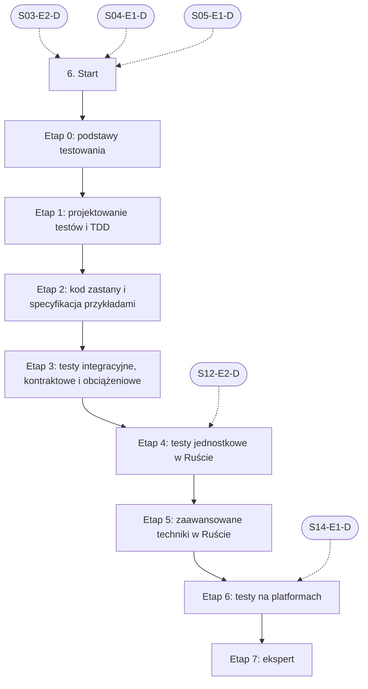

# 06. Testowanie: plan wdrożenia w Linear

Team **LEA** (https://linear.app/daankh/team/LEA/overview). Plan do przeglądu przed wdrożeniem: nic nie zostało jeszcze utworzone w Linear. Klucze zadań (np. `S06-E0-M1`) są robocze; po wdrożeniu dostaną identyfikatory `LEA-…`.

**W skrócie:** 8 kamieni milowych, 50 zadań (1 start, 38 materiałów, 8 dowodów, 3 praktyki). Plik główny z kolejnością projektów: `00-kolejnosc-i-zaleznosci.md`.

## 1. Projekt

| Pole | Wartość |
|---|---|
| Nazwa | 06. Testowanie |
| Team | LEA |
| Podsumowanie (pole „Summary”) | Warstwa 2: jakość i projektowanie. Opiera się na: 3, 4 i 5; etapy testów w Ruście i na platformach także na 12 i 14. Jest podstawą: 7, 8, 9, 11, 12, 20 i 21. |
| Etykiety projektu | `warstwa-2` |
| Blokowany przez (projekty) | 03. Frontend web, 04. Bazy danych i dane, 05. Backend i API |
| Blokuje (projekty) | 07. Wymagania i specyfikacje, 08. Architektura i projektowanie systemów, 09. DevOps, CI/CD i wydania, 11. Weryfikacja pracy AI i budowa procesu, 12. Rust jako wspólny fundament, 20. Lokalne AI i rozwój modeli, 21. Funkcje AI w aplikacjach |
| Zależności częściowe (wchodzące) | etap 4 czeka na 12. Rust jako wspólny fundament (etap 2); etap 6 czeka na 14. Desktop: wspólne (etap 1) |

### Opis projektu (do wklejenia w Linear)

*Warstwa 2: jakość i projektowanie. Opiera się na: 3, 4 i 5; etapy testów w Ruście i na platformach także na 12 i 14. Jest podstawą: 7, 8, 9, 11, 12, 20 i 21.*

**Zakres umiejętności**

- Techniki: TDD, testy charakteryzujące, klasy równoważności, wartości brzegowe, tablice decyzyjne, przejścia stanów, Gherkin.
- Rust: `cargo test`, `cargo-nextest`, `proptest` (testy właściwości), `insta` (snapshoty), `criterion` (wydajność), `cargo-fuzz`, `cargo-mutants` (testy mutacyjne), `cargo-llvm-cov`.
- Web: Vitest, Testing Library, Playwright (E2E i akceptacyjne), MSW, axe (dostępność), regresja wizualna, k6 (obciążenie).
- Mobile: XCTest i XCUITest, testy Compose i Espresso, Maestro; emulatory i realne urządzenia (ćwiczone w sekcjach 18 i 19).
- Desktop: WebDriver dla Tauri (`tauri-driver`), testy instalatorów i aktualizacji na czystych maszynach wirtualnych.
- Embedded: testy na hoście, `embedded-test` lub `defmt-test` na urządzeniu, QEMU, testy hardware-in-the-loop (ćwiczone w sekcji 22).
- Testy kontraktowe API i dane testowe bez danych osobowych.
- Typowe błędy testów pisanych przez AI: testy, które nic nie sprawdzają, mocki ukrywające błąd, testy dopasowane do implementacji zamiast zachowania, wyłączone lub osłabione asercje.

**Ścieżka nauki**

Ścieżka ma 8 etapów. Każdy kończy się **dowodem**, czyli małym projektem, który pokazuje, że etap jest opanowany. Kolejność: podstawy, projektowanie testów i TDD (w TypeScript), kod zastany i specyfikacja przykładami, testy integracyjne i kontraktowe, a po opanowaniu Rusta (sekcja 12, etap 2) testy jednostkowe i zaawansowane techniki w Ruście, na końcu testy web E2E i desktopu Tauri. Etap „projektowanie testów i TDD” otwiera sekcje 7–9, 11, 12, 20 i 21, więc nie czeka na Rusta. Przy doświadczeniu seniorskim etapy 0–3 można zaliczyć samym dowodem i wracać do materiałów tylko tam, gdzie dowód nie wychodzi; nowe będą najpewniej narzędzia Rusta (etapy 4–5) i testy desktopu Tauri (etap 6). Testy mobilne i na urządzeniach embedded są w sekcjach 18, 19 i 22 (materiały do nich są w etapie 6 jako opcjonalne), testy web (Vitest, Testing Library, MSW, Playwright) także w ścieżce frontendu (sekcja 3, etap 6), a testy bezpieczeństwa w sekcji 10. Ceny materiałów płatnych zmieniają się, więc warto je sprawdzić przed zakupem.

**Definicja ukończenia projektu (dowód poziomu E)**

Samodzielnie, bez agenta, w 1 dzień obejmujesz nieznany moduł przejmowanej aplikacji testami charakteryzującymi, wskazujesz w zestawie testów wygenerowanym przez AI testy, które nic nie sprawdzają (potwierdzone testami mutacyjnymi), i umiesz wyjaśnić osobie nietechnicznej, jakie ryzyko pokrywają testy, a jakiego nie.

**Źródło:** dokument „Umiejętności techniczne” w projekcie „JDG: Rozwój oprogramowania”, sekcja 6.

## 2. Kamienie milowe

Jeden kamień milowy na etap ścieżki. Kamień milowy jest zamknięty, gdy zamknięte jest zadanie dowodu tego etapu.

| # | Kamień milowy | Cel | Poziom po etapie | Zadania |
|---|---|---|---|---|
| 1 | Etap 0: podstawy testowania | podstawy testowania i techniki projektowania testów | podstawy | 3 |
| 2 | Etap 1: projektowanie testów i TDD | projektowanie testów i TDD: cykl TDD, dublery, granice, co testować | W | 10 |
| 3 | Etap 2: kod zastany i specyfikacja przykładami | kod zastany i specyfikacja przykładami | W | 5 |
| 4 | Etap 3: testy integracyjne, kontraktowe i obciążeniowe | testy integracyjne z prawdziwą bazą, kontraktowe i obciążeniowe | W | 4 |
| 5 | Etap 4: testy jednostkowe w Ruście | testy jednostkowe w Ruście: `cargo test`, `cargo-nextest`, pokrycie | W | 4 |
| 6 | Etap 5: zaawansowane techniki w Ruście | testy właściwości, snapshoty, fuzzing, testy mutacyjne, wydajność | W | 8 |
| 7 | Etap 6: testy na platformach | testy na platformach: web E2E i desktop Tauri | W | 9 |
| 8 | Etap 7: ekspert | ekspert: strategia testów, recenzja testów z AI, aktualność | E | 6 |

## 3. Punkt startu

Zadanie **`S06-START` · Start: 6. Testowanie** to jedyne wejście do projektu: wszystkie zadania pierwszego etapu są przez nie blokowane.

- **Blokowane przez:** `S03-E2-D`, `S04-E1-D`, `S05-E1-D`
- **Odblokowuje:** `S06-E0-M1`, `S06-E0-M2`
- **Status początkowy:** Backlog do czasu zamknięcia zadań blokujących, potem Todo

Opis zadania (do wklejenia):

Punkt startu projektu „06. Testowanie”.

**Warunki wejścia (zadania blokujące):**

- `S03-E2-D` · Dowód etapu 2: TypeScript — sekcja 3 na poziomie podstawowym do pracy (etap 2)
- `S04-E1-D` · Dowód etapu 1: PostgreSQL w praktyce — sekcja 4 na poziomie podstawowym do pracy (etap 1)
- `S05-E1-D` · Dowód etapu 1: Node.js po stronie serwera — sekcja 5 na poziomie podstawowym do pracy (etap 1)

**Do zrobienia:**

- przeczytać sekcję 6 dokumentu „Umiejętności techniczne”,
- zaznaczyć etapy, które zaliczasz samym dowodem (zgodnie z akapitem wstępnym ścieżki), i dla nich zamknąć zadania materiałów jako niepotrzebne.

**Folder roboczy:** `06-testowanie/`

## 4. Przepływ zależności

Linie ciągłe to zależności wewnątrz projektu, przerywane to zadania z innych projektów. Wewnątrz etapu zadania materiałów są równoległe i wszystkie blokują dowód etapu; dowód etapu blokuje materiały kolejnego etapu.

## 5. Zadania według kamieni milowych

Szablon opisu zadania materiału: nazwa materiału, autor lub wydawca, typ, czas, koszt i link (jak w kolumnach poniżej), zdanie „Gotowe, gdy materiał jest przerobiony w zakresie potrzebnym do dowodu etapu” oraz folder roboczy z kolumny „Folder”. Opisy dowodów i praktyk są podane pod tabelą każdego etapu.

### Etap 0: podstawy testowania

Opis kamienia milowego (do wklejenia):

**Cel:** podstawy testowania i techniki projektowania testów · **Poziom po etapie:** podstawy

**Szczególnie ważne:** klasy równoważności, wartości brzegowe, tablice decyzyjne, przejścia stanów, testowanie oparte na ryzyku, różnica między weryfikacją a walidacją. Certyfikat nie jest potrzebny; sylabus służy jako wspólny słownik z klientami i zespołami QA.

**Dowód:** Dla jednej funkcji z wymaganiami (np. naliczanie ceny abonamentu z rabatem i okresem próbnym) rozpisany zestaw przypadków testowych z uzasadnieniem techniką: klasy, granice, tablica decyzyjna.

| Klucz | Tytuł | Typ | Czas | Koszt | Link | Blokowane przez | Blokuje | Folder |
|---|---|---|---|---|---|---|---|---|
| `S06-E0-M1` | Przerobić: Certified Tester Foundation Level, sylabus v4.0 (aktualizacja 4.0.1) | materiał | 15–20 h | 0 zł (egzamin płatny, opcjonalny) | https://istqb.org/certifications/certified-tester-foundation-level-ctfl-v4-0/ | `S06-START` | `S06-E0-D` | `06-testowanie/e0-podstawy-testowania/` |
| `S06-E0-M2` | Przerobić: Effective Software Testing | materiał, płatny | 15–20 h | płatna | https://www.manning.com/books/effective-software-testing | `S06-START` | `S06-E0-D` | `06-testowanie/e0-podstawy-testowania/` |
| `S06-E0-D` | Dowód etapu 0: podstawy testowania | dowód | — | — | — | `S06-E0-M1`, `S06-E0-M2` | `S06-E1-M1`, `S06-E1-M2`, `S06-E1-M3`, `S06-E1-M4`, `S06-E1-M5`, `S06-E1-M6`, `S06-E1-M7`, `S06-E1-M8`, `S06-E1-M9` | `06-testowanie/e0-podstawy-testowania/` |

**`S06-E0-D` · Dowód etapu 0: podstawy testowania**

Dla jednej funkcji z wymaganiami (np. naliczanie ceny abonamentu z rabatem i okresem próbnym) rozpisany zestaw przypadków testowych z uzasadnieniem techniką: klasy, granice, tablica decyzyjna.

**Na co zwrócić uwagę:** klasy równoważności, wartości brzegowe, tablice decyzyjne, przejścia stanów, testowanie oparte na ryzyku, różnica między weryfikacją a walidacją. Certyfikat nie jest potrzebny; sylabus służy jako wspólny słownik z klientami i zespołami QA.

**Kryterium ukończenia:** dowód wykonany samodzielnie; w komentarzu link do repozytorium, raportu lub notatki.

**Folder roboczy:** `06-testowanie/e0-podstawy-testowania/`

### Etap 1: projektowanie testów i TDD

Opis kamienia milowego (do wklejenia):

**Cel:** projektowanie testów i TDD: cykl TDD, dublery, granice, co testować · **Poziom po etapie:** W

**Szczególnie ważne:** cykl czerwony–zielony–refaktoryzacja i lista testów jako plan (zgodna ze specyfikacją w procesie spec-driven); testowanie zachowania, a nie implementacji; kiedy dubler (mock, stub, fake) pomaga, a kiedy ukrywa błąd; odporność testu na refaktoryzację; proporcje testów jednostkowych, integracyjnych i E2E. TDD jest tu ćwiczone w TypeScript, bo nie wymaga Rusta; w Ruście wraca w etapie „testy jednostkowe w Ruście”. To jest podstawa listy kontrolnej do recenzji testów pisanych przez agentów.

**Dowód:** Moduł domenowy w TypeScript (np. naliczanie ceny abonamentu z rabatem i okresem próbnym z etapu 0 albo walidacja i aktywacja klucza licencyjnego) napisany metodą TDD w Vitest: lista testów zapisana przed kodem, historia commitów pokazuje cykl test–implementacja. Potem refaktoryzacja wewnętrznej struktury (podział na mniejsze funkcje albo zmiana reprezentacji danych) bez zmiany żadnego testu i trzy celowo wprowadzone błędy zachowania, które zestaw wykrywa; krótka notatka, które mocki usunięto i dlaczego.

| Klucz | Tytuł | Typ | Czas | Koszt | Link | Blokowane przez | Blokuje | Folder |
|---|---|---|---|---|---|---|---|---|
| `S06-E1-M1` | Przerobić: Test Driven Development: By Example | materiał, płatny | 12–15 h | płatna | https://www.informit.com/store/test-driven-development-by-example-9780321146533 | `S06-E0-D` | `S06-E1-D` | `06-testowanie/e1-projektowanie-testow-i-tdd/` |
| `S06-E1-M2` | Przerobić: „Canon TDD” | materiał | 1 h | 0 zł | https://tidyfirst.substack.com/p/canon-tdd | `S06-E0-D` | `S06-E1-D` | `06-testowanie/e1-projektowanie-testow-i-tdd/` |
| `S06-E1-M3` | Przerobić: Unit Testing Principles, Practices, and Patterns | materiał, płatny | 15–20 h | płatna | https://www.manning.com/books/unit-testing | `S06-E0-D` | `S06-E1-D` | `06-testowanie/e1-projektowanie-testow-i-tdd/` |
| `S06-E1-M4` | Przerobić: Growing Object-Oriented Software, Guided by Tests | materiał, płatny, opcjonalne | 15–20 h | płatna | https://www.informit.com/store/growing-object-oriented-software-guided-by-tests-9780321503626 | `S06-E0-D` | — | `06-testowanie/e1-projektowanie-testow-i-tdd/` |
| `S06-E1-M5` | Przerobić: „Mocks Aren’t Stubs” | materiał | 1–2 h | 0 zł | https://martinfowler.com/articles/mocksArentStubs.html | `S06-E0-D` | `S06-E1-D` | `06-testowanie/e1-projektowanie-testow-i-tdd/` |
| `S06-E1-M6` | Przerobić: „The Practical Test Pyramid” | materiał | 2 h | 0 zł | https://martinfowler.com/articles/practical-test-pyramid.html | `S06-E0-D` | `S06-E1-D` | `06-testowanie/e1-projektowanie-testow-i-tdd/` |
| `S06-E1-M7` | Przerobić: „The Testing Trophy and Testing Classifications” | materiał | 1 h | 0 zł | https://kentcdodds.com/blog/the-testing-trophy-and-testing-classifications | `S06-E0-D` | `S06-E1-D` | `06-testowanie/e1-projektowanie-testow-i-tdd/` |
| `S06-E1-M8` | Przerobić: Software Engineering at Google, rozdziały 11–14 (testowanie) | materiał | 6–8 h | 0 zł online | https://abseil.io/resources/swe-book | `S06-E0-D` | `S06-E1-D` | `06-testowanie/e1-projektowanie-testow-i-tdd/` |
| `S06-E1-M9` | Przerobić: Vitest: Getting Started, Mocking, Coverage | materiał | 2–3 h | 0 zł | https://vitest.dev/guide/ | `S06-E0-D` | `S06-E1-D` | `06-testowanie/e1-projektowanie-testow-i-tdd/` |
| `S06-E1-D` | Dowód etapu 1: projektowanie testów i TDD | dowód | — | — | — | `S06-E1-M1`, `S06-E1-M2`, `S06-E1-M3`, `S06-E1-M5`, `S06-E1-M6`, `S06-E1-M7`, `S06-E1-M8`, `S06-E1-M9` | `S06-E2-M1`, `S06-E2-M2`, `S06-E2-M3`, `S06-E2-M4`, `S07-START`, `S08-START`, `S09-START`, `S11-START`, `S12-START`, `S20-START`, `S21-START` | `06-testowanie/e1-projektowanie-testow-i-tdd/` |

**`S06-E1-D` · Dowód etapu 1: projektowanie testów i TDD**

Moduł domenowy w TypeScript (np. naliczanie ceny abonamentu z rabatem i okresem próbnym z etapu 0 albo walidacja i aktywacja klucza licencyjnego) napisany metodą TDD w Vitest: lista testów zapisana przed kodem, historia commitów pokazuje cykl test–implementacja. Potem refaktoryzacja wewnętrznej struktury (podział na mniejsze funkcje albo zmiana reprezentacji danych) bez zmiany żadnego testu i trzy celowo wprowadzone błędy zachowania, które zestaw wykrywa; krótka notatka, które mocki usunięto i dlaczego.

**Na co zwrócić uwagę:** cykl czerwony–zielony–refaktoryzacja i lista testów jako plan (zgodna ze specyfikacją w procesie spec-driven); testowanie zachowania, a nie implementacji; kiedy dubler (mock, stub, fake) pomaga, a kiedy ukrywa błąd; odporność testu na refaktoryzację; proporcje testów jednostkowych, integracyjnych i E2E. TDD jest tu ćwiczone w TypeScript, bo nie wymaga Rusta; w Ruście wraca w etapie „testy jednostkowe w Ruście”. To jest podstawa listy kontrolnej do recenzji testów pisanych przez agentów.

**Kryterium ukończenia:** lista testów w repozytorium sprzed pierwszego commitu z kodem; co najmniej 10 par commitów „test czerwony → implementacja”; po refaktoryzacji wszystkie testy przechodzą, a diff plików testów jest pusty; każdy z 3 wprowadzonych błędów daje co najmniej jeden czerwony test; raport pokrycia z `vitest --coverage` dołączony (pokrycie gałęzi ≥ 80% jako sygnał, nie cel); w komentarzu link do repozytorium.

**Folder roboczy:** `06-testowanie/e1-projektowanie-testow-i-tdd/`

### Etap 2: kod zastany i specyfikacja przykładami

Opis kamienia milowego (do wklejenia):

**Cel:** kod zastany i specyfikacja przykładami · **Poziom po etapie:** W

**Szczególnie ważne:** testy charakteryzujące (utrwalenie obecnego zachowania przed zmianą), szwy i łamanie zależności, kryteria akceptacji jako przykłady w specyfikacji, testowanie eksploracyjne w sesjach z kartą (charter) przy przejmowaniu aplikacji z vibe codingu.

**Dowód:** Przejmowana aplikacja (poligon B z mapy nauki) objęta testami charakteryzującymi krytycznych ścieżek (logowanie, płatność, zapis danych) przed pierwszą zmianą; notatki z dwóch sesji eksploracyjnych z kartą (charter) i listą znalezionych problemów; trzy kryteria akceptacji kolejnej poprawki zapisane w Gherkinie.

| Klucz | Tytuł | Typ | Czas | Koszt | Link | Blokowane przez | Blokuje | Folder |
|---|---|---|---|---|---|---|---|---|
| `S06-E2-M1` | Przerobić: Working Effectively with Legacy Code | materiał, płatny | 15–20 h | płatna | https://www.informit.com/store/working-effectively-with-legacy-code-9780131177055 | `S06-E1-D` | `S06-E2-D` | `06-testowanie/e2-kod-zastany-i-specyfikacja-przykladami/` |
| `S06-E2-M2` | Przerobić: Specification by Example | materiał, płatny | 10–12 h | płatna | https://www.manning.com/books/specification-by-example | `S06-E1-D` | `S06-E2-D` | `06-testowanie/e2-kod-zastany-i-specyfikacja-przykladami/` |
| `S06-E2-M3` | Przerobić: Gherkin Reference | materiał | 1–2 h | 0 zł | https://cucumber.io/docs/gherkin/reference/ | `S06-E1-D` | `S06-E2-D` | `06-testowanie/e2-kod-zastany-i-specyfikacja-przykladami/` |
| `S06-E2-M4` | Przerobić: Explore It! | materiał, płatny | 8–10 h | płatna | https://pragprog.com/titles/ehxta/explore-it/ | `S06-E1-D` | `S06-E2-D` | `06-testowanie/e2-kod-zastany-i-specyfikacja-przykladami/` |
| `S06-E2-D` | Dowód etapu 2: kod zastany i specyfikacja przykładami | dowód | — | — | — | `S06-E2-M1`, `S06-E2-M2`, `S06-E2-M3`, `S06-E2-M4` | `S06-E3-M1`, `S06-E3-M2`, `S06-E3-M3` | `06-testowanie/e2-kod-zastany-i-specyfikacja-przykladami/` |

**`S06-E2-D` · Dowód etapu 2: kod zastany i specyfikacja przykładami**

Przejmowana aplikacja (poligon B z mapy nauki) objęta testami charakteryzującymi krytycznych ścieżek (logowanie, płatność, zapis danych) przed pierwszą zmianą; notatki z dwóch sesji eksploracyjnych z kartą (charter) i listą znalezionych problemów; trzy kryteria akceptacji kolejnej poprawki zapisane w Gherkinie.

**Na co zwrócić uwagę:** testy charakteryzujące (utrwalenie obecnego zachowania przed zmianą), szwy i łamanie zależności, kryteria akceptacji jako przykłady w specyfikacji, testowanie eksploracyjne w sesjach z kartą (charter) przy przejmowaniu aplikacji z vibe codingu.

**Kryterium ukończenia:** co najmniej 3 krytyczne ścieżki objęte testami charakteryzującymi, które przechodzą na niezmienionym kodzie; każda sesja eksploracyjna z kartą, czasem trwania i co najmniej 3 zapisanymi obserwacjami; 3 scenariusze Gherkin z danymi (bez ogólników); w komentarzu link do repozytorium i notatek.

**Folder roboczy:** `06-testowanie/e2-kod-zastany-i-specyfikacja-przykladami/`

### Etap 3: testy integracyjne, kontraktowe i obciążeniowe

Opis kamienia milowego (do wklejenia):

**Cel:** testy integracyjne z prawdziwą bazą, kontraktowe i obciążeniowe · **Poziom po etapie:** W

**Szczególnie ważne:** testy integracyjne z prawdziwą bazą w kontenerze (Testcontainers) zamiast mocków warstwy danych, czysty stan bazy dla każdego testu; kontrakt między klientem (web, później desktop i mobile) a API weryfikowany po stronie dostawcy; progi (thresholds) w k6 jako bramka w CI; dane testowe bez danych osobowych. Przewodnik Pact dla Rusta (`pact_consumer`, `pact_verifier`) przydaje się później, przy API w Ruście.

**Dowód:** API w Node.js/TypeScript (usługa z sekcji 5, np. NestJS, albo API z etapu o Node.js) z testami integracyjnymi na prawdziwym PostgreSQL w kontenerze (Testcontainers), testem kontraktowym konsumenta (frontend web lub klient CLI) i weryfikacją kontraktu po stronie dostawcy; scenariusz k6 z progami opóźnienia i błędów, który zatrzymuje pipeline po ich przekroczeniu.

| Klucz | Tytuł | Typ | Czas | Koszt | Link | Blokowane przez | Blokuje | Folder |
|---|---|---|---|---|---|---|---|---|
| `S06-E3-M1` | Przerobić: Testcontainers for Node.js (moduł PostgreSQL) i przewodniki Testcontainers | materiał | 3–4 h | 0 zł | https://node.testcontainers.org, https://testcontainers.com/guides/ | `S06-E2-D` | `S06-E3-D` | `06-testowanie/e3-testy-integracyjne-kontraktowe-i-obciazeniowe/` |
| `S06-E3-M2` | Przerobić: Pact: wprowadzenie i przewodnik dla JavaScript/TypeScript (`@pact-foundation/pact`) | materiał | 8–10 h | 0 zł | https://docs.pact.io, https://docs.pact.io/implementation_guides/javascript | `S06-E2-D` | `S06-E3-D` | `06-testowanie/e3-testy-integracyjne-kontraktowe-i-obciazeniowe/` |
| `S06-E3-M3` | Przerobić: Grafana k6 | materiał | 8–10 h | 0 zł | https://grafana.com/docs/k6/latest/ | `S06-E2-D` | `S06-E3-D` | `06-testowanie/e3-testy-integracyjne-kontraktowe-i-obciazeniowe/` |
| `S06-E3-D` | Dowód etapu 3: testy integracyjne, kontraktowe i obciążeniowe | dowód | — | — | — | `S06-E3-M1`, `S06-E3-M2`, `S06-E3-M3` | `S06-E4-M1`, `S06-E4-M2`, `S06-E4-M3` | `06-testowanie/e3-testy-integracyjne-kontraktowe-i-obciazeniowe/` |

**`S06-E3-D` · Dowód etapu 3: testy integracyjne, kontraktowe i obciążeniowe**

API w Node.js/TypeScript (usługa z sekcji 5, np. NestJS, albo API z etapu o Node.js) z testami integracyjnymi na prawdziwym PostgreSQL w kontenerze (Testcontainers), testem kontraktowym konsumenta (frontend web lub klient CLI) i weryfikacją kontraktu po stronie dostawcy; scenariusz k6 z progami opóźnienia i błędów, który zatrzymuje pipeline po ich przekroczeniu.

**Na co zwrócić uwagę:** testy integracyjne z prawdziwą bazą w kontenerze (Testcontainers) zamiast mocków warstwy danych, czysty stan bazy dla każdego testu; kontrakt między klientem (web, później desktop i mobile) a API weryfikowany po stronie dostawcy; progi (thresholds) w k6 jako bramka w CI; dane testowe bez danych osobowych. Przewodnik Pact dla Rusta (`pact_consumer`, `pact_verifier`) przydaje się później, przy API w Ruście.

**Kryterium ukończenia:** co najmniej 5 testów integracyjnych na prawdziwej bazie, bez mocków warstwy danych, każdy na czystym stanie; kontrakt Pact z co najmniej 3 interakcjami weryfikowany po stronie dostawcy, a celowa zmiana pola odpowiedzi API psuje weryfikację; k6 z progami (np. `p(95)<300`, `http_req_failed<0.01`) kończy się kodem różnym od 0 na celowo spowolnionym endpoincie; całość uruchamiana jednym poleceniem lokalnie i w CI; w komentarzu link do repozytorium.

**Folder roboczy:** `06-testowanie/e3-testy-integracyjne-kontraktowe-i-obciazeniowe/`

### Etap 4: testy jednostkowe w Ruście

Opis kamienia milowego (do wklejenia):

**Cel:** testy jednostkowe w Ruście: `cargo test`, `cargo-nextest`, pokrycie · **Poziom po etapie:** W

**Szczególnie ważne:** TDD z etapu „projektowanie testów i TDD” przeniesione na Rusta; testy w module (`#[cfg(test)]`) i testy integracyjne w `tests/`, doctesty jako dokumentacja, która się kompiluje; `cargo nextest` nie uruchamia doctestów, więc w CI osobno `cargo test --doc`; pokrycie jako sygnał, a nie cel.

**Dowód:** Biblioteka w Ruście (np. walidacja i aktywacja klucza licencyjnego) napisana metodą TDD, z historią commitów pokazującą cykl test–implementacja, z testami w module, testami integracyjnymi w `tests/` i doctestami, uruchamiana przez `cargo nextest` i `cargo test --doc`, z raportem pokrycia z `cargo llvm-cov`.

| Klucz | Tytuł | Typ | Czas | Koszt | Link | Blokowane przez | Blokuje | Folder |
|---|---|---|---|---|---|---|---|---|
| `S06-E4-M1` | Przerobić: The Rust Programming Language, rozdział 11 „Writing Automated Tests” | materiał | 4–6 h | 0 zł | https://doc.rust-lang.org/book/ch11-00-testing.html | `S06-E3-D`, `S12-E2-D` | `S06-E4-D` | `06-testowanie/e4-testy-jednostkowe-w-ruscie/` |
| `S06-E4-M2` | Przerobić: cargo-nextest | materiał | 3–4 h | 0 zł | https://nexte.st | `S06-E3-D`, `S12-E2-D` | `S06-E4-D` | `06-testowanie/e4-testy-jednostkowe-w-ruscie/` |
| `S06-E4-M3` | Przerobić: cargo-llvm-cov | materiał | 2 h | 0 zł | https://github.com/taiki-e/cargo-llvm-cov | `S06-E3-D`, `S12-E2-D` | `S06-E4-D` | `06-testowanie/e4-testy-jednostkowe-w-ruscie/` |
| `S06-E4-D` | Dowód etapu 4: testy jednostkowe w Ruście | dowód | — | — | — | `S06-E4-M1`, `S06-E4-M2`, `S06-E4-M3` | `S06-E5-M1`, `S06-E5-M2`, `S06-E5-M3`, `S06-E5-M4`, `S06-E5-M5`, `S06-E5-M6`, `S06-E5-M7` | `06-testowanie/e4-testy-jednostkowe-w-ruscie/` |

**`S06-E4-D` · Dowód etapu 4: testy jednostkowe w Ruście**

Biblioteka w Ruście (np. walidacja i aktywacja klucza licencyjnego) napisana metodą TDD, z historią commitów pokazującą cykl test–implementacja, z testami w module, testami integracyjnymi w `tests/` i doctestami, uruchamiana przez `cargo nextest` i `cargo test --doc`, z raportem pokrycia z `cargo llvm-cov`.

**Na co zwrócić uwagę:** TDD z etapu „projektowanie testów i TDD” przeniesione na Rusta; testy w module (`#[cfg(test)]`) i testy integracyjne w `tests/`, doctesty jako dokumentacja, która się kompiluje; `cargo nextest` nie uruchamia doctestów, więc w CI osobno `cargo test --doc`; pokrycie jako sygnał, a nie cel.

**Kryterium ukończenia:** co najmniej 15 testów, w tym co najmniej 3 testy integracyjne w `tests/` i 2 doctesty; `cargo nextest run` i `cargo test --doc` przechodzą w CI; raport `cargo llvm-cov` dołączony (pokrycie linii ≥ 80%); w komentarzu link do repozytorium.

**Folder roboczy:** `06-testowanie/e4-testy-jednostkowe-w-ruscie/`

### Etap 5: zaawansowane techniki w Ruście

Opis kamienia milowego (do wklejenia):

**Cel:** testy właściwości, snapshoty, fuzzing, testy mutacyjne, wydajność · **Poziom po etapie:** W

**Szczególnie ważne:** własności zamiast przykładów (odwracalność serializacji, niezmienniki), minimalizacja kontrprzykładów, recenzja zmian w snapshotach (`cargo insta review`) zamiast ślepej akceptacji, fuzzing parserów i wszystkiego, co przyjmuje dane z zewnątrz, odsetek przeżywających mutantów jako miara jakości testów; Miri wykrywa niezdefiniowane zachowanie w `unsafe` (także w zależnościach), działa tylko na nightly i jest wolny, więc w CI na podzbiorze testów; `loom` dla własnych struktur współbieżnych.

**Dowód:** Do biblioteki z etapu „testy jednostkowe w Ruście” dodane: testy właściwości dla serializacji i niezmienników, snapshot formatu wyjściowego, cel fuzzingu dla parsera wejścia uruchamiany w CI przez ograniczony czas, przebieg `cargo miri test`, benchmark `criterion` jednej ścieżki krytycznej i raport `cargo mutants` z omówieniem każdego przeżywającego mutanta.

| Klucz | Tytuł | Typ | Czas | Koszt | Link | Blokowane przez | Blokuje | Folder |
|---|---|---|---|---|---|---|---|---|
| `S06-E5-M1` | Przerobić: Proptest book | materiał | 5–6 h | 0 zł | https://proptest-rs.github.io/proptest/ | `S06-E4-D` | `S06-E5-D` | `06-testowanie/e5-zaawansowane-techniki-w-ruscie/` |
| `S06-E5-M2` | Przerobić: insta | materiał | 2–3 h | 0 zł | https://insta.rs/docs/ | `S06-E4-D` | `S06-E5-D` | `06-testowanie/e5-zaawansowane-techniki-w-ruscie/` |
| `S06-E5-M3` | Przerobić: Rust Fuzz Book (`cargo-fuzz`, `afl.rs`) | materiał | 6–8 h | 0 zł | https://rust-fuzz.github.io/book/ | `S06-E4-D` | `S06-E5-D` | `06-testowanie/e5-zaawansowane-techniki-w-ruscie/` |
| `S06-E5-M4` | Przerobić: cargo-mutants | materiał | 4–5 h | 0 zł | https://mutants.rs | `S06-E4-D` | `S06-E5-D` | `06-testowanie/e5-zaawansowane-techniki-w-ruscie/` |
| `S06-E5-M5` | Przerobić: Criterion.rs | materiał | 3–4 h | 0 zł | https://bheisler.github.io/criterion.rs/book/ | `S06-E4-D` | `S06-E5-D` | `06-testowanie/e5-zaawansowane-techniki-w-ruscie/` |
| `S06-E5-M6` | Przerobić: Miri: wykrywanie niezdefiniowanego zachowania (`cargo miri test`) | materiał | 2–3 h | 0 zł | https://github.com/rust-lang/miri | `S06-E4-D` | `S06-E5-D` | `06-testowanie/e5-zaawansowane-techniki-w-ruscie/` |
| `S06-E5-M7` | Przerobić: loom: testowanie współbieżności przez przegląd wszystkich przeplotów wątków | materiał, opcjonalne | 3–4 h | 0 zł | https://docs.rs/loom/latest/loom/ | `S06-E4-D` | — | `06-testowanie/e5-zaawansowane-techniki-w-ruscie/` |
| `S06-E5-D` | Dowód etapu 5: zaawansowane techniki w Ruście | dowód | — | — | — | `S06-E5-M1`, `S06-E5-M2`, `S06-E5-M3`, `S06-E5-M4`, `S06-E5-M5`, `S06-E5-M6` | `S06-E6-M1`, `S06-E6-M2`, `S06-E6-M3`, `S06-E6-M4`, `S06-E6-M5`, `S06-E6-M6`, `S06-E6-M7`, `S06-E6-M8` | `06-testowanie/e5-zaawansowane-techniki-w-ruscie/` |

**`S06-E5-D` · Dowód etapu 5: zaawansowane techniki w Ruście**

Do biblioteki z etapu „testy jednostkowe w Ruście” dodane: testy właściwości dla serializacji i niezmienników, snapshot formatu wyjściowego, cel fuzzingu dla parsera wejścia uruchamiany w CI przez ograniczony czas, przebieg `cargo miri test`, benchmark `criterion` jednej ścieżki krytycznej i raport `cargo mutants` z omówieniem każdego przeżywającego mutanta.

**Na co zwrócić uwagę:** własności zamiast przykładów (odwracalność serializacji, niezmienniki), minimalizacja kontrprzykładów, recenzja zmian w snapshotach (`cargo insta review`) zamiast ślepej akceptacji, fuzzing parserów i wszystkiego, co przyjmuje dane z zewnątrz, odsetek przeżywających mutantów jako miara jakości testów; Miri wykrywa niezdefiniowane zachowanie w `unsafe` (także w zależnościach), działa tylko na nightly i jest wolny, więc w CI na podzbiorze testów; `loom` dla własnych struktur współbieżnych.

**Kryterium ukończenia:** co najmniej 3 właściwości w `proptest`; fuzzing w CI co najmniej 5 minut na przebieg, a każde znalezisko dodane jako test regresji; `cargo +nightly miri test` bez zgłoszeń; benchmark z zapisanym wynikiem bazowym; przeżywające mutanty ≤ 10% albo każdy omówiony w raporcie; w komentarzu link do repozytorium i raportu.

**Folder roboczy:** `06-testowanie/e5-zaawansowane-techniki-w-ruscie/`

### Etap 6: testy na platformach

Opis kamienia milowego (do wklejenia):

**Cel:** testy na platformach: web E2E i desktop Tauri · **Poziom po etapie:** W

**Szczególnie ważne:** testy logiki na hoście (moduły domenowe, rdzeń w Ruście) jako główna warstwa, a testy platformowe tylko dla integracji i UI; w Playwright lokatory po roli i tekście zamiast selektorów CSS i auto-oczekiwanie zamiast stałych opóźnień; `tauri-driver` działa bezpośrednio na Linuksie i Windows, a macOS wymaga ścieżki przez WebdriverIO; `mockIPC` pozwala testować frontend Tauri bez uruchamiania backendu; testy instalatora i aktualizacji na czystych maszynach wirtualnych są w sekcjach 15–17. Testy mobilne (XCUITest, Compose, Maestro) i na urządzeniach embedded są w dowodach sekcji 18, 19 i 22.

**Dowód:** Zestaw E2E w Playwright dla trzech krytycznych ścieżek aplikacji web (np. logowanie, główny przepływ, błąd walidacji) uruchamiany w CI na Chromium, Firefox i WebKit; aplikacja Tauri z testami frontendu z zamockowanym IPC (`mockIPC`) i jednym testem WebDriver (`tauri-driver`) przez główny przepływ, uruchamianym w CI na Linuksie i Windows.

| Klucz | Tytuł | Typ | Czas | Koszt | Link | Blokowane przez | Blokuje | Folder |
|---|---|---|---|---|---|---|---|---|
| `S06-E6-M1` | Przerobić: Playwright: Getting started, lokatory, trace viewer, uruchamianie w CI | materiał | 6–8 h | 0 zł | https://playwright.dev/docs/intro | `S06-E5-D`, `S14-E1-D` | `S06-E6-D` | `06-testowanie/e6-testy-na-platformach/` |
| `S06-E6-M2` | Przerobić: Tauri: WebDriver (`tauri-driver`, usługa WebdriverIO) | materiał | 4–6 h | 0 zł | https://v2.tauri.app/develop/tests/webdriver/ | `S06-E5-D`, `S14-E1-D` | `S06-E6-D` | `06-testowanie/e6-testy-na-platformach/` |
| `S06-E6-M3` | Przerobić: Tauri: Mock Tauri APIs (`@tauri-apps/api/mocks`, `mockIPC`) | materiał | 1–2 h | 0 zł | https://v2.tauri.app/develop/tests/mocking/ | `S06-E5-D`, `S14-E1-D` | `S06-E6-D` | `06-testowanie/e6-testy-na-platformach/` |
| `S06-E6-M4` | Przerobić: XCTest (testy jednostkowe, wydajności i UI) i Swift Testing | materiał, opcjonalne | 8–10 h | 0 zł | https://developer.apple.com/documentation/xctest, https://developer.apple.com/xcode/swift-testing/ | `S06-E5-D`, `S14-E1-D` | — | `06-testowanie/e6-testy-na-platformach/` |
| `S06-E6-M5` | Przerobić: Test apps on Android, Test your Compose layout, Espresso | materiał, opcjonalne | 8–10 h | 0 zł | https://developer.android.com/training/testing, https://developer.android.com/develop/ui/compose/testing | `S06-E5-D`, `S14-E1-D` | — | `06-testowanie/e6-testy-na-platformach/` |
| `S06-E6-M6` | Przerobić: Maestro | materiał, płatny, opcjonalne | 4–6 h | 0 zł (chmura płatna) | https://docs.maestro.dev | `S06-E5-D`, `S14-E1-D` | — | `06-testowanie/e6-testy-na-platformach/` |
| `S06-E6-M7` | Przerobić: embedded-test | materiał, opcjonalne | 4–6 h | 0 zł | https://github.com/probe-rs/embedded-test | `S06-E5-D`, `S14-E1-D` | — | `06-testowanie/e6-testy-na-platformach/` |
| `S06-E6-M8` | Przerobić: QEMU: emulacja systemów Arm | materiał, opcjonalne | 3–4 h | 0 zł | https://www.qemu.org/docs/master/system/target-arm.html | `S06-E5-D`, `S14-E1-D` | — | `06-testowanie/e6-testy-na-platformach/` |
| `S06-E6-D` | Dowód etapu 6: testy na platformach | dowód | — | — | — | `S06-E6-M1`, `S06-E6-M2`, `S06-E6-M3` | `S06-E7-M1`, `S06-E7-M2`, `S06-E7-P1`, `S06-E7-P2`, `S06-E7-P3` | `06-testowanie/e6-testy-na-platformach/` |

**`S06-E6-D` · Dowód etapu 6: testy na platformach**

Zestaw E2E w Playwright dla trzech krytycznych ścieżek aplikacji web (np. logowanie, główny przepływ, błąd walidacji) uruchamiany w CI na Chromium, Firefox i WebKit; aplikacja Tauri z testami frontendu z zamockowanym IPC (`mockIPC`) i jednym testem WebDriver (`tauri-driver`) przez główny przepływ, uruchamianym w CI na Linuksie i Windows.

**Na co zwrócić uwagę:** testy logiki na hoście (moduły domenowe, rdzeń w Ruście) jako główna warstwa, a testy platformowe tylko dla integracji i UI; w Playwright lokatory po roli i tekście zamiast selektorów CSS i auto-oczekiwanie zamiast stałych opóźnień; `tauri-driver` działa bezpośrednio na Linuksie i Windows, a macOS wymaga ścieżki przez WebdriverIO; `mockIPC` pozwala testować frontend Tauri bez uruchamiania backendu; testy instalatora i aktualizacji na czystych maszynach wirtualnych są w sekcjach 15–17. Testy mobilne (XCUITest, Compose, Maestro) i na urządzeniach embedded są w dowodach sekcji 18, 19 i 22.

**Kryterium ukończenia:** 3 scenariusze Playwright przechodzą na 3 silnikach, bez `waitForTimeout`, ze śladem (trace) zapisywanym przy błędzie; co najmniej 5 testów frontendu Tauri z `mockIPC`; test WebDriver przechodzi w CI na Linuksie i Windows; w komentarzu link do przebiegu CI.

**Folder roboczy:** `06-testowanie/e6-testy-na-platformach/`

### Etap 7: ekspert

Opis kamienia milowego (do wklejenia):

**Cel:** ekspert: strategia testów, recenzja testów z AI, aktualność · **Poziom po etapie:** E

**Dowód poziomu E:** Samodzielnie, bez agenta, w 1 dzień obejmujesz nieznany moduł przejmowanej aplikacji testami charakteryzującymi, wskazujesz w zestawie testów wygenerowanym przez AI testy, które nic nie sprawdzają (potwierdzone testami mutacyjnymi), i umiesz wyjaśnić osobie nietechnicznej, jakie ryzyko pokrywają testy, a jakiego nie.

| Klucz | Tytuł | Typ | Czas | Koszt | Link | Blokowane przez | Blokuje | Folder |
|---|---|---|---|---|---|---|---|---|
| `S06-E7-M1` | Przerobić: Wydania i changelogi narzędzi testowych… | materiał | ok. 30 min tygodniowo | 0 zł | strony z etapów 1–6 | `S06-E6-D` | `S06-E7-D` | `06-testowanie/e7-ekspert/` |
| `S06-E7-M2` | Przerobić: Aktualizacje sylabusów ISTQB (m.in. Advanced Level Test Analyst, Testing with Generative AI) | materiał, opcjonalne | wg potrzeb | 0 zł | https://istqb.org | `S06-E6-D` | — | `06-testowanie/e7-ekspert/` |
| `S06-E7-P1` | Praktyka: recenzja testów z AI | praktyka | — | — | — | `S06-E6-D` | `S06-E7-D` | `06-testowanie/e7-ekspert/` |
| `S06-E7-P2` | Praktyka: TDD z agentem | praktyka | — | — | — | `S06-E6-D` | `S06-E7-D` | `06-testowanie/e7-ekspert/` |
| `S06-E7-P3` | Praktyka: strategia testów u klienta | praktyka | — | — | — | `S06-E6-D` | `S06-E7-D` | `06-testowanie/e7-ekspert/` |
| `S06-E7-D` | Dowód poziomu E: ekspert | dowód | — | — | — | `S06-E7-M1`, `S06-E7-P1`, `S06-E7-P2`, `S06-E7-P3` | — | `06-testowanie/e7-ekspert/` |

**`S06-E7-P1` · Praktyka: recenzja testów z AI**

20 pull requestów z testami wygenerowanymi przez agentów, recenzowanych według listy kontrolnej z etapów „projektowanie testów i TDD” i „zaawansowane techniki w Ruście” (testy bez asercji lub z asercjami tautologicznymi, mocki ukrywające błąd, testy dopasowane do implementacji, osłabione lub wyłączone asercje, zaakceptowane bez przeglądu snapshoty); przy każdej wątpliwości `cargo mutants` na zmienionym kodzie.

Praktyka ciągła etapu eksperckiego: oznacz jako gotową, gdy działa jako stały element pracy, a nie po jednorazowym wykonaniu.

**Folder roboczy:** `06-testowanie/e7-ekspert/`

**`S06-E7-P2` · Praktyka: TDD z agentem**

Człowiek pisze lub zatwierdza listę testów ze specyfikacji, agent implementuje; pomiar, ile błędów wyłapały testy przed recenzją.

Praktyka ciągła etapu eksperckiego: oznacz jako gotową, gdy działa jako stały element pracy, a nie po jednorazowym wykonaniu.

**Folder roboczy:** `06-testowanie/e7-ekspert/`

**`S06-E7-P3` · Praktyka: strategia testów u klienta**

Jednostronicowa strategia (ryzyka, warstwy testów, bramki w CI, dane testowe) dla przejmowanej aplikacji.

Praktyka ciągła etapu eksperckiego: oznacz jako gotową, gdy działa jako stały element pracy, a nie po jednorazowym wykonaniu.

**Folder roboczy:** `06-testowanie/e7-ekspert/`

**`S06-E7-D` · Dowód poziomu E: ekspert**

Samodzielnie, bez agenta, w 1 dzień obejmujesz nieznany moduł przejmowanej aplikacji testami charakteryzującymi, wskazujesz w zestawie testów wygenerowanym przez AI testy, które nic nie sprawdzają (potwierdzone testami mutacyjnymi), i umiesz wyjaśnić osobie nietechnicznej, jakie ryzyko pokrywają testy, a jakiego nie.

**Kryterium ukończenia:** dowód wykonany samodzielnie; w komentarzu link do repozytorium, raportu lub notatki. Bez agenta AI.

**Folder roboczy:** `06-testowanie/e7-ekspert/`

## 6. Relacje z innymi projektami

**Wchodzące** (zadanie z innego projektu blokuje zadanie tego projektu):

- `S03-E2-D` (Dowód etapu 2: TypeScript) → `S06-START`
- `S04-E1-D` (Dowód etapu 1: PostgreSQL w praktyce) → `S06-START`
- `S05-E1-D` (Dowód etapu 1: Node.js po stronie serwera) → `S06-START`
- `S12-E2-D` (Dowód etapu 2: własność, pożyczanie, czasy życia) → `S06-E4-M1`
- `S12-E2-D` (Dowód etapu 2: własność, pożyczanie, czasy życia) → `S06-E4-M2`
- `S12-E2-D` (Dowód etapu 2: własność, pożyczanie, czasy życia) → `S06-E4-M3`
- `S14-E1-D` (Dowód etapu 1: Tauri 2) → `S06-E6-M1`
- `S14-E1-D` (Dowód etapu 1: Tauri 2) → `S06-E6-M2`
- `S14-E1-D` (Dowód etapu 1: Tauri 2) → `S06-E6-M3`
- `S14-E1-D` (Dowód etapu 1: Tauri 2) → `S06-E6-M4`
- `S14-E1-D` (Dowód etapu 1: Tauri 2) → `S06-E6-M5`
- `S14-E1-D` (Dowód etapu 1: Tauri 2) → `S06-E6-M6`
- `S14-E1-D` (Dowód etapu 1: Tauri 2) → `S06-E6-M7`
- `S14-E1-D` (Dowód etapu 1: Tauri 2) → `S06-E6-M8`

**Wychodzące** (zadanie tego projektu blokuje zadanie w innym projekcie):

- `S06-E1-D` → `S07-START` (07. Wymagania i specyfikacje)
- `S06-E1-D` → `S08-START` (08. Architektura i projektowanie systemów)
- `S06-E1-D` → `S09-START` (09. DevOps, CI/CD i wydania)
- `S06-E1-D` → `S11-START` (11. Weryfikacja pracy AI i budowa procesu)
- `S06-E1-D` → `S12-START` (12. Rust jako wspólny fundament)
- `S06-E1-D` → `S20-START` (20. Lokalne AI i rozwój modeli)
- `S06-E1-D` → `S21-START` (21. Funkcje AI w aplikacjach)
