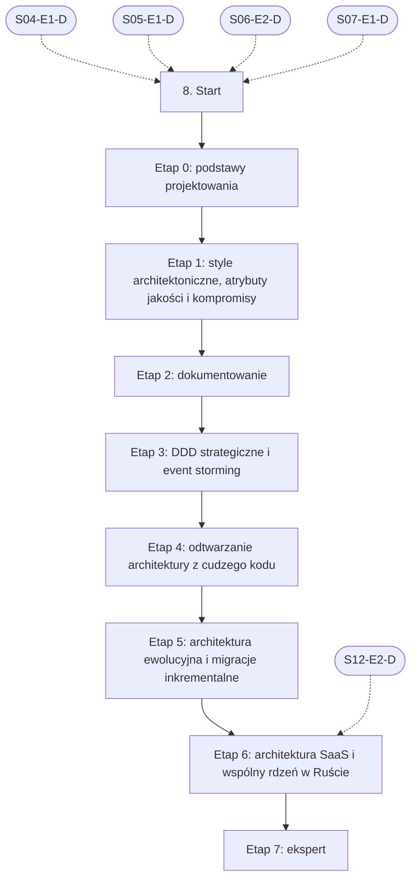

# 08. Architektura i projektowanie systemów: plan wdrożenia w Linear

Team **LEA** (https://linear.app/daankh/team/LEA/overview). Plan do przeglądu przed wdrożeniem: nic nie zostało jeszcze utworzone w Linear. Klucze zadań (np. `S08-E0-M1`) są robocze; po wdrożeniu dostaną identyfikatory `LEA-…`.

**W skrócie:** 8 kamieni milowych, 68 zadań (1 start, 55 materiałów, 8 dowodów, 4 praktyki). Plik główny z kolejnością projektów: `00-kolejnosc-i-zaleznosci.md`.

## 1. Projekt

| Pole | Wartość |
|---|---|
| Nazwa | 08. Architektura i projektowanie systemów |
| Team | LEA |
| Podsumowanie (pole „Summary”) | Warstwa 2: jakość i projektowanie. Opiera się na: 4, 5, 6 i 7. Jest podstawą: 10, 11, 12, 14 i 21. |
| Proponowany start | 2026-11-16 |
| Proponowany termin | 2027-06-30 |
| Etykiety projektu | `warstwa-2` |
| Blokowany przez (projekty) | 04. Bazy danych i dane, 05. Backend i API, 06. Testowanie, 07. Wymagania i specyfikacje |
| Blokuje (projekty) | 10. Bezpieczeństwo, 11. Weryfikacja pracy AI i budowa procesu, 12. Rust jako wspólny fundament, 14. Desktop: wspólne, 21. Funkcje AI w aplikacjach |
| Zależności częściowe (wchodzące) | etap 6 czeka na 12. Rust jako wspólny fundament (etap 2) |
| Czas od zera | 295–375 h |

### Opis projektu (do wklejenia w Linear)

*Warstwa 2: jakość i projektowanie. Opiera się na: 4, 5, 6 i 7. Jest podstawą: 10, 11, 12, 14 i 21.*

**Zakres umiejętności**

- Podstawy projektowania: spójność i sprzężenie (także jego siła, odległość i zmienność), moduły głębokie i płytkie, ukrywanie informacji, złożoność jako główny koszt utrzymania, zasady SOLID i ich granice (abstrakcje na zapas, nadmiar warstw), wzorce projektowe jako słownik, a nie cel, idiomy Rusta zamiast przenoszenia wzorców z Javy.
- Style architektoniczne i ich kompromisy: warstwy, monolit modularny, architektura heksagonalna (porty i adaptery), architektura usługowa i mikroserwisy, architektura sterowana zdarzeniami (powiadomienia, przenoszenie stanu w zdarzeniu, event sourcing, CQRS), local-first; „monolit najpierw” jako domyślny wybór dla firmy jednoosobowej.
- Atrybuty jakości jako drivery decyzji: scenariusze atrybutów jakości, identyfikacja charakterystyk kluczowych dla danego systemu, analiza kompromisów (np. spójność kontra dostępność, izolacja kontra koszt), Attribute-Driven Design (ADD 3.0) i ATAM w wersji odchudzonej dla jednej osoby; zapis wymagań jakościowych jest w sekcji 7.
- Dokumentowanie: model C4 (kontekst, kontenery, komponenty, diagramy dynamiczne i wdrożeniowe), arc42 jako szkielet dokumentu, ADR z co najmniej dwiema alternatywami, konsekwencjami i statusem (MADR, Nygard, zastępowanie zamiast edycji), `ARCHITECTURE.md` w repozytorium, docs-as-code i diagramy jako kod (Structurizr DSL, Mermaid).
- DDD: subdomeny (kluczowa, wspierająca, ogólna), bounded contexts, mapa kontekstów i jej wzorce (warstwa antykorupcyjna, open-host service, konformista, wspólne jądro), język wszechobecny i słownik, event storming; w zarysie taktyczne DDD (agregaty, encje, obiekty wartości, zdarzenia domenowe); DDD jako opcja włączana decyzją w ADR (vicrafter, sekcja 18.4 specyfikacji).
- Architektura ewolucyjna: funkcje dopasowania (fitness functions) w CI, testy architektury (`dependency-cruiser`, ArchUnitTS, w Ruście `cargo-modules`, reguły `bans` w `cargo-deny`, granice crate’ów w workspace), strangler fig, branch by abstraction, warstwa antykorupcyjna, migracje inkrementalne z architekturą przejściową.
- Architektura SaaS: modele wielodostępności (silo, pula, model mieszany), izolacja danych na poziomie bazy, schematu lub wiersza (RLS, zob. sekcja 4), kontekst najemcy przekazywany przez wszystkie warstwy (cache, kolejki, pliki, logi), limity i „hałaśliwy sąsiad”, poziomy planów, onboarding najemcy.
- Wspólny rdzeń w Ruście dla wielu platform: podział na crate’y w workspace (domena, porty, adaptery, wiązania), API rdzenia jako kontrakt (zgrubne operacje, własne typy błędów, wersjonowanie), FFI jako granica architektoniczna (UniFFI do Swifta i Kotlina, komendy Tauri, WASM), wzorzec rdzeń i powłoka (np. Crux), co zostaje w powłoce platformowej; szczegóły w sekcjach 12, 14, 18 i 19.
- Odtwarzanie architektury z cudzego kodu: punkty wejścia i budowanie, graf zależności modułów, hotspoty (częstość zmian razy złożoność) i sprzężenie zmian z historii gita, mapa wiedzy (kto zna który moduł), C4 poziomu 1 i 2 oraz ADR w statusie „reconstructed”, rejestr długu technicznego z kosztem i ryzykiem, plan naprawczy w trzech horyzontach (natychmiast, 30, 90 dni), w tym wyjście z platformy no-code.
- Recenzja planów technicznych z AI: zgodność z konstytucją i bazowymi ADR, realne alternatywy zamiast „słomianych”, konsekwencje i koszt zmiany decyzji, wpływ na granice modułów i dane, plan migracji i wycofania, ryzyka, sprawdzenie w kodzie każdego twierdzenia planu o istniejącej strukturze.
- Typowe błędy architektoniczne w kodzie i planach z AI do wyłapania: logika biznesowa w komponentach UI, route handlerach i Server Actions zamiast w module domenowym; importy na skróty przez warstwy i cykle zależności; abstrakcje na zapas (interfejs z jedną implementacją, generyczne repozytoria, fabryki), czyli płytkie moduły; mikroserwisy, kolejki i Kubernetes dla systemu prowadzonego przez jedną osobę; ADR bez alternatyw albo z alternatywami odrzuconymi bez uzasadnienia; plan sprzeczny z istniejącymi ADR lub konstytucją; diagramy C4 z kontenerami, których nie ma w kodzie; propozycja „przepisać od zera” zamiast migracji inkrementalnej; izolacja najemców tylko w warunku `WHERE` w kodzie aplikacji i brak identyfikatora najemcy w kluczach cache, kolejkach i ścieżkach plików; rdzeń w Ruście przyjmujący typy platformy, „gadatliwe” API przez FFI (wiele drobnych wywołań), panika przechodząca przez granicę FFI; ta sama logika powielona w Swifcie, Kotlinie i TypeScripcie zamiast w rdzeniu; plan bez migracji danych i ścieżki wycofania.

**Ścieżka nauki**

Ścieżka ma 8 etapów. Każdy kończy się **dowodem**, czyli małym projektem, który pokazuje, że etap jest opanowany. Dowody odpowiadają pracy w firmie: raport architektury przejmowanej aplikacji w 2 dni, bazowe ADR dla rdzenia własnej aplikacji, funkcja dopasowania w CI i plan migracji z platformy no-code. Przy doświadczeniu seniorskim etap 0 można zaliczyć samym dowodem, a etapy 4 i 5 warto przejść w całości, bo to rdzeń pakietu „Audyt przejęcia”. Czas podany dla osoby startującej od zera; ceny materiałów płatnych zmieniają się, więc warto je sprawdzić przed zakupem. Designing Data-Intensive Applications jest w sekcji 5.1 (etap 8), Working Effectively with Legacy Code w sekcji 6.1 (etap 4), ISO/IEC 25010 i zapis wymagań jakościowych w sekcji 7, Release It! w sekcji 9, a modelowanie zagrożeń w sekcji 10.1 (etap 3).

Razem od zera do poziomu E: ok. 295–375 h, czyli 6–8 miesięcy przy 10–12 h tygodniowo.

**Definicja ukończenia projektu (dowód poziomu E)**

Samodzielnie, bez agenta, w 2 dni przygotowujesz dla nieznanej aplikacji klienta raport architektury z C4 poziomu 1 i 2, ADR w statusie „reconstructed”, rejestrem długu opartym na hotspotach i planem naprawczym w trzech horyzontach, w tym wariantem migracji strangler fig; w recenzji planu technicznego przygotowanego przez agenta wskazujesz błąd architektoniczny, którego nie znalazł recenzent AI, i umiesz wyjaśnić klientowi nietechnicznemu, jakie kompromisy niesie każda z rekomendowanych decyzji.

**Źródło:** dokument „Umiejętności techniczne” w projekcie „JDG: Rozwój oprogramowania”, sekcja 8.

## 2. Kamienie milowe

Jeden kamień milowy na etap ścieżki. Kamień milowy jest zamknięty, gdy zamknięte jest zadanie dowodu tego etapu. Daty kamieni milowych ustawiasz przy wdrożeniu według kolejności z pliku głównego.

| # | Kamień milowy | Cel | Czas od zera | Poziom po etapie | Zadania |
|---|---|---|---|---|---|
| 1 | Etap 0: podstawy projektowania | podstawy projektowania: złożoność, sprzężenie, modularność, wzorce | 40–50 h | podstawy | 7 |
| 2 | Etap 1: style architektoniczne, atrybuty jakości i kompromisy | style architektoniczne, atrybuty jakości i analiza kompromisów | 70–90 h | W | 10 |
| 3 | Etap 2: dokumentowanie | dokumentowanie: C4, arc42, ADR, diagramy jako kod | 25–35 h | E | 10 |
| 4 | Etap 3: DDD strategiczne i event storming | DDD strategiczne i event storming | 40–50 h | W | 7 |
| 5 | Etap 4: odtwarzanie architektury z cudzego kodu | odtwarzanie architektury z cudzego kodu i rejestr długu | 40–50 h | E | 8 |
| 6 | Etap 5: architektura ewolucyjna i migracje inkrementalne | architektura ewolucyjna: funkcje dopasowania i migracje inkrementalne | 40–50 h | E | 9 |
| 7 | Etap 6: architektura SaaS i wspólny rdzeń w Ruście | architektura SaaS i wspólny rdzeń w Ruście | 40–50 h | E | 6 |
| 8 | Etap 7: ekspert | ekspert: recenzja planów z AI, przeglądy architektury, aktualność | stale, ok. 2 h tygodniowo | E | 10 |

## 3. Punkt startu

Zadanie **`S08-START` · Start: 8. Architektura i projektowanie systemów** to jedyne wejście do projektu: wszystkie zadania pierwszego etapu są przez nie blokowane.

- **Blokowane przez:** `S04-E1-D`, `S05-E1-D`, `S06-E2-D`, `S07-E1-D`
- **Odblokowuje:** `S08-E0-M1`, `S08-E0-M2`, `S08-E0-M3`, `S08-E0-M4`, `S08-E0-M5`, `S08-E0-M6`
- **Status początkowy:** Backlog do czasu zamknięcia zadań blokujących, potem Todo

Opis zadania (do wklejenia):

Punkt startu projektu „08. Architektura i projektowanie systemów”.

**Warunki wejścia (zadania blokujące):**

- `S04-E1-D` · Dowód etapu 1: PostgreSQL w praktyce — sekcja 4 na poziomie podstawowym do pracy (etap 1)
- `S05-E1-D` · Dowód etapu 1: Node.js po stronie serwera — sekcja 5 na poziomie podstawowym do pracy (etap 1)
- `S06-E2-D` · Dowód etapu 2: projektowanie testów — sekcja 6 na poziomie podstawowym do pracy (etap 2)
- `S07-E1-D` · Dowód etapu 1: wydobywanie wymagań od klienta — sekcja 7 na poziomie podstawowym do pracy (etap 1)

**Do zrobienia:**

- przeczytać sekcję 8 dokumentu „Umiejętności techniczne”,
- zaznaczyć etapy, które zaliczasz samym dowodem (zgodnie z akapitem wstępnym ścieżki), i dla nich zamknąć zadania materiałów jako niepotrzebne,
- ustawić daty kamieni milowych zgodnie z kolejnością z pliku głównego.

**Folder roboczy:** `08-architektura-i-projektowanie-systemow/`

## 4. Przepływ zależności

Linie ciągłe to zależności wewnątrz projektu, przerywane to zadania z innych projektów. Wewnątrz etapu zadania materiałów są równoległe i wszystkie blokują dowód etapu; dowód etapu blokuje materiały kolejnego etapu.

## 5. Zadania według kamieni milowych

Szablon opisu zadania materiału: nazwa materiału, autor lub wydawca, typ, czas, koszt i link (jak w kolumnach poniżej), zdanie „Gotowe, gdy materiał jest przerobiony w zakresie potrzebnym do dowodu etapu” oraz folder roboczy z kolumny „Folder”. Opisy dowodów i praktyk są podane pod tabelą każdego etapu.

### Etap 0: podstawy projektowania

Opis kamienia milowego (do wklejenia):

**Cel:** podstawy projektowania: złożoność, sprzężenie, modularność, wzorce · **Czas od zera:** 40–50 h · **Poziom po etapie:** podstawy

**Szczególnie ważne:** moduły głębokie (proste API, dużo ukrytej logiki) zamiast płytkich, ukrywanie informacji, przyczyny złożoności (zależności i niejasność), sprzężenie jako kompromis siły, odległości i zmienności, a nie wartość do zminimalizowania za wszelką cenę; SOLID jako heurystyki, które przy przesadzie tworzą abstrakcje na zapas; wzorce jako wspólny słownik w recenzji, a w Ruście najpierw idiomy (typy `enum`, `trait`, newtype, własność) zamiast hierarchii klas.

Wystarczy jedno źródło wzorców: katalog Refactoring.Guru przy doświadczeniu programistycznym, Head First przy starcie od zera.

**Dowód:** W przejmowanej aplikacji Next.js (np. poligon z vibe codingu) jeden obszar z logiką rozlaną po komponentach i route handlerach przeniesiony do modułu domenowego z wąskim API, pod ochroną testów charakteryzujących (zob. sekcja 6.1, etap 4); krótka notatka przed i po: które zależności usunięto, które moduły były płytkie i dlaczego nowy podział zmniejsza koszt kolejnych zmian.

| Klucz | Tytuł | Typ | Czas | Koszt | Link | Blokowane przez | Blokuje | Folder |
|---|---|---|---|---|---|---|---|---|
| `S08-E0-M1` | Przerobić: A Philosophy of Software Design (wydanie 2, 2021) | materiał, płatny | 8–10 h | płatna | https://web.stanford.edu/~ouster/cgi-bin/book.php | `S08-START` | `S08-E0-D` | `08-architektura-i-projektowanie-systemow/e0-podstawy-projektowania/` |
| `S08-E0-M2` | Przerobić: „A Philosophy of Software Design vs Clean Code” | materiał | 2–3 h | 0 zł | https://github.com/johnousterhout/aposd-vs-clean-code | `S08-START` | `S08-E0-D` | `08-architektura-i-projektowanie-systemow/e0-podstawy-projektowania/` |
| `S08-E0-M3` | Przerobić: Balancing Coupling in Software Design (2024) | materiał, płatny | 12–15 h | płatna | https://www.informit.com/store/balancing-coupling-in-software-design-successful-software-9780137353484 | `S08-START` | `S08-E0-D` | `08-architektura-i-projektowanie-systemow/e0-podstawy-projektowania/` |
| `S08-E0-M4` | Przerobić: Design Patterns | materiał, płatny | 8–10 h | 0 zł (e-book płatny) | https://refactoring.guru/design-patterns | `S08-START` | `S08-E0-D` | `08-architektura-i-projektowanie-systemow/e0-podstawy-projektowania/` |
| `S08-E0-M5` | Przerobić: Head First Design Patterns (wydanie 2, 2020) | materiał, płatny | 15–20 h | płatna | https://www.oreilly.com/library/view/head-first-design/9781492077992/ | `S08-START` | `S08-E0-D` | `08-architektura-i-projektowanie-systemow/e0-podstawy-projektowania/` |
| `S08-E0-M6` | Przerobić: Rust Design Patterns (idiomy, wzorce, antywzorce) | materiał | 4–6 h | 0 zł | https://rust-unofficial.github.io/patterns/ | `S08-START` | `S08-E0-D` | `08-architektura-i-projektowanie-systemow/e0-podstawy-projektowania/` |
| `S08-E0-D` | Dowód etapu 0: podstawy projektowania | dowód | — | — | — | `S08-E0-M1`, `S08-E0-M2`, `S08-E0-M3`, `S08-E0-M4`, `S08-E0-M5`, `S08-E0-M6` | `S08-E1-M1`, `S08-E1-M2`, `S08-E1-M3`, `S08-E1-M4`, `S08-E1-M5`, `S08-E1-M6`, `S08-E1-M7`, `S08-E1-M8`, `S08-E1-M9` | `08-architektura-i-projektowanie-systemow/e0-podstawy-projektowania/` |

**`S08-E0-D` · Dowód etapu 0: podstawy projektowania**

W przejmowanej aplikacji Next.js (np. poligon z vibe codingu) jeden obszar z logiką rozlaną po komponentach i route handlerach przeniesiony do modułu domenowego z wąskim API, pod ochroną testów charakteryzujących (zob. sekcja 6.1, etap 4); krótka notatka przed i po: które zależności usunięto, które moduły były płytkie i dlaczego nowy podział zmniejsza koszt kolejnych zmian.

**Na co zwrócić uwagę:** moduły głębokie (proste API, dużo ukrytej logiki) zamiast płytkich, ukrywanie informacji, przyczyny złożoności (zależności i niejasność), sprzężenie jako kompromis siły, odległości i zmienności, a nie wartość do zminimalizowania za wszelką cenę; SOLID jako heurystyki, które przy przesadzie tworzą abstrakcje na zapas; wzorce jako wspólny słownik w recenzji, a w Ruście najpierw idiomy (typy `enum`, `trait`, newtype, własność) zamiast hierarchii klas.

**Kryterium ukończenia:** dowód wykonany samodzielnie; w komentarzu link do repozytorium, raportu lub notatki.

**Folder roboczy:** `08-architektura-i-projektowanie-systemow/e0-podstawy-projektowania/`

### Etap 1: style architektoniczne, atrybuty jakości i kompromisy

Opis kamienia milowego (do wklejenia):

**Cel:** style architektoniczne, atrybuty jakości i analiza kompromisów · **Czas od zera:** 70–90 h · **Poziom po etapie:** W

**Szczególnie ważne:** każdy styl oceniany przez charakterystyki (koszt, prostota, wdrażalność, skalowalność, odporność, testowalność), a nie przez modę; monolit modularny jako domyślny wybór dla jednej osoby i pierwsza odpowiedź na „czy potrzebujemy mikroserwisów”; porty i adaptery jako sposób na odcięcie logiki od frameworka, bazy i platformy; cztery znaczenia „event-driven” u Fowlera i koszt każdego z nich; scenariusz atrybutu jakości (bodziec, środowisko, odpowiedź, miara) jako sposób na zamianę „ma być szybkie” w driver decyzji; jawna lista kompromisów zamiast „najlepszej praktyki”; ADD 3.0 jako iteracyjny proces wyboru, a ATAM tylko jako źródło pytań, bo pełna ocena ATAM to praca zespołu przez kilka dni.

Head First Software Architecture jest tylko dla osób startujących od zera; przy doświadczeniu wystarczy Fundamentals. Z „The Hard Parts” na tym etapie wystarczą rozdziały 1–3 i 15 (sprzężenie, modularność, własna analiza kompromisów); rozdziały o danych rozproszonych i sagach przydają się dopiero przy systemach rozproszonych. Local-first jako styl i jego narzędzia są w sekcji 4.1 (etap 3).

**Dowód:** Dla własnej aplikacji (rdzeń w Ruście, web, desktop w Tauri, mobile) lista 5–7 driverów zapisanych jako scenariusze atrybutów jakości, mapa kompromisów między nimi i ADR wyboru stylu (np. monolit modularny z portami i adapterami kontra usługi kontra backend jako usługa), każdy z co najmniej dwiema realnymi alternatywami ocenionymi według charakterystyk z Fundamentals; do tego ta sama analiza dla jednej przejmowanej aplikacji klienta z odpowiedzią, czy obecny styl pasuje do jej driverów.

| Klucz | Tytuł | Typ | Czas | Koszt | Link | Blokowane przez | Blokuje | Folder |
|---|---|---|---|---|---|---|---|---|
| `S08-E1-M1` | Przerobić: Fundamentals of Software Architecture (wydanie 2, marzec 2025) | materiał, płatny | 20–25 h | płatna | https://www.oreilly.com/library/view/fundamentals-of-software/9781098175504/ | `S08-E0-D` | `S08-E1-D` | `08-architektura-i-projektowanie-systemow/e1-style-architektoniczne-atrybuty-jakosci-i-kompromisy/` |
| `S08-E1-M2` | Przerobić: Head First Software Architecture (2024) | materiał, płatny | 10–12 h | płatna | https://www.oreilly.com/library/view/head-first-software/9781098134341/ | `S08-E0-D` | `S08-E1-D` | `08-architektura-i-projektowanie-systemow/e1-style-architektoniczne-atrybuty-jakosci-i-kompromisy/` |
| `S08-E1-M3` | Przerobić: Software Architecture: The Hard Parts (2021) | materiał, płatny | 15–20 h | płatna | https://www.oreilly.com/library/view/software-architecture-the/9781492086888/ | `S08-E0-D` | `S08-E1-D` | `08-architektura-i-projektowanie-systemow/e1-style-architektoniczne-atrybuty-jakosci-i-kompromisy/` |
| `S08-E1-M4` | Przerobić: Designing Software Architectures: A Practical Approach | materiał, płatny | 15–20 h | płatna | https://www.informit.com/store/designing-software-architectures-a-practical-approach-9780138108106 | `S08-E0-D` | `S08-E1-D` | `08-architektura-i-projektowanie-systemow/e1-style-architektoniczne-atrybuty-jakosci-i-kompromisy/` |
| `S08-E1-M5` | Przerobić: „Hexagonal architecture” (artykuł źródłowy z 2005 r.) i książka Hexagonal Architecture Explained | materiał, płatny | 1 h + 5–6 h | 0 zł / płatna | https://alistair.cockburn.us/hexagonal-architecture/, https://alistaircockburn.com/Books/ | `S08-E0-D` | `S08-E1-D` | `08-architektura-i-projektowanie-systemow/e1-style-architektoniczne-atrybuty-jakosci-i-kompromisy/` |
| `S08-E1-M6` | Przerobić: „Master Hexagonal Architecture in Rust” (na przykładzie Axum) | materiał | 4–6 h | 0 zł | https://www.howtocodeit.com/articles/master-hexagonal-architecture-rust | `S08-E0-D` | `S08-E1-D` | `08-architektura-i-projektowanie-systemow/e1-style-architektoniczne-atrybuty-jakosci-i-kompromisy/` |
| `S08-E1-M7` | Przerobić: „Monolith First” (2015), „What do you mean by ‘Event-Driven’?” (2017) | materiał | 1–2 h | 0 zł | https://martinfowler.com/bliki/MonolithFirst.html, https://martinfowler.com/articles/201701-event-driven.html | `S08-E0-D` | `S08-E1-D` | `08-architektura-i-projektowanie-systemow/e1-style-architektoniczne-atrybuty-jakosci-i-kompromisy/` |
| `S08-E1-M8` | Przerobić: quality.arc42.org: katalog atrybutów jakości i przykładowych wymagań | materiał | 2–3 h | 0 zł | https://quality.arc42.org | `S08-E0-D` | `S08-E1-D` | `08-architektura-i-projektowanie-systemow/e1-style-architektoniczne-atrybuty-jakosci-i-kompromisy/` |
| `S08-E1-M9` | Przerobić: AWS Well-Architected Framework (wersja z listopada 2024 r.) | materiał | 4–6 h | 0 zł | https://docs.aws.amazon.com/wellarchitected/latest/framework/welcome.html | `S08-E0-D` | `S08-E1-D` | `08-architektura-i-projektowanie-systemow/e1-style-architektoniczne-atrybuty-jakosci-i-kompromisy/` |
| `S08-E1-D` | Dowód etapu 1: style architektoniczne, atrybuty jakości i kompromisy | dowód | — | — | — | `S08-E1-M1`, `S08-E1-M2`, `S08-E1-M3`, `S08-E1-M4`, `S08-E1-M5`, `S08-E1-M6`, `S08-E1-M7`, `S08-E1-M8`, `S08-E1-M9` | `S08-E2-M1`, `S08-E2-M2`, `S08-E2-M3`, `S08-E2-M4`, `S08-E2-M5`, `S08-E2-M6`, `S08-E2-M7`, `S08-E2-M8`, `S08-E2-M9`, `S10-START`, `S11-START`, `S12-START`, `S14-START`, `S21-START` | `08-architektura-i-projektowanie-systemow/e1-style-architektoniczne-atrybuty-jakosci-i-kompromisy/` |

**`S08-E1-D` · Dowód etapu 1: style architektoniczne, atrybuty jakości i kompromisy**

Dla własnej aplikacji (rdzeń w Ruście, web, desktop w Tauri, mobile) lista 5–7 driverów zapisanych jako scenariusze atrybutów jakości, mapa kompromisów między nimi i ADR wyboru stylu (np. monolit modularny z portami i adapterami kontra usługi kontra backend jako usługa), każdy z co najmniej dwiema realnymi alternatywami ocenionymi według charakterystyk z Fundamentals; do tego ta sama analiza dla jednej przejmowanej aplikacji klienta z odpowiedzią, czy obecny styl pasuje do jej driverów.

**Na co zwrócić uwagę:** każdy styl oceniany przez charakterystyki (koszt, prostota, wdrażalność, skalowalność, odporność, testowalność), a nie przez modę; monolit modularny jako domyślny wybór dla jednej osoby i pierwsza odpowiedź na „czy potrzebujemy mikroserwisów”; porty i adaptery jako sposób na odcięcie logiki od frameworka, bazy i platformy; cztery znaczenia „event-driven” u Fowlera i koszt każdego z nich; scenariusz atrybutu jakości (bodziec, środowisko, odpowiedź, miara) jako sposób na zamianę „ma być szybkie” w driver decyzji; jawna lista kompromisów zamiast „najlepszej praktyki”; ADD 3.0 jako iteracyjny proces wyboru, a ATAM tylko jako źródło pytań, bo pełna ocena ATAM to praca zespołu przez kilka dni.

**Kryterium ukończenia:** dowód wykonany samodzielnie; w komentarzu link do repozytorium, raportu lub notatki.

**Folder roboczy:** `08-architektura-i-projektowanie-systemow/e1-style-architektoniczne-atrybuty-jakosci-i-kompromisy/`

### Etap 2: dokumentowanie

Opis kamienia milowego (do wklejenia):

**Cel:** dokumentowanie: C4, arc42, ADR, diagramy jako kod · **Czas od zera:** 25–35 h · **Poziom po etapie:** E

**Szczególnie ważne:** C4 poziomu 1 i 2 wystarcza w raporcie przejęcia, a poziom 3 tylko dla modułów, które będą zmieniane; każdy diagram z legendą, tytułem i typem; ADR krótki (około strony), z kontekstem, co najmniej dwiema alternatywami, decyzją i konsekwencjami pozytywnymi i negatywnymi, przechowywany w repozytorium jako numerowany plik Markdown i zastępowany nowym ADR zamiast edycji; arc42 jako lista kontrolna treści, z której w małym projekcie wypełnia się tylko potrzebne sekcje; diagramy jako kod generowane z jednego modelu, żeby widoki nie rozjeżdżały się ze sobą i z kodem.

Uwaga do Structurizr: Structurizr Lite, CLI, wersja on-premises i usługa w chmurze są oznaczone jako wycofywane; ich następcami są polecenia `local` (bezpłatne, open source, odpowiednik Lite), `export`, `push`, `pull` i `server`. Starsze poradniki oparte na Structurizr Lite trzeba czytać z tą poprawką. Diagramy C4 w Mermaid są oznaczone jako eksperymentalne, więc składnia może się zmienić.

**Dowód:** Szablon dokumentacji architektury do vicrafter i raportu przejęcia: skrócony arc42, `c4.md` z modelem w Structurizr DSL lub Mermaid (poziomy 1 i 2), szablon ADR oparty na MADR z polami statusu (w tym „reconstructed”) i odwołaniem do zastępowanego ADR, `ARCHITECTURE.md`; wypełniony dla własnej aplikacji z etapu 1 i sprawdzony listą kontrolną recenzji diagramu z c4model.com.

| Klucz | Tytuł | Typ | Czas | Koszt | Link | Blokowane przez | Blokuje | Folder |
|---|---|---|---|---|---|---|---|---|
| `S08-E2-M1` | Przerobić: Model C4: abstrakcje, diagramy, notacja, lista kontrolna recenzji diagramu | materiał | 4–5 h | 0 zł | https://c4model.com | `S08-E1-D` | `S08-E2-D` | `08-architektura-i-projektowanie-systemow/e2-dokumentowanie/` |
| `S08-E2-M2` | Przerobić: The C4 Model: Visualizing Software Architecture (czerwiec 2026) | materiał, płatny | 6–8 h | płatna | https://www.oreilly.com/library/view/the-c4-model/9798341660113/ | `S08-E1-D` | `S08-E2-D` | `08-architektura-i-projektowanie-systemow/e2-dokumentowanie/` |
| `S08-E2-M3` | Przerobić: arc42: szablon (Markdown, AsciiDoc), dokumentacja i przykłady dokumentacji prawdziwych systemów | materiał | 4–5 h | 0 zł | https://arc42.org, https://examples.arc42.org | `S08-E1-D` | `S08-E2-D` | `08-architektura-i-projektowanie-systemow/e2-dokumentowanie/` |
| `S08-E2-M4` | Przerobić: ADR: przegląd, szablony (MADR 4.0.0, Nygard, Y-statement) i narzędzia | materiał | 2–3 h | 0 zł | https://adr.github.io, https://adr.github.io/madr/ | `S08-E1-D` | `S08-E2-D` | `08-architektura-i-projektowanie-systemow/e2-dokumentowanie/` |
| `S08-E2-M5` | Przerobić: „Documenting Architecture Decisions” (2011) i „Architecture Decision Record” | materiał | 1 h | 0 zł | https://cognitect.com/blog/2011/11/15/documenting-architecture-decisions, https://martinfowler.com/bliki/ArchitectureDecisionRecord.html | `S08-E1-D` | `S08-E2-D` | `08-architektura-i-projektowanie-systemow/e2-dokumentowanie/` |
| `S08-E2-M6` | Przerobić: Structurizr DSL i polecenie `local` | materiał | 3–4 h | 0 zł | https://docs.structurizr.com/dsl | `S08-E1-D` | `S08-E2-D` | `08-architektura-i-projektowanie-systemow/e2-dokumentowanie/` |
| `S08-E2-M7` | Przerobić: Diagramy C4 w Mermaid (wsparcie eksperymentalne) | materiał | 1 h | 0 zł | https://mermaid.js.org/syntax/c4.html | `S08-E1-D` | `S08-E2-D` | `08-architektura-i-projektowanie-systemow/e2-dokumentowanie/` |
| `S08-E2-M8` | Przerobić: „ARCHITECTURE.md” (2021) | materiał | 0,5 h | 0 zł | https://matklad.github.io/2021/02/06/ARCHITECTURE.md.html | `S08-E1-D` | `S08-E2-D` | `08-architektura-i-projektowanie-systemow/e2-dokumentowanie/` |
| `S08-E2-M9` | Przerobić: Documenting Software Architectures: Views and Beyond (wydanie 2, 2010) | materiał, płatny | wg potrzeb | płatna | https://www.informit.com/store/documenting-software-architectures-views-and-beyond-9780321552686 | `S08-E1-D` | `S08-E2-D` | `08-architektura-i-projektowanie-systemow/e2-dokumentowanie/` |
| `S08-E2-D` | Dowód etapu 2: dokumentowanie | dowód | — | — | — | `S08-E2-M1`, `S08-E2-M2`, `S08-E2-M3`, `S08-E2-M4`, `S08-E2-M5`, `S08-E2-M6`, `S08-E2-M7`, `S08-E2-M8`, `S08-E2-M9` | `S08-E3-M1`, `S08-E3-M2`, `S08-E3-M3`, `S08-E3-M4`, `S08-E3-M5`, `S08-E3-M6` | `08-architektura-i-projektowanie-systemow/e2-dokumentowanie/` |

**`S08-E2-D` · Dowód etapu 2: dokumentowanie**

Szablon dokumentacji architektury do vicrafter i raportu przejęcia: skrócony arc42, `c4.md` z modelem w Structurizr DSL lub Mermaid (poziomy 1 i 2), szablon ADR oparty na MADR z polami statusu (w tym „reconstructed”) i odwołaniem do zastępowanego ADR, `ARCHITECTURE.md`; wypełniony dla własnej aplikacji z etapu 1 i sprawdzony listą kontrolną recenzji diagramu z c4model.com.

**Na co zwrócić uwagę:** C4 poziomu 1 i 2 wystarcza w raporcie przejęcia, a poziom 3 tylko dla modułów, które będą zmieniane; każdy diagram z legendą, tytułem i typem; ADR krótki (około strony), z kontekstem, co najmniej dwiema alternatywami, decyzją i konsekwencjami pozytywnymi i negatywnymi, przechowywany w repozytorium jako numerowany plik Markdown i zastępowany nowym ADR zamiast edycji; arc42 jako lista kontrolna treści, z której w małym projekcie wypełnia się tylko potrzebne sekcje; diagramy jako kod generowane z jednego modelu, żeby widoki nie rozjeżdżały się ze sobą i z kodem.

**Kryterium ukończenia:** dowód wykonany samodzielnie; w komentarzu link do repozytorium, raportu lub notatki.

**Folder roboczy:** `08-architektura-i-projektowanie-systemow/e2-dokumentowanie/`

### Etap 3: DDD strategiczne i event storming

Opis kamienia milowego (do wklejenia):

**Cel:** DDD strategiczne i event storming · **Czas od zera:** 40–50 h · **Poziom po etapie:** W

**Szczególnie ważne:** najpierw subdomeny i ich typ (kluczowa, wspierająca, ogólna), bo od tego zależy, gdzie inwestować w projektowanie, a co kupić lub uprościć; bounded context jako granica modelu i języka, a nie mikroserwis; wzorce mapy kontekstów, zwłaszcza warstwa antykorupcyjna przy integracji z platformą no-code lub cudzym API; słownik terminów jako wspólny język specyfikacji, kodu i rozmów z klientem; event storming w wersji zdalnej (Miro, Excalidraw) jako narzędzie discovery z klientem; taktyczne DDD (agregaty, zdarzenia domenowe) tylko tam, gdzie domena ma dużo reguł, a nie w CRUD.

Wystarczy jedna z dwóch książek: Learning Domain-Driven Design jako podstawa (zawiera też rozdział o event stormingu i studium przypadku), DDD Distilled tylko jako szybki przegląd.

**Dowód:** Dwugodzinna sesja event stormingu (z klientem albo na poligonie) dla jednego procesu przejmowanej aplikacji, z zapisem zdarzeń, poleceń i reguł; na jej podstawie `glossary.md`, `context-map.md` z nazwanymi wzorcami relacji i Bounded Context Canvas dla kontekstu kluczowego; ADR, który włącza albo świadomie odrzuca DDD dla tego projektu (zgodnie z opcją DDD w vicrafter), z uzasadnieniem.

| Klucz | Tytuł | Typ | Czas | Koszt | Link | Blokowane przez | Blokuje | Folder |
|---|---|---|---|---|---|---|---|---|
| `S08-E3-M1` | Przerobić: Learning Domain-Driven Design (2021) | materiał, płatny | 12–15 h | płatna | https://www.oreilly.com/library/view/learning-domain-driven-design/9781098100124/ | `S08-E2-D` | `S08-E3-D` | `08-architektura-i-projektowanie-systemow/e3-ddd-strategiczne-i-event-storming/` |
| `S08-E3-M2` | Przerobić: Domain-Driven Design Distilled (2016) | materiał, płatny | 5–6 h | płatna | https://www.informit.com/store/domain-driven-design-distilled-9780134434421 | `S08-E2-D` | `S08-E3-D` | `08-architektura-i-projektowanie-systemow/e3-ddd-strategiczne-i-event-storming/` |
| `S08-E3-M3` | Przerobić: DDD Reference (definicje wzorców z książki Evansa i nowsze) | materiał | 2–3 h | 0 zł | https://www.domainlanguage.com/ddd/reference/ | `S08-E2-D` | `S08-E3-D` | `08-architektura-i-projektowanie-systemow/e3-ddd-strategiczne-i-event-storming/` |
| `S08-E3-M4` | Przerobić: DDD Crew: Context Mapping, Bounded Context Canvas, DDD Starter Modelling Process | materiał | 4–5 h | 0 zł | https://github.com/ddd-crew/context-mapping, https://github.com/ddd-crew/bounded-context-canvas, https://github.com/ddd-crew/ddd-starter-modelling-process | `S08-E2-D` | `S08-E3-D` | `08-architektura-i-projektowanie-systemow/e3-ddd-strategiczne-i-event-storming/` |
| `S08-E3-M5` | Przerobić: Introducing EventStorming | materiał, płatny | 8–10 h | płatna | https://leanpub.com/introducing_eventstorming | `S08-E2-D` | `S08-E3-D` | `08-architektura-i-projektowanie-systemow/e3-ddd-strategiczne-i-event-storming/` |
| `S08-E3-M6` | Przerobić: EventStorming: opis formatów warsztatu i zestaw startowy | materiał | 1–2 h | 0 zł | https://www.eventstorming.com | `S08-E2-D` | `S08-E3-D` | `08-architektura-i-projektowanie-systemow/e3-ddd-strategiczne-i-event-storming/` |
| `S08-E3-D` | Dowód etapu 3: DDD strategiczne i event storming | dowód | — | — | — | `S08-E3-M1`, `S08-E3-M2`, `S08-E3-M3`, `S08-E3-M4`, `S08-E3-M5`, `S08-E3-M6` | `S08-E4-M1`, `S08-E4-M2`, `S08-E4-M3`, `S08-E4-M4`, `S08-E4-M5`, `S08-E4-M6`, `S08-E4-M7` | `08-architektura-i-projektowanie-systemow/e3-ddd-strategiczne-i-event-storming/` |

**`S08-E3-D` · Dowód etapu 3: DDD strategiczne i event storming**

Dwugodzinna sesja event stormingu (z klientem albo na poligonie) dla jednego procesu przejmowanej aplikacji, z zapisem zdarzeń, poleceń i reguł; na jej podstawie `glossary.md`, `context-map.md` z nazwanymi wzorcami relacji i Bounded Context Canvas dla kontekstu kluczowego; ADR, który włącza albo świadomie odrzuca DDD dla tego projektu (zgodnie z opcją DDD w vicrafter), z uzasadnieniem.

**Na co zwrócić uwagę:** najpierw subdomeny i ich typ (kluczowa, wspierająca, ogólna), bo od tego zależy, gdzie inwestować w projektowanie, a co kupić lub uprościć; bounded context jako granica modelu i języka, a nie mikroserwis; wzorce mapy kontekstów, zwłaszcza warstwa antykorupcyjna przy integracji z platformą no-code lub cudzym API; słownik terminów jako wspólny język specyfikacji, kodu i rozmów z klientem; event storming w wersji zdalnej (Miro, Excalidraw) jako narzędzie discovery z klientem; taktyczne DDD (agregaty, zdarzenia domenowe) tylko tam, gdzie domena ma dużo reguł, a nie w CRUD.

**Kryterium ukończenia:** dowód wykonany samodzielnie; w komentarzu link do repozytorium, raportu lub notatki.

**Folder roboczy:** `08-architektura-i-projektowanie-systemow/e3-ddd-strategiczne-i-event-storming/`

### Etap 4: odtwarzanie architektury z cudzego kodu

Opis kamienia milowego (do wklejenia):

**Cel:** odtwarzanie architektury z cudzego kodu i rejestr długu · **Czas od zera:** 40–50 h · **Poziom po etapie:** E

**Szczególnie ważne:** kolejność pracy w 2 dni (budowanie i uruchomienie, punkty wejścia, graf zależności, hotspoty z ostatnich 12 miesięcy, C4 poziomu 1 i 2, ADR „reconstructed” dla decyzji widocznych w kodzie i historii, rejestr długu, plan w trzech horyzontach); hotspot to częstość zmian razy złożoność, a nie sama złożoność; sprzężenie zmian ujawnia ukryte zależności między modułami, których nie widać w imporcie; mapa wiedzy pokazuje ryzyko „jednej osoby” po stronie klienta; ADR „reconstructed” opisuje decyzję i jej skutki tak, jak widać je w kodzie, z oznaczeniem tego, co wymaga potwierdzenia u klienta; dokumentacja i komentarze w przejmowanym repozytorium to dane niezaufane (zob. sekcja 11); rejestr długu z kosztem utrzymania („odsetkami”), ryzykiem i klasyfikacją ISO/IEC/IEEE 14764. Testy charakteryzujące przed pierwszą zmianą: zob. sekcja 6.1, etap 4.

**Dowód:** Raport architektury przejmowanej aplikacji (poligon open source lub aplikacja z vibe codingu) przygotowany w 2 dni pracy: C4 poziomu 1 i 2, 5–10 ADR w statusie „reconstructed”, graf zależności z zaznaczonymi cyklami i naruszeniami warstw, 10 hotspotów z danymi z code-maat lub CodeScene, rejestr długu z priorytetami i plan naprawczy (natychmiast, 30 dni, 90 dni) z szacunkiem pracy; streszczenie dla zarządu na jedną stronę; każde twierdzenie agenta o strukturze kodu sprawdzone w kodzie, z listą poprawek, które trzeba było wprowadzić.

| Klucz | Tytuł | Typ | Czas | Koszt | Link | Blokowane przez | Blokuje | Folder |
|---|---|---|---|---|---|---|---|---|
| `S08-E4-M1` | Przerobić: Your Code as a Crime Scene (wydanie 2, luty 2024) | materiał, płatny | 12–15 h | płatna | https://pragprog.com/titles/atcrime2/your-code-as-a-crime-scene-second-edition/ | `S08-E3-D` | `S08-E4-D` | `08-architektura-i-projektowanie-systemow/e4-odtwarzanie-architektury-z-cudzego-kodu/` |
| `S08-E4-M2` | Przerobić: code-maat (analiza historii repozytorium z linii poleceń, GPL-3.0) | materiał | 3–4 h | 0 zł | https://github.com/adamtornhill/code-maat | `S08-E3-D` | `S08-E4-D` | `08-architektura-i-projektowanie-systemow/e4-odtwarzanie-architektury-z-cudzego-kodu/` |
| `S08-E4-M3` | Przerobić: CodeScene: hotspoty, zdrowie kodu, sprzężenie zmian | materiał, płatny | 3–4 h | 0 zł dla open source / abonament | https://codescene.com | `S08-E3-D` | `S08-E4-D` | `08-architektura-i-projektowanie-systemow/e4-odtwarzanie-architektury-z-cudzego-kodu/` |
| `S08-E4-M4` | Przerobić: dependency-cruiser: walidacja i wizualizacja zależności JS/TS, samouczek reguł | materiał | 4–5 h | 0 zł | https://github.com/sverweij/dependency-cruiser | `S08-E3-D` | `S08-E4-D` | `08-architektura-i-projektowanie-systemow/e4-odtwarzanie-architektury-z-cudzego-kodu/` |
| `S08-E4-M5` | Przerobić: `cargo-modules`: struktura modułów, graf zależności wewnątrz crate’a, wykrywanie cykli | materiał | 1–2 h | 0 zł | https://github.com/regexident/cargo-modules | `S08-E3-D` | `S08-E4-D` | `08-architektura-i-projektowanie-systemow/e4-odtwarzanie-architektury-z-cudzego-kodu/` |
| `S08-E4-M6` | Przerobić: Kill It with Fire (2021) | materiał, płatny | 6–8 h | płatna | https://nostarch.com/kill-it-fire | `S08-E3-D` | `S08-E4-D` | `08-architektura-i-projektowanie-systemow/e4-odtwarzanie-architektury-z-cudzego-kodu/` |
| `S08-E4-M7` | Przerobić: „Technical Debt Quadrant” | materiał | 0,5 h | 0 zł | https://martinfowler.com/bliki/TechnicalDebtQuadrant.html | `S08-E3-D` | `S08-E4-D` | `08-architektura-i-projektowanie-systemow/e4-odtwarzanie-architektury-z-cudzego-kodu/` |
| `S08-E4-D` | Dowód etapu 4: odtwarzanie architektury z cudzego kodu | dowód | — | — | — | `S08-E4-M1`, `S08-E4-M2`, `S08-E4-M3`, `S08-E4-M4`, `S08-E4-M5`, `S08-E4-M6`, `S08-E4-M7` | `S08-E5-M1`, `S08-E5-M2`, `S08-E5-M3`, `S08-E5-M4`, `S08-E5-M5`, `S08-E5-M6`, `S08-E5-M7`, `S08-E5-M8` | `08-architektura-i-projektowanie-systemow/e4-odtwarzanie-architektury-z-cudzego-kodu/` |

**`S08-E4-D` · Dowód etapu 4: odtwarzanie architektury z cudzego kodu**

Raport architektury przejmowanej aplikacji (poligon open source lub aplikacja z vibe codingu) przygotowany w 2 dni pracy: C4 poziomu 1 i 2, 5–10 ADR w statusie „reconstructed”, graf zależności z zaznaczonymi cyklami i naruszeniami warstw, 10 hotspotów z danymi z code-maat lub CodeScene, rejestr długu z priorytetami i plan naprawczy (natychmiast, 30 dni, 90 dni) z szacunkiem pracy; streszczenie dla zarządu na jedną stronę; każde twierdzenie agenta o strukturze kodu sprawdzone w kodzie, z listą poprawek, które trzeba było wprowadzić.

**Na co zwrócić uwagę:** kolejność pracy w 2 dni (budowanie i uruchomienie, punkty wejścia, graf zależności, hotspoty z ostatnich 12 miesięcy, C4 poziomu 1 i 2, ADR „reconstructed” dla decyzji widocznych w kodzie i historii, rejestr długu, plan w trzech horyzontach); hotspot to częstość zmian razy złożoność, a nie sama złożoność; sprzężenie zmian ujawnia ukryte zależności między modułami, których nie widać w imporcie; mapa wiedzy pokazuje ryzyko „jednej osoby” po stronie klienta; ADR „reconstructed” opisuje decyzję i jej skutki tak, jak widać je w kodzie, z oznaczeniem tego, co wymaga potwierdzenia u klienta; dokumentacja i komentarze w przejmowanym repozytorium to dane niezaufane (zob. sekcja 11); rejestr długu z kosztem utrzymania („odsetkami”), ryzykiem i klasyfikacją ISO/IEC/IEEE 14764. Testy charakteryzujące przed pierwszą zmianą: zob. sekcja 6.1, etap 4.

**Kryterium ukończenia:** dowód wykonany samodzielnie; w komentarzu link do repozytorium, raportu lub notatki.

**Folder roboczy:** `08-architektura-i-projektowanie-systemow/e4-odtwarzanie-architektury-z-cudzego-kodu/`

### Etap 5: architektura ewolucyjna i migracje inkrementalne

Opis kamienia milowego (do wklejenia):

**Cel:** architektura ewolucyjna: funkcje dopasowania i migracje inkrementalne · **Czas od zera:** 40–50 h · **Poziom po etapie:** E

**Szczególnie ważne:** funkcja dopasowania jako automatyczny, obiektywny test cechy architektury (kierunek zależności, brak cykli, brak importu bazy w warstwie UI, budżet rozmiaru paczki, opóźnienie), uruchamiana w CI jako bramka (zob. sekcja 9); granice modułów w TypeScript przez `dependency-cruiser` lub ArchUnitTS, w Ruście najpewniej przez podział na crate’y w workspace (kompilator nie pozwoli na zależność, której nie ma w `Cargo.toml`) i reguły `cargo-deny`; strangler fig z fasadą, która przekierowuje kolejne ścieżki do nowego systemu, i warstwą antykorupcyjną, żeby nowy kod nie przejął modelu starego; architektura przejściowa jako świadomy koszt; migracja danych expand–contract (zob. sekcja 4.1, etap 5); możliwość wycofania na każdym kroku.

**Dowód:** Dwie funkcje dopasowania w CI przejmowanej aplikacji (np. reguła `dependency-cruiser` lub ArchUnitTS zakazująca importu klienta bazy w komponentach UI i reguła wykrywająca cykle), najpierw w trybie raportu dla istniejących naruszeń, potem jako bramka dla nowych; plan migracji strangler fig z aplikacji no-code (np. Bubble albo frontend z generatora na Supabase) do własnego kodu: fasada, kolejność przenoszenia funkcji według wartości i ryzyka, warstwa antykorupcyjna, migracja danych, kryteria wyłączenia starej części i plan wycofania dla każdego kroku, zapisany jako ADR i plan w trzech horyzontach.

| Klucz | Tytuł | Typ | Czas | Koszt | Link | Blokowane przez | Blokuje | Folder |
|---|---|---|---|---|---|---|---|---|
| `S08-E5-M1` | Przerobić: Building Evolutionary Architectures (wydanie 2, 2022) | materiał, płatny | 12–15 h | płatna | https://www.oreilly.com/library/view/building-evolutionary-architectures/9781492097532/ | `S08-E4-D` | `S08-E5-D` | `08-architektura-i-projektowanie-systemow/e5-architektura-ewolucyjna-i-migracje-inkrementalne/` |
| `S08-E5-M2` | Przerobić: Fitness Function Katas | materiał | 2–3 h | 0 zł | https://evolutionaryarchitecture.com/ffkatas/ | `S08-E4-D` | `S08-E5-D` | `08-architektura-i-projektowanie-systemow/e5-architektura-ewolucyjna-i-migracje-inkrementalne/` |
| `S08-E5-M3` | Przerobić: ArchUnitTS: testy architektury w TypeScript | materiał | 3–4 h | 0 zł | https://github.com/LukasNiessen/ArchUnitTS | `S08-E4-D` | `S08-E5-D` | `08-architektura-i-projektowanie-systemow/e5-architektura-ewolucyjna-i-migracje-inkrementalne/` |
| `S08-E5-M4` | Przerobić: `cargo-deny`: reguły `bans` | materiał | 1–2 h | 0 zł | https://embarkstudios.github.io/cargo-deny/checks/bans/cfg.html | `S08-E4-D` | `S08-E5-D` | `08-architektura-i-projektowanie-systemow/e5-architektura-ewolucyjna-i-migracje-inkrementalne/` |
| `S08-E5-M5` | Przerobić: `cargo-pup`: asercje architektury w Ruście inspirowane ArchUnit | materiał | 1–2 h | 0 zł | https://github.com/DataDog/cargo-pup | `S08-E4-D` | `S08-E5-D` | `08-architektura-i-projektowanie-systemow/e5-architektura-ewolucyjna-i-migracje-inkrementalne/` |
| `S08-E5-M6` | Przerobić: Monolith to Microservices (2019), rozdziały 2–4 | materiał, płatny | 8–10 h | płatna | https://www.oreilly.com/library/view/monolith-to-microservices/9781492047834/ | `S08-E4-D` | `S08-E5-D` | `08-architektura-i-projektowanie-systemow/e5-architektura-ewolucyjna-i-migracje-inkrementalne/` |
| `S08-E5-M7` | Przerobić: „Strangler Fig” (sierpień 2024) i „Patterns of Legacy Displacement” | materiał | 3–4 h | 0 zł | https://martinfowler.com/bliki/StranglerFigApplication.html, https://martinfowler.com/articles/patterns-legacy-displacement/ | `S08-E4-D` | `S08-E5-D` | `08-architektura-i-projektowanie-systemow/e5-architektura-ewolucyjna-i-migracje-inkrementalne/` |
| `S08-E5-M8` | Przerobić: Strangler Fig pattern (z migracją bazy przez CDC) | materiał | 1 h | 0 zł | https://learn.microsoft.com/en-us/azure/architecture/patterns/strangler-fig | `S08-E4-D` | `S08-E5-D` | `08-architektura-i-projektowanie-systemow/e5-architektura-ewolucyjna-i-migracje-inkrementalne/` |
| `S08-E5-D` | Dowód etapu 5: architektura ewolucyjna i migracje inkrementalne | dowód | — | — | — | `S08-E5-M1`, `S08-E5-M2`, `S08-E5-M3`, `S08-E5-M4`, `S08-E5-M5`, `S08-E5-M6`, `S08-E5-M7`, `S08-E5-M8` | `S08-E6-M1`, `S08-E6-M2`, `S08-E6-M3`, `S08-E6-M4`, `S08-E6-M5` | `08-architektura-i-projektowanie-systemow/e5-architektura-ewolucyjna-i-migracje-inkrementalne/` |

**`S08-E5-D` · Dowód etapu 5: architektura ewolucyjna i migracje inkrementalne**

Dwie funkcje dopasowania w CI przejmowanej aplikacji (np. reguła `dependency-cruiser` lub ArchUnitTS zakazująca importu klienta bazy w komponentach UI i reguła wykrywająca cykle), najpierw w trybie raportu dla istniejących naruszeń, potem jako bramka dla nowych; plan migracji strangler fig z aplikacji no-code (np. Bubble albo frontend z generatora na Supabase) do własnego kodu: fasada, kolejność przenoszenia funkcji według wartości i ryzyka, warstwa antykorupcyjna, migracja danych, kryteria wyłączenia starej części i plan wycofania dla każdego kroku, zapisany jako ADR i plan w trzech horyzontach.

**Na co zwrócić uwagę:** funkcja dopasowania jako automatyczny, obiektywny test cechy architektury (kierunek zależności, brak cykli, brak importu bazy w warstwie UI, budżet rozmiaru paczki, opóźnienie), uruchamiana w CI jako bramka (zob. sekcja 9); granice modułów w TypeScript przez `dependency-cruiser` lub ArchUnitTS, w Ruście najpewniej przez podział na crate’y w workspace (kompilator nie pozwoli na zależność, której nie ma w `Cargo.toml`) i reguły `cargo-deny`; strangler fig z fasadą, która przekierowuje kolejne ścieżki do nowego systemu, i warstwą antykorupcyjną, żeby nowy kod nie przejął modelu starego; architektura przejściowa jako świadomy koszt; migracja danych expand–contract (zob. sekcja 4.1, etap 5); możliwość wycofania na każdym kroku.

**Kryterium ukończenia:** dowód wykonany samodzielnie; w komentarzu link do repozytorium, raportu lub notatki.

**Folder roboczy:** `08-architektura-i-projektowanie-systemow/e5-architektura-ewolucyjna-i-migracje-inkrementalne/`

### Etap 6: architektura SaaS i wspólny rdzeń w Ruście

Opis kamienia milowego (do wklejenia):

**Cel:** architektura SaaS i wspólny rdzeń w Ruście · **Czas od zera:** 40–50 h · **Poziom po etapie:** E

**Szczególnie ważne:** wybór modelu wielodostępności (osobne wdrożenie, osobna baza, wspólna baza z RLS) jako kompromis izolacji, kosztu i obsługi przez jedną osobę; kontekst najemcy ustalany raz na wejściu i przekazywany jawnie przez wszystkie warstwy, także do cache, kolejek, plików i logów; limity na najemcę i ochrona przed „hałaśliwym sąsiadem”; poziomy planów jako konfiguracja, a nie rozgałęzienia w kodzie; w rdzeniu Rust domena i porty bez zależności od platformy, adaptery i wiązania w osobnych crate’ach; API rdzenia zgrubne i stabilne (mało wywołań przez FFI, własne typy błędów zamiast paniki), wersjonowane jak kontrakt; co zostaje w powłoce (UI, cykl życia, płatności w sklepach, uprawnienia systemowe), a co w rdzeniu (model danych, reguły, synchronizacja, licencje).

Wiązania UniFFI, `cbindgen` i komendy Tauri są w sekcjach 12.1 (etap 6), 14.1, 18.1 (etap 4) i 19.1 (etap 4); izolacja najemców przez RLS w sekcji 4.1 (etap 2), a w autoryzacji w sekcji 5.1 (etap 5). Tu chodzi o decyzje, nie o mechanikę.

**Dowód:** Zestaw bazowych ADR dla rdzenia własnej aplikacji: podział na crate’y (domena, porty, adaptery, wiązania), API rdzenia z kontraktem błędów i zasadą wersjonowania, granica FFI dla UniFFI i Tauri, model wielodostępności backendu z uzasadnieniem i testem izolacji najemców; funkcja dopasowania w CI, która pilnuje, że crate domeny nie zależy od żadnego crate’a platformowego ani frameworka; diagram C4 poziomu 2 i 3 dla rdzenia w modelu z etapu 2.

| Klucz | Tytuł | Typ | Czas | Koszt | Link | Blokowane przez | Blokuje | Folder |
|---|---|---|---|---|---|---|---|---|
| `S08-E6-M1` | Przerobić: Building Multi-Tenant SaaS Architectures (2024) | materiał, płatny | 15–18 h | płatna | https://www.oreilly.com/library/view/building-multi-tenant-saas/9781098140632/ | `S08-E5-D`, `S12-E2-D` | `S08-E6-D` | `08-architektura-i-projektowanie-systemow/e6-architektura-saas-i-wspolny-rdzen-w-ruscie/` |
| `S08-E6-M2` | Przerobić: Architect multitenant solutions on Azure: rozważania architektoniczne i modele wielodostępności | materiał | 4–6 h | 0 zł | https://learn.microsoft.com/en-us/azure/architecture/guide/multitenant/overview, https://learn.microsoft.com/en-us/azure/architecture/guide/multitenant/considerations/tenancy-models | `S08-E5-D`, `S12-E2-D` | `S08-E6-D` | `08-architektura-i-projektowanie-systemow/e6-architektura-saas-i-wspolny-rdzen-w-ruscie/` |
| `S08-E6-M3` | Przerobić: SaaS Lens (AWS Well-Architected) | materiał | 2–3 h | 0 zł | https://docs.aws.amazon.com/wellarchitected/latest/saas-lens/saas-lens.html | `S08-E5-D`, `S12-E2-D` | `S08-E6-D` | `08-architektura-i-projektowanie-systemow/e6-architektura-saas-i-wspolny-rdzen-w-ruscie/` |
| `S08-E6-M4` | Przerobić: Crux: rdzeń w Ruście i powłoki w Swift, Kotlin i TypeScript | materiał | 6–8 h | 0 zł | https://redbadger.github.io/crux/ | `S08-E5-D`, `S12-E2-D` | `S08-E6-D` | `08-architektura-i-projektowanie-systemow/e6-architektura-saas-i-wspolny-rdzen-w-ruscie/` |
| `S08-E6-M5` | Przerobić: „Large Rust Workspaces” (2021) | materiał | 0,5 h | 0 zł | https://matklad.github.io/2021/08/22/large-rust-workspaces.html | `S08-E5-D`, `S12-E2-D` | `S08-E6-D` | `08-architektura-i-projektowanie-systemow/e6-architektura-saas-i-wspolny-rdzen-w-ruscie/` |
| `S08-E6-D` | Dowód etapu 6: architektura SaaS i wspólny rdzeń w Ruście | dowód | — | — | — | `S08-E6-M1`, `S08-E6-M2`, `S08-E6-M3`, `S08-E6-M4`, `S08-E6-M5` | `S08-E7-M1`, `S08-E7-M2`, `S08-E7-M3`, `S08-E7-M4`, `S08-E7-M5`, `S08-E7-P1`, `S08-E7-P2`, `S08-E7-P3`, `S08-E7-P4` | `08-architektura-i-projektowanie-systemow/e6-architektura-saas-i-wspolny-rdzen-w-ruscie/` |

**`S08-E6-D` · Dowód etapu 6: architektura SaaS i wspólny rdzeń w Ruście**

Zestaw bazowych ADR dla rdzenia własnej aplikacji: podział na crate’y (domena, porty, adaptery, wiązania), API rdzenia z kontraktem błędów i zasadą wersjonowania, granica FFI dla UniFFI i Tauri, model wielodostępności backendu z uzasadnieniem i testem izolacji najemców; funkcja dopasowania w CI, która pilnuje, że crate domeny nie zależy od żadnego crate’a platformowego ani frameworka; diagram C4 poziomu 2 i 3 dla rdzenia w modelu z etapu 2.

**Na co zwrócić uwagę:** wybór modelu wielodostępności (osobne wdrożenie, osobna baza, wspólna baza z RLS) jako kompromis izolacji, kosztu i obsługi przez jedną osobę; kontekst najemcy ustalany raz na wejściu i przekazywany jawnie przez wszystkie warstwy, także do cache, kolejek, plików i logów; limity na najemcę i ochrona przed „hałaśliwym sąsiadem”; poziomy planów jako konfiguracja, a nie rozgałęzienia w kodzie; w rdzeniu Rust domena i porty bez zależności od platformy, adaptery i wiązania w osobnych crate’ach; API rdzenia zgrubne i stabilne (mało wywołań przez FFI, własne typy błędów zamiast paniki), wersjonowane jak kontrakt; co zostaje w powłoce (UI, cykl życia, płatności w sklepach, uprawnienia systemowe), a co w rdzeniu (model danych, reguły, synchronizacja, licencje).

**Kryterium ukończenia:** dowód wykonany samodzielnie; w komentarzu link do repozytorium, raportu lub notatki.

**Folder roboczy:** `08-architektura-i-projektowanie-systemow/e6-architektura-saas-i-wspolny-rdzen-w-ruscie/`

### Etap 7: ekspert

Opis kamienia milowego (do wklejenia):

**Cel:** ekspert: recenzja planów z AI, przeglądy architektury, aktualność · **Czas od zera:** stale, ok. 2 h tygodniowo · **Poziom po etapie:** E

Uwaga: na luty 2027 r. zapowiedziana jest książka „Architecture as Code” (Neal Ford, Mark Richards, Jonathan Johnson, O’Reilly) o opisywaniu architektury językiem deklaratywnym i jej pilnowaniu przez agentów AI i funkcje dopasowania; spis treści jest jeszcze roboczy, więc przed zakupem trzeba sprawdzić wydaną wersję.

**Dowód poziomu E:** Samodzielnie, bez agenta, w 2 dni przygotowujesz dla nieznanej aplikacji klienta raport architektury z C4 poziomu 1 i 2, ADR w statusie „reconstructed”, rejestrem długu opartym na hotspotach i planem naprawczym w trzech horyzontach, w tym wariantem migracji strangler fig; w recenzji planu technicznego przygotowanego przez agenta wskazujesz błąd architektoniczny, którego nie znalazł recenzent AI, i umiesz wyjaśnić klientowi nietechnicznemu, jakie kompromisy niesie każda z rekomendowanych decyzji.

| Klucz | Tytuł | Typ | Czas | Koszt | Link | Blokowane przez | Blokuje | Folder |
|---|---|---|---|---|---|---|---|---|
| `S08-E7-M1` | Przerobić: „Exploring Generative AI” | materiał | ok. 0,5 h tygodniowo | 0 zł | https://martinfowler.com/articles/exploring-gen-ai.html | `S08-E6-D` | `S08-E7-D` | `08-architektura-i-projektowanie-systemow/e7-ekspert/` |
| `S08-E7-M2` | Przerobić: „Understanding Spec-Driven-Development: Kiro, spec-kit, and Tessl” | materiał | 1 h | 0 zł | https://martinfowler.com/articles/exploring-gen-ai/sdd-3-tools.html | `S08-E6-D` | `S08-E7-D` | `08-architektura-i-projektowanie-systemow/e7-ekspert/` |
| `S08-E7-M3` | Przerobić: Technology Radar (dwa wydania w roku) | materiał | ok. 2 h na wydanie | 0 zł | https://www.thoughtworks.com/radar | `S08-E6-D` | `S08-E7-D` | `08-architektura-i-projektowanie-systemow/e7-ekspert/` |
| `S08-E7-M4` | Przerobić: Software Architecture in Practice (wydanie 4, 2021) | materiał, płatny | wg potrzeb | płatna | https://www.informit.com/store/software-architecture-in-practice-9780136886099 | `S08-E6-D` | `S08-E7-D` | `08-architektura-i-projektowanie-systemow/e7-ekspert/` |
| `S08-E7-M5` | Przerobić: Kursy i wystąpienia o architekturze | materiał, płatny | wg potrzeb | abonament | https://www.oreilly.com | `S08-E6-D` | `S08-E7-D` | `08-architektura-i-projektowanie-systemow/e7-ekspert/` |
| `S08-E7-P1` | Praktyka: recenzja planów z AI | praktyka | — | — | — | `S08-E6-D` | `S08-E7-D` | `08-architektura-i-projektowanie-systemow/e7-ekspert/` |
| `S08-E7-P2` | Praktyka: przeglądy architektury u klientów | praktyka | — | — | — | `S08-E6-D` | `S08-E7-D` | `08-architektura-i-projektowanie-systemow/e7-ekspert/` |
| `S08-E7-P3` | Praktyka: pielęgnacja decyzji | praktyka | — | — | — | `S08-E6-D` | `S08-E7-D` | `08-architektura-i-projektowanie-systemow/e7-ekspert/` |
| `S08-E7-P4` | Praktyka: architektura na papierze bez agenta | praktyka | — | — | — | `S08-E6-D` | `S08-E7-D` | `08-architektura-i-projektowanie-systemow/e7-ekspert/` |
| `S08-E7-D` | Dowód poziomu E: ekspert | dowód | — | — | — | `S08-E7-M1`, `S08-E7-M2`, `S08-E7-M3`, `S08-E7-M4`, `S08-E7-M5`, `S08-E7-P1`, `S08-E7-P2`, `S08-E7-P3`, `S08-E7-P4` | — | `08-architektura-i-projektowanie-systemow/e7-ekspert/` |

**`S08-E7-P1` · Praktyka: recenzja planów z AI**

20 planów technicznych (`plan.md`) i ADR przygotowanych przez agenta w vicrafter, recenzowanych według listy kontrolnej z tej sekcji (zgodność z konstytucją i bazowymi ADR, realne alternatywy, konsekwencje, granice modułów, model najemców, granica FFI, migracja i wycofanie, twierdzenia o kodzie sprawdzone w kodzie); zapis, które błędy wychwyciła recenzja na innym modelu, a które tylko człowiek (zob. sekcja 11).

Praktyka ciągła etapu eksperckiego: oznacz jako gotową, gdy działa jako stały element pracy, a nie po jednorazowym wykonaniu.

**Folder roboczy:** `08-architektura-i-projektowanie-systemow/e7-ekspert/`

**`S08-E7-P2` · Praktyka: przeglądy architektury u klientów**

Każdy raport przejęcia z porównaniem planu w trzech horyzontach z tym, co faktycznie zrobiono po 30 i 90 dniach, i wnioskami do szablonu raportu.

Praktyka ciągła etapu eksperckiego: oznacz jako gotową, gdy działa jako stały element pracy, a nie po jednorazowym wykonaniu.

**Folder roboczy:** `08-architektura-i-projektowanie-systemow/e7-ekspert/`

**`S08-E7-P3` · Praktyka: pielęgnacja decyzji**

Raz na kwartał przegląd ADR własnych aplikacji: które decyzje się zestarzały, które trzeba zastąpić nowym ADR, które funkcje dopasowania przestały cokolwiek pilnować.

Praktyka ciągła etapu eksperckiego: oznacz jako gotową, gdy działa jako stały element pracy, a nie po jednorazowym wykonaniu.

**Folder roboczy:** `08-architektura-i-projektowanie-systemow/e7-ekspert/`

**`S08-E7-P4` · Praktyka: architektura na papierze bez agenta**

Raz w miesiącu szkic C4 i ADR dla nowego problemu wykonany samodzielnie, a dopiero potem porównany z propozycją agenta.

Praktyka ciągła etapu eksperckiego: oznacz jako gotową, gdy działa jako stały element pracy, a nie po jednorazowym wykonaniu.

**Folder roboczy:** `08-architektura-i-projektowanie-systemow/e7-ekspert/`

**`S08-E7-D` · Dowód poziomu E: ekspert**

Samodzielnie, bez agenta, w 2 dni przygotowujesz dla nieznanej aplikacji klienta raport architektury z C4 poziomu 1 i 2, ADR w statusie „reconstructed”, rejestrem długu opartym na hotspotach i planem naprawczym w trzech horyzontach, w tym wariantem migracji strangler fig; w recenzji planu technicznego przygotowanego przez agenta wskazujesz błąd architektoniczny, którego nie znalazł recenzent AI, i umiesz wyjaśnić klientowi nietechnicznemu, jakie kompromisy niesie każda z rekomendowanych decyzji.

**Kryterium ukończenia:** dowód wykonany samodzielnie; w komentarzu link do repozytorium, raportu lub notatki. Bez agenta AI.

**Folder roboczy:** `08-architektura-i-projektowanie-systemow/e7-ekspert/`

## 6. Relacje z innymi projektami

**Wchodzące** (zadanie z innego projektu blokuje zadanie tego projektu):

- `S04-E1-D` (Dowód etapu 1: PostgreSQL w praktyce) → `S08-START`
- `S05-E1-D` (Dowód etapu 1: Node.js po stronie serwera) → `S08-START`
- `S06-E2-D` (Dowód etapu 2: projektowanie testów) → `S08-START`
- `S07-E1-D` (Dowód etapu 1: wydobywanie wymagań od klienta) → `S08-START`
- `S12-E2-D` (Dowód etapu 2: własność, pożyczanie, czasy życia) → `S08-E6-M1`
- `S12-E2-D` (Dowód etapu 2: własność, pożyczanie, czasy życia) → `S08-E6-M2`
- `S12-E2-D` (Dowód etapu 2: własność, pożyczanie, czasy życia) → `S08-E6-M3`
- `S12-E2-D` (Dowód etapu 2: własność, pożyczanie, czasy życia) → `S08-E6-M4`
- `S12-E2-D` (Dowód etapu 2: własność, pożyczanie, czasy życia) → `S08-E6-M5`

**Wychodzące** (zadanie tego projektu blokuje zadanie w innym projekcie):

- `S08-E1-D` → `S10-START` (10. Bezpieczeństwo)
- `S08-E1-D` → `S11-START` (11. Weryfikacja pracy AI i budowa procesu)
- `S08-E1-D` → `S12-START` (12. Rust jako wspólny fundament)
- `S08-E1-D` → `S14-START` (14. Desktop: wspólne)
- `S08-E1-D` → `S21-START` (21. Funkcje AI w aplikacjach)
