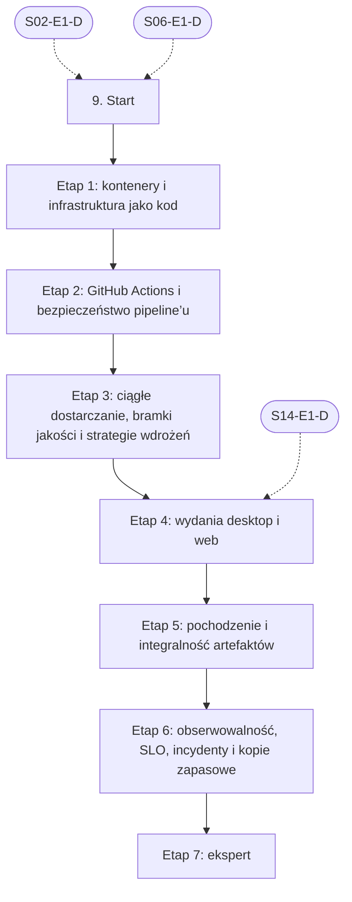

# 09. DevOps, CI/CD i wydania: plan wdrożenia w Linear

Team **LEA** (https://linear.app/daankh/team/LEA/overview). Plan do przeglądu przed wdrożeniem: nic nie zostało jeszcze utworzone w Linear. Klucze zadań (np. `S09-E1-M1`) są robocze; po wdrożeniu dostaną identyfikatory `LEA-…`.

**W skrócie:** 7 kamieni milowych, 46 zadań (1 start, 35 materiałów, 7 dowodów, 3 praktyki). Plik główny z kolejnością projektów: `00-kolejnosc-i-zaleznosci.md`.

## 1. Projekt

| Pole | Wartość |
|---|---|
| Nazwa | 09. DevOps, CI/CD i wydania |
| Team | LEA |
| Podsumowanie (pole „Summary”) | Warstwa 2: jakość i projektowanie. Opiera się na: 2 i 6; etap wydań na wiele platform także na 14. Jest podstawą: 10, 12 i 15–19 oraz etapu architektury ewolucyjnej w 8. |
| Etykiety projektu | `warstwa-2` |
| Blokowany przez (projekty) | 02. Języki i narzędzia podstawowe, 06. Testowanie |
| Blokuje (projekty) | 10. Bezpieczeństwo, 12. Rust jako wspólny fundament, 15. Linux, 16. macOS, 17. Windows, 18. Android, 19. iOS |
| Zależności częściowe (wchodzące) | etap 4 czeka na 14. Desktop: wspólne (etap 1) |
| Zależności częściowe (wychodzące) | 08. Architektura i projektowanie systemów, etap 5 |

### Opis projektu (do wklejenia w Linear)

*Warstwa 2: jakość i projektowanie. Opiera się na: 2 i 6; etap wydań na wiele platform także na 14. Jest podstawą: 10, 12 i 15–19 oraz etapu architektury ewolucyjnej w 8.*

**Zakres umiejętności**

- GitHub Actions: macierze systemów i targetów, runnery macOS i Windows, cache (zależności npm, a dla Rusta `sccache` i `Swatinem/rust-cache`), sekrety i OIDC do chmury.
- Sekrety: OIDC zamiast długotrwałych kluczy, środowiska z wymaganym zatwierdzeniem, SOPS z age dla sekretów w repozytorium.
- Bramki jakości: testy, lint, `clippy`, typecheck, SAST, SCA, SBOM jako warunek scalenia i wydania.
- Automatyzacja wydań: wersjonowanie semantyczne, Conventional Commits, changelog, `tauri-action`; wysyłka do App Store i Google Play (fastlane) jest w sekcjach 18 i 19.
- Strategie wdrożeń: blue-green, canary, flagi funkcji, automatyczne wycofanie, migracje bazy w pipeline (expand–contract).
- Podpisy w CI: certyfikaty Apple, Windows, klucze aktualizacji Tauri, klucze Androida, GPG dla Linuksa; bezpieczne przechowywanie kluczy.
- Pochodzenie i integralność artefaktów: powtarzalne buildy, SLSA, podpisy Sigstore/cosign.
- Infrastruktura: Docker, opis serwera, DNS i magazynu kopii w Terraform, czytanie planów Terraform i manifestów Kubernetes; podstawy Linuksa, sieci, DNS, TLS i poczty (SPF/DKIM/DMARC) są w sekcji 2, etap 0.
- Kopie zapasowe: RPO i RTO zapisane dla każdej aplikacji, regularny test odtworzenia.
- Obserwowalność: OpenTelemetry, logi, metryki, SLO, alerty; raportowanie awarii (np. Sentry) z symbolami dSYM, PDB i plików mapowania.
- Koszty: limity i alerty budżetowe w chmurze i u dostawców AI (FinOps w skali jednej firmy).

**Ścieżka nauki**

Ścieżka ma 7 etapów, numerowanych od 1, bo podstawy Linuksa, powłoki, Gita, sieci, DNS i poczty są w sekcji 2, etap 0. Każdy kończy się **dowodem**, czyli małym projektem, który pokazuje, że etap jest opanowany. Przy doświadczeniu seniorskim etap 1 można zaliczyć samym dowodem i wracać do materiałów tylko tam, gdzie dowód nie wychodzi; nowe będą najpewniej strategie wdrożeń (etap 3), wydania desktopowe z aktualizacjami (etap 4), pochodzenie artefaktów (etap 5) i SRE z kopiami zapasowymi (etap 6). Pipeline’y ćwiczy się na usłudze TypeScript z sekcji 5; wersje dla Rusta dochodzą po sekcji 12. Narzędzia SAST, SCA i generowania SBOM są w sekcji 10, szczegóły podpisów platformowych w sekcjach 15–17, a wysyłka do App Store i Google Play w sekcjach 18 i 19; tutaj chodzi o ich wpięcie w pipeline. Ceny materiałów płatnych zmieniają się, więc warto je sprawdzić przed zakupem.

**Definicja ukończenia projektu (dowód poziomu E)**

Samodzielnie, bez agenta, w 1 dzień wdrażasz szablon pipeline’u u klienta (bramki, SBOM, podpisane wydanie, monitoring z alertem SLO), diagnozujesz nieudane wydanie lub fałszywy alarm na podstawie logów i śladów, i umiesz wyjaśnić osobie nietechnicznej, co pipeline gwarantuje, a czego nie.

**Źródło:** dokument „Umiejętności techniczne” w projekcie „JDG: Rozwój oprogramowania”, sekcja 9.

## 2. Kamienie milowe

Jeden kamień milowy na etap ścieżki. Kamień milowy jest zamknięty, gdy zamknięte jest zadanie dowodu tego etapu.

| # | Kamień milowy | Cel | Poziom po etapie | Zadania |
|---|---|---|---|---|
| 1 | Etap 1: kontenery i infrastruktura jako kod | kontenery i infrastruktura jako kod (czytanie) | podstawy | 4 |
| 2 | Etap 2: GitHub Actions i bezpieczeństwo pipeline’u | GitHub Actions i bezpieczeństwo pipeline’u | W | 7 |
| 3 | Etap 3: ciągłe dostarczanie, bramki jakości i strategie wdrożeń | ciągłe dostarczanie, bramki jakości, strategie wdrożeń i wycofanie | W | 7 |
| 4 | Etap 4: wydania desktop i web | wydania: wersjonowanie, changelog, desktop i web, aktualizacje | W | 6 |
| 5 | Etap 5: pochodzenie i integralność artefaktów | pochodzenie i integralność artefaktów: SLSA, Sigstore, powtarzalne buildy | W | 5 |
| 6 | Etap 6: obserwowalność, SLO, incydenty i kopie zapasowe | obserwowalność, SLO, incydenty, kopie zapasowe i koszty | E | 9 |
| 7 | Etap 7: ekspert | ekspert: recenzja pipeline’ów z AI, ćwiczenia awarii, aktualność | E | 7 |

## 3. Punkt startu

Zadanie **`S09-START` · Start: 9. DevOps, CI/CD i wydania** to jedyne wejście do projektu: wszystkie zadania pierwszego etapu są przez nie blokowane.

- **Blokowane przez:** `S02-E1-D`, `S06-E1-D`
- **Odblokowuje:** `S09-E1-M1`, `S09-E1-M2`, `S09-E1-M3`
- **Status początkowy:** Backlog do czasu zamknięcia zadań blokujących, potem Todo

Opis zadania (do wklejenia):

Punkt startu projektu „09. DevOps, CI/CD i wydania”.

**Warunki wejścia (zadania blokujące):**

- `S02-E1-D` · Dowód etapu 1: Bash i `jq` — sekcja 2 na poziomie podstawowym do pracy (etap 1)
- `S06-E1-D` · Dowód etapu 1: projektowanie testów i TDD — sekcja 6 na poziomie podstawowym do pracy (etap 1: projektowanie testów i TDD)

**Do zrobienia:**

- przeczytać sekcję 9 dokumentu „Umiejętności techniczne”,
- zaznaczyć etapy, które zaliczasz samym dowodem (zgodnie z akapitem wstępnym ścieżki), i dla nich zamknąć zadania materiałów jako niepotrzebne.

**Folder roboczy:** `09-devops-ci-cd-i-wydania/`

## 4. Przepływ zależności

Linie ciągłe to zależności wewnątrz projektu, przerywane to zadania z innych projektów. Wewnątrz etapu zadania materiałów są równoległe i wszystkie blokują dowód etapu; dowód etapu blokuje materiały kolejnego etapu.

## 5. Zadania według kamieni milowych

Szablon opisu zadania materiału: nazwa materiału, autor lub wydawca, typ, czas, koszt i link (jak w kolumnach poniżej), zdanie „Gotowe, gdy materiał jest przerobiony w zakresie potrzebnym do dowodu etapu” oraz folder roboczy z kolumny „Folder”. Opisy dowodów i praktyk są podane pod tabelą każdego etapu.

### Etap 1: kontenery i infrastruktura jako kod

Opis kamienia milowego (do wklejenia):

**Cel:** kontenery i infrastruktura jako kod (czytanie) · **Poziom po etapie:** podstawy

**Szczególnie ważne:** małe obrazy z wieloetapowego buildu (obraz bazowy slim lub distroless, a dla binarek Rusta i Go nawet `scratch`), użytkownik bez roota w kontenerze, czytanie `terraform plan` przed zatwierdzeniem zmian proponowanych przez agenta, stan Terraform i sekrety. Podstawy Linuksa, sieci, DNS, TLS i poczty (SPF/DKIM/DMARC) są w sekcji 2, etap 0; tu opisuje się je w Terraform.

**Dowód:** Usługa z sekcji 2, etap 0 (lub usługa Node.js/TypeScript z sekcji 5) w obrazie z wieloetapowego buildu uruchamianym bez roota; infrastruktura (serwer, rekordy DNS, bucket na kopie zapasowe) opisana w Terraform, z przejrzanym i skomentowanym planem zmian.

| Klucz | Tytuł | Typ | Czas | Koszt | Link | Blokowane przez | Blokuje | Folder |
|---|---|---|---|---|---|---|---|---|
| `S09-E1-M1` | Przerobić: Docker: Get started (pojęcia, budowa obrazów, wieloetapowe buildy) | materiał | 8–10 h | 0 zł | https://docs.docker.com/get-started/ | `S09-START` | `S09-E1-D` | `09-devops-ci-cd-i-wydania/e1-kontenery-i-infrastruktura-jako-kod/` |
| `S09-E1-M2` | Przerobić: Terraform Tutorials | materiał | 10–12 h | 0 zł | https://developer.hashicorp.com/terraform/tutorials | `S09-START` | `S09-E1-D` | `09-devops-ci-cd-i-wydania/e1-kontenery-i-infrastruktura-jako-kod/` |
| `S09-E1-M3` | Przerobić: Kubernetes: Concepts (czytanie manifestów, bez administrowania klastrem) | materiał | 8–10 h | 0 zł | https://kubernetes.io/docs/concepts/ | `S09-START` | `S09-E1-D` | `09-devops-ci-cd-i-wydania/e1-kontenery-i-infrastruktura-jako-kod/` |
| `S09-E1-D` | Dowód etapu 1: kontenery i infrastruktura jako kod | dowód | — | — | — | `S09-E1-M1`, `S09-E1-M2`, `S09-E1-M3` | `S09-E2-M1`, `S09-E2-M2`, `S09-E2-M3`, `S09-E2-M4`, `S09-E2-M5`, `S09-E2-M6` | `09-devops-ci-cd-i-wydania/e1-kontenery-i-infrastruktura-jako-kod/` |

**`S09-E1-D` · Dowód etapu 1: kontenery i infrastruktura jako kod**

Usługa z sekcji 2, etap 0 (lub usługa Node.js/TypeScript z sekcji 5) w obrazie z wieloetapowego buildu uruchamianym bez roota; infrastruktura (serwer, rekordy DNS, bucket na kopie zapasowe) opisana w Terraform, z przejrzanym i skomentowanym planem zmian.

**Na co zwrócić uwagę:** małe obrazy z wieloetapowego buildu (obraz bazowy slim lub distroless, a dla binarek Rusta i Go nawet `scratch`), użytkownik bez roota w kontenerze, czytanie `terraform plan` przed zatwierdzeniem zmian proponowanych przez agenta, stan Terraform i sekrety. Podstawy Linuksa, sieci, DNS, TLS i poczty (SPF/DKIM/DMARC) są w sekcji 2, etap 0; tu opisuje się je w Terraform.

**Kryterium ukończenia:** obraz co najmniej o połowę mniejszy niż naiwny build jednoetapowy (oba rozmiary w notatce); `docker run … id -u` zwraca wartość różną od 0; `terraform plan` bez zmian po `apply` (infrastruktura zgodna z kodem); w planie skomentowane co najmniej 3 zasoby, w tym jeden niszczony lub zastępowany; stan Terraform poza repozytorium; w komentarzu link do repozytorium.

**Folder roboczy:** `09-devops-ci-cd-i-wydania/e1-kontenery-i-infrastruktura-jako-kod/`

### Etap 2: GitHub Actions i bezpieczeństwo pipeline’u

Opis kamienia milowego (do wklejenia):

**Cel:** GitHub Actions i bezpieczeństwo pipeline’u · **Poziom po etapie:** W

**Szczególnie ważne:** akcje przypięte do pełnego SHA, minimalne uprawnienia `GITHUB_TOKEN` (domyślnie tylko odczyt), ryzyko `pull_request_target` i `workflow_run`, wstrzykiwanie poleceń przez dane z `github.event`, OIDC zamiast długotrwałych kluczy do chmury, środowiska z wymaganym zatwierdzeniem dla sekretów do wdrożeń i podpisów; sekrety aplikacji zaszyfrowane w repozytorium (SOPS z kluczem age), klucz prywatny poza repozytorium i z kopią zapasową; maskowanie w logach nie chroni przed wypisaniem przekształconej wartości.

**Dowód:** Workflow budujący i testujący usługę NestJS/TypeScript z sekcji 5 (albo dowolny projekt TypeScript) w macierzy Linux, macOS i Windows z cache zależności; wszystkie akcje przypięte do SHA, uprawnienia ustawione per job, wdrożenie do chmury przez OIDC bez zapisanych kluczy, sekrety wdrożenia w środowisku z wymaganym zatwierdzeniem, sekrety aplikacji w repozytorium zaszyfrowane SOPS z kluczem age i odszyfrowywane tylko w jobie wdrożenia; lista kontrolna bezpieczeństwa workflow zastosowana do jednego publicznego repozytorium.

| Klucz | Tytuł | Typ | Czas | Koszt | Link | Blokowane przez | Blokuje | Folder |
|---|---|---|---|---|---|---|---|---|
| `S09-E2-M1` | Przerobić: GitHub Actions: dokumentacja, w tym macierze jobów | materiał | 10–12 h | 0 zł | https://docs.github.com/en/actions | `S09-E1-D` | `S09-E2-D` | `09-devops-ci-cd-i-wydania/e2-github-actions-i-bezpieczenstwo-pipelineu/` |
| `S09-E2-M2` | Przerobić: Secure use reference (dawniej „Security hardening for GitHub Actions”) | materiał | 3–4 h | 0 zł | https://docs.github.com/en/actions/reference/security/secure-use | `S09-E1-D` | `S09-E2-D` | `09-devops-ci-cd-i-wydania/e2-github-actions-i-bezpieczenstwo-pipelineu/` |
| `S09-E2-M3` | Przerobić: OpenID Connect w GitHub Actions | materiał | 2–3 h | 0 zł | https://docs.github.com/en/actions/concepts/security/openid-connect | `S09-E1-D` | `S09-E2-D` | `09-devops-ci-cd-i-wydania/e2-github-actions-i-bezpieczenstwo-pipelineu/` |
| `S09-E2-M4` | Przerobić: `Swatinem/rust-cache`, `sccache` | materiał, opcjonalne | 2–3 h | 0 zł | https://github.com/Swatinem/rust-cache, https://github.com/mozilla/sccache | `S09-E1-D` | — | `09-devops-ci-cd-i-wydania/e2-github-actions-i-bezpieczenstwo-pipelineu/` |
| `S09-E2-M5` | Przerobić: SOPS i age: sekrety zaszyfrowane w repozytorium | materiał | 2–3 h | 0 zł | https://getsops.io/docs/, https://github.com/FiloSottile/age | `S09-E1-D` | `S09-E2-D` | `09-devops-ci-cd-i-wydania/e2-github-actions-i-bezpieczenstwo-pipelineu/` |
| `S09-E2-M6` | Przerobić: GitHub Actions: sekrety i środowiska z wymaganym zatwierdzeniem | materiał | 1–2 h | 0 zł | https://docs.github.com/en/actions/concepts/security/secrets, https://docs.github.com/en/actions/how-tos/deploy/configure-and-manage-deployments/manage-environments | `S09-E1-D` | `S09-E2-D` | `09-devops-ci-cd-i-wydania/e2-github-actions-i-bezpieczenstwo-pipelineu/` |
| `S09-E2-D` | Dowód etapu 2: GitHub Actions i bezpieczeństwo pipeline’u | dowód | — | — | — | `S09-E2-M1`, `S09-E2-M2`, `S09-E2-M3`, `S09-E2-M5`, `S09-E2-M6` | `S08-E5-M1`, `S08-E5-M2`, `S08-E5-M3`, `S08-E5-M4`, `S08-E5-M5`, `S08-E5-M6`, `S08-E5-M7`, `S08-E5-M8`, `S09-E3-M1`, `S09-E3-M2`, `S09-E3-M3`, `S09-E3-M4`, `S09-E3-M5`, `S09-E3-M6`, `S10-START`, `S12-START`, `S15-START`, `S16-START`, `S17-START`, `S18-START`, `S19-START` | `09-devops-ci-cd-i-wydania/e2-github-actions-i-bezpieczenstwo-pipelineu/` |

**`S09-E2-D` · Dowód etapu 2: GitHub Actions i bezpieczeństwo pipeline’u**

Workflow budujący i testujący usługę NestJS/TypeScript z sekcji 5 (albo dowolny projekt TypeScript) w macierzy Linux, macOS i Windows z cache zależności; wszystkie akcje przypięte do SHA, uprawnienia ustawione per job, wdrożenie do chmury przez OIDC bez zapisanych kluczy, sekrety wdrożenia w środowisku z wymaganym zatwierdzeniem, sekrety aplikacji w repozytorium zaszyfrowane SOPS z kluczem age i odszyfrowywane tylko w jobie wdrożenia; lista kontrolna bezpieczeństwa workflow zastosowana do jednego publicznego repozytorium.

**Na co zwrócić uwagę:** akcje przypięte do pełnego SHA, minimalne uprawnienia `GITHUB_TOKEN` (domyślnie tylko odczyt), ryzyko `pull_request_target` i `workflow_run`, wstrzykiwanie poleceń przez dane z `github.event`, OIDC zamiast długotrwałych kluczy do chmury, środowiska z wymaganym zatwierdzeniem dla sekretów do wdrożeń i podpisów; sekrety aplikacji zaszyfrowane w repozytorium (SOPS z kluczem age), klucz prywatny poza repozytorium i z kopią zapasową; maskowanie w logach nie chroni przed wypisaniem przekształconej wartości.

**Kryterium ukończenia:** workflow przechodzi na 3 systemach, a drugi przebieg jest szybszy dzięki cache (czasy w notatce); zero akcji bez pełnego SHA i zero długotrwałych kluczy chmury w sekretach repozytorium; plik sekretów w repozytorium nie zawiera jawnych wartości; wdrożenie czeka na zatwierdzenie środowiska; lista kontrolna ma co najmniej 10 punktów z wynikiem dla publicznego repozytorium; w komentarzu link do repozytorium.

**Folder roboczy:** `09-devops-ci-cd-i-wydania/e2-github-actions-i-bezpieczenstwo-pipelineu/`

### Etap 3: ciągłe dostarczanie, bramki jakości i strategie wdrożeń

Opis kamienia milowego (do wklejenia):

**Cel:** ciągłe dostarczanie, bramki jakości, strategie wdrożeń i wycofanie · **Poziom po etapie:** W

**Szczególnie ważne:** jeden pipeline jako jedyna droga do produkcji, artefakt budowany raz i promowany między środowiskami, bramki jako warunek scalenia (testy, lint, `clippy`, typecheck, SAST, SCA, SBOM; narzędzia w sekcji 10), cztery metryki DORA mierzone także dla pracy agentów; blue-green albo canary z automatycznym wycofaniem po nieudanym health checku; flaga funkcji oddziela wdrożenie od udostępnienia i ma datę usunięcia; migracja bazy w pipeline przed wdrożeniem kodu, w krokach expand–contract, tak by poprzednia wersja aplikacji działała na nowym schemacie.

**Dowód:** Szablon pipeline’u gotowy do wdrożenia u klienta: bramki jakości jako wymagane sprawdzenia w ochronie gałęzi, SBOM w CycloneDX dołączany do każdego buildu, raport bramek w opisie pull requesta, wdrożenie blue-green lub canary z automatycznym wycofaniem, nowa funkcja za flagą wyłączaną bez wdrożenia, migracja bazy uruchamiana w pipeline w trybie expand–contract; krótka instrukcja wdrożenia szablonu w repozytorium klienta.

| Klucz | Tytuł | Typ | Czas | Koszt | Link | Blokowane przez | Blokuje | Folder |
|---|---|---|---|---|---|---|---|---|
| `S09-E3-M1` | Przerobić: Continuous Delivery | materiał, płatny | 15–20 h | płatna | https://www.informit.com/store/continuous-delivery-reliable-software-releases-through-build-9780321601919 | `S09-E2-D` | `S09-E3-D` | `09-devops-ci-cd-i-wydania/e3-ciagle-dostarczanie-bramki-jakosci-i-strategie-wdrozen/` |
| `S09-E3-M2` | Przerobić: Accelerate | materiał, płatny | 6–8 h | płatna | https://itrevolution.com/product/accelerate/ | `S09-E2-D` | `S09-E3-D` | `09-devops-ci-cd-i-wydania/e3-ciagle-dostarczanie-bramki-jakosci-i-strategie-wdrozen/` |
| `S09-E3-M3` | Przerobić: DORA: metryki dostarczania i raporty badawcze (m.in. o AI w wytwarzaniu oprogramowania) | materiał | 4–6 h | 0 zł | https://dora.dev | `S09-E2-D` | `S09-E3-D` | `09-devops-ci-cd-i-wydania/e3-ciagle-dostarczanie-bramki-jakosci-i-strategie-wdrozen/` |
| `S09-E3-M4` | Przerobić: „BlueGreenDeployment”, „CanaryRelease” i „Feature Toggles (aka Feature Flags)” | materiał | 3–4 h | 0 zł | https://martinfowler.com/bliki/BlueGreenDeployment.html, https://martinfowler.com/bliki/CanaryRelease.html, https://martinfowler.com/articles/feature-toggles.html | `S09-E2-D` | `S09-E3-D` | `09-devops-ci-cd-i-wydania/e3-ciagle-dostarczanie-bramki-jakosci-i-strategie-wdrozen/` |
| `S09-E3-M5` | Przerobić: „Evolutionary Database Design” i „ParallelChange” (expand–contract) | materiał | 2 h | 0 zł | https://martinfowler.com/articles/evodb.html, https://martinfowler.com/bliki/ParallelChange.html | `S09-E2-D` | `S09-E3-D` | `09-devops-ci-cd-i-wydania/e3-ciagle-dostarczanie-bramki-jakosci-i-strategie-wdrozen/` |
| `S09-E3-M6` | Przerobić: OpenFeature: standard i SDK flag funkcji | materiał, opcjonalne | 1–2 h | 0 zł | https://openfeature.dev/docs/reference/intro | `S09-E2-D` | — | `09-devops-ci-cd-i-wydania/e3-ciagle-dostarczanie-bramki-jakosci-i-strategie-wdrozen/` |
| `S09-E3-D` | Dowód etapu 3: ciągłe dostarczanie, bramki jakości i strategie wdrożeń | dowód | — | — | — | `S09-E3-M1`, `S09-E3-M2`, `S09-E3-M3`, `S09-E3-M4`, `S09-E3-M5` | `S09-E4-M1`, `S09-E4-M2`, `S09-E4-M3`, `S09-E4-M4`, `S09-E4-M5` | `09-devops-ci-cd-i-wydania/e3-ciagle-dostarczanie-bramki-jakosci-i-strategie-wdrozen/` |

**`S09-E3-D` · Dowód etapu 3: ciągłe dostarczanie, bramki jakości i strategie wdrożeń**

Szablon pipeline’u gotowy do wdrożenia u klienta: bramki jakości jako wymagane sprawdzenia w ochronie gałęzi, SBOM w CycloneDX dołączany do każdego buildu, raport bramek w opisie pull requesta, wdrożenie blue-green lub canary z automatycznym wycofaniem, nowa funkcja za flagą wyłączaną bez wdrożenia, migracja bazy uruchamiana w pipeline w trybie expand–contract; krótka instrukcja wdrożenia szablonu w repozytorium klienta.

**Na co zwrócić uwagę:** jeden pipeline jako jedyna droga do produkcji, artefakt budowany raz i promowany między środowiskami, bramki jako warunek scalenia (testy, lint, `clippy`, typecheck, SAST, SCA, SBOM; narzędzia w sekcji 10), cztery metryki DORA mierzone także dla pracy agentów; blue-green albo canary z automatycznym wycofaniem po nieudanym health checku; flaga funkcji oddziela wdrożenie od udostępnienia i ma datę usunięcia; migracja bazy w pipeline przed wdrożeniem kodu, w krokach expand–contract, tak by poprzednia wersja aplikacji działała na nowym schemacie.

**Kryterium ukończenia:** pull requesta z celowo zepsutym testem nie da się scalić; SBOM jest w artefaktach każdego buildu; celowo zepsuta wersja wycofana automatycznie (czas od wdrożenia do wycofania w notatce); wyłączenie flagi zmienia zachowanie bez nowego wdrożenia; migracja w co najmniej 2 krokach, a poprzednia wersja aplikacji działa na schemacie po kroku expand; w komentarzu link do repozytorium.

**Folder roboczy:** `09-devops-ci-cd-i-wydania/e3-ciagle-dostarczanie-bramki-jakosci-i-strategie-wdrozen/`

### Etap 4: wydania desktop i web

Opis kamienia milowego (do wklejenia):

**Cel:** wydania: wersjonowanie, changelog, desktop i web, aktualizacje · **Poziom po etapie:** W

**Szczególnie ważne:** wersja wynikająca z historii commitów, a nie z ręcznej decyzji agenta; klucz podpisu aktualizacji Tauri (utrata oznacza brak aktualizacji dla zainstalowanych kopii, więc kopia zapasowa poza CI); podpisy i notaryzacja wykonywane w CI z sekretami w środowisku chronionym (szczegóły platform w sekcjach 15–17); ta sama wersja w tagu, changelogu, instalatorach i obrazie kontenera. Wysyłka do TestFlight i Google Play (fastlane, ścieżki testowe sklepów) jest w sekcjach 18 i 19.

**Dowód:** Wydanie aplikacji Tauri na Linux, macOS i Windows z jednego tagu (macierz trzech systemów): podpisane instalatory, plik aktualizacji dla Updatera, changelog z Conventional Commits; zainstalowana starsza wersja aktualizuje się automatycznie, a zmodyfikowana paczka aktualizacji jest odrzucana; z tego samego tagu obraz kontenera usługi web lub API z wersją w etykiecie, opublikowany w rejestrze.

| Klucz | Tytuł | Typ | Czas | Koszt | Link | Blokowane przez | Blokuje | Folder |
|---|---|---|---|---|---|---|---|---|
| `S09-E4-M1` | Przerobić: Semantic Versioning 2.0.0, Conventional Commits 1.0.0 | materiał | 2 h | 0 zł | https://semver.org, https://www.conventionalcommits.org/en/v1.0.0/ | `S09-E3-D`, `S14-E1-D` | `S09-E4-D` | `09-devops-ci-cd-i-wydania/e4-wydania-desktop-i-web/` |
| `S09-E4-M2` | Przerobić: release-plz (wydania crate’ów przez PR z changelogiem) i `cargo-semver-checks` | materiał | 3–4 h | 0 zł | https://release-plz.dev, https://github.com/obi1kenobi/cargo-semver-checks | `S09-E3-D`, `S14-E1-D` | `S09-E4-D` | `09-devops-ci-cd-i-wydania/e4-wydania-desktop-i-web/` |
| `S09-E4-M3` | Przerobić: dist (dawniej cargo-dist): instalatory i wydania narzędzi CLI | materiał | 3–4 h | 0 zł | https://axodotdev.github.io/cargo-dist/book/ | `S09-E3-D`, `S14-E1-D` | `S09-E4-D` | `09-devops-ci-cd-i-wydania/e4-wydania-desktop-i-web/` |
| `S09-E4-M4` | Przerobić: Tauri: GitHub pipeline (`tauri-action`) i plugin Updater | materiał | 5–6 h | 0 zł | https://v2.tauri.app/distribute/pipelines/github/, https://v2.tauri.app/plugin/updater/ | `S09-E3-D`, `S14-E1-D` | `S09-E4-D` | `09-devops-ci-cd-i-wydania/e4-wydania-desktop-i-web/` |
| `S09-E4-M5` | Przerobić: fastlane (w tym `match` do certyfikatów Apple) | materiał, opcjonalne | 6–8 h | 0 zł | https://docs.fastlane.tools | `S09-E3-D`, `S14-E1-D` | — | `09-devops-ci-cd-i-wydania/e4-wydania-desktop-i-web/` |
| `S09-E4-D` | Dowód etapu 4: wydania desktop i web | dowód | — | — | — | `S09-E4-M1`, `S09-E4-M2`, `S09-E4-M3`, `S09-E4-M4` | `S09-E5-M1`, `S09-E5-M2`, `S09-E5-M3`, `S09-E5-M4` | `09-devops-ci-cd-i-wydania/e4-wydania-desktop-i-web/` |

**`S09-E4-D` · Dowód etapu 4: wydania desktop i web**

Wydanie aplikacji Tauri na Linux, macOS i Windows z jednego tagu (macierz trzech systemów): podpisane instalatory, plik aktualizacji dla Updatera, changelog z Conventional Commits; zainstalowana starsza wersja aktualizuje się automatycznie, a zmodyfikowana paczka aktualizacji jest odrzucana; z tego samego tagu obraz kontenera usługi web lub API z wersją w etykiecie, opublikowany w rejestrze.

**Na co zwrócić uwagę:** wersja wynikająca z historii commitów, a nie z ręcznej decyzji agenta; klucz podpisu aktualizacji Tauri (utrata oznacza brak aktualizacji dla zainstalowanych kopii, więc kopia zapasowa poza CI); podpisy i notaryzacja wykonywane w CI z sekretami w środowisku chronionym (szczegóły platform w sekcjach 15–17); ta sama wersja w tagu, changelogu, instalatorach i obrazie kontenera. Wysyłka do TestFlight i Google Play (fastlane, ścieżki testowe sklepów) jest w sekcjach 18 i 19.

**Kryterium ukończenia:** jeden tag wyzwala całe wydanie; 3 instalatory podpisane (wynik weryfikacji podpisu na każdym systemie w notatce); aktualizacja z wersji N-1 do N działa, a paczka ze zmienionym bajtem jest odrzucona; numer wersji identyczny w aplikacji, changelogu, obrazie i tagu; w komentarzu link do wydania.

**Folder roboczy:** `09-devops-ci-cd-i-wydania/e4-wydania-desktop-i-web/`

### Etap 5: pochodzenie i integralność artefaktów

Opis kamienia milowego (do wklejenia):

**Cel:** pochodzenie i integralność artefaktów: SLSA, Sigstore, powtarzalne buildy · **Poziom po etapie:** W

**Szczególnie ważne:** poziomy SLSA Build (atestacje GitHub dają poziom 2, poziom 3 wymaga wielokrotnego workflow izolującego build), weryfikacja atestacji i podpisów po stronie odbiorcy, a nie tylko ich wystawienie; powtarzalność jako dowód, że binarka odpowiada kodowi źródłowemu, co wspiera dokumentację techniczną wymaganą przez CRA.

**Dowód:** Artefakty wydania z etapu 4 z atestacją pochodzenia i podpisem Sigstore, SBOM dołączonym do wydania i instrukcją weryfikacji dla klienta (`gh attestation verify` lub `cosign verify-blob`); jeden artefakt (np. paczka `npm pack` usługi TypeScript albo binarka CLI) zbudowany dwa razy w różnych środowiskach z identyczną sumą kontrolną.

| Klucz | Tytuł | Typ | Czas | Koszt | Link | Blokowane przez | Blokuje | Folder |
|---|---|---|---|---|---|---|---|---|
| `S09-E5-M1` | Przerobić: SLSA Specification v1.2 | materiał | 4–6 h | 0 zł | https://slsa.dev/spec/v1.2/ | `S09-E4-D` | `S09-E5-D` | `09-devops-ci-cd-i-wydania/e5-pochodzenie-i-integralnosc-artefaktow/` |
| `S09-E5-M2` | Przerobić: Sigstore (cosign, Fulcio, Rekor) | materiał | 4–6 h | 0 zł | https://docs.sigstore.dev | `S09-E4-D` | `S09-E5-D` | `09-devops-ci-cd-i-wydania/e5-pochodzenie-i-integralnosc-artefaktow/` |
| `S09-E5-M3` | Przerobić: GitHub Artifact attestations | materiał | 2 h | 0 zł | https://docs.github.com/en/actions/concepts/security/artifact-attestations | `S09-E4-D` | `S09-E5-D` | `09-devops-ci-cd-i-wydania/e5-pochodzenie-i-integralnosc-artefaktow/` |
| `S09-E5-M4` | Przerobić: Reproducible Builds: dokumentacja (`SOURCE_DATE_EPOCH`, uwagi dla Rusta) | materiał | 4–6 h | 0 zł | https://reproducible-builds.org/docs/ | `S09-E4-D` | `S09-E5-D` | `09-devops-ci-cd-i-wydania/e5-pochodzenie-i-integralnosc-artefaktow/` |
| `S09-E5-D` | Dowód etapu 5: pochodzenie i integralność artefaktów | dowód | — | — | — | `S09-E5-M1`, `S09-E5-M2`, `S09-E5-M3`, `S09-E5-M4` | `S09-E6-M1`, `S09-E6-M2`, `S09-E6-M3`, `S09-E6-M4`, `S09-E6-M5`, `S09-E6-M6`, `S09-E6-M7`, `S09-E6-M8` | `09-devops-ci-cd-i-wydania/e5-pochodzenie-i-integralnosc-artefaktow/` |

**`S09-E5-D` · Dowód etapu 5: pochodzenie i integralność artefaktów**

Artefakty wydania z etapu 4 z atestacją pochodzenia i podpisem Sigstore, SBOM dołączonym do wydania i instrukcją weryfikacji dla klienta (`gh attestation verify` lub `cosign verify-blob`); jeden artefakt (np. paczka `npm pack` usługi TypeScript albo binarka CLI) zbudowany dwa razy w różnych środowiskach z identyczną sumą kontrolną.

**Na co zwrócić uwagę:** poziomy SLSA Build (atestacje GitHub dają poziom 2, poziom 3 wymaga wielokrotnego workflow izolującego build), weryfikacja atestacji i podpisów po stronie odbiorcy, a nie tylko ich wystawienie; powtarzalność jako dowód, że binarka odpowiada kodowi źródłowemu, co wspiera dokumentację techniczną wymaganą przez CRA.

**Kryterium ukończenia:** weryfikacja atestacji i podpisu przechodzi według instrukcji na czystej maszynie, a dla zmodyfikowanego artefaktu zawodzi; sumy SHA-256 obu buildów identyczne (lokalnie i w CI); w komentarzu link do wydania i instrukcji.

**Folder roboczy:** `09-devops-ci-cd-i-wydania/e5-pochodzenie-i-integralnosc-artefaktow/`

### Etap 6: obserwowalność, SLO, incydenty i kopie zapasowe

Opis kamienia milowego (do wklejenia):

**Cel:** obserwowalność, SLO, incydenty, kopie zapasowe i koszty · **Poziom po etapie:** E

**Szczególnie ważne:** SLO i budżet błędów zamiast alertów na każdą metrykę, alerty wielookienkowe według tempa zużycia budżetu (burn rate), ślady OpenTelemetry (SDK dla Node.js, a w Ruście `tracing`), symbole debugowania wysyłane w pipeline wydania, wzorce stabilności z „Release It!” (limity czasu, circuit breaker, bulkhead, szybka porażka), postmortem bez szukania winnych; kopia zapasowa istnieje dopiero po udanym odtworzeniu, a RPO i RTO to decyzja zapisana dla każdej aplikacji (bazy danych: sekcja 4); alerty budżetowe w chmurze i u dostawców AI; zgłaszanie aktywnie wykorzystywanych podatności i poważnych incydentów w terminach CRA (od 11 września 2026 r.).

**Dowód:** Usługa produkcyjna (np. z sekcji 5) z SLO dostępności i opóźnienia, alertem burn rate wysyłanym na telefon, śladami OpenTelemetry, jedną integracją zewnętrzną chronioną limitem czasu i circuit breakerem oraz raportami awarii z symbolami z aplikacji desktopowej; kopie zapasowe danych z zapisanym RPO i RTO i testem odtworzenia; alerty budżetowe u dostawcy chmury i API AI; ćwiczenie awarii zakończone postmortemem według szablonu z SRE Book, z czasem wykrycia i przywrócenia.

| Klucz | Tytuł | Typ | Czas | Koszt | Link | Blokowane przez | Blokuje | Folder |
|---|---|---|---|---|---|---|---|---|
| `S09-E6-M1` | Przerobić: Site Reliability Engineering, rozdziały 4, 6, 14 i 15 (SLO, monitorowanie, incydenty, postmortemy) | materiał | 12–15 h | 0 zł online | https://sre.google/sre-book/table-of-contents/ | `S09-E5-D` | `S09-E6-D` | `09-devops-ci-cd-i-wydania/e6-obserwowalnosc-slo-incydenty-i-kopie-zapasowe/` |
| `S09-E6-M2` | Przerobić: The Site Reliability Workbook, rozdziały 2 („Implementing SLOs”) i 5 („Alerting on SLOs”) | materiał | 6–8 h | 0 zł online | https://sre.google/workbook/table-of-contents/ | `S09-E5-D` | `S09-E6-D` | `09-devops-ci-cd-i-wydania/e6-obserwowalnosc-slo-incydenty-i-kopie-zapasowe/` |
| `S09-E6-M3` | Przerobić: Release It! (wydanie 2) | materiał, płatny | 12–15 h | płatna | https://pragprog.com/titles/mnee2/release-it-second-edition/ | `S09-E5-D` | `S09-E6-D` | `09-devops-ci-cd-i-wydania/e6-obserwowalnosc-slo-incydenty-i-kopie-zapasowe/` |
| `S09-E6-M4` | Przerobić: Observability Engineering (wydanie 2, czerwiec 2026) | materiał, płatny | 12–15 h | płatna (darmowy egzemplarz oferuje Honeycomb) | https://www.oreilly.com/library/view/-/9781098179915/ | `S09-E5-D` | `S09-E6-D` | `09-devops-ci-cd-i-wydania/e6-obserwowalnosc-slo-incydenty-i-kopie-zapasowe/` |
| `S09-E6-M5` | Przerobić: OpenTelemetry: pojęcia, Collector, SDK dla Node.js i Rusta | materiał | 6–8 h | 0 zł | https://opentelemetry.io/docs/ | `S09-E5-D` | `S09-E6-D` | `09-devops-ci-cd-i-wydania/e6-obserwowalnosc-slo-incydenty-i-kopie-zapasowe/` |
| `S09-E6-M6` | Przerobić: Sentry: SDK dla Rusta i plików debugowania (dSYM, PDB, mapowanie ProGuard) | materiał | 4–5 h | 0 zł (usługa: plan darmowy i płatne) | https://docs.sentry.io/platforms/rust/, https://docs.sentry.io/cli/dif/ | `S09-E5-D` | `S09-E6-D` | `09-devops-ci-cd-i-wydania/e6-obserwowalnosc-slo-incydenty-i-kopie-zapasowe/` |
| `S09-E6-M7` | Przerobić: Kopie zapasowe: restic i rozdział „Data Integrity: What You Read Is What You Wrote” | materiał | 4–5 h | 0 zł | https://restic.readthedocs.io/en/stable/, https://sre.google/sre-book/data-integrity/ | `S09-E5-D` | `S09-E6-D` | `09-devops-ci-cd-i-wydania/e6-obserwowalnosc-slo-incydenty-i-kopie-zapasowe/` |
| `S09-E6-M8` | Przerobić: FinOps Framework: zasady, fazy, budżety i alerty kosztów | materiał | 2–3 h | 0 zł | https://www.finops.org/framework/ | `S09-E5-D` | `S09-E6-D` | `09-devops-ci-cd-i-wydania/e6-obserwowalnosc-slo-incydenty-i-kopie-zapasowe/` |
| `S09-E6-D` | Dowód etapu 6: obserwowalność, SLO, incydenty i kopie zapasowe | dowód | — | — | — | `S09-E6-M1`, `S09-E6-M2`, `S09-E6-M3`, `S09-E6-M4`, `S09-E6-M5`, `S09-E6-M6`, `S09-E6-M7`, `S09-E6-M8` | `S09-E7-M1`, `S09-E7-M2`, `S09-E7-M3`, `S09-E7-P1`, `S09-E7-P2`, `S09-E7-P3` | `09-devops-ci-cd-i-wydania/e6-obserwowalnosc-slo-incydenty-i-kopie-zapasowe/` |

**`S09-E6-D` · Dowód etapu 6: obserwowalność, SLO, incydenty i kopie zapasowe**

Usługa produkcyjna (np. z sekcji 5) z SLO dostępności i opóźnienia, alertem burn rate wysyłanym na telefon, śladami OpenTelemetry, jedną integracją zewnętrzną chronioną limitem czasu i circuit breakerem oraz raportami awarii z symbolami z aplikacji desktopowej; kopie zapasowe danych z zapisanym RPO i RTO i testem odtworzenia; alerty budżetowe u dostawcy chmury i API AI; ćwiczenie awarii zakończone postmortemem według szablonu z SRE Book, z czasem wykrycia i przywrócenia.

**Na co zwrócić uwagę:** SLO i budżet błędów zamiast alertów na każdą metrykę, alerty wielookienkowe według tempa zużycia budżetu (burn rate), ślady OpenTelemetry (SDK dla Node.js, a w Ruście `tracing`), symbole debugowania wysyłane w pipeline wydania, wzorce stabilności z „Release It!” (limity czasu, circuit breaker, bulkhead, szybka porażka), postmortem bez szukania winnych; kopia zapasowa istnieje dopiero po udanym odtworzeniu, a RPO i RTO to decyzja zapisana dla każdej aplikacji (bazy danych: sekcja 4); alerty budżetowe w chmurze i u dostawców AI; zgłaszanie aktywnie wykorzystywanych podatności i poważnych incydentów w terminach CRA (od 11 września 2026 r.).

**Kryterium ukończenia:** SLO zapisane liczbowo (np. 99,5% dostępności w 28 dniach, p95 poniżej 300 ms); alert burn rate z dwoma oknami wyzwolony w ćwiczeniu i dostarczony na telefon; ślad obejmuje co najmniej 3 spany przez granicę usługi; raport awarii z aplikacji desktopowej z czytelnym stosem; odtworzenie kopii na czystym środowisku mieści się w RTO, a utrata danych w ćwiczeniu w RPO (zmierzone); alert budżetowy ustawiony na 80% miesięcznego limitu; postmortem z osią czasu; w komentarzu link do repozytorium i postmortemu.

**Folder roboczy:** `09-devops-ci-cd-i-wydania/e6-obserwowalnosc-slo-incydenty-i-kopie-zapasowe/`

### Etap 7: ekspert

Opis kamienia milowego (do wklejenia):

**Cel:** ekspert: recenzja pipeline’ów z AI, ćwiczenia awarii, aktualność · **Poziom po etapie:** E

**Dowód poziomu E:** Samodzielnie, bez agenta, w 1 dzień wdrażasz szablon pipeline’u u klienta (bramki, SBOM, podpisane wydanie, monitoring z alertem SLO), diagnozujesz nieudane wydanie lub fałszywy alarm na podstawie logów i śladów, i umiesz wyjaśnić osobie nietechnicznej, co pipeline gwarantuje, a czego nie.

| Klucz | Tytuł | Typ | Czas | Koszt | Link | Blokowane przez | Blokuje | Folder |
|---|---|---|---|---|---|---|---|---|
| `S09-E7-M1` | Przerobić: GitHub Changelog i komunikaty bezpieczeństwa GitHub Actions | materiał | ok. 30 min tygodniowo | 0 zł | https://github.blog/changelog/ | `S09-E6-D` | `S09-E7-D` | `09-devops-ci-cd-i-wydania/e7-ekspert/` |
| `S09-E7-M2` | Przerobić: Implementing Service Level Objectives | materiał, płatny | 12–15 h | płatna | https://www.oreilly.com/library/view/implementing-service-level/9781492076803/ | `S09-E6-D` | `S09-E7-D` | `09-devops-ci-cd-i-wydania/e7-ekspert/` |
| `S09-E7-M3` | Przerobić: Building Secure and Reliable Systems | materiał, opcjonalne | wg potrzeb | 0 zł online | https://google.github.io/building-secure-and-reliable-systems/raw/toc.html | `S09-E6-D` | — | `09-devops-ci-cd-i-wydania/e7-ekspert/` |
| `S09-E7-P1` | Praktyka: recenzja pipeline’ów z AI | praktyka | — | — | — | `S09-E6-D` | `S09-E7-D` | `09-devops-ci-cd-i-wydania/e7-ekspert/` |
| `S09-E7-P2` | Praktyka: ćwiczenie wydania awaryjnego | praktyka | — | — | — | `S09-E6-D` | `S09-E7-D` | `09-devops-ci-cd-i-wydania/e7-ekspert/` |
| `S09-E7-P3` | Praktyka: ćwiczenie odtworzenia | praktyka | — | — | — | `S09-E6-D` | `S09-E7-D` | `09-devops-ci-cd-i-wydania/e7-ekspert/` |
| `S09-E7-D` | Dowód poziomu E: ekspert | dowód | — | — | — | `S09-E7-M1`, `S09-E7-M2`, `S09-E7-P1`, `S09-E7-P2`, `S09-E7-P3` | — | `09-devops-ci-cd-i-wydania/e7-ekspert/` |

**`S09-E7-P1` · Praktyka: recenzja pipeline’ów z AI**

20 zmian w workflow, Dockerfile i Terraform wygenerowanych przez agentów, recenzowanych według listy kontrolnej z etapów 2, 3 i 5 (także sekrety w repozytorium bez SOPS, wdrożenia bez ścieżki wycofania, migracje niekompatybilne z poprzednią wersją) (akcje nieprzypięte do SHA, nadmiarowe uprawnienia, sekrety w logach lub argumentach, wyłączone lub warunkowo pomijane bramki, `continue-on-error` na krokach jakości, cache zatruwany z gałęzi pull requestów, `terraform apply` bez przeglądu planu).

Praktyka ciągła etapu eksperckiego: oznacz jako gotową, gdy działa jako stały element pracy, a nie po jednorazowym wykonaniu.

**Folder roboczy:** `09-devops-ci-cd-i-wydania/e7-ekspert/`

**`S09-E7-P2` · Praktyka: ćwiczenie wydania awaryjnego**

Poprawka podatności od zgłoszenia do podpisanego wydania na wszystkich platformach w 24 h, z zaktualizowanym SBOM i komunikatem dla użytkowników.

Praktyka ciągła etapu eksperckiego: oznacz jako gotową, gdy działa jako stały element pracy, a nie po jednorazowym wykonaniu.

**Folder roboczy:** `09-devops-ci-cd-i-wydania/e7-ekspert/`

**`S09-E7-P3` · Praktyka: ćwiczenie odtworzenia**

Odtworzenie infrastruktury i kluczy podpisu z kopii zapasowych na czystym koncie.

Praktyka ciągła etapu eksperckiego: oznacz jako gotową, gdy działa jako stały element pracy, a nie po jednorazowym wykonaniu.

**Folder roboczy:** `09-devops-ci-cd-i-wydania/e7-ekspert/`

**`S09-E7-D` · Dowód poziomu E: ekspert**

Samodzielnie, bez agenta, w 1 dzień wdrażasz szablon pipeline’u u klienta (bramki, SBOM, podpisane wydanie, monitoring z alertem SLO), diagnozujesz nieudane wydanie lub fałszywy alarm na podstawie logów i śladów, i umiesz wyjaśnić osobie nietechnicznej, co pipeline gwarantuje, a czego nie.

**Kryterium ukończenia:** dowód wykonany samodzielnie; w komentarzu link do repozytorium, raportu lub notatki. Bez agenta AI.

**Folder roboczy:** `09-devops-ci-cd-i-wydania/e7-ekspert/`

## 6. Relacje z innymi projektami

**Wchodzące** (zadanie z innego projektu blokuje zadanie tego projektu):

- `S02-E1-D` (Dowód etapu 1: Bash i `jq`) → `S09-START`
- `S06-E1-D` (Dowód etapu 1: projektowanie testów i TDD) → `S09-START`
- `S14-E1-D` (Dowód etapu 1: Tauri 2) → `S09-E4-M1`
- `S14-E1-D` (Dowód etapu 1: Tauri 2) → `S09-E4-M2`
- `S14-E1-D` (Dowód etapu 1: Tauri 2) → `S09-E4-M3`
- `S14-E1-D` (Dowód etapu 1: Tauri 2) → `S09-E4-M4`
- `S14-E1-D` (Dowód etapu 1: Tauri 2) → `S09-E4-M5`

**Wychodzące** (zadanie tego projektu blokuje zadanie w innym projekcie):

- `S09-E2-D` → `S08-E5-M1` (08. Architektura i projektowanie systemów)
- `S09-E2-D` → `S08-E5-M2` (08. Architektura i projektowanie systemów)
- `S09-E2-D` → `S08-E5-M3` (08. Architektura i projektowanie systemów)
- `S09-E2-D` → `S08-E5-M4` (08. Architektura i projektowanie systemów)
- `S09-E2-D` → `S08-E5-M5` (08. Architektura i projektowanie systemów)
- `S09-E2-D` → `S08-E5-M6` (08. Architektura i projektowanie systemów)
- `S09-E2-D` → `S08-E5-M7` (08. Architektura i projektowanie systemów)
- `S09-E2-D` → `S08-E5-M8` (08. Architektura i projektowanie systemów)
- `S09-E2-D` → `S10-START` (10. Bezpieczeństwo)
- `S09-E2-D` → `S12-START` (12. Rust jako wspólny fundament)
- `S09-E2-D` → `S15-START` (15. Linux)
- `S09-E2-D` → `S16-START` (16. macOS)
- `S09-E2-D` → `S17-START` (17. Windows)
- `S09-E2-D` → `S18-START` (18. Android)
- `S09-E2-D` → `S19-START` (19. iOS)
