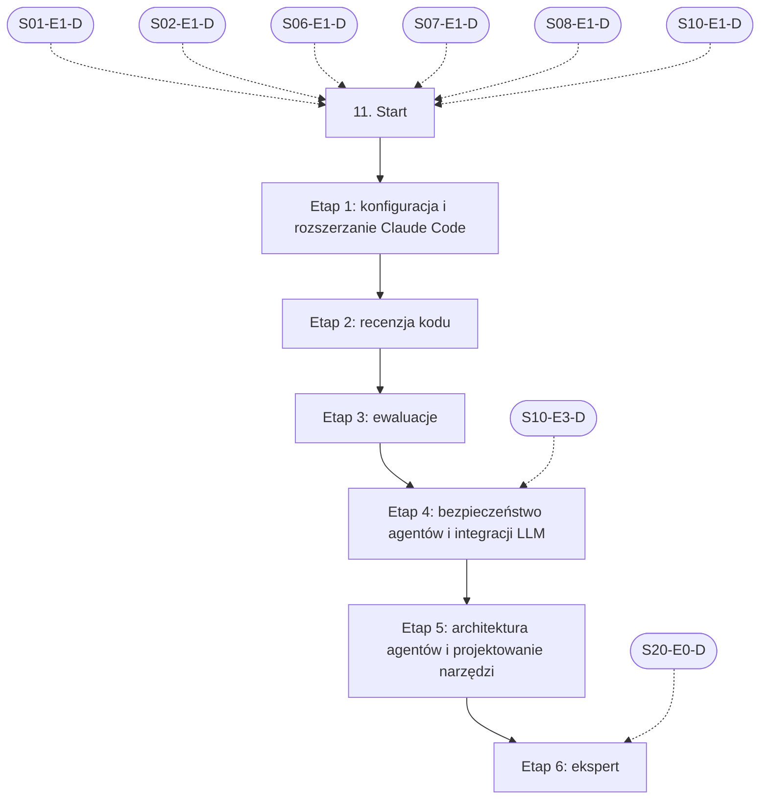

# 11. Weryfikacja pracy AI i budowa procesu: plan wdrożenia w Linear

Team **LEA** (https://linear.app/daankh/team/LEA/overview). Plan do przeglądu przed wdrożeniem: nic nie zostało jeszcze utworzone w Linear. Klucze zadań (np. `S11-E1-M1`) są robocze; po wdrożeniu dostaną identyfikatory `LEA-…`.

**W skrócie:** 6 kamieni milowych, 40 zadań (1 start, 29 materiałów, 6 dowodów, 4 praktyki). Plik główny z kolejnością projektów: `00-kolejnosc-i-zaleznosci.md`.

## 1. Projekt

| Pole | Wartość |
|---|---|
| Nazwa | 11. Weryfikacja pracy AI i budowa procesu |
| Team | LEA |
| Podsumowanie (pole „Summary”) | Warstwa 3: ochrona i kontrola. Opiera się na: 1, 2, 6, 7, 8 i 10; etap ekspercki także na 20. Jest podstawą: 21 i pracy z agentami we wszystkich kolejnych sekcjach. |
| Etykiety projektu | `warstwa-3` |
| Blokowany przez (projekty) | 01. Praca z AI w chmurze: Claude i Claude Code, 02. Języki i narzędzia podstawowe, 06. Testowanie, 07. Wymagania i specyfikacje, 08. Architektura i projektowanie systemów, 10. Bezpieczeństwo |
| Blokuje (projekty) | 21. Funkcje AI w aplikacjach |
| Zależności częściowe (wchodzące) | etap 4 czeka na 10. Bezpieczeństwo (etap 3); etap 6 czeka na 20. Lokalne AI i rozwój modeli (etap 0) |
| Zależności częściowe (wychodzące) | 10. Bezpieczeństwo, etap 8 |

### Opis projektu (do wklejenia w Linear)

*Warstwa 3: ochrona i kontrola. Opiera się na: 1, 2, 6, 7, 8 i 10; etap ekspercki także na 20. Jest podstawą: 21 i pracy z agentami we wszystkich kolejnych sekcjach.*

**Zakres umiejętności**

- Rozszerzanie Claude Code: skille, subagenci, hooki, MCP, reguły uprawnień, pluginy. To fundament vicrafter: własnego pluginu Claude Code budowanego w tej sekcji, który zbiera komendy, hooki, skille, listę kontrolną recenzji i ewaluacje procesu pracy z agentami.
- Ewaluacje pracy agenta i promptów jako testy regresji procesu.
- Bezpieczeństwo agentów: prompt injection przez treści z repozytorium klienta, nadmierna sprawczość, sandbox.
- Czytanie diffów i próbkowa, krytyczna recenzja; rozpoznawanie kodu „prawie dobrego”.
- Recenzja na innym modelu niż autor kodu, lokalne modele jako druga niezależna recenzja (Ollama, llama.cpp, LiteLLM).
- Pomiar: czy proces oszczędza czas, i gotowość do jego uproszczenia.

**Ścieżka nauki**

Ścieżka ma 6 etapów, numerowanych od 1, bo podstawy LLM i codzienna praca z Claude Code są w sekcji 1. Każdy kończy się **dowodem**, czyli małym projektem, który pokazuje, że etap jest opanowany. Dowody budują kolejne elementy vicrafter: konfigurację uprawnień, hooki i skille, listę kontrolną recenzji, zestaw ewaluacji i recenzję na innym modelu. Etapy 3 i 4 warto przejść w całości, bo bez nich nie da się zmierzyć, czy agent pracuje dobrze ani czy pracuje bezpiecznie. Ceny materiałów płatnych zmieniają się, więc warto je sprawdzić przed zakupem. Dokumentacja Claude Code zmienia się co kilka tygodni, więc materiały z tej sekcji trzeba czytać w wersji bieżącej, a nie z notatek. Uruchamianie modeli lokalnych jest w sekcji 20 (etap 0), bezpieczeństwo aplikacji w sekcji 10.

**Definicja ukończenia projektu (dowód poziomu E)**

Dla zmiany w nieznanym repozytorium potrafisz w 1 dzień ustalić, czy praca agenta jest poprawna i bezpieczna, wskazać błąd, którego nie znalazł recenzent AI, i wykazać na danych z ewaluacji, czy nowa wersja modelu lub skilla poprawiła, czy pogorszyła wyniki vicrafter.

**Źródło:** dokument „Umiejętności techniczne” w projekcie „JDG: Rozwój oprogramowania”, sekcja 11.

## 2. Kamienie milowe

Jeden kamień milowy na etap ścieżki. Kamień milowy jest zamknięty, gdy zamknięte jest zadanie dowodu tego etapu.

| # | Kamień milowy | Cel | Poziom po etapie | Zadania |
|---|---|---|---|---|
| 1 | Etap 1: konfiguracja i rozszerzanie Claude Code | konfiguracja i rozszerzanie Claude Code: uprawnienia, skille, subagenci, hooki, pluginy, MCP | E | 6 |
| 2 | Etap 2: recenzja kodu | recenzja kodu, także kodu z AI | E | 4 |
| 3 | Etap 3: ewaluacje | ewaluacje: pomiar jakości pracy agenta i promptów | E | 9 |
| 4 | Etap 4: bezpieczeństwo agentów i integracji LLM | bezpieczeństwo agentów i integracji LLM | E | 5 |
| 5 | Etap 5: architektura agentów i projektowanie narzędzi | architektura agentów i projektowanie narzędzi | W | 6 |
| 6 | Etap 6: ekspert | ekspert: pomiar procesu, recenzja krzyżowa, aktualność | E | 9 |

## 3. Punkt startu

Zadanie **`S11-START` · Start: 11. Weryfikacja pracy AI i budowa procesu** to jedyne wejście do projektu: wszystkie zadania pierwszego etapu są przez nie blokowane.

- **Blokowane przez:** `S01-E1-D`, `S02-E1-D`, `S06-E1-D`, `S07-E1-D`, `S08-E1-D`, `S10-E1-D`
- **Odblokowuje:** `S11-E1-M1`, `S11-E1-M2`, `S11-E1-M3`, `S11-E1-M4`, `S11-E1-M5`
- **Status początkowy:** Backlog do czasu zamknięcia zadań blokujących, potem Todo

Opis zadania (do wklejenia):

Punkt startu projektu „11. Weryfikacja pracy AI i budowa procesu”.

**Warunki wejścia (zadania blokujące):**

- `S01-E1-D` · Dowód etapu 1: codzienna praca z Claude Code — sekcja 1 na poziomie podstawowym do pracy (etap 1)
- `S02-E1-D` · Dowód etapu 1: Bash i `jq` — sekcja 2 na poziomie podstawowym do pracy (etap 1)
- `S06-E1-D` · Dowód etapu 1: projektowanie testów i TDD — sekcja 6 na poziomie podstawowym do pracy (etap 1)
- `S07-E1-D` · Dowód etapu 1: wydobywanie wymagań od klienta — sekcja 7 na poziomie podstawowym do pracy (etap 1)
- `S08-E1-D` · Dowód etapu 1: style architektoniczne, atrybuty jakości i kompromisy — sekcja 8 na poziomie podstawowym do pracy (etap 1)
- `S10-E1-D` · Dowód etapu 1: ataki na web i API w praktyce — sekcja 10 na poziomie podstawowym do pracy (etap 1)

**Do zrobienia:**

- przeczytać sekcję 11 dokumentu „Umiejętności techniczne”,
- zaznaczyć etapy, które zaliczasz samym dowodem (zgodnie z akapitem wstępnym ścieżki), i dla nich zamknąć zadania materiałów jako niepotrzebne.

**Folder roboczy:** `11-weryfikacja-pracy-ai-i-budowa-procesu/`

## 4. Przepływ zależności

Linie ciągłe to zależności wewnątrz projektu, przerywane to zadania z innych projektów. Wewnątrz etapu zadania materiałów są równoległe i wszystkie blokują dowód etapu; dowód etapu blokuje materiały kolejnego etapu.

## 5. Zadania według kamieni milowych

Szablon opisu zadania materiału: nazwa materiału, autor lub wydawca, typ, czas, koszt i link (jak w kolumnach poniżej), zdanie „Gotowe, gdy materiał jest przerobiony w zakresie potrzebnym do dowodu etapu” oraz folder roboczy z kolumny „Folder”. Opisy dowodów i praktyk są podane pod tabelą każdego etapu.

### Etap 1: konfiguracja i rozszerzanie Claude Code

Opis kamienia milowego (do wklejenia):

**Cel:** konfiguracja i rozszerzanie Claude Code: uprawnienia, skille, subagenci, hooki, pluginy, MCP · **Poziom po etapie:** E

**Szczególnie ważne:** hooki jako jedyny deterministyczny mechanizm (instrukcje w `CLAUDE.md` i skillach są tylko wskazówkami), reguły `allow` i `deny` oraz ich ograniczenia przy dopasowaniu poleceń, sandbox z izolacją sieci, co projekt może uruchomić przed zaufaniem folderowi, serwery MCP spoza repozytorium (pluginy, konektory).

**Dowód:** Pierwsza wersja pluginu vicrafter: ustawienia uprawnień dla repozytorium klienta (bez poświadczeń produkcyjnych, sieć tylko do listy domen), hook blokujący zapis w katalogu migracji i hook uruchamiający testy przed zakończeniem pracy, jeden skill i jeden subagent recenzujący; wszystko w repozytorium z opisem, dlaczego dana reguła istnieje.

| Klucz | Tytuł | Typ | Czas | Koszt | Link | Blokowane przez | Blokuje | Folder |
|---|---|---|---|---|---|---|---|---|
| `S11-E1-M1` | Przerobić: Dokumentacja: Permissions, Settings, Sandboxing, Security | materiał | 6–8 h | 0 zł | https://code.claude.com/docs/en/permissions, https://code.claude.com/docs/en/settings, https://code.claude.com/docs/en/sandboxing, https://code.claude.com/docs/en/security | `S11-START` | `S11-E1-D` | `11-weryfikacja-pracy-ai-i-budowa-procesu/e1-konfiguracja-i-rozszerzanie-claude-code/` |
| `S11-E1-M2` | Przerobić: Dokumentacja: Skills, Subagents, Hooks (przewodnik i referencja), Plugins | materiał | 10–12 h | 0 zł | https://code.claude.com/docs/en/skills, https://code.claude.com/docs/en/sub-agents, https://code.claude.com/docs/en/hooks-guide, https://code.claude.com/docs/en/hooks, https://code.claude.com/docs/en/plugins/overview | `S11-START` | `S11-E1-D` | `11-weryfikacja-pracy-ai-i-budowa-procesu/e1-konfiguracja-i-rozszerzanie-claude-code/` |
| `S11-E1-M3` | Przerobić: Dokumentacja: tryb nieinteraktywny, GitHub Actions, monitorowanie (OpenTelemetry) | materiał | 4–6 h | 0 zł | https://code.claude.com/docs/en/headless, https://code.claude.com/docs/en/github-actions, https://code.claude.com/docs/en/monitoring-usage | `S11-START` | `S11-E1-D` | `11-weryfikacja-pracy-ai-i-budowa-procesu/e1-konfiguracja-i-rozszerzanie-claude-code/` |
| `S11-E1-M4` | Przerobić: Kursy Anthropic Academy: „Introduction to agent skills”, „Introduction to subagents”… | materiał | 8–10 h | 0 zł | https://anthropic.skilljar.com | `S11-START` | `S11-E1-D` | `11-weryfikacja-pracy-ai-i-budowa-procesu/e1-konfiguracja-i-rozszerzanie-claude-code/` |
| `S11-E1-M5` | Przerobić: Model Context Protocol: architektura, budowa serwera, specyfikacja | materiał | 6–8 h | 0 zł | https://modelcontextprotocol.io | `S11-START` | `S11-E1-D` | `11-weryfikacja-pracy-ai-i-budowa-procesu/e1-konfiguracja-i-rozszerzanie-claude-code/` |
| `S11-E1-D` | Dowód etapu 1: konfiguracja i rozszerzanie Claude Code | dowód | — | — | — | `S11-E1-M1`, `S11-E1-M2`, `S11-E1-M3`, `S11-E1-M4`, `S11-E1-M5` | `S11-E2-M1`, `S11-E2-M2`, `S11-E2-M3` | `11-weryfikacja-pracy-ai-i-budowa-procesu/e1-konfiguracja-i-rozszerzanie-claude-code/` |

**`S11-E1-D` · Dowód etapu 1: konfiguracja i rozszerzanie Claude Code**

Pierwsza wersja pluginu vicrafter: ustawienia uprawnień dla repozytorium klienta (bez poświadczeń produkcyjnych, sieć tylko do listy domen), hook blokujący zapis w katalogu migracji i hook uruchamiający testy przed zakończeniem pracy, jeden skill i jeden subagent recenzujący; wszystko w repozytorium z opisem, dlaczego dana reguła istnieje.

**Na co zwrócić uwagę:** hooki jako jedyny deterministyczny mechanizm (instrukcje w `CLAUDE.md` i skillach są tylko wskazówkami), reguły `allow` i `deny` oraz ich ograniczenia przy dopasowaniu poleceń, sandbox z izolacją sieci, co projekt może uruchomić przed zaufaniem folderowi, serwery MCP spoza repozytorium (pluginy, konektory).

**Kryterium ukończenia:** w repozytorium vicrafter: plik ustawień uprawnień z regułami `deny` dla poświadczeń produkcyjnych i listą dozwolonych domen, 2 hooki z testami (próba zapisu w katalogu migracji jest blokowana; zakończenie pracy przy czerwonych testach jest blokowane), 1 skill i 1 subagent; każda reguła ma jednozdaniowe uzasadnienie w README.

**Folder roboczy:** `11-weryfikacja-pracy-ai-i-budowa-procesu/e1-konfiguracja-i-rozszerzanie-claude-code/`

### Etap 2: recenzja kodu

Opis kamienia milowego (do wklejenia):

**Cel:** recenzja kodu, także kodu z AI · **Poziom po etapie:** E

**Szczególnie ważne:** recenzja według kryteriów, a nie stylu; czytanie diffu od testów i kontraktów; typowe wady kodu „prawie dobrego” (obsłużona ścieżka szczęśliwa, brak przypadków brzegowych, osłabione asercje, wymyślone API i pakiety, niezamierzone zmiany poza zakresem zadania); recenzent w świeżym kontekście nie widzi rozumowania autora, a recenzent poproszony o znalezienie luk zwykle jakieś znajdzie, więc zgłoszenia trzeba filtrować.

**Dowód:** Lista kontrolna recenzji kodu z AI (z odesłaniami do sekcji 3, 6 i 10) i 20 pull requestów agentów zrecenzowanych według niej; dla każdego zapis znalezionych błędów, czasu recenzji i tego, które błędy wychwyciły narzędzia, a które tylko człowiek.

| Klucz | Tytuł | Typ | Czas | Koszt | Link | Blokowane przez | Blokuje | Folder |
|---|---|---|---|---|---|---|---|---|
| `S11-E2-M1` | Przerobić: Google Engineering Practices: „How to do a code review” i „The CL author’s guide” | materiał | 3–4 h | 0 zł | https://google.github.io/eng-practices/review/ | `S11-E1-D` | `S11-E2-D` | `11-weryfikacja-pracy-ai-i-budowa-procesu/e2-recenzja-kodu/` |
| `S11-E2-M2` | Przerobić: Simon Willison’s Weblog, tag „ai-assisted-programming” | materiał | 8–10 h (wybór wpisów) | 0 zł | https://simonwillison.net/tags/ai-assisted-programming/ | `S11-E1-D` | `S11-E2-D` | `11-weryfikacja-pracy-ai-i-budowa-procesu/e2-recenzja-kodu/` |
| `S11-E2-M3` | Przerobić: Dokumentacja Claude Code: „Add an adversarial review step”, `/code-review`, `/security-review` | materiał | 1–2 h | 0 zł | https://code.claude.com/docs/en/best-practices | `S11-E1-D` | `S11-E2-D` | `11-weryfikacja-pracy-ai-i-budowa-procesu/e2-recenzja-kodu/` |
| `S11-E2-D` | Dowód etapu 2: recenzja kodu | dowód | — | — | — | `S11-E2-M1`, `S11-E2-M2`, `S11-E2-M3` | `S10-E8-M1`, `S10-E8-M2`, `S10-E8-M3`, `S10-E8-P1`, `S10-E8-P2`, `S10-E8-P3`, `S10-E8-P4`, `S11-E3-M1`, `S11-E3-M2`, `S11-E3-M3`, `S11-E3-M4`, `S11-E3-M5`, `S11-E3-M6`, `S11-E3-M7`, `S11-E3-M8` | `11-weryfikacja-pracy-ai-i-budowa-procesu/e2-recenzja-kodu/` |

**`S11-E2-D` · Dowód etapu 2: recenzja kodu**

Lista kontrolna recenzji kodu z AI (z odesłaniami do sekcji 3, 6 i 10) i 20 pull requestów agentów zrecenzowanych według niej; dla każdego zapis znalezionych błędów, czasu recenzji i tego, które błędy wychwyciły narzędzia, a które tylko człowiek.

**Na co zwrócić uwagę:** recenzja według kryteriów, a nie stylu; czytanie diffu od testów i kontraktów; typowe wady kodu „prawie dobrego” (obsłużona ścieżka szczęśliwa, brak przypadków brzegowych, osłabione asercje, wymyślone API i pakiety, niezamierzone zmiany poza zakresem zadania); recenzent w świeżym kontekście nie widzi rozumowania autora, a recenzent poproszony o znalezienie luk zwykle jakieś znajdzie, więc zgłoszenia trzeba filtrować.

**Kryterium ukończenia:** lista kontrolna w vicrafter; tabela 20 pull requestów z liczbą błędów, czasem recenzji i źródłem wykrycia (narzędzie, recenzent AI, człowiek); na końcu podsumowanie: odsetek błędów wykrytych tylko przez człowieka i 3 punkty listy, które zmieniono po tej próbie.

**Folder roboczy:** `11-weryfikacja-pracy-ai-i-budowa-procesu/e2-recenzja-kodu/`

### Etap 3: ewaluacje

Opis kamienia milowego (do wklejenia):

**Cel:** ewaluacje: pomiar jakości pracy agenta i promptów · **Poziom po etapie:** E

**Szczególnie ważne:** analiza błędów na prawdziwych przebiegach przed pisaniem metryk, zadania z jednoznacznym kryterium sukcesu, oceniacze deterministyczne tam, gdzie się da, LLM-as-judge tylko po sprawdzeniu zgodności z oceną ręczną, wielokrotne uruchomienia z powodu niedeterminizmu, ewaluacje jako testy regresji przy zmianie modelu, promptu lub skilla.

Kurs Maven jest opcjonalny: darmowe artykuły tych samych autorów wystarczą do poziomu W, kurs przyspiesza dojście do E. Do uruchamiania zestawu w CI służy Inspect (alternatywa: promptfoo). Każdy przebieg ewaluacji kosztuje: liczba zadań × liczba powtórzeń × tokeny na zadanie × cena modelu, więc koszt trzeba policzyć przed włączeniem zestawu do CI.

**Dowód:** Zestaw ewaluacji vicrafter w Inspect (albo promptfoo): 30 zadań z repozytoriów testowych (naprawa błędu, test charakteryzujący, poprawka bezpieczeństwa) z automatycznym oceniaczem, uruchamiany w CI przy każdej zmianie pluginu; raport porównujący dwie wersje skilla lub dwa modele z liczbą powtórzeń i rozrzutem wyników; wyliczenie kosztu API jednego pełnego przebiegu (30 zadań × N powtórzeń) i miesięcznego budżetu przy uruchamianiu w CI.

| Klucz | Tytuł | Typ | Czas | Koszt | Link | Blokowane przez | Blokuje | Folder |
|---|---|---|---|---|---|---|---|---|
| `S11-E3-M1` | Przerobić: „Demystifying evals for AI agents” (styczeń 2026) | materiał | 1–2 h | 0 zł | https://www.anthropic.com/engineering/demystifying-evals-for-ai-agents | `S11-E2-D` | `S11-E3-D` | `11-weryfikacja-pracy-ai-i-budowa-procesu/e3-ewaluacje/` |
| `S11-E3-M2` | Przerobić: Kurs „Prompt evaluations” | materiał, płatny | 6–8 h | 0 zł (zużycie API płatne) | https://github.com/anthropics/courses | `S11-E2-D` | `S11-E3-D` | `11-weryfikacja-pracy-ai-i-budowa-procesu/e3-ewaluacje/` |
| `S11-E3-M3` | Przerobić: „Your AI Product Needs Evals”, „Using LLM-as-a-Judge”… | materiał | 8–10 h | 0 zł | https://hamel.dev/blog/posts/evals/, https://hamel.dev/blog/posts/evals-faq/ | `S11-E2-D` | `S11-E3-D` | `11-weryfikacja-pracy-ai-i-budowa-procesu/e3-ewaluacje/` |
| `S11-E3-M4` | Przerobić: AI Evals For Engineers & PMs | materiał, płatny, opcjonalne | 30–40 h | płatny | https://maven.com/parlance-labs/evals | `S11-E2-D` | — | `11-weryfikacja-pracy-ai-i-budowa-procesu/e3-ewaluacje/` |
| `S11-E3-M5` | Przerobić: AI Engineering: Building Applications with Foundation Models (O’Reilly 2025), rozdziały o ewaluacji | materiał, płatny | 10–12 h (rozdziały 3–4) | płatna | https://huyenchip.com/books/ | `S11-E2-D` | `S11-E3-D` | `11-weryfikacja-pracy-ai-i-budowa-procesu/e3-ewaluacje/` |
| `S11-E3-M6` | Przerobić: Inspect: framework do ewaluacji LLM i agentów… | materiał, płatny | 6–8 h | 0 zł (zużycie API płatne) | https://inspect.aisi.org.uk/ | `S11-E2-D` | `S11-E3-D` | `11-weryfikacja-pracy-ai-i-budowa-procesu/e3-ewaluacje/` |
| `S11-E3-M7` | Przerobić: promptfoo: ewaluacje promptów i agentów w konfiguracji YAML, integracja z CI/CD | materiał, płatny, opcjonalne | 3–4 h | 0 zł (zużycie API płatne) | https://www.promptfoo.dev/docs/intro/, https://www.promptfoo.dev/docs/integrations/ci-cd/ | `S11-E2-D` | — | `11-weryfikacja-pracy-ai-i-budowa-procesu/e3-ewaluacje/` |
| `S11-E3-M8` | Przerobić: Cennik API i Message Batches API (koszt przebiegów ewaluacji, przetwarzanie wsadowe) | materiał | 1 h | 0 zł | https://www.anthropic.com/pricing, https://docs.claude.com/en/docs/build-with-claude/batch-processing | `S11-E2-D` | `S11-E3-D` | `11-weryfikacja-pracy-ai-i-budowa-procesu/e3-ewaluacje/` |
| `S11-E3-D` | Dowód etapu 3: ewaluacje | dowód | — | — | — | `S11-E3-M1`, `S11-E3-M2`, `S11-E3-M3`, `S11-E3-M5`, `S11-E3-M6`, `S11-E3-M8` | `S11-E4-M1`, `S11-E4-M2`, `S11-E4-M3`, `S11-E4-M4`, `S21-START` | `11-weryfikacja-pracy-ai-i-budowa-procesu/e3-ewaluacje/` |

**`S11-E3-D` · Dowód etapu 3: ewaluacje**

Zestaw ewaluacji vicrafter w Inspect (albo promptfoo): 30 zadań z repozytoriów testowych (naprawa błędu, test charakteryzujący, poprawka bezpieczeństwa) z automatycznym oceniaczem, uruchamiany w CI przy każdej zmianie pluginu; raport porównujący dwie wersje skilla lub dwa modele z liczbą powtórzeń i rozrzutem wyników; wyliczenie kosztu API jednego pełnego przebiegu (30 zadań × N powtórzeń) i miesięcznego budżetu przy uruchamianiu w CI.

**Na co zwrócić uwagę:** analiza błędów na prawdziwych przebiegach przed pisaniem metryk, zadania z jednoznacznym kryterium sukcesu, oceniacze deterministyczne tam, gdzie się da, LLM-as-judge tylko po sprawdzeniu zgodności z oceną ręczną, wielokrotne uruchomienia z powodu niedeterminizmu, ewaluacje jako testy regresji przy zmianie modelu, promptu lub skilla.

**Kryterium ukończenia:** 30 zadań, każde z oceniaczem deterministycznym albo LLM-as-judge sprawdzonym na co najmniej 20 ocenach ręcznych; workflow CI uruchamia zestaw na pull requestach zmieniających plugin i publikuje wynik; raport: co najmniej 3 powtórzenia na zadanie, średnia i rozrzut dla obu wariantów; szacunek kosztu (tokeny wejścia i wyjścia na zadanie × N × cena) porównany z rzeczywistym zużyciem z konsoli API po jednym przebiegu, z decyzją o liczbie powtórzeń i użyciu Batch API.

**Folder roboczy:** `11-weryfikacja-pracy-ai-i-budowa-procesu/e3-ewaluacje/`

### Etap 4: bezpieczeństwo agentów i integracji LLM

Opis kamienia milowego (do wklejenia):

**Cel:** bezpieczeństwo agentów i integracji LLM · **Poziom po etapie:** E

**Szczególnie ważne:** „zabójcza trójka” (dostęp do prywatnych danych, niezaufane treści, kanał wysyłki na zewnątrz) i przecinanie kanału wysyłki jako najprostsza ochrona; pośredni prompt injection przez pliki repozytorium klienta, zgłoszenia i strony; nadmierna sprawczość; przekazywanie tokenów i za szerokie zakresy w serwerach MCP; lokalne serwery MCP jako uruchamianie cudzego kodu.

**Dowód:** Model zagrożeń STRIDE (zob. sekcja 10, etap 3) dla własnego stanowiska pracy z agentami i vicrafter; 10 przygotowanych przypadków prompt injection umieszczonych w repozytorium testowym (komentarze, README, zgłoszenia) dołączonych do ewaluacji z etapu 3, z wynikiem: które ataki zablokowały uprawnienia, sandbox lub hooki, a które wymagały poprawek.

| Klucz | Tytuł | Typ | Czas | Koszt | Link | Blokowane przez | Blokuje | Folder |
|---|---|---|---|---|---|---|---|---|
| `S11-E4-M1` | Przerobić: OWASP Top 10 for LLM Applications 2025 | materiał | 4–5 h | 0 zł | https://genai.owasp.org/llm-top-10/ | `S11-E3-D`, `S10-E3-D` | `S11-E4-D` | `11-weryfikacja-pracy-ai-i-budowa-procesu/e4-bezpieczenstwo-agentow-i-integracji-llm/` |
| `S11-E4-M2` | Przerobić: OWASP Top 10 for Agentic Applications for 2026 (grudzień 2025) | materiał | 3–4 h | 0 zł | https://genai.owasp.org/resource/owasp-top-10-for-agentic-applications-for-2026/ | `S11-E3-D`, `S10-E3-D` | `S11-E4-D` | `11-weryfikacja-pracy-ai-i-budowa-procesu/e4-bezpieczenstwo-agentow-i-integracji-llm/` |
| `S11-E4-M3` | Przerobić: MCP: Security Best Practices | materiał | 3–4 h | 0 zł | https://modelcontextprotocol.io/docs/2026-07-28/tutorials/security/security_best_practices | `S11-E3-D`, `S10-E3-D` | `S11-E4-D` | `11-weryfikacja-pracy-ai-i-budowa-procesu/e4-bezpieczenstwo-agentow-i-integracji-llm/` |
| `S11-E4-M4` | Przerobić: „The lethal trifecta for AI agents” i tag „prompt-injection” | materiał | 4–6 h | 0 zł | https://simonwillison.net/2025/Jun/16/the-lethal-trifecta/, https://simonwillison.net/tags/prompt-injection/ | `S11-E3-D`, `S10-E3-D` | `S11-E4-D` | `11-weryfikacja-pracy-ai-i-budowa-procesu/e4-bezpieczenstwo-agentow-i-integracji-llm/` |
| `S11-E4-D` | Dowód etapu 4: bezpieczeństwo agentów i integracji LLM | dowód | — | — | — | `S11-E4-M1`, `S11-E4-M2`, `S11-E4-M3`, `S11-E4-M4` | `S11-E5-M1`, `S11-E5-M2`, `S11-E5-M3`, `S11-E5-M4`, `S11-E5-M5`, `S21-START` | `11-weryfikacja-pracy-ai-i-budowa-procesu/e4-bezpieczenstwo-agentow-i-integracji-llm/` |

**`S11-E4-D` · Dowód etapu 4: bezpieczeństwo agentów i integracji LLM**

Model zagrożeń STRIDE (zob. sekcja 10, etap 3) dla własnego stanowiska pracy z agentami i vicrafter; 10 przygotowanych przypadków prompt injection umieszczonych w repozytorium testowym (komentarze, README, zgłoszenia) dołączonych do ewaluacji z etapu 3, z wynikiem: które ataki zablokowały uprawnienia, sandbox lub hooki, a które wymagały poprawek.

**Na co zwrócić uwagę:** „zabójcza trójka” (dostęp do prywatnych danych, niezaufane treści, kanał wysyłki na zewnątrz) i przecinanie kanału wysyłki jako najprostsza ochrona; pośredni prompt injection przez pliki repozytorium klienta, zgłoszenia i strony; nadmierna sprawczość; przekazywanie tokenów i za szerokie zakresy w serwerach MCP; lokalne serwery MCP jako uruchamianie cudzego kodu.

**Kryterium ukończenia:** diagram z granicami zaufania (agent, repozytorium klienta, serwery MCP, sieć, sekrety) i lista zagrożeń STRIDE; 10 przypadków w zestawie ewaluacji; po poprawkach żaden przypadek nie prowadzi do wysłania danych na zewnątrz ani zapisu poza katalogiem roboczym (wynik 10/10 w ewaluacji).

**Folder roboczy:** `11-weryfikacja-pracy-ai-i-budowa-procesu/e4-bezpieczenstwo-agentow-i-integracji-llm/`

### Etap 5: architektura agentów i projektowanie narzędzi

Opis kamienia milowego (do wklejenia):

**Cel:** architektura agentów i projektowanie narzędzi · **Poziom po etapie:** W

**Szczególnie ważne:** najprostsze rozwiązanie, które działa (przepływ zamiast agenta, jeśli wystarczy), opisy narzędzi jako część promptu, zwięzłe i jednoznaczne wyniki narzędzi, kontekst jako ograniczony zasób, podział pracy między subagentów.

**Dowód:** Jeden przepływ vicrafter (np. triage zgłoszeń klienta albo przygotowanie raportu z audytu) przebudowany według tych zasad, z pomiarem przed i po na zestawie ewaluacji z etapu 3 (jakość, czas, koszt tokenów).

| Klucz | Tytuł | Typ | Czas | Koszt | Link | Blokowane przez | Blokuje | Folder |
|---|---|---|---|---|---|---|---|---|
| `S11-E5-M1` | Przerobić: „Building effective agents” (grudzień 2024) | materiał | 1–2 h | 0 zł | https://www.anthropic.com/engineering/building-effective-agents | `S11-E4-D` | `S11-E5-D` | `11-weryfikacja-pracy-ai-i-budowa-procesu/e5-architektura-agentow-i-projektowanie-narzedzi/` |
| `S11-E5-M2` | Przerobić: „Writing effective tools for agents — with agents” i… | materiał | 2–3 h | 0 zł | https://www.anthropic.com/engineering/writing-tools-for-agents, https://www.anthropic.com/engineering/effective-context-engineering-for-ai-agents | `S11-E4-D` | `S11-E5-D` | `11-weryfikacja-pracy-ai-i-budowa-procesu/e5-architektura-agentow-i-projektowanie-narzedzi/` |
| `S11-E5-M3` | Przerobić: Claude Agent SDK | materiał | 4–6 h | 0 zł | https://code.claude.com/docs/en/agent-sdk/overview | `S11-E4-D` | `S11-E5-D` | `11-weryfikacja-pracy-ai-i-budowa-procesu/e5-architektura-agentow-i-projektowanie-narzedzi/` |
| `S11-E5-M4` | Przerobić: Kurs „Tool use” | materiał, płatny | 4–6 h | 0 zł (zużycie API płatne) | https://github.com/anthropics/courses | `S11-E4-D` | `S11-E5-D` | `11-weryfikacja-pracy-ai-i-budowa-procesu/e5-architektura-agentow-i-projektowanie-narzedzi/` |
| `S11-E5-M5` | Przerobić: AI Engineering, rozdziały o agentach, RAG i architekturze | materiał, płatny | 6–8 h | płatna (ta sama co w etapie 3) | https://huyenchip.com/books/ | `S11-E4-D` | `S11-E5-D` | `11-weryfikacja-pracy-ai-i-budowa-procesu/e5-architektura-agentow-i-projektowanie-narzedzi/` |
| `S11-E5-D` | Dowód etapu 5: architektura agentów i projektowanie narzędzi | dowód | — | — | — | `S11-E5-M1`, `S11-E5-M2`, `S11-E5-M3`, `S11-E5-M4`, `S11-E5-M5` | `S11-E6-M1`, `S11-E6-M2`, `S11-E6-M3`, `S11-E6-M4`, `S11-E6-P1`, `S11-E6-P2`, `S11-E6-P3`, `S11-E6-P4` | `11-weryfikacja-pracy-ai-i-budowa-procesu/e5-architektura-agentow-i-projektowanie-narzedzi/` |

**`S11-E5-D` · Dowód etapu 5: architektura agentów i projektowanie narzędzi**

Jeden przepływ vicrafter (np. triage zgłoszeń klienta albo przygotowanie raportu z audytu) przebudowany według tych zasad, z pomiarem przed i po na zestawie ewaluacji z etapu 3 (jakość, czas, koszt tokenów).

**Na co zwrócić uwagę:** najprostsze rozwiązanie, które działa (przepływ zamiast agenta, jeśli wystarczy), opisy narzędzi jako część promptu, zwięzłe i jednoznaczne wyniki narzędzi, kontekst jako ograniczony zasób, podział pracy między subagentów.

**Kryterium ukończenia:** ten sam zestaw ewaluacji uruchomiony przed i po przebudowie z co najmniej 3 powtórzeniami; tabela jakości, czasu i kosztu tokenów; przebudowa przyjęta tylko wtedy, gdy jakość nie spadła.

**Folder roboczy:** `11-weryfikacja-pracy-ai-i-budowa-procesu/e5-architektura-agentow-i-projektowanie-narzedzi/`

### Etap 6: ekspert

Opis kamienia milowego (do wklejenia):

**Cel:** ekspert: pomiar procesu, recenzja krzyżowa, aktualność · **Poziom po etapie:** E

**Dowód poziomu E:** Dla zmiany w nieznanym repozytorium potrafisz w 1 dzień ustalić, czy praca agenta jest poprawna i bezpieczna, wskazać błąd, którego nie znalazł recenzent AI, i wykazać na danych z ewaluacji, czy nowa wersja modelu lub skilla poprawiła, czy pogorszyła wyniki vicrafter.

| Klucz | Tytuł | Typ | Czas | Koszt | Link | Blokowane przez | Blokuje | Folder |
|---|---|---|---|---|---|---|---|---|
| `S11-E6-M1` | Przerobić: Blog inżynieryjny Anthropic i informacje o zmianach Claude Code | materiał | ok. 1 h tygodniowo | 0 zł | https://www.anthropic.com/engineering, https://code.claude.com/docs | `S11-E5-D`, `S20-E0-D` | `S11-E6-D` | `11-weryfikacja-pracy-ai-i-budowa-procesu/e6-ekspert/` |
| `S11-E6-M2` | Przerobić: Simon Willison’s Weblog | materiał | ok. 0,5 h tygodniowo | 0 zł | https://simonwillison.net | `S11-E5-D`, `S20-E0-D` | `S11-E6-D` | `11-weryfikacja-pracy-ai-i-budowa-procesu/e6-ekspert/` |
| `S11-E6-M3` | Przerobić: Specyfikacja MCP (nowe wersje i zmiany w autoryzacji) | materiał, opcjonalne | wg potrzeb | 0 zł | https://modelcontextprotocol.io | `S11-E5-D`, `S20-E0-D` | — | `11-weryfikacja-pracy-ai-i-budowa-procesu/e6-ekspert/` |
| `S11-E6-M4` | Przerobić: LiteLLM: jedna bramka (proxy) do modeli różnych dostawców i modeli lokalnych (Ollama), limity… | materiał | 3–4 h | 0 zł | https://docs.litellm.ai/docs/, https://docs.litellm.ai/docs/simple_proxy | `S11-E5-D`, `S20-E0-D` | `S11-E6-D` | `11-weryfikacja-pracy-ai-i-budowa-procesu/e6-ekspert/` |
| `S11-E6-P1` | Praktyka: recenzja krzyżowa | praktyka | — | — | — | `S11-E5-D`, `S20-E0-D` | `S11-E6-D` | `11-weryfikacja-pracy-ai-i-budowa-procesu/e6-ekspert/` |
| `S11-E6-P2` | Praktyka: pomiar procesu | praktyka | — | — | — | `S11-E5-D`, `S20-E0-D` | `S11-E6-D` | `11-weryfikacja-pracy-ai-i-budowa-procesu/e6-ekspert/` |
| `S11-E6-P3` | Praktyka: aktualizacja ewaluacji | praktyka | — | — | — | `S11-E5-D`, `S20-E0-D` | `S11-E6-D` | `11-weryfikacja-pracy-ai-i-budowa-procesu/e6-ekspert/` |
| `S11-E6-P4` | Praktyka: praca bez agenta | praktyka | — | — | — | `S11-E5-D`, `S20-E0-D` | `S11-E6-D` | `11-weryfikacja-pracy-ai-i-budowa-procesu/e6-ekspert/` |
| `S11-E6-D` | Dowód poziomu E: ekspert | dowód | — | — | — | `S11-E6-M1`, `S11-E6-M2`, `S11-E6-M4`, `S11-E6-P1`, `S11-E6-P2`, `S11-E6-P3`, `S11-E6-P4` | — | `11-weryfikacja-pracy-ai-i-budowa-procesu/e6-ekspert/` |

**`S11-E6-P1` · Praktyka: recenzja krzyżowa**

Każda zmiana w ścieżce krytycznej recenzowana przez inny model niż autor (inny dostawca przez bramkę LiteLLM albo model lokalny, zob. sekcja 20, etap 0), z porównaniem, które błędy wychwycił który recenzent.

Praktyka ciągła etapu eksperckiego: oznacz jako gotową, gdy działa jako stały element pracy, a nie po jednorazowym wykonaniu.

**Folder roboczy:** `11-weryfikacja-pracy-ai-i-budowa-procesu/e6-ekspert/`

**`S11-E6-P2` · Praktyka: pomiar procesu**

Co miesiąc czas od zadania do scalenia, odsetek zmian odrzuconych lub poprawionych przez człowieka, koszt na zadanie; decyzja o usunięciu kroków vicrafter, które nie poprawiają wyników.

Praktyka ciągła etapu eksperckiego: oznacz jako gotową, gdy działa jako stały element pracy, a nie po jednorazowym wykonaniu.

**Folder roboczy:** `11-weryfikacja-pracy-ai-i-budowa-procesu/e6-ekspert/`

**`S11-E6-P3` · Praktyka: aktualizacja ewaluacji**

Każdy błąd agenta, który przeszedł do recenzji, staje się nowym przypadkiem w zestawie.

Praktyka ciągła etapu eksperckiego: oznacz jako gotową, gdy działa jako stały element pracy, a nie po jednorazowym wykonaniu.

**Folder roboczy:** `11-weryfikacja-pracy-ai-i-budowa-procesu/e6-ekspert/`

**`S11-E6-P4` · Praktyka: praca bez agenta**

Raz w miesiącu zadanie wykonane samodzielnie, żeby nie utracić umiejętności, które się weryfikuje.

Praktyka ciągła etapu eksperckiego: oznacz jako gotową, gdy działa jako stały element pracy, a nie po jednorazowym wykonaniu.

**Folder roboczy:** `11-weryfikacja-pracy-ai-i-budowa-procesu/e6-ekspert/`

**`S11-E6-D` · Dowód poziomu E: ekspert**

Dla zmiany w nieznanym repozytorium potrafisz w 1 dzień ustalić, czy praca agenta jest poprawna i bezpieczna, wskazać błąd, którego nie znalazł recenzent AI, i wykazać na danych z ewaluacji, czy nowa wersja modelu lub skilla poprawiła, czy pogorszyła wyniki vicrafter.

**Kryterium ukończenia:** dowód wykonany samodzielnie; w komentarzu link do raportu: wskazany błąd z testem, który go odtwarza, oraz porównanie wyników ewaluacji obu wersji z liczbą powtórzeń i rozrzutem.

**Folder roboczy:** `11-weryfikacja-pracy-ai-i-budowa-procesu/e6-ekspert/`

## 6. Relacje z innymi projektami

**Wchodzące** (zadanie z innego projektu blokuje zadanie tego projektu):

- `S01-E1-D` (Dowód etapu 1: codzienna praca z Claude Code) → `S11-START`
- `S02-E1-D` (Dowód etapu 1: Bash i `jq`) → `S11-START`
- `S06-E1-D` (Dowód etapu 1: projektowanie testów i TDD) → `S11-START`
- `S07-E1-D` (Dowód etapu 1: wydobywanie wymagań od klienta) → `S11-START`
- `S08-E1-D` (Dowód etapu 1: style architektoniczne, atrybuty jakości i kompromisy) → `S11-START`
- `S10-E1-D` (Dowód etapu 1: ataki na web i API w praktyce) → `S11-START`
- `S10-E3-D` (Dowód etapu 3: modelowanie zagrożeń) → `S11-E4-M1`
- `S10-E3-D` (Dowód etapu 3: modelowanie zagrożeń) → `S11-E4-M2`
- `S10-E3-D` (Dowód etapu 3: modelowanie zagrożeń) → `S11-E4-M3`
- `S10-E3-D` (Dowód etapu 3: modelowanie zagrożeń) → `S11-E4-M4`
- `S20-E0-D` (Dowód etapu 0: modele lokalne na stanowisku pracy) → `S11-E6-M1`
- `S20-E0-D` (Dowód etapu 0: modele lokalne na stanowisku pracy) → `S11-E6-M2`
- `S20-E0-D` (Dowód etapu 0: modele lokalne na stanowisku pracy) → `S11-E6-M3`
- `S20-E0-D` (Dowód etapu 0: modele lokalne na stanowisku pracy) → `S11-E6-M4`
- `S20-E0-D` (Dowód etapu 0: modele lokalne na stanowisku pracy) → `S11-E6-P1`
- `S20-E0-D` (Dowód etapu 0: modele lokalne na stanowisku pracy) → `S11-E6-P2`
- `S20-E0-D` (Dowód etapu 0: modele lokalne na stanowisku pracy) → `S11-E6-P3`
- `S20-E0-D` (Dowód etapu 0: modele lokalne na stanowisku pracy) → `S11-E6-P4`

**Wychodzące** (zadanie tego projektu blokuje zadanie w innym projekcie):

- `S11-E2-D` → `S10-E8-M1` (10. Bezpieczeństwo)
- `S11-E2-D` → `S10-E8-M2` (10. Bezpieczeństwo)
- `S11-E2-D` → `S10-E8-M3` (10. Bezpieczeństwo)
- `S11-E2-D` → `S10-E8-P1` (10. Bezpieczeństwo)
- `S11-E2-D` → `S10-E8-P2` (10. Bezpieczeństwo)
- `S11-E2-D` → `S10-E8-P3` (10. Bezpieczeństwo)
- `S11-E2-D` → `S10-E8-P4` (10. Bezpieczeństwo)
- `S11-E3-D` → `S21-START` (21. Funkcje AI w aplikacjach)
- `S11-E4-D` → `S21-START` (21. Funkcje AI w aplikacjach)
