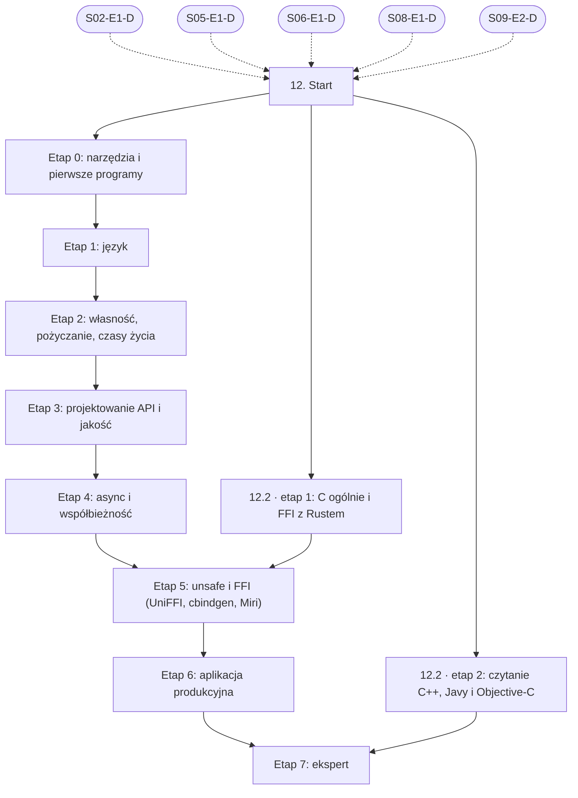

# 12. Rust jako wspólny fundament: plan wdrożenia w Linear

Team **LEA** (https://linear.app/daankh/team/LEA/overview). Plan jest wdrożony w Linear. Klucze zadań (np. `S12-E0-M1`) są robocze, a identyfikator każdego zadania w Linear (`LEA-…`) jest w kolumnie „Linear” tabel zadań i w pliku `mapowanie-kluczy.csv`.

**W skrócie:** 10 kamieni milowych, 68 zadań (1 start, 54 materiały, 10 dowodów, 3 praktyki). Plik główny z kolejnością projektów: `00-kolejnosc-i-zaleznosci.md`.

## 1. Projekt

| Pole | Wartość |
|---|---|
| Nazwa | 12. Rust jako wspólny fundament |
| Team | LEA |
| Podsumowanie (pole „Summary”) | Warstwa 4: rdzeń kompilowany. Opiera się na: 2, 5, 6, 8 i 9. Jest podstawą: 14, 18, 19, 20 i 22 oraz etapów w Ruście w 4, 5, 6, 8 i 10. |
| Etykiety projektu | `warstwa-4` |
| Blokowany przez (projekty) | 02. Języki i narzędzia podstawowe, 05. Backend i API, 06. Testowanie, 08. Architektura i projektowanie systemów, 09. DevOps, CI/CD i wydania |
| Blokuje (projekty) | 14. Desktop: wspólne, 18. Android, 19. iOS, 20. Lokalne AI i rozwój modeli, 22. Systemy wbudowane |
| Zależności częściowe (wychodzące) | 04. Bazy danych i dane, etap 7; 05. Backend i API, etap 9; 06. Testowanie, etap 4; 08. Architektura i projektowanie systemów, etap 6; 10. Bezpieczeństwo, etap 7; 18. Android, etap 4; 19. iOS, etap 4 |

### Opis projektu (do wklejenia w Linear)

*Warstwa 4: rdzeń kompilowany. Opiera się na: 2, 5, 6, 8 i 9. Jest podstawą: 14, 18, 19, 20 i 22 oraz etapów w Ruście w 4, 5, 6, 8 i 10.*

**Zakres umiejętności**

- Własność, pożyczanie, czasy życia, cechy (traits), generyki, obsługa błędów (`Result`, `thiserror`, `anyhow`).
- Programowanie asynchroniczne: Tokio, `Send`/`Sync`, anulowanie, blokowanie w kontekście async, kanały.
- `unsafe` i FFI: kiedy jest uzasadnione, jak je audytować, granice z C, Swift i Kotlinem (UniFFI, `cbindgen`), testy pod Miri.
- Cargo: workspace’y, features, profile budowania, kompilacja skrośna (targety, `cross`, `cargo-zigbuild`), rozmiar binarki.
- Ekosystem: `serde`, `tracing`, `reqwest`, `sqlx`, `clap`.
- Makra deklaratywne i proceduralne (`syn`, `quote`); WebAssembly (`wasm-bindgen`) jako opcja dla rdzenia uruchamianego w przeglądarce.
- Jakość: `clippy` (także w trybie pedantycznym), `rustfmt`, `miri` dla kodu `unsafe`, `cargo-udeps`.
- Weryfikacja kodu agentów w Ruście: nadmiarowe `.clone()` i `.unwrap()`, ukryte panice, `unsafe` bez uzasadnienia, wymyślone crate’y lub API, blokowanie w kodzie async.

**Ścieżka nauki**

Ścieżka ma 8 etapów. Każdy kończy się **dowodem**, czyli małym projektem, który pokazuje, że etap jest opanowany. Doświadczenie seniorskie w TypeScript skraca etapy 0 i 1 (narzędzia, składnia, typy algebraiczne, generyki), ale nie etap 2: model własności nie ma odpowiednika w językach z odśmiecaczem pamięci i właśnie tu najłatwiej przeoczyć błąd agenta. Etap 0 można zaliczyć samym dowodem, etap 1 częściowo, pozostałe trzeba przejść z materiałami. Ceny materiałów płatnych zmieniają się, więc warto je sprawdzić przed zakupem.

**Ścieżka uzupełniająca: C i inne języki systemowe**

Pierwszy etap ścieżki uzupełniającej (C i FFI z Rustem) jest warunkiem etapu `unsafe` i FFI, bo bez czytania C nie da się ocenić granicy FFI ani wiązań generowanych przez agenta. Drugi etap (czytanie C++, Javy i Objective-C) jest warunkiem etapu eksperckiego; Java przydaje się w sekcji 18, Objective-C w sekcji 19, C++ przy bibliotekach natywnych w sekcjach 20 i 22.

**Definicja ukończenia projektu (dowód poziomu E)**

Samodzielnie, bez agenta, w 1 dzień diagnozujesz i naprawiasz w nieznanym kodzie Rusta błąd niezdefiniowanego zachowania wykryty przez Miri, zakleszczenie w async albo awarię na granicy FFI (UniFFI lub C) i umiesz wyjaśnić przyczynę osobie nietechnicznej.

**Źródło:** dokument „Umiejętności techniczne” w projekcie „JDG: Rozwój oprogramowania”, sekcja 12.

## 2. Kamienie milowe

Jeden kamień milowy na etap ścieżki. Kamień milowy jest zamknięty, gdy zamknięte jest zadanie dowodu tego etapu.

| # | Kamień milowy | Cel | Poziom po etapie | Zadania |
|---|---|---|---|---|
| 1 | Etap 0: narzędzia i pierwsze programy | narzędzia i pierwsze programy: `rustup`, Cargo, edycja 2024 | podstawy | 6 |
| 2 | Etap 1: język | język: typy, wzorce, cechy, generyki, błędy, iteratory | podstawy | 7 |
| 3 | Etap 2: własność, pożyczanie, czasy życia | własność, pożyczanie, czasy życia, idiomy | W | 6 |
| 4 | Etap 3: projektowanie API i jakość | projektowanie API i jakość: Clippy, testy, dokumentacja, crate’y | W | 9 |
| 5 | Etap 4: async i współbieżność | async i współbieżność: Tokio, `Send`/`Sync`, atomiki | W | 6 |
| 6 | Etap 5: `unsafe` i FFI (UniFFI, `cbindgen`, Miri) | `unsafe` i FFI: UniFFI, `cbindgen`, Miri | W | 8 |
| 7 | Etap 6: aplikacja produkcyjna | aplikacja produkcyjna: backend, obserwowalność, CI, łańcuch dostaw | E | 4 |
| 8 | Etap 7: ekspert | ekspert: wydajność, recenzja kodu AI, aktualność | E | 8 |
| 9 | Uzupełniająca 12.2 · C ogólnie i FFI z Rustem | C ogólnie i FFI z Rustem | W | 7 |
| 10 | Uzupełniająca 12.2 · czytanie C++, Javy i Objective-C | czytanie C++, Javy i Objective-C | czytanie | 6 |

## 3. Punkt startu

Zadanie **`S12-START` · Start: 12. Rust jako wspólny fundament** (LEA-397 w Linear) to jedyne wejście do projektu: wszystkie zadania pierwszego etapu i ścieżek uzupełniających są przez nie blokowane.

- **Blokowane przez:** `S02-E1-D`, `S05-E1-D`, `S06-E1-D`, `S08-E1-D`, `S09-E2-D`
- **Odblokowuje:** `S12-E0-M1`, `S12-E0-M2`, `S12-E0-M3`, `S12-E0-M4`, `S12-E0-M5`, `S12-U1-M1`, `S12-U1-M2`, `S12-U1-M3`, `S12-U1-M4`, `S12-U1-M5`, `S12-U1-M6`, `S12-U2-M1`, `S12-U2-M2`, `S12-U2-M3`, `S12-U2-M4`, `S12-U2-M5`
- **Status początkowy:** Backlog do czasu zamknięcia zadań blokujących, potem Todo

Opis zadania (do wklejenia):

Punkt startu projektu „12. Rust jako wspólny fundament”.

**Warunki wejścia (zadania blokujące):**

- `S02-E1-D` · Dowód etapu 1: Bash i `jq` — sekcja 2 na poziomie podstawowym do pracy (etap 1)
- `S05-E1-D` · Dowód etapu 1: Node.js po stronie serwera — sekcja 5 na poziomie podstawowym do pracy (etap 1)
- `S06-E1-D` · Dowód etapu 1: projektowanie testów i TDD — sekcja 6 na poziomie podstawowym do pracy (etap 1)
- `S08-E1-D` · Dowód etapu 1: style architektoniczne, atrybuty jakości i kompromisy — sekcja 8 na poziomie podstawowym do pracy (etap 1)
- `S09-E2-D` · Dowód etapu 2: GitHub Actions i bezpieczeństwo pipeline’u — sekcja 9 na poziomie podstawowym do pracy (etap 2)

**Do zrobienia:**

- przeczytać sekcję 12 dokumentu „Umiejętności techniczne”,
- zaznaczyć etapy, które zaliczasz samym dowodem (zgodnie z akapitem wstępnym ścieżki), i dla nich zamknąć zadania materiałów jako niepotrzebne.

**Folder roboczy:** `12-rust-jako-wspolny-fundament/`

## 4. Przepływ zależności

Linie ciągłe to zależności wewnątrz projektu, przerywane to zadania z innych projektów. Wewnątrz etapu zadania materiałów są równoległe i wszystkie blokują dowód etapu; dowód etapu blokuje materiały kolejnego etapu.

## 5. Zadania według kamieni milowych

Szablon opisu zadania materiału: nazwa materiału, autor lub wydawca, typ, czas, koszt i link (jak w kolumnach poniżej), zdanie „Gotowe, gdy materiał jest przerobiony w zakresie potrzebnym do dowodu etapu” oraz folder roboczy z kolumny „Folder”. Opisy dowodów i praktyk są podane pod tabelą każdego etapu.

### Etap 0: narzędzia i pierwsze programy

Opis kamienia milowego (do wklejenia):

**Cel:** narzędzia i pierwsze programy: `rustup`, Cargo, edycja 2024 · **Poziom po etapie:** podstawy

**Dowód:** Narzędzie CLI w `clap` (np. walidator plików JSON lub CSV) w edycji 2024, z `cargo fmt`, `cargo clippy` i `cargo test` uruchamianymi w CI na Linuksie, macOS i Windows.

| Klucz | Linear | Tytuł | Typ | Czas | Koszt | Link | Blokowane przez | Blokuje | Folder |
|---|---|---|---|---|---|---|---|---|---|
| `S12-E0-M1` | LEA-413 | Przerobić: Strona „Learn” i instalacja przez `rustup` | materiał | 1–2 h | 0 zł | https://www.rust-lang.org/learn | `S12-START` | `S12-E0-D` | `12-rust-jako-wspolny-fundament/e0-narzedzia-i-pierwsze-programy/` |
| `S12-E0-M2` | LEA-415 | Przerobić: The Cargo Book: rozdziały „Getting Started” i „Cargo Guide” | materiał | 3–4 h | 0 zł | https://doc.rust-lang.org/cargo/ | `S12-START` | `S12-E0-D` | `12-rust-jako-wspolny-fundament/e0-narzedzia-i-pierwsze-programy/` |
| `S12-E0-M3` | LEA-416 | Przerobić: The Rust Edition Guide: Rust 2024 | materiał | 1–2 h | 0 zł | https://doc.rust-lang.org/edition-guide/rust-2024/index.html | `S12-START` | `S12-E0-D` | `12-rust-jako-wspolny-fundament/e0-narzedzia-i-pierwsze-programy/` |
| `S12-E0-M4` | LEA-419 | Przerobić: rust-analyzer | materiał | 1 h | 0 zł | https://rust-analyzer.github.io | `S12-START` | `S12-E0-D` | `12-rust-jako-wspolny-fundament/e0-narzedzia-i-pierwsze-programy/` |
| `S12-E0-M5` | LEA-421 | Przerobić: Command Line Applications in Rust | materiał | 4–5 h | 0 zł | https://rust-cli.github.io/book/ | `S12-START` | `S12-E0-D` | `12-rust-jako-wspolny-fundament/e0-narzedzia-i-pierwsze-programy/` |
| `S12-E0-D` | LEA-474 | Dowód etapu 0: narzędzia i pierwsze programy | dowód | — | — | — | `S12-E0-M1`, `S12-E0-M2`, `S12-E0-M3`, `S12-E0-M4`, `S12-E0-M5` | `S12-E1-M1`, `S12-E1-M2`, `S12-E1-M3`, `S12-E1-M4`, `S12-E1-M5`, `S12-E1-M6` | `12-rust-jako-wspolny-fundament/e0-narzedzia-i-pierwsze-programy/` |

**`S12-E0-D` · Dowód etapu 0: narzędzia i pierwsze programy**

Narzędzie CLI w `clap` (np. walidator plików JSON lub CSV) w edycji 2024, z `cargo fmt`, `cargo clippy` i `cargo test` uruchamianymi w CI na Linuksie, macOS i Windows.

**Kryterium ukończenia:** CI na trzech systemach przechodzi (`cargo fmt --check`, `cargo clippy -- -D warnings`, `cargo test`); CLI ma `--help`, kody wyjścia różne od zera przy błędach i co najmniej 5 testów, w tym test uruchamiający binarkę (np. `assert_cmd`).

**Folder roboczy:** `12-rust-jako-wspolny-fundament/e0-narzedzia-i-pierwsze-programy/`

### Etap 1: język

Opis kamienia milowego (do wklejenia):

**Cel:** język: typy, wzorce, cechy, generyki, błędy, iteratory · **Poziom po etapie:** podstawy

Wystarczy jedno z dwóch: Rustlings z Rust by Example (obowiązkowe) albo 100 Exercises To Learn Rust (opcjonalnie, zamiast nich); Comprehensive Rust jest zwięzłą, opcjonalną alternatywą dla osoby z doświadczeniem w innych językach. Książkę czyta się w jednej wersji: online albo interaktywnej z quizami (opcjonalnej). Szczególnie ważne: `enum` i `match` jako odpowiednik dyskryminowanych unii z TypeScriptu, `Option` i `Result` z operatorem `?`, cechy i generyki, iteratory i domknięcia, moduły i widoczność, `String` kontra `&str`, `Vec` kontra wycinki.

**Dowód:** Parser i walidator małego formatu (np. pliku konfiguracji) z typami błędów w `thiserror`, bez `unwrap()` poza testami, z testami jednostkowymi i dokumentacją `cargo doc`.

| Klucz | Linear | Tytuł | Typ | Czas | Koszt | Link | Blokowane przez | Blokuje | Folder |
|---|---|---|---|---|---|---|---|---|---|
| `S12-E1-M1` | LEA-523 | Przerobić: The Rust Programming Language… | materiał | 30–40 h | 0 zł online / płatna (druk) | https://doc.rust-lang.org/book/ | `S12-E0-D` | `S12-E1-D` | `12-rust-jako-wspolny-fundament/e1-jezyk/` |
| `S12-E1-M2` | LEA-524 | Przerobić: Wersja interaktywna tej książki z quizami i wizualizacjami własności | materiał, opcjonalne | 30–40 h | 0 zł | https://rust-book.cs.brown.edu | `S12-E0-D` | — | `12-rust-jako-wspolny-fundament/e1-jezyk/` |
| `S12-E1-M3` | LEA-525 | Przerobić: Rustlings | materiał | 10–15 h | 0 zł | https://rustlings.rust-lang.org | `S12-E0-D` | `S12-E1-D` | `12-rust-jako-wspolny-fundament/e1-jezyk/` |
| `S12-E1-M4` | LEA-526 | Przerobić: Rust by Example | materiał | 8–10 h | 0 zł | https://doc.rust-lang.org/rust-by-example/ | `S12-E0-D` | `S12-E1-D` | `12-rust-jako-wspolny-fundament/e1-jezyk/` |
| `S12-E1-M5` | LEA-527 | Przerobić: 100 Exercises To Learn Rust | materiał, opcjonalne | 15–20 h | 0 zł | https://rust-exercises.com/100-exercises/ | `S12-E0-D` | — | `12-rust-jako-wspolny-fundament/e1-jezyk/` |
| `S12-E1-M6` | LEA-528 | Przerobić: Comprehensive Rust: Rust Fundamentals (4 dni) | materiał, opcjonalne | 20–25 h | 0 zł | https://google.github.io/comprehensive-rust/ | `S12-E0-D` | — | `12-rust-jako-wspolny-fundament/e1-jezyk/` |
| `S12-E1-D` | LEA-572 | Dowód etapu 1: język | dowód | — | — | — | `S12-E1-M1`, `S12-E1-M3`, `S12-E1-M4` | `S12-E2-M1`, `S12-E2-M2`, `S12-E2-M3`, `S12-E2-M4`, `S12-E2-M5` | `12-rust-jako-wspolny-fundament/e1-jezyk/` |

**`S12-E1-D` · Dowód etapu 1: język**

Parser i walidator małego formatu (np. pliku konfiguracji) z typami błędów w `thiserror`, bez `unwrap()` poza testami, z testami jednostkowymi i dokumentacją `cargo doc`.

**Kryterium ukończenia:** `cargo test` przechodzi (co najmniej 10 testów, w tym przypadki błędnych danych); `cargo clippy -- -D clippy::unwrap_used` przechodzi poza testami; każdy wariant typu błędu ma test.

**Folder roboczy:** `12-rust-jako-wspolny-fundament/e1-jezyk/`

### Etap 2: własność, pożyczanie, czasy życia

Opis kamienia milowego (do wklejenia):

**Cel:** własność, pożyczanie, czasy życia, idiomy · **Poziom po etapie:** W

**Szczególnie ważne:** przenoszenie, pożyczanie współdzielone i wyłączne, elizja i jawne czasy życia, `Box`, `Rc`, `Arc`, `RefCell` i `Mutex` oraz kiedy ich użycie maskuje zły projekt, `Clone` kontra `Copy`, `Cow`, cechy `From`/`Into`, `AsRef`, `Deref`, `Drop`. Rozdział o antywzorcach w Rust Design Patterns (np. `clone()` dla uciszenia borrow checkera) to gotowa lista do recenzji kodu agentów.

**Dowód:** Model domeny rdzenia własnej aplikacji (np. dokumenty, licencje, synchronizacja) z poprawnym podziałem własności, bez zbędnych `.clone()` i `Rc<RefCell<…>>`, z jednym typem z jawnymi czasami życia (np. parser bez kopiowania danych wejściowych).

| Klucz | Linear | Tytuł | Typ | Czas | Koszt | Link | Blokowane przez | Blokuje | Folder |
|---|---|---|---|---|---|---|---|---|---|
| `S12-E2-M1` | LEA-594 | Przerobić: Programming Rust (wydanie 2, 2021) | materiał, płatny | 30–40 h | płatna | https://www.oreilly.com/library/view/programming-rust-2nd/9781492052586/ | `S12-E1-D` | `S12-E2-D` | `12-rust-jako-wspolny-fundament/e2-wlasnosc-pozyczanie-czasy-zycia/` |
| `S12-E2-M2` | LEA-596 | Przerobić: Effective Rust | materiał | 10–12 h | 0 zł online / płatna (druk) | https://effective-rust.com | `S12-E1-D` | `S12-E2-D` | `12-rust-jako-wspolny-fundament/e2-wlasnosc-pozyczanie-czasy-zycia/` |
| `S12-E2-M3` | LEA-598 | Przerobić: Learning Rust With Entirely Too Many Linked Lists | materiał | 8–10 h | 0 zł | https://rust-unofficial.github.io/too-many-lists/ | `S12-E1-D` | `S12-E2-D` | `12-rust-jako-wspolny-fundament/e2-wlasnosc-pozyczanie-czasy-zycia/` |
| `S12-E2-M4` | LEA-601 | Przerobić: Rust Design Patterns | materiał | 5–6 h | 0 zł | https://rust-unofficial.github.io/patterns/ | `S12-E1-D` | `S12-E2-D` | `12-rust-jako-wspolny-fundament/e2-wlasnosc-pozyczanie-czasy-zycia/` |
| `S12-E2-M5` | LEA-603 | Przerobić: Rust Language Cheat Sheet | materiał, opcjonalne | wg potrzeb | 0 zł | https://cheats.rs | `S12-E1-D` | — | `12-rust-jako-wspolny-fundament/e2-wlasnosc-pozyczanie-czasy-zycia/` |
| `S12-E2-D` | LEA-621 | Dowód etapu 2: własność, pożyczanie, czasy życia | dowód | — | — | — | `S12-E2-M1`, `S12-E2-M2`, `S12-E2-M3`, `S12-E2-M4` | `S04-E7-M1`, `S04-E7-M2`, `S04-E7-M3`, `S04-E7-M4`, `S04-E7-M5`, `S04-E7-M6`, `S04-E7-M7`, `S05-E9-M1`, `S05-E9-M2`, `S05-E9-M3`, `S05-E9-M4`, `S05-E9-M5`, `S05-E9-M6`, `S05-E9-M7`, `S05-E9-M8`, `S05-E9-M9`, `S06-E4-M1`, `S06-E4-M2`, `S06-E4-M3`, `S12-E3-M1`, `S12-E3-M2`, `S12-E3-M3`, `S12-E3-M4`, `S12-E3-M5`, `S12-E3-M6`, `S12-E3-M7`, `S12-E3-M8`, `S14-START`, `S18-START`, `S19-START`, `S20-START` | `12-rust-jako-wspolny-fundament/e2-wlasnosc-pozyczanie-czasy-zycia/` |

**`S12-E2-D` · Dowód etapu 2: własność, pożyczanie, czasy życia**

Model domeny rdzenia własnej aplikacji (np. dokumenty, licencje, synchronizacja) z poprawnym podziałem własności, bez zbędnych `.clone()` i `Rc<RefCell<…>>`, z jednym typem z jawnymi czasami życia (np. parser bez kopiowania danych wejściowych).

**Na co zwrócić uwagę:** przenoszenie, pożyczanie współdzielone i wyłączne, elizja i jawne czasy życia, `Box`, `Rc`, `Arc`, `RefCell` i `Mutex` oraz kiedy ich użycie maskuje zły projekt, `Clone` kontra `Copy`, `Cow`, cechy `From`/`Into`, `AsRef`, `Deref`, `Drop`. Rozdział o antywzorcach w Rust Design Patterns (np. `clone()` dla uciszenia borrow checkera) to gotowa lista do recenzji kodu agentów.

**Kryterium ukończenia:** dowód wykonany samodzielnie; w komentarzu link do repozytorium, raportu lub notatki.

**Folder roboczy:** `12-rust-jako-wspolny-fundament/e2-wlasnosc-pozyczanie-czasy-zycia/`

### Etap 3: projektowanie API i jakość

Opis kamienia milowego (do wklejenia):

**Cel:** projektowanie API i jakość: Clippy, testy, dokumentacja, crate’y · **Poziom po etapie:** W

**Szczególnie ważne:** typy błędów w bibliotece (`thiserror`) i w aplikacji (`anyhow`), semver i zmiany łamiące zgodność, cechy domyślne i addytywność features, testy integracyjne i doctesty, konfiguracja lintów w `[lints]` w `Cargo.toml`. Techniki i narzędzia testowe (`proptest`, `insta`, `cargo-nextest`, `cargo-mutants`): zob. sekcja 6.

**Dowód:** Biblioteka w workspace z rdzeniem aplikacji, z udokumentowanym publicznym API zgodnym z listą kontrolną API Guidelines, `#![deny(missing_docs)]`, wybranymi lintami `pedantic` w `[lints]`, testami właściwości i sprawdzeniem semver (`cargo-semver-checks`) w CI; jedno makro `derive` w osobnym crate (`syn`, `quote`) z testami `trybuild`.

| Klucz | Linear | Tytuł | Typ | Czas | Koszt | Link | Blokowane przez | Blokuje | Folder |
|---|---|---|---|---|---|---|---|---|---|
| `S12-E3-M1` | LEA-660 | Przerobić: Rust for Rustaceans | materiał, płatny | 15–20 h | płatna | https://rust-for-rustaceans.com | `S12-E2-D` | `S12-E3-D` | `12-rust-jako-wspolny-fundament/e3-projektowanie-api-i-jakosc/` |
| `S12-E3-M2` | LEA-662 | Przerobić: Rust API Guidelines | materiał | 4–5 h | 0 zł | https://rust-lang.github.io/api-guidelines/ | `S12-E2-D` | `S12-E3-D` | `12-rust-jako-wspolny-fundament/e3-projektowanie-api-i-jakosc/` |
| `S12-E3-M3` | LEA-664 | Przerobić: Clippy: lista lintów i grupy (`correctness`, `suspicious`, `pedantic`, `restriction` i inne) | materiał | 3–4 h | 0 zł | https://rust-lang.github.io/rust-clippy/stable/index.html | `S12-E2-D` | `S12-E3-D` | `12-rust-jako-wspolny-fundament/e3-projektowanie-api-i-jakosc/` |
| `S12-E3-M4` | LEA-666 | Przerobić: The Cargo Book: features, workspace’y, profile, publikowanie | materiał | 4–5 h | 0 zł | https://doc.rust-lang.org/cargo/ | `S12-E2-D` | `S12-E3-D` | `12-rust-jako-wspolny-fundament/e3-projektowanie-api-i-jakosc/` |
| `S12-E3-M5` | LEA-669 | Przerobić: The rustdoc book | materiał | 2 h | 0 zł | https://doc.rust-lang.org/rustdoc/ | `S12-E2-D` | `S12-E3-D` | `12-rust-jako-wspolny-fundament/e3-projektowanie-api-i-jakosc/` |
| `S12-E3-M6` | LEA-671 | Przerobić: The Little Book of Rust Macros (część o makrach proceduralnych niepełna) | materiał | 4–6 h | 0 zł | https://lukaswirth.dev/tlborm/ | `S12-E2-D` | `S12-E3-D` | `12-rust-jako-wspolny-fundament/e3-projektowanie-api-i-jakosc/` |
| `S12-E3-M7` | LEA-672 | Przerobić: Makra proceduralne: The Rust Reference („Procedural Macros”) i ćwiczenia proc-macro-workshop… | materiał | 6–8 h | 0 zł | https://doc.rust-lang.org/reference/procedural-macros.html, https://github.com/dtolnay/proc-macro-workshop | `S12-E2-D` | `S12-E3-D` | `12-rust-jako-wspolny-fundament/e3-projektowanie-api-i-jakosc/` |
| `S12-E3-M8` | LEA-673 | Przerobić: Nagrania „Crust of Rust” | materiał, opcjonalne | wg potrzeb | 0 zł | https://www.youtube.com/@jonhoo | `S12-E2-D` | — | `12-rust-jako-wspolny-fundament/e3-projektowanie-api-i-jakosc/` |
| `S12-E3-D` | LEA-688 | Dowód etapu 3: projektowanie API i jakość | dowód | — | — | — | `S12-E3-M1`, `S12-E3-M2`, `S12-E3-M3`, `S12-E3-M4`, `S12-E3-M5`, `S12-E3-M6`, `S12-E3-M7` | `S12-E4-M1`, `S12-E4-M2`, `S12-E4-M3`, `S12-E4-M4`, `S12-E4-M5` | `12-rust-jako-wspolny-fundament/e3-projektowanie-api-i-jakosc/` |

**`S12-E3-D` · Dowód etapu 3: projektowanie API i jakość**

Biblioteka w workspace z rdzeniem aplikacji, z udokumentowanym publicznym API zgodnym z listą kontrolną API Guidelines, `#![deny(missing_docs)]`, wybranymi lintami `pedantic` w `[lints]`, testami właściwości i sprawdzeniem semver (`cargo-semver-checks`) w CI; jedno makro `derive` w osobnym crate (`syn`, `quote`) z testami `trybuild`.

**Na co zwrócić uwagę:** typy błędów w bibliotece (`thiserror`) i w aplikacji (`anyhow`), semver i zmiany łamiące zgodność, cechy domyślne i addytywność features, testy integracyjne i doctesty, konfiguracja lintów w `[lints]` w `Cargo.toml`. Techniki i narzędzia testowe (`proptest`, `insta`, `cargo-nextest`, `cargo-mutants`): zob. sekcja 6.

**Kryterium ukończenia:** CI przechodzi z `cargo doc` bez ostrzeżeń, `cargo-semver-checks` i testami właściwości; lista kontrolna API Guidelines w repozytorium z odhaczonymi punktami lub uzasadnieniem pominięcia; makro ma co najmniej 2 testy kompilacji i 2 testy błędów kompilacji z czytelnym komunikatem.

**Folder roboczy:** `12-rust-jako-wspolny-fundament/e3-projektowanie-api-i-jakosc/`

### Etap 4: async i współbieżność

Opis kamienia milowego (do wklejenia):

**Cel:** async i współbieżność: Tokio, `Send`/`Sync`, atomiki · **Poziom po etapie:** W

Książka zespołu Rusta o async jest przepisywana i ma luki, więc podstawą jest samouczek Tokio, a „Async Rust” jest opcjonalna (nie blokuje dowodu). Szczególnie ważne: `Future` i `Pin`, `Send` i `Sync` w zadaniach, blokowanie w kontekście async (`spawn_blocking`), anulowanie i bezpieczeństwo anulowania w `select!`, kanały i przeciwciśnienie, `Mutex` z `std` kontra z Tokio, porządki pamięci w atomikach.

**Dowód:** Usługa w Tokio z kolejką zadań w tle, limitem współbieżności, łagodnym zamykaniem i anulowaniem, z testami (`#[tokio::test]`, kontrola czasu przez `tokio::time::pause`) i bez blokujących wywołań w kodzie async; jedna struktura danych z atomikami opisana komentarzem uzasadniającym wybrane porządki pamięci.

| Klucz | Linear | Tytuł | Typ | Czas | Koszt | Link | Blokowane przez | Blokuje | Folder |
|---|---|---|---|---|---|---|---|---|---|
| `S12-E4-M1` | LEA-718 | Przerobić: Tokio Tutorial i rozdziały „Bridging with sync code”, „Graceful Shutdown”, „Tracing” | materiał | 10–12 h | 0 zł | https://tokio.rs/tokio/tutorial | `S12-E3-D` | `S12-E4-D` | `12-rust-jako-wspolny-fundament/e4-async-i-wspolbieznosc/` |
| `S12-E4-M2` | LEA-720 | Przerobić: Asynchronous Programming in Rust (w trakcie przepisywania, niekompletna) | materiał | 4–6 h | 0 zł | https://rust-lang.github.io/async-book/ | `S12-E3-D` | `S12-E4-D` | `12-rust-jako-wspolny-fundament/e4-async-i-wspolbieznosc/` |
| `S12-E4-M3` | LEA-723 | Przerobić: Async Rust | materiał, płatny, opcjonalne | 12–15 h | płatna | https://www.oreilly.com/library/view/async-rust/9781098149086/ | `S12-E3-D` | — | `12-rust-jako-wspolny-fundament/e4-async-i-wspolbieznosc/` |
| `S12-E4-M4` | LEA-725 | Przerobić: Rust Atomics and Locks | materiał | 12–15 h | 0 zł online / płatna (druk) | https://mara.nl/atomics/ | `S12-E3-D` | `S12-E4-D` | `12-rust-jako-wspolny-fundament/e4-async-i-wspolbieznosc/` |
| `S12-E4-M5` | LEA-727 | Przerobić: Comprehensive Rust: Concurrency (1 dzień) | materiał | 6–8 h | 0 zł | https://google.github.io/comprehensive-rust/ | `S12-E3-D` | `S12-E4-D` | `12-rust-jako-wspolny-fundament/e4-async-i-wspolbieznosc/` |
| `S12-E4-D` | LEA-741 | Dowód etapu 4: async i współbieżność | dowód | — | — | — | `S12-E4-M1`, `S12-E4-M2`, `S12-E4-M4`, `S12-E4-M5` | `S12-E5-M1`, `S12-E5-M2`, `S12-E5-M3`, `S12-E5-M4`, `S12-E5-M5`, `S12-E5-M6`, `S12-E5-M7` | `12-rust-jako-wspolny-fundament/e4-async-i-wspolbieznosc/` |

**`S12-E4-D` · Dowód etapu 4: async i współbieżność**

Usługa w Tokio z kolejką zadań w tle, limitem współbieżności, łagodnym zamykaniem i anulowaniem, z testami (`#[tokio::test]`, kontrola czasu przez `tokio::time::pause`) i bez blokujących wywołań w kodzie async; jedna struktura danych z atomikami opisana komentarzem uzasadniającym wybrane porządki pamięci.

**Kryterium ukończenia:** testy przechodzą także pod `cargo test -- --test-threads=1` i z `tokio::time::pause`; test łagodnego zamykania potwierdza, że żadne zadanie nie jest gubione; Clippy bez ostrzeżeń, w tym `await_holding_lock`.

**Folder roboczy:** `12-rust-jako-wspolny-fundament/e4-async-i-wspolbieznosc/`

### Etap 5: `unsafe` i FFI (UniFFI, `cbindgen`, Miri)

Opis kamienia milowego (do wklejenia):

**Cel:** `unsafe` i FFI: UniFFI, `cbindgen`, Miri · **Poziom po etapie:** W

**Szczególnie ważne:** `unsafe` tylko tam, gdzie jest konieczne, każdy blok z niezmiennikiem opisanym w komentarzu `SAFETY:`; własność pamięci na granicy (kto alokuje, kto zwalnia), typy `#[repr(C)]`, panika nie może przejść przez granicę FFI (`catch_unwind`, `extern "C-unwind"`), błędy jako typy wyniku zamiast paniki, wątki i async w wiązaniach UniFFI; Miri nie wykonuje kodu C, więc granicę testuje się z obu stron (Miri po stronie Rusta, sanitizery po stronie C).

**Dowód:** Biblioteka w Ruście (np. walidacja licencji albo parser z rdzenia aplikacji) wystawiona przez UniFFI do Kotlina i Swifta albo przez `cbindgen` do C: wiązania generowane w CI, testy wywołujące bibliotekę z języka docelowego, kod `unsafe` z komentarzami `SAFETY:` i testami pod Miri.

| Klucz | Linear | Tytuł | Typ | Czas | Koszt | Link | Blokowane przez | Blokuje | Folder |
|---|---|---|---|---|---|---|---|---|---|
| `S12-E5-M1` | LEA-780 | Przerobić: The Rustonomicon | materiał | 10–15 h | 0 zł | https://doc.rust-lang.org/nomicon/ | `S12-E4-D`, `S12-U1-D` | `S12-E5-D` | `12-rust-jako-wspolny-fundament/e5-unsafe-i-ffi-uniffi-cbindgen-miri/` |
| `S12-E5-M2` | LEA-783 | Przerobić: Safety comments policy (zasady komentarzy `SAFETY:`) | materiał | 1 h | 0 zł | https://std-dev-guide.rust-lang.org/policy/safety-comments.html | `S12-E4-D`, `S12-U1-D` | `S12-E5-D` | `12-rust-jako-wspolny-fundament/e5-unsafe-i-ffi-uniffi-cbindgen-miri/` |
| `S12-E5-M3` | LEA-785 | Przerobić: Miri | materiał | 2–3 h | 0 zł | https://github.com/rust-lang/miri | `S12-E4-D`, `S12-U1-D` | `S12-E5-D` | `12-rust-jako-wspolny-fundament/e5-unsafe-i-ffi-uniffi-cbindgen-miri/` |
| `S12-E5-M4` | LEA-788 | Przerobić: Comprehensive Rust: Unsafe Rust (z ćwiczeniem FFI) | materiał | 2 h | 0 zł | https://google.github.io/comprehensive-rust/unsafe-rust.html | `S12-E4-D`, `S12-U1-D` | `S12-E5-D` | `12-rust-jako-wspolny-fundament/e5-unsafe-i-ffi-uniffi-cbindgen-miri/` |
| `S12-E5-M5` | LEA-789 | Przerobić: The UniFFI User Guide (Kotlin, Swift, Python) | materiał | 6–8 h | 0 zł | https://mozilla.github.io/uniffi-rs/latest/ | `S12-E4-D`, `S12-U1-D` | `S12-E5-D` | `12-rust-jako-wspolny-fundament/e5-unsafe-i-ffi-uniffi-cbindgen-miri/` |
| `S12-E5-M6` | LEA-791 | Przerobić: cbindgen: dokumentacja | materiał | 2–3 h | 0 zł | https://github.com/mozilla/cbindgen/blob/main/docs.md | `S12-E4-D`, `S12-U1-D` | `S12-E5-D` | `12-rust-jako-wspolny-fundament/e5-unsafe-i-ffi-uniffi-cbindgen-miri/` |
| `S12-E5-M7` | LEA-794 | Przerobić: WebAssembly z Rusta: przewodnik `wasm-bindgen` i „Compiling from Rust to WebAssembly” | materiał, opcjonalne | 4–6 h | 0 zł | https://wasm-bindgen.github.io/wasm-bindgen/, https://developer.mozilla.org/en-US/docs/WebAssembly/Guides/Rust_to_Wasm | `S12-E4-D`, `S12-U1-D` | — | `12-rust-jako-wspolny-fundament/e5-unsafe-i-ffi-uniffi-cbindgen-miri/` |
| `S12-E5-D` | LEA-816 | Dowód etapu 5: `unsafe` i FFI (UniFFI, `cbindgen`, Miri) | dowód | — | — | — | `S12-E5-M1`, `S12-E5-M2`, `S12-E5-M3`, `S12-E5-M4`, `S12-E5-M5`, `S12-E5-M6` | `S08-E6-M1`, `S08-E6-M2`, `S08-E6-M3`, `S08-E6-M4`, `S08-E6-M5`, `S10-E7-M1`, `S10-E7-M2`, `S10-E7-M3`, `S12-E6-M1`, `S12-E6-M2`, `S12-E6-M3`, `S18-E4-M1`, `S18-E4-M2`, `S18-E4-M3`, `S18-E4-M4`, `S18-E4-M5`, `S18-E4-M6`, `S18-E4-M7`, `S18-E4-M8`, `S19-E4-M1`, `S19-E4-M2`, `S19-E4-M3`, `S19-E4-M4`, `S19-E4-M5`, `S19-E4-M6`, `S19-E4-M7` | `12-rust-jako-wspolny-fundament/e5-unsafe-i-ffi-uniffi-cbindgen-miri/` |

**`S12-E5-D` · Dowód etapu 5: `unsafe` i FFI (UniFFI, `cbindgen`, Miri)**

Biblioteka w Ruście (np. walidacja licencji albo parser z rdzenia aplikacji) wystawiona przez UniFFI do Kotlina i Swifta albo przez `cbindgen` do C: wiązania generowane w CI, testy wywołujące bibliotekę z języka docelowego, kod `unsafe` z komentarzami `SAFETY:` i testami pod Miri.

**Na co zwrócić uwagę:** `unsafe` tylko tam, gdzie jest konieczne, każdy blok z niezmiennikiem opisanym w komentarzu `SAFETY:`; własność pamięci na granicy (kto alokuje, kto zwalnia), typy `#[repr(C)]`, panika nie może przejść przez granicę FFI (`catch_unwind`, `extern "C-unwind"`), błędy jako typy wyniku zamiast paniki, wątki i async w wiązaniach UniFFI; Miri nie wykonuje kodu C, więc granicę testuje się z obu stron (Miri po stronie Rusta, sanitizery po stronie C).

**Kryterium ukończenia:** `cargo +nightly miri test` przechodzi dla wszystkich modułów z `unsafe`; lint `clippy::undocumented_unsafe_blocks` ustawiony na `deny`; co najmniej 3 testy w języku docelowym (Kotlin na JVM, Swift na macOS albo program w C), w tym błąd zwracany przez bibliotekę i panika, która nie przekracza granicy FFI; wiązania nie są edytowane ręcznie (CI sprawdza, że regeneracja nie zmienia plików).

**Folder roboczy:** `12-rust-jako-wspolny-fundament/e5-unsafe-i-ffi-uniffi-cbindgen-miri/`

### Etap 6: aplikacja produkcyjna

Opis kamienia milowego (do wklejenia):

**Cel:** aplikacja produkcyjna: backend, obserwowalność, CI, łańcuch dostaw · **Poziom po etapie:** E

Zero To Production prowadzi przez budowę backendu od zera do wdrożenia (testy, błędy, logi strukturalne, uwierzytelnianie, CI/CD), ale nie na Axum; przy przenoszeniu wzorców pomaga dokumentacja Axum. Szczegóły Axum, Tower i SQLx: zob. sekcja 5; SBOM, `cargo-audit`, `cargo-deny`, `cargo-vet`: zob. sekcja 10; pipeline wydań: zob. sekcja 9. Secure Rust Guidelines (ANSSI) są w sekcji 10, etap 7.

**Dowód:** Backend Axum z SQLx dla własnej aplikacji (licencje lub synchronizacja), z testami integracyjnymi na prawdziwej bazie, `tracing` z OpenTelemetry, obsługą błędów bez paniki na ścieżce żądania, binarkami dla trzech systemów z CI (w tym Linux ARM64 albo musl przez `cross` lub `cargo-zigbuild`) oraz SBOM CycloneDX i `cargo-deny` jako bramką wydania (CRA).

| Klucz | Linear | Tytuł | Typ | Czas | Koszt | Link | Blokowane przez | Blokuje | Folder |
|---|---|---|---|---|---|---|---|---|---|
| `S12-E6-M1` | LEA-848 | Przerobić: Zero To Production in Rust | materiał, płatny | 40–50 h | płatna (darmowa próbka) | https://www.zero2prod.com | `S12-E5-D` | `S12-E6-D` | `12-rust-jako-wspolny-fundament/e6-aplikacja-produkcyjna/` |
| `S12-E6-M2` | LEA-849 | Przerobić: Dokumentacja i przykłady Axum | materiał | 6–8 h | 0 zł | https://docs.rs/axum, https://github.com/tokio-rs/axum/tree/main/examples | `S12-E5-D` | `S12-E6-D` | `12-rust-jako-wspolny-fundament/e6-aplikacja-produkcyjna/` |
| `S12-E6-M3` | LEA-850 | Przerobić: Kompilacja skrośna: rustc „Platform Support”, `cross` i `cargo-zigbuild` | materiał | 3–4 h | 0 zł | https://doc.rust-lang.org/rustc/platform-support.html, https://github.com/cross-rs/cross, https://github.com/rust-cross/cargo-zigbuild | `S12-E5-D` | `S12-E6-D` | `12-rust-jako-wspolny-fundament/e6-aplikacja-produkcyjna/` |
| `S12-E6-D` | LEA-874 | Dowód etapu 6: aplikacja produkcyjna | dowód | — | — | — | `S12-E6-M1`, `S12-E6-M2`, `S12-E6-M3` | `S12-E7-M1`, `S12-E7-M2`, `S12-E7-M3`, `S12-E7-M4`, `S12-E7-P1`, `S12-E7-P2`, `S12-E7-P3`, `S22-START` | `12-rust-jako-wspolny-fundament/e6-aplikacja-produkcyjna/` |

**`S12-E6-D` · Dowód etapu 6: aplikacja produkcyjna**

Backend Axum z SQLx dla własnej aplikacji (licencje lub synchronizacja), z testami integracyjnymi na prawdziwej bazie, `tracing` z OpenTelemetry, obsługą błędów bez paniki na ścieżce żądania, binarkami dla trzech systemów z CI (w tym Linux ARM64 albo musl przez `cross` lub `cargo-zigbuild`) oraz SBOM CycloneDX i `cargo-deny` jako bramką wydania (CRA).

**Kryterium ukończenia:** testy integracyjne na prawdziwej bazie przechodzą w CI; `clippy::unwrap_used` i `clippy::panic` na poziomie `deny` w kodzie obsługi żądań; wydanie zawiera binarki dla co najmniej 3 targetów i SBOM; `cargo deny check` blokuje wydanie przy znanej podatności.

**Folder roboczy:** `12-rust-jako-wspolny-fundament/e6-aplikacja-produkcyjna/`

### Etap 7: ekspert

Opis kamienia milowego (do wklejenia):

**Cel:** ekspert: wydajność, recenzja kodu AI, aktualność · **Poziom po etapie:** E

**Dowód poziomu E:** Samodzielnie, bez agenta, w 1 dzień diagnozujesz i naprawiasz w nieznanym kodzie Rusta błąd niezdefiniowanego zachowania wykryty przez Miri, zakleszczenie w async albo awarię na granicy FFI (UniFFI lub C) i umiesz wyjaśnić przyczynę osobie nietechnicznej.

| Klucz | Linear | Tytuł | Typ | Czas | Koszt | Link | Blokowane przez | Blokuje | Folder |
|---|---|---|---|---|---|---|---|---|---|
| `S12-E7-M1` | LEA-904 | Przerobić: The Rust Reference | materiał, opcjonalne | wg potrzeb | 0 zł | https://doc.rust-lang.org/reference/ | `S12-E6-D`, `S12-U2-D` | — | `12-rust-jako-wspolny-fundament/e7-ekspert/` |
| `S12-E7-M2` | LEA-905 | Przerobić: The Rust Performance Book | materiał | 4–5 h | 0 zł | https://nnethercote.github.io/perf-book/ | `S12-E6-D`, `S12-U2-D` | `S12-E7-D` | `12-rust-jako-wspolny-fundament/e7-ekspert/` |
| `S12-E7-M3` | LEA-906 | Przerobić: Rust Fuzz Book (`cargo-fuzz`, `afl.rs`) | materiał | 3–4 h | 0 zł | https://rust-fuzz.github.io/book/ | `S12-E6-D`, `S12-U2-D` | `S12-E7-D` | `12-rust-jako-wspolny-fundament/e7-ekspert/` |
| `S12-E7-M4` | LEA-907 | Przerobić: Blog Rusta, informacje o wydaniach, RFC | materiał | ok. 1 h tygodniowo | 0 zł | https://blog.rust-lang.org | `S12-E6-D`, `S12-U2-D` | `S12-E7-D` | `12-rust-jako-wspolny-fundament/e7-ekspert/` |
| `S12-E7-P1` | LEA-909 | Praktyka: recenzja kodu AI | praktyka | — | — | — | `S12-E6-D`, `S12-U2-D` | `S12-E7-D` | `12-rust-jako-wspolny-fundament/e7-ekspert/` |
| `S12-E7-P2` | LEA-911 | Praktyka: wydajność | praktyka | — | — | — | `S12-E6-D`, `S12-U2-D` | `S12-E7-D` | `12-rust-jako-wspolny-fundament/e7-ekspert/` |
| `S12-E7-P3` | LEA-914 | Praktyka: przegląd zależności | praktyka | — | — | — | `S12-E6-D`, `S12-U2-D` | `S12-E7-D` | `12-rust-jako-wspolny-fundament/e7-ekspert/` |
| `S12-E7-D` | LEA-954 | Dowód poziomu E: ekspert | dowód | — | — | — | `S12-E7-M2`, `S12-E7-M3`, `S12-E7-M4`, `S12-E7-P1`, `S12-E7-P2`, `S12-E7-P3` | — | `12-rust-jako-wspolny-fundament/e7-ekspert/` |

**`S12-E7-P1` · Praktyka: recenzja kodu AI**

20 pull requestów w Ruście wygenerowanych przez agentów, recenzowanych według listy kontrolnej z sekcji 12 (nadmiarowe `.clone()` i `.unwrap()`, ukryte panice przez indeksowanie i `expect`, `unsafe` bez komentarza `SAFETY:`, wymyślone crate’y, features lub API, blokowanie w async, zbędne `Arc<Mutex<…>>`, typy błędów gubiące kontekst) oraz z lintami Clippy `undocumented_unsafe_blocks` i `unwrap_used`.

Praktyka ciągła etapu eksperckiego: oznacz jako gotową, gdy działa jako stały element pracy, a nie po jednorazowym wykonaniu.

**Folder roboczy:** `12-rust-jako-wspolny-fundament/e7-ekspert/`

**`S12-E7-P2` · Praktyka: wydajność**

Profilowanie (`cargo flamegraph`, `perf` lub Instruments), benchmarki w `criterion` jako regresja w CI, redukcja rozmiaru binarki.

Praktyka ciągła etapu eksperckiego: oznacz jako gotową, gdy działa jako stały element pracy, a nie po jednorazowym wykonaniu.

**Folder roboczy:** `12-rust-jako-wspolny-fundament/e7-ekspert/`

**`S12-E7-P3` · Praktyka: przegląd zależności**

Audyt nowych crate’ów przed dodaniem (utrzymanie, `unsafe`, licencja), wpisy w `cargo-vet`.

Praktyka ciągła etapu eksperckiego: oznacz jako gotową, gdy działa jako stały element pracy, a nie po jednorazowym wykonaniu.

**Folder roboczy:** `12-rust-jako-wspolny-fundament/e7-ekspert/`

**`S12-E7-D` · Dowód poziomu E: ekspert**

Samodzielnie, bez agenta, w 1 dzień diagnozujesz i naprawiasz w nieznanym kodzie Rusta błąd niezdefiniowanego zachowania wykryty przez Miri, zakleszczenie w async albo awarię na granicy FFI (UniFFI lub C) i umiesz wyjaśnić przyczynę osobie nietechnicznej.

**Kryterium ukończenia:** dowód wykonany samodzielnie; w komentarzu link do repozytorium, raportu lub notatki. Bez agenta AI.

**Folder roboczy:** `12-rust-jako-wspolny-fundament/e7-ekspert/`

### Uzupełniająca 12.2 · C ogólnie i FFI z Rustem

Opis kamienia milowego (do wklejenia):

**Cel:** C ogólnie i FFI z Rustem · **Poziom po etapie:** W

**Szczególnie ważne:** wskaźniki i arytmetyka wskaźników, czas życia i własność pamięci (kto zwalnia), niezdefiniowane zachowanie, łańcuchy zakończone zerem, układ struktur i wyrównanie, nagłówki i makra preprocesora, konwencje wywołań, `errno` i kody błędów. Po stronie Rusta: `bindgen` do wiązań z nagłówków C, `#[repr(C)]`, `CStr` i `CString`. Wystawianie API Rusta dla C (`cbindgen`) i UniFFI: zob. etap `unsafe` i FFI, C w firmware: zob. sekcja 22.

**Dowód:** Bezpieczna obudowa w Ruście dla małej biblioteki C (np. kompresji lub parsera) przez `bindgen`, z testami uruchamianymi pod AddressSanitizer po stronie C i notatką, kto i kiedy zwalnia każdy zasób.

| Klucz | Linear | Tytuł | Typ | Czas | Koszt | Link | Blokowane przez | Blokuje | Folder |
|---|---|---|---|---|---|---|---|---|---|
| `S12-U1-M1` | LEA-423 | Przerobić: Beej’s Guide to C Programming | materiał | 15–20 h | 0 zł | https://beej.us/guide/bgc/ | `S12-START` | `S12-U1-D` | `12-rust-jako-wspolny-fundament/u1-c-ogolnie-i-ffi-z-rustem/` |
| `S12-U1-M2` | LEA-426 | Przerobić: Modern C (wydanie 3, C23) | materiał | 20–25 h | 0 zł (PDF autora) / płatna (druk) | https://gustedt.gitlabpages.inria.fr/modern-c/ | `S12-START` | `S12-U1-D` | `12-rust-jako-wspolny-fundament/u1-c-ogolnie-i-ffi-z-rustem/` |
| `S12-U1-M3` | LEA-428 | Przerobić: Effective C (wydanie 2, C23) | materiał, płatny | 12–15 h | płatna | https://nostarch.com/effective-c-2nd-edition | `S12-START` | `S12-U1-D` | `12-rust-jako-wspolny-fundament/u1-c-ogolnie-i-ffi-z-rustem/` |
| `S12-U1-M4` | LEA-475 | Przerobić: SEI CERT C Coding Standard | materiał, opcjonalne | wg potrzeb | 0 zł | https://wiki.sei.cmu.edu/confluence/display/c/SEI+CERT+C+Coding+Standard | `S12-START` | — | `12-rust-jako-wspolny-fundament/u1-c-ogolnie-i-ffi-z-rustem/` |
| `S12-U1-M5` | LEA-476 | Przerobić: AddressSanitizer i pokrewne sanitizery | materiał | 2–3 h | 0 zł | https://clang.llvm.org/docs/AddressSanitizer.html | `S12-START` | `S12-U1-D` | `12-rust-jako-wspolny-fundament/u1-c-ogolnie-i-ffi-z-rustem/` |
| `S12-U1-M6` | LEA-477 | Przerobić: The Rustonomicon: rozdział FFI; The bindgen User Guide | materiał | 4–6 h | 0 zł | https://doc.rust-lang.org/nomicon/ffi.html, https://rust-lang.github.io/rust-bindgen/ | `S12-START` | `S12-U1-D` | `12-rust-jako-wspolny-fundament/u1-c-ogolnie-i-ffi-z-rustem/` |
| `S12-U1-D` | LEA-531 | Dowód (12.2): C ogólnie i FFI z Rustem | dowód | — | — | — | `S12-U1-M1`, `S12-U1-M2`, `S12-U1-M3`, `S12-U1-M5`, `S12-U1-M6` | `S12-E5-M1`, `S12-E5-M2`, `S12-E5-M3`, `S12-E5-M4`, `S12-E5-M5`, `S12-E5-M6`, `S12-E5-M7`, `S22-START` | `12-rust-jako-wspolny-fundament/u1-c-ogolnie-i-ffi-z-rustem/` |

**`S12-U1-D` · Dowód (12.2): C ogólnie i FFI z Rustem**

Bezpieczna obudowa w Ruście dla małej biblioteki C (np. kompresji lub parsera) przez `bindgen`, z testami uruchamianymi pod AddressSanitizer po stronie C i notatką, kto i kiedy zwalnia każdy zasób.

**Na co zwrócić uwagę:** wskaźniki i arytmetyka wskaźników, czas życia i własność pamięci (kto zwalnia), niezdefiniowane zachowanie, łańcuchy zakończone zerem, układ struktur i wyrównanie, nagłówki i makra preprocesora, konwencje wywołań, `errno` i kody błędów. Po stronie Rusta: `bindgen` do wiązań z nagłówków C, `#[repr(C)]`, `CStr` i `CString`. Wystawianie API Rusta dla C (`cbindgen`) i UniFFI: zob. etap `unsafe` i FFI, C w firmware: zob. sekcja 22.

**Kryterium ukończenia:** dowód wykonany samodzielnie; w komentarzu link do repozytorium, raportu lub notatki.

**Folder roboczy:** `12-rust-jako-wspolny-fundament/u1-c-ogolnie-i-ffi-z-rustem/`

### Uzupełniająca 12.2 · czytanie C++, Javy i Objective-C

Opis kamienia milowego (do wklejenia):

**Cel:** czytanie C++, Javy i Objective-C · **Poziom po etapie:** czytanie

Celem jest czytanie, nie pisanie: zrozumieć, co robi fragment biblioteki platformowej, skąd bierze się wyciek lub awaria i jak API przekłada się na wiązanie w Ruście, Kotlinie lub Swifcie. Szczególnie ważne: w C++ RAII, szablony i wyjątki na granicy FFI; w Javie wątki, wyjątki kontrolowane i JNI; w Objective-C wysyłanie komunikatów, ARC i cykle referencji, adnotacje nullability.

**Dowód:** Notatka z analizy fragmentu cudzego kodu w każdym z trzech języków (np. biblioteki C++ używanej przez llama.cpp, klasy Javy z Android SDK, starego modułu Objective-C w przejmowanej aplikacji iOS), opisująca przepływ danych, własność pamięci i miejsca ryzyka.

| Klucz | Linear | Tytuł | Typ | Czas | Koszt | Link | Blokowane przez | Blokuje | Folder |
|---|---|---|---|---|---|---|---|---|---|
| `S12-U2-M1` | LEA-479 | Przerobić: LearnCpp.com… | materiał | 8–10 h | 0 zł | https://www.learncpp.com | `S12-START` | `S12-U2-D` | `12-rust-jako-wspolny-fundament/u2-czytanie-c-javy-i-objective-c/` |
| `S12-U2-M2` | LEA-481 | Przerobić: C++ Core Guidelines | materiał | 2–3 h (wybrane sekcje) | 0 zł | https://isocpp.github.io/CppCoreGuidelines/CppCoreGuidelines | `S12-START` | `S12-U2-D` | `12-rust-jako-wspolny-fundament/u2-czytanie-c-javy-i-objective-c/` |
| `S12-U2-M3` | LEA-482 | Przerobić: Learn Java | materiał | 5–8 h | 0 zł | https://dev.java/learn/ | `S12-START` | `S12-U2-D` | `12-rust-jako-wspolny-fundament/u2-czytanie-c-javy-i-objective-c/` |
| `S12-U2-M4` | LEA-483 | Przerobić: Programming with Objective-C… | materiał | 3–4 h | 0 zł | https://developer.apple.com/library/archive/documentation/Cocoa/Conceptual/ProgrammingWithObjectiveC/Introduction/Introduction.html | `S12-START` | `S12-U2-D` | `12-rust-jako-wspolny-fundament/u2-czytanie-c-javy-i-objective-c/` |
| `S12-U2-M5` | LEA-534 | Przerobić: Importing Objective-C into Swift | materiał | 1 h | 0 zł | https://developer.apple.com/documentation/swift/importing-objective-c-into-swift | `S12-START` | `S12-U2-D` | `12-rust-jako-wspolny-fundament/u2-czytanie-c-javy-i-objective-c/` |
| `S12-U2-D` | LEA-574 | Dowód (12.2): czytanie C++, Javy i Objective-C | dowód | — | — | — | `S12-U2-M1`, `S12-U2-M2`, `S12-U2-M3`, `S12-U2-M4`, `S12-U2-M5` | `S12-E7-M1`, `S12-E7-M2`, `S12-E7-M3`, `S12-E7-M4`, `S12-E7-P1`, `S12-E7-P2`, `S12-E7-P3`, `S18-E4-M1`, `S18-E4-M2`, `S18-E4-M3`, `S18-E4-M4`, `S18-E4-M5`, `S18-E4-M6`, `S18-E4-M7`, `S18-E4-M8`, `S19-E4-M1`, `S19-E4-M2`, `S19-E4-M3`, `S19-E4-M4`, `S19-E4-M5`, `S19-E4-M6`, `S19-E4-M7` | `12-rust-jako-wspolny-fundament/u2-czytanie-c-javy-i-objective-c/` |

**`S12-U2-D` · Dowód (12.2): czytanie C++, Javy i Objective-C**

Notatka z analizy fragmentu cudzego kodu w każdym z trzech języków (np. biblioteki C++ używanej przez llama.cpp, klasy Javy z Android SDK, starego modułu Objective-C w przejmowanej aplikacji iOS), opisująca przepływ danych, własność pamięci i miejsca ryzyka.

**Kryterium ukończenia:** dowód wykonany samodzielnie; w komentarzu link do repozytorium, raportu lub notatki.

**Folder roboczy:** `12-rust-jako-wspolny-fundament/u2-czytanie-c-javy-i-objective-c/`

## 6. Relacje z innymi projektami

**Wchodzące** (zadanie z innego projektu blokuje zadanie tego projektu):

- `S02-E1-D` (Dowód etapu 1: Bash i `jq`) → `S12-START`
- `S05-E1-D` (Dowód etapu 1: Node.js po stronie serwera) → `S12-START`
- `S06-E1-D` (Dowód etapu 1: projektowanie testów i TDD) → `S12-START`
- `S08-E1-D` (Dowód etapu 1: style architektoniczne, atrybuty jakości i kompromisy) → `S12-START`
- `S09-E2-D` (Dowód etapu 2: GitHub Actions i bezpieczeństwo pipeline’u) → `S12-START`

**Wychodzące** (zadanie tego projektu blokuje zadanie w innym projekcie):

- `S12-E2-D` → `S04-E7-M1` (04. Bazy danych i dane)
- `S12-E2-D` → `S04-E7-M2` (04. Bazy danych i dane)
- `S12-E2-D` → `S04-E7-M3` (04. Bazy danych i dane)
- `S12-E2-D` → `S04-E7-M4` (04. Bazy danych i dane)
- `S12-E2-D` → `S04-E7-M5` (04. Bazy danych i dane)
- `S12-E2-D` → `S04-E7-M6` (04. Bazy danych i dane)
- `S12-E2-D` → `S04-E7-M7` (04. Bazy danych i dane)
- `S12-E2-D` → `S05-E9-M1` (05. Backend i API)
- `S12-E2-D` → `S05-E9-M2` (05. Backend i API)
- `S12-E2-D` → `S05-E9-M3` (05. Backend i API)
- `S12-E2-D` → `S05-E9-M4` (05. Backend i API)
- `S12-E2-D` → `S05-E9-M5` (05. Backend i API)
- `S12-E2-D` → `S05-E9-M6` (05. Backend i API)
- `S12-E2-D` → `S05-E9-M7` (05. Backend i API)
- `S12-E2-D` → `S05-E9-M8` (05. Backend i API)
- `S12-E2-D` → `S05-E9-M9` (05. Backend i API)
- `S12-E2-D` → `S06-E4-M1` (06. Testowanie)
- `S12-E2-D` → `S06-E4-M2` (06. Testowanie)
- `S12-E2-D` → `S06-E4-M3` (06. Testowanie)
- `S12-E2-D` → `S14-START` (14. Desktop: wspólne)
- `S12-E2-D` → `S18-START` (18. Android)
- `S12-E2-D` → `S19-START` (19. iOS)
- `S12-E2-D` → `S20-START` (20. Lokalne AI i rozwój modeli)
- `S12-E5-D` → `S08-E6-M1` (08. Architektura i projektowanie systemów)
- `S12-E5-D` → `S08-E6-M2` (08. Architektura i projektowanie systemów)
- `S12-E5-D` → `S08-E6-M3` (08. Architektura i projektowanie systemów)
- `S12-E5-D` → `S08-E6-M4` (08. Architektura i projektowanie systemów)
- `S12-E5-D` → `S08-E6-M5` (08. Architektura i projektowanie systemów)
- `S12-E5-D` → `S10-E7-M1` (10. Bezpieczeństwo)
- `S12-E5-D` → `S10-E7-M2` (10. Bezpieczeństwo)
- `S12-E5-D` → `S10-E7-M3` (10. Bezpieczeństwo)
- `S12-E5-D` → `S18-E4-M1` (18. Android)
- `S12-E5-D` → `S18-E4-M2` (18. Android)
- `S12-E5-D` → `S18-E4-M3` (18. Android)
- `S12-E5-D` → `S18-E4-M4` (18. Android)
- `S12-E5-D` → `S18-E4-M5` (18. Android)
- `S12-E5-D` → `S18-E4-M6` (18. Android)
- `S12-E5-D` → `S18-E4-M7` (18. Android)
- `S12-E5-D` → `S18-E4-M8` (18. Android)
- `S12-E5-D` → `S19-E4-M1` (19. iOS)
- `S12-E5-D` → `S19-E4-M2` (19. iOS)
- `S12-E5-D` → `S19-E4-M3` (19. iOS)
- `S12-E5-D` → `S19-E4-M4` (19. iOS)
- `S12-E5-D` → `S19-E4-M5` (19. iOS)
- `S12-E5-D` → `S19-E4-M6` (19. iOS)
- `S12-E5-D` → `S19-E4-M7` (19. iOS)
- `S12-E6-D` → `S22-START` (22. Systemy wbudowane)
- `S12-U1-D` → `S22-START` (22. Systemy wbudowane)
- `S12-U2-D` → `S18-E4-M1` (18. Android)
- `S12-U2-D` → `S18-E4-M2` (18. Android)
- `S12-U2-D` → `S18-E4-M3` (18. Android)
- `S12-U2-D` → `S18-E4-M4` (18. Android)
- `S12-U2-D` → `S18-E4-M5` (18. Android)
- `S12-U2-D` → `S18-E4-M6` (18. Android)
- `S12-U2-D` → `S18-E4-M7` (18. Android)
- `S12-U2-D` → `S18-E4-M8` (18. Android)
- `S12-U2-D` → `S19-E4-M1` (19. iOS)
- `S12-U2-D` → `S19-E4-M2` (19. iOS)
- `S12-U2-D` → `S19-E4-M3` (19. iOS)
- `S12-U2-D` → `S19-E4-M4` (19. iOS)
- `S12-U2-D` → `S19-E4-M5` (19. iOS)
- `S12-U2-D` → `S19-E4-M6` (19. iOS)
- `S12-U2-D` → `S19-E4-M7` (19. iOS)
