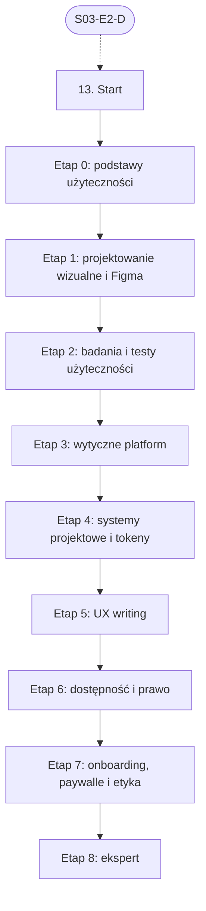

# 13. UI/UX: plan wdrożenia w Linear

Team **LEA** (https://linear.app/daankh/team/LEA/overview). Plan jest wdrożony w Linear. Klucze zadań (np. `S13-E0-M1`) są robocze, a identyfikator każdego zadania w Linear (`LEA-…`) jest w kolumnie „Linear” tabel zadań i w pliku `mapowanie-kluczy.csv`.

**W skrócie:** 9 kamieni milowych, 61 zadań (1 start, 47 materiałów, 9 dowodów, 4 praktyki). Plik główny z kolejnością projektów: `00-kolejnosc-i-zaleznosci.md`.

## 1. Projekt

| Pole | Wartość |
|---|---|
| Nazwa | 13. UI/UX |
| Team | LEA |
| Podsumowanie (pole „Summary”) | Warstwa 4: rdzeń kompilowany i produkt. Opiera się na: 3. Jest podstawą: 14, 18 i 19. |
| Etykiety projektu | `warstwa-4` |
| Blokowany przez (projekty) | 03. Frontend web |
| Blokuje (projekty) | 14. Desktop: wspólne, 18. Android, 19. iOS |
| Zależności częściowe (wychodzące) | 18. Android, etap 5; 19. iOS, etap 5 |

### Opis projektu (do wklejenia w Linear)

*Warstwa 4: rdzeń kompilowany i produkt. Opiera się na: 3. Jest podstawą: 14, 18 i 19.*

**Zakres umiejętności**

- Proces: przepływy użytkownika, architektura informacji (card sorting, tree testing), makiety, prototypy (Figma), testy użyteczności, UX writing.
- Wzorce interfejsu: formularze i walidacja, tabele danych, ruch i animacje (z ograniczeniem ruchu).
- Systemy projektowe i tokeny, spójne między web, desktop i mobile.
- Wytyczne platform: Apple Human Interface Guidelines, Material Design 3, Fluent (Windows), GNOME HIG.
- Stany ekranów (pusty, ładowanie, błąd, sukces, offline), tryb ciemny, responsywność, lokalizacja.
- Dostępność: WCAG 2.2, Europejski akt o dostępności, technologie wspomagające na każdej platformie (VoiceOver, TalkBack, Narrator, Orca), dostępność natywnych UI w Ruście.
- Onboarding, paywalle i ekrany zakupu zgodne z prawem konsumenckim (dyrektywa 2011/83/UE, art. 25 DSA) i regułami sklepów.

**Ścieżka nauki**

Ścieżka ma 9 etapów. Każdy kończy się **dowodem**, czyli małym projektem, który pokazuje, że etap jest opanowany. Przy doświadczeniu seniorskim we frontendzie etapy 0–1 można zaliczyć samym dowodem i wracać do materiałów tylko tam, gdzie dowód nie wychodzi; etapy o badaniach, wytycznych platform natywnych i dostępności poza webem zwykle są nowe. Dostępność web (WCAG 2.2, ARIA, testy w przeglądarce) jest w sekcji 3, tutaj chodzi o proces projektowy, platformy natywne i prawo. Dowody etapów o dostępności i paywallach dotyczą web i desktopu; audyt dostępności aplikacji mobilnych i recenzja w App Store i Google Play są w sekcjach 18 i 19. Ceny materiałów płatnych zmieniają się, więc warto je sprawdzić przed zakupem.

**Definicja ukończenia projektu (dowód poziomu E)**

Samodzielnie, bez agenta, w 2 dni przeprowadzasz audyt UX i dostępności nieznanej aplikacji klienta na dwóch platformach (np. web i desktop), z testem z co najmniej 3 użytkownikami, raportem z priorytetami, oceną zgodności z EAA (WCAG 2.2 AA) i prawem konsumenckim oraz poprawionym projektem najważniejszego przepływu, i umiesz obronić rekomendacje przed osobą nietechniczną.

**Źródło:** dokument „Umiejętności techniczne” w projekcie „JDG: Rozwój oprogramowania”, sekcja 13.

## 2. Kamienie milowe

Jeden kamień milowy na etap ścieżki. Kamień milowy jest zamknięty, gdy zamknięte jest zadanie dowodu tego etapu.

| # | Kamień milowy | Cel | Poziom po etapie | Zadania |
|---|---|---|---|---|
| 1 | Etap 0: podstawy użyteczności | podstawy użyteczności i psychologii interfejsu | podstawy | 5 |
| 2 | Etap 1: projektowanie wizualne i Figma | projektowanie wizualne i Figma | podstawy | 6 |
| 3 | Etap 2: badania i testy użyteczności | badania i testy użyteczności | W | 7 |
| 4 | Etap 3: wytyczne platform | wytyczne platform: Apple, Google, Microsoft, GNOME | W | 6 |
| 5 | Etap 4: systemy projektowe i tokeny | systemy projektowe i tokeny dla wielu platform | W | 5 |
| 6 | Etap 5: UX writing | UX writing i mikroteksty | W | 4 |
| 7 | Etap 6: dostępność i prawo | dostępność web i desktop, technologie wspomagające, EAA i normy | E | 11 |
| 8 | Etap 7: onboarding, paywalle i etyka | onboarding, paywalle i etyka: prawo konsumenckie i wzorce zwodnicze | E | 8 |
| 9 | Etap 8: ekspert | ekspert: audyty, recenzja interfejsów z AI, aktualność | E | 8 |

## 3. Punkt startu

Zadanie **`S13-START` · Start: 13. UI/UX** (LEA-829 w Linear) to jedyne wejście do projektu: wszystkie zadania pierwszego etapu są przez nie blokowane.

- **Blokowane przez:** `S03-E2-D`
- **Odblokowuje:** `S13-E0-M1`, `S13-E0-M2`, `S13-E0-M3`, `S13-E0-M4`
- **Status początkowy:** Backlog do czasu zamknięcia zadań blokujących, potem Todo

Opis zadania (do wklejenia):

Punkt startu projektu „13. UI/UX”.

**Warunki wejścia (zadania blokujące):**

- `S03-E2-D` · Dowód etapu 2: TypeScript — sekcja 3 na poziomie podstawowym do pracy (etap 2)

**Do zrobienia:**

- przeczytać sekcję 13 dokumentu „Umiejętności techniczne”,
- zaznaczyć etapy, które zaliczasz samym dowodem (zgodnie z akapitem wstępnym ścieżki), i dla nich zamknąć zadania materiałów jako niepotrzebne.

**Folder roboczy:** `13-ui-ux/`

## 4. Przepływ zależności

Linie ciągłe to zależności wewnątrz projektu, przerywane to zadania z innych projektów. Wewnątrz etapu zadania materiałów są równoległe i wszystkie blokują dowód etapu; dowód etapu blokuje materiały kolejnego etapu.

## 5. Zadania według kamieni milowych

Szablon opisu zadania materiału: nazwa materiału, autor lub wydawca, typ, czas, koszt i link (jak w kolumnach poniżej), zdanie „Gotowe, gdy materiał jest przerobiony w zakresie potrzebnym do dowodu etapu” oraz folder roboczy z kolumny „Folder”. Opisy dowodów i praktyk są podane pod tabelą każdego etapu.

### Etap 0: podstawy użyteczności

Opis kamienia milowego (do wklejenia):

**Cel:** podstawy użyteczności i psychologii interfejsu · **Poziom po etapie:** podstawy

**Szczególnie ważne:** afordancje i sygnifikatory, informacja zwrotna, model mentalny użytkownika, zapobieganie błędom zamiast komunikatów o błędach, prawa Hicka, Fittsa i Jakoba, obciążenie poznawcze.

**Dowód:** Ocena heurystyczna jednej istniejącej aplikacji (najlepiej z portfolio przejmowanych projektów): 15–20 problemów przypisanych do heurystyk Nielsena, z oceną wagi i propozycją poprawki dla każdego.

| Klucz | Linear | Tytuł | Typ | Czas | Koszt | Link | Blokowane przez | Blokuje | Folder |
|---|---|---|---|---|---|---|---|---|---|
| `S13-E0-M1` | LEA-843 | Przerobić: Don’t Make Me Think, Revisited (wydanie 3) | materiał, płatny | 5–6 h | płatna | https://sensible.com/dont-make-me-think/ | `S13-START` | `S13-E0-D` | `13-ui-ux/e0-podstawy-uzytecznosci/` |
| `S13-E0-M2` | LEA-844 | Przerobić: The Design of Everyday Things (wydanie poprawione i rozszerzone) | materiał, płatny | 10–12 h | płatna | https://www.hachettebookgroup.com/titles/don-norman/the-design-of-everyday-things-revised-and-expanded-edition/9780465050659/ | `S13-START` | `S13-E0-D` | `13-ui-ux/e0-podstawy-uzytecznosci/` |
| `S13-E0-M3` | LEA-845 | Przerobić: 10 Usability Heuristics for User Interface Design i artykuły pokrewne | materiał | 6–8 h | 0 zł | https://www.nngroup.com/articles/ten-usability-heuristics/ | `S13-START` | `S13-E0-D` | `13-ui-ux/e0-podstawy-uzytecznosci/` |
| `S13-E0-M4` | LEA-846 | Przerobić: Laws of UX (strona) i książka Laws of UX (wydanie 2, 2024) | materiał, płatny | 6–8 h | 0 zł / płatna | https://lawsofux.com, https://www.oreilly.com/library/view/laws-of-ux/9781098146955/ | `S13-START` | `S13-E0-D` | `13-ui-ux/e0-podstawy-uzytecznosci/` |
| `S13-E0-D` | LEA-866 | Dowód etapu 0: podstawy użyteczności | dowód | — | — | — | `S13-E0-M1`, `S13-E0-M2`, `S13-E0-M3`, `S13-E0-M4` | `S13-E1-M1`, `S13-E1-M2`, `S13-E1-M3`, `S13-E1-M4`, `S13-E1-M5` | `13-ui-ux/e0-podstawy-uzytecznosci/` |

**`S13-E0-D` · Dowód etapu 0: podstawy użyteczności**

Ocena heurystyczna jednej istniejącej aplikacji (najlepiej z portfolio przejmowanych projektów): 15–20 problemów przypisanych do heurystyk Nielsena, z oceną wagi i propozycją poprawki dla każdego.

**Na co zwrócić uwagę:** afordancje i sygnifikatory, informacja zwrotna, model mentalny użytkownika, zapobieganie błędom zamiast komunikatów o błędach, prawa Hicka, Fittsa i Jakoba, obciążenie poznawcze.

**Kryterium ukończenia:** dowód wykonany samodzielnie; w komentarzu link do repozytorium, raportu lub notatki.

**Folder roboczy:** `13-ui-ux/e0-podstawy-uzytecznosci/`

### Etap 1: projektowanie wizualne i Figma

Opis kamienia milowego (do wklejenia):

**Cel:** projektowanie wizualne i Figma · **Poziom po etapie:** podstawy

**Szczególnie ważne:** hierarchia wizualna, siatka i rytm odstępów, skala typograficzna, palety kolorów z kontrastem od początku, stany komponentów, tryb ciemny, komponenty i warianty w Figmie zamiast kopiowania ramek; formularze z etykietą nad polem, walidacją po opuszczeniu pola i podsumowaniem błędów; tabele danych z sortowaniem, filtrowaniem i stanem pustym.

**Dowód:** W Figmie projekt 5–7 ekranów jednej własnej aplikacji (lista w formie tabeli danych, szczegóły, formularz, ustawienia, ekran zakupu) w wersji mobilnej i desktopowej, z jasnym i ciemnym motywem, zbudowany z własnych komponentów z wariantami i z prototypem klikanym.

| Klucz | Linear | Tytuł | Typ | Czas | Koszt | Link | Blokowane przez | Blokuje | Folder |
|---|---|---|---|---|---|---|---|---|---|
| `S13-E1-M1` | LEA-880 | Przerobić: Refactoring UI | materiał, płatny | 8–10 h | płatna (2 rozdziały za darmo) | https://www.refactoringui.com | `S13-E0-D` | `S13-E1-D` | `13-ui-ux/e1-projektowanie-wizualne-i-figma/` |
| `S13-E1-M2` | LEA-881 | Przerobić: Figma Learn: Figma Design for beginners, kursy i dokumentacja… | materiał | 20–25 h | 0 zł (narzędzie z planem darmowym i płatnymi) | https://help.figma.com/hc/en-us | `S13-E0-D` | `S13-E1-D` | `13-ui-ux/e1-projektowanie-wizualne-i-figma/` |
| `S13-E1-M3` | LEA-882 | Przerobić: Practical Typography | materiał | 5–6 h | 0 zł | https://practicaltypography.com | `S13-E0-D` | `S13-E1-D` | `13-ui-ux/e1-projektowanie-wizualne-i-figma/` |
| `S13-E1-M4` | LEA-883 | Przerobić: GOV.UK Design System: wzorce formularzy, walidacji i komunikatów błędów, komponent tabeli; NN/g… | materiał | 4–6 h | 0 zł | https://design-system.service.gov.uk/patterns/, https://design-system.service.gov.uk/patterns/validation/, https://design-system.service.gov.uk/components/table/, https://www.nngroup.com/articles/data-tables/ | `S13-E0-D` | `S13-E1-D` | `13-ui-ux/e1-projektowanie-wizualne-i-figma/` |
| `S13-E1-M5` | LEA-884 | Przerobić: Form Design Patterns | materiał, płatny, opcjonalne | 6–8 h | płatna | https://www.smashingmagazine.com/printed-books/form-design-patterns/ | `S13-E0-D` | — | `13-ui-ux/e1-projektowanie-wizualne-i-figma/` |
| `S13-E1-D` | LEA-895 | Dowód etapu 1: projektowanie wizualne i Figma | dowód | — | — | — | `S13-E1-M1`, `S13-E1-M2`, `S13-E1-M3`, `S13-E1-M4` | `S13-E2-M1`, `S13-E2-M2`, `S13-E2-M3`, `S13-E2-M4`, `S13-E2-M5`, `S13-E2-M6` | `13-ui-ux/e1-projektowanie-wizualne-i-figma/` |

**`S13-E1-D` · Dowód etapu 1: projektowanie wizualne i Figma**

W Figmie projekt 5–7 ekranów jednej własnej aplikacji (lista w formie tabeli danych, szczegóły, formularz, ustawienia, ekran zakupu) w wersji mobilnej i desktopowej, z jasnym i ciemnym motywem, zbudowany z własnych komponentów z wariantami i z prototypem klikanym.

**Na co zwrócić uwagę:** hierarchia wizualna, siatka i rytm odstępów, skala typograficzna, palety kolorów z kontrastem od początku, stany komponentów, tryb ciemny, komponenty i warianty w Figmie zamiast kopiowania ramek; formularze z etykietą nad polem, walidacją po opuszczeniu pola i podsumowaniem błędów; tabele danych z sortowaniem, filtrowaniem i stanem pustym.

**Kryterium ukończenia:** każdy ekran zbudowany wyłącznie z komponentów biblioteki (bez odłączonych instancji); kontrast tekstu co najmniej 4,5:1 w obu motywach; formularz ma stany: pusty, błąd pola, podsumowanie błędów, wysłano; tabela ma stany: ładowanie, pusta, wynik filtrowania; prototyp przechodzi cały przepływ zakupu.

**Folder roboczy:** `13-ui-ux/e1-projektowanie-wizualne-i-figma/`

### Etap 2: badania i testy użyteczności

Opis kamienia milowego (do wklejenia):

**Cel:** badania i testy użyteczności · **Poziom po etapie:** W

**Szczególnie ważne:** pytania bez sugerowania odpowiedzi, scenariusz zadań zamiast pytania o opinię, 5 uczestników na rundę i kolejne rundy po poprawkach, analityka produktowa jako uzupełnienie, a nie zamiennik rozmów, zgody i dane osobowe uczestników (RODO).

**Dowód:** Dwie rundy testów użyteczności (po 5 osób) prototypu z etapu 1: scenariusz, nagrania za zgodą, lista problemów z częstością i wagą, poprawki między rundami i porównanie wyników; tree testing nawigacji tej aplikacji przed zmianą struktury i po niej.

| Klucz | Linear | Tytuł | Typ | Czas | Koszt | Link | Blokowane przez | Blokuje | Folder |
|---|---|---|---|---|---|---|---|---|---|
| `S13-E2-M1` | LEA-940 | Przerobić: Rocket Surgery Made Easy | materiał, płatny | 4–5 h | płatna | https://sensible.com/rocket-surgery-made-easy/ | `S13-E1-D` | `S13-E2-D` | `13-ui-ux/e2-badania-i-testy-uzytecznosci/` |
| `S13-E2-M2` | LEA-942 | Przerobić: Just Enough Research (wydanie 2) | materiał, płatny | 4–5 h | płatna | https://abookapart.com/blogs/press/just-enough-research-2nd-edition-is-now-available | `S13-E1-D` | `S13-E2-D` | `13-ui-ux/e2-badania-i-testy-uzytecznosci/` |
| `S13-E2-M3` | LEA-944 | Przerobić: Artykuły NN/g o badaniach (testy moderowane i zdalne, wywiady, liczba uczestników, ankiety) | materiał | 8–10 h | 0 zł | https://www.nngroup.com/articles/ | `S13-E1-D` | `S13-E2-D` | `13-ui-ux/e2-badania-i-testy-uzytecznosci/` |
| `S13-E2-M4` | LEA-946 | Przerobić: Kursy UX Nielsen Norman Group (opcjonalnie, z certyfikacją) | materiał, płatny, opcjonalne | wg potrzeb | płatne | https://www.nngroup.com/courses/ | `S13-E1-D` | — | `13-ui-ux/e2-badania-i-testy-uzytecznosci/` |
| `S13-E2-M5` | LEA-947 | Przerobić: Architektura informacji: NN/g „Card Sorting”, „Card Sorting: How Many Users to Test”… | materiał | 2–3 h | 0 zł | https://www.nngroup.com/articles/card-sorting-definition/, https://www.nngroup.com/articles/card-sorting-how-many-users-to-test/, https://www.nngroup.com/articles/tree-testing/ | `S13-E1-D` | `S13-E2-D` | `13-ui-ux/e2-badania-i-testy-uzytecznosci/` |
| `S13-E2-M6` | LEA-948 | Przerobić: How to Make Sense of Any Mess | materiał, opcjonalne | 3–4 h | 0 zł online / płatna (druk) | https://howtomakesenseofanymess.com | `S13-E1-D` | — | `13-ui-ux/e2-badania-i-testy-uzytecznosci/` |
| `S13-E2-D` | LEA-952 | Dowód etapu 2: badania i testy użyteczności | dowód | — | — | — | `S13-E2-M1`, `S13-E2-M2`, `S13-E2-M3`, `S13-E2-M5` | `S13-E3-M1`, `S13-E3-M2`, `S13-E3-M3`, `S13-E3-M4`, `S13-E3-M5`, `S14-START`, `S18-START`, `S19-START` | `13-ui-ux/e2-badania-i-testy-uzytecznosci/` |

**`S13-E2-D` · Dowód etapu 2: badania i testy użyteczności**

Dwie rundy testów użyteczności (po 5 osób) prototypu z etapu 1: scenariusz, nagrania za zgodą, lista problemów z częstością i wagą, poprawki między rundami i porównanie wyników; tree testing nawigacji tej aplikacji przed zmianą struktury i po niej.

**Na co zwrócić uwagę:** pytania bez sugerowania odpowiedzi, scenariusz zadań zamiast pytania o opinię, 5 uczestników na rundę i kolejne rundy po poprawkach, analityka produktowa jako uzupełnienie, a nie zamiennik rozmów, zgody i dane osobowe uczestników (RODO).

**Kryterium ukończenia:** 10 sesji z nagraniem i zgodą; każdy problem z liczbą osób, które go napotkały, i wagą; w drugiej rundzie odsetek ukończonych zadań nie niższy niż w pierwszej; tree testing z co najmniej 10 uczestnikami i 5 zadaniami, ze skutecznością i bezpośredniością (directness) dla każdego zadania przed zmianą i po niej.

**Folder roboczy:** `13-ui-ux/e2-badania-i-testy-uzytecznosci/`

### Etap 3: wytyczne platform

Opis kamienia milowego (do wklejenia):

**Cel:** wytyczne platform: Apple, Google, Microsoft, GNOME · **Poziom po etapie:** W

**Szczególnie ważne:** nawigacja i gesty specyficzne dla platformy (wstecz w Androidzie, paski kart i arkusze w iOS, menu i skróty klawiaturowe na desktopie), dynamiczny rozmiar tekstu, obszary dotyku, okna i ich rozmiary na desktopie, kiedy Tauri z Reactem może wyglądać „tak samo wszędzie”, a kiedy użytkownik oczekuje wyglądu natywnego; ruch jako informacja o zmianie stanu, a nie ozdoba, i wariant dla ustawienia ograniczonego ruchu.

**Dowód:** Ten sam przepływ (np. zakup i ustawienia) zaprojektowany w trzech wariantach: iOS, Android i desktop, z notatką, które różnice wynikają z wytycznych platformy, a które są świadomym odstępstwem i dlaczego; specyfikacja ruchu dla przejść w tym przepływie.

| Klucz | Linear | Tytuł | Typ | Czas | Koszt | Link | Blokowane przez | Blokuje | Folder |
|---|---|---|---|---|---|---|---|---|---|
| `S13-E3-M1` | LEA-967 | Przerobić: Human Interface Guidelines | materiał | 12–15 h | 0 zł | https://developer.apple.com/design/human-interface-guidelines/ | `S13-E2-D` | `S13-E3-D` | `13-ui-ux/e3-wytyczne-platform/` |
| `S13-E3-M2` | LEA-968 | Przerobić: Material Design 3 | materiał | 10–12 h | 0 zł | https://m3.material.io | `S13-E2-D` | `S13-E3-D` | `13-ui-ux/e3-wytyczne-platform/` |
| `S13-E3-M3` | LEA-969 | Przerobić: Fluent 2 Design System | materiał | 6–8 h | 0 zł | https://fluent2.microsoft.design | `S13-E2-D` | `S13-E3-D` | `13-ui-ux/e3-wytyczne-platform/` |
| `S13-E3-M4` | LEA-970 | Przerobić: GNOME Human Interface Guidelines | materiał | 4–6 h | 0 zł | https://developer.gnome.org/hig/ | `S13-E2-D` | `S13-E3-D` | `13-ui-ux/e3-wytyczne-platform/` |
| `S13-E3-M5` | LEA-971 | Przerobić: Ruch w interfejsie: HIG „Motion”, Material Design 3 „Motion” (easing i czasy trwania), NN/g… | materiał | 3–4 h | 0 zł | https://developer.apple.com/design/human-interface-guidelines/motion, https://m3.material.io/styles/motion/overview, https://www.nngroup.com/articles/animation-purpose-ux/, https://developer.mozilla.org/en-US/docs/Web/CSS/@media/prefers-reduced-motion | `S13-E2-D` | `S13-E3-D` | `13-ui-ux/e3-wytyczne-platform/` |
| `S13-E3-D` | LEA-976 | Dowód etapu 3: wytyczne platform | dowód | — | — | — | `S13-E3-M1`, `S13-E3-M2`, `S13-E3-M3`, `S13-E3-M4`, `S13-E3-M5` | `S13-E4-M1`, `S13-E4-M2`, `S13-E4-M3`, `S13-E4-M4` | `13-ui-ux/e3-wytyczne-platform/` |

**`S13-E3-D` · Dowód etapu 3: wytyczne platform**

Ten sam przepływ (np. zakup i ustawienia) zaprojektowany w trzech wariantach: iOS, Android i desktop, z notatką, które różnice wynikają z wytycznych platformy, a które są świadomym odstępstwem i dlaczego; specyfikacja ruchu dla przejść w tym przepływie.

**Na co zwrócić uwagę:** nawigacja i gesty specyficzne dla platformy (wstecz w Androidzie, paski kart i arkusze w iOS, menu i skróty klawiaturowe na desktopie), dynamiczny rozmiar tekstu, obszary dotyku, okna i ich rozmiary na desktopie, kiedy Tauri z Reactem może wyglądać „tak samo wszędzie”, a kiedy użytkownik oczekuje wyglądu natywnego; ruch jako informacja o zmianie stanu, a nie ozdoba, i wariant dla ustawienia ograniczonego ruchu.

**Kryterium ukończenia:** trzy warianty w Figmie; co najmniej 8 różnic opisanych z odesłaniem do konkretnej strony wytycznych; specyfikacja ruchu z czasem trwania i krzywą dla każdego przejścia oraz wariantem dla ograniczonego ruchu.

**Folder roboczy:** `13-ui-ux/e3-wytyczne-platform/`

### Etap 4: systemy projektowe i tokeny

Opis kamienia milowego (do wklejenia):

**Cel:** systemy projektowe i tokeny dla wielu platform · **Poziom po etapie:** W

Specyfikacja DTCG jest raportem grupy społecznościowej W3C, a nie standardem W3C, ale jest stabilna i stała się wspólnym formatem wymiany między narzędziami. Tokeny i komponenty web (Tailwind, Radix, shadcn/ui) są w sekcji 3. Do generowania kodu z jednego źródła DTCG służy Style Dictionary; dla Slint trzeba dopisać własny format wyjściowy.

**Dowód:** Jedno źródło tokenów w formacie DTCG (kolory z trybami jasnym i ciemnym, typografia, odstępy, promienie) generowane w CI przez Style Dictionary do zmiennych CSS i motywu Tailwind, stałych Swift, zasobów Kotlin/Compose i motywu natywnego UI w Ruście (np. Slint); zmiana jednego tokenu widoczna na wszystkich platformach po jednym buildzie.

| Klucz | Linear | Tytuł | Typ | Czas | Koszt | Link | Blokowane przez | Blokuje | Folder |
|---|---|---|---|---|---|---|---|---|---|
| `S13-E4-M1` | LEA-989 | Przerobić: Design Tokens Format Module 2025.10 (pierwsza stabilna wersja, październik 2025) | materiał | 4–6 h | 0 zł | https://www.designtokens.org/tr/2025.10/format/ | `S13-E3-D` | `S13-E4-D` | `13-ui-ux/e4-systemy-projektowe-i-tokeny/` |
| `S13-E4-M2` | LEA-990 | Przerobić: Figma Learn: zmienne, tryby i biblioteki | materiał | 4–5 h | 0 zł | https://help.figma.com/hc/en-us | `S13-E3-D` | `S13-E4-D` | `13-ui-ux/e4-systemy-projektowe-i-tokeny/` |
| `S13-E4-M3` | LEA-992 | Przerobić: Fluent 2 i Material Design 3: rozdziały o tokenach i motywach | materiał | 4–6 h | 0 zł | https://fluent2.microsoft.design, https://m3.material.io | `S13-E3-D` | `S13-E4-D` | `13-ui-ux/e4-systemy-projektowe-i-tokeny/` |
| `S13-E4-M4` | LEA-994 | Przerobić: Style Dictionary (wersja 4 lub nowsza): format DTCG, transformacje i własne formaty wyjściowe | materiał | 4–6 h | 0 zł | https://styledictionary.com/, https://styledictionary.com/info/dtcg/ | `S13-E3-D` | `S13-E4-D` | `13-ui-ux/e4-systemy-projektowe-i-tokeny/` |
| `S13-E4-D` | LEA-996 | Dowód etapu 4: systemy projektowe i tokeny | dowód | — | — | — | `S13-E4-M1`, `S13-E4-M2`, `S13-E4-M3`, `S13-E4-M4` | `S13-E5-M1`, `S13-E5-M2`, `S13-E5-M3` | `13-ui-ux/e4-systemy-projektowe-i-tokeny/` |

**`S13-E4-D` · Dowód etapu 4: systemy projektowe i tokeny**

Jedno źródło tokenów w formacie DTCG (kolory z trybami jasnym i ciemnym, typografia, odstępy, promienie) generowane w CI przez Style Dictionary do zmiennych CSS i motywu Tailwind, stałych Swift, zasobów Kotlin/Compose i motywu natywnego UI w Ruście (np. Slint); zmiana jednego tokenu widoczna na wszystkich platformach po jednym buildzie.

**Kryterium ukończenia:** źródło tokenów przechodzi walidację formatu DTCG; CI generuje 4 wyjścia i kończy się błędem, gdy pliki w repozytorium różnią się od wygenerowanych; pull request ze zmianą jednego tokenu zmienia wszystkie 4 wyjścia; aplikacja web i desktop budują się z wygenerowanymi plikami.

**Folder roboczy:** `13-ui-ux/e4-systemy-projektowe-i-tokeny/`

### Etap 5: UX writing

Opis kamienia milowego (do wklejenia):

**Cel:** UX writing i mikroteksty · **Poziom po etapie:** W

**Szczególnie ważne:** komunikaty błędów mówiące, co zrobić dalej, stany puste, przyciski nazwane czynnością, spójny słownik w całym produkcie, teksty przygotowane do lokalizacji (długość, liczba mnoga, płeć gramatyczna w polskim), prosty język jako element dostępności.

**Dowód:** Przepisany komplet tekstów jednej aplikacji (onboarding, błędy, stany puste, paywall, potwierdzenia) z krótkim przewodnikiem stylu i słownikiem, w dwóch językach przez pliki tłumaczeń, bez tekstów wpisanych na stałe w kodzie.

| Klucz | Linear | Tytuł | Typ | Czas | Koszt | Link | Blokowane przez | Blokuje | Folder |
|---|---|---|---|---|---|---|---|---|---|
| `S13-E5-M1` | LEA-1014 | Przerobić: Strategic Writing for UX (wydanie 2, 2025) | materiał, płatny | 6–8 h | płatna | https://www.oreilly.com/library/view/strategic-writing-for/9781098174323/ | `S13-E4-D` | `S13-E5-D` | `13-ui-ux/e5-ux-writing/` |
| `S13-E5-M2` | LEA-1015 | Przerobić: Microcopy: The Complete Guide | materiał, płatny | 5–6 h | płatna | https://www.microcopybook.com | `S13-E4-D` | `S13-E5-D` | `13-ui-ux/e5-ux-writing/` |
| `S13-E5-M3` | LEA-1016 | Przerobić: Wytyczne pisania w HIG, Material Design 3 i GNOME HIG | materiał | 2–3 h | 0 zł | jak w etapie 3 | `S13-E4-D` | `S13-E5-D` | `13-ui-ux/e5-ux-writing/` |
| `S13-E5-D` | LEA-1019 | Dowód etapu 5: UX writing | dowód | — | — | — | `S13-E5-M1`, `S13-E5-M2`, `S13-E5-M3` | `S13-E6-M1`, `S13-E6-M2`, `S13-E6-M3`, `S13-E6-M4`, `S13-E6-M5`, `S13-E6-M6`, `S13-E6-M7`, `S13-E6-M8`, `S13-E6-M9`, `S13-E6-M10` | `13-ui-ux/e5-ux-writing/` |

**`S13-E5-D` · Dowód etapu 5: UX writing**

Przepisany komplet tekstów jednej aplikacji (onboarding, błędy, stany puste, paywall, potwierdzenia) z krótkim przewodnikiem stylu i słownikiem, w dwóch językach przez pliki tłumaczeń, bez tekstów wpisanych na stałe w kodzie.

**Na co zwrócić uwagę:** komunikaty błędów mówiące, co zrobić dalej, stany puste, przyciski nazwane czynnością, spójny słownik w całym produkcie, teksty przygotowane do lokalizacji (długość, liczba mnoga, płeć gramatyczna w polskim), prosty język jako element dostępności.

**Kryterium ukończenia:** przewodnik stylu i słownik w repozytorium; skrypt lub lint w CI nie znajduje tekstów interfejsu wpisanych na stałe; oba pliki tłumaczeń mają ten sam zestaw kluczy, z poprawnymi formami liczby mnogiej po polsku.

**Folder roboczy:** `13-ui-ux/e5-ux-writing/`

### Etap 6: dostępność i prawo

Opis kamienia milowego (do wklejenia):

**Cel:** dostępność web i desktop, technologie wspomagające, EAA i normy · **Poziom po etapie:** E

Stan na 11 października 2026 r.: polska ustawa wdrażająca EAA obowiązuje od 28 czerwca 2025 r.; EN 301 549 V4.1.1, oparta na WCAG 2.2 AA z dodatkowymi kryteriami, została opublikowana 2 września 2026 r., ale domniemanie zgodności z EAA da dopiero jej publikacja w Dzienniku Urzędowym UE. Apple pokazuje w App Store etykiety dostępności (Accessibility Nutrition Labels); na razie są dobrowolne, a Apple zapowiada, że staną się obowiązkowe. Mikroprzedsiębiorcy świadczący usługi są zwolnieni z części obowiązków ustawy, ale klienci firmy zwykle nie są.

**Szczególnie ważne:** czytnik ekranu na każdej platformie desktopowej (NVDA lub Narrator na Windows, VoiceOver na macOS, Orca na Linuksie), nazwy i role elementów w webview Tauri i w UI rysowanych w Ruście (AccessKit), kolejność fokusu i pułapki fokusu w oknach dialogowych, powiększenie tekstu do 200% bez utraty treści, tryb wysokiego kontrastu; ocena według WCAG-EM zamiast samych testów automatycznych. Audyt aplikacji iOS i Android jest w sekcjach 18 i 19.

**Dowód:** Audyt dostępności własnej aplikacji w wersji web i desktop (Tauri): przejście kluczowych zadań (pierwsze uruchomienie, logowanie, zakup, ustawienia) z czytnikiem ekranu, powiększonym tekstem i samą klawiaturą; raport według WCAG-EM z poprawkami i oceną zgodności z EAA.

| Klucz | Linear | Tytuł | Typ | Czas | Koszt | Link | Blokowane przez | Blokuje | Folder |
|---|---|---|---|---|---|---|---|---|---|
| `S13-E6-M1` | LEA-1033 | Przerobić: Inclusive Components | materiał, płatny | 6–8 h | 0 zł / płatna | https://inclusive-components.design | `S13-E5-D` | `S13-E6-D` | `13-ui-ux/e6-dostepnosc-i-prawo/` |
| `S13-E6-M2` | LEA-1034 | Przerobić: Deque University: pakiet z kursem dostępności aplikacji natywnych (Android, iOS) | materiał, płatny, opcjonalne | 20–30 h | abonament | https://dequeuniversity.com/online-courses/ | `S13-E5-D` | — | `13-ui-ux/e6-dostepnosc-i-prawo/` |
| `S13-E6-M3` | LEA-1035 | Przerobić: Accessibility (dokumentacja dla deweloperów) i Accessibility Nutrition Labels w App Store Connect | materiał, opcjonalne | 3–4 h | 0 zł | https://developer.apple.com/accessibility/, https://developer.apple.com/help/app-store-connect/manage-app-accessibility/overview-of-accessibility-nutrition-labels | `S13-E5-D` | — | `13-ui-ux/e6-dostepnosc-i-prawo/` |
| `S13-E6-M4` | LEA-1036 | Przerobić: Build accessible apps, dostępność w Jetpack Compose | materiał, opcjonalne | 3–4 h | 0 zł | https://developer.android.com/guide/topics/ui/accessibility | `S13-E5-D` | — | `13-ui-ux/e6-dostepnosc-i-prawo/` |
| `S13-E6-M5` | LEA-1037 | Przerobić: Accessibility overview: Windows apps (UI Automation, wysoki kontrast) i Accessibility Insights | materiał | 2–3 h | 0 zł | https://learn.microsoft.com/en-us/windows/apps/design/accessibility/accessibility, https://accessibilityinsights.io | `S13-E5-D` | `S13-E6-D` | `13-ui-ux/e6-dostepnosc-i-prawo/` |
| `S13-E6-M6` | LEA-1038 | Przerobić: AccessKit: dostępność UI rysowanych w Ruście (egui, Slint i inne) | materiał | 1–2 h | 0 zł | https://accesskit.dev | `S13-E5-D` | `S13-E6-D` | `13-ui-ux/e6-dostepnosc-i-prawo/` |
| `S13-E6-M7` | LEA-1039 | Przerobić: WCAG-EM: metodyka oceny zgodności i Easy Checks | materiał | 2–3 h | 0 zł | https://www.w3.org/WAI/test-evaluate/ | `S13-E5-D` | `S13-E6-D` | `13-ui-ux/e6-dostepnosc-i-prawo/` |
| `S13-E6-M8` | LEA-1040 | Przerobić: Dyrektywa (UE) 2019/882 (Europejski akt o dostępności) | materiał | 3–4 h | 0 zł | https://eur-lex.europa.eu/eli/dir/2019/882/oj | `S13-E5-D` | `S13-E6-D` | `13-ui-ux/e6-dostepnosc-i-prawo/` |
| `S13-E6-M9` | LEA-1042 | Przerobić: Ustawa z 26 kwietnia 2024 r. o zapewnianiu spełniania wymagań dostępności niektórych produktów i… | materiał | 3–4 h | 0 zł | https://isap.sejm.gov.pl/isap.nsf/DocDetails.xsp?id=WDU20240000731 | `S13-E5-D` | `S13-E6-D` | `13-ui-ux/e6-dostepnosc-i-prawo/` |
| `S13-E6-M10` | LEA-1044 | Przerobić: EN 301 549 V4.1.1 (wrzesień 2026) | materiał | 4–6 h | 0 zł | https://www.etsi.org | `S13-E5-D` | `S13-E6-D` | `13-ui-ux/e6-dostepnosc-i-prawo/` |
| `S13-E6-D` | LEA-1052 | Dowód etapu 6: dostępność i prawo | dowód | — | — | — | `S13-E6-M1`, `S13-E6-M5`, `S13-E6-M6`, `S13-E6-M7`, `S13-E6-M8`, `S13-E6-M9`, `S13-E6-M10` | `S13-E7-M1`, `S13-E7-M2`, `S13-E7-M3`, `S13-E7-M4`, `S13-E7-M5`, `S13-E7-M6`, `S13-E7-M7` | `13-ui-ux/e6-dostepnosc-i-prawo/` |

**`S13-E6-D` · Dowód etapu 6: dostępność i prawo**

Audyt dostępności własnej aplikacji w wersji web i desktop (Tauri): przejście kluczowych zadań (pierwsze uruchomienie, logowanie, zakup, ustawienia) z czytnikiem ekranu, powiększonym tekstem i samą klawiaturą; raport według WCAG-EM z poprawkami i oceną zgodności z EAA.

**Na co zwrócić uwagę:** czytnik ekranu na każdej platformie desktopowej (NVDA lub Narrator na Windows, VoiceOver na macOS, Orca na Linuksie), nazwy i role elementów w webview Tauri i w UI rysowanych w Ruście (AccessKit), kolejność fokusu i pułapki fokusu w oknach dialogowych, powiększenie tekstu do 200% bez utraty treści, tryb wysokiego kontrastu; ocena według WCAG-EM zamiast samych testów automatycznych. Audyt aplikacji iOS i Android jest w sekcjach 18 i 19.

**Kryterium ukończenia:** 4 zadania × 2 platformy × 3 sposoby (czytnik ekranu, klawiatura, powiększenie 200%) opisane w raporcie; każde niespełnione kryterium WCAG 2.2 AA z poprawką albo zadaniem; po poprawkach żadne zadanie nie jest zablokowane dla użytkownika czytnika ekranu ani klawiatury; test axe w CI dla wersji web bez naruszeń poziomu „serious” i „critical”.

**Folder roboczy:** `13-ui-ux/e6-dostepnosc-i-prawo/`

### Etap 7: onboarding, paywalle i etyka

Opis kamienia milowego (do wklejenia):

**Cel:** onboarding, paywalle i etyka: prawo konsumenckie i wzorce zwodnicze · **Poziom po etapie:** E

**Szczególnie ważne:** cena, okres rozliczenia, warunki okresu próbnego i sposób anulowania widoczne przed zakupem, przycisk zamówienia z obowiązkiem zapłaty, funkcja odstąpienia od umowy (art. 11a dyrektywy 2011/83/UE), przywracanie zakupów, brak zatrzymywania użytkownika przy rezygnacji, sprzedaż przez web lub Merchant of Record; wzorce zwodnicze jako ryzyko prawne, a nie tylko etyczne: art. 25 DSA dotyczy platform internetowych (mikro- i małe przedsiębiorstwa są wyłączone, klienci-platformy nie), a pozostałe przypadki obejmuje prawo konsumenckie i RODO. Reguły App Store i Google Play są w sekcjach 18 i 19, implementacja zakupów i licencji w sekcjach 5, 18 i 19.

**Dowód:** Onboarding i paywall jednej własnej aplikacji web lub desktop (Tauri) z zakupem przez web lub Merchant of Record, sprawdzone punkt po punkcie z dyrektywą 2011/83/UE (w tym art. 11a), zasadami z art. 25 DSA i katalogiem Deceptive Patterns; rezygnacja z abonamentu osiągalna w nie więcej krokach niż zakup.

| Klucz | Linear | Tytuł | Typ | Czas | Koszt | Link | Blokowane przez | Blokuje | Folder |
|---|---|---|---|---|---|---|---|---|---|
| `S13-E7-M1` | LEA-1068 | Przerobić: App Review Guidelines, sekcja 3.1 Payments (zakupy w aplikacji, subskrypcje, linki zewnętrzne) | materiał, opcjonalne | 3–4 h | 0 zł | https://developer.apple.com/app-store/review/guidelines/ | `S13-E6-D` | — | `13-ui-ux/e7-onboarding-paywalle-i-etyka/` |
| `S13-E7-M2` | LEA-1070 | Przerobić: Payments i Create and manage subscriptions (przejrzystość ofert) | materiał, opcjonalne | 2–3 h | 0 zł | https://support.google.com/googleplay/android-developer/answer/9858738, https://support.google.com/googleplay/android-developer/answer/140504 | `S13-E6-D` | — | `13-ui-ux/e7-onboarding-paywalle-i-etyka/` |
| `S13-E7-M3` | LEA-1071 | Przerobić: Deceptive Patterns | materiał, płatny | 5–6 h | płatna (katalog online 0 zł) | https://deceptive.design | `S13-E6-D` | `S13-E7-D` | `13-ui-ux/e7-onboarding-paywalle-i-etyka/` |
| `S13-E7-M4` | LEA-1072 | Przerobić: Dyrektywa 2011/83/UE w sprawie praw konsumentów… | materiał | 3–4 h | 0 zł | https://eur-lex.europa.eu/eli/dir/2011/83/oj | `S13-E6-D` | `S13-E7-D` | `13-ui-ux/e7-onboarding-paywalle-i-etyka/` |
| `S13-E7-M5` | LEA-1073 | Przerobić: Dyrektywa (UE) 2023/2673… | materiał | 2–3 h | 0 zł | https://eur-lex.europa.eu/eli/dir/2023/2673/oj | `S13-E6-D` | `S13-E7-D` | `13-ui-ux/e7-onboarding-paywalle-i-etyka/` |
| `S13-E7-M6` | LEA-1074 | Przerobić: Rozporządzenie (UE) 2022/2065 (akt o usługach cyfrowych, DSA), art. 25: zakaz zwodniczych… | materiał | 1–2 h | 0 zł | https://eur-lex.europa.eu/eli/reg/2022/2065/oj | `S13-E6-D` | `S13-E7-D` | `13-ui-ux/e7-onboarding-paywalle-i-etyka/` |
| `S13-E7-M7` | LEA-1075 | Przerobić: Artykuły NN/g o onboardingu, paywallach i formularzach | materiał | 3–4 h | 0 zł | https://www.nngroup.com/articles/ | `S13-E6-D` | `S13-E7-D` | `13-ui-ux/e7-onboarding-paywalle-i-etyka/` |
| `S13-E7-D` | LEA-1081 | Dowód etapu 7: onboarding, paywalle i etyka | dowód | — | — | — | `S13-E7-M3`, `S13-E7-M4`, `S13-E7-M5`, `S13-E7-M6`, `S13-E7-M7` | `S13-E8-M1`, `S13-E8-M2`, `S13-E8-M3`, `S13-E8-P1`, `S13-E8-P2`, `S13-E8-P3`, `S13-E8-P4`, `S18-E5-M1`, `S18-E5-M2`, `S18-E5-M3`, `S18-E5-M4`, `S18-E5-M5`, `S18-E5-M6`, `S18-E5-M7`, `S18-E5-M8`, `S18-E5-M9`, `S18-E5-M10`, `S18-E5-M11`, `S19-E5-M1`, `S19-E5-M2`, `S19-E5-M3`, `S19-E5-M4`, `S19-E5-M5`, `S19-E5-M6`, `S19-E5-M7`, `S19-E5-M8`, `S19-E5-M9`, `S19-E5-M10` | `13-ui-ux/e7-onboarding-paywalle-i-etyka/` |

**`S13-E7-D` · Dowód etapu 7: onboarding, paywalle i etyka**

Onboarding i paywall jednej własnej aplikacji web lub desktop (Tauri) z zakupem przez web lub Merchant of Record, sprawdzone punkt po punkcie z dyrektywą 2011/83/UE (w tym art. 11a), zasadami z art. 25 DSA i katalogiem Deceptive Patterns; rezygnacja z abonamentu osiągalna w nie więcej krokach niż zakup.

**Na co zwrócić uwagę:** cena, okres rozliczenia, warunki okresu próbnego i sposób anulowania widoczne przed zakupem, przycisk zamówienia z obowiązkiem zapłaty, funkcja odstąpienia od umowy (art. 11a dyrektywy 2011/83/UE), przywracanie zakupów, brak zatrzymywania użytkownika przy rezygnacji, sprzedaż przez web lub Merchant of Record; wzorce zwodnicze jako ryzyko prawne, a nie tylko etyczne: art. 25 DSA dotyczy platform internetowych (mikro- i małe przedsiębiorstwa są wyłączone, klienci-platformy nie), a pozostałe przypadki obejmuje prawo konsumenckie i RODO. Reguły App Store i Google Play są w sekcjach 18 i 19, implementacja zakupów i licencji w sekcjach 5, 18 i 19.

**Kryterium ukończenia:** lista kontrolna wymogów informacyjnych i przycisków z oceną każdego punktu i zrzutem ekranu; funkcja odstąpienia dostępna przez cały okres odstąpienia; liczba kroków rezygnacji ≤ liczby kroków zakupu (zmierzona na nagraniu); żadnego wzorca z katalogu Deceptive Patterns w przepływie (przegląd każdego ekranu udokumentowany).

**Folder roboczy:** `13-ui-ux/e7-onboarding-paywalle-i-etyka/`

### Etap 8: ekspert

Opis kamienia milowego (do wklejenia):

**Cel:** ekspert: audyty, recenzja interfejsów z AI, aktualność · **Poziom po etapie:** E

**Dowód poziomu E:** Samodzielnie, bez agenta, w 2 dni przeprowadzasz audyt UX i dostępności nieznanej aplikacji klienta na dwóch platformach (np. web i desktop), z testem z co najmniej 3 użytkownikami, raportem z priorytetami, oceną zgodności z EAA (WCAG 2.2 AA) i prawem konsumenckim oraz poprawionym projektem najważniejszego przepływu, i umiesz obronić rekomendacje przed osobą nietechniczną.

| Klucz | Linear | Tytuł | Typ | Czas | Koszt | Link | Blokowane przez | Blokuje | Folder |
|---|---|---|---|---|---|---|---|---|---|
| `S13-E8-M1` | LEA-1092 | Przerobić: Nowe artykuły i badania NN/g | materiał | ok. 1 h tygodniowo | 0 zł | https://www.nngroup.com/articles/ | `S13-E7-D` | `S13-E8-D` | `13-ui-ux/e8-ekspert/` |
| `S13-E8-M2` | LEA-1093 | Przerobić: Zmiany w HIG, Material Design i Fluent oraz sesje projektowe z konferencji WWDC i Google I/O | materiał, opcjonalne | wg potrzeb | 0 zł | https://developer.apple.com/design/, https://m3.material.io | `S13-E7-D` | — | `13-ui-ux/e8-ekspert/` |
| `S13-E8-M3` | LEA-1094 | Przerobić: Zmiany w zasadach sklepów i prawie (EAA, EN 301 549, prawa konsumenta) | materiał | ok. 1 h miesięcznie | 0 zł | jak w etapach 6 i 7 | `S13-E7-D` | `S13-E8-D` | `13-ui-ux/e8-ekspert/` |
| `S13-E8-P1` | LEA-1095 | Praktyka: recenzja interfejsów z AI | praktyka | — | — | — | `S13-E7-D` | `S13-E8-D` | `13-ui-ux/e8-ekspert/` |
| `S13-E8-P2` | LEA-1097 | Praktyka: audyt UX i dostępności przejmowanej aplikacji | praktyka | — | — | — | `S13-E7-D` | `S13-E8-D` | `13-ui-ux/e8-ekspert/` |
| `S13-E8-P3` | LEA-1098 | Praktyka: system projektowy w praktyce | praktyka | — | — | — | `S13-E7-D` | `S13-E8-D` | `13-ui-ux/e8-ekspert/` |
| `S13-E8-P4` | LEA-1100 | Praktyka: pomiar | praktyka | — | — | — | `S13-E7-D` | `S13-E8-D` | `13-ui-ux/e8-ekspert/` |
| `S13-E8-D` | LEA-1106 | Dowód poziomu E: ekspert | dowód | — | — | — | `S13-E8-M1`, `S13-E8-M3`, `S13-E8-P1`, `S13-E8-P2`, `S13-E8-P3`, `S13-E8-P4` | — | `13-ui-ux/e8-ekspert/` |

**`S13-E8-P1` · Praktyka: recenzja interfejsów z AI**

20 ekranów lub pull requestów z UI wygenerowanych przez agentów, ocenianych według listy kontrolnej z etapów 3–7 (brakujące stany pusty, błędu i offline, wartości wpisane zamiast tokenów, wzorce z innej platformy, ikony bez etykiet dostępności, teksty na stałe w kodzie, wzorce zwodnicze w paywallu, „ładne, ale nieużyteczne” układy).

Praktyka ciągła etapu eksperckiego: oznacz jako gotową, gdy działa jako stały element pracy, a nie po jednorazowym wykonaniu.

**Folder roboczy:** `13-ui-ux/e8-ekspert/`

**`S13-E8-P2` · Praktyka: audyt UX i dostępności przejmowanej aplikacji**

Pierwsza aplikacja klienta przeprowadzona przez ocenę heurystyczną, test z 5 użytkownikami i audyt dostępności, z planem poprawek uszeregowanym według wpływu i kosztu.

Praktyka ciągła etapu eksperckiego: oznacz jako gotową, gdy działa jako stały element pracy, a nie po jednorazowym wykonaniu.

**Folder roboczy:** `13-ui-ux/e8-ekspert/`

**`S13-E8-P3` · Praktyka: system projektowy w praktyce**

Tokeny i komponenty używane przez wszystkie własne aplikacje, z dokumentacją, którą agenci czytają jako kontekst.

Praktyka ciągła etapu eksperckiego: oznacz jako gotową, gdy działa jako stały element pracy, a nie po jednorazowym wykonaniu.

**Folder roboczy:** `13-ui-ux/e8-ekspert/`

**`S13-E8-P4` · Praktyka: pomiar**

Jedna zmiana UX na kwartał zweryfikowana danymi (konwersja paywalla, ukończenie onboardingu, zgłoszenia do wsparcia).

Praktyka ciągła etapu eksperckiego: oznacz jako gotową, gdy działa jako stały element pracy, a nie po jednorazowym wykonaniu.

**Folder roboczy:** `13-ui-ux/e8-ekspert/`

**`S13-E8-D` · Dowód poziomu E: ekspert**

Samodzielnie, bez agenta, w 2 dni przeprowadzasz audyt UX i dostępności nieznanej aplikacji klienta na dwóch platformach (np. web i desktop), z testem z co najmniej 3 użytkownikami, raportem z priorytetami, oceną zgodności z EAA (WCAG 2.2 AA) i prawem konsumenckim oraz poprawionym projektem najważniejszego przepływu, i umiesz obronić rekomendacje przed osobą nietechniczną.

**Kryterium ukończenia:** dowód wykonany samodzielnie; w komentarzu link do repozytorium, raportu lub notatki. Bez agenta AI.

**Folder roboczy:** `13-ui-ux/e8-ekspert/`

## 6. Relacje z innymi projektami

**Wchodzące** (zadanie z innego projektu blokuje zadanie tego projektu):

- `S03-E2-D` (Dowód etapu 2: TypeScript) → `S13-START`

**Wychodzące** (zadanie tego projektu blokuje zadanie w innym projekcie):

- `S13-E2-D` → `S14-START` (14. Desktop: wspólne)
- `S13-E2-D` → `S18-START` (18. Android)
- `S13-E2-D` → `S19-START` (19. iOS)
- `S13-E7-D` → `S18-E5-M1` (18. Android)
- `S13-E7-D` → `S18-E5-M2` (18. Android)
- `S13-E7-D` → `S18-E5-M3` (18. Android)
- `S13-E7-D` → `S18-E5-M4` (18. Android)
- `S13-E7-D` → `S18-E5-M5` (18. Android)
- `S13-E7-D` → `S18-E5-M6` (18. Android)
- `S13-E7-D` → `S18-E5-M7` (18. Android)
- `S13-E7-D` → `S18-E5-M8` (18. Android)
- `S13-E7-D` → `S18-E5-M9` (18. Android)
- `S13-E7-D` → `S18-E5-M10` (18. Android)
- `S13-E7-D` → `S18-E5-M11` (18. Android)
- `S13-E7-D` → `S19-E5-M1` (19. iOS)
- `S13-E7-D` → `S19-E5-M2` (19. iOS)
- `S13-E7-D` → `S19-E5-M3` (19. iOS)
- `S13-E7-D` → `S19-E5-M4` (19. iOS)
- `S13-E7-D` → `S19-E5-M5` (19. iOS)
- `S13-E7-D` → `S19-E5-M6` (19. iOS)
- `S13-E7-D` → `S19-E5-M7` (19. iOS)
- `S13-E7-D` → `S19-E5-M8` (19. iOS)
- `S13-E7-D` → `S19-E5-M9` (19. iOS)
- `S13-E7-D` → `S19-E5-M10` (19. iOS)
