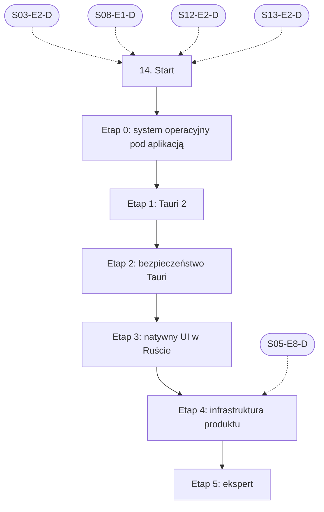

# 14. Desktop: wspólne: plan wdrożenia w Linear

Team **LEA** (https://linear.app/daankh/team/LEA/overview). Plan jest wdrożony w Linear. Klucze zadań (np. `S14-E0-M1`) są robocze, a identyfikator każdego zadania w Linear (`LEA-…`) jest w kolumnie „Linear” tabel zadań i w pliku `mapowanie-kluczy.csv`.

**W skrócie:** 6 kamieni milowych, 39 zadań (1 start, 29 materiałów, 6 dowodów, 3 praktyki). Plik główny z kolejnością projektów: `00-kolejnosc-i-zaleznosci.md`.

## 1. Projekt

| Pole | Wartość |
|---|---|
| Nazwa | 14. Desktop: wspólne |
| Team | LEA |
| Podsumowanie (pole „Summary”) | Warstwa 5: desktop. Opiera się na: 3, 8, 12 i 13; etap infrastruktury produktu także na 5. Jest podstawą: 15–19 oraz etapów desktopowych w 4, 6, 9, 10 i 21. |
| Etykiety projektu | `warstwa-5` |
| Blokowany przez (projekty) | 03. Frontend web, 08. Architektura i projektowanie systemów, 12. Rust jako wspólny fundament, 13. UI/UX |
| Blokuje (projekty) | 15. Linux, 16. macOS, 17. Windows, 18. Android, 19. iOS |
| Zależności częściowe (wchodzące) | etap 4 czeka na 05. Backend i API (etap 8) |
| Zależności częściowe (wychodzące) | 04. Bazy danych i dane, etap 7; 06. Testowanie, etap 6; 09. DevOps, CI/CD i wydania, etap 4; 10. Bezpieczeństwo, etap 7; 16. macOS, etap 1; 17. Windows, etap 1; 21. Funkcje AI w aplikacjach, etap 1 |

### Opis projektu (do wklejenia w Linear)

*Warstwa 5: desktop. Opiera się na: 3, 8, 12 i 13; etap infrastruktury produktu także na 5. Jest podstawą: 15–19 oraz etapów desktopowych w 4, 6, 9, 10 i 21.*

**Zakres umiejętności**

- Tauri 2: architektura (proces Rust i webview), polecenia IPC, system capabilities i uprawnień, pluginy, Content Security Policy, aktualizacje z podpisem; testy (mocki IPC, WebDriver przez `tauri-driver`).
- Alternatywy natywne w Ruście: Slint, egui, Iced, Dioxus; kryteria wyboru (rozmiar, wygląd natywny, dostępność).
- Praca offline, lokalne przechowywanie, bezpieczne sekrety (Keychain, Windows Credential Manager/DPAPI, libsecret).
- Licencjonowanie offline i online, aktywacja, automatyczne aktualizacje, raportowanie awarii z symbolami.

**Ścieżka nauki**

Ścieżka ma 6 etapów. Każdy kończy się **dowodem**, czyli małym projektem, który pokazuje, że etap jest opanowany. Wszystkie dowody budują kolejne wersje tego samego produktu: desktopowego narzędzia, które skanuje repozytoria pod kątem sekretów, licencji i podatnych zależności. Przy doświadczeniu seniorskim z Reactem etap 1 można zaliczyć samym dowodem, ale etapów 2 i 4 nie warto skracać, bo tam leżą błędy, których agent najczęściej nie widzi. Ceny materiałów płatnych zmieniają się, więc warto je sprawdzić przed zakupem. Stan dokumentacji: Tauri 2.12 (wrzesień 2026).

Szczegóły każdego systemu (instalatory, podpisy, sklepy) są w sekcjach 15–17.

**Definicja ukończenia projektu (dowód poziomu E)**

Samodzielnie, bez agenta, w 1 dzień diagnozujesz i naprawiasz błąd, który występuje tylko na jednym systemie (np. różnica webview, ścieżek albo uprawnień), wydajesz poprawkę przez podpisaną aktualizację i umiesz wyjaśnić przyczynę osobie nietechnicznej.

**Źródło:** dokument „Umiejętności techniczne” w projekcie „JDG: Rozwój oprogramowania”, sekcja 14.

## 2. Kamienie milowe

Jeden kamień milowy na etap ścieżki. Kamień milowy jest zamknięty, gdy zamknięte jest zadanie dowodu tego etapu.

| # | Kamień milowy | Cel | Poziom po etapie | Zadania |
|---|---|---|---|---|
| 1 | Etap 0: system operacyjny pod aplikacją | system operacyjny pod aplikacją: procesy, pamięć, pliki, uprawnienia | podstawy | 3 |
| 2 | Etap 1: Tauri 2 | Tauri 2: architektura, IPC, pluginy | W | 7 |
| 3 | Etap 2: bezpieczeństwo Tauri | bezpieczeństwo Tauri: uprawnienia, capabilities, zakresy, CSP | W | 6 |
| 4 | Etap 3: natywny UI w Ruście | natywny UI w Ruście i kryteria wyboru | W | 7 |
| 5 | Etap 4: infrastruktura produktu | infrastruktura produktu: sekrety, dane lokalne, licencje, aktualizacje, awarie | E | 8 |
| 6 | Etap 5: ekspert | ekspert: podatności, model zagrożeń aktualizacji, recenzja kodu AI | E | 7 |

## 3. Punkt startu

Zadanie **`S14-START` · Start: 14. Desktop: wspólne** (LEA-199 w Linear) to jedyne wejście do projektu: wszystkie zadania pierwszego etapu są przez nie blokowane.

- **Blokowane przez:** `S03-E2-D`, `S08-E1-D`, `S12-E2-D`, `S13-E2-D`
- **Odblokowuje:** `S14-E0-M1`, `S14-E0-M2`
- **Status początkowy:** Backlog do czasu zamknięcia zadań blokujących, potem Todo

Opis zadania (do wklejenia):

Punkt startu projektu „14. Desktop: wspólne”.

**Warunki wejścia (zadania blokujące):**

- `S03-E2-D` · Dowód etapu 2: TypeScript — sekcja 3 na poziomie podstawowym do pracy (etap 2)
- `S08-E1-D` · Dowód etapu 1: style architektoniczne, atrybuty jakości i kompromisy — sekcja 8 na poziomie podstawowym do pracy (etap 1)
- `S12-E2-D` · Dowód etapu 2: własność, pożyczanie, czasy życia — sekcja 12 na poziomie podstawowym do pracy (etap 2)
- `S13-E2-D` · Dowód etapu 2: badania i testy użyteczności — sekcja 13 na poziomie podstawowym do pracy (etap 2)

**Do zrobienia:**

- przeczytać sekcję 14 dokumentu „Umiejętności techniczne”,
- zaznaczyć etapy, które zaliczasz samym dowodem (zgodnie z akapitem wstępnym ścieżki), i dla nich zamknąć zadania materiałów jako niepotrzebne.

**Folder roboczy:** `14-desktop/`

## 4. Przepływ zależności

Linie ciągłe to zależności wewnątrz projektu, przerywane to zadania z innych projektów. Wewnątrz etapu zadania materiałów są równoległe i wszystkie blokują dowód etapu; dowód etapu blokuje materiały kolejnego etapu.

## 5. Zadania według kamieni milowych

Szablon opisu zadania materiału: nazwa materiału, autor lub wydawca, typ, czas, koszt i link (jak w kolumnach poniżej), zdanie „Gotowe, gdy materiał jest przerobiony w zakresie potrzebnym do dowodu etapu” oraz folder roboczy z kolumny „Folder”. Opisy dowodów i praktyk są podane pod tabelą każdego etapu.

### Etap 0: system operacyjny pod aplikacją

Opis kamienia milowego (do wklejenia):

**Cel:** system operacyjny pod aplikacją: procesy, pamięć, pliki, uprawnienia · **Poziom po etapie:** podstawy

**Szczególnie ważne:** proces a wątek, przestrzeń adresowa, deskryptory plików, uprawnienia użytkownika, sygnały i zakończenie procesu, komunikacja międzyprocesowa. To język, którym opisane są capabilities Tauri, sandboxy i instalatory.

**Dowód:** Narzędzie CLI w Ruście, które rekurencyjnie przechodzi katalog repozytorium, pomija `.git` i dowiązania symboliczne prowadzące poza katalog oraz obsługuje brak uprawnień do pliku bez paniki. Zestaw testów integracyjnych z katalogiem testowym zawierającym: dowiązanie symboliczne poza katalog, plik bez prawa odczytu, dwa pliki różniące się tylko wielkością liter, plik z końcami linii CRLF i ścieżkę dłuższą niż 260 znaków; testy przechodzą na Linuksie, macOS i Windows (lokalnie albo na maszynach wirtualnych).

| Klucz | Linear | Tytuł | Typ | Czas | Koszt | Link | Blokowane przez | Blokuje | Folder |
|---|---|---|---|---|---|---|---|---|---|
| `S14-E0-M1` | LEA-211 | Przerobić: Operating Systems: Three Easy Pieces… | materiał | 8–10 h | 0 zł (PDF), druk płatny | https://pages.cs.wisc.edu/~remzi/OSTEP/ | `S14-START` | `S14-E0-D` | `14-desktop/e0-system-operacyjny-pod-aplikacja/` |
| `S14-E0-M2` | LEA-212 | Przerobić: Ścieżki i pliki między systemami: dokumentacja `std::path` i `std::fs`… | materiał | 3–4 h | 0 zł | https://doc.rust-lang.org/std/path/index.html, https://learn.microsoft.com/en-us/windows/win32/fileio/naming-a-file, https://git-scm.com/docs/gitattributes | `S14-START` | `S14-E0-D` | `14-desktop/e0-system-operacyjny-pod-aplikacja/` |
| `S14-E0-D` | LEA-230 | Dowód etapu 0: system operacyjny pod aplikacją | dowód | — | — | — | `S14-E0-M1`, `S14-E0-M2` | `S14-E1-M1`, `S14-E1-M2`, `S14-E1-M3`, `S14-E1-M4`, `S14-E1-M5`, `S14-E1-M6` | `14-desktop/e0-system-operacyjny-pod-aplikacja/` |

**`S14-E0-D` · Dowód etapu 0: system operacyjny pod aplikacją**

Narzędzie CLI w Ruście, które rekurencyjnie przechodzi katalog repozytorium, pomija `.git` i dowiązania symboliczne prowadzące poza katalog oraz obsługuje brak uprawnień do pliku bez paniki. Zestaw testów integracyjnych z katalogiem testowym zawierającym: dowiązanie symboliczne poza katalog, plik bez prawa odczytu, dwa pliki różniące się tylko wielkością liter, plik z końcami linii CRLF i ścieżkę dłuższą niż 260 znaków; testy przechodzą na Linuksie, macOS i Windows (lokalnie albo na maszynach wirtualnych).

**Na co zwrócić uwagę:** proces a wątek, przestrzeń adresowa, deskryptory plików, uprawnienia użytkownika, sygnały i zakończenie procesu, komunikacja międzyprocesowa. To język, którym opisane są capabilities Tauri, sandboxy i instalatory.

**Kryterium ukończenia:** wszystkie testy przechodzą na trzech systemach, wynik skanu (lista plików) jest identyczny na każdym z nich z dokładnością do udokumentowanych różnic (np. wielkość liter na Windows i domyślnie na macOS); brak `unwrap()` na wejściu z systemu plików; w komentarzu link do repozytorium.

**Folder roboczy:** `14-desktop/e0-system-operacyjny-pod-aplikacja/`

### Etap 1: Tauri 2

Opis kamienia milowego (do wklejenia):

**Cel:** Tauri 2: architektura, IPC, pluginy · **Poziom po etapie:** W

**Szczególnie ważne:** Tauri używa webview systemu (WebView2 na Windows, WKWebView na macOS, WebKitGTK na Linuksie), więc ten sam frontend może zachowywać się różnie na trzech systemach; długie operacje nie mogą blokować wątku głównego; dane do frontendu idą kanałem lub zdarzeniami, a nie jednym ogromnym wynikiem polecenia. `tauri-driver` uruchamiany bezpośrednio działa tylko na Windows i Linuksie (na macOS nie ma sterownika WKWebView), więc testy end-to-end dla macOS wymagają innego narzędzia albo testów ręcznych.

**Dowód:** Aplikacja Tauri 2 z frontendem React: wybór katalogu repozytorium okienkiem systemowym, skan w Ruście uruchomiony asynchronicznie, postęp przesyłany kanałem, możliwość anulowania, wynik w tabeli; działa jedna instancja aplikacji, a stan okna jest pamiętany między uruchomieniami. Testy frontendu z `mockIPC` dla poleceń skanu i anulowania oraz co najmniej jeden test end-to-end przez WebDriver (`tauri-driver` na Linuksie albo Windows).

| Klucz | Linear | Tytuł | Typ | Czas | Koszt | Link | Blokowane przez | Blokuje | Folder |
|---|---|---|---|---|---|---|---|---|---|
| `S14-E1-M1` | LEA-254 | Przerobić: Dokumentacja Tauri 2: Quick Start, Prerequisites, Core Concepts… | materiał | 10–12 h | 0 zł | https://v2.tauri.app/start/, https://v2.tauri.app/concept/ | `S14-E0-D` | `S14-E1-D` | `14-desktop/e1-tauri-2/` |
| `S14-E1-M2` | LEA-256 | Przerobić: Calling Rust from the Frontend, Calling the Frontend from Rust (polecenia, zdarzenia, kanały) | materiał | 4–6 h | 0 zł | https://v2.tauri.app/develop/calling-rust/ | `S14-E0-D` | `S14-E1-D` | `14-desktop/e1-tauri-2/` |
| `S14-E1-M3` | LEA-258 | Przerobić: Plugins: przegląd oficjalnych pluginów… | materiał | 6–8 h | 0 zł | https://v2.tauri.app/plugin/ | `S14-E0-D` | `S14-E1-D` | `14-desktop/e1-tauri-2/` |
| `S14-E1-M4` | LEA-259 | Przerobić: Plugin Development | materiał | 4–6 h | 0 zł | https://v2.tauri.app/develop/plugins/ | `S14-E0-D` | `S14-E1-D` | `14-desktop/e1-tauri-2/` |
| `S14-E1-M5` | LEA-260 | Przerobić: Releases (changelogi `tauri`, `tauri-cli` i pluginów) | materiał | 1–2 h | 0 zł | https://v2.tauri.app/release/ | `S14-E0-D` | `S14-E1-D` | `14-desktop/e1-tauri-2/` |
| `S14-E1-M6` | LEA-261 | Przerobić: Tauri: Tests (mocki IPC z `@tauri-apps/api/mocks`, WebDriver i `tauri-driver`) | materiał | 3–4 h | 0 zł | https://v2.tauri.app/develop/tests/, https://v2.tauri.app/develop/tests/mocking/, https://v2.tauri.app/develop/tests/webdriver/ | `S14-E0-D` | `S14-E1-D` | `14-desktop/e1-tauri-2/` |
| `S14-E1-D` | LEA-266 | Dowód etapu 1: Tauri 2 | dowód | — | — | — | `S14-E1-M1`, `S14-E1-M2`, `S14-E1-M3`, `S14-E1-M4`, `S14-E1-M5`, `S14-E1-M6` | `S04-E7-M1`, `S04-E7-M2`, `S04-E7-M3`, `S04-E7-M4`, `S04-E7-M5`, `S04-E7-M6`, `S04-E7-M7`, `S06-E6-M1`, `S06-E6-M2`, `S06-E6-M3`, `S06-E6-M4`, `S06-E6-M5`, `S06-E6-M6`, `S06-E6-M7`, `S06-E6-M8`, `S09-E4-M1`, `S09-E4-M2`, `S09-E4-M3`, `S09-E4-M4`, `S09-E4-M5`, `S10-E7-M1`, `S10-E7-M2`, `S10-E7-M3`, `S14-E2-M1`, `S14-E2-M2`, `S14-E2-M3`, `S14-E2-M4`, `S14-E2-M5`, `S15-START`, `S16-START`, `S17-START`, `S18-START`, `S19-START`, `S21-E1-M1`, `S21-E1-M2`, `S21-E1-M3`, `S21-E1-M4`, `S21-E1-M5` | `14-desktop/e1-tauri-2/` |

**`S14-E1-D` · Dowód etapu 1: Tauri 2**

Aplikacja Tauri 2 z frontendem React: wybór katalogu repozytorium okienkiem systemowym, skan w Ruście uruchomiony asynchronicznie, postęp przesyłany kanałem, możliwość anulowania, wynik w tabeli; działa jedna instancja aplikacji, a stan okna jest pamiętany między uruchomieniami. Testy frontendu z `mockIPC` dla poleceń skanu i anulowania oraz co najmniej jeden test end-to-end przez WebDriver (`tauri-driver` na Linuksie albo Windows).

**Na co zwrócić uwagę:** Tauri używa webview systemu (WebView2 na Windows, WKWebView na macOS, WebKitGTK na Linuksie), więc ten sam frontend może zachowywać się różnie na trzech systemach; długie operacje nie mogą blokować wątku głównego; dane do frontendu idą kanałem lub zdarzeniami, a nie jednym ogromnym wynikiem polecenia. `tauri-driver` uruchamiany bezpośrednio działa tylko na Windows i Linuksie (na macOS nie ma sterownika WKWebView), więc testy end-to-end dla macOS wymagają innego narzędzia albo testów ręcznych.

**Kryterium ukończenia:** anulowanie przerywa skan w czasie poniżej 1 s; interfejs reaguje w trakcie skanu repozytorium z co najmniej 10 tys. plików; testy z `mockIPC` i test WebDriver przechodzą; w komentarzu link do repozytorium.

**Folder roboczy:** `14-desktop/e1-tauri-2/`

### Etap 2: bezpieczeństwo Tauri

Opis kamienia milowego (do wklejenia):

**Cel:** bezpieczeństwo Tauri: uprawnienia, capabilities, zakresy, CSP · **Poziom po etapie:** W

**Szczególnie ważne:** webview traktowany jako niezaufany; każde polecenie IPC waliduje wejście tak, jak endpoint API; capabilities przypisane do konkretnych okien; zakresy plików zawężone do katalogów wybranych przez użytkownika; brak `unsafe-inline` w CSP; zdalna treść nigdy nie dostaje dostępu do poleceń. Ogólne zasady bezpieczeństwa i modelowanie zagrożeń: zob. sekcja 10.

**Dowód:** Aplikacja z etapu 1 z minimalnymi capabilities (osobne dla okna głównego i okna ustawień), zakresem systemu plików ograniczonym do wybranego repozytorium i ścisłą CSP; test, w którym kod wstrzyknięty do webview próbuje odczytać `~/.ssh` i wywołać polecenie spoza capability, i dostaje odmowę; krótki dokument z granicami zaufania.

| Klucz | Linear | Tytuł | Typ | Czas | Koszt | Link | Blokowane przez | Blokuje | Folder |
|---|---|---|---|---|---|---|---|---|---|
| `S14-E2-M1` | LEA-286 | Przerobić: Security: Overview, Permissions, Command Scopes, Capabilities, Runtime Authority, Asset protocol… | materiał | 8–10 h | 0 zł | https://v2.tauri.app/security/ | `S14-E1-D` | `S14-E2-D` | `14-desktop/e2-bezpieczenstwo-tauri/` |
| `S14-E2-M2` | LEA-287 | Przerobić: Isolation Pattern, Brownfield Pattern | materiał | 2–3 h | 0 zł | https://v2.tauri.app/concept/inter-process-communication/isolation/ | `S14-E1-D` | `S14-E2-D` | `14-desktop/e2-bezpieczenstwo-tauri/` |
| `S14-E2-M3` | LEA-288 | Przerobić: Application Lifecycle Threats, Tauri Ecosystem Security | materiał | 2–3 h | 0 zł | https://v2.tauri.app/security/lifecycle/ | `S14-E1-D` | `S14-E2-D` | `14-desktop/e2-bezpieczenstwo-tauri/` |
| `S14-E2-M4` | LEA-289 | Przerobić: Electron Security: lista kontrolna (jako porównanie zagrożeń aplikacji z webview) | materiał | 2–3 h | 0 zł | https://www.electronjs.org/docs/latest/tutorial/security | `S14-E1-D` | `S14-E2-D` | `14-desktop/e2-bezpieczenstwo-tauri/` |
| `S14-E2-M5` | LEA-291 | Przerobić: Komunikaty bezpieczeństwa Tauri (GitHub Security Advisories), m.in. obejście kontroli pochodzenia… | materiał | 2–3 h | 0 zł | https://github.com/tauri-apps/tauri/security/advisories | `S14-E1-D` | `S14-E2-D` | `14-desktop/e2-bezpieczenstwo-tauri/` |
| `S14-E2-D` | LEA-302 | Dowód etapu 2: bezpieczeństwo Tauri | dowód | — | — | — | `S14-E2-M1`, `S14-E2-M2`, `S14-E2-M3`, `S14-E2-M4`, `S14-E2-M5` | `S14-E3-M1`, `S14-E3-M2`, `S14-E3-M3`, `S14-E3-M4`, `S14-E3-M5`, `S14-E3-M6` | `14-desktop/e2-bezpieczenstwo-tauri/` |

**`S14-E2-D` · Dowód etapu 2: bezpieczeństwo Tauri**

Aplikacja z etapu 1 z minimalnymi capabilities (osobne dla okna głównego i okna ustawień), zakresem systemu plików ograniczonym do wybranego repozytorium i ścisłą CSP; test, w którym kod wstrzyknięty do webview próbuje odczytać `~/.ssh` i wywołać polecenie spoza capability, i dostaje odmowę; krótki dokument z granicami zaufania.

**Na co zwrócić uwagę:** webview traktowany jako niezaufany; każde polecenie IPC waliduje wejście tak, jak endpoint API; capabilities przypisane do konkretnych okien; zakresy plików zawężone do katalogów wybranych przez użytkownika; brak `unsafe-inline` w CSP; zdalna treść nigdy nie dostaje dostępu do poleceń. Ogólne zasady bezpieczeństwa i modelowanie zagrożeń: zob. sekcja 10.

**Kryterium ukończenia:** test wstrzyknięcia dostaje odmowę dla odczytu `~/.ssh` i dla każdego polecenia spoza capability okna; CSP nie zawiera `unsafe-inline` ani `unsafe-eval`; dokument granic zaufania wymienia każde polecenie IPC z walidacją wejścia; w komentarzu link do repozytorium.

**Folder roboczy:** `14-desktop/e2-bezpieczenstwo-tauri/`

### Etap 3: natywny UI w Ruście

Opis kamienia milowego (do wklejenia):

**Cel:** natywny UI w Ruście i kryteria wyboru · **Poziom po etapie:** W

**Szczególnie ważne:** kryteria wyboru zapisane w ADR, a nie gust: dostępność (AccessKit w Slint i egui), obsługa IME, wygląd natywny, rozmiar i czas startu, licencja, dojrzałość API (iced i Dioxus zmieniają API między wersjami 0.x). Dioxus na desktopie renderuje przez webview, więc nie jest „natywnym” UI w tym samym sensie co Slint czy egui.

**Dowód:** Ten sam rdzeń skanera (osobny crate bez zależności od UI) z drugim interfejsem w Slint albo egui; tabela porównania z wersją Tauri na każdym systemie: rozmiar instalatora (MB), czas do pierwszego okna (mediana z 10 uruchomień), pamięć (RSS) po skanie, wynik testu z czytnikiem ekranu (NVDA, VoiceOver, Orca: które elementy są odczytywane) i obsługa IME; ADR z decyzją dla własnej aplikacji.

| Klucz | Linear | Tytuł | Typ | Czas | Koszt | Link | Blokowane przez | Blokuje | Folder |
|---|---|---|---|---|---|---|---|---|---|
| `S14-E3-M1` | LEA-311 | Przerobić: Slint: dokumentacja, Quickstart, Rust API (`slint` 1.18) | materiał | 10–12 h | 0 zł; licencja royalty-free na desktop, embedded płatny lub GPLv3 | https://docs.slint.dev | `S14-E2-D` | `S14-E3-D` | `14-desktop/e3-natywny-ui-w-ruscie/` |
| `S14-E3-M2` | LEA-313 | Przerobić: egui i eframe, szablon `eframe_template` | materiał | 6–8 h | 0 zł | https://docs.rs/egui, https://github.com/emilk/eframe_template | `S14-E2-D` | `S14-E3-D` | `14-desktop/e3-natywny-ui-w-ruscie/` |
| `S14-E3-M3` | LEA-316 | Przerobić: The iced book (niedokończony) i dokumentacja `iced` 0.14 | materiał, opcjonalne | 5–6 h | 0 zł | https://book.iced.rs, https://docs.rs/iced | `S14-E2-D` | — | `14-desktop/e3-natywny-ui-w-ruscie/` |
| `S14-E3-M4` | LEA-319 | Przerobić: Dioxus 0.7: Desktop (system WebView przez `wry`) | materiał, opcjonalne | 3–4 h | 0 zł | https://dioxuslabs.com/learn/0.7/ | `S14-E2-D` | — | `14-desktop/e3-natywny-ui-w-ruscie/` |
| `S14-E3-M5` | LEA-323 | Przerobić: AccessKit: infrastruktura dostępności dla toolkitów rysujących własny UI | materiał | 1–2 h | 0 zł | https://accesskit.dev | `S14-E2-D` | `S14-E3-D` | `14-desktop/e3-natywny-ui-w-ruscie/` |
| `S14-E3-M6` | LEA-326 | Przerobić: „A 2025 Survey of Rust GUI Libraries” (test czytnika ekranu i IME w 43 bibliotekach) | materiał | 2–3 h | 0 zł | https://www.boringcactus.com/2025/04/13/2025-survey-of-rust-gui-libraries.html | `S14-E2-D` | `S14-E3-D` | `14-desktop/e3-natywny-ui-w-ruscie/` |
| `S14-E3-D` | LEA-336 | Dowód etapu 3: natywny UI w Ruście | dowód | — | — | — | `S14-E3-M1`, `S14-E3-M2`, `S14-E3-M5`, `S14-E3-M6` | `S14-E4-M1`, `S14-E4-M2`, `S14-E4-M3`, `S14-E4-M4`, `S14-E4-M5`, `S14-E4-M6`, `S14-E4-M7` | `14-desktop/e3-natywny-ui-w-ruscie/` |

**`S14-E3-D` · Dowód etapu 3: natywny UI w Ruście**

Ten sam rdzeń skanera (osobny crate bez zależności od UI) z drugim interfejsem w Slint albo egui; tabela porównania z wersją Tauri na każdym systemie: rozmiar instalatora (MB), czas do pierwszego okna (mediana z 10 uruchomień), pamięć (RSS) po skanie, wynik testu z czytnikiem ekranu (NVDA, VoiceOver, Orca: które elementy są odczytywane) i obsługa IME; ADR z decyzją dla własnej aplikacji.

**Na co zwrócić uwagę:** kryteria wyboru zapisane w ADR, a nie gust: dostępność (AccessKit w Slint i egui), obsługa IME, wygląd natywny, rozmiar i czas startu, licencja, dojrzałość API (iced i Dioxus zmieniają API między wersjami 0.x). Dioxus na desktopie renderuje przez webview, więc nie jest „natywnym” UI w tym samym sensie co Slint czy egui.

**Kryterium ukończenia:** crate rdzenia kompiluje się bez zależności od UI; tabela ma wszystkie pomiary dla obu interfejsów na trzech systemach; ADR odwołuje się do tych liczb; w komentarzu link do repozytorium.

**Folder roboczy:** `14-desktop/e3-natywny-ui-w-ruscie/`

### Etap 4: infrastruktura produktu

Opis kamienia milowego (do wklejenia):

**Cel:** infrastruktura produktu: sekrety, dane lokalne, licencje, aktualizacje, awarie · **Poziom po etapie:** E

**Szczególnie ważne:** sekrety użytkownika (tokeny API, klucz licencji) tylko w magazynie systemu, nigdy w pliku konfiguracyjnym ani w `localStorage` webview; licencja weryfikowana kluczem publicznym wbudowanym w aplikację, z łaskawym okresem offline; aktualizacja z kanałami (stabilny, beta), możliwością wycofania i ochroną przed cofnięciem do podatnej wersji (wymóg CRA dotyczący poprawek bezpieczeństwa); od wersji 2.10 plugin updater Tauri obsługuje także pakiety `.deb` i `.rpm`. Integracja z Merchant of Record po stronie serwera: zob. sekcja 5; podpisy i klucze w CI: zob. sekcja 9.

**Dowód:** Narzędzie z etapu 2 sprzedawane „na niby”: zakup w środowisku testowym MoR wywołuje webhook, który wystawia podpisaną licencję; aplikacja weryfikuje ją offline i trzyma w magazynie systemu; aktualizacja z podpisem przechodzi ze stabilnej wersji N do N+1 na trzech systemach, a próba podsunięcia niepodpisanej lub starszej paczki kończy się odmową; wymuszona awaria procesu daje minidump z czytelnym, zsymbolizowanym stosem.

| Klucz | Linear | Tytuł | Typ | Czas | Koszt | Link | Blokowane przez | Blokuje | Folder |
|---|---|---|---|---|---|---|---|---|---|
| `S14-E4-M1` | LEA-341 | Przerobić: `keyring` 4 i `keyring-core` z osobnymi magazynami dla Keychain, Windows Credential Manager i… | materiał | 2–3 h | 0 zł | https://docs.rs/keyring | `S14-E3-D`, `S05-E8-D` | `S14-E4-D` | `14-desktop/e4-infrastruktura-produktu/` |
| `S14-E4-M2` | LEA-342 | Przerobić: Keychain services, CryptProtectData (DPAPI), CredWriteW, Secret Service API | materiał | 4–5 h | 0 zł | https://developer.apple.com/documentation/security/keychain-services, https://learn.microsoft.com/en-us/windows/win32/api/dpapi/nf-dpapi-cryptprotectdata, https://specifications.freedesktop.org/secret-service/latest/ | `S14-E3-D`, `S05-E8-D` | `S14-E4-D` | `14-desktop/e4-infrastruktura-produktu/` |
| `S14-E4-M3` | LEA-344 | Przerobić: Tauri Updater: klucze, format manifestu, serwer statyczny i dynamiczny, podpis nie do wyłączenia | materiał | 3–4 h | 0 zł | https://v2.tauri.app/plugin/updater/ | `S14-E3-D`, `S05-E8-D` | `S14-E4-D` | `14-desktop/e4-infrastruktura-produktu/` |
| `S14-E4-M4` | LEA-347 | Przerobić: The Update Framework (TUF): specyfikacja i model zagrożeń aktualizacji | materiał | 4–6 h | 0 zł | https://theupdateframework.io | `S14-E3-D`, `S05-E8-D` | `S14-E4-D` | `14-desktop/e4-infrastruktura-produktu/` |
| `S14-E4-M5` | LEA-350 | Przerobić: Keygen: licencjonowanie offline (podpisane pliki licencji, Ed25519), aktywacja urządzeń | materiał | 4–5 h | 0 zł | https://keygen.sh/docs/choosing-a-licensing-model/offline-licenses/ | `S14-E3-D`, `S05-E8-D` | `S14-E4-D` | `14-desktop/e4-infrastruktura-produktu/` |
| `S14-E4-M6` | LEA-353 | Przerobić: Sentry for Native i Minidumps; crate’y `crash-handler` i `minidumper` | materiał | 4–6 h | 0 zł | https://docs.sentry.io/platforms/native/guides/minidumps/, https://docs.rs/crash-handler, https://docs.rs/minidumper | `S14-E3-D`, `S05-E8-D` | `S14-E4-D` | `14-desktop/e4-infrastruktura-produktu/` |
| `S14-E4-M7` | LEA-355 | Przerobić: Distribute: przegląd formatów i pipeline’ów | materiał | 2–3 h | 0 zł | https://v2.tauri.app/distribute/ | `S14-E3-D`, `S05-E8-D` | `S14-E4-D` | `14-desktop/e4-infrastruktura-produktu/` |
| `S14-E4-D` | LEA-370 | Dowód etapu 4: infrastruktura produktu | dowód | — | — | — | `S14-E4-M1`, `S14-E4-M2`, `S14-E4-M3`, `S14-E4-M4`, `S14-E4-M5`, `S14-E4-M6`, `S14-E4-M7` | `S14-E5-M1`, `S14-E5-M2`, `S14-E5-M3`, `S14-E5-P1`, `S14-E5-P2`, `S14-E5-P3`, `S16-E1-M1`, `S16-E1-M2`, `S16-E1-M3`, `S16-E1-M4`, `S16-E1-M5`, `S16-E1-M6`, `S16-E1-M7`, `S16-E1-M8`, `S16-E1-M9`, `S16-E1-M10`, `S16-E1-M11`, `S17-E1-M1`, `S17-E1-M2`, `S17-E1-M3`, `S17-E1-M4`, `S17-E1-M5`, `S17-E1-M6` | `14-desktop/e4-infrastruktura-produktu/` |

**`S14-E4-D` · Dowód etapu 4: infrastruktura produktu**

Narzędzie z etapu 2 sprzedawane „na niby”: zakup w środowisku testowym MoR wywołuje webhook, który wystawia podpisaną licencję; aplikacja weryfikuje ją offline i trzyma w magazynie systemu; aktualizacja z podpisem przechodzi ze stabilnej wersji N do N+1 na trzech systemach, a próba podsunięcia niepodpisanej lub starszej paczki kończy się odmową; wymuszona awaria procesu daje minidump z czytelnym, zsymbolizowanym stosem.

**Na co zwrócić uwagę:** sekrety użytkownika (tokeny API, klucz licencji) tylko w magazynie systemu, nigdy w pliku konfiguracyjnym ani w `localStorage` webview; licencja weryfikowana kluczem publicznym wbudowanym w aplikację, z łaskawym okresem offline; aktualizacja z kanałami (stabilny, beta), możliwością wycofania i ochroną przed cofnięciem do podatnej wersji (wymóg CRA dotyczący poprawek bezpieczeństwa); od wersji 2.10 plugin updater Tauri obsługuje także pakiety `.deb` i `.rpm`. Integracja z Merchant of Record po stronie serwera: zob. sekcja 5; podpisy i klucze w CI: zob. sekcja 9.

**Kryterium ukończenia:** licencja działa offline i jest odrzucana po zmianie jednego bajtu; aktualizacja N → N+1 przechodzi na trzech systemach; niepodpisana i starsza paczka są odrzucane; minidump daje stos z nazwami funkcji i numerami linii; w komentarzu link do repozytorium.

**Folder roboczy:** `14-desktop/e4-infrastruktura-produktu/`

### Etap 5: ekspert

Opis kamienia milowego (do wklejenia):

**Cel:** ekspert: podatności, model zagrożeń aktualizacji, recenzja kodu AI · **Poziom po etapie:** E

**Dowód poziomu E:** Samodzielnie, bez agenta, w 1 dzień diagnozujesz i naprawiasz błąd, który występuje tylko na jednym systemie (np. różnica webview, ścieżek albo uprawnień), wydajesz poprawkę przez podpisaną aktualizację i umiesz wyjaśnić przyczynę osobie nietechnicznej.

| Klucz | Linear | Tytuł | Typ | Czas | Koszt | Link | Blokowane przez | Blokuje | Folder |
|---|---|---|---|---|---|---|---|---|---|
| `S14-E5-M1` | LEA-398 | Przerobić: Blog i informacje o wydaniach Tauri, komunikaty bezpieczeństwa | materiał | ok. 30 min tygodniowo | 0 zł | https://v2.tauri.app/blog/, https://v2.tauri.app/release/ | `S14-E4-D` | `S14-E5-D` | `14-desktop/e5-ekspert/` |
| `S14-E5-M2` | LEA-399 | Przerobić: Komunikaty bezpieczeństwa silników webview: WebKitGTK Security Advisories, informacje o wydaniach… | materiał | ok. 15 min tygodniowo | 0 zł | https://webkitgtk.org/security.html, https://learn.microsoft.com/en-us/microsoft-edge/webview2/ | `S14-E4-D` | `S14-E5-D` | `14-desktop/e5-ekspert/` |
| `S14-E5-M3` | LEA-400 | Przerobić: Kod źródłowy `tauri`, `wry` i `tao` (obsługa IPC, capabilities, updater) | materiał, opcjonalne | wg potrzeb | 0 zł | https://github.com/tauri-apps | `S14-E4-D` | — | `14-desktop/e5-ekspert/` |
| `S14-E5-P1` | LEA-401 | Praktyka: recenzja kodu AI | praktyka | — | — | — | `S14-E4-D` | `S14-E5-D` | `14-desktop/e5-ekspert/` |
| `S14-E5-P2` | LEA-402 | Praktyka: ćwiczenie incydentu | praktyka | — | — | — | `S14-E4-D` | `S14-E5-D` | `14-desktop/e5-ekspert/` |
| `S14-E5-P3` | LEA-403 | Praktyka: macierz testowa | praktyka | — | — | — | `S14-E4-D` | `S14-E5-D` | `14-desktop/e5-ekspert/` |
| `S14-E5-D` | LEA-406 | Dowód poziomu E: ekspert | dowód | — | — | — | `S14-E5-M1`, `S14-E5-M2`, `S14-E5-P1`, `S14-E5-P2`, `S14-E5-P3` | — | `14-desktop/e5-ekspert/` |

**`S14-E5-P1` · Praktyka: recenzja kodu AI**

20 pull requestów wygenerowanych przez agentów w aplikacji desktopowej, recenzowanych według listy kontrolnej z etapów 2 i 4: rozszerzone capabilities „żeby zadziałało”, polecenia IPC bez walidacji ścieżek, `unwrap()` w poleceniach (panika zabija proces), blokujące operacje na wątku głównym, sekrety w plikach lub w webview, wyłączona CSP, wymyślone opcje `tauri.conf.json` i nieistniejące API pluginów.

Praktyka ciągła etapu eksperckiego: oznacz jako gotową, gdy działa jako stały element pracy, a nie po jednorazowym wykonaniu.

**Folder roboczy:** `14-desktop/e5-ekspert/`

**`S14-E5-P2` · Praktyka: ćwiczenie incydentu**

Podatność w zależności lub w webview, od komunikatu do podpisanej aktualizacji u użytkowników w 24 h, z zapisem przebiegu do dokumentacji CRA.

Praktyka ciągła etapu eksperckiego: oznacz jako gotową, gdy działa jako stały element pracy, a nie po jednorazowym wykonaniu.

**Folder roboczy:** `14-desktop/e5-ekspert/`

**`S14-E5-P3` · Praktyka: macierz testowa**

Wspólny scenariusz testu wydania dla wszystkich systemów: lista kontrolna i skrypt (instalacja, pierwsze uruchomienie, aktualizacja N → N+1, odinstalowanie, test czytnika ekranu), uruchamiany przed każdym wydaniem na czystych maszynach wirtualnych. Wersje i formaty dla poszczególnych systemów są w praktykach sekcji 15–17; strategia testów: zob. sekcja 6.

Praktyka ciągła etapu eksperckiego: oznacz jako gotową, gdy działa jako stały element pracy, a nie po jednorazowym wykonaniu.

**Folder roboczy:** `14-desktop/e5-ekspert/`

**`S14-E5-D` · Dowód poziomu E: ekspert**

Samodzielnie, bez agenta, w 1 dzień diagnozujesz i naprawiasz błąd, który występuje tylko na jednym systemie (np. różnica webview, ścieżek albo uprawnień), wydajesz poprawkę przez podpisaną aktualizację i umiesz wyjaśnić przyczynę osobie nietechnicznej.

**Kryterium ukończenia:** dowód wykonany samodzielnie; w komentarzu link do repozytorium, raportu lub notatki. Bez agenta AI.

**Folder roboczy:** `14-desktop/e5-ekspert/`

## 6. Relacje z innymi projektami

**Wchodzące** (zadanie z innego projektu blokuje zadanie tego projektu):

- `S03-E2-D` (Dowód etapu 2: TypeScript) → `S14-START`
- `S08-E1-D` (Dowód etapu 1: style architektoniczne, atrybuty jakości i kompromisy) → `S14-START`
- `S12-E2-D` (Dowód etapu 2: własność, pożyczanie, czasy życia) → `S14-START`
- `S13-E2-D` (Dowód etapu 2: badania i testy użyteczności) → `S14-START`
- `S05-E8-D` (Dowód etapu 8: płatności i platformy klientów) → `S14-E4-M1`
- `S05-E8-D` (Dowód etapu 8: płatności i platformy klientów) → `S14-E4-M2`
- `S05-E8-D` (Dowód etapu 8: płatności i platformy klientów) → `S14-E4-M3`
- `S05-E8-D` (Dowód etapu 8: płatności i platformy klientów) → `S14-E4-M4`
- `S05-E8-D` (Dowód etapu 8: płatności i platformy klientów) → `S14-E4-M5`
- `S05-E8-D` (Dowód etapu 8: płatności i platformy klientów) → `S14-E4-M6`
- `S05-E8-D` (Dowód etapu 8: płatności i platformy klientów) → `S14-E4-M7`

**Wychodzące** (zadanie tego projektu blokuje zadanie w innym projekcie):

- `S14-E1-D` → `S04-E7-M1` (04. Bazy danych i dane)
- `S14-E1-D` → `S04-E7-M2` (04. Bazy danych i dane)
- `S14-E1-D` → `S04-E7-M3` (04. Bazy danych i dane)
- `S14-E1-D` → `S04-E7-M4` (04. Bazy danych i dane)
- `S14-E1-D` → `S04-E7-M5` (04. Bazy danych i dane)
- `S14-E1-D` → `S04-E7-M6` (04. Bazy danych i dane)
- `S14-E1-D` → `S04-E7-M7` (04. Bazy danych i dane)
- `S14-E1-D` → `S06-E6-M1` (06. Testowanie)
- `S14-E1-D` → `S06-E6-M2` (06. Testowanie)
- `S14-E1-D` → `S06-E6-M3` (06. Testowanie)
- `S14-E1-D` → `S06-E6-M4` (06. Testowanie)
- `S14-E1-D` → `S06-E6-M5` (06. Testowanie)
- `S14-E1-D` → `S06-E6-M6` (06. Testowanie)
- `S14-E1-D` → `S06-E6-M7` (06. Testowanie)
- `S14-E1-D` → `S06-E6-M8` (06. Testowanie)
- `S14-E1-D` → `S09-E4-M1` (09. DevOps, CI/CD i wydania)
- `S14-E1-D` → `S09-E4-M2` (09. DevOps, CI/CD i wydania)
- `S14-E1-D` → `S09-E4-M3` (09. DevOps, CI/CD i wydania)
- `S14-E1-D` → `S09-E4-M4` (09. DevOps, CI/CD i wydania)
- `S14-E1-D` → `S09-E4-M5` (09. DevOps, CI/CD i wydania)
- `S14-E1-D` → `S10-E7-M1` (10. Bezpieczeństwo)
- `S14-E1-D` → `S10-E7-M2` (10. Bezpieczeństwo)
- `S14-E1-D` → `S10-E7-M3` (10. Bezpieczeństwo)
- `S14-E1-D` → `S15-START` (15. Linux)
- `S14-E1-D` → `S16-START` (16. macOS)
- `S14-E1-D` → `S17-START` (17. Windows)
- `S14-E1-D` → `S18-START` (18. Android)
- `S14-E1-D` → `S19-START` (19. iOS)
- `S14-E1-D` → `S21-E1-M1` (21. Funkcje AI w aplikacjach)
- `S14-E1-D` → `S21-E1-M2` (21. Funkcje AI w aplikacjach)
- `S14-E1-D` → `S21-E1-M3` (21. Funkcje AI w aplikacjach)
- `S14-E1-D` → `S21-E1-M4` (21. Funkcje AI w aplikacjach)
- `S14-E1-D` → `S21-E1-M5` (21. Funkcje AI w aplikacjach)
- `S14-E4-D` → `S16-E1-M1` (16. macOS)
- `S14-E4-D` → `S16-E1-M2` (16. macOS)
- `S14-E4-D` → `S16-E1-M3` (16. macOS)
- `S14-E4-D` → `S16-E1-M4` (16. macOS)
- `S14-E4-D` → `S16-E1-M5` (16. macOS)
- `S14-E4-D` → `S16-E1-M6` (16. macOS)
- `S14-E4-D` → `S16-E1-M7` (16. macOS)
- `S14-E4-D` → `S16-E1-M8` (16. macOS)
- `S14-E4-D` → `S16-E1-M9` (16. macOS)
- `S14-E4-D` → `S16-E1-M10` (16. macOS)
- `S14-E4-D` → `S16-E1-M11` (16. macOS)
- `S14-E4-D` → `S17-E1-M1` (17. Windows)
- `S14-E4-D` → `S17-E1-M2` (17. Windows)
- `S14-E4-D` → `S17-E1-M3` (17. Windows)
- `S14-E4-D` → `S17-E1-M4` (17. Windows)
- `S14-E4-D` → `S17-E1-M5` (17. Windows)
- `S14-E4-D` → `S17-E1-M6` (17. Windows)
