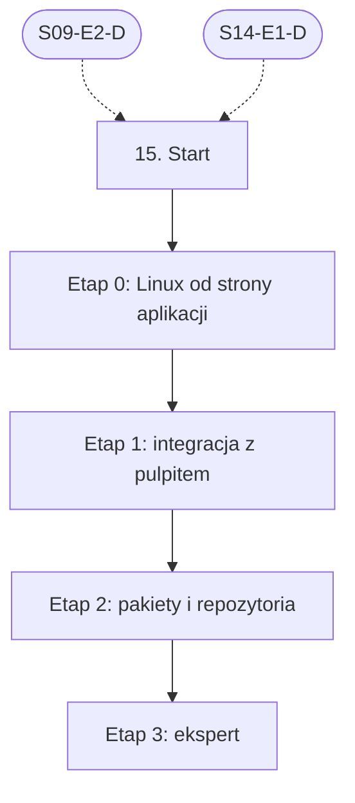

# 15. Linux: plan wdrożenia w Linear

Team **LEA** (https://linear.app/daankh/team/LEA/overview). Plan jest wdrożony w Linear. Klucze zadań (np. `S15-E0-M1`) są robocze, a identyfikator każdego zadania w Linear (`LEA-…`) jest w kolumnie „Linear” tabel zadań i w pliku `mapowanie-kluczy.csv`.

**W skrócie:** 4 kamienie milowe, 31 zadań (1 start, 23 materiały, 4 dowody, 3 praktyki). Plik główny z kolejnością projektów: `00-kolejnosc-i-zaleznosci.md`.

## 1. Projekt

| Pole | Wartość |
|---|---|
| Nazwa | 15. Linux |
| Team | LEA |
| Podsumowanie (pole „Summary”) | Warstwa 5: desktop. Opiera się na: 9 i 14. |
| Etykiety projektu | `warstwa-5` |
| Blokowany przez (projekty) | 09. DevOps, CI/CD i wydania, 14. Desktop: wspólne |
| Blokuje (projekty) | — |

### Opis projektu (do wklejenia w Linear)

*Warstwa 5: desktop. Opiera się na: 9 i 14.*

**Zakres umiejętności**

- Formaty: `.deb`, `.rpm`, AppImage, Flatpak (Flathub), Snap; repozytoria pakietów z podpisem GPG.
- Zgodność glibc między dystrybucjami, architektury x86_64 i aarch64, zależności webview (WebKitGTK), Wayland i X11.
- Ograniczenia systemów: AppArmor i nieuprzywilejowane przestrzenie nazw użytkownika (Ubuntu 24.04+), dystrybucje niezmienne (Fedora Silverblue), na których Flatpak jest główną drogą instalacji.
- Standardy freedesktop: pliki `.desktop`, ścieżki XDG, powiadomienia, autostart; systemd dla usług.

**Ścieżka nauki**

Ścieżka ma 4 etapy. Każdy kończy się **dowodem**, czyli małym projektem, który pokazuje, że etap jest opanowany. Wszystkie dowody dotyczą tej samej aplikacji z sekcji 14: narzędzia desktopowego do kontroli sekretów, licencji i zależności w repozytoriach, sprzedawanego poza sklepem przez Merchant of Record. Przy codziennej pracy na Linuksie etap 0 można zaliczyć samym dowodem. Ceny materiałów płatnych zmieniają się, więc warto je sprawdzić przed zakupem.

**Definicja ukończenia projektu (dowód poziomu E)**

Samodzielnie, bez agenta, w 1 dzień diagnozujesz i naprawiasz błąd zgłoszony przez użytkownika jednej dystrybucji (np. brakująca biblioteka, zbyt nowa glibc, problem z Wayland lub portalem), wydajesz poprawione pakiety we wszystkich kanałach i umiesz wyjaśnić przyczynę osobie nietechnicznej.

**Źródło:** dokument „Umiejętności techniczne” w projekcie „JDG: Rozwój oprogramowania”, sekcja 15.

## 2. Kamienie milowe

Jeden kamień milowy na etap ścieżki. Kamień milowy jest zamknięty, gdy zamknięte jest zadanie dowodu tego etapu.

| # | Kamień milowy | Cel | Poziom po etapie | Zadania |
|---|---|---|---|---|
| 1 | Etap 0: Linux od strony aplikacji | Linux od strony aplikacji: system plików, procesy, biblioteki, systemd | podstawy | 4 |
| 2 | Etap 1: integracja z pulpitem | integracja z pulpitem: standardy freedesktop, portale, Wayland i X11 | W | 5 |
| 3 | Etap 2: pakiety i repozytoria | pakiety i repozytoria: `.deb`, `.rpm`, AppImage, Flatpak, Snap | W | 15 |
| 4 | Etap 3: ekspert | ekspert: zgodność między dystrybucjami, utrzymanie repozytoriów, recenzja kodu AI | E | 6 |

## 3. Punkt startu

Zadanie **`S15-START` · Start: 15. Linux** (LEA-891 w Linear) to jedyne wejście do projektu: wszystkie zadania pierwszego etapu są przez nie blokowane.

- **Blokowane przez:** `S09-E2-D`, `S14-E1-D`
- **Odblokowuje:** `S15-E0-M1`, `S15-E0-M2`, `S15-E0-M3`
- **Status początkowy:** Backlog do czasu zamknięcia zadań blokujących, potem Todo

Opis zadania (do wklejenia):

Punkt startu projektu „15. Linux”.

**Warunki wejścia (zadania blokujące):**

- `S09-E2-D` · Dowód etapu 2: GitHub Actions i bezpieczeństwo pipeline’u — sekcja 9 na poziomie podstawowym do pracy (etap 2)
- `S14-E1-D` · Dowód etapu 1: Tauri 2 — sekcja 14 na poziomie podstawowym do pracy (etap 1)

**Do zrobienia:**

- przeczytać sekcję 15 dokumentu „Umiejętności techniczne”,
- zaznaczyć etapy, które zaliczasz samym dowodem (zgodnie z akapitem wstępnym ścieżki), i dla nich zamknąć zadania materiałów jako niepotrzebne.

**Folder roboczy:** `15-linux/`

## 4. Przepływ zależności

Linie ciągłe to zależności wewnątrz projektu, przerywane to zadania z innych projektów. Wewnątrz etapu zadania materiałów są równoległe i wszystkie blokują dowód etapu; dowód etapu blokuje materiały kolejnego etapu.

## 5. Zadania według kamieni milowych

Szablon opisu zadania materiału: nazwa materiału, autor lub wydawca, typ, czas, koszt i link (jak w kolumnach poniżej), zdanie „Gotowe, gdy materiał jest przerobiony w zakresie potrzebnym do dowodu etapu” oraz folder roboczy z kolumny „Folder”. Opisy dowodów i praktyk są podane pod tabelą każdego etapu.

### Etap 0: Linux od strony aplikacji

Opis kamienia milowego (do wklejenia):

**Cel:** Linux od strony aplikacji: system plików, procesy, biblioteki, systemd · **Poziom po etapie:** podstawy

**Szczególnie ważne:** hierarchia katalogów, uprawnienia i właściciele plików, dynamiczne łączenie i wersje symboli glibc (`ldd`, `objdump -T`), zmienne środowiskowe, a w szczególności to, że aplikacje graficzne nie dziedziczą `$PATH` z plików powłoki.

**Dowód:** Binarka skanera z sekcji 14 uruchamiana jako usługa użytkownika systemd z timerem (nocny skan wybranych repozytoriów), logami w journald i poprawnym zakończeniem po `SIGTERM`; lista symboli glibc, od których zależy binarka, z najwyższą wymaganą wersją.

| Klucz | Linear | Tytuł | Typ | Czas | Koszt | Link | Blokowane przez | Blokuje | Folder |
|---|---|---|---|---|---|---|---|---|---|
| `S15-E0-M1` | LEA-896 | Przerobić: How Linux Works, 3rd Edition | materiał, płatny | 20–25 h | płatna | https://nostarch.com/howlinuxworks3 | `S15-START` | `S15-E0-D` | `15-linux/e0-linux-od-strony-aplikacji/` |
| `S15-E0-M2` | LEA-897 | Przerobić: The Linux Programming Interface… | materiał, płatny | 8–10 h | płatna | https://man7.org/tlpi/ | `S15-START` | `S15-E0-D` | `15-linux/e0-linux-od-strony-aplikacji/` |
| `S15-E0-M3` | LEA-898 | Przerobić: systemd: dokumentacja i strony podręcznika (`systemd.unit`, `systemd.service`, usługi użytkownika) | materiał | 3–4 h | 0 zł | https://systemd.io | `S15-START` | `S15-E0-D` | `15-linux/e0-linux-od-strony-aplikacji/` |
| `S15-E0-D` | LEA-901 | Dowód etapu 0: Linux od strony aplikacji | dowód | — | — | — | `S15-E0-M1`, `S15-E0-M2`, `S15-E0-M3` | `S15-E1-M1`, `S15-E1-M2`, `S15-E1-M3`, `S15-E1-M4` | `15-linux/e0-linux-od-strony-aplikacji/` |

**`S15-E0-D` · Dowód etapu 0: Linux od strony aplikacji**

Binarka skanera z sekcji 14 uruchamiana jako usługa użytkownika systemd z timerem (nocny skan wybranych repozytoriów), logami w journald i poprawnym zakończeniem po `SIGTERM`; lista symboli glibc, od których zależy binarka, z najwyższą wymaganą wersją.

**Na co zwrócić uwagę:** hierarchia katalogów, uprawnienia i właściciele plików, dynamiczne łączenie i wersje symboli glibc (`ldd`, `objdump -T`), zmienne środowiskowe, a w szczególności to, że aplikacje graficzne nie dziedziczą `$PATH` z plików powłoki.

**Kryterium ukończenia:** dowód wykonany samodzielnie; w komentarzu link do repozytorium, raportu lub notatki.

**Folder roboczy:** `15-linux/e0-linux-od-strony-aplikacji/`

### Etap 1: integracja z pulpitem

Opis kamienia milowego (do wklejenia):

**Cel:** integracja z pulpitem: standardy freedesktop, portale, Wayland i X11 · **Poziom po etapie:** W

**Szczególnie ważne:** pliki aplikacji w `$XDG_CONFIG_HOME`, `$XDG_DATA_HOME` i `$XDG_CACHE_HOME`, a nie w katalogu domowym; zachowanie pod Wayland (brak globalnych skrótów i pozycjonowania okien bez portali, inne skalowanie); portal Secret i Secret Service zamiast plików z tokenami; różnice między GNOME i KDE w zasobniku systemowym. Wytyczne GNOME HIG: zob. sekcja 13.

**Dowód:** Aplikacja Tauri z sekcji 14 z poprawnym plikiem `.desktop`, ikonami w kilku rozmiarach, plikiem MetaInfo przechodzącym walidację, danymi w ścieżkach XDG, autostartem przez plik autostart i powiadomieniem o wykrytym sekrecie; przetestowana w sesji Wayland i X11 na GNOME oraz KDE.

| Klucz | Linear | Tytuł | Typ | Czas | Koszt | Link | Blokowane przez | Blokuje | Folder |
|---|---|---|---|---|---|---|---|---|---|
| `S15-E1-M1` | LEA-908 | Przerobić: Specyfikacje freedesktop.org: Desktop Entry, Base Directory, Autostart, Notification, Icon Theme… | materiał | 6–8 h | 0 zł | https://specifications.freedesktop.org | `S15-E0-D` | `S15-E1-D` | `15-linux/e1-integracja-z-pulpitem/` |
| `S15-E1-M2` | LEA-910 | Przerobić: XDG Desktop Portal: dokumentacja API (File Chooser, Secret, Background, Notification, OpenURI) | materiał | 4–5 h | 0 zł | https://flatpak.github.io/xdg-desktop-portal/docs/ | `S15-E0-D` | `S15-E1-D` | `15-linux/e1-integracja-z-pulpitem/` |
| `S15-E1-M3` | LEA-912 | Przerobić: The Wayland Protocol | materiał | 4–6 h | 0 zł | https://wayland-book.com | `S15-E0-D` | `S15-E1-D` | `15-linux/e1-integracja-z-pulpitem/` |
| `S15-E1-M4` | LEA-913 | Przerobić: AppStream: format metadanych MetaInfo | materiał | 1–2 h | 0 zł | https://www.freedesktop.org/software/appstream/docs/ | `S15-E0-D` | `S15-E1-D` | `15-linux/e1-integracja-z-pulpitem/` |
| `S15-E1-D` | LEA-924 | Dowód etapu 1: integracja z pulpitem | dowód | — | — | — | `S15-E1-M1`, `S15-E1-M2`, `S15-E1-M3`, `S15-E1-M4` | `S15-E2-M1`, `S15-E2-M2`, `S15-E2-M3`, `S15-E2-M4`, `S15-E2-M5`, `S15-E2-M6`, `S15-E2-M7`, `S15-E2-M8`, `S15-E2-M9`, `S15-E2-M10`, `S15-E2-M11`, `S15-E2-M12`, `S15-E2-M13`, `S15-E2-M14` | `15-linux/e1-integracja-z-pulpitem/` |

**`S15-E1-D` · Dowód etapu 1: integracja z pulpitem**

Aplikacja Tauri z sekcji 14 z poprawnym plikiem `.desktop`, ikonami w kilku rozmiarach, plikiem MetaInfo przechodzącym walidację, danymi w ścieżkach XDG, autostartem przez plik autostart i powiadomieniem o wykrytym sekrecie; przetestowana w sesji Wayland i X11 na GNOME oraz KDE.

**Na co zwrócić uwagę:** pliki aplikacji w `$XDG_CONFIG_HOME`, `$XDG_DATA_HOME` i `$XDG_CACHE_HOME`, a nie w katalogu domowym; zachowanie pod Wayland (brak globalnych skrótów i pozycjonowania okien bez portali, inne skalowanie); portal Secret i Secret Service zamiast plików z tokenami; różnice między GNOME i KDE w zasobniku systemowym. Wytyczne GNOME HIG: zob. sekcja 13.

**Kryterium ukończenia:** dowód wykonany samodzielnie; w komentarzu link do repozytorium, raportu lub notatki.

**Folder roboczy:** `15-linux/e1-integracja-z-pulpitem/`

### Etap 2: pakiety i repozytoria

Opis kamienia milowego (do wklejenia):

**Cel:** pakiety i repozytoria: `.deb`, `.rpm`, AppImage, Flatpak, Snap · **Poziom po etapie:** W

**Szczególnie ważne:** budowanie na najstarszej wspieranej wersji LTS, która ma WebKitGTK 4.1 (zasada, a nie stała wersja; dziś np. Ubuntu 24.04, bo standardowe wsparcie Ubuntu 22.04 dobiega końca), ponieważ binarka wymaga glibc w wersji co najmniej takiej jak na systemie budowania, więc nowsza glibc zawęża krąg odbiorców; pakiety dla x86_64 i aarch64, a AppImage dla aarch64 trzeba budować natywnie; od Ubuntu 24.04 AppArmor ogranicza nieuprzywilejowane przestrzenie nazw użytkownika, co psuje sandbox WebKitGTK i niektóre AppImage, a obejściem nie jest wyłączanie ochrony u klienta; na systemach niezmiennych (Fedora Silverblue) Flatpak jest praktycznie jedyną drogą instalacji; podpis pakietów i repozytoriów (GPG dla `.rpm` i plików `Release`), a podpis AppImage nie jest sprawdzany automatycznie; Flathub wymaga sandboxa z minimalnymi uprawnieniami i portali, nie przyjmuje aplikacji uruchamianych tylko z zasobnika, zabrania treści generowanych przez AI w manifestach, a płatne aplikacje podlegają osobnym zasadom monetyzacji; w Flatpaku aktualizacje dostarcza Flathub, więc w tej wersji aplikacji własny updater powinien być wyłączony. Klucze GPG w CI: zob. sekcja 9.

**Dowód:** Narzędzie z sekcji 14 wydane jako `.deb`, `.rpm`, AppImage i Flatpak dla x86_64 oraz `.deb` i AppImage dla aarch64, zbudowane w CI na obrazie bazowym najstarszej wspieranej LTS; własne repozytorium APT i RPM z podpisanym indeksem, instrukcją z `Signed-By` i działającą aktualizacją przez `apt upgrade` i `dnf upgrade`; manifest Flatpak przechodzący `flatpak-builder-lint`, z dostępem do repozytoriów tylko przez portal File Chooser; test dymny (uruchomienie i skan przykładowego repozytorium) na czystym Ubuntu 24.04 z domyślną konfiguracją AppArmor, na aarch64 i na Fedora Silverblue (Flatpak, bez nakładania pakietów przez `rpm-ostree`).

| Klucz | Linear | Tytuł | Typ | Czas | Koszt | Link | Blokowane przez | Blokuje | Folder |
|---|---|---|---|---|---|---|---|---|---|
| `S15-E2-M1` | LEA-951 | Przerobić: Guide for Debian Maintainers (następca Debian New Maintainers’ Guide) | materiał | 6–8 h | 0 zł | https://www.debian.org/doc/manuals/debmake-doc/ | `S15-E1-D` | `S15-E2-D` | `15-linux/e2-pakiety-i-repozytoria/` |
| `S15-E2-M2` | LEA-953 | Przerobić: Debian Policy Manual (rozdziały o plikach kontrolnych, zależnościach, skryptach maintainera) | materiał, opcjonalne | 4–6 h | 0 zł | https://www.debian.org/doc/debian-policy/ | `S15-E1-D` | — | `15-linux/e2-pakiety-i-repozytoria/` |
| `S15-E2-M3` | LEA-955 | Przerobić: `apt-secure(8)`: podpisane pliki `Release`/`InRelease` i `Signed-By` | materiał | 1–2 h | 0 zł | https://manpages.debian.org/apt-secure | `S15-E1-D` | `S15-E2-D` | `15-linux/e2-pakiety-i-repozytoria/` |
| `S15-E2-M4` | LEA-957 | Przerobić: RPM Packaging Guide | materiał | 5–6 h | 0 zł | https://rpm-packaging-guide.github.io | `S15-E1-D` | `S15-E2-D` | `15-linux/e2-pakiety-i-repozytoria/` |
| `S15-E2-M5` | LEA-958 | Przerobić: Fedora Packaging Guidelines, w tym Rust Packaging Guidelines | materiał, opcjonalne | 3–4 h | 0 zł | https://docs.fedoraproject.org/en-US/packaging-guidelines/ | `S15-E1-D` | — | `15-linux/e2-pakiety-i-repozytoria/` |
| `S15-E2-M6` | LEA-960 | Przerobić: Dokumentacja AppImage: Packaging Guide, Best practices, aktualizacje przez zsync | materiał | 3–4 h | 0 zł | https://docs.appimage.org | `S15-E1-D` | `S15-E2-D` | `15-linux/e2-pakiety-i-repozytoria/` |
| `S15-E2-M7` | LEA-961 | Przerobić: Dokumentacja Flatpak: Building, Sandbox Permissions, Portals, Publishing | materiał | 6–8 h | 0 zł | https://docs.flatpak.org/en/latest/ | `S15-E1-D` | `S15-E2-D` | `15-linux/e2-pakiety-i-repozytoria/` |
| `S15-E2-M8` | LEA-977 | Przerobić: Flathub dla autorów: Requirements, MetaInfo Guidelines, Submission, Verification, zasady… | materiał | 3–4 h | 0 zł | https://docs.flathub.org/docs/for-app-authors/requirements | `S15-E1-D` | `S15-E2-D` | `15-linux/e2-pakiety-i-repozytoria/` |
| `S15-E2-M9` | LEA-978 | Przerobić: Snap documentation | materiał, opcjonalne | 2–3 h | 0 zł | https://snapcraft.io/docs | `S15-E1-D` | — | `15-linux/e2-pakiety-i-repozytoria/` |
| `S15-E2-M10` | LEA-979 | Przerobić: Tauri: Debian, RPM, AppImage, Flathub, Snapcraft, AUR, Linux Code Signing | materiał | 2–3 h | 0 zł | https://v2.tauri.app/distribute/ | `S15-E1-D` | `S15-E2-D` | `15-linux/e2-pakiety-i-repozytoria/` |
| `S15-E2-M11` | LEA-980 | Przerobić: `cargo-deb`, `cargo-generate-rpm` (pakiety dla aplikacji bez Tauri) | materiał, opcjonalne | 1–2 h | 0 zł | https://docs.rs/cargo-deb, https://github.com/cat-in-136/cargo-generate-rpm | `S15-E1-D` | — | `15-linux/e2-pakiety-i-repozytoria/` |
| `S15-E2-M12` | LEA-981 | Przerobić: Tauri: AppImage, sekcja „AppImages for ARM-based devices” i runnery GitHub `ubuntu-24.04-arm`… | materiał | 1–2 h | 0 zł | https://v2.tauri.app/distribute/appimage/, https://docs.github.com/en/actions/reference/runners/github-hosted-runners | `S15-E1-D` | `S15-E2-D` | `15-linux/e2-pakiety-i-repozytoria/` |
| `S15-E2-M13` | LEA-982 | Przerobić: Ubuntu: ograniczenie nieuprzywilejowanych przestrzeni nazw użytkownika przez AppArmor i profile… | materiał | 1–2 h | 0 zł | https://ubuntu.com/blog/ubuntu-23-10-restricted-unprivileged-user-namespaces, https://documentation.ubuntu.com/server/how-to/security/apparmor/ | `S15-E1-D` | `S15-E2-D` | `15-linux/e2-pakiety-i-repozytoria/` |
| `S15-E2-M14` | LEA-984 | Przerobić: Fedora Silverblue: dokumentacja (system niezmienny, `rpm-ostree`, Flatpak i Toolbx) | materiał | 1–2 h | 0 zł | https://docs.fedoraproject.org/en-US/fedora-silverblue/ | `S15-E1-D` | `S15-E2-D` | `15-linux/e2-pakiety-i-repozytoria/` |
| `S15-E2-D` | LEA-991 | Dowód etapu 2: pakiety i repozytoria | dowód | — | — | — | `S15-E2-M1`, `S15-E2-M3`, `S15-E2-M4`, `S15-E2-M6`, `S15-E2-M7`, `S15-E2-M8`, `S15-E2-M10`, `S15-E2-M12`, `S15-E2-M13`, `S15-E2-M14` | `S15-E3-M1`, `S15-E3-M2`, `S15-E3-P1`, `S15-E3-P2`, `S15-E3-P3` | `15-linux/e2-pakiety-i-repozytoria/` |

**`S15-E2-D` · Dowód etapu 2: pakiety i repozytoria**

Narzędzie z sekcji 14 wydane jako `.deb`, `.rpm`, AppImage i Flatpak dla x86_64 oraz `.deb` i AppImage dla aarch64, zbudowane w CI na obrazie bazowym najstarszej wspieranej LTS; własne repozytorium APT i RPM z podpisanym indeksem, instrukcją z `Signed-By` i działającą aktualizacją przez `apt upgrade` i `dnf upgrade`; manifest Flatpak przechodzący `flatpak-builder-lint`, z dostępem do repozytoriów tylko przez portal File Chooser; test dymny (uruchomienie i skan przykładowego repozytorium) na czystym Ubuntu 24.04 z domyślną konfiguracją AppArmor, na aarch64 i na Fedora Silverblue (Flatpak, bez nakładania pakietów przez `rpm-ostree`).

**Na co zwrócić uwagę:** budowanie na najstarszej wspieranej wersji LTS, która ma WebKitGTK 4.1 (zasada, a nie stała wersja; dziś np. Ubuntu 24.04, bo standardowe wsparcie Ubuntu 22.04 dobiega końca), ponieważ binarka wymaga glibc w wersji co najmniej takiej jak na systemie budowania, więc nowsza glibc zawęża krąg odbiorców; pakiety dla x86_64 i aarch64, a AppImage dla aarch64 trzeba budować natywnie; od Ubuntu 24.04 AppArmor ogranicza nieuprzywilejowane przestrzenie nazw użytkownika, co psuje sandbox WebKitGTK i niektóre AppImage, a obejściem nie jest wyłączanie ochrony u klienta; na systemach niezmiennych (Fedora Silverblue) Flatpak jest praktycznie jedyną drogą instalacji; podpis pakietów i repozytoriów (GPG dla `.rpm` i plików `Release`), a podpis AppImage nie jest sprawdzany automatycznie; Flathub wymaga sandboxa z minimalnymi uprawnieniami i portali, nie przyjmuje aplikacji uruchamianych tylko z zasobnika, zabrania treści generowanych przez AI w manifestach, a płatne aplikacje podlegają osobnym zasadom monetyzacji; w Flatpaku aktualizacje dostarcza Flathub, więc w tej wersji aplikacji własny updater powinien być wyłączony. Klucze GPG w CI: zob. sekcja 9.

**Kryterium ukończenia:** wszystkie pakiety instalują się i przechodzą test dymny; `objdump -T` nie pokazuje symboli glibc nowszych niż w systemie bazowym; na Ubuntu 24.04 aplikacja działa bez `--no-sandbox` i bez zmiany `kernel.apparmor_restrict_unprivileged_userns` (albo z profilem AppArmor dostarczonym w pakiecie `.deb`); `flatpak-builder-lint` bez błędów; w komentarzu link do repozytorium i logów CI.

**Folder roboczy:** `15-linux/e2-pakiety-i-repozytoria/`

### Etap 3: ekspert

Opis kamienia milowego (do wklejenia):

**Cel:** ekspert: zgodność między dystrybucjami, utrzymanie repozytoriów, recenzja kodu AI · **Poziom po etapie:** E

**Dowód poziomu E:** Samodzielnie, bez agenta, w 1 dzień diagnozujesz i naprawiasz błąd zgłoszony przez użytkownika jednej dystrybucji (np. brakująca biblioteka, zbyt nowa glibc, problem z Wayland lub portalem), wydajesz poprawione pakiety we wszystkich kanałach i umiesz wyjaśnić przyczynę osobie nietechnicznej.

| Klucz | Linear | Tytuł | Typ | Czas | Koszt | Link | Blokowane przez | Blokuje | Folder |
|---|---|---|---|---|---|---|---|---|---|
| `S15-E3-M1` | LEA-1006 | Przerobić: Komunikaty bezpieczeństwa WebKitGTK i informacje o wydaniach dystrybucji (Debian, Ubuntu, Fedora) | materiał | ok. 30 min tygodniowo | 0 zł | https://webkitgtk.org/security.html | `S15-E2-D` | `S15-E3-D` | `15-linux/e3-ekspert/` |
| `S15-E3-M2` | LEA-1008 | Przerobić: Open Build Service: budowanie pakietów dla wielu dystrybucji | materiał | 4–6 h | 0 zł | https://openbuildservice.org/help/manuals/obs-user-guide/ | `S15-E2-D` | `S15-E3-D` | `15-linux/e3-ekspert/` |
| `S15-E3-P1` | LEA-1010 | Praktyka: recenzja kodu AI | praktyka | — | — | — | `S15-E2-D` | `S15-E3-D` | `15-linux/e3-ekspert/` |
| `S15-E3-P2` | LEA-1012 | Praktyka: macierz zgodności | praktyka | — | — | — | `S15-E2-D` | `S15-E3-D` | `15-linux/e3-ekspert/` |
| `S15-E3-P3` | LEA-1013 | Praktyka: rotacja klucza repozytorium | praktyka | — | — | — | `S15-E2-D` | `S15-E3-D` | `15-linux/e3-ekspert/` |
| `S15-E3-D` | LEA-1018 | Dowód poziomu E: ekspert | dowód | — | — | — | `S15-E3-M1`, `S15-E3-M2`, `S15-E3-P1`, `S15-E3-P2`, `S15-E3-P3` | — | `15-linux/e3-ekspert/` |

**`S15-E3-P1` · Praktyka: recenzja kodu AI**

10 pull requestów agentów dotyczących pakowania i integracji z Linuksem, recenzowanych pod kątem: twardych ścieżek zamiast XDG, zależności dopisanych „na zapas” do pakietu, skryptów `postinst` z `sudo` lub `curl | sh`, nadmiarowych uprawnień Flatpak (`--filesystem=home`, `--talk-name` bez potrzeby), kluczy repozytorium dodawanych do globalnego zaufania zamiast `Signed-By`.

Praktyka ciągła etapu eksperckiego: oznacz jako gotową, gdy działa jako stały element pracy, a nie po jednorazowym wykonaniu.

**Folder roboczy:** `15-linux/e3-ekspert/`

**`S15-E3-P2` · Praktyka: macierz zgodności**

Linuksowa część macierzy testowej: czyste maszyny wirtualne z najstarszą i najnowszą wspieraną wersją Ubuntu LTS, Debiana i Fedory oraz Fedora Silverblue, x86_64 i aarch64, sesje Wayland i X11; instalacja, aktualizacja i odinstalowanie każdego formatu (`.deb`, `.rpm`, AppImage, Flatpak).

Praktyka ciągła etapu eksperckiego: oznacz jako gotową, gdy działa jako stały element pracy, a nie po jednorazowym wykonaniu.

**Folder roboczy:** `15-linux/e3-ekspert/`

**`S15-E3-P3` · Praktyka: rotacja klucza repozytorium**

Przećwiczona wymiana klucza GPG bez utraty aktualizacji u istniejących użytkowników.

Praktyka ciągła etapu eksperckiego: oznacz jako gotową, gdy działa jako stały element pracy, a nie po jednorazowym wykonaniu.

**Folder roboczy:** `15-linux/e3-ekspert/`

**`S15-E3-D` · Dowód poziomu E: ekspert**

Samodzielnie, bez agenta, w 1 dzień diagnozujesz i naprawiasz błąd zgłoszony przez użytkownika jednej dystrybucji (np. brakująca biblioteka, zbyt nowa glibc, problem z Wayland lub portalem), wydajesz poprawione pakiety we wszystkich kanałach i umiesz wyjaśnić przyczynę osobie nietechnicznej.

**Kryterium ukończenia:** dowód wykonany samodzielnie; w komentarzu link do repozytorium, raportu lub notatki. Bez agenta AI.

**Folder roboczy:** `15-linux/e3-ekspert/`

## 6. Relacje z innymi projektami

**Wchodzące** (zadanie z innego projektu blokuje zadanie tego projektu):

- `S09-E2-D` (Dowód etapu 2: GitHub Actions i bezpieczeństwo pipeline’u) → `S15-START`
- `S14-E1-D` (Dowód etapu 1: Tauri 2) → `S15-START`

**Wychodzące** (zadanie tego projektu blokuje zadanie w innym projekcie):

- brak
