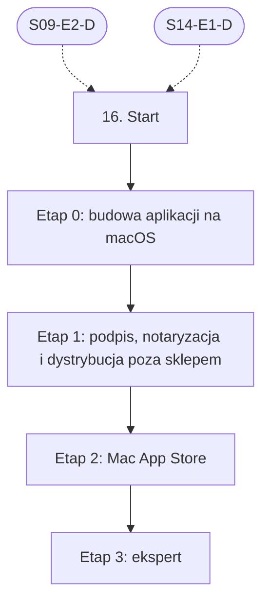

# 16. macOS: plan wdrożenia w Linear

Team **LEA** (https://linear.app/daankh/team/LEA/overview). Plan do przeglądu przed wdrożeniem: nic nie zostało jeszcze utworzone w Linear. Klucze zadań (np. `S16-E0-M1`) są robocze; po wdrożeniu dostaną identyfikatory `LEA-…`.

**W skrócie:** 4 kamienie milowe, 32 zadania (1 start, 24 materiały, 4 dowody, 3 praktyki). Plik główny z kolejnością projektów: `00-kolejnosc-i-zaleznosci.md`.

## 1. Projekt

| Pole | Wartość |
|---|---|
| Nazwa | 16. macOS |
| Team | LEA |
| Podsumowanie (pole „Summary”) | Warstwa 5: desktop. Opiera się na: 9 i 14. |
| Proponowany start | 2027-06-01 |
| Proponowany termin | 2027-12-17 |
| Etykiety projektu | `warstwa-5` |
| Blokowany przez (projekty) | 09. DevOps, CI/CD i wydania, 14. Desktop: wspólne |
| Blokuje (projekty) | — |
| Czas od zera | 60–75 h |

### Opis projektu (do wklejenia w Linear)

*Warstwa 5: desktop. Opiera się na: 9 i 14.*

**Zakres umiejętności**

- Uniwersalne binarki (aarch64 i x86_64), struktura pakietu `.app`, DMG.
- Podpis kodu, hardened runtime, entitlements, notaryzacja (`notarytool`), staple.
- Mac App Store: sandbox, zakupy w aplikacji, recenzja.
- Integracje systemowe: menu, pasek menu, uprawnienia prywatności (TCC), Keychain.

**Ścieżka nauki**

Ścieżka ma 4 etapy. Każdy kończy się **dowodem**, czyli małym projektem, który pokazuje, że etap jest opanowany. Wszystkie dowody dotyczą tej samej aplikacji z sekcji 14.1: narzędzia desktopowego do kontroli sekretów, licencji i zależności w repozytoriach, sprzedawanego poza sklepem przez Merchant of Record (podpis Developer ID i notaryzacja) oraz w Mac App Store. Przy codziennej pracy na Macu etap 0 można przejść szybciej, ale etapu 1 nie warto skracać: podpis, entitlements i notaryzacja to miejsce, w którym agent najczęściej „naprawia” błąd przez wyłączenie zabezpieczenia. Czas podany dla osoby startującej od zera; członkostwo w Apple Developer Program jest płatne (abonament roczny), a bez niego nie da się notaryzować aplikacji.

Razem od zera do poziomu E: ok. 60–75 h, czyli ok. 2 miesiące przy 8–10 h tygodniowo.

**Definicja ukończenia projektu (dowód poziomu E)**

Samodzielnie, bez agenta, w 1 dzień diagnozujesz i naprawiasz odrzuconą notaryzację albo problem z uruchomieniem zgłoszony przez użytkownika (log notaryzacji, `codesign`, `spctl`, logi systemowe), wydajesz poprawioną wersję i umiesz wyjaśnić przyczynę osobie nietechnicznej.

**Źródło:** dokument „Umiejętności techniczne” w projekcie „JDG: Rozwój oprogramowania”, sekcja 16.

## 2. Kamienie milowe

Jeden kamień milowy na etap ścieżki. Kamień milowy jest zamknięty, gdy zamknięte jest zadanie dowodu tego etapu. Daty kamieni milowych ustawiasz przy wdrożeniu według kolejności z pliku głównego.

| # | Kamień milowy | Cel | Czas od zera | Poziom po etapie | Zadania |
|---|---|---|---|---|---|
| 1 | Etap 0: budowa aplikacji na macOS | budowa aplikacji na macOS: pakiet `.app`, uniwersalne binarki, integracje systemowe | 20–25 h | podstawy | 7 |
| 2 | Etap 1: podpis, notaryzacja i dystrybucja poza sklepem | podpis kodu, hardened runtime, entitlements, notaryzacja i dystrybucja poza sklepem | 25–30 h | W | 12 |
| 3 | Etap 2: Mac App Store | Mac App Store: App Sandbox, recenzja, osobny wariant aplikacji | 15–20 h | W | 4 |
| 4 | Etap 3: ekspert | ekspert: Gatekeeper i mechanizmy ochrony systemu, recenzja kodu AI | stale, ok. 1 h tygodniowo | E | 8 |

## 3. Punkt startu

Zadanie **`S16-START` · Start: 16. macOS** to jedyne wejście do projektu: wszystkie zadania pierwszego etapu są przez nie blokowane.

- **Blokowane przez:** `S09-E2-D`, `S14-E1-D`
- **Odblokowuje:** `S16-E0-M1`, `S16-E0-M2`, `S16-E0-M3`, `S16-E0-M4`, `S16-E0-M5`, `S16-E0-M6`
- **Status początkowy:** Backlog do czasu zamknięcia zadań blokujących, potem Todo

Opis zadania (do wklejenia):

Punkt startu projektu „16. macOS”.

**Warunki wejścia (zadania blokujące):**

- `S09-E2-D` · Dowód etapu 2: GitHub Actions i bezpieczeństwo pipeline’u — sekcja 9 na poziomie podstawowym do pracy (etap 2)
- `S14-E1-D` · Dowód etapu 1: Tauri 2 — sekcja 14 na poziomie podstawowym do pracy (etap 1)

**Do zrobienia:**

- przeczytać sekcję 16 dokumentu „Umiejętności techniczne”,
- zaznaczyć etapy, które zaliczasz samym dowodem (zgodnie z akapitem wstępnym ścieżki), i dla nich zamknąć zadania materiałów jako niepotrzebne,
- ustawić daty kamieni milowych zgodnie z kolejnością z pliku głównego.

**Folder roboczy:** `16-macos/`

## 4. Przepływ zależności

Linie ciągłe to zależności wewnątrz projektu, przerywane to zadania z innych projektów. Wewnątrz etapu zadania materiałów są równoległe i wszystkie blokują dowód etapu; dowód etapu blokuje materiały kolejnego etapu.

## 5. Zadania według kamieni milowych

Szablon opisu zadania materiału: nazwa materiału, autor lub wydawca, typ, czas, koszt i link (jak w kolumnach poniżej), zdanie „Gotowe, gdy materiał jest przerobiony w zakresie potrzebnym do dowodu etapu” oraz folder roboczy z kolumny „Folder”. Opisy dowodów i praktyk są podane pod tabelą każdego etapu.

### Etap 0: budowa aplikacji na macOS

Opis kamienia milowego (do wklejenia):

**Cel:** budowa aplikacji na macOS: pakiet `.app`, uniwersalne binarki, integracje systemowe · **Czas od zera:** 20–25 h · **Poziom po etapie:** podstawy

**Szczególnie ważne:** target `universal-apple-darwin` w Tauri albo łączenie dwóch binarek przez `lipo`; `minimumSystemVersion` zgodne z użytymi API; opisy użycia w `Info.plist` dla każdego zasobu chronionego przez TCC (dostęp do folderów, automatyzacja); aplikacje graficzne nie dziedziczą `$PATH` z powłoki, więc wywołanie `git` z aplikacji wymaga jawnej ścieżki. Wytyczne Apple Human Interface Guidelines: zob. sekcja 13.

**Dowód:** Narzędzie z sekcji 14.1 jako uniwersalna binarka w DMG, z menu aplikacji zgodnym z konwencjami macOS, ikoną w pasku menu pokazującą wynik ostatniego skanu, tokenami w Keychain i opcjonalnym uruchamianiem przy logowaniu przez `SMAppService`; `lipo -info` potwierdza obie architektury.

| Klucz | Tytuł | Typ | Czas | Koszt | Link | Blokowane przez | Blokuje | Folder |
|---|---|---|---|---|---|---|---|---|
| `S16-E0-M1` | Przerobić: Placing content in a bundle (struktura `.app`, `Info.plist`, zasoby) | materiał | 2–3 h | 0 zł | https://developer.apple.com/documentation/bundleresources/placing-content-in-a-bundle | `S16-START` | `S16-E0-D` | `16-macos/e0-budowa-aplikacji-na-macos/` |
| `S16-E0-M2` | Przerobić: Building a universal macOS binary (`lipo`, `arm64` i `x86_64`) | materiał | 1–2 h | 0 zł | https://developer.apple.com/documentation/apple-silicon/building-a-universal-macos-binary | `S16-START` | `S16-E0-D` | `16-macos/e0-budowa-aplikacji-na-macos/` |
| `S16-E0-M3` | Przerobić: Tauri: macOS Application Bundle, DMG | materiał | 2–3 h | 0 zł | https://v2.tauri.app/distribute/macos-application-bundle/, https://v2.tauri.app/distribute/dmg/ | `S16-START` | `S16-E0-D` | `16-macos/e0-budowa-aplikacji-na-macos/` |
| `S16-E0-M4` | Przerobić: Keychain services | materiał | 2–3 h | 0 zł | https://developer.apple.com/documentation/security/keychain-services | `S16-START` | `S16-E0-D` | `16-macos/e0-budowa-aplikacji-na-macos/` |
| `S16-E0-M5` | Przerobić: SMAppService (elementy logowania i usługi w tle) | materiał | 1–2 h | 0 zł | https://developer.apple.com/documentation/servicemanagement/smappservice | `S16-START` | `S16-E0-D` | `16-macos/e0-budowa-aplikacji-na-macos/` |
| `S16-E0-M6` | Przerobić: AppKit i crate’y `objc2`, `objc2-app-kit` | materiał | 6–8 h | 0 zł | https://developer.apple.com/documentation/appkit, https://docs.rs/objc2 | `S16-START` | `S16-E0-D` | `16-macos/e0-budowa-aplikacji-na-macos/` |
| `S16-E0-D` | Dowód etapu 0: budowa aplikacji na macOS | dowód | — | — | — | `S16-E0-M1`, `S16-E0-M2`, `S16-E0-M3`, `S16-E0-M4`, `S16-E0-M5`, `S16-E0-M6` | `S16-E1-M1`, `S16-E1-M2`, `S16-E1-M3`, `S16-E1-M4`, `S16-E1-M5`, `S16-E1-M6`, `S16-E1-M7`, `S16-E1-M8`, `S16-E1-M9`, `S16-E1-M10`, `S16-E1-M11` | `16-macos/e0-budowa-aplikacji-na-macos/` |

**`S16-E0-D` · Dowód etapu 0: budowa aplikacji na macOS**

Narzędzie z sekcji 14.1 jako uniwersalna binarka w DMG, z menu aplikacji zgodnym z konwencjami macOS, ikoną w pasku menu pokazującą wynik ostatniego skanu, tokenami w Keychain i opcjonalnym uruchamianiem przy logowaniu przez `SMAppService`; `lipo -info` potwierdza obie architektury.

**Na co zwrócić uwagę:** target `universal-apple-darwin` w Tauri albo łączenie dwóch binarek przez `lipo`; `minimumSystemVersion` zgodne z użytymi API; opisy użycia w `Info.plist` dla każdego zasobu chronionego przez TCC (dostęp do folderów, automatyzacja); aplikacje graficzne nie dziedziczą `$PATH` z powłoki, więc wywołanie `git` z aplikacji wymaga jawnej ścieżki. Wytyczne Apple Human Interface Guidelines: zob. sekcja 13.

**Kryterium ukończenia:** dowód wykonany samodzielnie; w komentarzu link do repozytorium, raportu lub notatki.

**Folder roboczy:** `16-macos/e0-budowa-aplikacji-na-macos/`

### Etap 1: podpis, notaryzacja i dystrybucja poza sklepem

Opis kamienia milowego (do wklejenia):

**Cel:** podpis kodu, hardened runtime, entitlements, notaryzacja i dystrybucja poza sklepem · **Czas od zera:** 25–30 h · **Poziom po etapie:** W

**Szczególnie ważne:** certyfikat Developer ID Application dla dystrybucji poza sklepem, Apple Distribution dla sklepu; hardened runtime jest warunkiem notaryzacji; `altool` nie jest już przyjmowany do notaryzacji, obowiązuje `notarytool`; staple biletu do DMG, żeby pierwsze uruchomienie działało offline; designated requirement musi być stały między wersjami, inaczej użytkownik traci dostęp do Keychain i zgody TCC po aktualizacji; każdy entitlement typu `com.apple.security.cs.disable-library-validation` lub `allow-unsigned-executable-memory` wymaga uzasadnienia. Certyfikaty i klucze w CI: zob. sekcja 9.

**Dowód:** DMG z aplikacją podpisaną Developer ID, z hardened runtime i minimalnym zestawem entitlements, notaryzowaną przez `notarytool` z kluczem API App Store Connect i ze zszytym biletem; na czystym Macu bez sieci aplikacja otwiera się bez ostrzeżenia Gatekeepera; `codesign --verify --deep --strict` i `spctl --assess` przechodzą; aktualizacja z N do N+1 zachowuje wpisy w Keychain i zgody prywatności.

| Klucz | Tytuł | Typ | Czas | Koszt | Link | Blokowane przez | Blokuje | Folder |
|---|---|---|---|---|---|---|---|---|
| `S16-E1-M1` | Przerobić: Signing Mac Software with Developer ID | materiał | 1 h | 0 zł | https://developer.apple.com/developer-id/ | `S16-E0-D` | `S16-E1-D` | `16-macos/e1-podpis-notaryzacja-i-dystrybucja-poza-sklepem/` |
| `S16-E1-M2` | Przerobić: Creating distribution-signed code for macOS | materiał | 2–3 h | 0 zł | https://developer.apple.com/documentation/xcode/creating-distribution-signed-code-for-the-mac | `S16-E0-D` | `S16-E1-D` | `16-macos/e1-podpis-notaryzacja-i-dystrybucja-poza-sklepem/` |
| `S16-E1-M3` | Przerobić: Hardened Runtime | materiał | 1–2 h | 0 zł | https://developer.apple.com/documentation/security/hardened-runtime | `S16-E0-D` | `S16-E1-D` | `16-macos/e1-podpis-notaryzacja-i-dystrybucja-poza-sklepem/` |
| `S16-E1-M4` | Przerobić: Notarizing macOS software before distribution, Customizing the notarization workflow, Resolving… | materiał | 3–4 h | 0 zł | https://developer.apple.com/documentation/security/notarizing-macos-software-before-distribution | `S16-E0-D` | `S16-E1-D` | `16-macos/e1-podpis-notaryzacja-i-dystrybucja-poza-sklepem/` |
| `S16-E1-M5` | Przerobić: Packaging Mac software for distribution (ZIP, DMG, PKG) | materiał | 1–2 h | 0 zł | https://developer.apple.com/documentation/xcode/packaging-mac-software-for-distribution | `S16-E0-D` | `S16-E1-D` | `16-macos/e1-podpis-notaryzacja-i-dystrybucja-poza-sklepem/` |
| `S16-E1-M6` | Przerobić: TN3125, TN3126, TN3127: Inside Code Signing | materiał | 4–5 h | 0 zł | https://developer.apple.com/documentation/technotes/tn3127-inside-code-signing-requirements | `S16-E0-D` | `S16-E1-D` | `16-macos/e1-podpis-notaryzacja-i-dystrybucja-poza-sklepem/` |
| `S16-E1-M7` | Przerobić: Code Signing: strona wsparcia z odnośnikami do przewodników i wątków forum | materiał | 1–2 h | 0 zł | https://developer.apple.com/support/code-signing/ | `S16-E0-D` | `S16-E1-D` | `16-macos/e1-podpis-notaryzacja-i-dystrybucja-poza-sklepem/` |
| `S16-E1-M8` | Przerobić: „Resolving Trusted Execution Problems” | materiał | 2–3 h | 0 zł | https://developer.apple.com/forums/thread/706442 | `S16-E0-D` | `S16-E1-D` | `16-macos/e1-podpis-notaryzacja-i-dystrybucja-poza-sklepem/` |
| `S16-E1-M9` | Przerobić: Tauri: macOS Code Signing | materiał | 1–2 h | 0 zł | https://v2.tauri.app/distribute/sign/macos/ | `S16-E0-D` | `S16-E1-D` | `16-macos/e1-podpis-notaryzacja-i-dystrybucja-poza-sklepem/` |
| `S16-E1-M10` | Przerobić: Sparkle: dokumentacja | materiał | 2 h | 0 zł | https://sparkle-project.github.io/documentation/ | `S16-E0-D` | `S16-E1-D` | `16-macos/e1-podpis-notaryzacja-i-dystrybucja-poza-sklepem/` |
| `S16-E1-M11` | Przerobić: Apple Code Signing (`rcodesign`: podpis i notaryzacja z Linuksa) | materiał | 1–2 h | 0 zł | https://gregoryszorc.com/docs/apple-codesign/stable/ | `S16-E0-D` | `S16-E1-D` | `16-macos/e1-podpis-notaryzacja-i-dystrybucja-poza-sklepem/` |
| `S16-E1-D` | Dowód etapu 1: podpis, notaryzacja i dystrybucja poza sklepem | dowód | — | — | — | `S16-E1-M1`, `S16-E1-M2`, `S16-E1-M3`, `S16-E1-M4`, `S16-E1-M5`, `S16-E1-M6`, `S16-E1-M7`, `S16-E1-M8`, `S16-E1-M9`, `S16-E1-M10`, `S16-E1-M11` | `S16-E2-M1`, `S16-E2-M2`, `S16-E2-M3` | `16-macos/e1-podpis-notaryzacja-i-dystrybucja-poza-sklepem/` |

**`S16-E1-D` · Dowód etapu 1: podpis, notaryzacja i dystrybucja poza sklepem**

DMG z aplikacją podpisaną Developer ID, z hardened runtime i minimalnym zestawem entitlements, notaryzowaną przez `notarytool` z kluczem API App Store Connect i ze zszytym biletem; na czystym Macu bez sieci aplikacja otwiera się bez ostrzeżenia Gatekeepera; `codesign --verify --deep --strict` i `spctl --assess` przechodzą; aktualizacja z N do N+1 zachowuje wpisy w Keychain i zgody prywatności.

**Na co zwrócić uwagę:** certyfikat Developer ID Application dla dystrybucji poza sklepem, Apple Distribution dla sklepu; hardened runtime jest warunkiem notaryzacji; `altool` nie jest już przyjmowany do notaryzacji, obowiązuje `notarytool`; staple biletu do DMG, żeby pierwsze uruchomienie działało offline; designated requirement musi być stały między wersjami, inaczej użytkownik traci dostęp do Keychain i zgody TCC po aktualizacji; każdy entitlement typu `com.apple.security.cs.disable-library-validation` lub `allow-unsigned-executable-memory` wymaga uzasadnienia. Certyfikaty i klucze w CI: zob. sekcja 9.

**Kryterium ukończenia:** dowód wykonany samodzielnie; w komentarzu link do repozytorium, raportu lub notatki.

**Folder roboczy:** `16-macos/e1-podpis-notaryzacja-i-dystrybucja-poza-sklepem/`

### Etap 2: Mac App Store

Opis kamienia milowego (do wklejenia):

**Cel:** Mac App Store: App Sandbox, recenzja, osobny wariant aplikacji · **Czas od zera:** 15–20 h · **Poziom po etapie:** W

**Szczególnie ważne:** aplikacja z Mac App Store musi działać w sandboxie i aktualizować się wyłącznie przez sklep, więc wariant sklepowy nie ma własnego updatera ani zewnętrznej licencji kupowanej poza sklepem bez zgodności z zasadami płatności; dostęp do repozytoriów tylko do folderów wskazanych przez użytkownika, z zakładkami bezpieczeństwa (security-scoped bookmarks) zapamiętującymi dostęp między uruchomieniami; wywoływanie zewnętrznych narzędzi (np. `git`) z sandboxa jest ograniczone. StoreKit i rozliczenia: zob. sekcja 19.

**Dowód:** Osobny wariant budowania (flaga Cargo i osobny plik konfiguracji) bez updatera, z sandboxem, dostępem do repozytorium wybranego okienkiem systemowym i zapamiętanym przez zakładkę bezpieczeństwa; wariant przechodzi walidację w App Store Connect i trafia do testów w TestFlight; lista różnic między wariantem sklepowym a wariantem Developer ID w dokumentacji wydania.

| Klucz | Tytuł | Typ | Czas | Koszt | Link | Blokowane przez | Blokuje | Folder |
|---|---|---|---|---|---|---|---|---|
| `S16-E2-M1` | Przerobić: App Sandbox, Configuring the macOS App Sandbox | materiał | 3–4 h | 0 zł | https://developer.apple.com/documentation/security/app-sandbox | `S16-E1-D` | `S16-E2-D` | `16-macos/e2-mac-app-store/` |
| `S16-E2-M2` | Przerobić: App Review Guidelines | materiał | 3–4 h | 0 zł | https://developer.apple.com/app-store/review/guidelines/ | `S16-E1-D` | `S16-E2-D` | `16-macos/e2-mac-app-store/` |
| `S16-E2-M3` | Przerobić: Tauri: App Store | materiał | 2–3 h | 0 zł | https://v2.tauri.app/distribute/app-store/ | `S16-E1-D` | `S16-E2-D` | `16-macos/e2-mac-app-store/` |
| `S16-E2-D` | Dowód etapu 2: Mac App Store | dowód | — | — | — | `S16-E2-M1`, `S16-E2-M2`, `S16-E2-M3` | `S16-E3-M1`, `S16-E3-M2`, `S16-E3-M3`, `S16-E3-M4`, `S16-E3-P1`, `S16-E3-P2`, `S16-E3-P3` | `16-macos/e2-mac-app-store/` |

**`S16-E2-D` · Dowód etapu 2: Mac App Store**

Osobny wariant budowania (flaga Cargo i osobny plik konfiguracji) bez updatera, z sandboxem, dostępem do repozytorium wybranego okienkiem systemowym i zapamiętanym przez zakładkę bezpieczeństwa; wariant przechodzi walidację w App Store Connect i trafia do testów w TestFlight; lista różnic między wariantem sklepowym a wariantem Developer ID w dokumentacji wydania.

**Na co zwrócić uwagę:** aplikacja z Mac App Store musi działać w sandboxie i aktualizować się wyłącznie przez sklep, więc wariant sklepowy nie ma własnego updatera ani zewnętrznej licencji kupowanej poza sklepem bez zgodności z zasadami płatności; dostęp do repozytoriów tylko do folderów wskazanych przez użytkownika, z zakładkami bezpieczeństwa (security-scoped bookmarks) zapamiętującymi dostęp między uruchomieniami; wywoływanie zewnętrznych narzędzi (np. `git`) z sandboxa jest ograniczone. StoreKit i rozliczenia: zob. sekcja 19.

**Kryterium ukończenia:** dowód wykonany samodzielnie; w komentarzu link do repozytorium, raportu lub notatki.

**Folder roboczy:** `16-macos/e2-mac-app-store/`

### Etap 3: ekspert

Opis kamienia milowego (do wklejenia):

**Cel:** ekspert: Gatekeeper i mechanizmy ochrony systemu, recenzja kodu AI · **Czas od zera:** stale, ok. 1 h tygodniowo · **Poziom po etapie:** E

**Dowód poziomu E:** Samodzielnie, bez agenta, w 1 dzień diagnozujesz i naprawiasz odrzuconą notaryzację albo problem z uruchomieniem zgłoszony przez użytkownika (log notaryzacji, `codesign`, `spctl`, logi systemowe), wydajesz poprawioną wersję i umiesz wyjaśnić przyczynę osobie nietechnicznej.

| Klucz | Tytuł | Typ | Czas | Koszt | Link | Blokowane przez | Blokuje | Folder |
|---|---|---|---|---|---|---|---|---|
| `S16-E3-M1` | Przerobić: Apple Platform Security | materiał | 8–10 h | 0 zł | https://support.apple.com/guide/security/welcome/web | `S16-E2-D` | `S16-E3-D` | `16-macos/e3-ekspert/` |
| `S16-E3-M2` | Przerobić: The Art of Mac Malware, tom I i II | materiał, płatny | 15–20 h | 0 zł online, druk płatny | https://taomm.org | `S16-E2-D` | `S16-E3-D` | `16-macos/e3-ekspert/` |
| `S16-E3-M3` | Przerobić: The Eclectic Light Company | materiał | ok. 30 min tygodniowo | 0 zł | https://eclecticlight.co | `S16-E2-D` | `S16-E3-D` | `16-macos/e3-ekspert/` |
| `S16-E3-M4` | Przerobić: Informacje o wydaniach Xcode i macOS, forum Apple Developer | materiał | ok. 30 min tygodniowo | 0 zł | https://developer.apple.com/forums/tags/code-signing | `S16-E2-D` | `S16-E3-D` | `16-macos/e3-ekspert/` |
| `S16-E3-P1` | Praktyka: recenzja kodu AI | praktyka | — | — | — | `S16-E2-D` | `S16-E3-D` | `16-macos/e3-ekspert/` |
| `S16-E3-P2` | Praktyka: macierz wersji | praktyka | — | — | — | `S16-E2-D` | `S16-E3-D` | `16-macos/e3-ekspert/` |
| `S16-E3-P3` | Praktyka: ćwiczenie wygaśnięcia lub unieważnienia certyfikatu | praktyka | — | — | — | `S16-E2-D` | `S16-E3-D` | `16-macos/e3-ekspert/` |
| `S16-E3-D` | Dowód poziomu E: ekspert | dowód | — | — | — | `S16-E3-M1`, `S16-E3-M2`, `S16-E3-M3`, `S16-E3-M4`, `S16-E3-P1`, `S16-E3-P2`, `S16-E3-P3` | — | `16-macos/e3-ekspert/` |

**`S16-E3-P1` · Praktyka: recenzja kodu AI**

10 pull requestów agentów dotyczących budowania, podpisu i integracji z macOS, recenzowanych pod kątem: dopisanych entitlements wyłączających ochrony hardened runtime, `--deep` jako sposobu na błędy podpisu zagnieżdżonego kodu, usuwania atrybutu kwarantanny w instrukcjach dla użytkownika, sekretów w `UserDefaults` lub plikach zamiast w Keychain, nieuzasadnionych próśb o pełny dostęp do dysku.

Praktyka ciągła etapu eksperckiego: oznacz jako gotową, gdy działa jako stały element pracy, a nie po jednorazowym wykonaniu.

**Folder roboczy:** `16-macos/e3-ekspert/`

**`S16-E3-P2` · Praktyka: macierz wersji**

Najstarsza wspierana i najnowsza wersja macOS na Apple Silicon i Intelu, test pierwszego uruchomienia z kwarantanną, aktualizacji i odinstalowania.

Praktyka ciągła etapu eksperckiego: oznacz jako gotową, gdy działa jako stały element pracy, a nie po jednorazowym wykonaniu.

**Folder roboczy:** `16-macos/e3-ekspert/`

**`S16-E3-P3` · Praktyka: ćwiczenie wygaśnięcia lub unieważnienia certyfikatu**

Plan, co dzieje się z wydanymi wersjami i jak wydać kolejną bez przerwy w aktualizacjach.

Praktyka ciągła etapu eksperckiego: oznacz jako gotową, gdy działa jako stały element pracy, a nie po jednorazowym wykonaniu.

**Folder roboczy:** `16-macos/e3-ekspert/`

**`S16-E3-D` · Dowód poziomu E: ekspert**

Samodzielnie, bez agenta, w 1 dzień diagnozujesz i naprawiasz odrzuconą notaryzację albo problem z uruchomieniem zgłoszony przez użytkownika (log notaryzacji, `codesign`, `spctl`, logi systemowe), wydajesz poprawioną wersję i umiesz wyjaśnić przyczynę osobie nietechnicznej.

**Kryterium ukończenia:** dowód wykonany samodzielnie; w komentarzu link do repozytorium, raportu lub notatki. Bez agenta AI.

**Folder roboczy:** `16-macos/e3-ekspert/`

## 6. Relacje z innymi projektami

**Wchodzące** (zadanie z innego projektu blokuje zadanie tego projektu):

- `S09-E2-D` (Dowód etapu 2: GitHub Actions i bezpieczeństwo pipeline’u) → `S16-START`
- `S14-E1-D` (Dowód etapu 1: Tauri 2) → `S16-START`

**Wychodzące** (zadanie tego projektu blokuje zadanie w innym projekcie):

- brak
