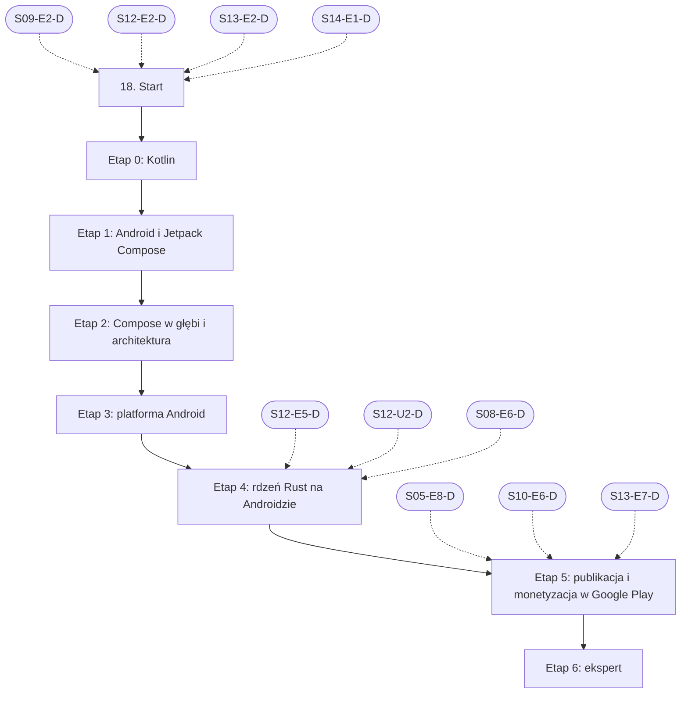

# 18. Android: plan wdrożenia w Linear

Team **LEA** (https://linear.app/daankh/team/LEA/overview). Plan jest wdrożony w Linear. Klucze zadań (np. `S18-E0-M1`) są robocze, a identyfikator każdego zadania w Linear (`LEA-…`) jest w kolumnie „Linear” tabel zadań i w pliku `mapowanie-kluczy.csv`.

**W skrócie:** 7 kamieni milowych, 58 zadań (1 start, 47 materiałów, 7 dowodów, 3 praktyki). Plik główny z kolejnością projektów: `00-kolejnosc-i-zaleznosci.md`.

## 1. Projekt

| Pole | Wartość |
|---|---|
| Nazwa | 18. Android |
| Team | LEA |
| Podsumowanie (pole „Summary”) | Warstwa 6: mobile. Opiera się na: 9, 12, 13 i 14; etapy rdzenia i publikacji także na 5, 8 i 10. Jest podstawą: etapu AI na urządzeniach mobilnych w 21. |
| Etykiety projektu | `warstwa-6` |
| Blokowany przez (projekty) | 09. DevOps, CI/CD i wydania, 12. Rust jako wspólny fundament, 13. UI/UX, 14. Desktop: wspólne |
| Blokuje (projekty) | — |
| Zależności częściowe (wchodzące) | etap 4 czeka na 12. Rust jako wspólny fundament (etap 5); etap 4 czeka na 12. Rust jako wspólny fundament (ścieżka uzupełniająca, etap 2); etap 4 czeka na 08. Architektura i projektowanie systemów (etap 6); etap 5 czeka na 05. Backend i API (etap 8); etap 5 czeka na 10. Bezpieczeństwo (etap 6); etap 5 czeka na 13. UI/UX (etap 7) |
| Zależności częściowe (wychodzące) | 21. Funkcje AI w aplikacjach, etap 2 |

### Opis projektu (do wklejenia w Linear)

*Warstwa 6: mobile. Opiera się na: 9, 12, 13 i 14; etapy rdzenia i publikacji także na 5, 8 i 10. Jest podstawą: etapu AI na urządzeniach mobilnych w 21.*

**Zakres umiejętności**

- Kotlin, Jetpack Compose, cykl życia aktywności i procesów, WorkManager, uprawnienia.
- Gradle, Android SDK i NDK, targety ABI, budowanie biblioteki Rust (`cargo-ndk`) i wiązania UniFFI.
- Alternatywnie Tauri 2 na Androidzie: ograniczenia webview i pluginy natywne; wybór technologii opisany w ADR.
- Powiadomienia push (Firebase Cloud Messaging), App Links, dostępność (TalkBack, Accessibility Scanner).
- Diagnoza wydajności i wycieków pamięci: Perfetto, profilery Android Studio, LeakCanary.
- Android App Bundle, podpisywanie (Play App Signing), Play Console, ścieżki testowe, wymagania docelowego poziomu API.
- Google Play Billing (abonamenty, zakup jednorazowy), polityki sklepu, sekcja bezpieczeństwa danych.
- Bezpieczne przechowywanie: Android Keystore i szyfrowane magazyny danych.

**Ścieżka nauki**

Ścieżka ma 7 etapów. Każdy kończy się **dowodem**, czyli małym projektem, który pokazuje, że etap jest opanowany. Przy doświadczeniu seniorskim w TypeScript, React i Rust etap 0 można zaliczyć samym dowodem (Kotlin jest bliski obu językom), a etap 1 jest zawężony do jednostek 4–7 kursu „Android Basics with Compose”, bo model Compose odpowiada Reactowi. Etapy 4 i 5 są obowiązkowe w całości: to w nich powstaje rdzeń Rust na Androidzie i przychód. Ceny materiałów płatnych zmieniają się, więc warto je sprawdzić przed zakupem.

**Definicja ukończenia projektu (dowód poziomu E)**

Samodzielnie, bez agenta, w 1 dzień diagnozujesz i naprawiasz ANR, wyciek pamięci albo błąd zakupów w aplikacji z rdzeniem Rust, korzystając z Perfetto, profilera Android Studio i logów RTDN, i umiesz wyjaśnić przyczynę osobie nietechnicznej.

**Źródło:** dokument „Umiejętności techniczne” w projekcie „JDG: Rozwój oprogramowania”, sekcja 18.

## 2. Kamienie milowe

Jeden kamień milowy na etap ścieżki. Kamień milowy jest zamknięty, gdy zamknięte jest zadanie dowodu tego etapu.

| # | Kamień milowy | Cel | Poziom po etapie | Zadania |
|---|---|---|---|---|
| 1 | Etap 0: Kotlin | Kotlin i korutyny | podstawy | 5 |
| 2 | Etap 1: Android i Jetpack Compose | pierwsze aplikacje: Android i Jetpack Compose | podstawy | 3 |
| 3 | Etap 2: Compose w głębi i architektura | Compose w głębi i architektura aplikacji | W | 8 |
| 4 | Etap 3: platforma Android | platforma: procesy, praca w tle, uprawnienia, dane, Keystore | W | 9 |
| 5 | Etap 4: rdzeń Rust na Androidzie | rdzeń Rust: UniFFI, `cargo-ndk`, alternatywnie Tauri 2 | E | 9 |
| 6 | Etap 5: publikacja i monetyzacja w Google Play | publikacja i monetyzacja w Google Play | E | 12 |
| 7 | Etap 6: ekspert | ekspert: wydajność, mechanizmy wewnętrzne, recenzja kodu AI, aktualność | E | 11 |

## 3. Punkt startu

Zadanie **`S18-START` · Start: 18. Android** (LEA-358 w Linear) to jedyne wejście do projektu: wszystkie zadania pierwszego etapu są przez nie blokowane.

- **Blokowane przez:** `S09-E2-D`, `S12-E2-D`, `S13-E2-D`, `S14-E1-D`
- **Odblokowuje:** `S18-E0-M1`, `S18-E0-M2`, `S18-E0-M3`, `S18-E0-M4`
- **Status początkowy:** Backlog do czasu zamknięcia zadań blokujących, potem Todo

Opis zadania (do wklejenia):

Punkt startu projektu „18. Android”.

**Warunki wejścia (zadania blokujące):**

- `S09-E2-D` · Dowód etapu 2: GitHub Actions i bezpieczeństwo pipeline’u — sekcja 9 na poziomie podstawowym do pracy (etap 2)
- `S12-E2-D` · Dowód etapu 2: własność, pożyczanie, czasy życia — sekcja 12 na poziomie podstawowym do pracy (etap 2)
- `S13-E2-D` · Dowód etapu 2: badania i testy użyteczności — sekcja 13 na poziomie podstawowym do pracy (etap 2)
- `S14-E1-D` · Dowód etapu 1: Tauri 2 — sekcja 14 na poziomie podstawowym do pracy (etap 1)

**Do zrobienia:**

- przeczytać sekcję 18 dokumentu „Umiejętności techniczne”,
- zaznaczyć etapy, które zaliczasz samym dowodem (zgodnie z akapitem wstępnym ścieżki), i dla nich zamknąć zadania materiałów jako niepotrzebne.

**Folder roboczy:** `18-android/`

## 4. Przepływ zależności

Linie ciągłe to zależności wewnątrz projektu, przerywane to zadania z innych projektów. Wewnątrz etapu zadania materiałów są równoległe i wszystkie blokują dowód etapu; dowód etapu blokuje materiały kolejnego etapu.

## 5. Zadania według kamieni milowych

Szablon opisu zadania materiału: nazwa materiału, autor lub wydawca, typ, czas, koszt i link (jak w kolumnach poniżej), zdanie „Gotowe, gdy materiał jest przerobiony w zakresie potrzebnym do dowodu etapu” oraz folder roboczy z kolumny „Folder”. Opisy dowodów i praktyk są podane pod tabelą każdego etapu.

### Etap 0: Kotlin

Opis kamienia milowego (do wklejenia):

**Cel:** Kotlin i korutyny · **Poziom po etapie:** podstawy

**Szczególnie ważne:** null safety, klasy `data` i `sealed`, funkcje rozszerzające, lambdy z odbiorcą, korutyny strukturalne, anulowanie, `Flow` i `StateFlow`, różnice wobec `async`/`await` w TypeScript i Tokio w Ruście.

**Dowód:** Narzędzie konsolowe w Kotlinie pobierające dane z publicznego API przez korutyny, z anulowaniem po przekroczeniu czasu, wynikami jako `sealed` hierarchią i testami jednostkowymi.

| Klucz | Linear | Tytuł | Typ | Czas | Koszt | Link | Blokowane przez | Blokuje | Folder |
|---|---|---|---|---|---|---|---|---|---|
| `S18-E0-M1` | LEA-371 | Przerobić: Kotlin tour i dokumentacja języka | materiał | 10–15 h | 0 zł | https://kotlinlang.org/docs/kotlin-tour-welcome.html, https://kotlinlang.org/docs/home.html | `S18-START` | `S18-E0-D` | `18-android/e0-kotlin/` |
| `S18-E0-M2` | LEA-372 | Przerobić: Kotlin Koans | materiał | 6–8 h | 0 zł | https://play.kotlinlang.org/koans | `S18-START` | `S18-E0-D` | `18-android/e0-kotlin/` |
| `S18-E0-M3` | LEA-373 | Przerobić: Kotlin in Action (wydanie 2, 2024) | materiał, płatny, opcjonalne | 20–25 h | płatna | https://www.manning.com/books/kotlin-in-action-second-edition | `S18-START` | — | `18-android/e0-kotlin/` |
| `S18-E0-M4` | LEA-374 | Przerobić: Coroutines guide | materiał | 6–8 h | 0 zł | https://kotlinlang.org/docs/coroutines-guide.html | `S18-START` | `S18-E0-D` | `18-android/e0-kotlin/` |
| `S18-E0-D` | LEA-404 | Dowód etapu 0: Kotlin | dowód | — | — | — | `S18-E0-M1`, `S18-E0-M2`, `S18-E0-M4` | `S18-E1-M1`, `S18-E1-M2` | `18-android/e0-kotlin/` |

**`S18-E0-D` · Dowód etapu 0: Kotlin**

Narzędzie konsolowe w Kotlinie pobierające dane z publicznego API przez korutyny, z anulowaniem po przekroczeniu czasu, wynikami jako `sealed` hierarchią i testami jednostkowymi.

**Na co zwrócić uwagę:** null safety, klasy `data` i `sealed`, funkcje rozszerzające, lambdy z odbiorcą, korutyny strukturalne, anulowanie, `Flow` i `StateFlow`, różnice wobec `async`/`await` w TypeScript i Tokio w Ruście.

**Kryterium ukończenia:** dowód wykonany samodzielnie; w komentarzu link do repozytorium, raportu lub notatki.

**Folder roboczy:** `18-android/e0-kotlin/`

### Etap 1: Android i Jetpack Compose

Opis kamienia milowego (do wklejenia):

**Cel:** pierwsze aplikacje: Android i Jetpack Compose · **Poziom po etapie:** podstawy

**Szczególnie ważne:** rekompozycja i `remember`, wynoszenie stanu (state hoisting), `ViewModel`, nawigacja, różnice między efektami w Compose a `useEffect` w React.

Jednostki 1–3 kursu (pierwsza aplikacja, układ UI, listy i Material) tylko przy starcie bez doświadczenia z deklaratywnym UI; przy znajomości Reacta wystarczy dokumentacja „Thinking in Compose”.

**Dowód:** Aplikacja offline-first z listą, edycją i wyszukiwaniem (np. notatki lub nawyki), z danymi w Room, odświeżaniem z sieci i obsługą obrotu ekranu bez utraty stanu.

| Klucz | Linear | Tytuł | Typ | Czas | Koszt | Link | Blokowane przez | Blokuje | Folder |
|---|---|---|---|---|---|---|---|---|---|
| `S18-E1-M1` | LEA-407 | Przerobić: Android Basics with Compose, jednostki 4–7 (nawigacja i architektura, sieć, Room, WorkManager) | materiał | 25–35 h | 0 zł | https://developer.android.com/courses/android-basics-compose/course | `S18-E0-D` | `S18-E1-D` | `18-android/e1-android-i-jetpack-compose/` |
| `S18-E1-M2` | LEA-408 | Przerobić: Dokumentacja Jetpack Compose: „Thinking in Compose”, stan, efekty uboczne, Material 3 | materiał | 6–8 h | 0 zł | https://developer.android.com/develop/ui/compose/documentation | `S18-E0-D` | `S18-E1-D` | `18-android/e1-android-i-jetpack-compose/` |
| `S18-E1-D` | LEA-435 | Dowód etapu 1: Android i Jetpack Compose | dowód | — | — | — | `S18-E1-M1`, `S18-E1-M2` | `S18-E2-M1`, `S18-E2-M2`, `S18-E2-M3`, `S18-E2-M4`, `S18-E2-M5`, `S18-E2-M6`, `S18-E2-M7` | `18-android/e1-android-i-jetpack-compose/` |

**`S18-E1-D` · Dowód etapu 1: Android i Jetpack Compose**

Aplikacja offline-first z listą, edycją i wyszukiwaniem (np. notatki lub nawyki), z danymi w Room, odświeżaniem z sieci i obsługą obrotu ekranu bez utraty stanu.

**Na co zwrócić uwagę:** rekompozycja i `remember`, wynoszenie stanu (state hoisting), `ViewModel`, nawigacja, różnice między efektami w Compose a `useEffect` w React.

**Kryterium ukończenia:** dowód wykonany samodzielnie; w komentarzu link do repozytorium, raportu lub notatki.

**Folder roboczy:** `18-android/e1-android-i-jetpack-compose/`

### Etap 2: Compose w głębi i architektura

Opis kamienia milowego (do wklejenia):

**Cel:** Compose w głębi i architektura aplikacji · **Poziom po etapie:** W

**Szczególnie ważne:** wstrzykiwanie dispatcherów i zakresów, zakresy komponentów Hilt (`SingletonComponent`, `ViewModelComponent`), niemutowalny stan UI, układy adaptacyjne (telefon, tablet, składane), modularyzacja Gradle, katalog wersji i Compose BOM.

**Dowód:** Aplikacja z etapu 1 przebudowana na warstwy (UI, dane, opcjonalnie domena) i co najmniej 3 moduły Gradle, z `StateFlow` jako jedynym źródłem stanu ekranu, zależnościami (repozytoria, dispatchery) dostarczanymi przez Hilt, układem list–szczegóły na tablecie i testami `ViewModel` z `runTest` (zob. sekcja 6), w których repozytorium jest podmienione przez `@TestInstallIn` lub ręcznie wstrzyknięty fałszywy obiekt.

| Klucz | Linear | Tytuł | Typ | Czas | Koszt | Link | Blokowane przez | Blokuje | Folder |
|---|---|---|---|---|---|---|---|---|---|
| `S18-E2-M1` | LEA-441 | Przerobić: Guide to app architecture: warstwy UI i danych, jedno źródło prawdy, przepływ jednokierunkowy | materiał | 6–8 h | 0 zł | https://developer.android.com/topic/architecture | `S18-E1-D` | `S18-E2-D` | `18-android/e2-compose-w-glebi-i-architektura/` |
| `S18-E2-M2` | LEA-442 | Przerobić: Dependency injection with Hilt (moduły, zakresy, `@HiltViewModel`, podmiana zależności w testach) | materiał | 4–6 h | 0 zł | https://developer.android.com/training/dependency-injection/hilt-android | `S18-E1-D` | `S18-E2-D` | `18-android/e2-compose-w-glebi-i-architektura/` |
| `S18-E2-M3` | LEA-443 | Przerobić: Now in Android (z dokumentami „Architecture Learning Journey” i „Modularization Learning Journey”) | materiał | 10–15 h | 0 zł | https://github.com/android/nowinandroid | `S18-E1-D` | `S18-E2-D` | `18-android/e2-compose-w-glebi-i-architektura/` |
| `S18-E2-M4` | LEA-444 | Przerobić: Best practices for coroutines in Android | materiał | 2–3 h | 0 zł | https://developer.android.com/kotlin/coroutines/coroutines-best-practices | `S18-E1-D` | `S18-E2-D` | `18-android/e2-compose-w-glebi-i-architektura/` |
| `S18-E2-M5` | LEA-446 | Przerobić: Jetpack Compose for Android Developers… | materiał, opcjonalne | 15–20 h | 0 zł | https://developer.android.com/courses/jetpack-compose/course | `S18-E1-D` | — | `18-android/e2-compose-w-glebi-i-architektura/` |
| `S18-E2-M6` | LEA-447 | Przerobić: Kotlin Coroutines: Deep Dive | materiał, płatny | 12–15 h | płatna | https://leanpub.com/coroutines | `S18-E1-D` | `S18-E2-D` | `18-android/e2-compose-w-glebi-i-architektura/` |
| `S18-E2-M7` | LEA-450 | Przerobić: Effective Kotlin | materiał, płatny, opcjonalne | 10–12 h | płatna | https://kt.academy/book/effectivekotlin | `S18-E1-D` | — | `18-android/e2-compose-w-glebi-i-architektura/` |
| `S18-E2-D` | LEA-480 | Dowód etapu 2: Compose w głębi i architektura | dowód | — | — | — | `S18-E2-M1`, `S18-E2-M2`, `S18-E2-M3`, `S18-E2-M4`, `S18-E2-M6` | `S18-E3-M1`, `S18-E3-M2`, `S18-E3-M3`, `S18-E3-M4`, `S18-E3-M5`, `S18-E3-M6`, `S18-E3-M7`, `S18-E3-M8`, `S21-E2-M1`, `S21-E2-M2`, `S21-E2-M3`, `S21-E2-M4` | `18-android/e2-compose-w-glebi-i-architektura/` |

**`S18-E2-D` · Dowód etapu 2: Compose w głębi i architektura**

Aplikacja z etapu 1 przebudowana na warstwy (UI, dane, opcjonalnie domena) i co najmniej 3 moduły Gradle, z `StateFlow` jako jedynym źródłem stanu ekranu, zależnościami (repozytoria, dispatchery) dostarczanymi przez Hilt, układem list–szczegóły na tablecie i testami `ViewModel` z `runTest` (zob. sekcja 6), w których repozytorium jest podmienione przez `@TestInstallIn` lub ręcznie wstrzyknięty fałszywy obiekt.

**Na co zwrócić uwagę:** wstrzykiwanie dispatcherów i zakresów, zakresy komponentów Hilt (`SingletonComponent`, `ViewModelComponent`), niemutowalny stan UI, układy adaptacyjne (telefon, tablet, składane), modularyzacja Gradle, katalog wersji i Compose BOM.

**Kryterium ukończenia:** aplikacja buduje się z co najmniej 3 modułów, `ViewModel` nie tworzy zależności samodzielnie, testy `ViewModel` przechodzą w CI, układ list–szczegóły działa na emulatorze tabletu; link do repozytorium w komentarzu.

**Folder roboczy:** `18-android/e2-compose-w-glebi-i-architektura/`

### Etap 3: platforma Android

Opis kamienia milowego (do wklejenia):

**Cel:** platforma: procesy, praca w tle, uprawnienia, dane, Keystore · **Poziom po etapie:** W

**Szczególnie ważne:** system może zabić proces w każdej chwili, `onDestroy()` nie jest gwarantowane, ograniczenia pracy w tle i trybu Doze, jednorazowe i automatycznie cofane uprawnienia, prośba o `POST_NOTIFICATIONS` w kontekście, klucze sprzętowe (TEE, StrongBox) i uwierzytelnianie biometryczne, weryfikacja App Links, wymagania MASVS sprawdzane testami MASTG.

**Dowód:** Synchronizacja danych aplikacji przez `CoroutineWorker` z ograniczeniami sieci i baterii, przeżywająca ubicie procesu i restart urządzenia; token sesji zaszyfrowany kluczem z Android Keystore; funkcja wymagająca uprawnienia działa w trybie ograniczonym po odmowie. Powiadomienie push wysłane przez FCM HTTP v1 otwiera konkretny ekran przez App Link zweryfikowany dla własnej domeny. Raport z weryfikacji co najmniej 6 wymagań MASVS (po jednym z grup STORAGE, CRYPTO, AUTH, NETWORK, PLATFORM i RESILIENCE lub CODE) testami z MASTG, z wynikiem i dowodem dla każdego.

| Klucz | Linear | Tytuł | Typ | Czas | Koszt | Link | Blokowane przez | Blokuje | Folder |
|---|---|---|---|---|---|---|---|---|---|
| `S18-E3-M1` | LEA-508 | Przerobić: Processes and app lifecycle | materiał | 2–3 h | 0 zł | https://developer.android.com/guide/components/activities/process-lifecycle | `S18-E2-D` | `S18-E3-D` | `18-android/e3-platforma-android/` |
| `S18-E3-M2` | LEA-510 | Przerobić: WorkManager: trwała praca w tle | materiał | 4–6 h | 0 zł | https://developer.android.com/develop/background-work/background-tasks/persistent | `S18-E2-D` | `S18-E3-D` | `18-android/e3-platforma-android/` |
| `S18-E3-M3` | LEA-511 | Przerobić: Request runtime permissions | materiał | 2–3 h | 0 zł | https://developer.android.com/training/permissions/requesting | `S18-E2-D` | `S18-E3-D` | `18-android/e3-platforma-android/` |
| `S18-E3-M4` | LEA-512 | Przerobić: Room (od wersji 3.0 pakiet `androidx.room3`, wymaga KSP) | materiał | 4–6 h | 0 zł | https://developer.android.com/training/data-storage/room | `S18-E2-D` | `S18-E3-D` | `18-android/e3-platforma-android/` |
| `S18-E3-M5` | LEA-513 | Przerobić: Android Keystore system | materiał | 3–4 h | 0 zł | https://developer.android.com/privacy-and-security/keystore | `S18-E2-D` | `S18-E3-D` | `18-android/e3-platforma-android/` |
| `S18-E3-M6` | LEA-514 | Przerobić: Firebase Cloud Messaging na Androidzie… | materiał | 4–6 h | 0 zł | https://firebase.google.com/docs/cloud-messaging/android/client, https://developer.android.com/develop/ui/views/notifications/notification-permission | `S18-E2-D` | `S18-E3-D` | `18-android/e3-platforma-android/` |
| `S18-E3-M7` | LEA-515 | Przerobić: Android App Links (plik `assetlinks.json`, weryfikacja domeny, obsługa w nawigacji Compose) | materiał | 2–3 h | 0 zł | https://developer.android.com/training/app-links | `S18-E2-D` | `S18-E3-D` | `18-android/e3-platforma-android/` |
| `S18-E3-M8` | LEA-516 | Przerobić: OWASP MASVS, MASWE i MASTG (część ogólna i testy dla Androida) | materiał | 12–15 h | 0 zł | https://mas.owasp.org | `S18-E2-D` | `S18-E3-D` | `18-android/e3-platforma-android/` |
| `S18-E3-D` | LEA-540 | Dowód etapu 3: platforma Android | dowód | — | — | — | `S18-E3-M1`, `S18-E3-M2`, `S18-E3-M3`, `S18-E3-M4`, `S18-E3-M5`, `S18-E3-M6`, `S18-E3-M7`, `S18-E3-M8` | `S18-E4-M1`, `S18-E4-M2`, `S18-E4-M3`, `S18-E4-M4`, `S18-E4-M5`, `S18-E4-M6`, `S18-E4-M7`, `S18-E4-M8` | `18-android/e3-platforma-android/` |

**`S18-E3-D` · Dowód etapu 3: platforma Android**

Synchronizacja danych aplikacji przez `CoroutineWorker` z ograniczeniami sieci i baterii, przeżywająca ubicie procesu i restart urządzenia; token sesji zaszyfrowany kluczem z Android Keystore; funkcja wymagająca uprawnienia działa w trybie ograniczonym po odmowie. Powiadomienie push wysłane przez FCM HTTP v1 otwiera konkretny ekran przez App Link zweryfikowany dla własnej domeny. Raport z weryfikacji co najmniej 6 wymagań MASVS (po jednym z grup STORAGE, CRYPTO, AUTH, NETWORK, PLATFORM i RESILIENCE lub CODE) testami z MASTG, z wynikiem i dowodem dla każdego.

**Na co zwrócić uwagę:** system może zabić proces w każdej chwili, `onDestroy()` nie jest gwarantowane, ograniczenia pracy w tle i trybu Doze, jednorazowe i automatycznie cofane uprawnienia, prośba o `POST_NOTIFICATIONS` w kontekście, klucze sprzętowe (TEE, StrongBox) i uwierzytelnianie biometryczne, weryfikacja App Links, wymagania MASVS sprawdzane testami MASTG.

**Kryterium ukończenia:** synchronizacja wznawia się po `adb shell am kill` i restarcie emulatora; `adb shell pm get-app-links` pokazuje domenę jako `verified`; kliknięcie powiadomienia otwiera właściwy ekran; raport MASVS ma co najmniej 6 wymagań z wynikiem „spełnione” albo z opisaną poprawką; link do repozytorium i raportu w komentarzu.

**Folder roboczy:** `18-android/e3-platforma-android/`

### Etap 4: rdzeń Rust na Androidzie

Opis kamienia milowego (do wklejenia):

**Cel:** rdzeń Rust: UniFFI, `cargo-ndk`, alternatywnie Tauri 2 · **Poziom po etapie:** E

**Szczególnie ważne:** granica FFI jako kontrakt (błędy Rust zamienione na wyjątki Kotlina, brak paniki przez granicę), wątki Rust wywołujące Kotlina, async po obu stronach, rozmiar `.so` na każde ABI, wyrównanie bibliotek do stron 16 KB (blokada aktualizacji w Google Play bez tego wsparcia od 1 lutego 2027 r.), wersjonowanie rdzenia wspólnego z iOS i desktopem. Opcjonalnie Gobley (https://gobley.dev) przy projekcie Kotlin Multiplatform. W ADR uczciwie porównaj koszt pluginów natywnych w Tauri i Kotlin Multiplatform z kosztem dwóch natywnych UI.

**Dowód:** Crate z rdzeniem z projektu z sekcji 12 (model danych, walidacja, logika licencji i synchronizacji; ten sam dla desktopu i iOS) używany przez aplikację z etapu 3 przez wiązania UniFFI, budowany w Gradle dla `arm64-v8a` i `x86_64`; błąd z Rusta obsłużony w UI jako wyjątek Kotlina; biblioteka `.so` zweryfikowana pod kątem wyrównania 16 KB. Rdzeń wchodzi do SBOM aplikacji (zob. sekcja 10). Do tego ADR: natywny Compose z rdzeniem Rust przez UniFFI vs Tauri 2 mobile vs Kotlin Multiplatform, oceniony według co najmniej 5 kryteriów (dostęp do API platformy, rozmiar AAB, czas zimnego startu, ilość kodu współdzielonego z iOS i desktopem, koszt utrzymania i dojrzałość narzędzi), z pomiarami rozmiaru i zimnego startu dla minimalnego prototypu Tauri 2 z tym samym crate’em.

| Klucz | Linear | Tytuł | Typ | Czas | Koszt | Link | Blokowane przez | Blokuje | Folder |
|---|---|---|---|---|---|---|---|---|---|
| `S18-E4-M1` | LEA-557 | Przerobić: The UniFFI user guide: model typów, proc-macros, async, interfejsy zwrotne, rozdziały Kotlin i… | materiał | 8–10 h | 0 zł | https://mozilla.github.io/uniffi-rs/latest/ | `S18-E3-D`, `S12-E5-D`, `S12-U2-D`, `S08-E6-D` | `S18-E4-D` | `18-android/e4-rdzen-rust-na-androidzie/` |
| `S18-E4-M2` | LEA-558 | Przerobić: `cargo-ndk` | materiał | 1–2 h | 0 zł | https://github.com/bbqsrc/cargo-ndk | `S18-E3-D`, `S12-E5-D`, `S12-U2-D`, `S08-E6-D` | `S18-E4-D` | `18-android/e4-rdzen-rust-na-androidzie/` |
| `S18-E4-M3` | LEA-559 | Przerobić: JNI tips (wątki, `JNIEnv`, ładowanie bibliotek, `UnsatisfiedLinkError`) | materiał | 2–3 h | 0 zł | https://developer.android.com/ndk/guides/jni-tips | `S18-E3-D`, `S12-E5-D`, `S12-U2-D`, `S08-E6-D` | `S18-E4-D` | `18-android/e4-rdzen-rust-na-androidzie/` |
| `S18-E4-M4` | LEA-561 | Przerobić: Support 16 KB page sizes | materiał | 1–2 h | 0 zł | https://developer.android.com/guide/practices/page-sizes | `S18-E3-D`, `S12-E5-D`, `S12-U2-D`, `S08-E6-D` | `S18-E4-D` | `18-android/e4-rdzen-rust-na-androidzie/` |
| `S18-E4-M5` | LEA-563 | Przerobić: uniffi-starter (rdzeń Rust, Gradle z `cargo-ndk`, Swift Package) | materiał | 3–4 h | 0 zł | https://github.com/ianthetechie/uniffi-starter | `S18-E3-D`, `S12-E5-D`, `S12-U2-D`, `S08-E6-D` | `S18-E4-D` | `18-android/e4-rdzen-rust-na-androidzie/` |
| `S18-E4-M6` | LEA-566 | Przerobić: application-services (komponenty Firefoksa współdzielone przez UniFFI z Androidem i iOS) | materiał | 3–5 h | 0 zł | https://github.com/mozilla/application-services | `S18-E3-D`, `S12-E5-D`, `S12-U2-D`, `S08-E6-D` | `S18-E4-D` | `18-android/e4-rdzen-rust-na-androidzie/` |
| `S18-E4-M7` | LEA-569 | Przerobić: Tauri 2 na Androidzie: wymagania (SDK, NDK, targety `rustup`) i pluginy mobilne w Kotlinie | materiał | 6–8 h | 0 zł | https://v2.tauri.app/start/prerequisites/, https://v2.tauri.app/develop/plugins/develop-mobile/ | `S18-E3-D`, `S12-E5-D`, `S12-U2-D`, `S08-E6-D` | `S18-E4-D` | `18-android/e4-rdzen-rust-na-androidzie/` |
| `S18-E4-M8` | LEA-571 | Przerobić: Kotlin Multiplatform i Compose Multiplatform: przegląd, współdzielenie logiki z iOS | materiał | 2–3 h | 0 zł | https://kotlinlang.org/docs/multiplatform.html, https://www.jetbrains.com/compose-multiplatform/ | `S18-E3-D`, `S12-E5-D`, `S12-U2-D`, `S08-E6-D` | `S18-E4-D` | `18-android/e4-rdzen-rust-na-androidzie/` |
| `S18-E4-D` | LEA-589 | Dowód etapu 4: rdzeń Rust na Androidzie | dowód | — | — | — | `S18-E4-M1`, `S18-E4-M2`, `S18-E4-M3`, `S18-E4-M4`, `S18-E4-M5`, `S18-E4-M6`, `S18-E4-M7`, `S18-E4-M8` | `S18-E5-M1`, `S18-E5-M2`, `S18-E5-M3`, `S18-E5-M4`, `S18-E5-M5`, `S18-E5-M6`, `S18-E5-M7`, `S18-E5-M8`, `S18-E5-M9`, `S18-E5-M10`, `S18-E5-M11` | `18-android/e4-rdzen-rust-na-androidzie/` |

**`S18-E4-D` · Dowód etapu 4: rdzeń Rust na Androidzie**

Crate z rdzeniem z projektu z sekcji 12 (model danych, walidacja, logika licencji i synchronizacji; ten sam dla desktopu i iOS) używany przez aplikację z etapu 3 przez wiązania UniFFI, budowany w Gradle dla `arm64-v8a` i `x86_64`; błąd z Rusta obsłużony w UI jako wyjątek Kotlina; biblioteka `.so` zweryfikowana pod kątem wyrównania 16 KB. Rdzeń wchodzi do SBOM aplikacji (zob. sekcja 10). Do tego ADR: natywny Compose z rdzeniem Rust przez UniFFI vs Tauri 2 mobile vs Kotlin Multiplatform, oceniony według co najmniej 5 kryteriów (dostęp do API platformy, rozmiar AAB, czas zimnego startu, ilość kodu współdzielonego z iOS i desktopem, koszt utrzymania i dojrzałość narzędzi), z pomiarami rozmiaru i zimnego startu dla minimalnego prototypu Tauri 2 z tym samym crate’em.

**Na co zwrócić uwagę:** granica FFI jako kontrakt (błędy Rust zamienione na wyjątki Kotlina, brak paniki przez granicę), wątki Rust wywołujące Kotlina, async po obu stronach, rozmiar `.so` na każde ABI, wyrównanie bibliotek do stron 16 KB (blokada aktualizacji w Google Play bez tego wsparcia od 1 lutego 2027 r.), wersjonowanie rdzenia wspólnego z iOS i desktopem. Opcjonalnie Gobley (https://gobley.dev) przy projekcie Kotlin Multiplatform. W ADR uczciwie porównaj koszt pluginów natywnych w Tauri i Kotlin Multiplatform z kosztem dwóch natywnych UI.

**Kryterium ukończenia:** wiązania generują się w buildzie Gradle bez ręcznych kroków; test UI potwierdza obsługę błędu z Rusta; `zipalign -c -P 16` lub kontrola APK Analyzer przechodzi dla obu ABI; ADR ma tabelę kryteriów, pomiary obu prototypów i decyzję z uzasadnieniem; link do repozytorium i ADR w komentarzu.

**Folder roboczy:** `18-android/e4-rdzen-rust-na-androidzie/`

### Etap 5: publikacja i monetyzacja w Google Play

Opis kamienia milowego (do wklejenia):

**Cel:** publikacja i monetyzacja w Google Play · **Poziom po etapie:** E

**Szczególnie ważne:** potwierdzenie zakupu w ciągu 3 dni (inaczej automatyczny zwrot), uprawnienia przyznawane dopiero po weryfikacji tokenu na serwerze, stany abonamentu (okres karencji, wstrzymanie, odzyskanie), zgodność ekranu zakupu z polityką i prawem konsumenckim (zob. sekcja 13), automatyzacja wydań przez API Google Play (zob. sekcja 9).

**Dowód:** Aplikacja z rdzeniem Rust opublikowana w Google Play po teście zamkniętym, z abonamentem i zakupem jednorazowym; backend w Rust (Axum, zob. sekcja 5) weryfikuje tokeny, odbiera RTDN przez Pub/Sub i jest jedynym źródłem uprawnień; sekcja bezpieczeństwa danych zgodna z faktycznym przetwarzaniem; proces zgłaszania podatności zgodny z CRA opisany na stronie produktu. Przed wydaniem: onboarding, ekran zakupu i anulowanie abonamentu przechodzą test z TalkBack i Accessibility Scanner, a ekran zakupu przechodzi przegląd z listą kontrolną zasad Google Play dotyczących abonamentów (mobilna część dowodów dostępności i paywalli z sekcji 13).

| Klucz | Linear | Tytuł | Typ | Czas | Koszt | Link | Blokowane przez | Blokuje | Folder |
|---|---|---|---|---|---|---|---|---|---|
| `S18-E5-M1` | LEA-624 | Przerobić: Play Console Help: konto dewelopera, ścieżki testów, wymóg testu zamkniętego… | materiał | 4–6 h | 0 zł | https://support.google.com/googleplay/android-developer/answer/14151465 | `S18-E4-D`, `S05-E8-D`, `S10-E6-D`, `S13-E7-D` | `S18-E5-D` | `18-android/e5-publikacja-i-monetyzacja-w-google-play/` |
| `S18-E5-M2` | LEA-625 | Przerobić: Android App Bundle, Play App Signing (klucz podpisu i klucz przesyłania) | materiał | 2–3 h | 0 zł | https://developer.android.com/guide/app-bundle, https://developer.android.com/studio/publish/app-signing | `S18-E4-D`, `S05-E8-D`, `S10-E6-D`, `S13-E7-D` | `S18-E5-D` | `18-android/e5-publikacja-i-monetyzacja-w-google-play/` |
| `S18-E5-M3` | LEA-626 | Przerobić: Wymagania docelowego API… | materiał | 1 h | 0 zł | https://developer.android.com/google/play/requirements/target-sdk | `S18-E4-D`, `S05-E8-D`, `S10-E6-D`, `S13-E7-D` | `S18-E5-D` | `18-android/e5-publikacja-i-monetyzacja-w-google-play/` |
| `S18-E5-M4` | LEA-627 | Przerobić: Google Play Billing: integracja, abonamenty, produkty jednorazowe, aktualna wersja Billing… | materiał | 8–10 h | 0 zł | https://developer.android.com/google/play/billing | `S18-E4-D`, `S05-E8-D`, `S10-E6-D`, `S13-E7-D` | `S18-E5-D` | `18-android/e5-publikacja-i-monetyzacja-w-google-play/` |
| `S18-E5-M5` | LEA-628 | Przerobić: Real-time developer notifications (RTDN) i weryfikacja zakupów na serwerze | materiał | 3–4 h | 0 zł | https://developer.android.com/google/play/billing/rtdn-reference | `S18-E4-D`, `S05-E8-D`, `S10-E6-D`, `S13-E7-D` | `S18-E5-D` | `18-android/e5-publikacja-i-monetyzacja-w-google-play/` |
| `S18-E5-M6` | LEA-629 | Przerobić: Play Integrity API | materiał | 2–3 h | 0 zł | https://developer.android.com/google/play/integrity | `S18-E4-D`, `S05-E8-D`, `S10-E6-D`, `S13-E7-D` | `S18-E5-D` | `18-android/e5-publikacja-i-monetyzacja-w-google-play/` |
| `S18-E5-M7` | LEA-630 | Przerobić: Polityki programu dla deweloperów, sekcja bezpieczeństwa danych, weryfikacja deweloperów Androida | materiał | 4–6 h | 0 zł | https://play.google/developer-content-policy/, https://support.google.com/googleplay/android-developer/answer/10787469, https://developer.android.com/developer-verification | `S18-E4-D`, `S05-E8-D`, `S10-E6-D`, `S13-E7-D` | `S18-E5-D` | `18-android/e5-publikacja-i-monetyzacja-w-google-play/` |
| `S18-E5-M8` | LEA-631 | Przerobić: Dostępność w Compose i testowanie dostępności (TalkBack, Accessibility Scanner, testy semantyki) | materiał | 4–6 h | 0 zł | https://developer.android.com/develop/ui/compose/accessibility, https://developer.android.com/guide/topics/ui/accessibility/testing | `S18-E4-D`, `S05-E8-D`, `S10-E6-D`, `S13-E7-D` | `S18-E5-D` | `18-android/e5-publikacja-i-monetyzacja-w-google-play/` |
| `S18-E5-M9` | LEA-650 | Przerobić: Zasady Google Play dotyczące abonamentów (przejrzystość oferty, okres próbny, anulowanie) | materiał | 1 h | 0 zł | https://support.google.com/googleplay/android-developer/answer/9900533 | `S18-E4-D`, `S05-E8-D`, `S10-E6-D`, `S13-E7-D` | `S18-E5-D` | `18-android/e5-publikacja-i-monetyzacja-w-google-play/` |
| `S18-E5-M10` | LEA-652 | Przerobić: Google Play Academy | materiał, opcjonalne | wg potrzeb | 0 zł | https://playacademy.withgoogle.com | `S18-E4-D`, `S05-E8-D`, `S10-E6-D`, `S13-E7-D` | — | `18-android/e5-publikacja-i-monetyzacja-w-google-play/` |
| `S18-E5-M11` | LEA-654 | Przerobić: Tauri 2: publikacja w Google Play (AAB, architektury) | materiał, opcjonalne | 1–2 h | 0 zł | https://v2.tauri.app/distribute/google-play/ | `S18-E4-D`, `S05-E8-D`, `S10-E6-D`, `S13-E7-D` | — | `18-android/e5-publikacja-i-monetyzacja-w-google-play/` |
| `S18-E5-D` | LEA-680 | Dowód etapu 5: publikacja i monetyzacja w Google Play | dowód | — | — | — | `S18-E5-M1`, `S18-E5-M2`, `S18-E5-M3`, `S18-E5-M4`, `S18-E5-M5`, `S18-E5-M6`, `S18-E5-M7`, `S18-E5-M8`, `S18-E5-M9` | `S18-E6-M1`, `S18-E6-M2`, `S18-E6-M3`, `S18-E6-M4`, `S18-E6-M5`, `S18-E6-M6`, `S18-E6-M7`, `S18-E6-P1`, `S18-E6-P2`, `S18-E6-P3` | `18-android/e5-publikacja-i-monetyzacja-w-google-play/` |

**`S18-E5-D` · Dowód etapu 5: publikacja i monetyzacja w Google Play**

Aplikacja z rdzeniem Rust opublikowana w Google Play po teście zamkniętym, z abonamentem i zakupem jednorazowym; backend w Rust (Axum, zob. sekcja 5) weryfikuje tokeny, odbiera RTDN przez Pub/Sub i jest jedynym źródłem uprawnień; sekcja bezpieczeństwa danych zgodna z faktycznym przetwarzaniem; proces zgłaszania podatności zgodny z CRA opisany na stronie produktu. Przed wydaniem: onboarding, ekran zakupu i anulowanie abonamentu przechodzą test z TalkBack i Accessibility Scanner, a ekran zakupu przechodzi przegląd z listą kontrolną zasad Google Play dotyczących abonamentów (mobilna część dowodów dostępności i paywalli z sekcji 13).

**Na co zwrócić uwagę:** potwierdzenie zakupu w ciągu 3 dni (inaczej automatyczny zwrot), uprawnienia przyznawane dopiero po weryfikacji tokenu na serwerze, stany abonamentu (okres karencji, wstrzymanie, odzyskanie), zgodność ekranu zakupu z polityką i prawem konsumenckim (zob. sekcja 13), automatyzacja wydań przez API Google Play (zob. sekcja 9).

**Kryterium ukończenia:** aplikacja jest dostępna w ścieżce produkcyjnej lub otwartej; test zakupu i anulowania na koncie testowym zmienia uprawnienia w backendzie w ciągu minuty od RTDN; 0 błędów Accessibility Scanner na trzech ekranach i pełna ścieżka zakupu wykonana z TalkBack; lista kontrolna paywalla (cena, okres rozliczenia, warunki próby, sposób anulowania widoczne przed zakupem) bez otwartych punktów; link do raportu w komentarzu.

**Folder roboczy:** `18-android/e5-publikacja-i-monetyzacja-w-google-play/`

### Etap 6: ekspert

Opis kamienia milowego (do wklejenia):

**Cel:** ekspert: wydajność, mechanizmy wewnętrzne, recenzja kodu AI, aktualność · **Poziom po etapie:** E

**Dowód poziomu E:** Samodzielnie, bez agenta, w 1 dzień diagnozujesz i naprawiasz ANR, wyciek pamięci albo błąd zakupów w aplikacji z rdzeniem Rust, korzystając z Perfetto, profilera Android Studio i logów RTDN, i umiesz wyjaśnić przyczynę osobie nietechnicznej.

| Klucz | Linear | Tytuł | Typ | Czas | Koszt | Link | Blokowane przez | Blokuje | Folder |
|---|---|---|---|---|---|---|---|---|---|
| `S18-E6-M1` | LEA-711 | Przerobić: Jetpack Compose Performance: fazy Compose, stabilność, strong skipping, raporty kompilatora Compose | materiał | 4–6 h | 0 zł | https://developer.android.com/develop/ui/compose/performance, https://developer.android.com/develop/ui/compose/performance/stability | `S18-E5-D` | `S18-E6-D` | `18-android/e6-ekspert/` |
| `S18-E6-M2` | LEA-712 | Przerobić: Baseline Profiles i Macrobenchmark | materiał | 6–8 h | 0 zł | https://developer.android.com/topic/performance/baselineprofiles/overview, https://developer.android.com/topic/performance/benchmarking/macrobenchmark-overview | `S18-E5-D` | `S18-E6-D` | `18-android/e6-ekspert/` |
| `S18-E6-M3` | LEA-713 | Przerobić: Android vitals (progi złego zachowania: awarie, ANR, pamięć) | materiał | 2–3 h | 0 zł | https://developer.android.com/topic/performance/vitals | `S18-E5-D` | `S18-E6-D` | `18-android/e6-ekspert/` |
| `S18-E6-M4` | LEA-714 | Przerobić: Perfetto i profilery Android Studio (śledzenie systemowe, CPU, pamięć, analiza ANR i zacięć) | materiał | 6–8 h | 0 zł | https://perfetto.dev/docs/, https://developer.android.com/studio/profile | `S18-E5-D` | `S18-E6-D` | `18-android/e6-ekspert/` |
| `S18-E6-M5` | LEA-715 | Przerobić: LeakCanary (wykrywanie wycieków pamięci, czytanie śladu wycieku) | materiał | 2–3 h | 0 zł | https://square.github.io/leakcanary/ | `S18-E5-D` | `S18-E6-D` | `18-android/e6-ekspert/` |
| `S18-E6-M6` | LEA-716 | Przerobić: Jetpack Compose Internals (wydanie z 2022 r.) | materiał, płatny, opcjonalne | 10–12 h | płatna | https://leanpub.com/composeinternals | `S18-E5-D` | — | `18-android/e6-ekspert/` |
| `S18-E6-M7` | LEA-717 | Przerobić: Android Developers Blog, Android Code Search | materiał | ok. 1 h tygodniowo | 0 zł | https://android-developers.googleblog.com, https://cs.android.com | `S18-E5-D` | `S18-E6-D` | `18-android/e6-ekspert/` |
| `S18-E6-P1` | LEA-719 | Praktyka: recenzja kodu AI | praktyka | — | — | — | `S18-E5-D` | `S18-E6-D` | `18-android/e6-ekspert/` |
| `S18-E6-P2` | LEA-744 | Praktyka: wydajność | praktyka | — | — | — | `S18-E5-D` | `S18-E6-D` | `18-android/e6-ekspert/` |
| `S18-E6-P3` | LEA-745 | Praktyka: śledzenie zmian platformy | praktyka | — | — | — | `S18-E5-D` | `S18-E6-D` | `18-android/e6-ekspert/` |
| `S18-E6-D` | LEA-768 | Dowód poziomu E: ekspert | dowód | — | — | — | `S18-E6-M1`, `S18-E6-M2`, `S18-E6-M3`, `S18-E6-M4`, `S18-E6-M5`, `S18-E6-M7`, `S18-E6-P1`, `S18-E6-P2`, `S18-E6-P3` | — | `18-android/e6-ekspert/` |

**`S18-E6-P1` · Praktyka: recenzja kodu AI**

20 pull requestów wygenerowanych przez agentów, recenzowanych według listy kontrolnej z etapów 2–5 (zbędne rekompozycje i niestabilne parametry, `GlobalScope` i zakodowane dispatchery, połknięte `CancellationException`, praca w tle bez WorkManagera, nadmiarowe uprawnienia, zakupy bez potwierdzenia i weryfikacji na serwerze, panika Rusta przez granicę FFI, wymyślone API Androida).

Praktyka ciągła etapu eksperckiego: oznacz jako gotową, gdy działa jako stały element pracy, a nie po jednorazowym wykonaniu.

**Folder roboczy:** `18-android/e6-ekspert/`

**`S18-E6-P2` · Praktyka: wydajność**

Baseline Profile i Macrobenchmark w CI dla uruchomienia i przewijania; awarie i ANR poniżej progów Android vitals.

Praktyka ciągła etapu eksperckiego: oznacz jako gotową, gdy działa jako stały element pracy, a nie po jednorazowym wykonaniu.

**Folder roboczy:** `18-android/e6-ekspert/`

**`S18-E6-P3` · Praktyka: śledzenie zmian platformy**

Coroczna aktualizacja docelowego API, wersji Billing Library i wymogów weryfikacji deweloperów, przećwiczona przed terminem Google.

Praktyka ciągła etapu eksperckiego: oznacz jako gotową, gdy działa jako stały element pracy, a nie po jednorazowym wykonaniu.

**Folder roboczy:** `18-android/e6-ekspert/`

**`S18-E6-D` · Dowód poziomu E: ekspert**

Samodzielnie, bez agenta, w 1 dzień diagnozujesz i naprawiasz ANR, wyciek pamięci albo błąd zakupów w aplikacji z rdzeniem Rust, korzystając z Perfetto, profilera Android Studio i logów RTDN, i umiesz wyjaśnić przyczynę osobie nietechnicznej.

**Kryterium ukończenia:** dowód wykonany samodzielnie; w komentarzu link do repozytorium, raportu lub notatki. Bez agenta AI.

**Folder roboczy:** `18-android/e6-ekspert/`

## 6. Relacje z innymi projektami

**Wchodzące** (zadanie z innego projektu blokuje zadanie tego projektu):

- `S09-E2-D` (Dowód etapu 2: GitHub Actions i bezpieczeństwo pipeline’u) → `S18-START`
- `S12-E2-D` (Dowód etapu 2: własność, pożyczanie, czasy życia) → `S18-START`
- `S13-E2-D` (Dowód etapu 2: badania i testy użyteczności) → `S18-START`
- `S14-E1-D` (Dowód etapu 1: Tauri 2) → `S18-START`
- `S12-E5-D` (Dowód etapu 5: `unsafe` i FFI (UniFFI, `cbindgen`, Miri)) → `S18-E4-M1`
- `S12-U2-D` (Dowód (12.2): czytanie C++, Javy i Objective-C) → `S18-E4-M1`
- `S08-E6-D` (Dowód etapu 6: architektura SaaS i wspólny rdzeń w Ruście) → `S18-E4-M1`
- `S12-E5-D` (Dowód etapu 5: `unsafe` i FFI (UniFFI, `cbindgen`, Miri)) → `S18-E4-M2`
- `S12-U2-D` (Dowód (12.2): czytanie C++, Javy i Objective-C) → `S18-E4-M2`
- `S08-E6-D` (Dowód etapu 6: architektura SaaS i wspólny rdzeń w Ruście) → `S18-E4-M2`
- `S12-E5-D` (Dowód etapu 5: `unsafe` i FFI (UniFFI, `cbindgen`, Miri)) → `S18-E4-M3`
- `S12-U2-D` (Dowód (12.2): czytanie C++, Javy i Objective-C) → `S18-E4-M3`
- `S08-E6-D` (Dowód etapu 6: architektura SaaS i wspólny rdzeń w Ruście) → `S18-E4-M3`
- `S12-E5-D` (Dowód etapu 5: `unsafe` i FFI (UniFFI, `cbindgen`, Miri)) → `S18-E4-M4`
- `S12-U2-D` (Dowód (12.2): czytanie C++, Javy i Objective-C) → `S18-E4-M4`
- `S08-E6-D` (Dowód etapu 6: architektura SaaS i wspólny rdzeń w Ruście) → `S18-E4-M4`
- `S12-E5-D` (Dowód etapu 5: `unsafe` i FFI (UniFFI, `cbindgen`, Miri)) → `S18-E4-M5`
- `S12-U2-D` (Dowód (12.2): czytanie C++, Javy i Objective-C) → `S18-E4-M5`
- `S08-E6-D` (Dowód etapu 6: architektura SaaS i wspólny rdzeń w Ruście) → `S18-E4-M5`
- `S12-E5-D` (Dowód etapu 5: `unsafe` i FFI (UniFFI, `cbindgen`, Miri)) → `S18-E4-M6`
- `S12-U2-D` (Dowód (12.2): czytanie C++, Javy i Objective-C) → `S18-E4-M6`
- `S08-E6-D` (Dowód etapu 6: architektura SaaS i wspólny rdzeń w Ruście) → `S18-E4-M6`
- `S12-E5-D` (Dowód etapu 5: `unsafe` i FFI (UniFFI, `cbindgen`, Miri)) → `S18-E4-M7`
- `S12-U2-D` (Dowód (12.2): czytanie C++, Javy i Objective-C) → `S18-E4-M7`
- `S08-E6-D` (Dowód etapu 6: architektura SaaS i wspólny rdzeń w Ruście) → `S18-E4-M7`
- `S12-E5-D` (Dowód etapu 5: `unsafe` i FFI (UniFFI, `cbindgen`, Miri)) → `S18-E4-M8`
- `S12-U2-D` (Dowód (12.2): czytanie C++, Javy i Objective-C) → `S18-E4-M8`
- `S08-E6-D` (Dowód etapu 6: architektura SaaS i wspólny rdzeń w Ruście) → `S18-E4-M8`
- `S05-E8-D` (Dowód etapu 8: płatności i platformy klientów) → `S18-E5-M1`
- `S10-E6-D` (Dowód etapu 6: obsługa podatności i CRA) → `S18-E5-M1`
- `S13-E7-D` (Dowód etapu 7: onboarding, paywalle i etyka) → `S18-E5-M1`
- `S05-E8-D` (Dowód etapu 8: płatności i platformy klientów) → `S18-E5-M2`
- `S10-E6-D` (Dowód etapu 6: obsługa podatności i CRA) → `S18-E5-M2`
- `S13-E7-D` (Dowód etapu 7: onboarding, paywalle i etyka) → `S18-E5-M2`
- `S05-E8-D` (Dowód etapu 8: płatności i platformy klientów) → `S18-E5-M3`
- `S10-E6-D` (Dowód etapu 6: obsługa podatności i CRA) → `S18-E5-M3`
- `S13-E7-D` (Dowód etapu 7: onboarding, paywalle i etyka) → `S18-E5-M3`
- `S05-E8-D` (Dowód etapu 8: płatności i platformy klientów) → `S18-E5-M4`
- `S10-E6-D` (Dowód etapu 6: obsługa podatności i CRA) → `S18-E5-M4`
- `S13-E7-D` (Dowód etapu 7: onboarding, paywalle i etyka) → `S18-E5-M4`
- `S05-E8-D` (Dowód etapu 8: płatności i platformy klientów) → `S18-E5-M5`
- `S10-E6-D` (Dowód etapu 6: obsługa podatności i CRA) → `S18-E5-M5`
- `S13-E7-D` (Dowód etapu 7: onboarding, paywalle i etyka) → `S18-E5-M5`
- `S05-E8-D` (Dowód etapu 8: płatności i platformy klientów) → `S18-E5-M6`
- `S10-E6-D` (Dowód etapu 6: obsługa podatności i CRA) → `S18-E5-M6`
- `S13-E7-D` (Dowód etapu 7: onboarding, paywalle i etyka) → `S18-E5-M6`
- `S05-E8-D` (Dowód etapu 8: płatności i platformy klientów) → `S18-E5-M7`
- `S10-E6-D` (Dowód etapu 6: obsługa podatności i CRA) → `S18-E5-M7`
- `S13-E7-D` (Dowód etapu 7: onboarding, paywalle i etyka) → `S18-E5-M7`
- `S05-E8-D` (Dowód etapu 8: płatności i platformy klientów) → `S18-E5-M8`
- `S10-E6-D` (Dowód etapu 6: obsługa podatności i CRA) → `S18-E5-M8`
- `S13-E7-D` (Dowód etapu 7: onboarding, paywalle i etyka) → `S18-E5-M8`
- `S05-E8-D` (Dowód etapu 8: płatności i platformy klientów) → `S18-E5-M9`
- `S10-E6-D` (Dowód etapu 6: obsługa podatności i CRA) → `S18-E5-M9`
- `S13-E7-D` (Dowód etapu 7: onboarding, paywalle i etyka) → `S18-E5-M9`
- `S05-E8-D` (Dowód etapu 8: płatności i platformy klientów) → `S18-E5-M10`
- `S10-E6-D` (Dowód etapu 6: obsługa podatności i CRA) → `S18-E5-M10`
- `S13-E7-D` (Dowód etapu 7: onboarding, paywalle i etyka) → `S18-E5-M10`
- `S05-E8-D` (Dowód etapu 8: płatności i platformy klientów) → `S18-E5-M11`
- `S10-E6-D` (Dowód etapu 6: obsługa podatności i CRA) → `S18-E5-M11`
- `S13-E7-D` (Dowód etapu 7: onboarding, paywalle i etyka) → `S18-E5-M11`

**Wychodzące** (zadanie tego projektu blokuje zadanie w innym projekcie):

- `S18-E2-D` → `S21-E2-M1` (21. Funkcje AI w aplikacjach)
- `S18-E2-D` → `S21-E2-M2` (21. Funkcje AI w aplikacjach)
- `S18-E2-D` → `S21-E2-M3` (21. Funkcje AI w aplikacjach)
- `S18-E2-D` → `S21-E2-M4` (21. Funkcje AI w aplikacjach)
