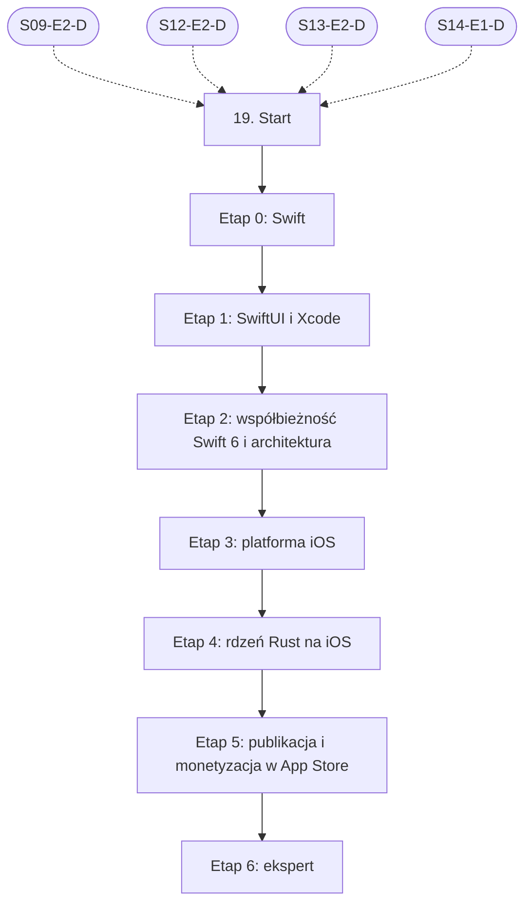

# 19. iOS: plan wdrożenia w Linear

Team **LEA** (https://linear.app/daankh/team/LEA/overview). Plan do przeglądu przed wdrożeniem: nic nie zostało jeszcze utworzone w Linear. Klucze zadań (np. `S19-E0-M1`) są robocze; po wdrożeniu dostaną identyfikatory `LEA-…`.

**W skrócie:** 7 kamieni milowych, 49 zadań (1 start, 38 materiałów, 7 dowodów, 3 praktyki). Plik główny z kolejnością projektów: `00-kolejnosc-i-zaleznosci.md`.

## 1. Projekt

| Pole | Wartość |
|---|---|
| Nazwa | 19. iOS |
| Team | LEA |
| Podsumowanie (pole „Summary”) | Warstwa 6: mobile. Opiera się na: 9, 12, 13 i 14 (rdzeń w Ruście). Jest podstawą: 21. |
| Proponowany start | 2028-01-03 |
| Proponowany termin | 2028-12-15 |
| Etykiety projektu | `warstwa-6` |
| Blokowany przez (projekty) | 09. DevOps, CI/CD i wydania, 12. Rust jako wspólny fundament, 13. UI/UX, 14. Desktop: wspólne |
| Blokuje (projekty) | — |
| Zależności częściowe (wychodzące) | 21. Funkcje AI w aplikacjach, etap 1 |
| Czas od zera | 250–330 h |

### Opis projektu (do wklejenia w Linear)

*Warstwa 6: mobile. Opiera się na: 9, 12, 13 i 14 (rdzeń w Ruście). Jest podstawą: 21.*

**Zakres umiejętności**

- Swift, SwiftUI, cykl życia aplikacji, zadania w tle, uprawnienia.
- Xcode, certyfikaty, profile provisioningu, XCFramework z biblioteką Rust i wiązaniami UniFFI.
- Alternatywnie Tauri 2 na iOS i jego ograniczenia.
- StoreKit 2, App Store Connect, TestFlight, zasady recenzji Apple, manifest prywatności, regulacje UE dla dystrybucji.
- Keychain, ochrona danych na urządzeniu, App Transport Security.

**Ścieżka nauki**

Ścieżka ma 7 etapów. Każdy kończy się **dowodem**, czyli małym projektem, który pokazuje, że etap jest opanowany. Przy doświadczeniu seniorskim w TypeScript, React i Rust etap 0 można zaliczyć samym dowodem (Swift ma wiele wspólnego z Rustem: enumy z danymi, protokoły podobne do cech, typy wartościowe), a etap 1 skrócić do „100 Days of SwiftUI” od dnia 16 albo wybranych wykładów CS193p. Etap 2 (współbieżność Swift 6) oraz etapy 4 i 5 są obowiązkowe w całości: tu najczęściej mylą się agenci i tu powstaje przychód. Do budowania na iOS potrzebny jest Mac z Xcode. Czas podany dla osoby startującej od zera; ceny materiałów płatnych zmieniają się, więc warto je sprawdzić przed zakupem.

Razem od zera do poziomu E: ok. 250–330 h, czyli 6–8 miesięcy przy 10–12 h tygodniowo.

**Definicja ukończenia projektu (dowód poziomu E)**

Samodzielnie, bez agenta, w 1 dzień diagnozujesz i naprawiasz zawieszenie UI, awarię na granicy Swift–Rust albo błąd uprawnień po zakupie w aplikacji z rdzeniem Rust, korzystając z Instruments, raportów awarii i powiadomień serwerowych App Store, i umiesz wyjaśnić przyczynę osobie nietechnicznej.

**Źródło:** dokument „Umiejętności techniczne” w projekcie „JDG: Rozwój oprogramowania”, sekcja 19.

## 2. Kamienie milowe

Jeden kamień milowy na etap ścieżki. Kamień milowy jest zamknięty, gdy zamknięte jest zadanie dowodu tego etapu. Daty kamieni milowych ustawiasz przy wdrożeniu według kolejności z pliku głównego.

| # | Kamień milowy | Cel | Czas od zera | Poziom po etapie | Zadania |
|---|---|---|---|---|---|
| 1 | Etap 0: Swift | język Swift | 40–60 h | podstawy | 4 |
| 2 | Etap 1: SwiftUI i Xcode | pierwsze aplikacje: SwiftUI i Xcode | 80–100 h | podstawy | 5 |
| 3 | Etap 2: współbieżność Swift 6 i architektura | współbieżność Swift 6 i architektura | 40–50 h | W | 8 |
| 4 | Etap 3: platforma iOS | platforma: cykl życia, praca w tle, dane, Keychain, prywatność | 30–40 h | W | 6 |
| 5 | Etap 4: rdzeń Rust na iOS | rdzeń Rust: UniFFI i XCFramework, alternatywnie Tauri 2 | 30–40 h | E | 7 |
| 6 | Etap 5: publikacja i monetyzacja w App Store | publikacja i monetyzacja w App Store | 30–40 h | E | 10 |
| 7 | Etap 6: ekspert | ekspert: wydajność, mechanizmy wewnętrzne, recenzja kodu AI, aktualność | stale, ok. 2 h tygodniowo | E | 8 |

## 3. Punkt startu

Zadanie **`S19-START` · Start: 19. iOS** to jedyne wejście do projektu: wszystkie zadania pierwszego etapu są przez nie blokowane.

- **Blokowane przez:** `S09-E2-D`, `S12-E2-D`, `S13-E2-D`, `S14-E1-D`
- **Odblokowuje:** `S19-E0-M1`, `S19-E0-M2`, `S19-E0-M3`
- **Status początkowy:** Backlog do czasu zamknięcia zadań blokujących, potem Todo

Opis zadania (do wklejenia):

Punkt startu projektu „19. iOS”.

**Warunki wejścia (zadania blokujące):**

- `S09-E2-D` · Dowód etapu 2: GitHub Actions i bezpieczeństwo pipeline’u — sekcja 9 na poziomie podstawowym do pracy (etap 2)
- `S12-E2-D` · Dowód etapu 2: własność, pożyczanie, czasy życia — sekcja 12 na poziomie podstawowym do pracy (etap 2)
- `S13-E2-D` · Dowód etapu 2: badania i testy użyteczności — sekcja 13 na poziomie podstawowym do pracy (etap 2)
- `S14-E1-D` · Dowód etapu 1: Tauri 2 — sekcja 14 na poziomie podstawowym do pracy (etap 1)

**Do zrobienia:**

- przeczytać sekcję 19 dokumentu „Umiejętności techniczne”,
- zaznaczyć etapy, które zaliczasz samym dowodem (zgodnie z akapitem wstępnym ścieżki), i dla nich zamknąć zadania materiałów jako niepotrzebne,
- ustawić daty kamieni milowych zgodnie z kolejnością z pliku głównego.

**Folder roboczy:** `19-ios/`

## 4. Przepływ zależności

Linie ciągłe to zależności wewnątrz projektu, przerywane to zadania z innych projektów. Wewnątrz etapu zadania materiałów są równoległe i wszystkie blokują dowód etapu; dowód etapu blokuje materiały kolejnego etapu.

## 5. Zadania według kamieni milowych

Szablon opisu zadania materiału: nazwa materiału, autor lub wydawca, typ, czas, koszt i link (jak w kolumnach poniżej), zdanie „Gotowe, gdy materiał jest przerobiony w zakresie potrzebnym do dowodu etapu” oraz folder roboczy z kolumny „Folder”. Opisy dowodów i praktyk są podane pod tabelą każdego etapu.

### Etap 0: Swift

Opis kamienia milowego (do wklejenia):

**Cel:** język Swift · **Czas od zera:** 40–60 h · **Poziom po etapie:** podstawy

**Szczególnie ważne:** typy wartościowe i referencyjne (`struct` a `class`), opcjonalne, enumy z wartościami powiązanymi, protokoły i rozszerzenia, generyki, `some` i `any`, obsługa błędów (`throws`, typowane błędy), zarządzanie pamięcią przez ARC i cykle referencji.

**Dowód:** Pakiet Swift Package Manager z modelem domeny aplikacji (np. abonamenty i limity), z błędami jako enumami i testami jednostkowymi uruchamianymi przez `swift test`.

| Klucz | Tytuł | Typ | Czas | Koszt | Link | Blokowane przez | Blokuje | Folder |
|---|---|---|---|---|---|---|---|---|
| `S19-E0-M1` | Przerobić: The Swift Programming Language (rozdziały do „Generics” włącznie) | materiał | 20–25 h | 0 zł | https://docs.swift.org/swift-book/documentation/the-swift-programming-language/ | `S19-START` | `S19-E0-D` | `19-ios/e0-swift/` |
| `S19-E0-M2` | Przerobić: 100 Days of SwiftUI, dni 1–15 (podstawy języka) | materiał | 15–20 h | 0 zł | https://www.hackingwithswift.com/100/swiftui | `S19-START` | `S19-E0-D` | `19-ios/e0-swift/` |
| `S19-E0-M3` | Przerobić: API Design Guidelines | materiał | 1–2 h | 0 zł | https://www.swift.org/documentation/api-design-guidelines/ | `S19-START` | `S19-E0-D` | `19-ios/e0-swift/` |
| `S19-E0-D` | Dowód etapu 0: Swift | dowód | — | — | — | `S19-E0-M1`, `S19-E0-M2`, `S19-E0-M3` | `S19-E1-M1`, `S19-E1-M2`, `S19-E1-M3`, `S19-E1-M4` | `19-ios/e0-swift/` |

**`S19-E0-D` · Dowód etapu 0: Swift**

Pakiet Swift Package Manager z modelem domeny aplikacji (np. abonamenty i limity), z błędami jako enumami i testami jednostkowymi uruchamianymi przez `swift test`.

**Na co zwrócić uwagę:** typy wartościowe i referencyjne (`struct` a `class`), opcjonalne, enumy z wartościami powiązanymi, protokoły i rozszerzenia, generyki, `some` i `any`, obsługa błędów (`throws`, typowane błędy), zarządzanie pamięcią przez ARC i cykle referencji.

**Kryterium ukończenia:** dowód wykonany samodzielnie; w komentarzu link do repozytorium, raportu lub notatki.

**Folder roboczy:** `19-ios/e0-swift/`

### Etap 1: SwiftUI i Xcode

Opis kamienia milowego (do wklejenia):

**Cel:** pierwsze aplikacje: SwiftUI i Xcode · **Czas od zera:** 80–100 h · **Poziom po etapie:** podstawy

**Szczególnie ważne:** przepływ danych (`@State`, `@Binding`, `@Observable`, `@Environment`), tożsamość widoków i ich odświeżanie, nawigacja (`NavigationStack`), listy i formularze, SwiftData, podgląd w Xcode, różnice wobec modelu Reacta.

Wystarczy jedna ścieżka: 100 Days of SwiftUI przy starcie od zera, CS193p przy doświadczeniu z innym frameworkiem deklaratywnym. Materiały CS193p powstały przed Xcode 26; kod jest w większości zgodny.

**Dowód:** Aplikacja z listą, edycją, wyszukiwaniem i trwałym zapisem w SwiftData, poprawna na iPhonie i iPadzie, w trybie ciemnym i z Dynamic Type.

| Klucz | Tytuł | Typ | Czas | Koszt | Link | Blokowane przez | Blokuje | Folder |
|---|---|---|---|---|---|---|---|---|
| `S19-E1-M1` | Przerobić: Develop in Swift Tutorials | materiał | 10–15 h | 0 zł | https://developer.apple.com/tutorials/develop-in-swift | `S19-E0-D` | `S19-E1-D` | `19-ios/e1-swiftui-i-xcode/` |
| `S19-E1-M2` | Przerobić: SwiftUI Tutorials („Introducing SwiftUI”) | materiał | 6–8 h | 0 zł | https://developer.apple.com/tutorials/swiftui | `S19-E0-D` | `S19-E1-D` | `19-ios/e1-swiftui-i-xcode/` |
| `S19-E1-M3` | Przerobić: 100 Days of SwiftUI, dni 16–100 | materiał, płatny | 60–80 h | 0 zł / abonament | https://www.hackingwithswift.com/100/swiftui | `S19-E0-D` | `S19-E1-D` | `19-ios/e1-swiftui-i-xcode/` |
| `S19-E1-M4` | Przerobić: CS193p Developing Apps for iOS | materiał | 30–40 h | 0 zł | https://cs193p.stanford.edu | `S19-E0-D` | `S19-E1-D` | `19-ios/e1-swiftui-i-xcode/` |
| `S19-E1-D` | Dowód etapu 1: SwiftUI i Xcode | dowód | — | — | — | `S19-E1-M1`, `S19-E1-M2`, `S19-E1-M3`, `S19-E1-M4` | `S19-E2-M1`, `S19-E2-M2`, `S19-E2-M3`, `S19-E2-M4`, `S19-E2-M5`, `S19-E2-M6`, `S19-E2-M7` | `19-ios/e1-swiftui-i-xcode/` |

**`S19-E1-D` · Dowód etapu 1: SwiftUI i Xcode**

Aplikacja z listą, edycją, wyszukiwaniem i trwałym zapisem w SwiftData, poprawna na iPhonie i iPadzie, w trybie ciemnym i z Dynamic Type.

**Na co zwrócić uwagę:** przepływ danych (`@State`, `@Binding`, `@Observable`, `@Environment`), tożsamość widoków i ich odświeżanie, nawigacja (`NavigationStack`), listy i formularze, SwiftData, podgląd w Xcode, różnice wobec modelu Reacta.

**Kryterium ukończenia:** dowód wykonany samodzielnie; w komentarzu link do repozytorium, raportu lub notatki.

**Folder roboczy:** `19-ios/e1-swiftui-i-xcode/`

### Etap 2: współbieżność Swift 6 i architektura

Opis kamienia milowego (do wklejenia):

**Cel:** współbieżność Swift 6 i architektura · **Czas od zera:** 40–50 h · **Poziom po etapie:** W

**Szczególnie ważne:** izolacja aktorów i `Sendable`, `@MainActor` jako domyślna izolacja w nowych projektach Xcode 26, `nonisolated` i `@concurrent`, anulowanie zadań strukturalnych, wstrzykiwanie zależności w testach, model `@Observable` zamiast `ObservableObject`.

**Dowód:** Aplikacja z etapu 1 skompilowana w trybie języka Swift 6 z pełnym sprawdzaniem współbieżności, bez ostrzeżeń i bez `@unchecked Sendable` bez uzasadnienia; ciężka praca wyniesiona do `@concurrent` lub aktora; zależności (sieć, czas, magazyn) wstrzykiwane i podmieniane w testach (zob. sekcja 6).

| Klucz | Tytuł | Typ | Czas | Koszt | Link | Blokowane przez | Blokuje | Folder |
|---|---|---|---|---|---|---|---|---|
| `S19-E2-M1` | Przerobić: The Swift Programming Language: rozdział „Concurrency” | materiał | 3–4 h | 0 zł | https://docs.swift.org/swift-book/documentation/the-swift-programming-language/concurrency/ | `S19-E1-D` | `S19-E2-D` | `19-ios/e2-wspolbieznosc-swift-6-i-architektura/` |
| `S19-E2-M2` | Przerobić: Swift Concurrency Migration Guide | materiał | 6–8 h | 0 zł | https://www.swift.org/migration/documentation/migrationguide/ | `S19-E1-D` | `S19-E2-D` | `19-ios/e2-wspolbieznosc-swift-6-i-architektura/` |
| `S19-E2-M3` | Przerobić: Swift 6.2 Released | materiał | 1 h | 0 zł | https://swift.org/blog/swift-6.2-released/ | `S19-E1-D` | `S19-E2-D` | `19-ios/e2-wspolbieznosc-swift-6-i-architektura/` |
| `S19-E2-M4` | Przerobić: „Embracing Swift concurrency” (WWDC25, sesja 268) | materiał | 1 h | 0 zł | https://developer.apple.com/videos/play/wwdc2025/268/ | `S19-E1-D` | `S19-E2-D` | `19-ios/e2-wspolbieznosc-swift-6-i-architektura/` |
| `S19-E2-M5` | Przerobić: Swift Concurrency by Example | materiał | 8–10 h | 0 zł | https://www.hackingwithswift.com/quick-start/concurrency | `S19-E1-D` | `S19-E2-D` | `19-ios/e2-wspolbieznosc-swift-6-i-architektura/` |
| `S19-E2-M6` | Przerobić: Point-Free: kolekcje Concurrency, Dependencies, SwiftUI, Modern Persistence | materiał, płatny | 15–20 h | abonament (część odcinków 0 zł) | https://www.pointfree.co | `S19-E1-D` | `S19-E2-D` | `19-ios/e2-wspolbieznosc-swift-6-i-architektura/` |
| `S19-E2-M7` | Przerobić: Thinking in SwiftUI (aktualizacja dla iOS 17) | materiał, płatny | 6–8 h | płatna | https://www.objc.io/books/thinking-in-swiftui/ | `S19-E1-D` | `S19-E2-D` | `19-ios/e2-wspolbieznosc-swift-6-i-architektura/` |
| `S19-E2-D` | Dowód etapu 2: współbieżność Swift 6 i architektura | dowód | — | — | — | `S19-E2-M1`, `S19-E2-M2`, `S19-E2-M3`, `S19-E2-M4`, `S19-E2-M5`, `S19-E2-M6`, `S19-E2-M7` | `S19-E3-M1`, `S19-E3-M2`, `S19-E3-M3`, `S19-E3-M4`, `S19-E3-M5`, `S21-E1-M1`, `S21-E1-M2`, `S21-E1-M3`, `S21-E1-M4`, `S21-E1-M5`, `S21-E1-M6`, `S21-E1-M7`, `S21-E1-M8` | `19-ios/e2-wspolbieznosc-swift-6-i-architektura/` |

**`S19-E2-D` · Dowód etapu 2: współbieżność Swift 6 i architektura**

Aplikacja z etapu 1 skompilowana w trybie języka Swift 6 z pełnym sprawdzaniem współbieżności, bez ostrzeżeń i bez `@unchecked Sendable` bez uzasadnienia; ciężka praca wyniesiona do `@concurrent` lub aktora; zależności (sieć, czas, magazyn) wstrzykiwane i podmieniane w testach (zob. sekcja 6).

**Na co zwrócić uwagę:** izolacja aktorów i `Sendable`, `@MainActor` jako domyślna izolacja w nowych projektach Xcode 26, `nonisolated` i `@concurrent`, anulowanie zadań strukturalnych, wstrzykiwanie zależności w testach, model `@Observable` zamiast `ObservableObject`.

**Kryterium ukończenia:** dowód wykonany samodzielnie; w komentarzu link do repozytorium, raportu lub notatki.

**Folder roboczy:** `19-ios/e2-wspolbieznosc-swift-6-i-architektura/`

### Etap 3: platforma iOS

Opis kamienia milowego (do wklejenia):

**Cel:** platforma: cykl życia, praca w tle, dane, Keychain, prywatność · **Czas od zera:** 30–40 h · **Poziom po etapie:** W

**Szczególnie ważne:** system zawiesza i kończy aplikację bez ostrzeżenia, praca w tle jest planowana przez system, a nie przez aplikację, klasy ochrony danych i dostępności elementów Keychain, prośby o uprawnienia w kontekście, App Transport Security. Testy bezpieczeństwa według MASVS: zob. sekcja 10.

**Dowód:** Synchronizacja danych przez `BGAppRefreshTask` odporna na zakończenie aplikacji; token sesji w Keychain z odpowiednią klasą dostępności; manifest prywatności zgodny z faktycznie używanymi API, także przez dołączone biblioteki.

| Klucz | Tytuł | Typ | Czas | Koszt | Link | Blokowane przez | Blokuje | Folder |
|---|---|---|---|---|---|---|---|---|
| `S19-E3-M1` | Przerobić: Managing your app’s life cycle | materiał | 2–3 h | 0 zł | https://developer.apple.com/documentation/uikit/managing-your-app-s-life-cycle | `S19-E2-D` | `S19-E3-D` | `19-ios/e3-platforma-ios/` |
| `S19-E3-M2` | Przerobić: BackgroundTasks (`BGAppRefreshTask`, `BGProcessingTask`) | materiał | 3–4 h | 0 zł | https://developer.apple.com/documentation/backgroundtasks | `S19-E2-D` | `S19-E3-D` | `19-ios/e3-platforma-ios/` |
| `S19-E3-M3` | Przerobić: SwiftData | materiał | 4–6 h | 0 zł | https://developer.apple.com/documentation/swiftdata | `S19-E2-D` | `S19-E3-D` | `19-ios/e3-platforma-ios/` |
| `S19-E3-M4` | Przerobić: Keychain services | materiał | 3–4 h | 0 zł | https://developer.apple.com/documentation/security/keychain-services | `S19-E2-D` | `S19-E3-D` | `19-ios/e3-platforma-ios/` |
| `S19-E3-M5` | Przerobić: Privacy manifest files (API wymagające uzasadnienia, manifesty SDK) | materiał | 2–3 h | 0 zł | https://developer.apple.com/documentation/bundleresources/privacy-manifest-files | `S19-E2-D` | `S19-E3-D` | `19-ios/e3-platforma-ios/` |
| `S19-E3-D` | Dowód etapu 3: platforma iOS | dowód | — | — | — | `S19-E3-M1`, `S19-E3-M2`, `S19-E3-M3`, `S19-E3-M4`, `S19-E3-M5` | `S19-E4-M1`, `S19-E4-M2`, `S19-E4-M3`, `S19-E4-M4`, `S19-E4-M5`, `S19-E4-M6` | `19-ios/e3-platforma-ios/` |

**`S19-E3-D` · Dowód etapu 3: platforma iOS**

Synchronizacja danych przez `BGAppRefreshTask` odporna na zakończenie aplikacji; token sesji w Keychain z odpowiednią klasą dostępności; manifest prywatności zgodny z faktycznie używanymi API, także przez dołączone biblioteki.

**Na co zwrócić uwagę:** system zawiesza i kończy aplikację bez ostrzeżenia, praca w tle jest planowana przez system, a nie przez aplikację, klasy ochrony danych i dostępności elementów Keychain, prośby o uprawnienia w kontekście, App Transport Security. Testy bezpieczeństwa według MASVS: zob. sekcja 10.

**Kryterium ukończenia:** dowód wykonany samodzielnie; w komentarzu link do repozytorium, raportu lub notatki.

**Folder roboczy:** `19-ios/e3-platforma-ios/`

### Etap 4: rdzeń Rust na iOS

Opis kamienia milowego (do wklejenia):

**Cel:** rdzeń Rust: UniFFI i XCFramework, alternatywnie Tauri 2 · **Czas od zera:** 30–40 h · **Poziom po etapie:** E

**Szczególnie ważne:** targety `aarch64-apple-ios` i `aarch64-apple-ios-sim` (plus `x86_64-apple-ios` dla starszych Maców), łączenie bibliotek symulatora przez `lipo`, dystrybucja XCFramework jako `binaryTarget` z sumą kontrolną w `Package.swift`, mapowanie błędów Rusta na `throws`, funkcje async Rusta jako `async` w Swifcie, zgodność typów z UniFFI z `Sendable`, symbole debugowania rdzenia w raportach awarii, manifest prywatności także dla kodu Rust. Ten sam crate co na Androidzie (zob. sekcja 18.1, etap 4).

**Dowód:** Rdzeń z sekcji 18.1 (model danych, walidacja, logika licencji i synchronizacji) dołączony do aplikacji z etapu 3 jako lokalny pakiet Swift z XCFramework, zbudowany jednym skryptem dla urządzenia i symulatora; błąd z Rusta obsłużony w UI jako `throws`; kompilacja w trybie Swift 6 bez ostrzeżeń współbieżności po stronie wiązań.

| Klucz | Tytuł | Typ | Czas | Koszt | Link | Blokowane przez | Blokuje | Folder |
|---|---|---|---|---|---|---|---|---|
| `S19-E4-M1` | Przerobić: The UniFFI user guide: rozdziały Swift | materiał | 4–6 h | 0 zł | https://mozilla.github.io/uniffi-rs/latest/swift/xcode.html | `S19-E3-D` | `S19-E4-D` | `19-ios/e4-rdzen-rust-na-ios/` |
| `S19-E4-M2` | Przerobić: Creating a multiplatform binary framework bundle (XCFramework) | materiał | 1–2 h | 0 zł | https://developer.apple.com/documentation/xcode/creating-a-multi-platform-binary-framework-bundle | `S19-E3-D` | `S19-E4-D` | `19-ios/e4-rdzen-rust-na-ios/` |
| `S19-E4-M3` | Przerobić: „Ferrostar: Building a Cross-Platform Navigation SDK in Rust (Part 2 – iOS Packaging)” | materiał | 1–2 h | 0 zł | https://stadiamaps.com/blog/ferrostar-building-a-cross-platform-navigation-sdk-in-rust-part-2/ | `S19-E3-D` | `S19-E4-D` | `19-ios/e4-rdzen-rust-na-ios/` |
| `S19-E4-M4` | Przerobić: `cargo-swift` (budowa pakietu Swift z crate’a z UniFFI) | materiał | 2–3 h | 0 zł | https://github.com/antoniusnaumann/cargo-swift | `S19-E3-D` | `S19-E4-D` | `19-ios/e4-rdzen-rust-na-ios/` |
| `S19-E4-M5` | Przerobić: uniffi-starter | materiał | 3–4 h | 0 zł | https://github.com/ianthetechie/uniffi-starter | `S19-E3-D` | `S19-E4-D` | `19-ios/e4-rdzen-rust-na-ios/` |
| `S19-E4-M6` | Przerobić: Tauri 2 na iOS: wymagania, pluginy mobilne w Swifcie, publikacja w App Store | materiał | 6–8 h | 0 zł | https://v2.tauri.app/develop/plugins/develop-mobile/, https://v2.tauri.app/distribute/app-store/ | `S19-E3-D` | `S19-E4-D` | `19-ios/e4-rdzen-rust-na-ios/` |
| `S19-E4-D` | Dowód etapu 4: rdzeń Rust na iOS | dowód | — | — | — | `S19-E4-M1`, `S19-E4-M2`, `S19-E4-M3`, `S19-E4-M4`, `S19-E4-M5`, `S19-E4-M6` | `S19-E5-M1`, `S19-E5-M2`, `S19-E5-M3`, `S19-E5-M4`, `S19-E5-M5`, `S19-E5-M6`, `S19-E5-M7`, `S19-E5-M8`, `S19-E5-M9` | `19-ios/e4-rdzen-rust-na-ios/` |

**`S19-E4-D` · Dowód etapu 4: rdzeń Rust na iOS**

Rdzeń z sekcji 18.1 (model danych, walidacja, logika licencji i synchronizacji) dołączony do aplikacji z etapu 3 jako lokalny pakiet Swift z XCFramework, zbudowany jednym skryptem dla urządzenia i symulatora; błąd z Rusta obsłużony w UI jako `throws`; kompilacja w trybie Swift 6 bez ostrzeżeń współbieżności po stronie wiązań.

**Na co zwrócić uwagę:** targety `aarch64-apple-ios` i `aarch64-apple-ios-sim` (plus `x86_64-apple-ios` dla starszych Maców), łączenie bibliotek symulatora przez `lipo`, dystrybucja XCFramework jako `binaryTarget` z sumą kontrolną w `Package.swift`, mapowanie błędów Rusta na `throws`, funkcje async Rusta jako `async` w Swifcie, zgodność typów z UniFFI z `Sendable`, symbole debugowania rdzenia w raportach awarii, manifest prywatności także dla kodu Rust. Ten sam crate co na Androidzie (zob. sekcja 18.1, etap 4).

**Kryterium ukończenia:** dowód wykonany samodzielnie; w komentarzu link do repozytorium, raportu lub notatki.

**Folder roboczy:** `19-ios/e4-rdzen-rust-na-ios/`

### Etap 5: publikacja i monetyzacja w App Store

Opis kamienia milowego (do wklejenia):

**Cel:** publikacja i monetyzacja w App Store · **Czas od zera:** 30–40 h · **Poziom po etapie:** E

**Szczególnie ważne:** przywracanie zakupów, nasłuch `Transaction.updates` od startu aplikacji, `Transaction.currentEntitlements` jako źródło uprawnień na urządzeniu, weryfikacja podpisanych transakcji JWS na serwerze, stany abonamentu (okres karencji, problemy z płatnością, zwroty), status przedsiębiorcy z DSA w UE, zasady linkowania do zakupów poza aplikacją różne dla sklepów USA, UE i reszty świata, ekran zakupu zgodny z regułami sklepu i prawem konsumenckim (zob. sekcja 13), automatyzacja wydań przez API App Store Connect (zob. sekcja 9).

**Dowód:** Aplikacja z rdzeniem Rust przeszła recenzję Apple i jest dostępna w App Store, z abonamentem i zakupem jednorazowym w StoreKit 2; backend w Rust (Axum) odbiera App Store Server Notifications V2, weryfikuje podpisy i jest jedynym źródłem uprawnień, wspólnym z Google Play; etykieta prywatności i manifest prywatności zgodne z faktycznym przetwarzaniem; proces zgłaszania podatności zgodny z CRA opisany na stronie produktu.

| Klucz | Tytuł | Typ | Czas | Koszt | Link | Blokowane przez | Blokuje | Folder |
|---|---|---|---|---|---|---|---|---|
| `S19-E5-M1` | Przerobić: App Store Connect Help: rekord aplikacji, przesyłanie buildów, ceny, abonamenty, umowy i podatki | materiał | 4–6 h | 0 zł | https://developer.apple.com/help/app-store-connect/ | `S19-E4-D` | `S19-E5-D` | `19-ios/e5-publikacja-i-monetyzacja-w-app-store/` |
| `S19-E5-M2` | Przerobić: TestFlight | materiał | 1–2 h | 0 zł | https://developer.apple.com/testflight/ | `S19-E4-D` | `S19-E5-D` | `19-ios/e5-publikacja-i-monetyzacja-w-app-store/` |
| `S19-E5-M3` | Przerobić: App Review Guidelines | materiał | 3–4 h | 0 zł | https://developer.apple.com/app-store/review/guidelines/ | `S19-E4-D` | `S19-E5-D` | `19-ios/e5-publikacja-i-monetyzacja-w-app-store/` |
| `S19-E5-M4` | Przerobić: StoreKit 2: przegląd, widoki sklepu, testowanie w Xcode, „Meet StoreKit 2” | materiał | 8–10 h | 0 zł | https://developer.apple.com/storekit/, https://developer.apple.com/videos/play/wwdc2021/10114/ | `S19-E4-D` | `S19-E5-D` | `19-ios/e5-publikacja-i-monetyzacja-w-app-store/` |
| `S19-E5-M5` | Przerobić: App Store Server API, App Store Server Notifications, App Store Server Library | materiał | 4–6 h | 0 zł | https://developer.apple.com/documentation/appstoreservernotifications, https://github.com/apple/app-store-server-library-swift | `S19-E4-D` | `S19-E5-D` | `19-ios/e5-publikacja-i-monetyzacja-w-app-store/` |
| `S19-E5-M6` | Przerobić: App Privacy Details (etykiety prywatności) | materiał | 1–2 h | 0 zł | https://developer.apple.com/app-store/app-privacy-details/ | `S19-E4-D` | `S19-E5-D` | `19-ios/e5-publikacja-i-monetyzacja-w-app-store/` |
| `S19-E5-M7` | Przerobić: Dystrybucja aplikacji w UE | materiał | 2–3 h | 0 zł | https://developer.apple.com/support/dma-and-apps-in-the-eu/ | `S19-E4-D` | `S19-E5-D` | `19-ios/e5-publikacja-i-monetyzacja-w-app-store/` |
| `S19-E5-M8` | Przerobić: App Store Small Business Program | materiał | 0,5 h | 0 zł | https://developer.apple.com/app-store/small-business-program/ | `S19-E4-D` | `S19-E5-D` | `19-ios/e5-publikacja-i-monetyzacja-w-app-store/` |
| `S19-E5-M9` | Przerobić: Upcoming requirements | materiał | ok. 0,5 h miesięcznie | 0 zł | https://developer.apple.com/news/upcoming-requirements/ | `S19-E4-D` | `S19-E5-D` | `19-ios/e5-publikacja-i-monetyzacja-w-app-store/` |
| `S19-E5-D` | Dowód etapu 5: publikacja i monetyzacja w App Store | dowód | — | — | — | `S19-E5-M1`, `S19-E5-M2`, `S19-E5-M3`, `S19-E5-M4`, `S19-E5-M5`, `S19-E5-M6`, `S19-E5-M7`, `S19-E5-M8`, `S19-E5-M9` | `S19-E6-M1`, `S19-E6-M2`, `S19-E6-M3`, `S19-E6-M4`, `S19-E6-P1`, `S19-E6-P2`, `S19-E6-P3` | `19-ios/e5-publikacja-i-monetyzacja-w-app-store/` |

**`S19-E5-D` · Dowód etapu 5: publikacja i monetyzacja w App Store**

Aplikacja z rdzeniem Rust przeszła recenzję Apple i jest dostępna w App Store, z abonamentem i zakupem jednorazowym w StoreKit 2; backend w Rust (Axum) odbiera App Store Server Notifications V2, weryfikuje podpisy i jest jedynym źródłem uprawnień, wspólnym z Google Play; etykieta prywatności i manifest prywatności zgodne z faktycznym przetwarzaniem; proces zgłaszania podatności zgodny z CRA opisany na stronie produktu.

**Na co zwrócić uwagę:** przywracanie zakupów, nasłuch `Transaction.updates` od startu aplikacji, `Transaction.currentEntitlements` jako źródło uprawnień na urządzeniu, weryfikacja podpisanych transakcji JWS na serwerze, stany abonamentu (okres karencji, problemy z płatnością, zwroty), status przedsiębiorcy z DSA w UE, zasady linkowania do zakupów poza aplikacją różne dla sklepów USA, UE i reszty świata, ekran zakupu zgodny z regułami sklepu i prawem konsumenckim (zob. sekcja 13), automatyzacja wydań przez API App Store Connect (zob. sekcja 9).

**Kryterium ukończenia:** dowód wykonany samodzielnie; w komentarzu link do repozytorium, raportu lub notatki.

**Folder roboczy:** `19-ios/e5-publikacja-i-monetyzacja-w-app-store/`

### Etap 6: ekspert

Opis kamienia milowego (do wklejenia):

**Cel:** ekspert: wydajność, mechanizmy wewnętrzne, recenzja kodu AI, aktualność · **Czas od zera:** stale, ok. 2 h tygodniowo · **Poziom po etapie:** E

**Dowód poziomu E:** Samodzielnie, bez agenta, w 1 dzień diagnozujesz i naprawiasz zawieszenie UI, awarię na granicy Swift–Rust albo błąd uprawnień po zakupie w aplikacji z rdzeniem Rust, korzystając z Instruments, raportów awarii i powiadomień serwerowych App Store, i umiesz wyjaśnić przyczynę osobie nietechnicznej.

| Klucz | Tytuł | Typ | Czas | Koszt | Link | Blokowane przez | Blokuje | Folder |
|---|---|---|---|---|---|---|---|---|
| `S19-E6-M1` | Przerobić: Improving your app’s performance (Instruments, metryki, `os_signpost`) | materiał | 4–6 h | 0 zł | https://developer.apple.com/documentation/xcode/improving-your-app-s-performance | `S19-E5-D` | `S19-E6-D` | `19-ios/e6-ekspert/` |
| `S19-E6-M2` | Przerobić: Sesje WWDC (SwiftUI, współbieżność, StoreKit, wydajność) | materiał | ok. 10 h rocznie | 0 zł | https://developer.apple.com/videos/ | `S19-E5-D` | `S19-E6-D` | `19-ios/e6-ekspert/` |
| `S19-E6-M3` | Przerobić: Swift Evolution i fora Swift | materiał | ok. 1 h tygodniowo | 0 zł | https://github.com/swiftlang/swift-evolution, https://forums.swift.org | `S19-E5-D` | `S19-E6-D` | `19-ios/e6-ekspert/` |
| `S19-E6-M4` | Przerobić: Point-Free: zaawansowane serie | materiał, płatny | wg potrzeb | abonament | https://www.pointfree.co | `S19-E5-D` | `S19-E6-D` | `19-ios/e6-ekspert/` |
| `S19-E6-P1` | Praktyka: recenzja kodu AI | praktyka | — | — | — | `S19-E5-D` | `S19-E6-D` | `19-ios/e6-ekspert/` |
| `S19-E6-P2` | Praktyka: wydajność | praktyka | — | — | — | `S19-E5-D` | `S19-E6-D` | `19-ios/e6-ekspert/` |
| `S19-E6-P3` | Praktyka: śledzenie zmian platformy | praktyka | — | — | — | `S19-E5-D` | `S19-E6-D` | `19-ios/e6-ekspert/` |
| `S19-E6-D` | Dowód poziomu E: ekspert | dowód | — | — | — | `S19-E6-M1`, `S19-E6-M2`, `S19-E6-M3`, `S19-E6-M4`, `S19-E6-P1`, `S19-E6-P2`, `S19-E6-P3` | — | `19-ios/e6-ekspert/` |

**`S19-E6-P1` · Praktyka: recenzja kodu AI**

20 pull requestów wygenerowanych przez agentów, recenzowanych według listy kontrolnej z etapów 2–5 (`@unchecked Sendable` i `nonisolated(unsafe)` bez uzasadnienia, `Task {}` bez anulowania, praca na `MainActor` blokująca UI, cykle referencji w domknięciach, wymuszone rozpakowanie `!`, starsze API zamiast StoreKit 2 i `@Observable`, brak przywracania zakupów, sekrety w `UserDefaults` zamiast Keychain, wymyślone API Apple).

Praktyka ciągła etapu eksperckiego: oznacz jako gotową, gdy działa jako stały element pracy, a nie po jednorazowym wykonaniu.

**Folder roboczy:** `19-ios/e6-ekspert/`

**`S19-E6-P2` · Praktyka: wydajność**

Profil uruchomienia i przewijania w Instruments, monitorowanie zawieszeń i awarii w Xcode Organizer z symbolami dSYM rdzenia Rust.

Praktyka ciągła etapu eksperckiego: oznacz jako gotową, gdy działa jako stały element pracy, a nie po jednorazowym wykonaniu.

**Folder roboczy:** `19-ios/e6-ekspert/`

**`S19-E6-P3` · Praktyka: śledzenie zmian platformy**

Coroczna migracja na nowe Xcode i SDK przed terminem Apple, przegląd zmian w zasadach recenzji i warunkach UE po każdej aktualizacji.

Praktyka ciągła etapu eksperckiego: oznacz jako gotową, gdy działa jako stały element pracy, a nie po jednorazowym wykonaniu.

**Folder roboczy:** `19-ios/e6-ekspert/`

**`S19-E6-D` · Dowód poziomu E: ekspert**

Samodzielnie, bez agenta, w 1 dzień diagnozujesz i naprawiasz zawieszenie UI, awarię na granicy Swift–Rust albo błąd uprawnień po zakupie w aplikacji z rdzeniem Rust, korzystając z Instruments, raportów awarii i powiadomień serwerowych App Store, i umiesz wyjaśnić przyczynę osobie nietechnicznej.

**Kryterium ukończenia:** dowód wykonany samodzielnie; w komentarzu link do repozytorium, raportu lub notatki. Bez agenta AI.

**Folder roboczy:** `19-ios/e6-ekspert/`

## 6. Relacje z innymi projektami

**Wchodzące** (zadanie z innego projektu blokuje zadanie tego projektu):

- `S09-E2-D` (Dowód etapu 2: GitHub Actions i bezpieczeństwo pipeline’u) → `S19-START`
- `S12-E2-D` (Dowód etapu 2: własność, pożyczanie, czasy życia) → `S19-START`
- `S13-E2-D` (Dowód etapu 2: badania i testy użyteczności) → `S19-START`
- `S14-E1-D` (Dowód etapu 1: Tauri 2) → `S19-START`

**Wychodzące** (zadanie tego projektu blokuje zadanie w innym projekcie):

- `S19-E2-D` → `S21-E1-M1` (21. Funkcje AI w aplikacjach)
- `S19-E2-D` → `S21-E1-M2` (21. Funkcje AI w aplikacjach)
- `S19-E2-D` → `S21-E1-M3` (21. Funkcje AI w aplikacjach)
- `S19-E2-D` → `S21-E1-M4` (21. Funkcje AI w aplikacjach)
- `S19-E2-D` → `S21-E1-M5` (21. Funkcje AI w aplikacjach)
- `S19-E2-D` → `S21-E1-M6` (21. Funkcje AI w aplikacjach)
- `S19-E2-D` → `S21-E1-M7` (21. Funkcje AI w aplikacjach)
- `S19-E2-D` → `S21-E1-M8` (21. Funkcje AI w aplikacjach)
