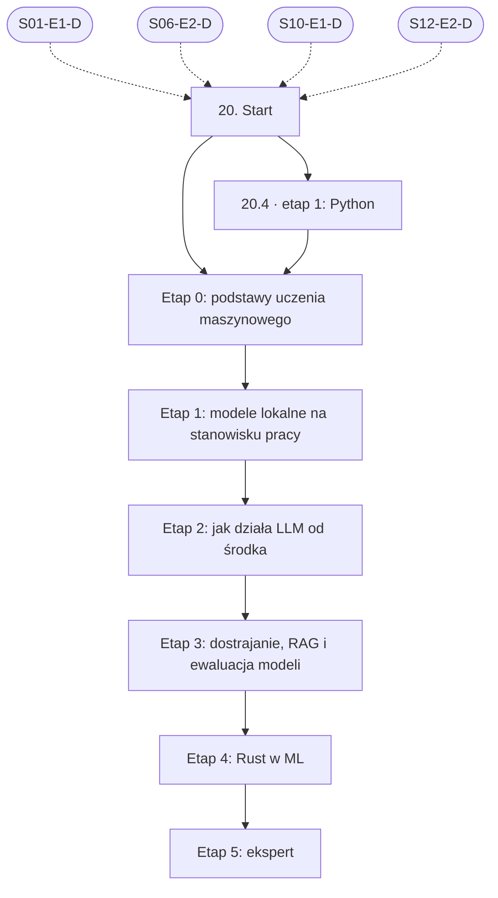

# 20. Lokalne AI i rozwój modeli: plan wdrożenia w Linear

Team **LEA** (https://linear.app/daankh/team/LEA/overview). Plan do przeglądu przed wdrożeniem: nic nie zostało jeszcze utworzone w Linear. Klucze zadań (np. `S20-E0-M1`) są robocze; po wdrożeniu dostaną identyfikatory `LEA-…`.

**W skrócie:** 7 kamieni milowych, 40 zadań (1 start, 29 materiałów, 7 dowodów, 3 praktyki). Plik główny z kolejnością projektów: `00-kolejnosc-i-zaleznosci.md`.

## 1. Projekt

| Pole | Wartość |
|---|---|
| Nazwa | 20. Lokalne AI i rozwój modeli |
| Team | LEA |
| Podsumowanie (pole „Summary”) | Warstwa 7: AI w produktach. Opiera się na: 1, 6, 10 i 12. Jest podstawą: 21. |
| Proponowany start | 2027-07-01 |
| Proponowany termin | 2028-12-15 |
| Etykiety projektu | `warstwa-7` |
| Blokowany przez (projekty) | 01. Praca z AI w chmurze: Claude i Claude Code, 06. Testowanie, 10. Bezpieczeństwo, 12. Rust jako wspólny fundament |
| Blokuje (projekty) | 21. Funkcje AI w aplikacjach |
| Czas od zera | 215–295 h + 50–70 h (ścieżka uzupełniająca) |

### Opis projektu (do wklejenia w Linear)

*Warstwa 7: AI w produktach. Opiera się na: 1, 6, 10 i 12. Jest podstawą: 21.*

**Zakres umiejętności**

**Po co w tym modelu biznesowym:** praca na kodzie i danych klienta, które nie mogą opuścić maszyny (RODO, umowa), niezależność od jednego dostawcy AI i tańsze wykonywanie prostych, powtarzalnych zadań.
- Środowiska uruchomieniowe: Ollama, LM Studio, llama.cpp (`llama-server`), MLX na Apple Silicon; kiedy potrzebny jest serwer typu vLLM.
- Sprzęt i zasoby: VRAM, pamięć zunifikowana na Macu, przepustowość pamięci jako ograniczenie szybkości, backendy CUDA, Metal, ROCm i Vulkan, NPU w nowszych laptopach; szacowanie, jaki model zmieści się na danej maszynie.
- Formaty i kwantyzacja: GGUF, MLX, AWQ, GPTQ; poziomy kwantyzacji i ich wpływ na jakość; długość kontekstu i koszt pamięci podręcznej KV.
- Dobór modelu do zadania: modele do kodu z otwartymi wagami, modele ogólne, małe modele do klasyfikacji, modele embeddingowe; architektury MoE.
- Integracja z narzędziami: podłączenie Claude Code do lokalnego modelu przez endpoint zgodny z API Anthropic (`ANTHROPIC_BASE_URL`) albo przez bramkę LLM (np. LiteLLM), routing części zadań lokalnie, a części do Claude; endpointy zgodne z OpenAI.
- Podział ról: co może robić model lokalny (triage, klasyfikacja, streszczenia, wyszukiwanie w repozytorium, druga niezależna recenzja), a czego nie powinien robić bez nadzoru (zmiany w ścieżkach krytycznych).
- Bezpieczeństwo stanowiska: pochodzenie wag (zaufani wydawcy, formaty bez wykonywalnego kodu, np. `safetensors` zamiast `pickle`), serwer modelu nasłuchujący tylko lokalnie, odróżnianie modeli lokalnych od wariantów chmurowych w tych samych narzędziach, licencje modeli.
- Ewaluacja: własny zestaw zadań i przypadków granicznych, metryki dopasowane do zadania, porównanie modeli i wersji, ocena przez model (LLM-as-judge) z kontrolą jego trafności na próbce ocenionej ręcznie.
- RAG: podział dokumentów na fragmenty, modele embeddingowe, wyszukiwanie wektorowe i hybrydowe (wektor i słowa kluczowe), reranking, ocena trafności wyszukiwania i odpowiedzi; bazy wektorowe (pgvector, Qdrant, LanceDB, sqlite-vec).
- Dostrajanie: LoRA i QLoRA, przygotowanie i czyszczenie zbiorów danych, podział na zbiory treningowy i testowy, wykrywanie przeuczenia i regresji; narzędzia ekosystemu Python (Hugging Face Transformers, PEFT, Unsloth lub podobne) oraz MLX na Macu.
- Destylacja i kompresja: przenoszenie umiejętności z dużego modelu do małego, kwantyzacja po dostrojeniu, konwersja do GGUF, ONNX lub formatów platformowych.
- Rust w ML: Candle, Burn, mistral.rs, wiązania llama.cpp, `ort` (ONNX Runtime), `tract`; tokenizery (`tokenizers`); biblioteki do embeddingów (np. `fastembed`); frameworki agentowe w Ruście (np. Rig).
- Dokumentacja modelu: karta modelu, dane treningowe i ich licencje, znane ograniczenia, wyniki ewaluacji; wpis modelu w SBOM jako ML-BOM (CycloneDX).
- Granica opłacalności: kiedy dostrajanie ma sens, a kiedy wystarczy lepszy prompt, RAG albo model chmurowy.

**Ścieżka nauki**

Ścieżka ma 6 etapów. Każdy kończy się **dowodem**, czyli małym projektem, który pokazuje, że etap jest opanowany. Przed etapem 0 warto mieć Pythona na poziomie W (ścieżka uzupełniająca 20.4). Przy doświadczeniu seniorskim etap 0 można zaliczyć samym dowodem, a etap 1 warto przejść w całości, bo bezpośrednio przekłada się na pracę z kodem klientów, który nie może opuścić maszyny. Czas podany dla osoby startującej od zera; ceny materiałów płatnych zmieniają się, więc warto je sprawdzić przed zakupem. Ewaluacje agentów i bezpieczeństwo LLM są w sekcji 11.1, OpenTelemetry ogólnie w sekcji 9.

Razem od zera do poziomu E: ok. 215–295 h, czyli 5–7 miesięcy przy 10–12 h tygodniowo.

**20.4 Ścieżka uzupełniająca: Python**

Python jest potrzebny przed etapem 0 ścieżki 20.3, bo cały ekosystem ML (Transformers, PEFT, dostrajanie) jest w Pythonie. Przyda się też wcześniej, przy przejmowanych projektach klientów napisanych w Pythonie. Ok. 50–70 h od zera do poziomu W.

**Definicja ukończenia projektu (dowód poziomu E)**

Samodzielnie, bez agenta, w 1 dzień dobierasz model lokalny do zadania i sprzętu, oceniasz go na własnym zestawie ewaluacji względem modelu w chmurze i podłączasz do przepływu recenzji tak, że kod klienta nie opuszcza maszyny, a decyzję zapisujesz w ADR.

**Źródło:** dokument „Umiejętności techniczne” w projekcie „JDG: Rozwój oprogramowania”, sekcja 20.

## 2. Kamienie milowe

Jeden kamień milowy na etap ścieżki. Kamień milowy jest zamknięty, gdy zamknięte jest zadanie dowodu tego etapu. Daty kamieni milowych ustawiasz przy wdrożeniu według kolejności z pliku głównego.

| # | Kamień milowy | Cel | Czas od zera | Poziom po etapie | Zadania |
|---|---|---|---|---|---|
| 1 | Etap 0: podstawy uczenia maszynowego | podstawy uczenia maszynowego i sieci neuronowych | 60–80 h | podstawy | 4 |
| 2 | Etap 1: modele lokalne na stanowisku pracy | modele lokalne na stanowisku pracy | 25–35 h | E | 7 |
| 3 | Etap 2: jak działa LLM od środka | jak działa LLM od środka | 50–70 h | W | 4 |
| 4 | Etap 3: dostrajanie, RAG i ewaluacja modeli | dostrajanie, RAG i ewaluacja modeli | 50–70 h | W, przy rozwoju modeli E | 5 |
| 5 | Etap 4: Rust w ML | Rust w ML: Candle, Burn, mistral.rs, `ort` | 30–40 h | W | 5 |
| 6 | Etap 5: ekspert | ekspert: modele lokalne w pracy z klientem, aktualność | stale, ok. 1–2 h tygodniowo | E | 7 |
| 7 | Uzupełniająca 20.4 · Python | Python | — | — | 7 |

## 3. Punkt startu

Zadanie **`S20-START` · Start: 20. Lokalne AI i rozwój modeli** to jedyne wejście do projektu: wszystkie zadania pierwszego etapu i ścieżek uzupełniających są przez nie blokowane.

- **Blokowane przez:** `S01-E1-D`, `S06-E2-D`, `S10-E1-D`, `S12-E2-D`
- **Odblokowuje:** `S20-E0-M1`, `S20-E0-M2`, `S20-E0-M3`, `S20-U1-M1`, `S20-U1-M2`, `S20-U1-M3`, `S20-U1-M4`, `S20-U1-M5`, `S20-U1-M6`
- **Status początkowy:** Backlog do czasu zamknięcia zadań blokujących, potem Todo

Opis zadania (do wklejenia):

Punkt startu projektu „20. Lokalne AI i rozwój modeli”.

**Warunki wejścia (zadania blokujące):**

- `S01-E1-D` · Dowód etapu 1: codzienna praca z Claude Code — sekcja 1 na poziomie podstawowym do pracy (etap 1)
- `S06-E2-D` · Dowód etapu 2: projektowanie testów — sekcja 6 na poziomie podstawowym do pracy (etap 2)
- `S10-E1-D` · Dowód etapu 1: ataki na web i API w praktyce — sekcja 10 na poziomie podstawowym do pracy (etap 1)
- `S12-E2-D` · Dowód etapu 2: własność, pożyczanie, czasy życia — sekcja 12 na poziomie podstawowym do pracy (etap 2)

**Do zrobienia:**

- przeczytać sekcję 20 dokumentu „Umiejętności techniczne”,
- zaznaczyć etapy, które zaliczasz samym dowodem (zgodnie z akapitem wstępnym ścieżki), i dla nich zamknąć zadania materiałów jako niepotrzebne,
- ustawić daty kamieni milowych zgodnie z kolejnością z pliku głównego.

**Folder roboczy:** `20-lokalne-ai-i-rozwoj-modeli/`

## 4. Przepływ zależności

Linie ciągłe to zależności wewnątrz projektu, przerywane to zadania z innych projektów. Wewnątrz etapu zadania materiałów są równoległe i wszystkie blokują dowód etapu; dowód etapu blokuje materiały kolejnego etapu.

## 5. Zadania według kamieni milowych

Szablon opisu zadania materiału: nazwa materiału, autor lub wydawca, typ, czas, koszt i link (jak w kolumnach poniżej), zdanie „Gotowe, gdy materiał jest przerobiony w zakresie potrzebnym do dowodu etapu” oraz folder roboczy z kolumny „Folder”. Opisy dowodów i praktyk są podane pod tabelą każdego etapu.

### Etap 0: podstawy uczenia maszynowego

Opis kamienia milowego (do wklejenia):

**Cel:** podstawy uczenia maszynowego i sieci neuronowych · **Czas od zera:** 60–80 h · **Poziom po etapie:** podstawy

**Szczególnie ważne:** zbiór treningowy, walidacyjny i testowy, przeuczenie, funkcja straty i propagacja wsteczna, tokenizacja (źródło wielu dziwnych zachowań modeli), embeddingi, mechanizm uwagi.

**Dowód:** Samodzielnie wytrenowany mały model (np. klasyfikator tekstu z fast.ai i bigramowy model językowy z wykładów Karpathy’ego) z poprawnym podziałem danych i wykresem straty, z opisem, po czym widać przeuczenie.

| Klucz | Tytuł | Typ | Czas | Koszt | Link | Blokowane przez | Blokuje | Folder |
|---|---|---|---|---|---|---|---|---|
| `S20-E0-M1` | Przerobić: Practical Deep Learning for Coders, część 1 | materiał | 25–35 h | 0 zł | https://course.fast.ai | `S20-START`, `S20-U1-D` | `S20-E0-D` | `20-lokalne-ai-i-rozwoj-modeli/e0-podstawy-uczenia-maszynowego/` |
| `S20-E0-M2` | Przerobić: Neural Networks: Zero to Hero (od micrograd do GPT i tokenizera) | materiał | 20–30 h | 0 zł | https://karpathy.ai/zero-to-hero.html | `S20-START`, `S20-U1-D` | `S20-E0-D` | `20-lokalne-ai-i-rozwoj-modeli/e0-podstawy-uczenia-maszynowego/` |
| `S20-E0-M3` | Przerobić: LLM Course, rozdziały 0–6 | materiał | 15–20 h | 0 zł | https://huggingface.co/learn/llm-course | `S20-START`, `S20-U1-D` | `S20-E0-D` | `20-lokalne-ai-i-rozwoj-modeli/e0-podstawy-uczenia-maszynowego/` |
| `S20-E0-D` | Dowód etapu 0: podstawy uczenia maszynowego | dowód | — | — | — | `S20-E0-M1`, `S20-E0-M2`, `S20-E0-M3` | `S20-E1-M1`, `S20-E1-M2`, `S20-E1-M3`, `S20-E1-M4`, `S20-E1-M5`, `S20-E1-M6` | `20-lokalne-ai-i-rozwoj-modeli/e0-podstawy-uczenia-maszynowego/` |

**`S20-E0-D` · Dowód etapu 0: podstawy uczenia maszynowego**

Samodzielnie wytrenowany mały model (np. klasyfikator tekstu z fast.ai i bigramowy model językowy z wykładów Karpathy’ego) z poprawnym podziałem danych i wykresem straty, z opisem, po czym widać przeuczenie.

**Na co zwrócić uwagę:** zbiór treningowy, walidacyjny i testowy, przeuczenie, funkcja straty i propagacja wsteczna, tokenizacja (źródło wielu dziwnych zachowań modeli), embeddingi, mechanizm uwagi.

**Kryterium ukończenia:** dowód wykonany samodzielnie; w komentarzu link do repozytorium, raportu lub notatki.

**Folder roboczy:** `20-lokalne-ai-i-rozwoj-modeli/e0-podstawy-uczenia-maszynowego/`

### Etap 1: modele lokalne na stanowisku pracy

Opis kamienia milowego (do wklejenia):

**Cel:** modele lokalne na stanowisku pracy · **Czas od zera:** 25–35 h · **Poziom po etapie:** E

**Szczególnie ważne:** szacowanie pamięci (wagi po kwantyzacji i pamięć podręczna KV dla danej długości kontekstu), wpływ poziomu kwantyzacji na jakość, serwer nasłuchujący tylko na `127.0.0.1`, odróżnianie modeli lokalnych od chmurowych w tym samym narzędziu (np. modele chmurowe Ollama), licencje wag.

Uwaga do Claude Code: dokumentacja Anthropic o bramkach LLM zaznacza, że kierowanie Claude Code do modeli innych niż Claude nie jest przez Anthropic wspierane. Integracja przez Ollama czy LiteLLM działa, ale wyniki trzeba sprawdzać własnymi ewaluacjami (zob. sekcja 11.1).

**Dowód:** Model lokalny wykonuje drugą, niezależną recenzję kodu klienta bez wysyłania danych poza maszynę: `llama-server` lub Ollama za bramką LiteLLM, sprawdzenie ruchu sieciowego (brak połączeń wychodzących), porównanie z recenzją Claude na 10 pull requestach z zapisem trafień i fałszywych alarmów oraz tabela: model, kwantyzacja, pamięć, tokeny na sekundę.

| Klucz | Tytuł | Typ | Czas | Koszt | Link | Blokowane przez | Blokuje | Folder |
|---|---|---|---|---|---|---|---|---|
| `S20-E1-M1` | Przerobić: Ollama: dokumentacja, API (w tym zgodność z OpenAI i Anthropic Messages API od wersji 0.14),… | materiał | 4–6 h | 0 zł | https://docs.ollama.com, https://docs.ollama.com/integrations/claude-code | `S20-E0-D` | `S20-E1-D` | `20-lokalne-ai-i-rozwoj-modeli/e1-modele-lokalne-na-stanowisku-pracy/` |
| `S20-E1-M2` | Przerobić: llama.cpp: budowanie, `llama-server`, kwantyzacja GGUF | materiał | 6–8 h | 0 zł | https://github.com/ggml-org/llama.cpp, https://github.com/ggml-org/llama.cpp/blob/master/tools/server/README.md | `S20-E0-D` | `S20-E1-D` | `20-lokalne-ai-i-rozwoj-modeli/e1-modele-lokalne-na-stanowisku-pracy/` |
| `S20-E1-M3` | Przerobić: LM Studio: aplikacja, CLI `lms`, API | materiał | 2–3 h | 0 zł | https://lmstudio.ai/docs | `S20-E0-D` | `S20-E1-D` | `20-lokalne-ai-i-rozwoj-modeli/e1-modele-lokalne-na-stanowisku-pracy/` |
| `S20-E1-M4` | Przerobić: MLX i MLX LM (Apple Silicon) | materiał | 3–4 h | 0 zł | https://ml-explore.github.io/mlx/build/html/index.html, https://github.com/ml-explore/mlx-lm | `S20-E0-D` | `S20-E1-D` | `20-lokalne-ai-i-rozwoj-modeli/e1-modele-lokalne-na-stanowisku-pracy/` |
| `S20-E1-M5` | Przerobić: vLLM | materiał | 3–4 h | 0 zł | https://docs.vllm.ai | `S20-E0-D` | `S20-E1-D` | `20-lokalne-ai-i-rozwoj-modeli/e1-modele-lokalne-na-stanowisku-pracy/` |
| `S20-E1-M6` | Przerobić: LiteLLM: bramka (proxy) i endpoint `/v1/messages` | materiał | 3–4 h | 0 zł | https://docs.litellm.ai/docs/, https://docs.litellm.ai/docs/anthropic_unified | `S20-E0-D` | `S20-E1-D` | `20-lokalne-ai-i-rozwoj-modeli/e1-modele-lokalne-na-stanowisku-pracy/` |
| `S20-E1-D` | Dowód etapu 1: modele lokalne na stanowisku pracy | dowód | — | — | — | `S20-E1-M1`, `S20-E1-M2`, `S20-E1-M3`, `S20-E1-M4`, `S20-E1-M5`, `S20-E1-M6` | `S20-E2-M1`, `S20-E2-M2`, `S20-E2-M3`, `S21-START` | `20-lokalne-ai-i-rozwoj-modeli/e1-modele-lokalne-na-stanowisku-pracy/` |

**`S20-E1-D` · Dowód etapu 1: modele lokalne na stanowisku pracy**

Model lokalny wykonuje drugą, niezależną recenzję kodu klienta bez wysyłania danych poza maszynę: `llama-server` lub Ollama za bramką LiteLLM, sprawdzenie ruchu sieciowego (brak połączeń wychodzących), porównanie z recenzją Claude na 10 pull requestach z zapisem trafień i fałszywych alarmów oraz tabela: model, kwantyzacja, pamięć, tokeny na sekundę.

**Na co zwrócić uwagę:** szacowanie pamięci (wagi po kwantyzacji i pamięć podręczna KV dla danej długości kontekstu), wpływ poziomu kwantyzacji na jakość, serwer nasłuchujący tylko na `127.0.0.1`, odróżnianie modeli lokalnych od chmurowych w tym samym narzędziu (np. modele chmurowe Ollama), licencje wag.

**Kryterium ukończenia:** dowód wykonany samodzielnie; w komentarzu link do repozytorium, raportu lub notatki.

**Folder roboczy:** `20-lokalne-ai-i-rozwoj-modeli/e1-modele-lokalne-na-stanowisku-pracy/`

### Etap 2: jak działa LLM od środka

Opis kamienia milowego (do wklejenia):

**Cel:** jak działa LLM od środka · **Czas od zera:** 50–70 h · **Poziom po etapie:** W

**Szczególnie ważne:** architektura transformera dekodującego, pretrening a dostrajanie instrukcyjne, próbkowanie (temperatura, top-p), embeddingi i ich zastosowanie w wyszukiwaniu.

**Dowód:** Własna implementacja małego modelu GPT według książki Raschki, wczytanie do niej wag GPT-2 i dostrojenie do klasyfikacji tekstu, z notatką, które elementy odpowiadają parametrom widocznym w llama.cpp (kontekst, kwantyzacja, próbkowanie).

| Klucz | Tytuł | Typ | Czas | Koszt | Link | Blokowane przez | Blokuje | Folder |
|---|---|---|---|---|---|---|---|---|
| `S20-E2-M1` | Przerobić: Build a Large Language Model (From Scratch) | materiał, płatny | 30–40 h | płatna | https://www.manning.com/books/build-a-large-language-model-from-scratch | `S20-E1-D` | `S20-E2-D` | `20-lokalne-ai-i-rozwoj-modeli/e2-jak-dziala-llm-od-srodka/` |
| `S20-E2-M2` | Przerobić: Hands-On Large Language Models | materiał, płatny | 15–20 h | płatna | https://www.llm-book.com | `S20-E1-D` | `S20-E2-D` | `20-lokalne-ai-i-rozwoj-modeli/e2-jak-dziala-llm-od-srodka/` |
| `S20-E2-M3` | Przerobić: LLM Course, rozdziały 7–12 (dostrajanie LLM, modele rozumujące) | materiał | 10–15 h | 0 zł | https://huggingface.co/learn/llm-course | `S20-E1-D` | `S20-E2-D` | `20-lokalne-ai-i-rozwoj-modeli/e2-jak-dziala-llm-od-srodka/` |
| `S20-E2-D` | Dowód etapu 2: jak działa LLM od środka | dowód | — | — | — | `S20-E2-M1`, `S20-E2-M2`, `S20-E2-M3` | `S20-E3-M1`, `S20-E3-M2`, `S20-E3-M3`, `S20-E3-M4` | `20-lokalne-ai-i-rozwoj-modeli/e2-jak-dziala-llm-od-srodka/` |

**`S20-E2-D` · Dowód etapu 2: jak działa LLM od środka**

Własna implementacja małego modelu GPT według książki Raschki, wczytanie do niej wag GPT-2 i dostrojenie do klasyfikacji tekstu, z notatką, które elementy odpowiadają parametrom widocznym w llama.cpp (kontekst, kwantyzacja, próbkowanie).

**Na co zwrócić uwagę:** architektura transformera dekodującego, pretrening a dostrajanie instrukcyjne, próbkowanie (temperatura, top-p), embeddingi i ich zastosowanie w wyszukiwaniu.

**Kryterium ukończenia:** dowód wykonany samodzielnie; w komentarzu link do repozytorium, raportu lub notatki.

**Folder roboczy:** `20-lokalne-ai-i-rozwoj-modeli/e2-jak-dziala-llm-od-srodka/`

### Etap 3: dostrajanie, RAG i ewaluacja modeli

Opis kamienia milowego (do wklejenia):

**Cel:** dostrajanie, RAG i ewaluacja modeli · **Czas od zera:** 50–70 h · **Poziom po etapie:** W, przy rozwoju modeli E

**Szczególnie ważne:** najpierw prompt i RAG, dostrajanie dopiero gdy ewaluacja pokazuje, że to nie wystarcza; jakość i licencje danych treningowych; zbiór testowy rozdzielony od treningowego przed pierwszym eksperymentem; sprawdzanie regresji w zadaniach ogólnych po dostrojeniu.

**Dowód:** Mały model dostrojony metodą LoRA lub QLoRA do zadania z niszy (np. klasyfikacja zgłoszeń bezpieczeństwa lub ocena wagi znalezisk z audytu), wyeksportowany do GGUF i uruchomiony w llama.cpp; raport ewaluacji przed i po dostrojeniu na wydzielonym zbiorze testowym oraz porównanie z wersją „prompt i RAG” bez dostrajania.

| Klucz | Tytuł | Typ | Czas | Koszt | Link | Blokowane przez | Blokuje | Folder |
|---|---|---|---|---|---|---|---|---|
| `S20-E3-M1` | Przerobić: Transformers, PEFT (LoRA), TRL | materiał | 15–20 h | 0 zł | https://huggingface.co/docs/transformers, https://huggingface.co/docs/peft, https://huggingface.co/docs/trl | `S20-E2-D` | `S20-E3-D` | `20-lokalne-ai-i-rozwoj-modeli/e3-dostrajanie-rag-i-ewaluacja-modeli/` |
| `S20-E3-M2` | Przerobić: Unsloth: przewodnik dostrajania, eksport do GGUF | materiał | 6–8 h | 0 zł | https://unsloth.ai/docs | `S20-E2-D` | `S20-E3-D` | `20-lokalne-ai-i-rozwoj-modeli/e3-dostrajanie-rag-i-ewaluacja-modeli/` |
| `S20-E3-M3` | Przerobić: MLX LM: dostrajanie LoRA na Macu | materiał | 3–4 h | 0 zł | https://github.com/ml-explore/mlx-lm | `S20-E2-D` | `S20-E3-D` | `20-lokalne-ai-i-rozwoj-modeli/e3-dostrajanie-rag-i-ewaluacja-modeli/` |
| `S20-E3-M4` | Przerobić: AI Engineering: Building Applications with Foundation Models, rozdziały o RAG, dostrajaniu i danych | materiał, płatny | 10–12 h | płatna | https://huyenchip.com/books/ | `S20-E2-D` | `S20-E3-D` | `20-lokalne-ai-i-rozwoj-modeli/e3-dostrajanie-rag-i-ewaluacja-modeli/` |
| `S20-E3-D` | Dowód etapu 3: dostrajanie, RAG i ewaluacja modeli | dowód | — | — | — | `S20-E3-M1`, `S20-E3-M2`, `S20-E3-M3`, `S20-E3-M4` | `S20-E4-M1`, `S20-E4-M2`, `S20-E4-M3`, `S20-E4-M4` | `20-lokalne-ai-i-rozwoj-modeli/e3-dostrajanie-rag-i-ewaluacja-modeli/` |

**`S20-E3-D` · Dowód etapu 3: dostrajanie, RAG i ewaluacja modeli**

Mały model dostrojony metodą LoRA lub QLoRA do zadania z niszy (np. klasyfikacja zgłoszeń bezpieczeństwa lub ocena wagi znalezisk z audytu), wyeksportowany do GGUF i uruchomiony w llama.cpp; raport ewaluacji przed i po dostrojeniu na wydzielonym zbiorze testowym oraz porównanie z wersją „prompt i RAG” bez dostrajania.

**Na co zwrócić uwagę:** najpierw prompt i RAG, dostrajanie dopiero gdy ewaluacja pokazuje, że to nie wystarcza; jakość i licencje danych treningowych; zbiór testowy rozdzielony od treningowego przed pierwszym eksperymentem; sprawdzanie regresji w zadaniach ogólnych po dostrojeniu.

**Kryterium ukończenia:** dowód wykonany samodzielnie; w komentarzu link do repozytorium, raportu lub notatki.

**Folder roboczy:** `20-lokalne-ai-i-rozwoj-modeli/e3-dostrajanie-rag-i-ewaluacja-modeli/`

### Etap 4: Rust w ML

Opis kamienia milowego (do wklejenia):

**Cel:** Rust w ML: Candle, Burn, mistral.rs, `ort` · **Czas od zera:** 30–40 h · **Poziom po etapie:** W

**Szczególnie ważne:** kiedy wystarczy biblioteka w Ruście, a kiedy lepiej uruchomić llama.cpp jako proces poboczny; zgodność formatów (safetensors, GGUF, ONNX); akceleracja (CUDA, Metal) i jej wpływ na budowanie na trzech systemach (zob. sekcja 9); niestabilne API przed wersją 1.0.

**Dowód:** Narzędzie CLI w Ruście, które liczy embeddingi plików repozytorium (Candle lub `ort`) i odpowiada na pytania przez mistral.rs lub llama.cpp, działające offline na Linuksie i macOS, z testem porównującym wyniki z referencyjną implementacją w Pythonie.

| Klucz | Tytuł | Typ | Czas | Koszt | Link | Blokowane przez | Blokuje | Folder |
|---|---|---|---|---|---|---|---|---|
| `S20-E4-M1` | Przerobić: Candle: książka i przykłady | materiał | 8–10 h | 0 zł | https://huggingface.github.io/candle/, https://github.com/huggingface/candle | `S20-E3-D` | `S20-E4-D` | `20-lokalne-ai-i-rozwoj-modeli/e4-rust-w-ml/` |
| `S20-E4-M2` | Przerobić: The Burn Book | materiał | 8–10 h | 0 zł | https://burn.dev/books/burn/ | `S20-E3-D` | `S20-E4-D` | `20-lokalne-ai-i-rozwoj-modeli/e4-rust-w-ml/` |
| `S20-E4-M3` | Przerobić: mistral.rs | materiał | 4–6 h | 0 zł | https://github.com/EricLBuehler/mistral.rs, https://docs.mistralrs.dev | `S20-E3-D` | `S20-E4-D` | `20-lokalne-ai-i-rozwoj-modeli/e4-rust-w-ml/` |
| `S20-E4-M4` | Przerobić: `ort` (wiązania ONNX Runtime; wersja 2.0 w fazie RC) | materiał | 4–6 h | 0 zł | https://ort.pyke.io | `S20-E3-D` | `S20-E4-D` | `20-lokalne-ai-i-rozwoj-modeli/e4-rust-w-ml/` |
| `S20-E4-D` | Dowód etapu 4: Rust w ML | dowód | — | — | — | `S20-E4-M1`, `S20-E4-M2`, `S20-E4-M3`, `S20-E4-M4` | `S20-E5-M1`, `S20-E5-M2`, `S20-E5-M3`, `S20-E5-P1`, `S20-E5-P2`, `S20-E5-P3` | `20-lokalne-ai-i-rozwoj-modeli/e4-rust-w-ml/` |

**`S20-E4-D` · Dowód etapu 4: Rust w ML**

Narzędzie CLI w Ruście, które liczy embeddingi plików repozytorium (Candle lub `ort`) i odpowiada na pytania przez mistral.rs lub llama.cpp, działające offline na Linuksie i macOS, z testem porównującym wyniki z referencyjną implementacją w Pythonie.

**Na co zwrócić uwagę:** kiedy wystarczy biblioteka w Ruście, a kiedy lepiej uruchomić llama.cpp jako proces poboczny; zgodność formatów (safetensors, GGUF, ONNX); akceleracja (CUDA, Metal) i jej wpływ na budowanie na trzech systemach (zob. sekcja 9); niestabilne API przed wersją 1.0.

**Kryterium ukończenia:** dowód wykonany samodzielnie; w komentarzu link do repozytorium, raportu lub notatki.

**Folder roboczy:** `20-lokalne-ai-i-rozwoj-modeli/e4-rust-w-ml/`

### Etap 5: ekspert

Opis kamienia milowego (do wklejenia):

**Cel:** ekspert: modele lokalne w pracy z klientem, aktualność · **Czas od zera:** stale, ok. 1–2 h tygodniowo · **Poziom po etapie:** E

**Dowód poziomu E:** Samodzielnie, bez agenta, w 1 dzień dobierasz model lokalny do zadania i sprzętu, oceniasz go na własnym zestawie ewaluacji względem modelu w chmurze i podłączasz do przepływu recenzji tak, że kod klienta nie opuszcza maszyny, a decyzję zapisujesz w ADR.

| Klucz | Tytuł | Typ | Czas | Koszt | Link | Blokowane przez | Blokuje | Folder |
|---|---|---|---|---|---|---|---|---|
| `S20-E5-M1` | Przerobić: Informacje o wydaniach llama.cpp, Ollama, ONNX Runtime, mistral.rs, MLX | materiał | ok. 0,5 h tygodniowo | 0 zł | https://github.com/ggml-org/llama.cpp/releases | `S20-E4-D` | `S20-E5-D` | `20-lokalne-ai-i-rozwoj-modeli/e5-ekspert/` |
| `S20-E5-M2` | Przerobić: Blog i dokumentacja Hugging Face | materiał | ok. 0,5 h tygodniowo | 0 zł | https://huggingface.co/blog | `S20-E4-D` | `S20-E5-D` | `20-lokalne-ai-i-rozwoj-modeli/e5-ekspert/` |
| `S20-E5-M3` | Przerobić: Practical Deep Learning for Coders, część 2 | materiał | wg potrzeb | 0 zł | https://course.fast.ai | `S20-E4-D` | `S20-E5-D` | `20-lokalne-ai-i-rozwoj-modeli/e5-ekspert/` |
| `S20-E5-P1` | Praktyka: modele lokalne w pracy z klientem | praktyka | — | — | — | `S20-E4-D` | `S20-E5-D` | `20-lokalne-ai-i-rozwoj-modeli/e5-ekspert/` |
| `S20-E5-P2` | Praktyka: przegląd co kwartał | praktyka | — | — | — | `S20-E4-D` | `S20-E5-D` | `20-lokalne-ai-i-rozwoj-modeli/e5-ekspert/` |
| `S20-E5-P3` | Praktyka: podatności środowisk uruchomieniowych | praktyka | — | — | — | `S20-E4-D` | `S20-E5-D` | `20-lokalne-ai-i-rozwoj-modeli/e5-ekspert/` |
| `S20-E5-D` | Dowód poziomu E: ekspert | dowód | — | — | — | `S20-E5-M1`, `S20-E5-M2`, `S20-E5-M3`, `S20-E5-P1`, `S20-E5-P2`, `S20-E5-P3` | — | `20-lokalne-ai-i-rozwoj-modeli/e5-ekspert/` |

**`S20-E5-P1` · Praktyka: modele lokalne w pracy z klientem**

Stały przepływ, w którym kod objęty umową poufności jest analizowany wyłącznie lokalnie, z zapisem w umowie i w ofercie.

Praktyka ciągła etapu eksperckiego: oznacz jako gotową, gdy działa jako stały element pracy, a nie po jednorazowym wykonaniu.

**Folder roboczy:** `20-lokalne-ai-i-rozwoj-modeli/e5-ekspert/`

**`S20-E5-P2` · Praktyka: przegląd co kwartał**

Porównanie nowych modeli z otwartymi wagami na własnym zestawie ewaluacji (zob. sekcja 11.1) i decyzja o wymianie.

Praktyka ciągła etapu eksperckiego: oznacz jako gotową, gdy działa jako stały element pracy, a nie po jednorazowym wykonaniu.

**Folder roboczy:** `20-lokalne-ai-i-rozwoj-modeli/e5-ekspert/`

**`S20-E5-P3` · Praktyka: podatności środowisk uruchomieniowych**

Llama.cpp, ONNX Runtime i biblioteki tokenizerów objęte tym samym procesem obsługi podatności co reszta zależności (zob. sekcja 10.1).

Praktyka ciągła etapu eksperckiego: oznacz jako gotową, gdy działa jako stały element pracy, a nie po jednorazowym wykonaniu.

**Folder roboczy:** `20-lokalne-ai-i-rozwoj-modeli/e5-ekspert/`

**`S20-E5-D` · Dowód poziomu E: ekspert**

Samodzielnie, bez agenta, w 1 dzień dobierasz model lokalny do zadania i sprzętu, oceniasz go na własnym zestawie ewaluacji względem modelu w chmurze i podłączasz do przepływu recenzji tak, że kod klienta nie opuszcza maszyny, a decyzję zapisujesz w ADR.

**Kryterium ukończenia:** dowód wykonany samodzielnie; w komentarzu link do repozytorium, raportu lub notatki. Bez agenta AI.

**Folder roboczy:** `20-lokalne-ai-i-rozwoj-modeli/e5-ekspert/`

### Uzupełniająca 20.4 · Python

Opis kamienia milowego (do wklejenia):

**Cel:** Python

**Szczególnie ważne:** środowiska wirtualne i blokowanie zależności (`uv.lock`), adnotacje typów i sprawdzanie typów w CI, wyjątki i menedżery kontekstu, `async` w Pythonie, typowe podatności w przejmowanych projektach (`pickle`, `eval`, `subprocess` z `shell=True`, `yaml.load`).

Python jest potrzebny przed etapem 0 ścieżki 20.3, bo cały ekosystem ML (Transformers, PEFT, dostrajanie) jest w Pythonie. Przyda się też wcześniej, przy przejmowanych projektach klientów napisanych w Pythonie. Ok. 50–70 h od zera do poziomu W.

Wystarczy jedna z dwóch płatnych książek: Effective Python przy pracy na cudzych projektach, Fluent Python przy głębszym zrozumieniu modelu danych języka. Ekosystem ML (Transformers, PEFT, dostrajanie): zob. sekcja 20.3, etap 3.

**Dowód:** Przejęty skrypt lub mała usługa w Pythonie przeprowadzona przez stabilizację: zależności zablokowane przez `uv`, Ruff i sprawdzanie typów bez błędów, testy w pytest dla ścieżek krytycznych i SBOM wygenerowany dla środowiska.

| Klucz | Tytuł | Typ | Czas | Koszt | Link | Blokowane przez | Blokuje | Folder |
|---|---|---|---|---|---|---|---|---|
| `S20-U1-M1` | Przerobić: The Python Tutorial | materiał | 10–15 h | 0 zł | https://docs.python.org/3/tutorial/ | `S20-START` | `S20-U1-D` | `20-lokalne-ai-i-rozwoj-modeli/u1-python/` |
| `S20-U1-M2` | Przerobić: Effective Python (wydanie 3, do Pythona 3.13) | materiał, płatny | 15–20 h | płatna | https://effectivepython.com | `S20-START` | `S20-U1-D` | `20-lokalne-ai-i-rozwoj-modeli/u1-python/` |
| `S20-U1-M3` | Przerobić: Fluent Python (wydanie 2) | materiał, płatny | 20–25 h | płatna | https://www.oreilly.com/library/view/fluent-python-2nd/9781492056348/ | `S20-START` | `S20-U1-D` | `20-lokalne-ai-i-rozwoj-modeli/u1-python/` |
| `S20-U1-M4` | Przerobić: Static Typing with Python | materiał | 4–5 h | 0 zł | https://typing.python.org | `S20-START` | `S20-U1-D` | `20-lokalne-ai-i-rozwoj-modeli/u1-python/` |
| `S20-U1-M5` | Przerobić: uv, Ruff, pytest | materiał | 4–6 h | 0 zł | https://docs.astral.sh/uv/, https://docs.astral.sh/ruff/, https://docs.pytest.org | `S20-START` | `S20-U1-D` | `20-lokalne-ai-i-rozwoj-modeli/u1-python/` |
| `S20-U1-M6` | Przerobić: PyO3 i maturin (wywoływanie Rusta z Pythona) | materiał | 4–6 h | 0 zł | https://pyo3.rs, https://www.maturin.rs | `S20-START` | `S20-U1-D` | `20-lokalne-ai-i-rozwoj-modeli/u1-python/` |
| `S20-U1-D` | Dowód (20.4): Python | dowód | — | — | — | `S20-U1-M1`, `S20-U1-M2`, `S20-U1-M3`, `S20-U1-M4`, `S20-U1-M5`, `S20-U1-M6` | `S20-E0-M1`, `S20-E0-M2`, `S20-E0-M3` | `20-lokalne-ai-i-rozwoj-modeli/u1-python/` |

**`S20-U1-D` · Dowód (20.4): Python**

Przejęty skrypt lub mała usługa w Pythonie przeprowadzona przez stabilizację: zależności zablokowane przez `uv`, Ruff i sprawdzanie typów bez błędów, testy w pytest dla ścieżek krytycznych i SBOM wygenerowany dla środowiska.

**Na co zwrócić uwagę:** środowiska wirtualne i blokowanie zależności (`uv.lock`), adnotacje typów i sprawdzanie typów w CI, wyjątki i menedżery kontekstu, `async` w Pythonie, typowe podatności w przejmowanych projektach (`pickle`, `eval`, `subprocess` z `shell=True`, `yaml.load`).

**Kryterium ukończenia:** dowód wykonany samodzielnie; w komentarzu link do repozytorium, raportu lub notatki.

**Folder roboczy:** `20-lokalne-ai-i-rozwoj-modeli/u1-python/`

## 6. Relacje z innymi projektami

**Wchodzące** (zadanie z innego projektu blokuje zadanie tego projektu):

- `S01-E1-D` (Dowód etapu 1: codzienna praca z Claude Code) → `S20-START`
- `S06-E2-D` (Dowód etapu 2: projektowanie testów) → `S20-START`
- `S10-E1-D` (Dowód etapu 1: ataki na web i API w praktyce) → `S20-START`
- `S12-E2-D` (Dowód etapu 2: własność, pożyczanie, czasy życia) → `S20-START`

**Wychodzące** (zadanie tego projektu blokuje zadanie w innym projekcie):

- `S20-E1-D` → `S21-START` (21. Funkcje AI w aplikacjach)
