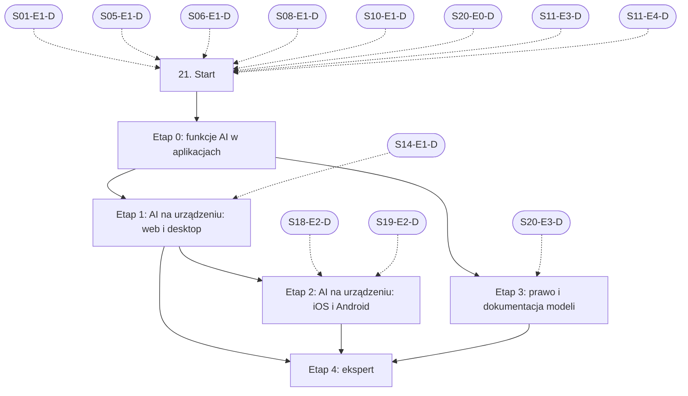

# 21. Funkcje AI w aplikacjach: plan wdrożenia w Linear

Team **LEA** (https://linear.app/daankh/team/LEA/overview). Plan jest wdrożony w Linear. Klucze zadań (np. `S21-E0-M1`) są robocze, a identyfikator każdego zadania w Linear (`LEA-…`) jest w kolumnie „Linear” tabel zadań i w pliku `mapowanie-kluczy.csv`.

**W skrócie:** 5 kamieni milowych, 31 zadań (1 start, 22 materiały, 5 dowodów, 3 praktyki). Plik główny z kolejnością projektów: `00-kolejnosc-i-zaleznosci.md`.

## 1. Projekt

| Pole | Wartość |
|---|---|
| Nazwa | 21. Funkcje AI w aplikacjach |
| Team | LEA |
| Podsumowanie (pole „Summary”) | Warstwa 7: AI w produktach. Opiera się na: 1, 5, 6, 8, 10, 11 i 20; etapy AI na urządzeniu także na 14, 18 i 19. Jest podstawą: opcjonalnego etapu TinyML w 22. |
| Etykiety projektu | `warstwa-7` |
| Blokowany przez (projekty) | 01. Praca z AI w chmurze: Claude i Claude Code, 05. Backend i API, 06. Testowanie, 08. Architektura i projektowanie systemów, 10. Bezpieczeństwo, 11. Weryfikacja pracy AI i budowa procesu, 20. Lokalne AI i rozwój modeli |
| Blokuje (projekty) | — |
| Zależności częściowe (wchodzące) | etap 1 czeka na 14. Desktop: wspólne (etap 1); etap 2 czeka na 18. Android (etap 2); etap 2 czeka na 19. iOS (etap 2); etap 3 czeka na 20. Lokalne AI i rozwój modeli (etap 3) |
| Zależności częściowe (wychodzące) | 22. Systemy wbudowane, etap 9 |

### Opis projektu (do wklejenia w Linear)

*Warstwa 7: AI w produktach. Opiera się na: 1, 5, 6, 8, 10, 11 i 20; etapy AI na urządzeniu także na 14, 18 i 19. Jest podstawą: opcjonalnego etapu TinyML w 22.*

**Zakres umiejętności**

**Architektura i wybór miejsca wykonania**
- Decyzja chmura, urządzenie czy hybryda: prywatność, koszt na użytkownika, opóźnienie, praca offline, rozmiar aplikacji, jakość; zapisana w ADR.
- Model w chmurze: API Anthropic i innych dostawców (oficjalne SDK w TypeScript, klient HTTP w Ruście), streaming, tool use, wyjście strukturalne ze schematem, prompt caching, przetwarzanie wsadowe, limity i ponawianie.
- Backend jako pośrednik: klucze API nigdy w aplikacji klienckiej, limity per użytkownik, kontrola kosztów, cache odpowiedzi, wymiana modelu bez wydania aplikacji.
- Agenci i narzędzia w produkcie: projektowanie narzędzi, minimalne uprawnienia, potwierdzenie przez człowieka dla działań nieodwracalnych, MCP jako interfejs do danych.
**Modele na urządzeniu, według platformy**
- Web: WebGPU i WASM w przeglądarce (np. Transformers.js, WebLLM, ONNX Runtime Web), ograniczenia pamięci i pobierania modelu, Vercel AI SDK lub podobne do streamingu UI w Next.js.
- Desktop (Tauri, Rust): llama.cpp lub mistral.rs jako biblioteka albo proces poboczny, ONNX Runtime z akceleracją (CoreML, DirectML), pobieranie i aktualizacja modeli poza instalatorem, weryfikacja sum kontrolnych.
- macOS i iOS: Core ML, MLX, systemowe modele Apple (framework Foundation Models) i ich dostępność zależna od urządzenia i wersji systemu.
- Android: systemowe modele Google na urządzeniu (Gemini Nano przez ML Kit i AICore) i ich dostępność, LiteRT (dawniej TensorFlow Lite), ONNX Runtime Mobile, MediaPipe.
- Windows: Windows ML i akceleracja NPU, DirectML.
- Systemy wbudowane (opcjonalny etap TinyML w sekcji 22): TinyML (LiteRT for Microcontrollers, narzędzia typu Edge Impulse), modele w Ruście `no_std` (np. `tract` lub własne sieci po kwantyzacji int8), budżet pamięci, energii i czasu wnioskowania, akceleratory w mikrokontrolerach.
**Bezpieczeństwo funkcji AI**
- OWASP Top 10 dla aplikacji LLM: prompt injection bezpośredni i pośredni, niebezpieczna obsługa wyjścia modelu, wyciek danych i promptu systemowego, nadmierna sprawczość agentów, zatrucie danych RAG.
- Treści z zewnątrz (dokumenty, strony, e-maile) traktowane jako dane, nie instrukcje; separacja uprawnień między modelem a narzędziami.
- Walidacja wyjścia modelu przed użyciem (schemat, sanitacja HTML, zakaz wykonywania kodu z odpowiedzi bez piaskownicy).
- Ochrona modeli dostarczanych z aplikacją: podpis i integralność plików modelu, licencje wag, ryzyko ekstrakcji modelu z aplikacji.
**Jakość, testy i obserwowalność**
- Testowanie niedeterministycznych funkcji: zestawy referencyjne, progi jakości jako bramka w CI, testy regresji przy zmianie modelu lub promptu, testy adwersarialne (próby prompt injection).
- Wersjonowanie promptów, modeli i konfiguracji razem z kodem; możliwość wycofania.
- Obserwowalność: śledzenie wywołań LLM (np. konwencje OpenTelemetry dla GenAI, Langfuse lub podobne), koszt, opóźnienie, odsetek błędów i odmów, informacja zwrotna od użytkowników; bez zapisywania danych osobowych w logach.
- Ekonomia funkcji: koszt na aktywnego użytkownika wpisany w cenę abonamentu, limity w planach, degradacja do tańszego modelu.
**UX funkcji AI**
- Streaming i stany pośrednie, możliwość przerwania, edycji i ponowienia.
- Komunikowanie niepewności i ograniczeń, źródła przy odpowiedziach z RAG, kontrola człowieka przed skutkami.
- Ścieżka zastępcza, gdy model jest niedostępny, offline lub urządzenie go nie obsługuje.
- Dostępność interfejsów konwersacyjnych i treści generowanych.
**Prawo i zgodność**
- AI Act: obowiązki przejrzystości z art. 50 (informowanie o interakcji z AI, oznaczanie treści generowanych), rozpoznawanie zastosowań wysokiego ryzyka przed wejściem w budowę (kryterium z biznesplanu), obowiązki dostawców modeli ogólnego przeznaczenia przy publikacji własnych dostrojonych modeli.
- RODO: podstawa prawna przetwarzania przez AI, umowy powierzenia z dostawcami API, transfery poza EOG, retencja danych u dostawcy, prawo do sprzeciwu i wyjaśnienia; przewaga przetwarzania na urządzeniu.
- CRA: model jako element produktu z elementami cyfrowymi, podatności w środowiskach uruchomieniowych (llama.cpp, ONNX Runtime) objęte procesem obsługi podatności i SBOM.
- Zasady sklepów: wymagania Apple i Google dla treści generowanych przez AI, zgłaszanie treści przez użytkowników, deklaracje w sekcjach prywatności.
- Licencje modeli z otwartymi wagami: ograniczenia komercyjne, obowiązki przypisania, zakazy zastosowań.

**Ścieżka nauki**

Ścieżka ma 5 etapów. Każdy kończy się **dowodem**, czyli małym projektem, który pokazuje, że etap jest opanowany. Etapy funkcji AI w aplikacjach oraz prawa i dokumentacji modeli warto przejść w całości, bo bezpośrednio przekładają się na usługi i produkty z biznesplanu. Etap AI na urządzeniu w webie i na desktopie robi się po sekcji 14 (Tauri), a etap iOS i Android po sekcjach 18 i 19. TinyML na mikrokontrolerach jest opcjonalnym etapem sekcji 22. Ceny materiałów płatnych zmieniają się, więc warto je sprawdzić przed zakupem.

**Definicja ukończenia projektu (dowód poziomu E)**

Samodzielnie, bez agenta, w 2 dni dodajesz do istniejącej aplikacji funkcję AI z wyborem miejsca wykonania uzasadnionym w ADR (chmura, urządzenie lub model lokalny), bramką jakości w CI, obserwowalnością bez danych osobowych, oznaczeniem zgodnym z art. 50 i wpisem ML-BOM, i umiesz wyjaśnić klientowi koszt, ryzyka i ograniczenia tej funkcji.

**Źródło:** dokument „Umiejętności techniczne” w projekcie „JDG: Rozwój oprogramowania”, sekcja 21.

## 2. Kamienie milowe

Jeden kamień milowy na etap ścieżki. Kamień milowy jest zamknięty, gdy zamknięte jest zadanie dowodu tego etapu.

| # | Kamień milowy | Cel | Poziom po etapie | Zadania |
|---|---|---|---|---|
| 1 | Etap 0: funkcje AI w aplikacjach | funkcje AI w aplikacjach: API, streaming, obserwowalność | W | 6 |
| 2 | Etap 1: AI na urządzeniu: web i desktop | AI na urządzeniu: web (WebGPU, WASM) i desktop (Tauri, Windows) | W | 6 |
| 3 | Etap 2: AI na urządzeniu: iOS i Android | AI na urządzeniu: iOS (Foundation Models, Core ML) i Android (ML Kit GenAI, LiteRT) | W | 5 |
| 4 | Etap 3: prawo i dokumentacja modeli | prawo i dokumentacja: AI Act art. 50, ML-BOM | W | 5 |
| 5 | Etap 4: ekspert | ekspert: produkt z funkcją AI, aktualność | E | 8 |

## 3. Punkt startu

Zadanie **`S21-START` · Start: 21. Funkcje AI w aplikacjach** (LEA-1050 w Linear) to jedyne wejście do projektu: wszystkie zadania pierwszego etapu są przez nie blokowane.

- **Blokowane przez:** `S01-E1-D`, `S05-E1-D`, `S06-E1-D`, `S08-E1-D`, `S10-E1-D`, `S20-E0-D`, `S11-E3-D`, `S11-E4-D`
- **Odblokowuje:** `S21-E0-M1`, `S21-E0-M2`, `S21-E0-M3`, `S21-E0-M4`, `S21-E0-M5`
- **Status początkowy:** Backlog do czasu zamknięcia zadań blokujących, potem Todo

Opis zadania (do wklejenia):

Punkt startu projektu „21. Funkcje AI w aplikacjach”.

**Warunki wejścia (zadania blokujące):**

- `S01-E1-D` · Dowód etapu 1: codzienna praca z Claude Code — sekcja 1 na poziomie podstawowym do pracy (etap 1)
- `S05-E1-D` · Dowód etapu 1: Node.js po stronie serwera — sekcja 5 na poziomie podstawowym do pracy (etap 1)
- `S06-E1-D` · Dowód etapu 1: projektowanie testów i TDD — sekcja 6 na poziomie podstawowym do pracy (etap 1)
- `S08-E1-D` · Dowód etapu 1: style architektoniczne, atrybuty jakości i kompromisy — sekcja 8 na poziomie podstawowym do pracy (etap 1)
- `S10-E1-D` · Dowód etapu 1: ataki na web i API w praktyce — sekcja 10 na poziomie podstawowym do pracy (etap 1)
- `S20-E0-D` · Dowód etapu 0: modele lokalne na stanowisku pracy — sekcja 20 na poziomie podstawowym do pracy (etap 0)
- `S11-E3-D` · Dowód etapu 3: ewaluacje — ewaluacje z sekcji 11 (etap 3) jako bramka jakości funkcji AI
- `S11-E4-D` · Dowód etapu 4: bezpieczeństwo agentów i integracji LLM — prompt injection i uprawnienia agentów z sekcji 11 (etap 4)

**Do zrobienia:**

- przeczytać sekcję 21 dokumentu „Umiejętności techniczne”,
- zaznaczyć etapy, które zaliczasz samym dowodem (zgodnie z akapitem wstępnym ścieżki), i dla nich zamknąć zadania materiałów jako niepotrzebne.

**Folder roboczy:** `21-funkcje-ai-w-aplikacjach/`

## 4. Przepływ zależności

Linie ciągłe to zależności wewnątrz projektu, przerywane to zadania z innych projektów. Wewnątrz etapu zadania materiałów są równoległe i wszystkie blokują dowód etapu; dowód etapu blokuje materiały kolejnego etapu.

## 5. Zadania według kamieni milowych

Szablon opisu zadania materiału: nazwa materiału, autor lub wydawca, typ, czas, koszt i link (jak w kolumnach poniżej), zdanie „Gotowe, gdy materiał jest przerobiony w zakresie potrzebnym do dowodu etapu” oraz folder roboczy z kolumny „Folder”. Opisy dowodów i praktyk są podane pod tabelą każdego etapu.

### Etap 0: funkcje AI w aplikacjach

Opis kamienia milowego (do wklejenia):

**Cel:** funkcje AI w aplikacjach: API, streaming, obserwowalność · **Poziom po etapie:** W

**Szczególnie ważne:** klucz API tylko na backendzie, limity per użytkownik i budżet, cache promptów a koszt na aktywnego użytkownika, walidacja wyjścia modelu schematem przed użyciem, ścieżka zastępcza przy niedostępności modelu, nazwy atrybutów `gen_ai.*` mogą się zmieniać, więc wersję konwencji trzeba przypiąć.

**Dowód:** Funkcja AI w aplikacji Next.js (np. streszczenie raportu z audytu dla klienta) z backendem pośredniczącym, streamingiem, wyjściem strukturalnym, śledzeniem w Langfuse lub przez OpenTelemetry bez danych osobowych w logach i bramką jakości w CI: zestaw referencyjny z progiem, który blokuje scalenie przy spadku wyników, oraz co najmniej 20 przypadków adwersarialnych (prompt injection bezpośredni i pośredni przez treść raportu), które blokują scalenie, gdy model ujawni prompt systemowy, zmieni format wyjścia albo wywoła niedozwolone narzędzie.

| Klucz | Linear | Tytuł | Typ | Czas | Koszt | Link | Blokowane przez | Blokuje | Folder |
|---|---|---|---|---|---|---|---|---|---|
| `S21-E0-M1` | LEA-1059 | Przerobić: Claude API: prompt caching, wyjście strukturalne, przetwarzanie wsadowe, limity… | materiał, płatny | 8–10 h | 0 zł (zużycie API płatne) | https://platform.claude.com/docs/en/agents-and-tools/tool-use/overview, https://platform.claude.com/docs/en/build-with-claude/prompt-caching | `S21-START` | `S21-E0-D` | `21-funkcje-ai-w-aplikacjach/e0-funkcje-ai-w-aplikacjach/` |
| `S21-E0-M2` | LEA-1061 | Przerobić: Kurs „Building with the Claude API” | materiał, opcjonalne | 6–8 h | 0 zł | https://anthropic.skilljar.com | `S21-START` | — | `21-funkcje-ai-w-aplikacjach/e0-funkcje-ai-w-aplikacjach/` |
| `S21-E0-M3` | LEA-1063 | Przerobić: AI SDK | materiał | 5–6 h | 0 zł | https://ai-sdk.dev/docs | `S21-START` | `S21-E0-D` | `21-funkcje-ai-w-aplikacjach/e0-funkcje-ai-w-aplikacjach/` |
| `S21-E0-M4` | LEA-1066 | Przerobić: Langfuse: śledzenie, ewaluacje, wersjonowanie promptów (open source, możliwy własny hosting) | materiał, płatny | 4–5 h | 0 zł (własny hosting) / abonament (chmura) | https://langfuse.com/docs | `S21-START` | `S21-E0-D` | `21-funkcje-ai-w-aplikacjach/e0-funkcje-ai-w-aplikacjach/` |
| `S21-E0-M5` | LEA-1067 | Przerobić: Konwencje semantyczne OpenTelemetry dla GenAI… | materiał | 2–3 h | 0 zł | https://github.com/open-telemetry/semantic-conventions-genai | `S21-START` | `S21-E0-D` | `21-funkcje-ai-w-aplikacjach/e0-funkcje-ai-w-aplikacjach/` |
| `S21-E0-D` | LEA-1069 | Dowód etapu 0: funkcje AI w aplikacjach | dowód | — | — | — | `S21-E0-M1`, `S21-E0-M3`, `S21-E0-M4`, `S21-E0-M5` | `S21-E1-M1`, `S21-E1-M2`, `S21-E1-M3`, `S21-E1-M4`, `S21-E1-M5`, `S21-E3-M1`, `S21-E3-M2`, `S21-E3-M3`, `S21-E3-M4`, `S22-E9-M1`, `S22-E9-M2`, `S22-E9-M3`, `S22-E9-M4` | `21-funkcje-ai-w-aplikacjach/e0-funkcje-ai-w-aplikacjach/` |

**`S21-E0-D` · Dowód etapu 0: funkcje AI w aplikacjach**

Funkcja AI w aplikacji Next.js (np. streszczenie raportu z audytu dla klienta) z backendem pośredniczącym, streamingiem, wyjściem strukturalnym, śledzeniem w Langfuse lub przez OpenTelemetry bez danych osobowych w logach i bramką jakości w CI: zestaw referencyjny z progiem, który blokuje scalenie przy spadku wyników, oraz co najmniej 20 przypadków adwersarialnych (prompt injection bezpośredni i pośredni przez treść raportu), które blokują scalenie, gdy model ujawni prompt systemowy, zmieni format wyjścia albo wywoła niedozwolone narzędzie.

**Na co zwrócić uwagę:** klucz API tylko na backendzie, limity per użytkownik i budżet, cache promptów a koszt na aktywnego użytkownika, walidacja wyjścia modelu schematem przed użyciem, ścieżka zastępcza przy niedostępności modelu, nazwy atrybutów `gen_ai.*` mogą się zmieniać, więc wersję konwencji trzeba przypiąć.

**Kryterium ukończenia:** w CI działa zestaw referencyjny z progiem i zestaw adwersarialny; pull request z celowo pogorszonym promptem zostaje zablokowany; w logach i śladach z przykładowego przebiegu nie ma danych osobowych.

**Folder roboczy:** `21-funkcje-ai-w-aplikacjach/e0-funkcje-ai-w-aplikacjach/`

### Etap 1: AI na urządzeniu: web i desktop

Opis kamienia milowego (do wklejenia):

**Cel:** AI na urządzeniu: web (WebGPU, WASM) i desktop (Tauri, Windows) · **Poziom po etapie:** W

**Szczególnie ważne:** WebGPU nie jest dostępne wszędzie, więc rezerwa WASM lub backend jest obowiązkowa; rozmiar pobieranego modelu, pamięć podręczna przeglądarki i aktualizacja modelu poza instalatorem; weryfikacja sum kontrolnych i podpisu plików modelu; wnioskowanie w rdzeniu w Ruście, a nie w warstwie webowej Tauri.

**Dowód:** Jedna funkcja (np. streszczenie lub klasyfikacja notatki) działająca na urządzeniu w przeglądarce (Transformers.js lub WebLLM, WebGPU z rezerwą WASM) i w aplikacji Tauri z wnioskowaniem we wspólnym rdzeniu w Ruście (`ort` albo llama.cpp jako proces poboczny), z modelem pobieranym poza instalatorem i sprawdzaną sumą SHA-256, ścieżką zastępczą do backendu z etapu 0 i tabelą: dostępność, opóźnienie p50 i p95, rozmiar modelu, jakość na wspólnym zestawie testowym względem modelu w chmurze.

| Klucz | Linear | Tytuł | Typ | Czas | Koszt | Link | Blokowane przez | Blokuje | Folder |
|---|---|---|---|---|---|---|---|---|---|
| `S21-E1-M1` | LEA-1083 | Przerobić: Transformers.js (WebGPU i WASM) | materiał | 4–6 h | 0 zł | https://huggingface.co/docs/transformers.js | `S21-E0-D`, `S14-E1-D` | `S21-E1-D` | `21-funkcje-ai-w-aplikacjach/e1-ai-na-urzadzeniu-web-i-desktop/` |
| `S21-E1-M2` | LEA-1084 | Przerobić: WebLLM | materiał | 2–3 h | 0 zł | https://webllm.mlc.ai/docs/ | `S21-E0-D`, `S14-E1-D` | `S21-E1-D` | `21-funkcje-ai-w-aplikacjach/e1-ai-na-urzadzeniu-web-i-desktop/` |
| `S21-E1-M3` | LEA-1085 | Przerobić: ONNX Runtime: Web, Mobile, dostawcy wykonania (CoreML, DirectML, NNAPI, QNN) | materiał | 8–10 h | 0 zł | https://onnxruntime.ai/docs/ | `S21-E0-D`, `S14-E1-D` | `S21-E1-D` | `21-funkcje-ai-w-aplikacjach/e1-ai-na-urzadzeniu-web-i-desktop/` |
| `S21-E1-M4` | LEA-1086 | Przerobić: Windows ML (oparty na ONNX Runtime, akceleracja NPU) | materiał, opcjonalne | 4–6 h | 0 zł | https://learn.microsoft.com/windows/ai/new-windows-ml/overview | `S21-E0-D`, `S14-E1-D` | — | `21-funkcje-ai-w-aplikacjach/e1-ai-na-urzadzeniu-web-i-desktop/` |
| `S21-E1-M5` | LEA-1087 | Przerobić: Tauri 2: proces poboczny (sidecar) i dołączanie zewnętrznych binariów | materiał | 1–2 h | 0 zł | https://v2.tauri.app/develop/sidecar/ | `S21-E0-D`, `S14-E1-D` | `S21-E1-D` | `21-funkcje-ai-w-aplikacjach/e1-ai-na-urzadzeniu-web-i-desktop/` |
| `S21-E1-D` | LEA-1105 | Dowód etapu 1: AI na urządzeniu: web i desktop | dowód | — | — | — | `S21-E1-M1`, `S21-E1-M2`, `S21-E1-M3`, `S21-E1-M5` | `S21-E2-M1`, `S21-E2-M2`, `S21-E2-M3`, `S21-E2-M4`, `S21-E4-M1`, `S21-E4-M2`, `S21-E4-M3`, `S21-E4-M4`, `S21-E4-P1`, `S21-E4-P2`, `S21-E4-P3` | `21-funkcje-ai-w-aplikacjach/e1-ai-na-urzadzeniu-web-i-desktop/` |

**`S21-E1-D` · Dowód etapu 1: AI na urządzeniu: web i desktop**

Jedna funkcja (np. streszczenie lub klasyfikacja notatki) działająca na urządzeniu w przeglądarce (Transformers.js lub WebLLM, WebGPU z rezerwą WASM) i w aplikacji Tauri z wnioskowaniem we wspólnym rdzeniu w Ruście (`ort` albo llama.cpp jako proces poboczny), z modelem pobieranym poza instalatorem i sprawdzaną sumą SHA-256, ścieżką zastępczą do backendu z etapu 0 i tabelą: dostępność, opóźnienie p50 i p95, rozmiar modelu, jakość na wspólnym zestawie testowym względem modelu w chmurze.

**Na co zwrócić uwagę:** WebGPU nie jest dostępne wszędzie, więc rezerwa WASM lub backend jest obowiązkowa; rozmiar pobieranego modelu, pamięć podręczna przeglądarki i aktualizacja modelu poza instalatorem; weryfikacja sum kontrolnych i podpisu plików modelu; wnioskowanie w rdzeniu w Ruście, a nie w warstwie webowej Tauri.

**Kryterium ukończenia:** obie wersje działają offline; plik modelu ze zmienioną sumą jest odrzucany; ścieżka zastępcza działa przy wyłączonym WebGPU; tabela obejmuje co najmniej 30 przypadków testowych.

**Folder roboczy:** `21-funkcje-ai-w-aplikacjach/e1-ai-na-urzadzeniu-web-i-desktop/`

### Etap 2: AI na urządzeniu: iOS i Android

Opis kamienia milowego (do wklejenia):

**Cel:** AI na urządzeniu: iOS (Foundation Models, Core ML) i Android (ML Kit GenAI, LiteRT) · **Poziom po etapie:** W

**Szczególnie ważne:** dostępność modeli systemowych zależy od urządzenia, wersji systemu i regionu (Apple Intelligence, lista urządzeń z Gemini Nano), więc wykrywanie dostępności w czasie działania i ścieżka zastępcza są obowiązkowe; rozmiar pobieranego modelu i jego aktualizacja poza sklepem; limity kontekstu modeli systemowych; weryfikacja sum kontrolnych i podpisu plików modelu.

**Dowód:** Funkcja z etapu AI na urządzeniu w webie i na desktopie działająca na iOS (Foundation Models) i na Androidzie (ML Kit GenAI z Gemini Nano), z wykrywaniem dostępności modelu systemowego w czasie działania, rezerwą na urządzeniach bez niego (własny mały model przez Core ML i LiteRT albo backend) i tabelą: dostępność, opóźnienie p50 i p95, rozmiar, jakość na tym samym zestawie testowym.

| Klucz | Linear | Tytuł | Typ | Czas | Koszt | Link | Blokowane przez | Blokuje | Folder |
|---|---|---|---|---|---|---|---|---|---|
| `S21-E2-M1` | LEA-1109 | Przerobić: Foundation Models framework | materiał | 4–6 h | 0 zł | https://developer.apple.com/documentation/foundationmodels | `S21-E1-D`, `S18-E2-D`, `S19-E2-D` | `S21-E2-D` | `21-funkcje-ai-w-aplikacjach/e2-ai-na-urzadzeniu-ios-i-android/` |
| `S21-E2-M2` | LEA-1110 | Przerobić: Core ML | materiał | 4–6 h | 0 zł | https://developer.apple.com/documentation/coreml | `S21-E1-D`, `S18-E2-D`, `S19-E2-D` | `S21-E2-D` | `21-funkcje-ai-w-aplikacjach/e2-ai-na-urzadzeniu-ios-i-android/` |
| `S21-E2-M3` | LEA-1111 | Przerobić: ML Kit GenAI APIs (Gemini Nano przez AICore, w tym Prompt API) | materiał | 4–6 h | 0 zł | https://developers.google.com/ml-kit/genai | `S21-E1-D`, `S18-E2-D`, `S19-E2-D` | `S21-E2-D` | `21-funkcje-ai-w-aplikacjach/e2-ai-na-urzadzeniu-ios-i-android/` |
| `S21-E2-M4` | LEA-1112 | Przerobić: LiteRT (dawniej TensorFlow Lite) i LiteRT-LM | materiał | 6–8 h | 0 zł | https://developers.google.com/edge/litert | `S21-E1-D`, `S18-E2-D`, `S19-E2-D` | `S21-E2-D` | `21-funkcje-ai-w-aplikacjach/e2-ai-na-urzadzeniu-ios-i-android/` |
| `S21-E2-D` | LEA-1113 | Dowód etapu 2: AI na urządzeniu: iOS i Android | dowód | — | — | — | `S21-E2-M1`, `S21-E2-M2`, `S21-E2-M3`, `S21-E2-M4` | `S21-E4-M1`, `S21-E4-M2`, `S21-E4-M3`, `S21-E4-M4`, `S21-E4-P1`, `S21-E4-P2`, `S21-E4-P3` | `21-funkcje-ai-w-aplikacjach/e2-ai-na-urzadzeniu-ios-i-android/` |

**`S21-E2-D` · Dowód etapu 2: AI na urządzeniu: iOS i Android**

Funkcja z etapu AI na urządzeniu w webie i na desktopie działająca na iOS (Foundation Models) i na Androidzie (ML Kit GenAI z Gemini Nano), z wykrywaniem dostępności modelu systemowego w czasie działania, rezerwą na urządzeniach bez niego (własny mały model przez Core ML i LiteRT albo backend) i tabelą: dostępność, opóźnienie p50 i p95, rozmiar, jakość na tym samym zestawie testowym.

**Na co zwrócić uwagę:** dostępność modeli systemowych zależy od urządzenia, wersji systemu i regionu (Apple Intelligence, lista urządzeń z Gemini Nano), więc wykrywanie dostępności w czasie działania i ścieżka zastępcza są obowiązkowe; rozmiar pobieranego modelu i jego aktualizacja poza sklepem; limity kontekstu modeli systemowych; weryfikacja sum kontrolnych i podpisu plików modelu.

**Kryterium ukończenia:** na każdej platformie ścieżka zastępcza przetestowana na urządzeniu lub symulatorze bez modelu systemowego; tabela na tym samym zestawie co najmniej 30 przypadków co w etapie web i desktop.

**Folder roboczy:** `21-funkcje-ai-w-aplikacjach/e2-ai-na-urzadzeniu-ios-i-android/`

### Etap 3: prawo i dokumentacja modeli

Opis kamienia milowego (do wklejenia):

**Cel:** prawo i dokumentacja: AI Act art. 50, ML-BOM · **Poziom po etapie:** W

Obowiązki przejrzystości z art. 50 stosuje się od 2 sierpnia 2026 r.; według FAQ Komisji systemy wprowadzone do obrotu przed tą datą mają czas na oznaczanie treści (art. 50 ust. 2) do 2 grudnia 2026 r. Pakiet „Digital Omnibus” zmienia część terminów AI Act, więc przed wdrożeniem trzeba sprawdzić tekst obowiązujący w danym dniu.

**Dowód:** Dla funkcji AI z etapu 0: notatka kwalifikacyjna (czy to system wysokiego ryzyka, które ustępy art. 50 mają zastosowanie, kto jest dostawcą, a kto podmiotem stosującym), wdrożone informowanie użytkownika o interakcji z AI i oznaczenie treści generowanych zgodnie z kodeksem praktyk, wpis ML-BOM w SBOM wydania oraz karta modelu dla modelu dostrojonego w sekcji 20 (etap dostrajania, RAG i ewaluacji).

| Klucz | Linear | Tytuł | Typ | Czas | Koszt | Link | Blokowane przez | Blokuje | Folder |
|---|---|---|---|---|---|---|---|---|---|
| `S21-E3-M1` | LEA-1088 | Przerobić: Rozporządzenie (UE) 2024/1689 (AI Act), zwłaszcza art. 3, 6, 50 i załącznik III | materiał | 4–6 h | 0 zł | https://eur-lex.europa.eu/eli/reg/2024/1689/oj/eng | `S21-E0-D`, `S20-E3-D` | `S21-E3-D` | `21-funkcje-ai-w-aplikacjach/e3-prawo-i-dokumentacja-modeli/` |
| `S21-E3-M2` | LEA-1089 | Przerobić: Wytyczne w sprawie obowiązków przejrzystości dostawców i podmiotów stosujących systemy AI… | materiał | 3–4 h | 0 zł | https://digital-strategy.ec.europa.eu/en/library/guidelines-transparency-obligations-providers-and-deployers-ai-systems | `S21-E0-D`, `S20-E3-D` | `S21-E3-D` | `21-funkcje-ai-w-aplikacjach/e3-prawo-i-dokumentacja-modeli/` |
| `S21-E3-M3` | LEA-1090 | Przerobić: Kodeks praktyk dotyczący oznaczania i etykietowania treści generowanych przez AI… | materiał | 3–4 h | 0 zł | https://digital-strategy.ec.europa.eu/en/news/commission-publishes-code-practice-marking-and-labelling-ai-generated-content, https://digital-strategy.ec.europa.eu/en/faqs/code-practice-transparency-ai-generated-content | `S21-E0-D`, `S20-E3-D` | `S21-E3-D` | `21-funkcje-ai-w-aplikacjach/e3-prawo-i-dokumentacja-modeli/` |
| `S21-E3-M4` | LEA-1091 | Przerobić: CycloneDX ML-BOM i „Authoritative Guide to AI/ML-BOM” | materiał | 3–4 h | 0 zł | https://cyclonedx.org/capabilities/mlbom/, https://cyclonedx.org/guides/ | `S21-E0-D`, `S20-E3-D` | `S21-E3-D` | `21-funkcje-ai-w-aplikacjach/e3-prawo-i-dokumentacja-modeli/` |
| `S21-E3-D` | LEA-1107 | Dowód etapu 3: prawo i dokumentacja modeli | dowód | — | — | — | `S21-E3-M1`, `S21-E3-M2`, `S21-E3-M3`, `S21-E3-M4` | `S21-E4-M1`, `S21-E4-M2`, `S21-E4-M3`, `S21-E4-M4`, `S21-E4-P1`, `S21-E4-P2`, `S21-E4-P3` | `21-funkcje-ai-w-aplikacjach/e3-prawo-i-dokumentacja-modeli/` |

**`S21-E3-D` · Dowód etapu 3: prawo i dokumentacja modeli**

Dla funkcji AI z etapu 0: notatka kwalifikacyjna (czy to system wysokiego ryzyka, które ustępy art. 50 mają zastosowanie, kto jest dostawcą, a kto podmiotem stosującym), wdrożone informowanie użytkownika o interakcji z AI i oznaczenie treści generowanych zgodnie z kodeksem praktyk, wpis ML-BOM w SBOM wydania oraz karta modelu dla modelu dostrojonego w sekcji 20 (etap dostrajania, RAG i ewaluacji).

**Kryterium ukończenia:** dowód wykonany samodzielnie; w komentarzu link do repozytorium, raportu lub notatki.

**Folder roboczy:** `21-funkcje-ai-w-aplikacjach/e3-prawo-i-dokumentacja-modeli/`

### Etap 4: ekspert

Opis kamienia milowego (do wklejenia):

**Cel:** ekspert: produkt z funkcją AI, aktualność · **Poziom po etapie:** E

**Dowód poziomu E:** Samodzielnie, bez agenta, w 2 dni dodajesz do istniejącej aplikacji funkcję AI z wyborem miejsca wykonania uzasadnionym w ADR (chmura, urządzenie lub model lokalny), bramką jakości w CI, obserwowalnością bez danych osobowych, oznaczeniem zgodnym z art. 50 i wpisem ML-BOM, i umiesz wyjaśnić klientowi koszt, ryzyka i ograniczenia tej funkcji.

| Klucz | Linear | Tytuł | Typ | Czas | Koszt | Link | Blokowane przez | Blokuje | Folder |
|---|---|---|---|---|---|---|---|---|---|
| `S21-E4-M1` | LEA-1114 | Przerobić: Strony Komisji o AI Act i o kodeksach praktyk | materiał | ok. 1 h miesięcznie | 0 zł | https://digital-strategy.ec.europa.eu/en/policies/regulatory-framework-ai | `S21-E1-D`, `S21-E2-D`, `S21-E3-D` | `S21-E4-D` | `21-funkcje-ai-w-aplikacjach/e4-ekspert/` |
| `S21-E4-M2` | LEA-1115 | Przerobić: Strony modeli i cennik dostawców API oraz niezależne porównania jakości, ceny i szybkości modeli | materiał | ok. 0,5 h tygodniowo | 0 zł | https://platform.claude.com/docs/en/about-claude/pricing, https://ai.google.dev/gemini-api/docs/models, https://artificialanalysis.ai | `S21-E1-D`, `S21-E2-D`, `S21-E3-D` | `S21-E4-D` | `21-funkcje-ai-w-aplikacjach/e4-ekspert/` |
| `S21-E4-M3` | LEA-1116 | Przerobić: Konwencje semantyczne OpenTelemetry dla GenAI (`gen_ai.*`): zmiany i stan stabilizacji | materiał | ok. 1 h miesięcznie | 0 zł | https://opentelemetry.io/docs/specs/semconv/gen-ai/ | `S21-E1-D`, `S21-E2-D`, `S21-E3-D` | `S21-E4-D` | `21-funkcje-ai-w-aplikacjach/e4-ekspert/` |
| `S21-E4-M4` | LEA-1117 | Przerobić: Apple Foundation Models i Google AI Edge: nowe API, modele i dostępność na urządzeniach | materiał | ok. 1 h miesięcznie | 0 zł | https://developer.apple.com/documentation/foundationmodels, https://ai.google.dev/edge | `S21-E1-D`, `S21-E2-D`, `S21-E3-D` | `S21-E4-D` | `21-funkcje-ai-w-aplikacjach/e4-ekspert/` |
| `S21-E4-P1` | LEA-1118 | Praktyka: produkt z funkcją AI | praktyka | — | — | — | `S21-E1-D`, `S21-E2-D`, `S21-E3-D` | `S21-E4-D` | `21-funkcje-ai-w-aplikacjach/e4-ekspert/` |
| `S21-E4-P2` | LEA-1119 | Praktyka: regresje przy zmianie modelu | praktyka | — | — | — | `S21-E1-D`, `S21-E2-D`, `S21-E3-D` | `S21-E4-D` | `21-funkcje-ai-w-aplikacjach/e4-ekspert/` |
| `S21-E4-P3` | LEA-1120 | Praktyka: koszt funkcji AI | praktyka | — | — | — | `S21-E1-D`, `S21-E2-D`, `S21-E3-D` | `S21-E4-D` | `21-funkcje-ai-w-aplikacjach/e4-ekspert/` |
| `S21-E4-D` | LEA-1121 | Dowód poziomu E: ekspert | dowód | — | — | — | `S21-E4-M1`, `S21-E4-M2`, `S21-E4-M3`, `S21-E4-M4`, `S21-E4-P1`, `S21-E4-P2`, `S21-E4-P3` | — | `21-funkcje-ai-w-aplikacjach/e4-ekspert/` |

**`S21-E4-P1` · Praktyka: produkt z funkcją AI**

Jedna własna aplikacja z funkcją AI wydana na co najmniej dwóch platformach, z kosztem na aktywnego użytkownika wpisanym w cenę i ścieżką zastępczą.

Praktyka ciągła etapu eksperckiego: oznacz jako gotową, gdy działa jako stały element pracy, a nie po jednorazowym wykonaniu.

**Folder roboczy:** `21-funkcje-ai-w-aplikacjach/e4-ekspert/`

**`S21-E4-P2` · Praktyka: regresje przy zmianie modelu**

Każda zmiana modelu, wersji promptu lub dostawcy (także wymuszona wycofaniem modelu przez dostawcę) przechodzi przez zestaw referencyjny i adwersarialny z etapu funkcji AI w aplikacjach, z porównaniem jakości, kosztu i opóźnienia; terminy wycofania używanych modeli są w kalendarzu, a funkcje na urządzeniu sprawdzane po każdej większej wersji iOS i Androida.

Praktyka ciągła etapu eksperckiego: oznacz jako gotową, gdy działa jako stały element pracy, a nie po jednorazowym wykonaniu.

**Folder roboczy:** `21-funkcje-ai-w-aplikacjach/e4-ekspert/`

**`S21-E4-P3` · Praktyka: koszt funkcji AI**

Co miesiąc koszt na aktywnego użytkownika względem ceny planu i decyzja o zmianie modelu, cache lub limitów.

Praktyka ciągła etapu eksperckiego: oznacz jako gotową, gdy działa jako stały element pracy, a nie po jednorazowym wykonaniu.

**Folder roboczy:** `21-funkcje-ai-w-aplikacjach/e4-ekspert/`

**`S21-E4-D` · Dowód poziomu E: ekspert**

Samodzielnie, bez agenta, w 2 dni dodajesz do istniejącej aplikacji funkcję AI z wyborem miejsca wykonania uzasadnionym w ADR (chmura, urządzenie lub model lokalny), bramką jakości w CI, obserwowalnością bez danych osobowych, oznaczeniem zgodnym z art. 50 i wpisem ML-BOM, i umiesz wyjaśnić klientowi koszt, ryzyka i ograniczenia tej funkcji.

**Kryterium ukończenia:** dowód wykonany samodzielnie; w komentarzu link do repozytorium, raportu lub notatki. Bez agenta AI.

**Folder roboczy:** `21-funkcje-ai-w-aplikacjach/e4-ekspert/`

## 6. Relacje z innymi projektami

**Wchodzące** (zadanie z innego projektu blokuje zadanie tego projektu):

- `S01-E1-D` (Dowód etapu 1: codzienna praca z Claude Code) → `S21-START`
- `S05-E1-D` (Dowód etapu 1: Node.js po stronie serwera) → `S21-START`
- `S06-E1-D` (Dowód etapu 1: projektowanie testów i TDD) → `S21-START`
- `S08-E1-D` (Dowód etapu 1: style architektoniczne, atrybuty jakości i kompromisy) → `S21-START`
- `S10-E1-D` (Dowód etapu 1: ataki na web i API w praktyce) → `S21-START`
- `S20-E0-D` (Dowód etapu 0: modele lokalne na stanowisku pracy) → `S21-START`
- `S11-E3-D` (Dowód etapu 3: ewaluacje) → `S21-START`
- `S11-E4-D` (Dowód etapu 4: bezpieczeństwo agentów i integracji LLM) → `S21-START`
- `S14-E1-D` (Dowód etapu 1: Tauri 2) → `S21-E1-M1`
- `S14-E1-D` (Dowód etapu 1: Tauri 2) → `S21-E1-M2`
- `S14-E1-D` (Dowód etapu 1: Tauri 2) → `S21-E1-M3`
- `S14-E1-D` (Dowód etapu 1: Tauri 2) → `S21-E1-M4`
- `S14-E1-D` (Dowód etapu 1: Tauri 2) → `S21-E1-M5`
- `S18-E2-D` (Dowód etapu 2: Compose w głębi i architektura) → `S21-E2-M1`
- `S19-E2-D` (Dowód etapu 2: współbieżność Swift 6 i architektura) → `S21-E2-M1`
- `S18-E2-D` (Dowód etapu 2: Compose w głębi i architektura) → `S21-E2-M2`
- `S19-E2-D` (Dowód etapu 2: współbieżność Swift 6 i architektura) → `S21-E2-M2`
- `S18-E2-D` (Dowód etapu 2: Compose w głębi i architektura) → `S21-E2-M3`
- `S19-E2-D` (Dowód etapu 2: współbieżność Swift 6 i architektura) → `S21-E2-M3`
- `S18-E2-D` (Dowód etapu 2: Compose w głębi i architektura) → `S21-E2-M4`
- `S19-E2-D` (Dowód etapu 2: współbieżność Swift 6 i architektura) → `S21-E2-M4`
- `S20-E3-D` (Dowód etapu 3: dostrajanie, RAG i ewaluacja modeli) → `S21-E3-M1`
- `S20-E3-D` (Dowód etapu 3: dostrajanie, RAG i ewaluacja modeli) → `S21-E3-M2`
- `S20-E3-D` (Dowód etapu 3: dostrajanie, RAG i ewaluacja modeli) → `S21-E3-M3`
- `S20-E3-D` (Dowód etapu 3: dostrajanie, RAG i ewaluacja modeli) → `S21-E3-M4`

**Wychodzące** (zadanie tego projektu blokuje zadanie w innym projekcie):

- `S21-E0-D` → `S22-E9-M1` (22. Systemy wbudowane)
- `S21-E0-D` → `S22-E9-M2` (22. Systemy wbudowane)
- `S21-E0-D` → `S22-E9-M3` (22. Systemy wbudowane)
- `S21-E0-D` → `S22-E9-M4` (22. Systemy wbudowane)
