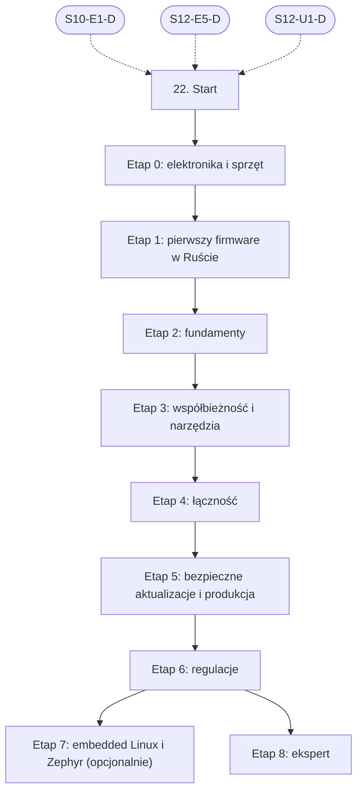

# 22. Systemy wbudowane: plan wdrożenia w Linear

Team **LEA** (https://linear.app/daankh/team/LEA/overview). Plan do przeglądu przed wdrożeniem: nic nie zostało jeszcze utworzone w Linear. Klucze zadań (np. `S22-E0-M1`) są robocze; po wdrożeniu dostaną identyfikatory `LEA-…`.

**W skrócie:** 9 kamieni milowych, 55 zadań (1 start, 41 materiałów, 9 dowodów, 4 praktyki). Plik główny z kolejnością projektów: `00-kolejnosc-i-zaleznosci.md`.

## 1. Projekt

| Pole | Wartość |
|---|---|
| Nazwa | 22. Systemy wbudowane |
| Team | LEA |
| Podsumowanie (pole „Summary”) | Warstwa 8: sprzęt. Opiera się na: 10 i 12 na poziomie E oraz 12.2 (C). |
| Proponowany start | 2029-01-08 |
| Proponowany termin | bez terminu, zależny od decyzji o skali |
| Etykiety projektu | `warstwa-8` |
| Blokowany przez (projekty) | 10. Bezpieczeństwo, 12. Rust jako wspólny fundament |
| Blokuje (projekty) | — |
| Zależności częściowe (wychodzące) | 21. Funkcje AI w aplikacjach, etap 2 |
| Czas od zera | 330–420 h |

### Opis projektu (do wklejenia w Linear)

*Warstwa 8: sprzęt. Opiera się na: 10 i 12 na poziomie E oraz 12.2 (C).*

**Zakres umiejętności**

- Rust embedded: `no_std`, `embedded-hal`, warstwy PAC i HAL, Embassy (async), RTIC, `probe-rs`, `defmt`, `heapless`.
- Architektura sprzętu: Cortex-M, RISC-V, Xtensa; pamięć, linker scripts, przerwania, DMA, zegary, tryby oszczędzania energii.
- Protokoły: GPIO, I2C, SPI, UART, CAN, USB; BLE, Wi-Fi, MQTT, CoAP.
- Bootloadery i aktualizacje OTA z podpisem (np. `embassy-boot`, MCUboot), secure boot, szyfrowanie flash, blokada portów debugowania.
- Sprzęt w praktyce: czytanie not katalogowych i schematów, oscyloskop, analizator stanów logicznych.
- Opcjonalnie embedded Linux (Yocto, Buildroot) i Zephyr, jeśli urządzenia będą większe.
- Regulacje szczególnie ważne dla urządzeń: CRA dla produktów z elementami cyfrowymi, akt delegowany dyrektywy RED (cyberbezpieczeństwo urządzeń radiowych, normy EN 18031), ETSI EN 303 645 dla IoT konsumenckiego; przy zastosowaniach bezpieczeństwa funkcjonalnego IEC 61508 lub ISO 26262 (np. kompilator Ferrocene).

**Ścieżka nauki**

Ścieżka ma 9 etapów, w tym jeden opcjonalny (embedded Linux). Każdy kończy się **dowodem**, czyli małym projektem na prawdziwym sprzęcie, który pokazuje, że etap jest opanowany. Doświadczenie seniora full-stack niewiele tu skraca: elektronika, pamięć bez systemu operacyjnego, przerwania i regulacje urządzeń to wiedza od zera, więc etapów 0–3 nie warto zaliczać samym dowodem. Skraca się tylko część o Ruście, jeśli sekcja 12 jest już opanowana. Czas podany dla osoby startującej od zera; ceny materiałów płatnych i sprzętu zmieniają się, więc warto je sprawdzić przed zakupem. Potrzebny sprzęt (płatny): micro:bit v2, płytka nRF52840 DK, płytka z ESP32-C3 lub ESP32-C6, sonda debugująca, multimetr, tani analizator stanów logicznych, płytka stykowa z zestawem elementów; oscyloskop od etapu 4.

Razem od zera do poziomu E bez etapu 7: ok. 330–420 h, czyli 7–10 miesięcy przy 10–12 h tygodniowo; z etapem 7 o 1,5–2 miesiąca dłużej.

**Definicja ukończenia projektu (dowód poziomu E)**

Samodzielnie, bez agenta, w 1 dzień diagnozujesz i naprawiasz błąd w nieznanym firmware (zawieszanie, HardFault, nadmierny pobór prądu albo błąd protokołu) z użyciem sondy, analizatora i not katalogowych, wydajesz poprawkę jako podpisaną aktualizację OTA i umiesz wyjaśnić klientowi, jak to wpływa na jego obowiązki z CRA.

**Źródło:** dokument „Umiejętności techniczne” w projekcie „JDG: Rozwój oprogramowania”, sekcja 22.

## 2. Kamienie milowe

Jeden kamień milowy na etap ścieżki. Kamień milowy jest zamknięty, gdy zamknięte jest zadanie dowodu tego etapu. Daty kamieni milowych ustawiasz przy wdrożeniu według kolejności z pliku głównego.

| # | Kamień milowy | Cel | Czas od zera | Poziom po etapie | Zadania |
|---|---|---|---|---|---|
| 1 | Etap 0: elektronika i sprzęt | elektronika i sprzęt: prąd, napięcie, elementy, schematy, pomiary | 70–90 h | podstawy | 6 |
| 2 | Etap 1: pierwszy firmware w Ruście | pierwszy firmware w Ruście na micro:bit v2 | 40–50 h | podstawy | 3 |
| 3 | Etap 2: fundamenty | fundamenty: `no_std`, pamięć, linker, przerwania, architektura firmware | 50–70 h | W | 5 |
| 4 | Etap 3: współbieżność i narzędzia | współbieżność i narzędzia: Embassy, RTIC, `probe-rs`, `defmt` | 50–60 h | W | 6 |
| 5 | Etap 4: łączność | łączność: BLE, Wi-Fi, MQTT na nRF i ESP32 | 50–60 h | W | 6 |
| 6 | Etap 5: bezpieczne aktualizacje i produkcja | bezpieczne aktualizacje i produkcja: bootloader, OTA z podpisem, secure boot | 40–50 h | E | 5 |
| 7 | Etap 6: regulacje | regulacje: CRA, RED i EN 18031, ETSI EN 303 645 | 30–40 h | W | 8 |
| 8 | Etap 7: embedded Linux i Zephyr (opcjonalnie) (opcjonalny) | opcjonalnie: embedded Linux i Zephyr | 60–80 h | W | 5 |
| 9 | Etap 8: ekspert | ekspert: diagnostyka w terenie, recenzja kodu AI, aktualność | stale, ok. 2 h tygodniowo | E | 10 |

## 3. Punkt startu

Zadanie **`S22-START` · Start: 22. Systemy wbudowane** to jedyne wejście do projektu: wszystkie zadania pierwszego etapu są przez nie blokowane.

- **Blokowane przez:** `S10-E1-D`, `S12-E5-D`, `S12-U1-D`
- **Odblokowuje:** `S22-E0-M1`, `S22-E0-M2`, `S22-E0-M3`, `S22-E0-M4`, `S22-E0-M5`
- **Status początkowy:** Backlog do czasu zamknięcia zadań blokujących, potem Todo

Opis zadania (do wklejenia):

Punkt startu projektu „22. Systemy wbudowane”.

**Warunki wejścia (zadania blokujące):**

- `S10-E1-D` · Dowód etapu 1: ataki na web i API w praktyce — sekcja 10 na poziomie podstawowym do pracy (etap 1)
- `S12-E5-D` · Dowód etapu 5: aplikacja produkcyjna — Rust na poziomie E (etap 5)
- `S12-U1-D` · Dowód (12.2): C ogólnie i FFI z Rustem — C i FFI (12.2, etap 1)

**Do zrobienia:**

- przeczytać sekcję 22 dokumentu „Umiejętności techniczne”,
- zaznaczyć etapy, które zaliczasz samym dowodem (zgodnie z akapitem wstępnym ścieżki), i dla nich zamknąć zadania materiałów jako niepotrzebne,
- ustawić daty kamieni milowych zgodnie z kolejnością z pliku głównego.

**Folder roboczy:** `22-systemy-wbudowane/`

## 4. Przepływ zależności

Linie ciągłe to zależności wewnątrz projektu, przerywane to zadania z innych projektów. Wewnątrz etapu zadania materiałów są równoległe i wszystkie blokują dowód etapu; dowód etapu blokuje materiały kolejnego etapu.

## 5. Zadania według kamieni milowych

Szablon opisu zadania materiału: nazwa materiału, autor lub wydawca, typ, czas, koszt i link (jak w kolumnach poniżej), zdanie „Gotowe, gdy materiał jest przerobiony w zakresie potrzebnym do dowodu etapu” oraz folder roboczy z kolumny „Folder”. Opisy dowodów i praktyk są podane pod tabelą każdego etapu.

### Etap 0: elektronika i sprzęt

Opis kamienia milowego (do wklejenia):

**Cel:** elektronika i sprzęt: prąd, napięcie, elementy, schematy, pomiary · **Czas od zera:** 70–90 h · **Poziom po etapie:** podstawy

**Szczególnie ważne:** prawo Ohma i dzielnik napięcia, rezystory podciągające, poziomy logiczne 3,3 V i 5 V, kondensatory odsprzęgające, tranzystor jako przełącznik, zasilanie i stabilizatory, czytanie noty katalogowej i schematu płytki rozwojowej, bezpieczna praca z zasilaczem i lutownicą.

**Dowód:** Na płytce stykowej układ z diodą LED sterowaną tranzystorem, przyciskiem z rezystorem podciągającym i czujnikiem I2C, podłączony do gotowej płytki z mikrokontrolerem; schemat narysowany w KiCad, napięcia i prądy zmierzone multimetrem i zgodne z obliczeniami, transmisja I2C przechwycona i zdekodowana w PulseView.

| Klucz | Tytuł | Typ | Czas | Koszt | Link | Blokowane przez | Blokuje | Folder |
|---|---|---|---|---|---|---|---|---|
| `S22-E0-M1` | Przerobić: Lessons in Electric Circuits: tomy Direct Current, Semiconductors, Digital Circuits | materiał | 30–40 h | 0 zł | https://www.allaboutcircuits.com/textbook/ | `S22-START` | `S22-E0-D` | `22-systemy-wbudowane/e0-elektronika-i-sprzet/` |
| `S22-E0-M2` | Przerobić: Practical Electronics for Inventors (wydanie 4) | materiał, płatny | 25–30 h (wybrane rozdziały) | płatna | https://www.mheducation.com/highered/product/practical-electronics-inventors-fourth-edition-scherz-monk/9781259587542.html | `S22-START` | `S22-E0-D` | `22-systemy-wbudowane/e0-elektronika-i-sprzet/` |
| `S22-E0-M3` | Przerobić: Getting Started in KiCad (dokumentacja KiCad 10) | materiał | 6–8 h | 0 zł | https://docs.kicad.org | `S22-START` | `S22-E0-D` | `22-systemy-wbudowane/e0-elektronika-i-sprzet/` |
| `S22-E0-M4` | Przerobić: PulseView (sigrok): analizator stanów logicznych z dekoderami protokołów | materiał | 3–4 h | 0 zł | https://sigrok.org/wiki/PulseView | `S22-START` | `S22-E0-D` | `22-systemy-wbudowane/e0-elektronika-i-sprzet/` |
| `S22-E0-M5` | Przerobić: The Art of Electronics (wydanie 3), opcjonalnie z „Learning the Art of Electronics” | materiał, płatny | wg potrzeb | płatna | https://artofelectronics.net | `S22-START` | `S22-E0-D` | `22-systemy-wbudowane/e0-elektronika-i-sprzet/` |
| `S22-E0-D` | Dowód etapu 0: elektronika i sprzęt | dowód | — | — | — | `S22-E0-M1`, `S22-E0-M2`, `S22-E0-M3`, `S22-E0-M4`, `S22-E0-M5` | `S22-E1-M1`, `S22-E1-M2` | `22-systemy-wbudowane/e0-elektronika-i-sprzet/` |

**`S22-E0-D` · Dowód etapu 0: elektronika i sprzęt**

Na płytce stykowej układ z diodą LED sterowaną tranzystorem, przyciskiem z rezystorem podciągającym i czujnikiem I2C, podłączony do gotowej płytki z mikrokontrolerem; schemat narysowany w KiCad, napięcia i prądy zmierzone multimetrem i zgodne z obliczeniami, transmisja I2C przechwycona i zdekodowana w PulseView.

**Na co zwrócić uwagę:** prawo Ohma i dzielnik napięcia, rezystory podciągające, poziomy logiczne 3,3 V i 5 V, kondensatory odsprzęgające, tranzystor jako przełącznik, zasilanie i stabilizatory, czytanie noty katalogowej i schematu płytki rozwojowej, bezpieczna praca z zasilaczem i lutownicą.

**Kryterium ukończenia:** dowód wykonany samodzielnie; w komentarzu link do repozytorium, raportu lub notatki.

**Folder roboczy:** `22-systemy-wbudowane/e0-elektronika-i-sprzet/`

### Etap 1: pierwszy firmware w Ruście

Opis kamienia milowego (do wklejenia):

**Cel:** pierwszy firmware w Ruście na micro:bit v2 · **Czas od zera:** 40–50 h · **Poziom po etapie:** podstawy

Podstawy samego Rusta są w sekcji 12. Starsza wersja Discovery (`docs.rust-embedded.org/discovery/microbit/`) jest zastąpiona wydaniem dla micro:bit v2.

**Dowód:** Gra lub instrument na micro:bit v2 (matryca LED, przyciski, akcelerometr przez I2C), zbudowany i wgrany z `probe-rs`, z logami przez RTT; umiesz wskazać na schemacie płytki każdy użyty pin.

| Klucz | Tytuł | Typ | Czas | Koszt | Link | Blokowane przez | Blokuje | Folder |
|---|---|---|---|---|---|---|---|---|
| `S22-E1-M1` | Przerobić: micro:bit v2 Embedded Discovery Book | materiał | 25–30 h | 0 zł | https://docs.rust-embedded.org/discovery-mb2/ | `S22-E0-D` | `S22-E1-D` | `22-systemy-wbudowane/e1-pierwszy-firmware-w-ruscie/` |
| `S22-E1-M2` | Przerobić: Bare Metal Rust (część kursu Comprehensive Rust) | materiał | 8–10 h | 0 zł | https://google.github.io/comprehensive-rust/bare-metal.html | `S22-E0-D` | `S22-E1-D` | `22-systemy-wbudowane/e1-pierwszy-firmware-w-ruscie/` |
| `S22-E1-D` | Dowód etapu 1: pierwszy firmware w Ruście | dowód | — | — | — | `S22-E1-M1`, `S22-E1-M2` | `S22-E2-M1`, `S22-E2-M2`, `S22-E2-M3`, `S22-E2-M4` | `22-systemy-wbudowane/e1-pierwszy-firmware-w-ruscie/` |

**`S22-E1-D` · Dowód etapu 1: pierwszy firmware w Ruście**

Gra lub instrument na micro:bit v2 (matryca LED, przyciski, akcelerometr przez I2C), zbudowany i wgrany z `probe-rs`, z logami przez RTT; umiesz wskazać na schemacie płytki każdy użyty pin.

**Kryterium ukończenia:** dowód wykonany samodzielnie; w komentarzu link do repozytorium, raportu lub notatki.

**Folder roboczy:** `22-systemy-wbudowane/e1-pierwszy-firmware-w-ruscie/`

### Etap 2: fundamenty

Opis kamienia milowego (do wklejenia):

**Cel:** fundamenty: `no_std`, pamięć, linker, przerwania, architektura firmware · **Czas od zera:** 50–70 h · **Poziom po etapie:** W

**Szczególnie ważne:** warstwy PAC, HAL i BSP, cechy `embedded-hal` 1.0 jako granica sterownika, mapa pamięci i sekcje linkera, tablica wektorów przerwań, sekcje krytyczne, `static` i współdzielenie stanu z przerwaniem, DMA i jego zasady własności bufora, budżet RAM i flash (`cargo size`, `cargo bloat`), zachowanie po panice.

**Dowód:** Sterownik czujnika I2C napisany wyłącznie na cechach `embedded-hal` 1.0, działający bez zmian na micro:bit i nRF52840 DK, z testami na hoście (zob. sekcja 6); notatka z mapą pamięci programu i uzasadnieniem każdego bloku `unsafe`.

| Klucz | Tytuł | Typ | Czas | Koszt | Link | Blokowane przez | Blokuje | Folder |
|---|---|---|---|---|---|---|---|---|
| `S22-E2-M1` | Przerobić: The Embedded Rust Book | materiał | 12–15 h | 0 zł | https://docs.rust-embedded.org/book/ | `S22-E1-D` | `S22-E2-D` | `22-systemy-wbudowane/e2-fundamenty/` |
| `S22-E2-M2` | Przerobić: The Embedonomicon | materiał | 10–12 h | 0 zł | https://docs.rust-embedded.org/embedonomicon/ | `S22-E1-D` | `S22-E2-D` | `22-systemy-wbudowane/e2-fundamenty/` |
| `S22-E2-M3` | Przerobić: Making Embedded Systems (wydanie 2, 2024) | materiał, płatny | 15–20 h | płatna | https://www.oreilly.com/library/view/-/9781098151539/ | `S22-E1-D` | `S22-E2-D` | `22-systemy-wbudowane/e2-fundamenty/` |
| `S22-E2-M4` | Przerobić: Ogłoszenie `embedded-hal` 1.0 | materiał | 1 h | 0 zł | https://blog.rust-embedded.org/embedded-hal-v1/ | `S22-E1-D` | `S22-E2-D` | `22-systemy-wbudowane/e2-fundamenty/` |
| `S22-E2-D` | Dowód etapu 2: fundamenty | dowód | — | — | — | `S22-E2-M1`, `S22-E2-M2`, `S22-E2-M3`, `S22-E2-M4` | `S21-E2-M1`, `S21-E2-M2`, `S21-E2-M3`, `S21-E2-M4`, `S22-E3-M1`, `S22-E3-M2`, `S22-E3-M3`, `S22-E3-M4`, `S22-E3-M5` | `22-systemy-wbudowane/e2-fundamenty/` |

**`S22-E2-D` · Dowód etapu 2: fundamenty**

Sterownik czujnika I2C napisany wyłącznie na cechach `embedded-hal` 1.0, działający bez zmian na micro:bit i nRF52840 DK, z testami na hoście (zob. sekcja 6); notatka z mapą pamięci programu i uzasadnieniem każdego bloku `unsafe`.

**Na co zwrócić uwagę:** warstwy PAC, HAL i BSP, cechy `embedded-hal` 1.0 jako granica sterownika, mapa pamięci i sekcje linkera, tablica wektorów przerwań, sekcje krytyczne, `static` i współdzielenie stanu z przerwaniem, DMA i jego zasady własności bufora, budżet RAM i flash (`cargo size`, `cargo bloat`), zachowanie po panice.

**Kryterium ukończenia:** dowód wykonany samodzielnie; w komentarzu link do repozytorium, raportu lub notatki.

**Folder roboczy:** `22-systemy-wbudowane/e2-fundamenty/`

### Etap 3: współbieżność i narzędzia

Opis kamienia milowego (do wklejenia):

**Cel:** współbieżność i narzędzia: Embassy, RTIC, `probe-rs`, `defmt` · **Czas od zera:** 50–60 h · **Poziom po etapie:** W

**Szczególnie ważne:** kiedy Embassy (async, wiele zadań, sterowniki async), a kiedy RTIC (twarde priorytety, analiza czasu); blokowanie executora i zagłodzenie zadań, priorytety przerwań, tryby uśpienia i pomiar poboru prądu, krokowe debugowanie i odczyt rejestrów, czytanie HardFault.

**Dowód:** Na nRF52840 DK firmware w Embassy z co najmniej trzema zadaniami (czujnik, przycisk z eliminacją drgań, komunikacja USB lub radio), logi przez `defmt`; zmierzony pobór prądu w uśpieniu i porównany z notą katalogową; ten sam fragment przepisany w RTIC z krótkim porównaniem.

| Klucz | Tytuł | Typ | Czas | Koszt | Link | Blokowane przez | Blokuje | Folder |
|---|---|---|---|---|---|---|---|---|
| `S22-E3-M1` | Przerobić: The Embassy Book | materiał | 10–12 h | 0 zł | https://embassy.dev/book/ | `S22-E2-D` | `S22-E3-D` | `22-systemy-wbudowane/e3-wspolbieznosc-i-narzedzia/` |
| `S22-E3-M2` | Przerobić: RTIC Book (v2) | materiał | 6–8 h | 0 zł | https://rtic.rs/2/book/en/ | `S22-E2-D` | `S22-E3-D` | `22-systemy-wbudowane/e3-wspolbieznosc-i-narzedzia/` |
| `S22-E3-M3` | Przerobić: probe-rs: dokumentacja | materiał | 3–4 h | 0 zł | https://probe.rs/docs/ | `S22-E2-D` | `S22-E3-D` | `22-systemy-wbudowane/e3-wspolbieznosc-i-narzedzia/` |
| `S22-E3-M4` | Przerobić: defmt book | materiał | 2–3 h | 0 zł | https://defmt.ferrous-systems.com | `S22-E2-D` | `S22-E3-D` | `22-systemy-wbudowane/e3-wspolbieznosc-i-narzedzia/` |
| `S22-E3-M5` | Przerobić: Rust Exercises: ćwiczenia nRF52 (BSP, radio, USB) | materiał | 15–20 h | 0 zł | https://rust-exercises.ferrous-systems.com/latest/book/ | `S22-E2-D` | `S22-E3-D` | `22-systemy-wbudowane/e3-wspolbieznosc-i-narzedzia/` |
| `S22-E3-D` | Dowód etapu 3: współbieżność i narzędzia | dowód | — | — | — | `S22-E3-M1`, `S22-E3-M2`, `S22-E3-M3`, `S22-E3-M4`, `S22-E3-M5` | `S22-E4-M1`, `S22-E4-M2`, `S22-E4-M3`, `S22-E4-M4`, `S22-E4-M5` | `22-systemy-wbudowane/e3-wspolbieznosc-i-narzedzia/` |

**`S22-E3-D` · Dowód etapu 3: współbieżność i narzędzia**

Na nRF52840 DK firmware w Embassy z co najmniej trzema zadaniami (czujnik, przycisk z eliminacją drgań, komunikacja USB lub radio), logi przez `defmt`; zmierzony pobór prądu w uśpieniu i porównany z notą katalogową; ten sam fragment przepisany w RTIC z krótkim porównaniem.

**Na co zwrócić uwagę:** kiedy Embassy (async, wiele zadań, sterowniki async), a kiedy RTIC (twarde priorytety, analiza czasu); blokowanie executora i zagłodzenie zadań, priorytety przerwań, tryby uśpienia i pomiar poboru prądu, krokowe debugowanie i odczyt rejestrów, czytanie HardFault.

**Kryterium ukończenia:** dowód wykonany samodzielnie; w komentarzu link do repozytorium, raportu lub notatki.

**Folder roboczy:** `22-systemy-wbudowane/e3-wspolbieznosc-i-narzedzia/`

### Etap 4: łączność

Opis kamienia milowego (do wklejenia):

**Cel:** łączność: BLE, Wi-Fi, MQTT na nRF i ESP32 · **Czas od zera:** 50–60 h · **Poziom po etapie:** W

Uwaga do ESP32: esp-hal 1.0 (30 października 2025 r.) stabilizuje tylko inicjalizację, GPIO, UART, SPI, I2C, moduł czasu i konfigurację; reszta, w tym obsługa radia, jest za flagą `unstable`, więc API może się zmieniać między wersjami. Warsztat `no_std-training` jest oznaczony jako nieaktualny i przepisywany, dlatego przykłady trzeba porównywać z bieżącą dokumentacją. Kurs BLE od Nordic uczy protokołu (GAP, GATT, parowanie, oszczędzanie energii), a nie Rusta; w Ruście ten sam zakres realizuje stos BLE na Embassy.

**Dowód:** Na ESP32-C3 lub ESP32-C6 czujnik wysyłający dane przez Wi-Fi do brokera MQTT z TLS i ponawianiem po utracie sieci, plus konfiguracja przez BLE z telefonu; zapis z analizatora lub oscyloskopu pokazujący zachowanie zasilania przy nadawaniu.

| Klucz | Tytuł | Typ | Czas | Koszt | Link | Blokowane przez | Blokuje | Folder |
|---|---|---|---|---|---|---|---|---|
| `S22-E4-M1` | Przerobić: The Rust on ESP Book | materiał | 8–10 h | 0 zł | https://docs.espressif.com/projects/rust/book/ | `S22-E3-D` | `S22-E4-D` | `22-systemy-wbudowane/e4-lacznosc/` |
| `S22-E4-M2` | Przerobić: Ogłoszenie esp-hal 1.0 i dokumentacja API | materiał | 2–3 h | 0 zł | https://developer.espressif.com/blog/2025/10/esp-hal-1/, https://docs.espressif.com/projects/rust/ | `S22-E3-D` | `S22-E4-D` | `22-systemy-wbudowane/e4-lacznosc/` |
| `S22-E4-M3` | Przerobić: Embedded Rust (no_std) on Espressif | materiał | 6–8 h | 0 zł | https://docs.espressif.com/projects/rust/no_std-training/ | `S22-E3-D` | `S22-E4-D` | `22-systemy-wbudowane/e4-lacznosc/` |
| `S22-E4-M4` | Przerobić: Bluetooth Low Energy Fundamentals | materiał | 15–20 h | 0 zł | https://academy.nordicsemi.com | `S22-E3-D` | `S22-E4-D` | `22-systemy-wbudowane/e4-lacznosc/` |
| `S22-E4-M5` | Przerobić: Interrupt | materiał | 5–8 h (wybrane artykuły) | 0 zł | https://interrupt.memfault.com | `S22-E3-D` | `S22-E4-D` | `22-systemy-wbudowane/e4-lacznosc/` |
| `S22-E4-D` | Dowód etapu 4: łączność | dowód | — | — | — | `S22-E4-M1`, `S22-E4-M2`, `S22-E4-M3`, `S22-E4-M4`, `S22-E4-M5` | `S22-E5-M1`, `S22-E5-M2`, `S22-E5-M3`, `S22-E5-M4` | `22-systemy-wbudowane/e4-lacznosc/` |

**`S22-E4-D` · Dowód etapu 4: łączność**

Na ESP32-C3 lub ESP32-C6 czujnik wysyłający dane przez Wi-Fi do brokera MQTT z TLS i ponawianiem po utracie sieci, plus konfiguracja przez BLE z telefonu; zapis z analizatora lub oscyloskopu pokazujący zachowanie zasilania przy nadawaniu.

**Kryterium ukończenia:** dowód wykonany samodzielnie; w komentarzu link do repozytorium, raportu lub notatki.

**Folder roboczy:** `22-systemy-wbudowane/e4-lacznosc/`

### Etap 5: bezpieczne aktualizacje i produkcja

Opis kamienia milowego (do wklejenia):

**Cel:** bezpieczne aktualizacje i produkcja: bootloader, OTA z podpisem, secure boot · **Czas od zera:** 40–50 h · **Poziom po etapie:** E

**Szczególnie ważne:** układ partycji i odporność na zanik zasilania w trakcie aktualizacji, przechowywanie klucza prywatnego poza repozytorium i CI bez dostępu agenta, ochrona przed cofnięciem do podatnej wersji, blokada portów debugowania w produkcji, numer seryjny i identyfikacja wersji w terenie, SBOM firmware (zob. sekcja 10).

**Dowód:** Urządzenie z etapu 4 z aktualizacją OTA podpisaną kluczem z bezpiecznego magazynu: niepodpisany lub zmodyfikowany obraz zostaje odrzucony, przerwanie zasilania w trakcie aktualizacji nie psuje urządzenia, nieudany rozruch nowej wersji wraca do poprzedniej, starsza wersja nie daje się wgrać; port debugowania zablokowany, SBOM w CycloneDX dołączany do każdego wydania.

| Klucz | Tytuł | Typ | Czas | Koszt | Link | Blokowane przez | Blokuje | Folder |
|---|---|---|---|---|---|---|---|---|
| `S22-E5-M1` | Przerobić: Embassy Book: rozdział o bootloaderze | materiał | 3–4 h | 0 zł | https://embassy.dev/book/dev/bootloader.html | `S22-E4-D` | `S22-E5-D` | `22-systemy-wbudowane/e5-bezpieczne-aktualizacje-i-produkcja/` |
| `S22-E5-M2` | Przerobić: MCUboot: projekt, `imgtool` (podpis obrazów, zarządzanie kluczami) | materiał | 6–8 h | 0 zł | https://docs.mcuboot.com | `S22-E4-D` | `S22-E5-D` | `22-systemy-wbudowane/e5-bezpieczne-aktualizacje-i-produkcja/` |
| `S22-E5-M3` | Przerobić: Interrupt: artykuły o aktualizacjach firmware, bootloaderach i analizie awarii | materiał | 6–8 h | 0 zł | https://interrupt.memfault.com | `S22-E4-D` | `S22-E5-D` | `22-systemy-wbudowane/e5-bezpieczne-aktualizacje-i-produkcja/` |
| `S22-E5-M4` | Przerobić: Noty producentów o secure boot, szyfrowaniu flash i blokadzie debugowania | materiał | 6–8 h | 0 zł | dokumentacja wybranego układu | `S22-E4-D` | `S22-E5-D` | `22-systemy-wbudowane/e5-bezpieczne-aktualizacje-i-produkcja/` |
| `S22-E5-D` | Dowód etapu 5: bezpieczne aktualizacje i produkcja | dowód | — | — | — | `S22-E5-M1`, `S22-E5-M2`, `S22-E5-M3`, `S22-E5-M4` | `S22-E6-M1`, `S22-E6-M2`, `S22-E6-M3`, `S22-E6-M4`, `S22-E6-M5`, `S22-E6-M6`, `S22-E6-M7` | `22-systemy-wbudowane/e5-bezpieczne-aktualizacje-i-produkcja/` |

**`S22-E5-D` · Dowód etapu 5: bezpieczne aktualizacje i produkcja**

Urządzenie z etapu 4 z aktualizacją OTA podpisaną kluczem z bezpiecznego magazynu: niepodpisany lub zmodyfikowany obraz zostaje odrzucony, przerwanie zasilania w trakcie aktualizacji nie psuje urządzenia, nieudany rozruch nowej wersji wraca do poprzedniej, starsza wersja nie daje się wgrać; port debugowania zablokowany, SBOM w CycloneDX dołączany do każdego wydania.

**Na co zwrócić uwagę:** układ partycji i odporność na zanik zasilania w trakcie aktualizacji, przechowywanie klucza prywatnego poza repozytorium i CI bez dostępu agenta, ochrona przed cofnięciem do podatnej wersji, blokada portów debugowania w produkcji, numer seryjny i identyfikacja wersji w terenie, SBOM firmware (zob. sekcja 10).

**Kryterium ukończenia:** dowód wykonany samodzielnie; w komentarzu link do repozytorium, raportu lub notatki.

**Folder roboczy:** `22-systemy-wbudowane/e5-bezpieczne-aktualizacje-i-produkcja/`

### Etap 6: regulacje

Opis kamienia milowego (do wklejenia):

**Cel:** regulacje: CRA, RED i EN 18031, ETSI EN 303 645 · **Czas od zera:** 30–40 h · **Poziom po etapie:** W

Kalendarz na dzień 11 października 2026 r.: wymogi cyberbezpieczeństwa RED obowiązują od 1 sierpnia 2025 r.; obowiązki CRA dotyczące zgłaszania aktywnie wykorzystywanych podatności i poważnych incydentów obowiązują od 11 września 2026 r., także dla produktów już na rynku; pełne stosowanie CRA (wymagania zasadnicze, ocena zgodności, oznakowanie CE) od 11 grudnia 2027 r. Komisja zaproponowała uchylenie rozporządzenia 2022/30 z tym samym dniem, tak aby urządzenia radiowe przeszły pod CRA; przed planowaniem zgodności trzeba sprawdzić, czy akt uchylający został przyjęty. Normy EN 18031 dają domniemanie zgodności tylko poza wskazanymi w decyzji 2025/138 ograniczeniami (m.in. dopuszczenie braku hasła, kontrola rodzicielska, płatności).

**Dowód:** Teczka zgodności dla urządzenia z etapu 5: zakres (czy RED, czy CRA, czy oba), ocena ryzyka, mapowanie wymagań EN 18031-1 na rozwiązania w firmware (aktualizacje, uwierzytelnianie, ochrona danych, porty debugowania), deklarowany okres wsparcia, polityka ujawniania podatności z kontaktem i procedurą zgłoszeń w terminach CRA, SBOM i instrukcja bezpiecznej konfiguracji dla użytkownika.

| Klucz | Tytuł | Typ | Czas | Koszt | Link | Blokowane przez | Blokuje | Folder |
|---|---|---|---|---|---|---|---|---|
| `S22-E6-M1` | Przerobić: Rozporządzenie (UE) 2024/2847 (Cyber Resilience Act) | materiał | 8–10 h | 0 zł | https://eur-lex.europa.eu/eli/reg/2024/2847/oj | `S22-E5-D` | `S22-E6-D` | `22-systemy-wbudowane/e6-regulacje/` |
| `S22-E6-M2` | Przerobić: Rozporządzenie delegowane (UE) 2022/30 do dyrektywy RED i zmieniające je rozporządzenie (UE)… | materiał | 2–3 h | 0 zł | https://eur-lex.europa.eu/eli/reg_del/2022/30/oj, https://eur-lex.europa.eu/eli/reg_del/2023/2444/oj | `S22-E5-D` | `S22-E6-D` | `22-systemy-wbudowane/e6-regulacje/` |
| `S22-E6-M3` | Przerobić: Decyzja wykonawcza (UE) 2025/138: normy zharmonizowane EN 18031-1, -2, -3 z ograniczeniami | materiał | 1–2 h | 0 zł | https://eur-lex.europa.eu/eli/dec_impl/2025/138/oj/eng | `S22-E5-D` | `S22-E6-D` | `22-systemy-wbudowane/e6-regulacje/` |
| `S22-E6-M4` | Przerobić: EN 18031-1, -2, -3 | materiał, płatny | 10–12 h | płatne | sklep PKN lub krajowej jednostki normalizacyjnej | `S22-E5-D` | `S22-E6-D` | `22-systemy-wbudowane/e6-regulacje/` |
| `S22-E6-M5` | Przerobić: ETSI EN 303 645 V3.1.3 (2024): cyberbezpieczeństwo IoT konsumenckiego | materiał | 4–6 h | 0 zł | https://www.etsi.org/deliver/etsi_en/303600_303699/303645/03.01.03_60/en_303645v030103p.pdf | `S22-E5-D` | `S22-E6-D` | `22-systemy-wbudowane/e6-regulacje/` |
| `S22-E6-M6` | Przerobić: IEC 62443-4-1 i 4-2 (opcjonalnie, urządzenia przemysłowe) | materiał, płatny | wg potrzeb | płatne | https://www.isa.org/standards-and-publications/isa-standards/isa-iec-62443-series-of-standards | `S22-E5-D` | `S22-E6-D` | `22-systemy-wbudowane/e6-regulacje/` |
| `S22-E6-M7` | Przerobić: Ferrocene | materiał, płatny | 2–3 h | 0 zł (wsparcie płatne) | https://ferrocene.dev, https://public-docs.ferrocene.dev/main/index.html | `S22-E5-D` | `S22-E6-D` | `22-systemy-wbudowane/e6-regulacje/` |
| `S22-E6-D` | Dowód etapu 6: regulacje | dowód | — | — | — | `S22-E6-M1`, `S22-E6-M2`, `S22-E6-M3`, `S22-E6-M4`, `S22-E6-M5`, `S22-E6-M6`, `S22-E6-M7` | `S22-E7-M1`, `S22-E7-M2`, `S22-E7-M3`, `S22-E7-M4`, `S22-E8-M1`, `S22-E8-M2`, `S22-E8-M3`, `S22-E8-M4`, `S22-E8-M5`, `S22-E8-P1`, `S22-E8-P2`, `S22-E8-P3`, `S22-E8-P4` | `22-systemy-wbudowane/e6-regulacje/` |

**`S22-E6-D` · Dowód etapu 6: regulacje**

Teczka zgodności dla urządzenia z etapu 5: zakres (czy RED, czy CRA, czy oba), ocena ryzyka, mapowanie wymagań EN 18031-1 na rozwiązania w firmware (aktualizacje, uwierzytelnianie, ochrona danych, porty debugowania), deklarowany okres wsparcia, polityka ujawniania podatności z kontaktem i procedurą zgłoszeń w terminach CRA, SBOM i instrukcja bezpiecznej konfiguracji dla użytkownika.

**Kryterium ukończenia:** dowód wykonany samodzielnie; w komentarzu link do repozytorium, raportu lub notatki.

**Folder roboczy:** `22-systemy-wbudowane/e6-regulacje/`

### Etap 7: embedded Linux i Zephyr (opcjonalnie) (opcjonalny)

Opis kamienia milowego (do wklejenia):

**Cel:** opcjonalnie: embedded Linux i Zephyr · **Czas od zera:** 60–80 h · **Poziom po etapie:** W

**Etap opcjonalny.** Nie blokuje dalszej części ścieżki.

Etap ma sens dopiero wtedy, gdy klient lub produkt wymaga procesora aplikacyjnego z Linuksem albo certyfikowanego stosu radiowego dostępnego tylko w Zephyrze. Kod w C czyta się tu na poziomie W (zob. sekcja 16.2).

**Dowód:** Obraz Yocto lub Buildroot dla płytki z materiałów Bootlin z własną aplikacją w Ruście jako usługą systemd, aktualizacją obrazu w schemacie A/B i SBOM; albo aplikacja Zephyr z MCUboot na nRF52840 DK.

| Klucz | Tytuł | Typ | Czas | Koszt | Link | Blokowane przez | Blokuje | Folder |
|---|---|---|---|---|---|---|---|---|
| `S22-E7-M1` | Przerobić: Szkolenia: Embedded Linux, Yocto Project i OpenEmbedded, Buildroot | materiał | 30–40 h | 0 zł | https://bootlin.com/docs/ | `S22-E6-D` | `S22-E7-D` | `22-systemy-wbudowane/e7-embedded-linux-i-zephyr-opcjonalnie/` |
| `S22-E7-M2` | Przerobić: Yocto Project Documentation (Quick Build, Overview and Concepts) | materiał | 10–15 h | 0 zł | https://docs.yoctoproject.org | `S22-E6-D` | `S22-E7-D` | `22-systemy-wbudowane/e7-embedded-linux-i-zephyr-opcjonalnie/` |
| `S22-E7-M3` | Przerobić: Zephyr Project Documentation | materiał | 10–15 h | 0 zł | https://docs.zephyrproject.org/latest/ | `S22-E6-D` | `S22-E7-D` | `22-systemy-wbudowane/e7-embedded-linux-i-zephyr-opcjonalnie/` |
| `S22-E7-M4` | Przerobić: nRF Connect SDK Fundamentals | materiał | 15–20 h | 0 zł | https://academy.nordicsemi.com | `S22-E6-D` | `S22-E7-D` | `22-systemy-wbudowane/e7-embedded-linux-i-zephyr-opcjonalnie/` |
| `S22-E7-D` | Dowód etapu 7: embedded Linux i Zephyr (opcjonalnie) | dowód | — | — | — | `S22-E7-M1`, `S22-E7-M2`, `S22-E7-M3`, `S22-E7-M4` | — | `22-systemy-wbudowane/e7-embedded-linux-i-zephyr-opcjonalnie/` |

**`S22-E7-D` · Dowód etapu 7: embedded Linux i Zephyr (opcjonalnie)**

Obraz Yocto lub Buildroot dla płytki z materiałów Bootlin z własną aplikacją w Ruście jako usługą systemd, aktualizacją obrazu w schemacie A/B i SBOM; albo aplikacja Zephyr z MCUboot na nRF52840 DK.

**Kryterium ukończenia:** dowód wykonany samodzielnie; w komentarzu link do repozytorium, raportu lub notatki.

**Folder roboczy:** `22-systemy-wbudowane/e7-embedded-linux-i-zephyr-opcjonalnie/`

### Etap 8: ekspert

Opis kamienia milowego (do wklejenia):

**Cel:** ekspert: diagnostyka w terenie, recenzja kodu AI, aktualność · **Czas od zera:** stale, ok. 2 h tygodniowo · **Poziom po etapie:** E

**Dowód poziomu E:** Samodzielnie, bez agenta, w 1 dzień diagnozujesz i naprawiasz błąd w nieznanym firmware (zawieszanie, HardFault, nadmierny pobór prądu albo błąd protokołu) z użyciem sondy, analizatora i not katalogowych, wydajesz poprawkę jako podpisaną aktualizację OTA i umiesz wyjaśnić klientowi, jak to wpływa na jego obowiązki z CRA.

| Klucz | Tytuł | Typ | Czas | Koszt | Link | Blokowane przez | Blokuje | Folder |
|---|---|---|---|---|---|---|---|---|
| `S22-E8-M1` | Przerobić: Blog i newsletter Rust Embedded Working Group, lista awesome-embedded-rust | materiał | ok. 1 h tygodniowo | 0 zł | https://blog.rust-embedded.org, https://github.com/rust-embedded/awesome-embedded-rust | `S22-E6-D` | `S22-E8-D` | `22-systemy-wbudowane/e8-ekspert/` |
| `S22-E8-M2` | Przerobić: Blog Embassy i informacje o wydaniach esp-hal | materiał | wg potrzeb | 0 zł | https://embassy.dev/blog/, https://developer.espressif.com/blog/ | `S22-E6-D` | `S22-E8-D` | `22-systemy-wbudowane/e8-ekspert/` |
| `S22-E8-M3` | Przerobić: Interrupt (wszystkie nowe artykuły i podsumowania lektur) | materiał | ok. 1 h tygodniowo | 0 zł | https://interrupt.memfault.com | `S22-E6-D` | `S22-E8-D` | `22-systemy-wbudowane/e8-ekspert/` |
| `S22-E8-M4` | Przerobić: Materiały szkoleniowe Ferrous Systems (pełny zestaw ćwiczeń) | materiał | wg potrzeb | 0 zł | https://rust-exercises.ferrous-systems.com/latest/book/ | `S22-E6-D` | `S22-E8-D` | `22-systemy-wbudowane/e8-ekspert/` |
| `S22-E8-M5` | Przerobić: Errata i noty aplikacyjne używanych układów | materiał | wg potrzeb | 0 zł | dokumentacja wybranego układu | `S22-E6-D` | `S22-E8-D` | `22-systemy-wbudowane/e8-ekspert/` |
| `S22-E8-P1` | Praktyka: recenzja kodu AI | praktyka | — | — | — | `S22-E6-D` | `S22-E8-D` | `22-systemy-wbudowane/e8-ekspert/` |
| `S22-E8-P2` | Praktyka: testy na prawdziwym sprzęcie | praktyka | — | — | — | `S22-E6-D` | `S22-E8-D` | `22-systemy-wbudowane/e8-ekspert/` |
| `S22-E8-P3` | Praktyka: diagnostyka w terenie | praktyka | — | — | — | `S22-E6-D` | `S22-E8-D` | `22-systemy-wbudowane/e8-ekspert/` |
| `S22-E8-P4` | Praktyka: śledzenie regulacji | praktyka | — | — | — | `S22-E6-D` | `S22-E8-D` | `22-systemy-wbudowane/e8-ekspert/` |
| `S22-E8-D` | Dowód poziomu E: ekspert | dowód | — | — | — | `S22-E8-M1`, `S22-E8-M2`, `S22-E8-M3`, `S22-E8-M4`, `S22-E8-M5`, `S22-E8-P1`, `S22-E8-P2`, `S22-E8-P3`, `S22-E8-P4` | — | `22-systemy-wbudowane/e8-ekspert/` |

**`S22-E8-P1` · Praktyka: recenzja kodu AI**

20 pull requestów firmware wygenerowanych przez agentów, recenzowanych według listy kontrolnej z etapów 2–5: `unsafe` i `static mut` bez uzasadnienia, blokujące pętle w zadaniach async, błędne priorytety przerwań, rejestry i piny niezgodne z notą katalogową lub schematem (agent często wymyśla adresy i nazwy pól), brak obsługi zaniku zasilania, sekrety w obrazie, wyłączona weryfikacja podpisu.

Praktyka ciągła etapu eksperckiego: oznacz jako gotową, gdy działa jako stały element pracy, a nie po jednorazowym wykonaniu.

**Folder roboczy:** `22-systemy-wbudowane/e8-ekspert/`

**`S22-E8-P2` · Praktyka: testy na prawdziwym sprzęcie**

Stanowisko hardware-in-the-loop w CI dla jednego urządzenia (zob. sekcja 6).

Praktyka ciągła etapu eksperckiego: oznacz jako gotową, gdy działa jako stały element pracy, a nie po jednorazowym wykonaniu.

**Folder roboczy:** `22-systemy-wbudowane/e8-ekspert/`

**`S22-E8-P3` · Praktyka: diagnostyka w terenie**

Zbieranie zrzutów awarii i metryk z urządzeń oraz ćwiczenie wydania poprawki bezpieczeństwa przez OTA w 24 h.

Praktyka ciągła etapu eksperckiego: oznacz jako gotową, gdy działa jako stały element pracy, a nie po jednorazowym wykonaniu.

**Folder roboczy:** `22-systemy-wbudowane/e8-ekspert/`

**`S22-E8-P4` · Praktyka: śledzenie regulacji**

Status uchylenia rozporządzenia 2022/30, normy zharmonizowane do CRA i wytyczne Komisji.

Praktyka ciągła etapu eksperckiego: oznacz jako gotową, gdy działa jako stały element pracy, a nie po jednorazowym wykonaniu.

**Folder roboczy:** `22-systemy-wbudowane/e8-ekspert/`

**`S22-E8-D` · Dowód poziomu E: ekspert**

Samodzielnie, bez agenta, w 1 dzień diagnozujesz i naprawiasz błąd w nieznanym firmware (zawieszanie, HardFault, nadmierny pobór prądu albo błąd protokołu) z użyciem sondy, analizatora i not katalogowych, wydajesz poprawkę jako podpisaną aktualizację OTA i umiesz wyjaśnić klientowi, jak to wpływa na jego obowiązki z CRA.

**Kryterium ukończenia:** dowód wykonany samodzielnie; w komentarzu link do repozytorium, raportu lub notatki. Bez agenta AI.

**Folder roboczy:** `22-systemy-wbudowane/e8-ekspert/`

## 6. Relacje z innymi projektami

**Wchodzące** (zadanie z innego projektu blokuje zadanie tego projektu):

- `S10-E1-D` (Dowód etapu 1: ataki na web i API w praktyce) → `S22-START`
- `S12-E5-D` (Dowód etapu 5: aplikacja produkcyjna) → `S22-START`
- `S12-U1-D` (Dowód (12.2): C ogólnie i FFI z Rustem) → `S22-START`

**Wychodzące** (zadanie tego projektu blokuje zadanie w innym projekcie):

- `S22-E2-D` → `S21-E2-M1` (21. Funkcje AI w aplikacjach)
- `S22-E2-D` → `S21-E2-M2` (21. Funkcje AI w aplikacjach)
- `S22-E2-D` → `S21-E2-M3` (21. Funkcje AI w aplikacjach)
- `S22-E2-D` → `S21-E2-M4` (21. Funkcje AI w aplikacjach)
